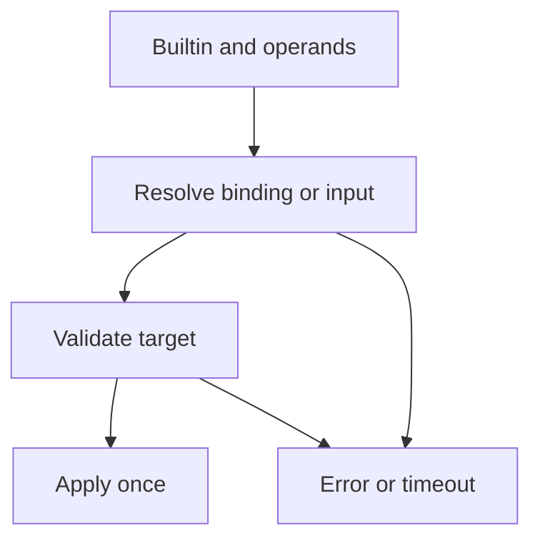

# Builtins preserve shell state and consume input according to Bash

Draft implementation contract from the November 22, 2026 review of `cbda2721`.

## The outcome wanted

Assignments update the intended binding once, input probes preserve the stream, and jobs and loop control belong to the shell that owns them.

## Builds on

Own machine/{builtins,vars,printf,arith,test,quote,expand}.rs for the rules below. “Redirections and pipelines” supplies descriptor reads and ownership; “Runtime termination” supplies the whole-line clock; “Parsing and live memory” owns capacity accounting. Preserve shipped shell settings and the pinned Bash 5.3 behavior wherever a row below refers to Bash.

These contracts are implementation prerequisites. [Redirections and pipelines propagate data, closure and failures in order](../2026-11-22-shell-descriptors/spec.md), [The parser and interpreter account for depth and live storage](../2026-11-22-shell-parsing-and-memory/spec.md), [File reads and metadata remain bounded and caller-authorized](../2026-11-22-shell-file-reads-and-metadata/spec.md).

## Design

## The problem

- Its loop omits the accounting used by other loops. A top-level break can fail to exit the body, allowing subsequent statements to run.
- The hub knows PIDs across forks even when the current shell has no such child. A subshell can wait for or observe the status of unrelated work in the same line.
- An indexed update can evaluate its subscript twice, valid negative indices can be written literally, and unindexed arithmetic on an associative map can replace the map with a scalar.

## Decisions

### 1. Resolve a mutation target once to a binding/scope, array kind and canonical element key.

Evaluate an indexed arithmetic subscript once for read-modify-write, resolve a negative index against highest assigned index plus one, and reject indices still negative. Associative keys are literal strings, including @ and * in an element unset; for indexed whole-element unset follow the pinned Bash version while preserving declared array attributes. An unindexed associative update targets its zero key. Preserve all other entries. Invalid arithmetic or readonly assignment returns the relevant builtin’s nonzero Bash status and diagnostic, with no mutation at index zero. Apply nameref resolution and readonly/type checks to read -a, mapfile, printf -v, declarations and unset as appropriate before changing the target. Stage partial updates until each builtin’s ordinary assignment point. Do not undo documented arithmetic side effects of evaluating a valid subscript.

### 2. For indirect default assignment retain the resolved assignable parameter and update it, preserving the reference variable.

Enforce the same binding checks on an indirect target as on a direct one. localvar_unset preserves a hidden local binding in the owning scope when enabled; lookup from descendants sees its unset state until that scope returns. When disabled use the recorded Bash shadow behavior. Keep escaped-field positions separate from data so private-use characters remain literal; linear scans of input and sorted escape positions suffice.

### 3. read -n 0 succeeds on a valid open descriptor without advancing it and follows Bash’s empty assignment behavior.

read -t 0 is a readiness probe: assign nothing, consume nothing, return success when input is ready and failure otherwise. For a regular file use Bash’s immediate-read semantics; for buffers and pipes use pending bytes/endpoint state, cross-check closed pipe EOF against the oracle. For positive timeouts use the tighter of the builtin monotonic expiry and the absolute line deadline; a builtin timeout yields status 142 and stores any partial record according to Bash. A line timeout wins at equality and returns 124. For blocked pipes expose earliest wake deadline to the host step driver and return control until data, cancel or timer; the native test host advances a virtual clock. No blocking sleep or busy loop on the caller event loop. Preserve existing file and here-string handling of EOF and delimiters.

### 4. Each select body admission spends one shared loop iteration and enters the normal loop-control scope.

Clamp/decrement multi-level break/continue as for existing Bash loops and restore depth on every path. EOF, menu output and REPLY follow the pinned cases. Numeric wait resolves only owned child jobs and the shell’s retained completion records. A fork starts with no waitable children of its parent. Unknown or foreign PID returns 127; invalid arguments retain builtin usage status. Preserve Bash’s last-background-child retention after completion and compare repeated waits with the pinned oracle. Reap entries when consumed under those rules or when the owner exits.

### 5. Printf %n consumes one variable argument, assigning the byte count emitted so far through checked binding resolution, without producing output.

Hexadecimal float %a/%A uses binary exponent and hexadecimal mantissa, honors case, sign, precision and rounding as the pinned Bash implementation. Parameter escape transformation reuses the established ANSI-C decoder where Bash defines identical escapes, including both Unicode widths and control escapes; keep any documented context-specific end/invalid-escape behavior. Descriptor predicates consult the live table, including duplicates and closed entries. Age and permission predicates use “File reads and metadata”.

## Interfaces and edge cases

For read -t 0 a descriptor at regular-file EOF is immediately ready, as is a pipe with buffered bytes or all writers closed. An open empty pipe reports status 1. No destination is modified. For read -n 0 on a valid source assign the empty value to ordinary destinations and return 0 without advancing; preserve normal assignment errors. Positive timeout parsing accepts nonnegative decimal seconds with optional fractional part; use the Bash parser’s usage response on invalid input, round positive fractional nanoseconds up, and compare monotonic instants with checked arithmetic. Attach a timer ID to the waiting read and cancel it on completion or descriptor close. The timer transport is specified in the wire contract. A SIGALRM-style local timeout uses 142; the public line deadline stays 124.

Retain completed job status for explicit repeated waits on the shell’s last background PID as Bash does. A successful bare wait consumes retained statuses for its owned children; a later numeric wait on a consumed PID gives 127. Determine the child set at invocation, preserve existing wait option parsing and interrupt handling, and never leak another fork’s job status. A wait on no children returns 0.

The active [Bash conformance spec](../2026-11-21-the-shell-closes-its-known-failures/spec.md) owns Bash-compatible 80-bit conversion and decimal parsing. Land that arithmetic/formatting primitive before implementing %a/%A or include that prerequisite in the same green change. The hex formatter consumes its extended-precision value directly without an intermediate f64. Record default and explicit precision, carries on rounding, zero and negative zero, upper/lowercase, infinity, NaN and a value that rounds to 1 as f64 but is greater than 1 in the recorder’s long-double format. Compare the stored byte count and the next conversion argument after %n. Retained job-status entries, partial read records and outstanding timer records are charged from creation until consumption, cancel or shell teardown.

For a positive timeout, in-memory strings/buffers and regular-file inputs complete through their normal descriptor paths; match Bash’s regular-file rule that -t does not interrupt a regular-file read. Storage waits on a regular file still obey the whole-line deadline. Pipes with buffered data consume it immediately, EOF ends the read with the ordinary EOF status, and an empty pipe with live writers arms the local timer. Partial pipe input on expiry assigns the partial record and exits 142. A closed/invalid fd reports the normal diagnostic before arming anything. For a native MemoryHost supply a monotonic test clock; a legacy host without timer-v1 may consume ready inputs, but a positive wait that would block returns diagnostic/status 2.

## Acceptance criteria

1. Compare complete variable declarations, indices, attributes, stdout, stderr and exit status with Bash for each state change. Include a side-effectful subscript, valid last index, invalid index with sentinel zero, implicit associative zero, literal special keys, readonly/nameref arrays, nested locals and an indirect assignment. A count conversion followed by an ordinary conversion must assign the correct byte count and consume the correct next argument.
2. Use consecutive reads against a shared regular file, pipe and here-string. Verify readiness leaves the destination and position unchanged, zero-count behavior, partial timeout, EOF and exact deadline precedence with a controlled clock. Test literal private-use characters next to escaped separators. Verify loop budget and n-level control effects, parent/subshell wait ownership, retained job status and descriptor predicates before/after close.

## Regression cases

| Behavior | Check through the normal entry point | Reviewed source |
|---|---|---|
| Select consumes the shell loop budget and honors loop control | Compare top-level and nested select behavior against Bash. Check effects following a break and count iterations under a small limit. | [machine/exec.rs L746](https://github.com/ClayGendron/vfs/blob/cbda27211fe165099c4843dad1464df6c8da0fe1/crates/vfs-shell/src/machine/exec.rs#L746) |
| Numeric wait recognizes the current shell’s children | Exercise parent and subshell waits on their own and each other’s job identifiers. Assert returned statuses, consumption and absence of blocked foreign waits. | [machine/builtins.rs L2102](https://github.com/ClayGendron/vfs/blob/cbda27211fe165099c4843dad1464df6c8da0fe1/crates/vfs-shell/src/machine/builtins.rs#L2102) |
| Arithmetic updates resolve one array element once | Compare the final array and subscript counter with Bash for a side-effectful index, a valid negative index and an implicit associative element update. | [machine/arith.rs L103](https://github.com/ClayGendron/vfs/blob/cbda27211fe165099c4843dad1464df6c8da0fe1/crates/vfs-shell/src/machine/arith.rs#L103) |
| Unset preserves unrelated associative array keys | Create an associative array with literal special keys and an unrelated sentinel. Remove present and absent keys and compare the entire declaration with Bash. | [machine/builtins.rs L1488](https://github.com/ClayGendron/vfs/blob/cbda27211fe165099c4843dad1464df6c8da0fe1/crates/vfs-shell/src/machine/builtins.rs#L1488) |
| Invalid arithmetic subscripts leave arrays intact | Exercise each affected builtin with an invalid subscript and a sentinel at zero. Check status and every element afterward. | [machine/builtins.rs L465](https://github.com/ClayGendron/vfs/blob/cbda27211fe165099c4843dad1464df6c8da0fe1/crates/vfs-shell/src/machine/builtins.rs#L465) |
| Array input builtins honor readonly bindings | Exercise read and mapfile on writable and readonly destinations. Check the diagnostic and original contents. Include the existing readonly mapfile case. | [machine/builtins.rs L834](https://github.com/ClayGendron/vfs/blob/cbda27211fe165099c4843dad1464df6c8da0fe1/crates/vfs-shell/src/machine/builtins.rs#L834) |
| Read timeout options preserve stream position | Verify the following read still returns the first record after a zero-time probe. With a controlled clock, check pending and ready sources under a positive duration. | [machine/builtins.rs L726](https://github.com/ClayGendron/vfs/blob/cbda27211fe165099c4843dad1464df6c8da0fe1/crates/vfs-shell/src/machine/builtins.rs#L726) |
| A zero-character read leaves file input untouched | Run two consecutive reads on file, pipe and here-string inputs. Check the first result and that the second read starts at the original byte. | [machine/builtins.rs L582](https://github.com/ClayGendron/vfs/blob/cbda27211fe165099c4843dad1464df6c8da0fe1/crates/vfs-shell/src/machine/builtins.rs#L582) |
| Read preserves literal Unicode during field splitting | Compare the assigned fields with Bash for a literal private-use character next to an escaped separator. Check both ordinary and raw input modes. | [field splitting](https://github.com/ClayGendron/vfs/blob/cbda27211fe165099c4843dad1464df6c8da0fe1/crates/vfs-shell/src/machine/builtins.rs#L880) |
| Indirect default assignment updates the resolved variable | Use a referring variable naming an unset target and then a set target. Compare both variables and expansion output with Bash. | [machine/expand.rs L1013](https://github.com/ClayGendron/vfs/blob/cbda27211fe165099c4843dad1464df6c8da0fe1/crates/vfs-shell/src/machine/expand.rs#L1013) |
| Printf stores the byte count for the count conversion | Check the stored count after multibyte output and the value consumed by the following conversion. Include a readonly destination. | [machine/printf.rs L206](https://github.com/ClayGendron/vfs/blob/cbda27211fe165099c4843dad1464df6c8da0fe1/crates/vfs-shell/src/machine/printf.rs#L206) |
| Printf renders hexadecimal floating point | Compare the emitted representation for an exactly representable finite value at default and explicit precision for both letter cases. | [machine/printf.rs L472](https://github.com/ClayGendron/vfs/blob/cbda27211fe165099c4843dad1464df6c8da0fe1/crates/vfs-shell/src/machine/printf.rs#L472) |
| Unsetting a shell local respects localvar_unset | With nested functions and a global of the same name, compare lookup in both functions and after their return with the option on and off. | [machine/vars.rs L171](https://github.com/ClayGendron/vfs/blob/cbda27211fe165099c4843dad1464df6c8da0fe1/crates/vfs-shell/src/machine/vars.rs#L171) |
| Parameter escape expansion decodes Unicode consistently | Compare short and long Unicode escapes and a control-letter escape in both contexts. Include a literal backslash case. | [machine/quote.rs L244](https://github.com/ClayGendron/vfs/blob/cbda27211fe165099c4843dad1464df6c8da0fe1/crates/vfs-shell/src/machine/quote.rs#L244) |
| Descriptor predicates use the live descriptor table | Check an open, closed and never-opened descriptor in the same shell. Compare the predicate with the descriptor’s availability. | [machine/test.rs L32](https://github.com/ClayGendron/vfs/blob/cbda27211fe165099c4843dad1464df6c8da0fe1/crates/vfs-shell/src/machine/test.rs#L32) |

## Verification

Use the pinned recorder and its environment in [the shell corpus](../../tests/shell/README.md) for observable Bash/GNU behavior. Run the affected crate laws and the release corpus with `cargo test --release -p vfs-shell -p vfs-shell-wasm`. Exercise public-host behavior with `uv run pytest tests/shell` and the PostgreSQL-marked engine cases when a storage contract changes. Record intentional VFS deviations alongside the corpus fixtures. A case moves out of the known-failure list only when its recorded assertions pass.

Add the regression `timed_read_keeps_the_partial_record_and_cancels_its_timer` to [crates/vfs-shell/tests/laws.rs](../../crates/vfs-shell/tests/laws.rs). Update [documentation/reference/shell.md](../../documentation/reference/shell.md) in the implementation change with the observable contract and intentional VFS differences. For a Python test use the standard test_ prefix.
