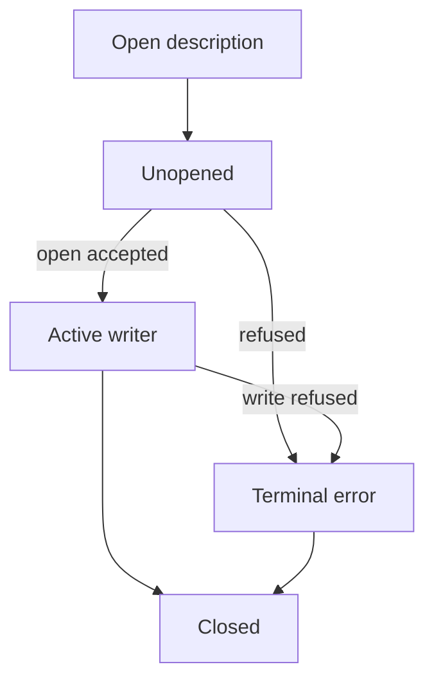

# Redirections and pipelines propagate data, closure and failures in order

Draft implementation contract from the November 22, 2026 review of `cbda2721`.

Verified against `dev` at `5a823ea` and amended on 2026-11-22 (`agents/2026-11-22-shell-review/reviews/verification.md`). Every problem reproduced, and the local decisions stand. The draft's writer handles, `writer-v1`, `append_open`, `if_object` and namespace incarnation are withdrawn: a writer that spans chunks is guarded by the session's stamp, decision 7 of `agents/2026-11-22-the-session-remembers-what-it-read/`, and no feature is negotiated with a host, since the module and its host ship together. The persistent named descriptor of problem 3 is `{fd}>`, as `exec 3>f` is refused at parse until `agents/2026-11-22-the-shell-acts-as-bash-where-it-refused/` lands.

## The outcome wanted

Every consumer sees a coherent byte stream or a typed error, and files reflect exactly the writes admitted before a failure.

## Builds on

Own machine/{exec,io,files,shell}.rs descriptor lifecycle, delimiter reads, lastpipe and substitution scheduling, plus head and tee in programs/text.rs. “Runtime termination” owns line-wide fatal stops. “Parsing and live memory” owns buffer charges. “Builtins and variables” owns read option semantics. Land descriptor primitives before the consumers.

These contracts are implementation prerequisites. [A shell line has one admission budget and one terminal outcome](../2026-11-22-shell-runtime-termination/spec.md).

## Design

## The problem

- The deferred-write optimization for output-only commands uses stat to decide whether a path looks writable. Stat cannot prove the subsequent write will be accepted. When a command has multiple redirections, a write denial on the first target can be discovered only after a later writable target has been opened or filled. This violates the documented left-to-right failure guarantee.
- The writer consumes its opening mode before learning the result and can later switch to append after a refusal. A concurrent creator can then receive bytes from the failed writer.
- The final flush and descriptor restoration can discard a saved write error for a persistent named descriptor. Command status can indicate success even though data never landed.

## Decisions

### 1. Open explicit redirections once, left to right, before the command acts.

The existing one-write fast path is allowed only for one plain output redirect of fd 1 on a command proven to produce no other observable effect before commit. Preserve the existing bounded cat-with-private-input optimization only if the input is already private, side-effect-free and opening it cannot expose an observable effect out of order. Otherwise use authoritative empty opens and subsequent append writes. Earlier successful opens remain visible after a later failure. After explicit redirections, apply Bash’s implicit stderr duplication for a pipe that carries stderr. Keep track of shared open descriptions separately from integer fd slots.

### 2. A writer moves from unopened to open on its first successful host reply, retaining the requested initial mode while pending.

After the first refused write save that error, discard undeliverable buffered data and enter a permanent failed state shared by all duplicates. No append, retry or close-time flush may write again. Ordinary redirection failures return command status 1 and a diagnostic once, and keep underlying host evidence. A failure first observed at final flush sets the line exit to 1 unless the line already has a fatal stop. Attribute a stage status only where the owning stage is known as detailed below. Bytes acknowledged earlier remain committed.

### 3. All file and pipe readers return Data, EOF or Error.

A later refused read delivers the prefix already handed to the caller and then a typed error. Map it to the consuming utility’s I/O status; cat and read return 1 with a diagnostic. A full pipe delivers an available fragment to delimiter-based readers even when the delimiter has not arrived. Accumulate charged fragments up to the applicable limit, handle an unterminated final record exactly once, and preserve EOF for the following call. For shared regular files advance a shared cursor by consumed bytes only; keep the surplus on the open description. head can consume a prefix without moving a duplicated descriptor past it.

### 4. Track external and owned references for each pipe end.

Final-stage completion under lastpipe restores the parent fd immediately, before waiting for upstream stages. Closing the last read end wakes blocked writers with broken pipe through the existing status 141 path. Allocate substitution descriptors from free slots below the implementation’s supported fd maximum, never replacing an occupied entry. Use the existing descriptor allocation failure status 1 if exhausted. A simple command owns substitution descriptors through invocation and closes them on every exit. Run each output-substitution reader concurrently with its producer, close the producer at completion, and reap consumers before returning from the line. Keep already-established command status rules for substitution children. Charge input captures from their first byte and release on final close.

### 5. For tee, parse all options before opening targets.

Open or append targets once in operand order before consuming stdin, report a target error and continue other targets. Stream charged chunks to stdout and all remaining outputs in GNU order. When the default stdout pipe is closed use the existing SIGPIPE behavior, preserving earlier accepted file bytes; a failing named output records status 1 and is removed from subsequent writes. With no named files consume bounded chunks and keep no whole-input copy. No background flush or detached write survives finalization.

## Interfaces and edge cases

### Open descriptions and later writes

For the single deferred write the cache-free fast path may finish in one request. For streaming output the first successful create, truncate or append stamps the file from its own result, through the line's session. Each later chunk is an append with `if_match` from that stamp, and its result refreshes it. A move, replacement, deletion or remount that changes the path's entry or version fails the writer with status 1 and ends its later chunks. A removed path is never re-created by a later chunk. This is vfs's path rule where a Unix open file would follow its inode.

For tee defaults, the first stdout pipe failure follows SIGPIPE. With -p use GNU warn-nopipe behavior: remove closed pipes, continue writing to surviving named files, and end successfully once all surviving outputs have completed unless a non-pipe write failed. For --output-error accept the GNU modes warn, warn-nopipe, exit and exit-nopipe, or reject an unsupported spelling with a usage error before any open. In warn mode diagnose, remove the failed output and keep serving others; exit stops at the first such error. The nopipe variants suppress pipe diagnostics and continue with remaining outputs. Test default and -p on the same finite input with a short-reading downstream stage. Compare exit status and final bytes on all destinations.

Choose the deferred optimization only when one plain stdout file is the sole deferred target and every other precondition is settled in Bash open order. For cat, use it for a here-string or already validated private input preceding that output. An output redirection followed by an input file open, another output, auxiliary descriptor, a pathname-producing expansion with effects or an inherited input uses eager opens. Keep the existing “pure echo makes one write” fixture. Add a test for a failed input following a successful truncate. Two descriptors referring to one writer share the first-error marker. A close error sets status 1 only for the relevant stage; if discovered solely at line teardown, update the final stage entry only when that stage owned the writer, otherwise keep completed pipeline history and return line exit 1 with the diagnostic.

A two-session integration test opens an output, replaces that entry, and confirms the later chunk cannot modify its replacement. Where supported options include --, stop option parsing at --. Reject an unrecognized tee option or output-error mode before opening any operand.

## Acceptance criteria

1. With request traces, contrast single redirected echo with a multi-redirection failure, pipe-stderr after an explicit redirect, create-only refusal on chunk one, refusal after an accepted chunk and refusal on an aliased persistent descriptor. Verify both streams, all affected paths, command status and pipeline history.
2. Run exact-capacity, capacity-plus-one and final unterminated records through read and mapfile. Exercise lastpipe with a short reader, multiple live substitutions with distinct input, early consumer exit, and repeated substitutions. Count live fds and buffers before and after. Head followed by a second reader returns the full original input between them. Tee’s destinations open even if stdin is empty; on early close compare the accepted prefix and request order.

## Regression cases

| Behavior | Check through the normal entry point | Reviewed source |
|---|---|---|
| Shell redirections open in order | Inject failure at the first open in a multi-target command. Verify the existing second target, both output streams, status and host request order. Keep the ordinary single-target write-count test. | [machine/exec.rs L1008](https://github.com/ClayGendron/vfs/blob/cbda27211fe165099c4843dad1464df6c8da0fe1/crates/vfs-shell/src/machine/exec.rs#L1008) |
| A refused shell writer becomes terminal | Use a host double returning an exists conflict on an opening chunk. Assert zero follow-up writes, identity of the existing content, and a failing command status. Cover a refusal after one accepted chunk. | [machine/files.rs L193](https://github.com/ClayGendron/vfs/blob/cbda27211fe165099c4843dad1464df6c8da0fe1/crates/vfs-shell/src/machine/files.rs#L193) |
| Persistent shell descriptors report final write errors | Allow the opening write and refuse the later data flush. Verify status, diagnostic, retained host warning and actual stored bytes, including a duplicated descriptor. | [machine/files.rs L193](https://github.com/ClayGendron/vfs/blob/cbda27211fe165099c4843dad1464df6c8da0fe1/crates/vfs-shell/src/machine/files.rs#L193) |
| A refused file chunk stays a read error | Deliver one successful chunk followed by a refusal. Check command status and the accepted prefix, then repeat with a genuine EOF that must succeed. | [machine/files.rs L119](https://github.com/ClayGendron/vfs/blob/cbda27211fe165099c4843dad1464df6c8da0fe1/crates/vfs-shell/src/machine/files.rs#L119) |
| Delimited reads drain full shell pipes | Send finite records just below, at and above pipe capacity. Check the resulting records and exit status with a sufficient budget and then with a small logical budget. | [machine/io.rs L352](https://github.com/ClayGendron/vfs/blob/cbda27211fe165099c4843dad1464df6c8da0fe1/crates/vfs-shell/src/machine/io.rs#L352) |
| Lastpipe releases a finished consumer’s descriptor | Use a finite producer and a short-reading final stage. Check completion, pipeline statuses and restoration of the parent’s previous input. | [machine/exec.rs L497](https://github.com/ClayGendron/vfs/blob/cbda27211fe165099c4843dad1464df6c8da0fe1/crates/vfs-shell/src/machine/exec.rs#L497) |
| Process substitutions own their descriptors until command completion | Use several distinct short input substitutions and an occupied descriptor. Verify stream identity and that repeated commands return descriptor and byte counts to baseline. | [machine/exec.rs L1787](https://github.com/ClayGendron/vfs/blob/cbda27211fe165099c4843dad1464df6c8da0fe1/crates/vfs-shell/src/machine/exec.rs#L1787) |
| Output process substitutions run alongside their producers | Pass a finite multi-buffer stream followed by EOF, and cover a consumer that exits early. Assert final bytes, completion status and closed descriptors. | [machine/exec.rs L1787](https://github.com/ClayGendron/vfs/blob/cbda27211fe165099c4843dad1464df6c8da0fe1/crates/vfs-shell/src/machine/exec.rs#L1787) |
| A shell pipeline redirects stderr in Bash order | Compare the downstream stream, both captured outputs and the redirected file with Bash for a producer that writes to both descriptors. | [machine/exec.rs L472](https://github.com/ClayGendron/vfs/blob/cbda27211fe165099c4843dad1464df6c8da0fe1/crates/vfs-shell/src/machine/exec.rs#L472) |
| Head preserves the unread suffix on a shared file descriptor | Use consecutive readers on one redirected regular file. Check byte and line modes, a boundary in the middle of a chunk and a request that reaches EOF. | [programs/text.rs L287](https://github.com/ClayGendron/vfs/blob/cbda27211fe165099c4843dad1464df6c8da0fe1/crates/vfs-shell/src/programs/text.rs#L287) |
| Tee opens and writes its targets while forwarding input | Inspect file open and write order on a finite stream and when a downstream reader closes early. Verify per-destination failures, accepted bytes and memory usage. | [programs/text.rs L1703](https://github.com/ClayGendron/vfs/blob/cbda27211fe165099c4843dad1464df6c8da0fe1/crates/vfs-shell/src/programs/text.rs#L1703) |

## Verification

Use the pinned recorder and its environment in [the shell corpus](../../tests/shell/README.md) for observable Bash/GNU behavior. Run the affected crate laws and the release corpus with `cargo test --release -p vfs-shell -p vfs-shell-wasm`. Exercise public-host behavior with `uv run pytest tests/shell` and the PostgreSQL-marked engine cases when a storage contract changes. Record intentional VFS deviations alongside the corpus fixtures. A case moves out of the known-failure list only when its recorded assertions pass.

Add the regression `refused_writer_stays_failed_across_aliases` to [crates/vfs-shell/tests/laws.rs](../../crates/vfs-shell/tests/laws.rs). Update [documentation/reference/shell.md](../../documentation/reference/shell.md) in the implementation change with the observable contract and intentional VFS differences. For a Python test use the standard test_ prefix.
