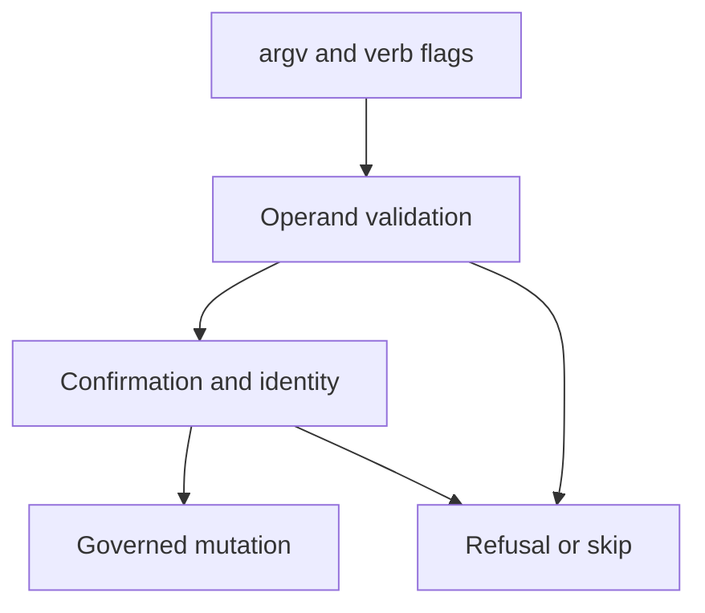

# File commands validate operands and preserve occupied targets

Draft implementation contract from the November 22, 2026 review of `cbda2721`.

## The outcome wanted

A cleanup command may delete only the paths selected by its validated arguments and confirmations. An incomplete tree walk is visible in the command result.

## Builds on

Own option parsing and dispatch in programs/files.rs, the typed metadata lookup in programs/mod.rs, recursive traversal in programs/grep.rs, and MemoryHost’s copy, move and mkdir semantics. The production transfer policy already refuses occupied destinations. Use the storage access and stat outcome contract in “File reads and metadata” for backend tests. The program-layer cases can land first with a typed host double.

These contracts are implementation prerequisites. [File reads and metadata remain bounded and caller-authorized](../2026-11-22-shell-file-reads-and-metadata/spec.md).

## Design

## The problem

- The file program normalizes its operand before requesting deletion. An empty pathname becomes the working directory, and a final dot or double-dot selects its resolved directory. In a writable subtree the resulting request is a real cascading delete. This is a serious failure mode for an empty variable or a malformed cleanup path. The production database independently protects its root.
- Both interactive removal options are accepted without setting any state. The delete path never reads the answer. EOF or a negative answer therefore gives no protection. GNU requires per-file confirmation for the always-interactive option and one confirmation under the applicable recursive or operand-count conditions for the once-interactive option.
- The shared option parser accepts interactive and update switches without recording either choice. The reference host permits replacements that production storage refuses.

## Decisions

### 1. Validate removal operands before canonicalizing them.

After trimming trailing separators, reject an empty pathname and a last component of dot or double-dot. Refuse the VFS root after resolution, including alternative spellings. Status is 1 with a diagnostic for each protected spelling, including under force. Parse all options before the first effect, but apply operand-specific checks in original order and continue with subsequent operands. Preserve force’s suppression of an ordinary nonexistent pathname. This prevents a missing shell variable from selecting the working directory.

### 2. Interactive removal uses fd 2 for prompts and fd 0 for answers, one line per prompt.

In the corpus locale accept a response beginning with y or Y after leading whitespace. EOF and other answers decline with no mutation and are successful skips. Last of -f, -i or -I wins. With -I prompt once for recursion or more than three operands. With -i prompt per file and before descending into and removing a directory, following the pinned GNU traversal order. Interactive recursive deletion enumerates admitted children and issues noncascade deletes from the leaves up. A denial, unlisted hidden child, new arrival or unconfirmed entry must survive. A parent that is still nonempty cannot be cascade-deleted. Keep ordinary authorized cascade deletion for noninteractive recursive removal.

### 3. Retain the VFS occupied-destination refusal for copy and move.

On both VFS and the Rust reference host an accepted -i prompt still delegates to that refusal. Negative/EOF skips with status 0. -n skips an occupied target. For -u skip an existing destination with equal or newer modification time, otherwise attempt the ordinary transfer. When time is unavailable refuse an occupied -u transfer with status 1 before mutation. Parse GNU option precedence from the pinned reference for combinations with -f/-n/-i. Check destination type for explicit -t or --target-directory even for one source. Preserve the public transfer primitive as the authority and atomicity check.

### 4. Reject unsupported mkdir mode and touch reference-time options with diagnostic and status 1 before operating on any operand.

Recognize attached and separate values, --mode and --reference, mixed flags and --. MemoryHost mkdir -p verifies every ancestor is a directory before installing a descendant. VFS has no modeled POSIX mode setter for these commands.

### 5. Keep a typed result for metadata lookup.

Forced rm suppresses NotFound including deliberately masked absence. On another error emit the program diagnostic and status 1. For a failed subtree listing/stat, find keeps admitted results, emits a diagnostic and exits 1. Grep keeps admissible matches, reports a traversal error with status 2 unless GNU -q has already found a match, and -s suppresses the diagnostic only. An unknown size cannot satisfy -empty. Store the classified warning under the host evidence rules. These outcomes preserve information about partial results without naming hidden rows.

## Interfaces and edge cases

Interactive removal works on an observed entry identity. Immediately before a prompt obtain the optional metadata identity from the stat path under current authority. On acceptance dispatch a noncascade guarded remove with the approved identity; recheck rights and compare identity/version atomically in the delete transaction. A replaced name or remount returns conflict and the replacement survives. Track which child names were visited, skip declined children and retain a parent containing skipped or new children. A directory version changed solely by this command’s own child removals may be restatted before the final independent directory prompt; compare stable object identity as well as the newly approved version. When guarded removal is unsupported refuse the interactive operation with status 1 before dispatching deletes. For a recursive -I confirmation, enumerate and bind the authorized traversal snapshot before the prompt; store it under the logical memory budget and refuse before any delete if it does not fit. Remove only approved identities from that snapshot, deepest first. GNU prompt spelling/order comes from the pinned GNU image under LC_ALL=C.UTF-8.

For -i traversal, decline descent → preserve the subtree without enumerating it. Decline a child → retain that object, continue siblings and never delete its parent by cascade. Open each target under current authority. If its identity cannot be obtained, produce one operational failure and leave it untouched. For -u, both the initial source and occupied destination need known times; unknown time yields status 1. For combined -i/-n/-f prefer the pinned GNU utility’s per-command precedence, recording a fixture for each ordered pair. A move or copy that would overwrite is still refused by the VFS transfer verb. Exact fixture stdout/stderr/status describe GNU behavior; add a VFS-specific result with a rationale where the no-overwrite rule changes it.

Declining a child in per-file -i mode suppresses removal of its parent; skip the final parent delete and its prompt when retained children are already known. For -I, take one snapshot before the single confirmation, then remove only the same identities, with unchanged versions where required. If an existing node disappeared or changed identity while paginating or awaiting confirmation, skip its removal and report a conflict (status 1) if the observed object cannot be confirmed again. A newly observed child outside the snapshot stays. Verify same-name replacement by another session between confirmation and deletion as well as insertion of a differently named child. Update the GNU comparison fixture with an explicit safety delta if this concurrent or declined-child behavior differs.

## Acceptance criteria

1. Assert the exact list of (operation, path, cascade) requests for a declined child in an otherwise accepted recursive run. Change directory membership between listing and removal and assert the new child survives. Confirm that a valid sibling can still be processed after an invalid operand. Use the existing Bash/GNU recorder for prompts and statuses with stable fixture paths.
2. Run a persistent fixture on SQLite and PostgreSQL plus the VFS reference host. Check source and destination bytes and directory membership after occupied transfer, declined interactive transfer, missing target directory and mkdir below a file. Keep the GNU overwrite records as upstream truth and record the intentional VFS policy with a justified delta wherever the corpus uses VFS semantics.

## Regression cases

| Behavior | Check through the normal entry point | Reviewed source |
|---|---|---|
| rm validates an operand before resolving its path | On a recording host, invalid operands leave every entry and the delete log untouched. A valid sibling operand still follows the documented per-operand behavior. | [programs/files.rs L679](https://github.com/ClayGendron/vfs/blob/cbda27211fe165099c4843dad1464df6c8da0fe1/crates/vfs-shell/src/programs/files.rs#L679) |
| rm honors interactive confirmation | Compare yes, no and EOF on an in-memory fixture. Count prompts and delete requests for both interactive switches, including a recursive request. | [programs/files.rs L655](https://github.com/ClayGendron/vfs/blob/cbda27211fe165099c4843dad1464df6c8da0fe1/crates/vfs-shell/src/programs/files.rs#L655) |
| Copy and move honor interactive and update options | Cover a declined transfer, EOF and an older source under the update option. Inspect the original destination and the transfer request log. | [programs/files.rs L505](https://github.com/ClayGendron/vfs/blob/cbda27211fe165099c4843dad1464df6c8da0fe1/crates/vfs-shell/src/programs/files.rs#L505) |
| Copy and move expose the production occupied-target policy | Run occupied-file and nonempty-directory cases on MemoryHost, SQLite and PostgreSQL. Inspect both trees, command status and VFS refusal. Keep fresh-destination successes covered. | [host/memory.rs L378](https://github.com/ClayGendron/vfs/blob/cbda27211fe165099c4843dad1464df6c8da0fe1/crates/vfs-shell/src/host/memory.rs#L378) |
| Directory and touch options consume their arguments before mutation | Check missing and supplied option values and the ordinary no-option form. Inspect every path sent to the host as well as the resulting entries. | [programs/files.rs L736](https://github.com/ClayGendron/vfs/blob/cbda27211fe165099c4843dad1464df6c8da0fe1/crates/vfs-shell/src/programs/files.rs#L736) |
| An explicit transfer target directory must be a directory | Cover a missing path, a file and a directory. The first two receive no transfer requests and the valid directory receives the expected basename. | [programs/files.rs L519](https://github.com/ClayGendron/vfs/blob/cbda27211fe165099c4843dad1464df6c8da0fe1/crates/vfs-shell/src/programs/files.rs#L519) |
| Forced removal distinguishes absence from a failed lookup | Use a recording host that returns absence and then a backend error in separate cases. Assert status, diagnostic and zero deletes for both outcomes. | [programs/mod.rs L137](https://github.com/ClayGendron/vfs/blob/cbda27211fe165099c4843dad1464df6c8da0fe1/crates/vfs-shell/src/programs/mod.rs#L137) |
| File traversal reports incomplete directory results | Return one readable child and one failed listing or stat. Verify surviving rows, error status and the treatment of the empty predicate and quiet options. | [programs/files.rs L431](https://github.com/ClayGendron/vfs/blob/cbda27211fe165099c4843dad1464df6c8da0fe1/crates/vfs-shell/src/programs/files.rs#L431) |
| The reference filesystem rejects descendants of a regular file | Compare a file ancestor, a directory ancestor and a missing directory chain. Assert the resulting tree and status against the VFS hosts. | [host/memory.rs L87](https://github.com/ClayGendron/vfs/blob/cbda27211fe165099c4843dad1464df6c8da0fe1/crates/vfs-shell/src/host/memory.rs#L87) |

## Verification

Use the pinned recorder and its environment in [the shell corpus](../../tests/shell/README.md) for observable Bash/GNU behavior. Run the affected crate laws and the release corpus with `cargo test --release -p vfs-shell -p vfs-shell-wasm`. Exercise public-host behavior with `uv run pytest tests/shell` and the PostgreSQL-marked engine cases when a storage contract changes. Record intentional VFS deviations alongside the corpus fixtures. A case moves out of the known-failure list only when its recorded assertions pass.

Add the regression `interactive_delete_preserves_replaced_entry` to [tests/shell/test_engines.py](../../tests/shell/test_engines.py). Update [documentation/reference/shell.md](../../documentation/reference/shell.md) in the implementation change with the observable contract and intentional VFS differences. For a Python test use the standard test_ prefix.
