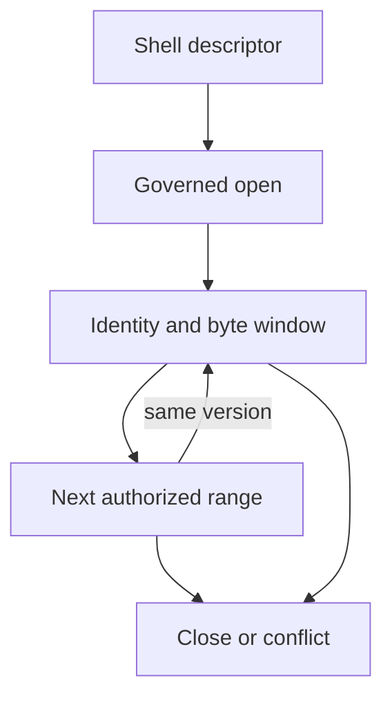

# File reads and metadata remain bounded and caller-authorized

Draft implementation contract from the November 22, 2026 review of `cbda2721`.

## The outcome wanted

A fresh open sees current authority and version. A read in progress either yields bytes from its opened version or encounters an explicit error. Predicate results and partial listings reflect the caller’s view.

## Builds on

Own src/vfs/shell/host.py read/list/stat requests, the Rust Request/Reply model and corresponding codec changes, AsyncVirtualFileSystem routing and the storage-side read/projection paths. Coordinate wire shapes with “Wire and instance lifecycle”, and stream errors with “Redirections and pipelines”. This work adds governed read/stat projections, reuses the existing paged ls verb and adds a guarded-write request for sed. Include protocol adapters, MemoryHost, database storage, testing hosts and public documentation in the same landing.

These contracts are implementation prerequisites. [Shell wire messages are exact and instance transitions are explicit](../2026-11-22-shell-wire-and-instance-lifecycle/spec.md), [A shell line has one admission budget and one terminal outcome](../2026-11-22-shell-runtime-termination/spec.md).

## Design

## The problem

- The Python host fetches an entire file for one range and can retain it regardless of size. Listing constructs all child entries before encoding the reply.
- The per-line cache key is a path. A new offset-zero read can hit a completed read’s body without asking the router again. A concurrent edit or revocation is invisible on that reopen. Exposure is limited to data already obtained by the same authority in that line. Conversely, eviction can cause a later chunk to come from a newer version.
- Adding a body builds a list by scanning cached paths even when usage is far below the eviction threshold. The per-line byte tally counts payloads but omits keys and metadata, so empty files can accumulate entries without advancing it.

## Decisions

### 1. Give a logical open a line-scoped reader ID using its first RequestKey.

Add ReadOpen(path,length), ReadNext(reader,offset,length) and ReadClose(reader) controls. Replies carry the current data bytes, eof and an opaque stable identity on open. The initial chunk and identity derive from the same authorized read. Seekless continuation requires the next sequential byte offset; next on an unknown or closed reader or mismatched cursor returns Invalid. Close is idempotent for a well-formed local reader ID. A duplicate fd shares the reader and cursor. Close releases the descriptor on last use and line teardown releases all remaining handles. Each independent open goes through the router, including offset zero at the same path. No cross-line cache.

### 2. Reuse the planned public read(range=ByteRange(offset, length)) spelling and public range_start/range_length fields.

Add keyword-only exact_bytes=False and if_identity=None to the read faces. Exact mode requires one path, one range and a backend advertising exact_read_v1. It serves only raw canonical file bytes in data, regardless of whether the row is text or bytes-sourced; a binary row's text rendering is never the source. For text files, use the stored text encoded as UTF-8. Ordinary public ranged text reads retain the existing proposal’s outward character widening and its default fallback. Exact shell reads never invoke that whole-body fallback. Source identity, authority and bytes must be observed together. Recheck access on each continuation and return conflict only after normal masked admission succeeds. A conflict or refusal is final for that reader.

### 3. Use a bounded, offset-indexed byte source on each supported database and preserve whole-file API behavior for existing files.

The engine implementations, upgrade and field definitions below are part of this landing. Replace the Python path-body cache with per-reader metadata and one active chunk. Use O(1) insertion and close, charge metadata even for empty files, and release the state on EOF, error, last close or teardown. When admission fails, preserve existing readers and terminate the line on the host-memory budget. MemoryHost implements the same identities and byte offsets.

### 4. Page shell listings with the public cursor.

Extend the request with optional after and page_size; default 128 entries and use at most the current allowance. Pass through next_after and use that opaque cursor until absent, including short pages. Validate forward progress and abort on repeated cursor. Treat the traversal as the sequence of authorized pages under concurrent changes, consistent with public ls. Charge each live page/entry and require a command accumulating a directory to reserve its aggregate logical memory before keeping entries. Propagate classified warnings of successful partial read/stat/ls/search results through the existing deduplicating evidence collector. Ignore ordinary negative existence probes; preserve operational failures and their original masking.

### 5. Extend the authorized stat projection with optional can_read, can_write and modified_at.

A visible regular file’s read bit uses the same admission as body read, and write bit uses the existing-file overwrite admission, including write masks, mount read-only policy and ownership rules. For directories, read means permission to list and write means permission to create a child under that directory. Do not name an invented child for this probe. A bare mount/unknown capability yields false. Compute capabilities in the router/backend from existing operation checks in the caller’s snapshot; a later real mutation always checks again. If a field is unavailable return unknown and test it as false. Use UTC instants at microsecond precision for age comparisons. Equal existing times compare false; newer-than succeeds when only the left exists, older-than succeeds when only the right exists, both missing or unknown timestamps compare false where both exist. Test both conditional syntaxes.

### 6. Add GuardedWrite(path,expected_identity,bytes) for publishing a completed edit.

Route to a conditional write that checks both stable identity and version in the mutation transaction; extend the current if_version path where it lacks identity. A conflict leaves the target intact. Engines that cannot check the precondition atomically return unsupported. Use an opaque token: possession alone never authorizes access. Host reply shapes and stat fields are negotiated before use under the wire spec.

## Interfaces and edge cases

### Public surfaces and representation

Extend the parameter registry, validation, all four router/session faces, result projection, storage protocols, native stub and API drift tests together. Use the active [ranged-read specification](../../context/specifications/active/178-the-ranged-read/spec.md) for ordinary range validation, widening, batch behavior and fallback on the two supported engines. If that API lands separately, reuse it. If it is still pending, land its shared signature and ordinary contract first. Exact mode is an additive single-path storage capability. Do not pass new keywords to old backends in ordinary calls. An unsupported exact call returns a classified unsupported result. Implement the derived r/w fields using the [file mode and rights proposal](../2026-11-22-a-file-carries-its-executable-bit/spec.md); its executable bit and chmod are independent future work.

| Interface | Contract |
|---|---|
| Exact read input | `read(path, range=(offset,length), exact_bytes=True, if_identity=token, authority=who)`. On first read omit the token. Accept non-bool counts 0 to 2^63−1; cap the selected end at file size using checked arithmetic. Exact mode accepts omitted columns or a subset of data and required range/identity metadata. Content, observations, and if_identity without exact mode return invalid before backend dispatch. |
| Exact read result | One observation carries `data: bytes`, `range_start`, `range_length`, `size_bytes` of the canonical body, `version`, `source` and `read_identity: str`. Empty/past-end reads still carry identity. EOF means offset ≥ size or returned length reaches the remaining size. No digest of the complete body is calculated on a range. |
| Identity and guarded writes | Mint an opaque router token for mount registration generation, storage entry ID and committed version. Validate structure and equality under normal authority, route and row preconditions. Bind it to the addressed path as resolved by that registration. A remount or new entry at the same spelling cannot satisfy it. Add `if_identity: str \| None` to single-target write and noncascade delete, mutually exclusive with other preconditions except the ordinary payload. Gate the row identity/version in the transaction performing the write or delete, checking the affected row count. Malformed form → invalid, authorized mismatch → conflict, inaccessible target → existing masked refusal. The internal reference host keeps a fresh ID on re-creation and increments a monotonic version on changes. |
| Stat projections | Reuse `updated_at` on Python observations. Map it to signed UTC microseconds on the wire. Add optional booleans `can_read`, `can_write` and optional `read_identity` to opt-in stat columns only. Where data access is masked, redact identities and timestamps as existing projection rules require; permit an identity-only token for an authorized deletion through the same delete gate, with no body permission conveyed. |

### Physical byte reads and upgrade

SQLite uses an immutable-for-the-statement row identity and the SQLite incremental BLOB reader on the same checked-out database connection and transaction as the access/version query. Resolve the rowid of the current text or bytes content row, check file kind, then use sqlite3_blob_open/bytes/read/close to read exactly the requested byte window. It supports TEXT and BLOB columns in ordinary rowid tables. Database encoding must be UTF-8 for text. Run the operation on the owning aiosqlite worker through a supported adapter or a registered native SQLite function on that connection; never share sqlite handles between threads. Close the blob and transaction before another shell await. Detect eligibility at backend construction. For another SQLite database encoding use the bounded canonical-byte projection described below instead of silently changing bytes.

PostgreSQL bytes files use the existing EXTERNAL bytea column and indexed entry_id. For text files, add a current UTF-8 bytea projection, keyed by entry_id with matching version, stored EXTERNAL. Populate/replace that projection inside the transaction that creates or changes canonical text, including append, edit, restore, kind transitions and copied entries. A move that preserves identity reuses the projection if the version still agrees. Join on entry_id and version; use bytea substring on the selected projection, with one-based arguments, without whole-text conversion per chunk. Backfill on the deployment/maintenance path in bounded primary-key batches with an entry_id/version compare-and-publish. Exact reads take an ordinary MVCC read snapshot, acquire no entry lock, perform no repair or write and never wait for a writer in order to construct a projection. Before the capability is advertised, finish backfill and verify every live text row has a matching projection. During mixed-version deployment keep the new capability disabled until writers support dual-write or an equivalent database trigger is active. For a stale/missing projection after activation, return classified unsupported immediately and leave repair to maintenance; a subsequent new read may succeed after repair. The ordinary whole-read API stays available before activation and throughout repair. Backfill externally on a writable primary before enabling the capability on a read-only replica. Existing rows on upgrade require no client rewrite. Stale projections are reclaimed on body replacement or purge. Budget one additional current text body per text file, plus index overhead. Measure first conversion separately from repeated windows; over a full sequential read count at most one full-body conversion per immutable version and O(file bytes + number of requests) DB byte work. Count slice bytes entering Python and verify zero full-body payloads. This explicitly addresses the whole-value costs described in §4 of the earlier range spec.

Range/capability metadata and read ownership are confined to a single router/line. For paging allocate at most 128 rows per request, shrink the requested count down to 1 as available host memory decreases; an entry that cannot fit returns a budget failure before materialization. The storage adapter must also enforce a per-page encoded-byte cap (return the prior cursor and remaining names on later pages); a single over-budget name yields budget failure instead of a nonprogressing page. A directory node with a suppressed child or concurrent change follows normal ls visibility rules. Track the last cursor only and require strict increasing path order, using the router’s existing cursor comparator.

Return already-authorized bytes held in an open description’s current chunk even if a subsequent grant change has occurred; those bytes were delivered at the earlier read. Recheck authority on the next host fetch and on every fresh open. Never prefetch a second chunk. Close reader state at EOF or failure; a buffered final suffix remains owned by the descriptor until drained. Fatal teardown releases all line-local state without routing any new close through storage. A duplicate close of an issued line-local reader is a successful no-op without needing an unbounded tombstone table. Reject structurally malformed or cross-line identifiers. A caller sending a syntactically valid close for an unknown reader in this line also gets success; next on any absent reader is invalid.

For page admission the adapter passes max_bytes before querying. Charge a fixed 32 bytes per returned entry plus its UTF-8 name length and 1 byte for its kind, and also charge the actual serialization workspace separately. SQL first fetches only indexed path metadata and byte lengths of at most page_size candidate rows, using the existing authorized keyset traversal. Fetch names for the fitting contiguous prefix only and preserve any earlier cursor if the first row alone is too large (budget failure; no retry of that page). Include the cursor in wire preflight. Advancing pages must use the existing router’s ordering across synthetic mount children and ordinary children, including its per-mount warning merging. Cover remounts, closed storage, an empty page with a valid next cursor, and a legal huge single name with the limit set deliberately small.

With verify-on-read enabled under the proposed integrity feature, a range is identified by entry/version but is not advertised as full-body checksum verified. Never fetch a full body solely to claim range verification. Expose whole-object verification status only when a verified snapshot independently covers that version; otherwise retain the ranged-read proposal’s partial/unverified semantics. Filtering a bytes-sourced row by permissions can never fall back silently to its text rendering. Old backends receive their current public signatures unless they advertise the optional capability; add conformance for all four public read faces and a protocol-only legacy backend.

A held writer on a text entry cannot stall a read of its last committed version to repair a projection. Run overlapping read/write engine tests with barriers and inspect the read session's statements: zero DML, row locks, whole-value conversions or maintenance requests. Inject a stale projection, observe a bounded unsupported read, repair on the maintenance path, then repeat the read as a fresh call. On a complete backfill observed concurrently with updates, revalidate the high-water version and finish a reconciliation pass before enabling the capability. Deleting a projection is optional cleanup, never a condition for a read to return.

For confirmed directory removal support a separate single-target `if_object` precondition on noncascade delete. The existing object token binds mount/entry identity and path only. Guarded directory removal additionally requires observed current kind=directory, current delete rights and empty directory in the same transaction. A concurrently inserted child, replaced directory or remount survives. Do not expose this as an unguarded version override for file removal. Conflicting or missing target uses normal masked errors. Guarded file deletion still requires `if_identity` including version. The `if_object` write form is restricted to append as specified by the descriptor contract.

An object token includes mount registration generation, resolved path, stable entry ID and **namespace incarnation**. Versioned identity adds the committed body/entry version. A delete and later revive can preserve entry_id in today's storage. Introduce a persisted per-entry incarnation (fresh ULID on first creation and on each tombstoned-to-live transition, restore or move changing the addressed path; copied entries receive fresh identities). Keep it stable across in-place writes and appends. Initialize existing live rows to their unique entry ID, and do the next transition atomically with its lifecycle mutation. The write and restore builders, topology builder, schema upgrade and MemoryHost share this rule. For directory moves or restores invalidate affected descendant path incarnations in the same transaction that updates their addresses/liveness. Anyone holding the old token sees a refusal even after the pathname and stable entry ID have been revived. Exercise open → delete → revive at the same path between writes on real engines, and contrast with concurrent appends to the original, still-live entry. Perform the identity check in the guarded mutation itself.

## Acceptance criteria

1. Across MemoryHost, SQLite and PostgreSQL open a file, read two chunks, replace its body between opens, revoke access between chunks and recreate its path. Assert router calls on every open, no mixed-version output and no stale bytes after revocation. Include binary and multibyte text split mid-character. Instrument SQL/result rows or a test adapter to verify that a tiny range never transfers the full body into Python.
2. Page a wide directory with tiny quotas, a partial warning and a short nonfinal page. Compare cursor order and warning evidence and count live host bytes including paths and entries. Test file/directory, list-only, read-only, writable, masked and synthetic mount paths for stat probes. Try a guarded write after delete/recreate with the same numeric version and verify the replacement survives.

## Regression cases

| Behavior | Check through the normal entry point | Reviewed source |
|---|---|---|
| The shell bounds storage replies while reading and listing | Use an instrumented storage with a multi-range file and a multi-page directory. Check sizes requested, maximum live bytes, ordering and continuity of the returned data. | [src/vfs/shell/host.py L375](https://github.com/ClayGendron/vfs/blob/cbda27211fe165099c4843dad1464df6c8da0fe1/src/vfs/shell/host.py#L375) |
| A fresh shell file open rechecks access and pins its contents | Open twice around a version or rights change. Under metadata pressure refuse new admission, preserve existing identities and verify every subsequent fetch either returns the same version or a typed refusal. | [src/vfs/shell/host.py L375](https://github.com/ClayGendron/vfs/blob/cbda27211fe165099c4843dad1464df6c8da0fe1/src/vfs/shell/host.py#L375) |
| The shell body cache bounds entry overhead and eviction work | Double the number of empty-file opens; count insert/close work, outstanding identities, and charged slots. EOF/close releases each entry once; exhausted metadata allowance cannot evict a live reader. | [src/vfs/shell/host.py L392](https://github.com/ClayGendron/vfs/blob/cbda27211fe165099c4843dad1464df6c8da0fe1/src/vfs/shell/host.py#L392) |
| The shell preserves warnings from partial VFS results | Return rows with a warning from a listing and search. Check output, deduplication and the warning record. Compare with an ordinary absent-file predicate. | [src/vfs/shell/host.py L408](https://github.com/ClayGendron/vfs/blob/cbda27211fe165099c4843dad1464df6c8da0fe1/src/vfs/shell/host.py#L408) |
| Shell access predicates reflect caller permissions | Run predicates with read-only, writable and masked paths on the same mount. Compare answers with the applicable VFS permission decisions without writing as a probe. | [machine/test.rs L78](https://github.com/ClayGendron/vfs/blob/cbda27211fe165099c4843dad1464df6c8da0fe1/crates/vfs-shell/src/machine/test.rs#L78) |
| Shell file age comparisons use modification time | Check older, newer and equal timestamps and both missing-operand orders on each host. | [machine/test.rs L203](https://github.com/ClayGendron/vfs/blob/cbda27211fe165099c4843dad1464df6c8da0fe1/crates/vfs-shell/src/machine/test.rs#L203) |

## Verification

Use the pinned recorder and its environment in [the shell corpus](../../tests/shell/README.md) for observable Bash/GNU behavior. Run the affected crate laws and the release corpus with `cargo test --release -p vfs-shell -p vfs-shell-wasm`. Exercise public-host behavior with `uv run pytest tests/shell` and the PostgreSQL-marked engine cases when a storage contract changes. Record intentional VFS deviations alongside the corpus fixtures. A case moves out of the known-failure list only when its recorded assertions pass.

Add the regression `range_rechecks_identity_and_access_on_both_engines` to [tests/shell/test_engines.py](../../tests/shell/test_engines.py). Update [documentation/reference/shell.md](../../documentation/reference/shell.md) in the implementation change with the observable contract and intentional VFS differences. For a Python test use the standard test_ prefix.
