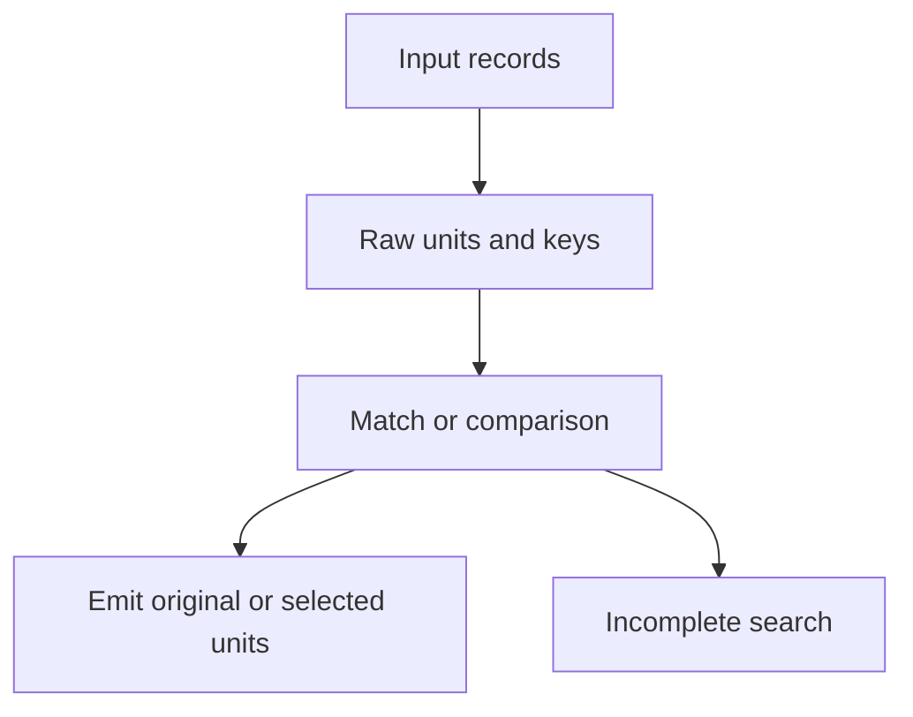

# Filters preserve bytes and distinguish an incomplete match

Draft implementation contract from the November 22, 2026 review of `cbda2721`.

## The outcome wanted

Filters preserve distinct records through redirection, and every pattern consumer receives a complete match decision or an explicit error.

## Builds on

Own machine/{pattern,regex,expand,test}.rs and programs/{grep,sed,text}.rs for matching and byte representation. “Sed edits” owns publication and restricted scripts. “File commands” owns recursive traversal errors. Coordinate matcher API changes with the active linear-time matcher spec; this contract applies to either algorithm.

These contracts are implementation prerequisites. [The parser and interpreter account for depth and live storage](../2026-11-22-shell-parsing-and-memory/spec.md), [Sed validates its script and commits completed edits in order](../2026-11-22-shell-sed-edits/spec.md).

## Design

## The problem

- Several filters decode input with replacement before comparing or emitting it. Byte-distinct records can become indistinguishable inside a pipeline.
- Wildcard handling treats the presence of an empty GLOBIGNORE as sufficient to include hidden paths.
- The replacement path constructs default match options while other pattern consumers consult shell state.

## Decisions

### 1. Keep raw records and separators through sort, uniq and tr.

Sort and uniq compare their normal keys and emit original bytes, including invalid UTF-8. Distinct opaque units can never collapse to a replacement scalar. Use the reversible scalar/opaque-byte representation defined by “Sed edits” for character operations; apply one total order to every input record as specified below, including when a record contains opaque units. For tr, retain the original bytes for units not selected, and apply explicit byte translations/deletions before reassembly. Keep the GNU handling of a final unterminated record per utility. Only the final Python CLI display decodes with replacement.

### 2. Numeric sort -n scans the signed decimal prefix under LC_ALL=C.UTF-8, ignoring leading blanks and insignificant leading/trailing zeroes.

Compare sign, magnitude by integral digit count and lexicographic digits, then fractional digits padded with zero, reversing magnitude for negative values. Zero and a missing numeric prefix compare as zero. Use the pinned GNU grammar for sign, decimal point, exponent-looking suffixes and option combinations. No f64 conversion is allowed in -n. Preserve -g’s general-number rules, -u’s first equal-key representative and the normal last-resort comparison when applicable.

### 3. Maintain a collection of patterns for grep.

A zero-line -f contributes zero alternatives, a blank line contributes one empty pattern, and -e/-f repetitions union in command order. Preserve inverse matching and statuses 0/1/2. Accept --regexp and --max-count with inline or separate values, handle -- and malformed or missing required values before file IO. GNU -m 0 selects nothing and performs no matching. Short options retain existing syntax.

### 4. Change glob and regex result types to distinguish matches, misses, malformed patterns and exhaustion.

On exhausted search discard partial best captures, propagate exhaustion before negation or -v. Binary grep, text grep, sed, pathname expansion, parameter replacement, conditional tests and case selection must all propagate it. Grep reports diagnostic/status 2, sed reports a runtime fault and follows its in-place discard rule, [[ ]] returns 2, and an incomplete shell pattern in argument expansion or case fails the affected command with status 1 and a diagnostic. Never dispatch a command with a partial pathname list. Reserve line-fatal 137 for a shared line budget, distinct from a matcher’s local search allowance. Keep syntax-specific malformed-pattern behavior where Bash treats a construct as literal.

### 5. Implement case-insensitive bracket ranges with the same character equivalence as literals in the pinned C.UTF-8 locale, including matching uppercase ASCII against a lowercase ASCII range in grep, sed and Bash regex conditions.

Pass the live nocasematch option into shell parameter replacements; leave case-sensitive behavior when disabled. Match Bash’s GLOBIGNORE state transitions: a fresh empty assignment does not set dotglob, a nonempty value enables it, unsetting removes the implicit enabling, and explicit shopt changes are applied in program order. Use fixture comparisons for empty-after-nonempty, explicit setting/resetting and the special dot entries, checking actual expanded filenames before any command runs.

## Interfaces and edge cases

An empty GLOBIGNORE assignment leaves the current dotglob bit alone, a nonempty assignment sets it, and unset clears it even if explicitly set beforehand. An explicit shopt operation afterward sets the requested state. Test the full sequence as well as the fresh-shell case. The pinned recorder fixes locale and program versions. In numeric sort -n, accept optional minus and the C-locale decimal point, do not interpret a leading plus or exponent as part of the numeric key, and compare normalized signed digit spans without expanding zero padding. Preserve equal-key input order where GNU requires it.

Numeric comparison always applies the same parsed numeric-key function to every record, irrespective of its encoding. An opaque byte ends the ASCII numeric prefix like any other nonnumeric byte. Never switch comparator based on the pair being compared. For the default textual comparator, compare sequences of uniformly ordered units, valid scalars by their corpus collation order and opaque units after valid scalars, ordered by unsigned byte. Use bytes only as a final whole-record tie-breaker after equal primary keys when GNU requires one; -u determines equality from the selected keys and retains the first eligible record. Test transitivity over triples mixing valid numeric prefixes and opaque bytes, and sort the same input in all six permutations.

## Acceptance criteria

1. Compare byte outputs and redirected file bytes using binary records, two adjacent large numeric IDs, equivalent signed decimals, UTF-8 and unterminated lines. Reference answers come from the image pinned in scripts/shell_record.py. For -n/-nu assert record count, order and exact bytes retained.
2. Exercise zero patterns, a single empty pattern, repeated -f/-e, inversion and both long-option spellings. Use a test-only small local match allowance to force exhausted, completed-match and completed-miss paths across every consumer. Check that incomplete filename expansion dispatches zero host mutations and a failed sed edit preserves the source. Test option transitions over a directory with normal and hidden entries.

## Regression cases

| Behavior | Check through the normal entry point | Reviewed source |
|---|---|---|
| Text filters preserve original record bytes | Read redirected output as bytes. Check distinct invalid byte sequences, normal UTF-8 and an unchanged byte passing through tr against the reference tools. | [programs/text.rs L1160](https://github.com/ClayGendron/vfs/blob/cbda27211fe165099c4843dad1464df6c8da0fe1/crates/vfs-shell/src/programs/text.rs#L1160) |
| An empty GLOBIGNORE preserves normal wildcard visibility | Compare matched names in a fixture with visible and hidden entries for unset, empty, nonempty and cleared values and an explicit dotglob choice. | [machine/expand.rs L1854](https://github.com/ClayGendron/vfs/blob/cbda27211fe165099c4843dad1464df6c8da0fe1/crates/vfs-shell/src/machine/expand.rs#L1854) |
| Parameter pattern replacement honors nocasematch | Compare replacements across mixed-case text with the option enabled and disabled. Include a literal replacement and a wildcard pattern. | [machine/expand.rs L1436](https://github.com/ClayGendron/vfs/blob/cbda27211fe165099c4843dad1464df6c8da0fe1/crates/vfs-shell/src/machine/expand.rs#L1436) |
| Numeric sort compares decimal identifiers exactly | Compare adjacent large IDs, negatives, fractional keys and equivalent decimal spellings with GNU sort. Check ordering and which records survive unique selection. | [programs/text.rs L958](https://github.com/ClayGendron/vfs/blob/cbda27211fe165099c4843dad1464df6c8da0fe1/crates/vfs-shell/src/programs/text.rs#L958) |
| An empty grep pattern file selects no lines | Compare zero-line and single-blank-line pattern files against the same input, both normally and inverted. Assert output and status. | [programs/grep.rs L143](https://github.com/ClayGendron/vfs/blob/cbda27211fe165099c4843dad1464df6c8da0fe1/crates/vfs-shell/src/programs/grep.rs#L143) |
| Grep long options consume separate values | Compare the two spellings for regexp and maximum count, including a real file operand. Check selected lines, status and the paths read. | [programs/grep.rs L85](https://github.com/ClayGendron/vfs/blob/cbda27211fe165099c4843dad1464df6c8da0fe1/crates/vfs-shell/src/programs/grep.rs#L85) |
| Pattern exhaustion reaches every shell matcher caller | Using a small injected matcher allowance, compare exhausted, completed-match and completed-miss outcomes across conditional, filename and grep callers. Verify that inversion preserves the error. | [machine/pattern.rs L330](https://github.com/ClayGendron/vfs/blob/cbda27211fe165099c4843dad1464df6c8da0fe1/crates/vfs-shell/src/machine/pattern.rs#L330) |
| Case-insensitive regex ranges fold case consistently | Compare a simple alphabetic range on upper- and lowercase input in grep, sed and shell regex conditions. Repeat with case sensitivity enabled. | [machine/regex.rs L464](https://github.com/ClayGendron/vfs/blob/cbda27211fe165099c4843dad1464df6c8da0fe1/crates/vfs-shell/src/machine/regex.rs#L464) |

## Verification

Use the pinned recorder and its environment in [the shell corpus](../../tests/shell/README.md) for observable Bash/GNU behavior. Run the affected crate laws and the release corpus with `cargo test --release -p vfs-shell -p vfs-shell-wasm`. Exercise public-host behavior with `uv run pytest tests/shell` and the PostgreSQL-marked engine cases when a storage contract changes. Record intentional VFS deviations alongside the corpus fixtures. A case moves out of the known-failure list only when its recorded assertions pass.

Add the regression `numeric_record_comparator_is_transitive_for_mixed_bytes` to [crates/vfs-shell/tests/laws.rs](../../crates/vfs-shell/tests/laws.rs). Update [documentation/reference/shell.md](../../documentation/reference/shell.md) in the implementation change with the observable contract and intentional VFS differences. For a Python test use the standard test_ prefix.
