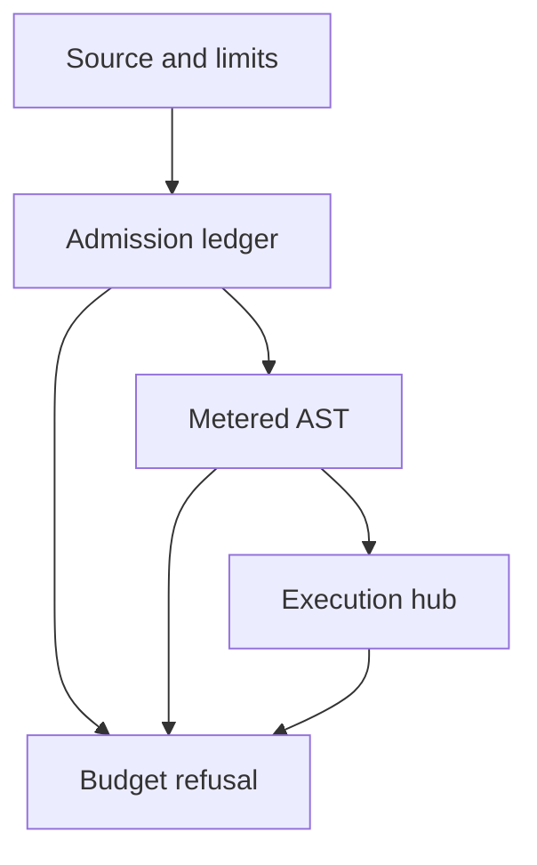

# The parser and interpreter account for depth and live storage

Draft implementation contract from the November 22, 2026 review of `cbda2721`.

Verified against `dev` at `5a823ea` and amended on 2026-11-22 (`agents/2026-11-22-shell-review/reviews/verification.md`). Every problem reproduced but one, and two claims are corrected. The pipeline-stage allowance already counts the final stage: a limit of 1 refuses `a|b` and 2 refuses `a|b|c`; only a limit of 0 admits a single command, and that is the whole of that row. Expanded arithmetic is bounded today by the fixed `PARSE_DEPTH`, and 200,000 parentheses end in an arithmetic error at exit 1, not a native stack overflow; the decision replaces a fixed bound by the configured one. Deep `!` and nested builtins overflow only the native build's stack; the wasm build already classifies them 137. The native build is the test reference host, not an embedding surface, so the draft's promises to native embedders (a source-compatible public `parse`, per-instance charges for shared external trees) are not constraints; the native stack and memory fixes still matter for the corpus. The balanced-subscript row is wider than stated: `a[$(( 1 + 1 ))]=x` and `a[$(echo 1 2|wc -w)]=x` also fail.

## The outcome wanted

A complete line is admitted under its parse allowances; structural descent and retained interpreter storage keep their declared bounds in native and Wasm builds. A printed function reparses with its original behavior.

## Builds on

Own syntax/{parser,ast,arith}.rs, machine/{arith,deparse,vars,exec,io}.rs and the budget-aware sinks used by printf, read, mapfile, sed and tr. The builtin and filter specs own observable command semantics. This spec owns their allocation, release and depth obligations. Apply the existing known-failure and depth spec to the same parser entry points. The default-depth native debug corpus overflow is an observed symptom whose call site needs measurement.

This work can start against the reviewed implementation.

## Design

## The problem

- The parser reconstructs the delimiter from parsed word nodes, dropping nonliteral child nodes in a double-quoted delimiter. Literal data in generated shell source can end up being parsed as commands. Any resulting effects run with the submitting caller’s authority. The existing known-failure list already records the underlying delimiter-handling discrepancy.
- Forked variable tables are cloned without charging, then child changes can release charges still owed by the parent. Scope removal can leave charges for values already discarded. Associative maps also allocate 1,024 bucket headers whose cost is omitted from their footprint.
- Repeated printf formatting, file-backed read/mapfile, tr repeat expansion, multi-operand sed and process-substitution captures can allocate full temporaries first. Native embedders lack the independent Wasm memory ceiling.

## Decisions

### 1. Parse a here-document delimiter as a quote-removal word, preserving literal expansion-like spellings.

Retain quoting as the switch controlling expansion of the body. Apply <<- tab stripping and delimiter matching according to the recorded Bash oracle. A parse-failing line issues zero requests, including work textually before the failure. Parent and all nested parsers share one checked remaining token counter, including a final unquoted document. Count each stage at insertion including a single final command; a zero stage limit permits empty input and rejects any actual pipeline. Never accept a counter overflow.

### 2. Retain source in one shared immutable buffer, line offsets in one owned array and function source as spans into it.

Include retained syntax nodes, strings, vectors and offset storage in the logical allowance. Charge owned requested capacities using checked element-count times element-size arithmetic before growth. Copy-on-write shells carry one charge per shared backing allocation plus charges for per-owner records. Mutating a child charges its private copy; popping an owning scope releases exactly that scope. Charge associative-map bucket capacity even when empty. Use a single runtime charge guard with rollback on failure and release on final owner drop. Logical limits count owned payload and reserved capacities, excluding allocator overhead and stack frames; the independent Wasm ceiling still bounds module memory.

### 3. Repeated printf padding and -v assignments, file-backed read/mapfile accumulators, tr repetitions, sed input/staged output and substitution captures reserve memory before extending.

Stream or represent repetitions compactly where the output contract permits. Include compound temporaries whose lifetimes overlap. With nested buffers or early return release the reservation once. Already completed independent writes survive a later resource refusal; staging a sed replacement is subject to the publication spec.

### 4. Use the configured parse depth for parsing expanded arithmetic too.

Count simultaneously open constructs and arithmetic chain depth consistently with the depth accounting defined by the current parser contract; a depth of N permits N and refuses N+1. A dynamic expression exceeding this bound ends execution with a typed budget failure at 137; a parse-time failure retains exit 2 and zero effects. Replace recursive builtin/command wrapper dispatch and unary argument-test evaluation by iterative dispatch. Check nested parenthesized argument tests against execution nesting. Preserve short-circuiting and ordinary status 2 for syntax errors within an executed test. No unchecked guest expression should consume an unbounded native call stack.

### 5. Recognize assignment after the complete balanced array subscript, including spaces and quoted or nested subexpressions.

Keep source spans for arithmetic bodies, here-documents, conditional grouping, timed pipelines and stderr-pipe metadata. Function rendering emits a Bash definition whose reparsed body has equivalent control flow, descriptor behavior and document delimiters; exact formatting follows the pinned oracle for corpus cases that compare it. The printed source is an observable API and may be parsed in a separate run.

### 6. Run the full unmodified native corpus in the standard cargo debug test profile with default external stack settings and in the CI release profile.

Localize the overflowing case using per-case progress in an isolated test process. Repair deep interpreter paths with explicit stacks/checked descent where applicable. If the excess frames are isolated to the test harness, launch that corpus runner on a documented 16 MiB stack internally and include a focused default-stack test for the actual public parser or machine entry path implicated. Do not hide an interpreter stack fault by only changing the harness. Keep a small-stack test for a low configured limit and retain Wasm trap containment.

## Interfaces and edge cases

### Admission and depth

Initialize an ownership ledger before Machine::new calls the parser. Introduce a metered parser entry which accepts parse limits and an allocation reservation/transfer handle. Charge source once on admission; subparsers borrow it and the shared token balance. Carry the ledger from parser into Hub without allocating or charging the tree again. Keep public parse(source, ParseLimits) source-compatible as the syntax-only API; it enforces syntax limits and reports the tree’s accounted footprint without claiming to enforce a caller-unsupplied runtime memory limit. Public from_script validates the admitted tree’s footprint and spans against the supplied source, charges shared storage once to the new line and returns execution-budget/137 if it does not fit. Keep syntax-only parse budget errors distinct (status 2) even when discovered during constructor work; logical memory exhaustion is 137 both during tree growth and after handoff. Check source length first, then parser admission as allocations occur. Dynamic arithmetic is a runtime limit with status 137. Define every push into a counted grammar/AST construct as one nesting unit; count the first construct as one, parentheses or unary/arithmetic chain nodes once each, and omit helper grammar-function frames. Record the counted nesting value in boundary fixtures.

Use pre-reservation with a tracked capacity-changing helper or an explicitly charged replacement buffer; avoid unmetered geometric growth from ordinary push/extend. Charge backing allocation plus owned child payloads once. On a failed growth the original value remains valid, and the temporary reservation is released. Native reference instances each pay the full accounted size of shared externally supplied immutable trees admitted into their own line. This makes two concurrent independent lines enforce their own ceilings even if Rust shares one immutable tree physically.

## Acceptance criteria

1. At each configured boundary test below, equal and above: final here-document token merge; zero/one/two pipeline stages; source and expanded arithmetic; and argument-test nesting. Verify error class, status, output, and whether any earlier command was dispatched. For escaped/quoted delimiters assert actual AST command counts and literal body bytes. Exercise whitespace within a valid indexed assignment.
2. Measure charged high-water marks during fork, child assignment, unset, function return, empty associative maps, repeated format conversions, multi-operand sed and large records using small budgets. Confirm releases on clean and fatal exits, and no failed allocation before a budget refusal. Compare printed and reparsed function definitions with the Bash recorder. Run both corpus profiles with the environment stack override unset.

## Regression cases

| Behavior | Check through the normal entry point | Reviewed source |
|---|---|---|
| Here-document delimiters preserve their quoted spelling | Compare delimiter text, body boundaries and following AST nodes against the pinned corpus. Include an ordinary near-match before the terminator and verify that body text produces no command nodes. | [syntax/parser.rs L1317](https://github.com/ClayGendron/vfs/blob/cbda27211fe165099c4843dad1464df6c8da0fe1/crates/vfs-shell/src/syntax/parser.rs#L1317) |
| Shell memory accounting follows variable ownership | Measure live usage before a fork, after independent assignment and after scope exit. Empty and single-entry maps incur their actual storage cost, and repeated completed calls return to baseline. | [machine/shell.rs L344](https://github.com/ClayGendron/vfs/blob/cbda27211fe165099c4843dad1464df6c8da0fe1/crates/vfs-shell/src/machine/shell.rs#L344) |
| Shell operations charge temporary buffers before growth | Use small configured limits and modest inputs across printf, read, mapfile, tr, sed and process substitution. Record peak charged bytes and verify ordinary output at an adequate limit. | [machine/printf.rs L23](https://github.com/ClayGendron/vfs/blob/cbda27211fe165099c4843dad1464df6c8da0fe1/crates/vfs-shell/src/machine/printf.rs#L23) |
| Expanded arithmetic respects the configured depth | Check an ordinary expression at its exact configured boundary, one beyond it, and the same expression read from a variable. | [machine/arith.rs L43](https://github.com/ClayGendron/vfs/blob/cbda27211fe165099c4843dad1464df6c8da0fe1/crates/vfs-shell/src/machine/arith.rs#L43) |
| Runtime builtin dispatch bounds recursive evaluation | Use small limits and ordinary argument lists immediately on either side of each boundary. Confirm the native and Wasm entry points return a classified result. | [machine/test.rs L491](https://github.com/ClayGendron/vfs/blob/cbda27211fe165099c4843dad1464df6c8da0fe1/crates/vfs-shell/src/machine/test.rs#L491) |
| Here-document parsing shares the line token allowance | Use a small token allowance and an ordinary final document whose two parser counts straddle it. Verify admission at the boundary and zero effects on refusal. | [syntax/parser.rs L393](https://github.com/ClayGendron/vfs/blob/cbda27211fe165099c4843dad1464df6c8da0fe1/crates/vfs-shell/src/syntax/parser.rs#L393) |
| The parsed shell tree accounts for retained source storage | Measure the footprint for nested ordinary definitions and multiline input. Verify the recorded size tracks retained storage and a small allowance refuses admission. | [syntax/parser.rs L1078](https://github.com/ClayGendron/vfs/blob/cbda27211fe165099c4843dad1464df6c8da0fe1/crates/vfs-shell/src/syntax/parser.rs#L1078) |
| The pipeline stage allowance covers the final stage | Cover zero, one and two permitted stages. A rejected line performs no host effects. | [syntax/parser.rs L563](https://github.com/ClayGendron/vfs/blob/cbda27211fe165099c4843dad1464df6c8da0fe1/crates/vfs-shell/src/syntax/parser.rs#L563) |
| Array assignment recognizes balanced subscript expressions | Compare a spaced arithmetic index and its compact equivalent with Bash. Verify array contents, exit status and absence of program dispatch. | [syntax/parser.rs L1347](https://github.com/ClayGendron/vfs/blob/cbda27211fe165099c4843dad1464df6c8da0fe1/crates/vfs-shell/src/syntax/parser.rs#L1347) |
| Printed shell functions preserve their parsed behavior | Round-trip definitions containing arithmetic, a here-document, a grouped conditional and piped stderr. Compare output, status and file effects before and after rendering. | [machine/deparse.rs L66](https://github.com/ClayGendron/vfs/blob/cbda27211fe165099c4843dad1464df6c8da0fe1/crates/vfs-shell/src/machine/deparse.rs#L66) |
| The native shell corpus runs on the default debug test stack | Run the unmodified corpus in debug on a clean environment with the default external stack settings, then in the release CI profile. Verify the recorded corpus result and retain a focused regression for the measured cause. | [corpus.rs](https://github.com/ClayGendron/vfs/blob/cbda27211fe165099c4843dad1464df6c8da0fe1/crates/vfs-shell/tests/corpus.rs#L12) |

## Verification

Use the pinned recorder and its environment in [the shell corpus](../../tests/shell/README.md) for observable Bash/GNU behavior. Run the affected crate laws and the release corpus with `cargo test --release -p vfs-shell -p vfs-shell-wasm`. Exercise public-host behavior with `uv run pytest tests/shell` and the PostgreSQL-marked engine cases when a storage contract changes. Record intentional VFS deviations alongside the corpus fixtures. A case moves out of the known-failure list only when its recorded assertions pass.

Add the regression `parse_and_execution_share_one_allocation_ledger` to [crates/vfs-shell/tests/laws.rs](../../crates/vfs-shell/tests/laws.rs). Update [documentation/reference/shell.md](../../documentation/reference/shell.md) in the implementation change with the observable contract and intentional VFS differences. For a Python test use the standard test_ prefix.
