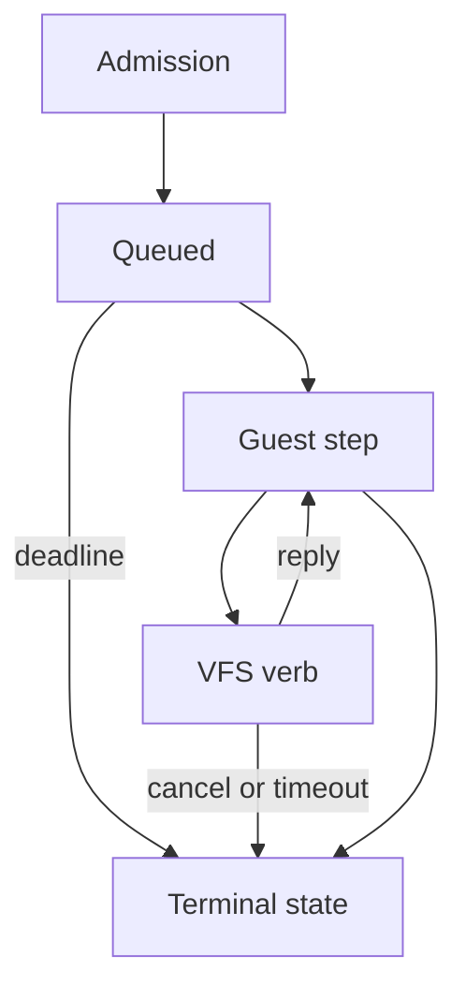

# A shell line has one admission budget and one terminal outcome

Draft implementation contract from the November 22, 2026 review of `cbda2721`.

Verified against `dev` at `5a823ea` and amended on 2026-11-22 (`agents/2026-11-22-shell-review/reviews/verification.md`). Every problem reproduced. The design stands, with two notes. The `search -n` limit moved to `src/vfs/shell/programs.py` with the served verbs: 0, a word, -1 and a non-ASCII digit are already usage errors, and the open cases are a value past the verb's maximum, which is dispatched, and a 5000-digit value, which raises `ValueError` out of `run_line`. The drain for an uncooperative router serves a custom Python `Router` handed to the public `run_line`, not a third-party Wasm host, so it stays. Two findings beyond the draft: the `slice` limit has no effect in the product, because the wasm build replaces the operation counter with its probe, and a fork during cold initialization hangs the child on the `RUNTIME` cell, which the ticker's PID check does not cover.

## The outcome wanted

A line can be refused before guest construction, expire while queued or waiting for storage, or finish normally. Every caller sees the stop that actually occurred.

## Builds on

Own the Python driver and native construction/step boundary, the Wasmtime epoch callback, worker lifecycle, and shared fatal state in machine/exec.rs and machine/io.rs. Preserve AsyncVirtualFileSystem, session and sync facade result semantics. Build atop current Deadline and offload APIs. The proposed verb-count budget and pool isolation in the existing November 21 budget spec are independent future work. This spec applies to the currently shared pool.

These contracts are implementation prerequisites. [Shell wire messages are exact and instance transitions are explicit](../2026-11-22-shell-wire-and-instance-lifecycle/spec.md).

## Design

## The problem

- Python snapshots the remaining duration before queueing construction. Rust adds it to a later clock reading after input conversion. During execution, a VFS verb can remain suspended beyond the deadline because Python awaits the verb without a timeout. Pending requests from a batch can also begin after expiry. A Wasm epoch check only runs when the guest is executing.
- The Python binding copies stdin and formats a complete wire document before entering the Wasm guest. Serialization and conversion can hold the GIL while unrelated callers wait.
- The background scheduler converts a fatal interpreter condition into an ordinary job status and drops the flush result. The foreground can continue and the enclosing call can report success after an interpreter-level limit is spent. The separate Wasm fuel and memory limits still apply.

## Decisions

### 1. Create a shared line control before submitting work.

It carries an immutable absolute Python monotonic deadline and a thread-safe cancellation flag accessible without the constructed machine. Cut remaining duration on entry to the running worker, immediately convert once to a Rust Instant and carry it through encoding, instantiation and execution. Active guest work checks it at the existing epoch callback. Recheck the absolute deadline before and after every await and before dispatching each request in a batch. Bound the queue wait and outstanding verb await by remaining time using the caller’s clock. A deadline during admission, host I/O or guest execution yields timeout/124. An externally cancelled Python await cancels the control and re-raises its original CancelledError; a machine cancel delivered through the native interface yields cancelled/130.

### 2. A published VM/host fatal stop is line-wide, first observed wins.

Before dispatch, prefer externally requested cancellation, then expired deadline, then new execution. Latch a background interpreter budget just as in foreground. Stop polling other jobs for effects, discard undispatched requests, release descriptors and staged buffers without final data writes, retain output and pipeline statuses completed before the stop. Never replay an in-flight mutation. Cancel its await under the storage cancellation protocol. A write committed before an interrupt stays committed; the line can report timeout while that effect exists. Stop admitting new work even during cleanup. Settle in-flight work according to the engine-specific rules below; the clock cannot undo a storage commit.

### 3. Bound shell-owned native buffers separately from the guest’s hard memory ceiling.

Use the configured memory_bytes value for the per-line total of live copied host payloads and wire workspaces, excluding caller-owned source objects, process-wide compiled code and allocator overhead. Charge actual requested capacity before allocation, release at ownership transfer/drop, and account for overlapping payload and serialization buffers. Retain the distinct source_bytes limit on raw UTF-8 source. Preflight length/overflow on borrowed Python data before extracting Vec or formatting JSON/base64; cap an encoded document by the remaining host budget. Scan Unicode without constructing an unbounded temporary UTF-8 copy. Move encoding, decoding and Wasmtime calls outside the GIL; acquire it only for bounded Python extraction and result construction. Count duplicate buffers while both exist. Reject parse source-length exhaustion at status 2; failure of the independent host or module memory budget is budget_exhausted/137. A trusted explicit larger limit changes the per-line allowance. Bound page sizes and replies before materializing them under the file-read spec.

### 4. Validate fuel before native extraction as a Python integer in [0, 2^64−1], excluding bool; None retains the current default.

Invalid input returns invalid/2. Parse search -n by a bounded decimal scan, with lexical treatment of non-ASCII or non-digit words unchanged. For recognized decimal values use the search PARAMS maximum, currently 1 through 2^31−1, reject zero/overflow with usage diagnostic and status 2, and make zero search requests on refusal. Count leading zeros without building a large integer. Keep the existing ordinary command-versus-call success convention.

### 5. Preserve typed startup causes across binding and Python: syntax/refusal/parse budget use 2 with the existing classifications; execution fuel, module/host/logical memory use 137 and budget_exhausted; deadline uses 124; external machine cancel uses 130; unexpected runtime failure uses 1/internal.

Initialization failure before any step yields empty statuses and no filesystem effects. Both slice and fuel_slice remain public. Yield at the next cooperative checkpoint once either the operation counter or spent slice fuel reaches its threshold. Zero means yield after at least one unit of progress, never a permanently empty step. Total fuel and deadline remain hard guest limits even between checkpoints.

### 6. A supported Unix child must start a fresh pool, engine singleton, epoch record, ticker and process-local synchronization.

Use a PID-tagged native runtime holder with a newly allocated per-process initialization cell published by atomic compare/exchange before any inherited lock can be entered. Initializers that lose the race use the published cell. In the forked child abandon inherited cells without locking, destroying or joining inherited Wasmtime state. The parent retains its own cells and ticker. Inherited machine objects reject step/cancel under a different creator PID before touching their mutex; return the existing internal failure for a stale step and make stale cancel a no-op. Public fs.cli in a child creates a new instance; warm and concurrent parent initialization must not change that contract.

## Interfaces and edge cases

### Queueing, transactions and validation

Expose a private construct/step path that takes the pre-created control token. A queued work item checks it immediately before doing any conversion or starting the engine. If an externally cancelled await abandons a queued constructor, the worker observes the cancelled token when dequeued and releases the slot without constructing an instance. A running constructor can observe the token before encoding, between bounded encoding chunks, before guest start and from the epoch callback. Code compilation that Wasmtime cannot interrupt is shared process setup; it owns no caller data or authority and cannot issue VFS effects.

Follow the [storage cancellation contract](../../documentation/maintainers/cancellation.md) on **external cancellation**. Signal the verb task and await settlement through the existing database cancellation path. A SQLite statement ends and its transaction has rolled back (or a commit already started has completed) before re-raising the identical external exception. Preserve additional external cancellation requests; cleanup must not replace or suppress the caller's exception. Test in-memory SQLite, file SQLite and PostgreSQL with the existing storage cancellation barriers. A shell **deadline** stops dispatch at expiry. Where no storage attempt is in flight, return timeout/124 immediately. Where an attempt is in flight, cancel it and await its storage settlement before exposing the timeout; a database cleanup tail can therefore extend elapsed time beyond the deadline. Distinguish the deadline for starting work from database cleanup completion explicitly in the public reference. On an uncooperative third-party router await that cannot confirm settlement, abandon its return value, register it with the router’s close-time drain, forbid new dispatch by the line, and document the possible committed outcome. A later external cancellation during settlement takes precedence for the Python await. Never run a detached retry.

Use checked envelope sizing before constructing PyO3-owned copies. Validate source_bytes independently, then size quoted UTF-8 source and strings, base64 payload, fixed syntax, collection entries and live return buffers. Count retained capacities including key and metadata slots at the point of allocation; release promptly. A host that receives a custom Router’s already-built oversized object can refuse to copy it, but cannot bound that external router’s private allocation. Document that distinction. With both native and interpreter live budgets set from memory_bytes, each applies separately; the process total can exceed one such allowance. Long-lived allocator/runtime and process-wide concurrency need separate accounting.

For search use the actual search limit from src/vfs/params.py, including its minimum and maximum. The first decimal outside this range is usage 2, with no underlying search call. On CLI budget failures preserve successful preceding pipeline history, never invent an entry for a command that was not started, and retain a precise stop tag (parse budget vs execution budget vs host memory). The Python ShellMachine constructor’s existing four-element ValueError for parse failures stays accepted; carry runtime stops across a distinct internal exception with reason, status and measured fuel, and translate it only at the public run_line boundary.

On a closed/rejected executor, obtain a fresh live pool and submit once under the same deadline. If still rejected return internal/1 without guest work. The shell never uses the generic executor’s inline fallback for native construction or stepping on an event-loop thread. The adapter owning the router keeps a set of unsettled third-party verb tasks. Router close first stops admission, requests cancellation and drains this set before storage shutdown; direct run_line against a third-party Router uses an equivalent externally owned driver or awaits settlement in the call itself if the router supplies no drain owner. For PostgreSQL a transaction that had entered commit can have landed; wait for the database attempt’s own terminal result before reuse of a connection. On SQLite protect cleanup from repeat cancellation as the existing storage helper does. Verify immediate subsequent use of the same storage after external cancel.

Post-fork disposal is PID-gated, including Python deallocation, Rust Drop and interpreter/process teardown. In the child deliberately abandon inherited native objects without running destructors for parent-owned stores, mutexes, threads or engines. Store them behind a process-tagged owner supporting this behavior; a mere PID test inside step is insufficient. The OS reclaims inherited allocations at child exit. Native objects newly created in the child take normal destruction paths. Test child collection of the last inherited wrapper, cold and warm parent initialization, parent reuse, and a new line in the child. Applies to Unix fork on supported CPython hosts; spawn/exec creates ordinary fresh state. This does not add fork support to unrelated rayon operations.

## Acceptance criteria

1. Use deterministic queue, before-dispatch and in-verb barriers, a controllable deadline, and a commit/return seam. Test expiry at each and queued cancellation before machine construction. Assert terminal kind, exit status, completed history and number of later dispatched requests. Release barriers, join workers and check active resource counts. Verify both committed and uncommitted outcomes of a single interrupted write without retries.
2. On tiny configured limits measure bytes reserved before conversion and the number of encoders entered. Use test doubles to verify a queue delay cannot reset the deadline. Compare startup and step classification for equivalent stops. Run zero and ordinary operation/fuel slices and count progress and yields. On Unix use bounded subprocess tests for cold/warm fork, fork alongside initialization and inherited-object rejection. Recheck parent and child independently.

## Regression cases

| Behavior | Check through the normal entry point | Reviewed source |
|---|---|---|
| A shell deadline covers queued work and VFS verbs | Use controlled queue and verb barriers. Advance a test clock at each barrier and assert timeout status and zero later dispatches. Cover an in-flight operation that had already committed. | [src/vfs/shell/host.py L244](https://github.com/ClayGendron/vfs/blob/cbda27211fe165099c4843dad1464df6c8da0fe1/src/vfs/shell/host.py#L244) |
| The shell checks native request sizes before encoding | Use small configured limits and conversion counters. Confirm rejection precedes encoding and check that an admitted request still produces the same guest input. | [crates/vfs-core/src/shell_binding.rs L79](https://github.com/ClayGendron/vfs/blob/cbda27211fe165099c4843dad1464df6c8da0fe1/crates/vfs-core/src/shell_binding.rs#L79) |
| A fatal budget ends every job in a shell line | Under a small limit, test both foreground and background termination with a recording host. Assert the line status, reason and absence of later mutations. | [machine/exec.rs L219](https://github.com/ClayGendron/vfs/blob/cbda27211fe165099c4843dad1464df6c8da0fe1/crates/vfs-shell/src/machine/exec.rs#L219) |
| Shell search limits return classified usage errors | Check ordinary, out-of-range and nonnumeric arguments at the public shell entry point. Assert exit status, diagnostic and whether search was dispatched. | [src/vfs/shell/host.py L449](https://github.com/ClayGendron/vfs/blob/cbda27211fe165099c4843dad1464df6c8da0fe1/src/vfs/shell/host.py#L449) |
| Invalid shell fuel returns a classified result | Test a valid boundary, zero, a negative value, a boolean and an out-of-range integer. Assert invalid inputs return classified errors before native construction. | [src/vfs/shell/host.py L237](https://github.com/ClayGendron/vfs/blob/cbda27211fe165099c4843dad1464df6c8da0fe1/src/vfs/shell/host.py#L237) |
| The shell preserves startup stop reasons | Compare identical runtime stop reasons at creation and stepping. Assert timeout 124 and execution-budget 137 and retain the separate parse-budget status 2 fixture. | [crates/vfs-core/src/shell_binding.rs L128](https://github.com/ClayGendron/vfs/blob/cbda27211fe165099c4843dad1464df6c8da0fe1/crates/vfs-core/src/shell_binding.rs#L128) |
| Shell runtime initialization is safe across a supported fork | Use controlled initialization barriers to check the chosen lifecycle protocol, with bounded test cleanup. Retain the existing warm, quiescent fork test and check that the child starts its own epoch handling. | [crates/vfs-core/src/shell_binding.rs L280](https://github.com/ClayGendron/vfs/blob/cbda27211fe165099c4843dad1464df6c8da0fe1/crates/vfs-core/src/shell_binding.rs#L280) |
| The Python shell exposes an effective slice setting | Run a finite command under distinguishable thresholds with a counted yield probe. Verify that each accepted setting affects cadence as documented and preserves the command result. | [src/vfs/shell/host.py L57](https://github.com/ClayGendron/vfs/blob/cbda27211fe165099c4843dad1464df6c8da0fe1/src/vfs/shell/host.py#L57) |

## Verification

Use the pinned recorder and its environment in [the shell corpus](../../tests/shell/README.md) for observable Bash/GNU behavior. Run the affected crate laws and the release corpus with `cargo test --release -p vfs-shell -p vfs-shell-wasm`. Exercise public-host behavior with `uv run pytest tests/shell` and the PostgreSQL-marked engine cases when a storage contract changes. Record intentional VFS deviations alongside the corpus fixtures. A case moves out of the known-failure list only when its recorded assertions pass.

Add the regression `deadline_and_external_cancel_settle_at_commit` to [tests/shell/test_host.py](../../tests/shell/test_host.py). Update [documentation/maintainers/cancellation.md](../../documentation/maintainers/cancellation.md) in the implementation change with the observable contract and intentional VFS differences. For a Python test use the standard test_ prefix.
