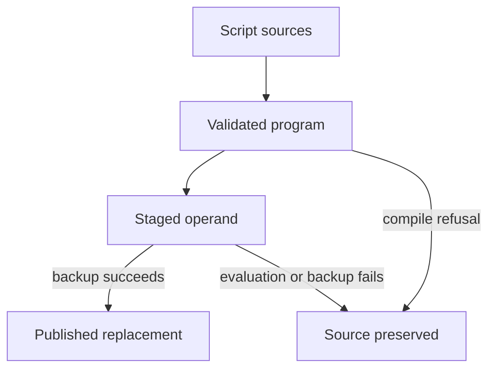

# Sed validates its script and commits completed edits in order

Draft implementation contract from the November 22, 2026 review of `cbda2721`.

## The outcome wanted

A restricted script is validated before auxiliary I/O, and an in-place edit publishes one complete replacement per successfully processed source file.

## Builds on

Own the option/compiler/execution interfaces in programs/sed.rs and run_sed in programs/mod.rs. Coordinate raw byte retention with “Filters and matching” and versioned input identity with “File reads and metadata”. Delegate mutations to existing caller-authorized VFS write checks. Keep the logical memory charges specified in “Parsing and live memory”.

These contracts are implementation prerequisites. [File reads and metadata remain bounded and caller-authorized](../2026-11-22-shell-file-reads-and-metadata/spec.md), [The parser and interpreter account for depth and live storage](../2026-11-22-shell-parsing-and-memory/spec.md).

## Design

## The problem

- The bundled help promises that sandbox mode disables script file access. Option parsing discards the flag. The compiler can still accept script reads and writes, which the adapter performs with the caller’s rights. Applications accepting someone else’s sed script under that flag give the script more access than intended.
- The interpreter queues the current file’s replacement before checking the evaluation result. The adapter applies the queued writes even on an error status.
- The backup and source replacement are independent writes. A refused backup records an error while leaving the source write in the queue.

## Decisions

### 1. Parse command-line options, read explicit -f sources under caller authority, compile all -e and -f fragments in their original order, validate, then read operands and request script-directed I/O.

In --sandbox refuse GNU restricted e/r/R/w/W and the executable/write forms of s, including constructs nested in branches and unused addresses. Match the pinned sed diagnostic class and status 1 on compile rejection. Reading an explicit -f source is necessary to validate it. No operand read, auxiliary read/write, backup or replacement is allowed after validation fails.

### 2. Resolve auxiliary reads from the compiled program regardless of how the script was supplied.

Preserve GNU r and R handling of absent files, order of appended text and per-file read position, and retain VFS refusal warnings. A filename spelled dash in a w/W or substitution-write instruction is an ordinary filename. A dash in an input-operand position retains its stdin meaning. Script w targets are opened only after complete script validation. Applied auxiliary writes have their ordinary independent effects.

### 3. Carry the original bytes of each input record, its delimiter and its terminated flag.

For a completely valid UTF-8 input retain the existing Unicode sed semantics. For input with invalid UTF-8 use a reversible byte representation throughout pattern/hold spaces, captures, literals, substitution and output: valid scalars remain scalars, each invalid byte is a distinct opaque unit, copies and backreferences preserve its original byte, dot matches one unit and Unicode character classes exclude opaque units. Re-encode scalars as UTF-8 and emit opaque units as their original byte. Record splitting and NUL-delimited mode operate on raw delimiters. This keeps an identity edit byte-exact.

### 4. Use one per-operand edit result with original content identity, staged output and termination kind.

Publish on normal completion or deliberate q/Q (including its explicit shell exit status). Discard the current replacement on evaluation fault, read error, failed output preparation, cancellation or exhausted budget. Earlier published operands stay committed. Execute backup then replacement in sequence. A refused backup returns sed I/O status 4 and stops that pair; stop further in-place operands on publication failure. A successful backup followed by a refused replacement leaves the backup intact. Never replay a partially completed pair blindly.

### 5. Use the public conditional write with the observed source version for replacement.

Preserve the host’s existing write permissions and version conflicts. A backup is a copy of the bytes used as input and uses the requested suffix policy. On an ordinary backup write failure do not truncate the source. Refuse with status 4 before either write if backup and source normalize to the same VFS path. Record a concurrent source change as a publication error, leave the newer source intact and preserve an already written backup. Native MemoryHost models the same precondition; use the additive guarded-write capability specified under “File reads and metadata”. This is per-file publication, with two visible VFS operations when a backup is requested.

## Interfaces and edge cases

Keep the source representation from read_open (text or bytes) for backup and replacement. A UTF-8-valid bytes-sourced input remains bytes even if the replacement happens to decode as text. Reject before publication if a text-sourced replacement cannot be encoded as valid UTF-8. Write each backup as a single public write with the original representation. Resolve GNU suffixes literally when they contain no star and substitute the input filename at every star otherwise. When the backup target is distinct from the source, GNU-style overwrite of an existing backup uses the ordinary authorized write contract. If a backup target resolves to another operand, process the operands sequentially in argv order and reopen each on its turn. Preserve the no-backup form. For an unchanged edit, preserve bytes, status and requested backup semantics even if VFS deduplicates an identical replacement.

Use an ordered sequence of output effects or a per-operand callback from the sed evaluator rather than a flat final writes vector. Tag writes as an auxiliary stream, backup or guarded replacement, with their file/operand association. A restricted compile failure produces zero effects. An already-opened auxiliary output is independent of a later source-edit fault. Test its ordering and status separately from in-place publication. An auxiliary write refusal is an I/O failure and prevents unfinished source publication.

Compile the complete script first. Then open validated script w targets (including s///w) in script order, before first input, as GNU does even for an unreachable address. An open/truncate refusal aborts the run with status 4 before any source read or publication. Resolve r/R at their execution/display points following the pinned GNU result, retaining per-command read cursors for R. Process each in-place operand from open to guarded publication before opening the next; never preload operands into a path-keyed snapshot. If operand names alias, the second occurrence observes the first occurrence’s committed result. A w target aliasing the source has its own earlier, explicitly requested side effect; the source-preservation assertion on a later fault refers to the bytes at edit-open, after those opens. Include alias and repeated-path fixtures.

A sed-local runtime evaluation fault reports the existing GNU-compatible diagnostic and nonzero utility status (the missing-previous-regex case uses 1); a shared interpreter or host budget is line-fatal/137 and stops all operands. With -i each named input is a separate stream for file state, but q/Q exits the invocation after publishing the current eligible file and never opens later operands. Bash exit-status tests and byte-preservation tests check these as separate outcomes.

## Acceptance criteria

1. Drive the normal sed adapter with ordered host replies. For a two-file edit check success of file one and a fault in file two, a refused backup, a successful backup followed by conflict, and a successful q with a nonzero requested status. Assert exact file/backup bytes, writes, exit status and warning/error classifications including absence of later writes.
2. Reference-check inline, file and mixed scripts with a valid auxiliary read and literal dash output. Include blank, unterminated, invalid UTF-8 and NUL-delimited records, identity edits and a replacement that copies an opaque capture. Assert bytes from VFS read, before CLI display decoding. Check logical memory refusal before publication when staging exceeds the line’s allowance.

## Regression cases

| Behavior | Check through the normal entry point | Reviewed source |
|---|---|---|
| sed enforces sandbox mode when compiling a script | Use a recording host with ordinary input and output paths. A restricted script returns a diagnostic and issues zero auxiliary file requests. A pure substitution still succeeds. | [programs/sed.rs L74](https://github.com/ClayGendron/vfs/blob/cbda27211fe165099c4843dad1464df6c8da0fe1/crates/vfs-shell/src/programs/sed.rs#L74) |
| An in-place sed edit preserves its source on evaluation failure | Use an injected evaluation error after ordinary output has been buffered. Compare the original bytes and replacement count, and cover an explicit successful quit separately. | [programs/sed.rs L1332](https://github.com/ClayGendron/vfs/blob/cbda27211fe165099c4843dad1464df6c8da0fe1/crates/vfs-shell/src/programs/sed.rs#L1332) |
| An in-place sed edit requires its requested backup | Refuse the backup on a fake host. Assert the original survives and its write count is zero. On success, verify that the backup contains the original bytes. | [programs/sed.rs L1332](https://github.com/ClayGendron/vfs/blob/cbda27211fe165099c4843dad1464df6c8da0fe1/crates/vfs-shell/src/programs/sed.rs#L1332) |
| sed preserves bytes during an in-place edit | Compare checksums of a mixed text and non-UTF-8 fixture before and after an identity edit. Check stream output at the byte boundary before display decoding. | [programs/sed.rs L2171](https://github.com/ClayGendron/vfs/blob/cbda27211fe165099c4843dad1464df6c8da0fe1/crates/vfs-shell/src/programs/sed.rs#L2171) |
| File-loaded sed scripts receive their auxiliary reads | Compare inline, file-loaded and mixed scripts against the same small auxiliary file. Check output, status and the authority on each read. | [programs/sed.rs L128](https://github.com/ClayGendron/vfs/blob/cbda27211fe165099c4843dad1464df6c8da0fe1/crates/vfs-shell/src/programs/sed.rs#L128) |
| Sed file writes preserve a literal dash filename | With a fixture directory, compare a sed write to the dash filename with GNU sed. Check file contents and stdout separately and retain stdin-alias behavior where appropriate. | [programs/mod.rs L242](https://github.com/ClayGendron/vfs/blob/cbda27211fe165099c4843dad1464df6c8da0fe1/crates/vfs-shell/src/programs/mod.rs#L242) |

## Verification

Use the pinned recorder and its environment in [the shell corpus](../../tests/shell/README.md) for observable Bash/GNU behavior. Run the affected crate laws and the release corpus with `cargo test --release -p vfs-shell -p vfs-shell-wasm`. Exercise public-host behavior with `uv run pytest tests/shell` and the PostgreSQL-marked engine cases when a storage contract changes. Record intentional VFS deviations alongside the corpus fixtures. A case moves out of the known-failure list only when its recorded assertions pass.

Add the regression `in_place_edit_orders_backup_and_replacement` to [tests/shell/test_host.py](../../tests/shell/test_host.py). Update [documentation/reference/shell.md](../../documentation/reference/shell.md) in the implementation change with the observable contract and intentional VFS differences. For a Python test use the standard test_ prefix.
