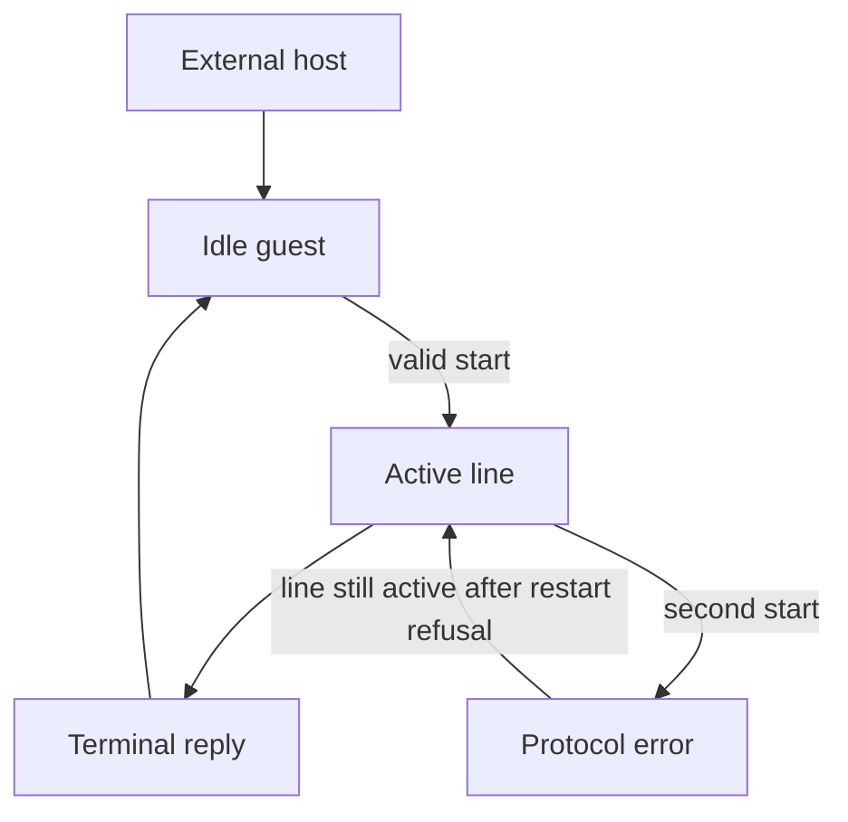

# Shell wire messages are exact and instance transitions are explicit

Draft implementation contract from the November 22, 2026 review of `cbda2721`.

## The outcome wanted

The bundled Python runtime and third-party Wasm hosts agree on Unicode, integers, mutation schemas and the identity of the active line after any protocol error.

## Builds on

Own crates/vfs-shell-wasm/src/{wire,lib}.rs and the checked buffer transfer in crates/vfs-core/src/shell_binding.rs. Both the existing JSON format and a future binary carrier must meet these semantics. The separate binary-transport spec is active and is not a prerequisite. Build decoder changes before the extended read/list/stat, guarded-write and timer schemas used by the other specs.

This work can start against the reviewed implementation.

## Design

## The problem

- The JSON reader converts escaped UTF-16 code units independently. External encoders that escape supplementary characters can change source, names or paths.
- JSON numbers are converted through a floating-point representation before integer fields are recovered, which rounds large exact values.
- A failed second start leaves the previous instance active. The Python product uses a fresh instance for each line.

## Decisions

### 1. For JSON strings combine an escaped high/low UTF-16 surrogate pair into a single scalar.

Reject lone, reversed or truncated halves as malformed before constructing a request, as well as invalid UTF-8 from the guest buffer. Raw UTF-8 and equivalent valid escaped strings produce identical paths, variables and source. Retain exact integer tokens until the destination field is known, then parse with signedness/range checks for its declared width; reject decimal or exponent spellings in integer-only fields, negatives for unsigned fields and overflow. Keep ordinary fractional fields on their documented path.

### 2. A mutation decoder is fallible for its tag, required fields, field types and enum variants.

A missing or malformed body is invalid; explicitly encoded zero-length data is valid. Reject malformed base64 and duplicate recognized fields. Unknown write modes never fall back to truncate. Reject the whole step document before dispatching any request if any entry is invalid. Bundled host discards the faulty instance, returns internal/1 and dispatches nothing from that document. Extensions may add optional unknown fields; ignore them unless a required feature/version is missing. These rules keep valid existing documents usable.

### 3. Add an optional top-level features list to the start request and repeat negotiated names in the successful start reply.

Absent means legacy behavior. Enable bounded-io-v1 only on explicit mutual acknowledgment. It covers reader open/next/close, paged list, optional stat projections and guarded writes; builtin timeouts require timer-v1. Deploy feature parsing first with both sets empty. Advertise a feature only when its entire provider and consumer ship together; a feature becomes mandatory for bundled startup in that same landing. Once mandatory, an absent acknowledgment returns unsupported/2 before guest effects. External legacy pairs retain the previous request repertoire and existing defaults. Do not send enhanced operations to a host that has not opted in. If an unnegotiated feature is essential for a newly requested operation, return an explicit unsupported command error before any mutation.

### 4. start on an active instance is rejected immediately with a protocol error and leaves its running line and identity intact.

It does not validate or install a replacement. Terminal step consumes the active machine; malformed first start leaves an idle instance idle. A terminal or idle instance can start a new valid line. A step on idle or after termination returns the existing no-active-line error. cancel is idempotent; active cancellation becomes terminal on the next step, and idle cancellation has no effect. Document that an active-start rejection leaves the old line available only through an explicit subsequent step. The bundled Python API still instantiates a fresh guest per line.

### 5. Validate guest output address and length with checked arithmetic against the same current linear-memory view and remaining native wire allowance before allocating or copying on the host.

Accept a zero-length range at the exact memory end; reject addition overflow or a nonempty range beyond the end. A malformed pointer is an internal protocol failure, while a valid range above the configured host allowance is a budget failure. Decode only after validating the entire range. Hold the instance/step guard during validation and copy so that another call cannot relocate the buffer. Never use an unchecked pointer or trust a host-side allocation size supplied only by the guest.

## Interfaces and edge cases

Use the existing JSON request/reply arrays, request keys and base64 alphabet. The following fields are required unless marked optional. Every request uses its existing correlation key. Every reply repeats that key. Reject duplicate keys within a reply batch and unsolicited or already-consumed keys. If transport fails after guest output is buffered, discard that entire undecodable step; prior completed steps keep their outputs and effects.

| Feature and operation | Arguments | Successful reply |
|---|---|---|
| bounded-io-v1 / read_open | path, length (u64, at most 65536); key is the reader ID | opened: bytes (base64), eof (bool), identity (string), source (text or bytes), size (u64). |
| read_next / read_close | reader (original key), offset and length for next only | data: bytes/eof; done for close, idempotent after EOF in this line. Invalid reader or cursor yields error/invalid. |
| list_page | path, after (string or null), page_size (u32), max_bytes (u64) | page: entries (existing entry records), next_after (string or null). |
| stat_meta | path | meta: kind, size, modified_us (i64 or null), can_read and can_write (bool or null), identity (string or null). |
| guarded_write / guarded_remove | path, identity; write also carries data (base64), source (text or bytes); guarded_remove is noncascade | done; stale visible identity yields error/conflict. |
| timer-v1 | Relative waits are carried separately from the outstanding filesystem requests. Optional step output field wake_after_ns is null or u64. | Python supplies an optional monotonic elapsed_ns (u64 since line admission) on each step. Old clients keep sending the JSON reply array; negotiated clients use an object with replies and elapsed_ns. |

Error/unsupported is a normal per-request reply; a malformed negotiated document terminates the line before any requests in it run. The bundled binding may add a separate private timed-step method returning the existing four step fields plus wake_after_ns, keeping the public legacy step tuple and existing direct callers compatible. When a timed read is requested by a legacy external host, allow zero-time readiness and ready data without a timer. For a positive wait that needs a clock, issue an unsupported builtin diagnostic and return 2. Legacy simple reads/listings retain the old request grammar. A legacy host lacking guarded publication refuses in-place sed and guarded interactive deletion before any auxiliary mutation. Capability support belongs to the host implementation, independently of individual backends, which may return unsupported for a particular authorized request.

At the start of a timed step ingest elapsed_ns before running any futures, reject decreasing time with a protocol error and wake due timer IDs. A ready in-memory producer is runnable immediately. Only when no guest task can progress and a timer is pending may the host wait, up to the smaller of wake_after_ns and the line deadline. Keep pending VFS replies in flight and resume on timer or I/O, whichever is ready; queue any later reply by its original key, drop it after a line-fatal stop. A duration of zero requests an immediate progress turn. No change in time is needed for an ordinary running checkpoint. The host cannot infer an internal deadlock simply from an empty request set if a timer is pending.

The independent writer-v1 feature supports open_write(path,mode,data) → written(object) and append_open(path,object,data) → done, or error from either; mode and data have the same validation as write. Object is a line-local opaque token for the underlying object, stable across changes to its body/version. Release it through close_write(object) → done or line teardown. When the feature is introduced, update the module, Wasmtime host, wire stubs and native reference host atomically. Legacy examples and fixtures keep the old hello; unsupported new behavior must fail with a diagnostic before its first side effect. A bundled pair may advertise features independently while these specs land. Decoder tests exercise unknown optional fields, unknown requested features (ignore, omit in acknowledgment), missing required capabilities and unknown operation tags (protocol failure).

State validation order is part of the ABI. A second start while running returns the usual start-error document with kind `protocol`, line/column zero and message `line already active` without consuming a pending request or the existing machine. For idle/terminal, validate length and strict UTF-8, then JSON/schema, then construct a fresh machine. On final Done or Ended clear state before returning the step document. Invalid input to step on a running external Wasm instance poisons and drops that line; the next step reports no active line. Previously emitted output is unaffected. Treat signed minimum and unsigned maximum integers as exact decimal values. Enforce the existing standard base64 alphabet with valid padding, and reject nonzero unused tail bits. Use the same strict schema for the reference adapter and binary carrier when it lands. Document feature states and publish fixtures beside wire_roundtrip.rs.

For legacy step batches require exactly one reply per outstanding request; an empty poll is valid only when none is outstanding. In timer-v1 allow a partial reply set or an empty poll carrying a timer tick. Keep unmatched outstanding requests pending, never redispatch them, and discard remaining replies locally once the machine has ended. Duplicates, unknown keys, stale keys and wrong reply variants poison the complete batch. A failed correlation or decoder validation cannot be retried on that instance. Never replay any previously dispatched operation, including after a host timeout. For a terminal step keep its completed output and status records and drop any returned future requests without dispatch. A ready line gets a progress turn before sleeping; if time equals both deadlines the line stop takes precedence over waking the builtin. Cancel removes the pending timer and prevents subsequent wake from reactivating a dead line. With a legacy host, check any known statically unsupported command feature before applying its shell redirections; dynamic resolution inside a command receives a refusal before its own file operations, and redirections already admitted under Bash’s ordering are retained. Document this distinction in the reference page.

## Acceptance criteria

1. Round-trip raw and escaped supplementary scalars in start source, paths and replies, exact integers around 2^53, maximum u64 and signed bounds. Check malformed encodings, oversized numbers and wrong field types. Submit an empty write, a malformed write, and a mixed valid/invalid batch. Inspect the dispatched operations, returned error and state after each.
2. Exercise Idle → Running → Terminal → new start, rejected restart, failed initial start, duplicate cancel and step after termination with a native wire client and the compiled module. Use a test adapter for invalid ranges and allocation counters. Exercise mutual, one-sided and absent negotiation. Compare logical request results across the native and Wasm hosts and update wire roundtrip and module law tests.

## Regression cases

| Behavior | Check through the normal entry point | Reviewed source |
|---|---|---|
| The shell wire decoder preserves supplementary Unicode | Round-trip a supplementary character as raw and escaped JSON in source and paths using a standard encoder. Check rejection of unpaired surrogate values. | [crates/vfs-shell-wasm/src/wire.rs L864](https://github.com/ClayGendron/vfs/blob/cbda27211fe165099c4843dad1464df6c8da0fe1/crates/vfs-shell-wasm/src/wire.rs#L864) |
| The shell wire protocol preserves exact integer fields | Round-trip adjacent large u64 values and field boundaries with standard JSON. Check out-of-range and fractional inputs for integer fields. | [crates/vfs-shell-wasm/src/wire.rs L822](https://github.com/ClayGendron/vfs/blob/cbda27211fe165099c4843dad1464df6c8da0fe1/crates/vfs-shell-wasm/src/wire.rs#L822) |
| A failed Wasm restart has a single defined lifecycle outcome | Exercise first start, repeated start, failed replacement, subsequent step and cancellation. Assert the externally visible state and which line can produce output after each transition. | [crates/vfs-shell-wasm/src/lib.rs L57](https://github.com/ClayGendron/vfs/blob/cbda27211fe165099c4843dad1464df6c8da0fe1/crates/vfs-shell-wasm/src/lib.rs#L57) |
| The native binding validates guest output ranges before allocating | At the decoder boundary inject a valid small range, an out-of-bounds range and an invalid length. Check error classification and that host allocation follows validation. | [crates/vfs-core/src/shell_binding.rs L510](https://github.com/ClayGendron/vfs/blob/cbda27211fe165099c4843dad1464df6c8da0fe1/crates/vfs-core/src/shell_binding.rs#L510) |
| Malformed shell mutation records are refused during decoding | Give the decoder malformed records and a valid empty write. Assert that only the valid record reaches the recording host. | [crates/vfs-shell-wasm/src/wire.rs L569](https://github.com/ClayGendron/vfs/blob/cbda27211fe165099c4843dad1464df6c8da0fe1/crates/vfs-shell-wasm/src/wire.rs#L569) |

## Verification

Use the pinned recorder and its environment in [the shell corpus](../../tests/shell/README.md) for observable Bash/GNU behavior. Run the affected crate laws and the release corpus with `cargo test --release -p vfs-shell -p vfs-shell-wasm`. Exercise public-host behavior with `uv run pytest tests/shell` and the PostgreSQL-marked engine cases when a storage contract changes. Record intentional VFS deviations alongside the corpus fixtures. A case moves out of the known-failure list only when its recorded assertions pass.

Add the regression `feature_negotiation_and_correlation_are_atomic` to [crates/vfs-shell-wasm/tests/wire_roundtrip.rs](../../crates/vfs-shell-wasm/tests/wire_roundtrip.rs). Update [documentation/reference/shell.md](../../documentation/reference/shell.md) in the implementation change with the observable contract and intentional VFS differences. For a Python test use the standard test_ prefix.
