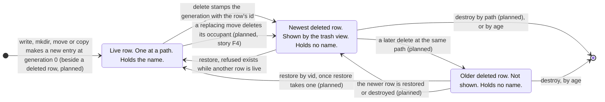

# A deleted row gives up its name, and destroy acts only on what is deleted

A draft, written on 2026-11-24. Nothing is built. It is the deletes spec that decisions 3 and 6 of `context/specifications/active/2026-11-15-the-kernels-public-names-and-argument-families-are-ruled.md` wait on, and that roadmap rows D55, D56 and D57 and story F4 name. It answers `context/research/2026-11-15-deletes-tombstones-and-a-move-that-keeps-its-identity.md`, whose three studies read seventeen reference clones and twelve products, and it closes three of that memo's open items by experiment. Every fact about the code was read on `dev` at `27f3d24`, and every fact a decision rests on was run that day. The probes are in `probes/`, and their output is in `probes/output.txt`. It was reviewed on 2026-11-24, in `reviews/2026-11-24-spec-review.md`, in two rounds, and decisions 17 and 18 and the amendments the review asked for were written that day.

## The outcome wanted

A deleted file or directory can be restored, as today. It no longer holds its name. A new file or directory can be made where a deleted one was, and it is a new entry that inherits nothing.

```bash
rm -r /proj/build && mkdir /proj/build      # exit 0; today mkdir answers "No such file or directory"
echo first > /proj/f.txt && rm /proj/f.txt && echo second > /proj/f.txt   # a new file; today the deleted row comes back
```

```python
await fs.delete("/proj/f.txt", authority=who)
made = await fs.write(path="/proj/f.txt", content="second\n", authority=other)
# made.observations[0].status == "created", at version 1, owned by `other`
await fs.restore("/proj/f.txt", authority=who)     # vfs.exists: a live file stands there
await fs.move("/proj/f.txt", "/proj/g.txt", authority=other)
await fs.restore("/proj/f.txt", authority=who)     # the deleted file is back, as it was
```

The verb that removes for good is `destroy`. It acts only on rows that are already deleted, so no call to it can remove a live file.

## Builds on

- `context/research/2026-11-15-deletes-tombstones-and-a-move-that-keeps-its-identity.md` and its three studies: the finding that a deleted row is right for undo and wrong for freeing a name, the prior art, and the three places a deleted row could live. This spec takes the third, a generation in the key, and reports where it leaves the memo.
- `context/research/2026-10-08-trash-as-a-tombstone-on-the-row.md`: why a deleted row stays in place and is not moved to a trash directory. That stands. A move made a delete into a permission event and cost about six row writes a file.
- The kernel rulings, `context/specifications/active/2026-11-15-the-kernels-public-names-and-argument-families-are-ruled.md`, landed. Decision 3 names the verb `destroy` and leaves its arguments here. Decision 6 rules that a replacing move keeps the moved file's identity and that the replaced file stays undoable, by this spec's design.
- `context/standards/roadmap.md`, rows D55 to D57 and story F4. D57 is the ruling on who may destroy, quoted in decision 13.
- `agents/2026-11-20-vfs-serves-sqlite-and-postgres-only/spec.md`, landed. Decision 2 keeps the generic floor for every other dialect. Decision 2 here rests on it.
- `agents/2026-11-20-write-takes-preconditions-and-an-append/spec.md`, landed. Its plan, snapshot and guard are kept. Its rows for a deleted target change, as listed under "Earlier decisions this reverses".
- `agents/2026-11-21-a-listing-comes-back-a-page-at-a-time/spec.md`, landed. It gave the two partial indexes over the live rows and the key a listing resumes by. Both are kept.
- `agents/2026-11-22-a-row-carries-a-vid-and-a-change-can-require-it/spec.md`, reviewed fit to build and not built. Three of its rows and two of its decisions read differently once this lands. Neither spec needs the other built first.
- `agents/2026-11-22-a-rewind-puts-a-sessions-files-back/spec.md`, a draft. Its decision 8 and its `revived` kind exist only because a deleted row holds its path.
- `context/research/2026-11-14-a-child-committed-inside-a-delete-or-a-move-can-be-left-behind-its-parent-on-a-read-committed-engine.md`, a placeholder. The window it describes is not closed here. Decision 9 names what a restore does when it meets such a row.
- Built on by roadmap story F4, which adds `move(replace=True)` on decision 14.

## Terms

- **Live row.** A row of `vfs_entries` with `deleted_at` null. Every read sees it.
- **Deleted row.** A row with `deleted_at` set. It is absent to every read outside the trash view. The code calls it a tombstone.
- **Name.** The two things a live row holds alone: its `path`, and its `(parent_id, name)` pair.
- **Deleted set.** The rows one delete marked: the row it named and every row that was live beneath it. They share one `trash_root_id`.
- **Root.** The row a delete named. Its `trash_root_id` is its own entry id.
- **Member.** A row of a deleted set that is not its root.
- **Generation.** The new column `name_generation`. It is 0 on a live row and the row's own `id` on a deleted row.
- **Newest.** Of the deleted rows at one path, the one with the latest `deleted_at`. A tie goes to the higher `name_generation`.
- **Reached.** The deleted row that a verb acts on for a caller who names a row's own path: the newest there, where the caller is admitted to it at the verb's rung, and otherwise the newest the caller owns. Decision 7. A trash path names the newest and no other.
- **Trash path.** `/.vfs/trash` followed by a row's own path: the address the trash view serves a deleted row at.
- **Trash view.** The read-only view under `/.vfs/trash`, which shows each deleted row at its trash path.
- **Hint.** The `vfs.trashed` and `vfs.deleted_at` keys on a `not_found`, which tell a caller that a deleted row lies at the path.
- **Floor.** The generic dialect profile, served to every dialect other than SQLite and Postgres.
- **Snapshot.** The read a mutation takes of its targets before it decides anything.
- **Claim.** The guarded statement that proves a row is still as the snapshot read it.

## What the code does today

Run on 2026-11-24, on the in-memory store unless a row says otherwise. A file named without a directory is under `src/vfs/storage/backends/database/`. Statement counts leave out `BEGIN`, `COMMIT`, `PRAGMA`, `SAVEPOINT`, `RELEASE`, `ROLLBACK` and the statistics statements.

| Fact | How it is known |
|---|---|
| `path` is unique over every row (`src/vfs/models/rows.py:374`), and so is `(parent_id, name)` (`rows.py:428`). A deleted row counts in both. | Read. |
| Two partial indexes hold the live rows alone, `(parent_id, name)` and `(path)` (`rows.py:443-444`). A third holds the deleted rows by `deleted_at` (`rows.py:441`). The predicate is given to SQLite and Postgres only (`rows.py:218-224`). | Read. |
| `rm -r /proj/build && mkdir /proj/build` in the shell exits 1: "mkdir: cannot create directory '/proj/build': No such file or directory". `mkdir -p /proj/build/sub` fails the same way. | Run, `p01`, part 1. |
| `mkdir` at a deleted directory's path is `not_found`. A write beneath it is `not_found`, with `parents=True` too. A move onto it is `exists` (`topology.py:188-191`, `:276-281`). | Run, `p01`, part 2. Read. |
| A write at a deleted file's path brings the deleted row back. One caller deletes, another writes with `if_absent=True`: the row keeps its entry id and its first owner, reports `updated`, and stands at version 3. The first caller's `restore` is then `exists`. | Run, `p01`, part 3. Read, `staging.py:283-313`. |
| The write's insert is arbitrated on `(parent_id, name)` with no predicate (`writes.py:633-639`), and the columns a clobber writes include `deleted_at` and `trash_root_id` (`writes.py:133-134`). | Read. |
| A revived row is judged at restore's rung (`authorized.py:316-327`, `src/vfs/ops.py:184-185`). | Read. |
| `mv -f tmp conf.txt` onto a live file is "File exists". After `rm conf.txt`, the same `mv` is still "File exists", and `conf.txt` no longer reads. | Run, `p01`, part 4. |
| One name written and deleted 50 times leaves 1 entry row and 50 version rows. | Run, `p01`, part 5. |
| A file inside a deleted directory is not restored alone: `not_found`, "inside a deleted tree; restore its root". | Run, `p01`, part 6. |
| `sweep` at a live directory destroys it and what it holds, at once. On a mount where everyone holds `read_write`, anonymous may. A `restore` afterwards is `not_found`. | Run, `p01`, part 7. Read, `trash.py:380-387`. |
| A file deleted beneath a directory that is then moved is shown at the new path and restores only there. | Run, `p01`, part 8. |
| A move rewrites the path and the postings of deleted rows beneath it. A directory of 100 live files and 1,000 deleted ones moves in 19 statements and rewrites 101 live rows, 1,000 deleted rows and 1,100 posting rows. | Run, `p05`. Read, `topology.py:365-373`. |
| Nearly every lookup by path goes through `rows_by_path`, which builds one dictionary slot for each path and carries no liveness term (`descent.py:150-173`). `point_row` returns the first row at a path with no order (`serialized.py:245-248`). | Read. |
| A write to a fresh name is 18 statements, a delete 11, a write at a deleted path 17, a restore 11, a `mkdir` 15, and a `stat` that misses 3. | Run, `p05`. |
| The trash view's head lists the deleted roots in path order (`listings.py:546-552`), and a listing's resumption key is a path (`keyset.py:97-101`). | Read. |
| The schema is one number, `SCHEMA_FORMAT_VERSION = 28` (`rows.py:135`). A database at another number is refused at first touch with `schema_mismatch`, "re-provision the mount" (`engine.py:922-929`). No migration exists. | Read. |
| No code calls `sweep`. A deleted row stands until a caller asks for the retention pass. | Read, a search of `src/`. |
| The floor arbitrates a create by catching the engine's unique violation (`dialects.py:448-454`, `writes.py:718-775`). | Read. |
| Three statements name a path or a name with no liveness term and do not pass through `rows_by_path`: the probe of the row that beat a create, read with `.one_or_none()` (`writes.py:694-697`, `:680`, `:765`); an append's row lock (`writes.py:355`); and an edge's endpoint lookup, which drops deleted rows in Python (`edges.py:371-380`). | Read. |
| The edge rebuild reads the `parent_id` of every row, deleted or not, and holds each fs mirror edge to it (`edges.py:279-307`). A purge removes every edge whose source or target it removes (`trash.py:613-614`). | Read. |
| A row read through the trash view reports its own path, with `deleted_at` set. `Result`'s `&`, `|` and `-` pair rows by `path` alone (`src/vfs/results/envelope.py:524-548`). | Run, `p01`, part 9. Read. |
| No mutation may name a path beneath the trash view's head: `restore` and `sweep` take a deleted row's own path, and its trash path is `invalid` (`src/vfs/paths.py:877-889`). The head alone is `sweep`'s. | Read. |
| A caller at `add` holds `list` (`src/vfs/ops.py:125-127`). In a directory at `add` under a root at `none`, a second caller lists the first caller's deleted file in the trash view, and its `restore` of that file is `permission_denied`. | Read. Run, in the review. |

## The problem

A deleted row is asked to do two jobs. It hides a row so that the same row can come back. It also goes on holding the row's name. The first job is right. The second is the cause of every failure above.

- **A deleted folder's name is dead.** Only `restore` or `sweep` frees it, so the ordinary way to reuse a name runs through the verb that cannot be undone.
- **A new file at a deleted path is not new.** It is the deleted row with another body. It keeps the old entry id, owner, creation time, edges and exact-path grants. The first owner still reads what the second caller believes it made. The delete can no longer be undone.
- **No move can replace anything.** The ruling that a replaced file stays undoable has nowhere to put the replaced row.
- **`sweep` destroys live data.** It has two arms under one name, and the arm at a path removes whatever is there.
- **Other specs carry the cost.** The rewind spec moves a made file to a holding name before it deletes it, because the deleted row would hold a path an older step needs. The vid spec lists two places where vfs leaves Plan 9 and Unix, each marked to end "when the trash design changes".

No system in the prior art keeps a stable id, a unique path, and a deleted item that goes on holding the path. Where a system has both an id and a unique path, the deleted item gives the path up.

## Architecture

The rows at one path, and what each verb does to them. `delete`, `restore` and the retention pass exist today. Planned: a create beside a deleted row, the older deleted rows that follow from it, and a `destroy` by path that takes a deleted row alone. No page of `documentation/` draws the storage's rows, so this diagram redraws none.



## Decisions

### 1. A deleted row holds no name

`path` and `(parent_id, name)` are unique among live rows, and among them only. Any number of deleted rows may share a path, beside at most one live row. A deleted row keeps its `path`, `parent_id` and `name` as a record of where it was deleted.

Reason: a name belongs to what is there now. Every system studied that has both an id and a unique path frees the path at the delete, and a design that does not is the cause of each failure listed under "The problem".

### 2. The two name keys carry a generation, declared the same on every dialect

`vfs_entries` gains one column and loses two keys.

```python
Column("name_generation", BigInteger, nullable=False, server_default="0"),
UniqueConstraint("path", "name_generation", name="uq_vfs_entries_path_generation"),
UniqueConstraint("parent_id", "name_generation", "name", name="uq_vfs_entries_parent_generation_name"),
CheckConstraint(
    "(deleted_at IS NULL AND name_generation = 0) OR (deleted_at IS NOT NULL AND name_generation <> 0)",
    name="ck_vfs_entries_generation_agrees",
),
Index("ix_vfs_entries_trashed_path", "path", "deleted_at", "name_generation", **_on_side(trashed=True)),
```

- `path` loses `unique=True` and its own index. `uq_vfs_entries_parent_name` goes. The two partial indexes over the live rows stay as they are, with their names and their pins.
- The generation is 0 on a live row and the row's own `id` on a deleted row. The `id` is unique in the table, so no two deleted rows collide, and no clock and no counter is in a key.
- The column order is fixed. `(parent_id, name_generation, name)` lists a directory's live children in name order from one seek. With the generation last, the same listing reads every deleted child.
- The check constraint holds the two statements of liveness together. `deleted_at` stays the one column every read tests.
- The new partial index serves the deleted side: the newest deleted row at a path, and the trash view's ranges. Its third column is the tie-break of "newest", so the newest row is the index's last entry for the path and no sort is taken.
- A second partial index on the deleted side, `Index("ix_vfs_entries_trashed_owner_path", "path", "owner_id", "deleted_at", "name_generation", **_on_side(trashed=True))`, leads to the newest deleted row one caller owns at a path, for decision 7's second step. A live row is in neither.
- `DialectProfile` gains one field, `target_seek: Literal["lateral", "scalar_join"] = "scalar_join"`, set to `"lateral"` on Postgres. It picks the spelling of decision 7's lookup, a matter of plan that SQLAlchemy takes no position on.
- `SCHEMA_FORMAT_VERSION` becomes 29. No migration is written. A database at 28 is refused at first touch, as every earlier format is.

Measured, `p02` and `p03`, on SQLite 3.53.1 and Postgres 16.15:

| | Keys over live rows only | A generation in the key |
|---|---|---|
| Delete, create, delete, create at one name | 3 rows, 1 live, on both engines | the same |
| A restore onto a live row | refused by the engine | the same |
| A create arbitrated against a live row, then against a name holding three deleted rows | 0 rows returned, then 1 | the same |
| The conflict target the tree writes today | refused by both engines: no key matches it without the predicate | accepted with the generation added |
| Two creates at one name on Postgres, the first held open | the second waits and returns 0 rows; 1 live row | the same |
| 10 live children beside 4,000 deleted ones | 77 steps; 3 buffers | 66 steps; 7 buffers |
| The live row at a path holding 10,000 deleted rows | 18 steps; 3 buffers | 10 steps; 3 buffers |
| The same declaration on a dialect no profile tunes | the keys are built whole, and a create at a deleted name is refused | the keys are as declared |

Reason: both shapes work on the two supported engines, and they cost the same there. They differ on the floor. A partial unique index is spelled per dialect, and a dialect that is not given the predicate builds the index whole, which brings back the held name on the one profile that finds a rival create by the engine's refusal. The generation is two ordinary unique constraints, so the floor keeps the arbitration it has. The price is one 8-byte column and a second statement of liveness, which the check constraint holds to the first.

### 3. A delete stamps the generation in the statements it already issues

The root claim and the descendant stamp each assign `name_generation = id` beside `deleted_at` and `trash_root_id` (`trash.py:459-464`, `:492-496`). A restore assigns 0 in its two statements (`trash.py:526`, `:543-547`). No statement is added to either verb.

A fifth statement clears `deleted_at`: the write that revives, which stands until the second landing. In the first landing `name_generation` joins the columns a clobber writes (`writes.py:113-135`, `:1339-1340`) with the value 0, so the guarded update, the unguarded update and the clobber each assign it in the statement they already issue. It leaves those columns, with `deleted_at` and `trash_root_id`, in the second landing.

Reason: the generation is a function of the row and of whether it is deleted, so it rides the statement that changes that.

### 4. A name that holds only deleted rows is free

`write`, `mkdir`, `move` and `copy` treat such a name as empty.

- A `write` there makes a new row: a new entry id, version 1, status `created`, owned by the caller. The deleted rows at the path are untouched and stay restorable.
- A `mkdir` there makes a new directory. A write or a `mkdir` beneath a path that holds only deleted rows is still `not_found` at that path, with the hint, unless `parents=True`, which makes the missing directory as it makes any other.
- A `move` or a `copy` lands there. Its destination check reads the live side.
- The kind is free too. A file may be made where a deleted directory lies, and a directory where a deleted file lies.
- The insert is arbitrated on `(parent_id, name_generation, name)`. A new row carries generation 0, so it can conflict only with a live rival. The columns a clobber writes lose `deleted_at` and `trash_root_id`.

Reason: decision 1 applied to the four verbs that take a name. This is what POSIX, Plan 9 and every product with a trash do.

### 5. No write brings a deleted row back

The revive leaves: `StagedEntry.revive`, the second guarded group in `writes.py`, and the plan's branch at `staging.py:283-313`. A deleted file is brought back by `restore` and by nothing else.

| The write | A path with a deleted row and no live row, today | After |
|---|---|---|
| plain | the deleted row returns, `updated` | a new row, `created` |
| `if_absent=True` | the deleted row returns, `updated` | a new row, `created` |
| `append=True` | the deleted row returns with the tail as its body | a new row whose body is the tail |
| `if_version=n` | `not_found` with the hint | unchanged |

Reason: a write that revives makes two files into one. In every system studied where a file has an id of its own, a new file at a freed path inherits nothing. Keeping the revive as an option would keep its code, its rights rule and its races for a result that `restore` and then `write` already give in two calls.

### 6. A create at a free name is judged as a create

A write at a path that holds only deleted rows is judged at the verb's `create` rung, as a write at a path that holds nothing is. The rule that a write landing on a deleted row is judged as a restore goes, with the revive it judged (`authorized.py:316-327`, and the sentence in `src/vfs/ops.py:184-185`).

A deleted row is judged at its own path, as today. Grants and postures are keyed by path, so they cover whatever row stands at a path, live or deleted. A grant on an exact path covers a new file made there, as it covers any file at that path.

Reason: the caller makes a new row and touches no other. This ends two cases the memo ran: a caller at `add` who is refused at a path because an unseen deleted row lies there, and a first owner who goes on reading a file a second caller made.

### 7. Every lookup by path names its side, and a miss still carries the hint

`rows_by_path` takes a required `side`: `live`, or `newest_deleted`. No caller reads both sides into one dictionary.

- The live side adds `deleted_at IS NULL`. A path then yields at most one row, by the key.
- The deleted side is driven by its list of targets and seeks once for each. Its spelling is the profile's `target_seek`. Both read the last entry of `ix_vfs_entries_trashed_path` for the target's path.

```sql
-- "lateral", on Postgres: each target reads its own newest row
WITH targets(p) AS (VALUES (:p1), (:p2))
SELECT e.* FROM targets CROSS JOIN LATERAL (
  SELECT n.* FROM vfs_entries n WHERE n.path = targets.p AND n.deleted_at IS NOT NULL
  ORDER BY n.deleted_at DESC, n.name_generation DESC LIMIT 1) e

-- "scalar_join", on SQLite and the floor: each target joined to the row its newest id names
WITH targets(p) AS (VALUES (:p1), (:p2))
SELECT e.* FROM targets JOIN vfs_entries e ON e.id = (
  SELECT n.id FROM vfs_entries n WHERE n.path = targets.p AND n.deleted_at IS NOT NULL
  ORDER BY n.deleted_at DESC, n.name_generation DESC LIMIT 1)
```

- It is chunked by the parameter budget, one bind a target, through `chunked()`.
- **The row a caller reaches is found in at most two steps, each a seek for each target.** The first is the statement above: the newest deleted row at each target. The storage judges that row for the caller at the rung of the verb that asks: restore's rung, with the owner's floor, for `restore`; `read` or `list` for a read through the trash view; `list` for a hint. Rows at one path share the path's grants and posture, so a caller who is refused the newest is admitted to no row there but its own. For those targets alone, and for a named caller alone, a second statement of the same spelling adds `n.owner_id = :caller` to the inner select and reads the last entry of `ix_vfs_entries_trashed_owner_path`. The row it finds is judged at the same rung. A caller is then never handed a deleted row it may not act on, and another caller's newer deleted row never stands between a caller and its own.
- **The second step is taken only for a row's own path.** A caller who names `/p` asks for what it may act on at `/p`. A caller who names the trash path `/.vfs/trash/p`, typed or handed back from a listing, names the row the trash view shows there, which is the newest, and is answered on that row alone.
- The snapshots of `write`, `delete`, `move`, `copy` and `mkdir` read the live side only. `point_row` takes the same argument.
- **Three statements that do not pass through `rows_by_path` gain the live term in the statement.** The probe of the row that beat a create (`writes.py:694-697`), which today would find a live rival and every deleted row at the name and raise at `.one_or_none()`. An append's row lock (`writes.py:355`), which would lock every deleted row at the path. An edge's endpoint lookup (`edges.py:371-380`), which filters in Python.
- **A lint holds the rest.** `tests/lint/` lists, by module and count, the statements of the database backend outside `descent.py` that test `path`, or `parent_id` with `name`, for equality or membership. Each listed site carries its side. A site that is not listed fails the lint.
- A refusal that finds no live row asks the deleted side for the row the caller reaches at the path it blames, which is a row's own path, at the `list` rung. Where there is one, the `not_found` carries the hint, with that row's `deleted_at`. This is one more statement, issued only on a refusal, and a second only where the first row is refused.

Measured, `p06`, the whole statement with the row fetched, on a table of 1,050,000 rows of which 10,000 are deleted at one target's path:

| Spelling | SQLite 3.53.1, steps a target at 3, 1,000 and 32,000 targets | Postgres 16.15, buffers a target at the same three |
|---|---|---|
| `lateral` | not available | 4.0, 4.0, 4.0; no sequential scan of the table |
| `scalar_join` | 30.3, 24.0, 24.0 | 8.0, 8.0, 8.3; at 32,000 targets the plan reads the whole table by a sequential scan |
| the row's id `IN` the targets' newest ids | 40.7, 31.0, 31.0 | 12.0, 12.0, 12.3; at 32,000 targets the same sequential scan |

A term on the row itself, in place of the target list, reads 170,066 steps and 30,164 buffers to find the newest of 10,000 (`p03`).

The second step, measured in `p07` on the same table with an owner on each row and 10,000 deleted rows of another caller above the caller's own: 26.0 steps a target on SQLite and 4.0 buffers a target on Postgres at 1,000 and 32,000 targets, with the owner index. Without it, the one target at that path costs about 50,000 steps and 290 buffers, since every newer row is read and passed over.

Reason: once two rows can share a path, a dictionary keyed by path drops one of them without a sign, and a lookup with no side returns an arbitrary row. A required argument makes each call site choose, and the lint reaches the statements the argument cannot. The driven form keeps a lookup's cost to its targets, whatever lies deleted at them. Postgres holds that bound at a full chunk only when the target list drives the read by construction, which a lateral join does and SQLite cannot spell. Rights are judged on the row in hand, and never as a term that walks the deleted rows at a path, so the cost stays a seek whoever asks.

### 8. A deleted row stays where it was deleted

A move rewrites live rows only: its descendant statement gains `deleted_at IS NULL` (`topology.py:371-373`). A deleted row's path, postings and label are changed by no verb but `restore`, `destroy` and a posture change at its path. `copy` reads live rows only, in the statement and not in Python (`topology.py:296`, `:198`).

A deleted row's `parent_id` is then a record. It may name a directory that has since moved, or, after decision 12, a row that has been destroyed. Two things read it. The set's own structure does. The edge rebuild does too (`edges.py:279-307`): it holds a deleted row's fs mirror edge to its `parent_id` only while that id names a row, and reports no drift for a deleted row whose parent row is gone.

Reason: today's rewrite names its rows by path prefix, which is sound only while a path holds one row. `p04` shows it once two directories share a path: the member of a deleted directory at `/d` is carried to `/e` with the live directory that took its name, and the deleted set is torn. Telling the rows apart would need a walk of parent ids at every move. Leaving them is correct by construction. It also takes 1,000 entry rows and 1,000 posting rows off the move measured in `p05`, and it closes the memo's item on a deleted row carried from a closed region into an open one: it is never carried. The trash directories of freedesktop, macOS and Windows, and the soft delete of S3, Azure and Google Cloud Storage, restore to the path the item was deleted at.

### 9. `restore` puts the newest deleted root at a path back at that path

`restore` takes a deleted row's own path, as today, or its trash path, as the trash view reports it by decision 17. The own path names the row the caller reaches, by decision 7. The trash path names the newest deleted row there, the one the view shows, and no other.

The kernel judges either spelling as the row's stored path. For `restore` and `destroy`, a path beneath a trash head is read by `address_of` (`src/vfs/paths.py:855-858`) before the gate, and the `busy` guard and the permission maps are asked about the stored path, in the single route and in the route of handed rows. `_reaches_beneath` already judges both at that path alone (`src/vfs/base.py:3079-3090`). A `read` rule over a region then refuses a restore into it, and a destroy of what was deleted in it, under any spelling.

The ladder, for each target, in this order:

1. A live row at the path is `exists`, with the occupant's version and hash as `occupant_exists` gives them. This is so whatever lies deleted there.
2. No deleted row that the caller reaches, by decision 7 at restore's rung, is answered by what the caller may see: `permission_denied` at the path where the caller may list the newest deleted row there, as today, and `not_found` through the descent ladder where it may not.
3. The row reached is a member: `not_found` naming its root, as today.
4. The ancestors are judged by the descent ladder, leftmost first: a component that holds no live row is `not_found` there, with the hint where a deleted row lies there, and a component that holds a live file is `wrong_kind` there. `restore` makes no directory.
5. The root is a directory and a live row stands beneath its path: `exists` at the first such path. The probe is `_least_inside` over the roots' descendant ranges with `live=True`, chunked by `arm_budget`, so no statement's arms pass the engine's expression depth (`authorized.py:409-425`). Only a row left behind by the window of the 2026-11-14 memo can be there.

Then the claim, guarded on the root's version as today, assigns `deleted_at`, `trash_root_id` and the generation. The set clears by its root id. The parent that is bumped is the live directory at the parent path.

- **The parent is the directory now at the parent path.** Where its entry id differs from the root's stored `parent_id`, the root is re-pointed. Its `parent_id` is set in one statement for a chunk of such roots. Its fs mirror edge is written whether or not one stands, since the stored parent may have been destroyed: one delete of the chunk's fs in-edges and one insert. In the common case no root is re-pointed and no statement is issued.
- **A rival that takes the name inside the window** makes the claim violate the key. The violation is caught under a savepoint and raised as `StaleSnapshot`, as a move's claim does (`topology.py:339-345`). The verb runs again, and the answer is `exists`.
- **An older deleted row at the path** is reached by restoring the newest and moving it aside. Each restore brings back the newest that remains.
- **Another caller's newer deleted row does not stand in the way.** In a directory where callers hold `add` and nothing more, a caller is refused the newest row when another caller deleted at the path last, and decision 7's second step reaches its own. Each caller restores its own deleted file by its own path, whoever deleted there last. The same caller's `restore` of the trash path names the other caller's row, and is `permission_denied`.
- **When `restore` takes `if_vid`,** by decision 17 of the vid spec, the vid selects: the root at the path whose vid it is, is restored, newest or not. No root with that vid is `conflict`.

A file restore is 12 statements where it is 11: the two sides are read apart.

Reason: the path is how a caller names a file, and the trash view shows a deleted row at its trash path, which `restore` takes. Refusing an occupied path is what Azure and JuiceFS do, and with decision 4 the remedy is real: move or delete the occupant. The re-pointing follows from decision 8.

### 10. The trash view shows the newest deleted row at each path

A listing on the deleted side shows one row for each path: the newest, where the caller may list it. The deleted arm of `liveness_filters` gains the term, so `ls`, `tree`, `glob`, `grep` and `search` in the trash view inherit it from one place.

```sql
e.id = (SELECT n.id FROM vfs_entries n WHERE n.path = e.path AND n.deleted_at IS NOT NULL
        ORDER BY n.deleted_at DESC, n.name_generation DESC LIMIT 1)
```

- The term carries no rights. The view's own row term stays on the outer row, as today, so the inner select reads the index's last entry for the path whoever asks.
- A point read at `/.vfs/trash/<path>` uses the first step of decision 7's lookup and no second: it is the newest row, judged at the read's rung. A listing and a point read therefore agree. A trash path names one row for every caller, and a caller who may not see it is answered as at a path that holds nothing.
- A caller's own older deleted row beneath another caller's newer one is in no listing and at no trash path. It is restored by its own path, by decisions 7 and 9, and is then read as any live file.
- A listing beneath `/.vfs/trash/<directory>` names its rows by path, one level down, and not by `parent_id`, which decision 8 makes a record.
- A listing resumes by path, as every listing does, and no path repeats.
- An older deleted row at a path is not listed while a newer one lies over it. It is listed when the newer one is restored or destroyed.

Measured, `p03`: a page of 100 paths with one deleted row each reads 2,047 steps on SQLite. The cost of a trash listing is the deleted rows in its range, and not the rows it returns. The two differ only at a path deleted many times: 10,000 deleted rows at one path cost 10,000 seeks to show one row.

Reason: a listing's resumption key is a path, by decision 5 of the kernel rulings, so a listing cannot repeat one. The row listed is the row a `restore` at that path brings back for every caller who may restore it. A rights term inside the newest select would make the listing read every deleted row at a path for a caller who owns none of them, so the view keeps to the newest and the second step of decision 7 serves the caller's own, by its own path. The profile at a path deleted many times is stated and not capped. The direction, if it shows in a profile, is a stored mark on the newest deleted row at a path, kept by `delete`, `restore` and `destroy`.

### 11. The verb that removes for good is `destroy`, and `sweep` leaves

`destroy` takes `sweep`'s place on the four faces, in `Op`, in `VERB_RUNGS`, in `DEVELOPER_OPS` and on the seam, with its default path `/.vfs/trash`. `sweep` is removed in the same landing, with no second name kept.

```python
async def destroy(self, path: str = "/.vfs/trash", *, authority: Authority | None = None) -> Result: ...
```

Reason: the kernel rulings' decision 3. `delete`, `restore` and `destroy` read as a set: undoable, undo, not undoable. Nothing is released, so no caller needs the old name.

### 12. `destroy` takes a trash path, and so acts only on deleted rows

- **At the trash view's head,** `/.vfs/trash`, it is the retention pass, as today: every root deleted more than `trash_days` ago, with its set, and the orphaned content rows past their fence.
- **At a trash path beneath the head,** `/.vfs/trash/<path>`, it removes the newest deleted root at that path, with its set, at once and whatever its age.
- **Any other path is `invalid`:** "destroy acts on the trash: delete the entry, then destroy `/.vfs/trash/<path>`". No address of a live row is accepted, so no call can remove one. A live row at `<path>` is untouched by a destroy of the deleted row beneath it.
- A trash path that holds no deleted row is `not_found`. One whose newest row is a member is `not_found` naming its root.
- **The set is the rows that share the root's id.** A deleted row beneath the root's path that belongs to another set is left. Such a row keeps a `parent_id` that names no row, and its fs mirror edge goes with the destroyed parent. Decision 8 says what the edge rebuild makes of it, and decision 9 what a restore does.
- **Each row a `destroy` returns has status `destroyed`,** which joins the literal on `Observation` (`src/vfs/models/entry.py:274`, `:476`). It carries its trash path and its `deleted_at`.
- **No parent is bumped.** A deleted row is in no live listing, and its `parent_id` is a record.
- `destroy` and `restore` are the two verbs that may name a path beneath the trash view's head. `check_reserved_path` admits it for them and refuses it for every other mutation, as today (`src/vfs/paths.py:877-889`). The kernel gates the call at `<path>`, as decision 9 says.

A caller that means to remove a live file for good calls `delete` and then `destroy` at its trash path.

Reason: the purge arm of `sweep` is the one call in vfs that removes live data with no undo and no warning, and one mistyped path loses a tree. In the prior art the permanent act applies to what is already deleted. An address that can only name a deleted row makes that a property of the verb's grammar and not of a check inside it. The second status keeps a log reader from taking a destroy for a delete.

### 13. Only the system actor destroys where everyone does not hold `read_write`

Ruled on 2026-11-15, roadmap row D57: "destroy is only available to system when the posture is anything besides read_write, and destroy is not accessible through the cli tool".

- The system actor may destroy any deleted row.
- Any other caller may destroy a deleted row only where the row's `everyone_level` is `read_write`. Elsewhere the answer is `permission_denied`, whatever the caller owns and whatever it is granted.
- Each row of a set is judged, and one row that fails refuses the call whole. The retention pass is judged the same way, row by row.
- A caller who may not see the deleted row is answered first, as at a path that holds nothing, by the judgment `restore` applies. `permission_denied` is then the answer only to a caller who could see the row.
- `destroy` stays a developer-plane op. No tool offers it, and the shell has no program for it.

Reason: the ruling. Where everyone already holds `read_write`, any caller can delete any file, so the permanent act adds little. Anywhere else the retention window is a promise to the people who rely on it, and a caller who could empty it early would break the promise. The owner's floor that lets a caller delete its own file does not reach the permanent act.

### 14. A replacing move deletes its occupant where it stands

This is the rule story F4 builds `move(replace=True)` on. This spec builds no argument.

- The occupant is a live file, and the source is a file. A directory at the destination is `exists`, as F4's second criterion has it.
- In the move's own transaction, before its claim, the occupant is stamped as a deleted row and its own root, by the statement a delete uses.
- The moved row keeps its entry id and takes the name. The occupant is then the newest deleted row at that path, and `restore` brings it back once the path is free.
- The mover needs delete's rung on the occupant, beside what the move needs.

Reason: the kernel rulings' decision 6. The replaced file must stay undoable, and decision 1 gives it somewhere to be. JuiceFS and Azure Blob with a hierarchical namespace do this.

### 15. The reference deployment gains a figure for deletes, marked as an assumption

The first landing adds one row to the table in the working agreement:

| Dimension | Figure | Source in words |
|---|---|---|
| Deletes | 5,000 a working day; about 450,000 deleted rows standing at a 90-day retention, under 5% of the live rows; one name deleted 1,000 times a day as the design ceiling for a single path | an *assumption*: one organic single-file change in ten is a delete, and the nightly batch replaces by overwriting; no public measurement was found |

Reason: the memo left this figure to be set, and "Cost" below rests on it. A figure marked as assumed can be corrected, and a design sized on none cannot be checked.

### 16. Three landings, in this order

1. **The key.** Decisions 2, 3 and 15: the column, the two constraints, the check, the two indexes of the deleted side, the profile field, the stamp and its clearing by the delete, the restore and the write that revives, the conflict target, format 29. No verb changes its answer, and no verb issues another statement.
2. **The name is free.** Decisions 1, 4 to 10 and 17: the creates, the revive's removal, the rights rule, the sides, the move, the restore, the trash view and the trash path its rows report. They land together because each is unsound without the others once two rows can share a path. Until the third landing `sweep` keeps both arms and its addresses; its arm at a path reads the live side, then the newest deleted row, and purges by path as today.
3. **`destroy`.** Decisions 11 to 13, and the edge rebuild's rule of decision 8, whose state only a destroy at a path makes.

Each is green under `scripts/ci.sh` alone, and under `scripts/docs.sh check` where it changes a docstring. The Postgres leg runs before the pull request of each.

Reason: the first landing changes the schema and nothing a caller can see, so the format moves once and is proven by unchanged answers. The second cannot be cut smaller. The third follows the second, since it acts on the newest deleted row at a path, and is kept apart so that the rename is one diff.

### 17. A row from the trash view reports its trash path, and the constitution holds as written

Every row the trash view returns, from `stat`, `read`, `ls`, `tree`, `glob`, `grep` and `search`, reports `/.vfs/trash/<its own path>` as its `path`, with `deleted_at` set. Today it reports its own path.

- **A path a caller is handed leads to one Entry.** A live row reports its path. A deleted row reports its trash path, and decision 10 shows one for each path. So no two rows a caller is handed share a path, though a live file and a deleted one may lie at one stored path.
- **`Result` pairs rows by path alone, as today.** A live listing and a trash listing never pair. A `delete`'s own rows report the row's own path with status `deleted`, as today, so a listing taken before a delete, less the delete's rows, is still what remains.
- **A row handed back to a verb reaches the row it came from.** Handed to `read`, `stat` or `grep`, a trash-view row is read through the trash view. Handed to `restore`, it is restored, by decision 9. Handed to any other mutation, it is `invalid`, since the trash view is never a place a write lands, as today. The live file that may stand at the same stored path is reached by no row of the trash view.
- **A listing of the trash resumes by the trash path** it reported.
- **`restore`'s row** reports the live row's own path, as today. **`destroy`'s rows** report the trash path they were removed at.

The constitution, by article:

- **Article 1.2**, "`path` ... MUST be unique within its terminal filesystem": it holds as written of every row a caller is handed. The article is not reworded.
- **Article 1.3**, "the path is sufficient to reach the Entry it observes": it holds of a trash-view row, which it does not today, when a row from the trash view reports a path whose read is `not_found`.
- **Article 1**: no primitive is added. `name_generation` never leaves the storage. An older deleted row beneath a newer one has no path until it is uncovered. It is reached then, or by its vid once `restore` takes one, which is the vid spec's public name of an entry at a version and no hidden handle.
- **Article 3**: decision 18.

Reason: once a live file and a deleted one can lie at one stored path, a row that reports that path names two things. The review ran the design that keeps the stored path and pairs rows by path and side: it changes what a listing less a delete's rows gives today, and it needs a check in the kernel on every handed row. Reporting the trash path needs neither. The path stays a row's whole address, which is what the constitution says of it, and the one thing that changes is the `path` field of a row that only the trash view returns.

### 18. Where this spec leaves Plan 9 and Unix it says so

| The principle | What vfs does | The constraint | Ends |
|---|---|---|---|
| A removed file is gone. | A deleted row is kept and can be restored, until it is destroyed. | The roadmap's third promise: every delete is reversible. Inherited. | Never. |
| A name removed and made again is another file. | The same, by decisions 4 and 5. A departure the vid spec lists ends here. | | Ended by this spec. |
| A removed file occupies nothing. | The same, by decision 1. A second departure the vid spec lists ends here. | | Ended by this spec. |
| `rename` replaces what is at its destination. | A move refuses an occupied destination. | No verb removes a file unless it is asked to. Inherited. | When story F4 adds `replace=`, on decision 14. |
| Whoever may write a directory may remove a file from it for good. | Only the system actor destroys where everyone does not hold `read_write`. | The retention window is a promise to the people who rely on it. Ruled, row D57. | When that ruling changes. |
| A file belongs to its directory, and moves with it. | A deleted row stays at the path it was deleted at, decision 8. | Rights are keyed by path, and two deleted directories can share one. | When names are stored apart from files. |

Reason: Article 3 asks that each departure be a numbered decision that names the principle, the deviation, the constraint and when it ends.

## Cost

Costed against the reference deployment in the working agreement, with decision 15's row.

**Per verb call, about 150,000 a day.** A read that finds its row issues what it issues today. A listing reads the live rows alone, through the partial indexes it already has: 66 steps for 10 children beside 4,000 deleted ones. A call that misses issues one more statement, for the hint, at 24 steps or 4 buffers a blamed path, and a second of the same cost only where the caller is refused the newest row there.

**Per file write, about 1,050,000 a day.** A create at a fresh name is unchanged at 18 statements. A create at a deleted name is that same create, where today it is a 17-statement revive that also writes a version row. A delete is unchanged at 11, with one more column in its stamp. Every row carries 8 more bytes, and each of the two keys 8 more: about 240 MB at 10,000,000 rows. A deleted row is in two more indexes, which a live row is in neither of: two more index entries a delete, and two fewer a restore.

**Per index visit, about 11,000,000 a day.** Nothing. The index passes read rows by id and by their pending flags, and no statement of theirs changes.

**Per batch, 100 a night.** A 10,000-file batch at deleted names issues the statements of a batch at fresh names. The deleted side of a 10,000-target `restore` is one driven statement a chunk of the parameter budget, one bind a target: 240,000 steps on SQLite, 40,000 buffers on Postgres.

**Per corpus.** Nothing is added to the rebuild. The retention pass is as today.

**Per lock.** None is taken and none is held longer. `restore` and `destroy` take the mount's serialization point as their first statement, as today, which `agents/2026-11-21-the-topology-lock-is-held-for-a-commit/spec.md` addresses. No read waits on anything new.

**A move.** Fewer rows. Deleted rows beneath the source are not rewritten: 1,000 entry rows and 1,000 posting rows fewer on the move measured.

**What grows with input.** The target list of the driven lookup, chunked by the parameter budget. Nothing else.

**What grows with deletes.** A name written and deleted `n` times holds `n` deleted rows, each with its body and its derived rows, until it is destroyed. Today it holds one row and `n` version rows. At the assumed 5,000 deletes a day and 90 days, about 450,000 deleted rows stand. At the design ceiling, one name deleted 1,000 times a day holds 90,000 rows: a live lookup there is 10 steps, a miss's hint 24, and a trash listing that crosses it 90,000 seeks. A pipeline that deletes and rewrites its files nightly, where it could overwrite them, would stand 90 nights of its batch as deleted rows; the docs say to overwrite.

## Left as it is

- **The retention pass runs only when it is called.** `agents/2026-11-24-the-trash-is-emptied-without-being-asked/spec.md`.
- **One file out of a deleted directory, and a restore to another path.** `agents/2026-11-24-one-file-is-restored-out-of-a-deleted-directory/spec.md`.
- **The body and the derived rows of a deleted file.** They are kept until the row is destroyed. `agents/2026-11-24-a-deleted-file-keeps-only-what-a-restore-needs/spec.md`.
- **A listing of every deleted row at one path.** None is needed to reach them: decision 9 brings each back in turn.
- **A child left live beneath a deleted directory by a rival write.** The 2026-11-14 memo holds it. Decision 9's fifth rung answers `exists` when a restore meets one.
- **A deleted row's version.** A delete adds one to the root and none to a member, as today.
- **Edges.** They are keyed by entry id and wait with a deleted endpoint, as today. A new file at a deleted path has none.
- **Version rows of a deleted row.** They stay with it and go when it is destroyed.
- **The serialization point of `delete`, `restore`, `move` and `destroy`.**
- **A copy out of the trash view.** It stays refused.
- **The bounded retention of numbered spec 180,** `destroy(limit=, after=)` once renamed. It is a draft and is not built here.
- **`copy(replace=True)`.** It keeps the destination's identity and deletes nothing, by the kernel rulings' decision 6.

## Tests

Each is written and seen failing before the code. Counts are of rows, of errors, of statements recorded by the `before_cursor_execute` listener the write tests use, or of calls to a spied function. Never of time. A row of the storage contract runs on memory, on SQLite and on the Postgres leg.

**Landing 1.** `tests/models/test_rows.py`:

- `test_the_name_keys_carry_the_generation`: the table declares exactly 2 unique constraints that name `path` or `name`, `(path, name_generation)` and `(parent_id, name_generation, name)`, and `path` alone is not unique. It replaces `test_identity_backbone`'s line on `path` and `test_create_arbitration_index_is_parent_id_name`.
- `test_a_live_row_is_generation_zero_and_a_deleted_row_is_not`: 2 inserts, a live row at generation 5 and a deleted row at generation 0, raise 2 `IntegrityError`s.
- `test_the_deleted_side_has_two_path_indexes`: `ix_vfs_entries_trashed_path` is on `(path, deleted_at, name_generation)` and `ix_vfs_entries_trashed_owner_path` on `(path, owner_id, deleted_at, name_generation)`, each with the deleted side's predicate.
- `test_the_name_keys_compile_whole_on_an_untuned_dialect`: compiled for the MySQL dialect, the two constraints hold 0 `WHERE`.
- `test_the_schema_format_is_29`, and in `tests/storage/database/test_engine.py`, `test_a_database_at_format_28_is_refused_at_first_touch`: 1 `schema_mismatch`.

`tests/storage/database/test_trash.py`:

- `test_a_delete_stamps_the_generation_and_a_restore_clears_it`: a directory of 3 files deleted leaves 4 rows with `name_generation == id`; restored, 4 rows at 0.
- `test_a_write_at_a_deleted_path_clears_the_generation`: after a delete, a plain write, an `if_absent=True` write and an append, each at its own deleted path, leave 3 live rows at generation 0 and raise 0 errors.
- `test_the_first_landing_changes_no_statement_count`: on the in-memory store, as one named caller, in the order of `p05` as recorded on `dev` at `27f3d24`: a write at a fresh name is 18 statements, the first delete of it 11, a restore after a write at the deleted path and a second delete 11, a `mkdir` at a fresh name 15, and a move of a directory of 100 files 19.

`tests/storage/database/test_dialects.py`:

- `test_postgres_seeks_by_lateral_and_every_other_profile_by_scalar_join`: 3 profiles, 1 `lateral`.

No test of an answer changes in this landing. The 100% coverage gate and the unchanged contract suite are the proof.

**Landing 2.** `tests/support/storage_contract.py`:

- `test_a_write_at_a_deleted_path_makes_a_new_file`: status `created`, version 1; 2 rows at the path, 1 live; the trash view still shows 1 row, at the trash path; a `restore` is `exists`. It replaces `test_a_write_at_a_deleted_path_revives_the_row_and_keeps_its_body`.
- `test_no_write_brings_a_deleted_row_back`, parametrized over 4 forms: plain, `if_absent=True` and `append=True` each leave 1 deleted row and 1 new live row; `if_version=2` is `not_found` with the hint and leaves 1 deleted row and 0 live.
- `test_a_directory_is_made_again_at_a_deleted_name`: `mkdir` is `created`; a write beneath it lands; with the directory deleted again, a write beneath with `parents=True` makes 1 directory and 1 file. A file written where a deleted directory lies is `created`.
- `test_a_transfer_lands_on_a_deleted_name`: a `move` and a `copy` onto a path holding 1 deleted row each succeed, and the deleted row count is 1 after each. It replaces `test_a_deleted_row_holds_its_address_against_a_transfer`.
- `test_a_name_written_and_deleted_fifty_times_holds_fifty_deleted_rows`: 50 rows at the path, 0 live; `ls` of the parent returns 0 rows; the 51st create issues the statement count of the first.
- `test_a_miss_carries_the_newest_deleted_row`: with 2 deleted rows at a path, `stat` is `not_found` and `vfs.deleted_at` is the later of the two.
- `test_restore_brings_back_the_newest_and_then_the_next`: 2 files deleted at one path; a `restore`, a `move` aside and a second `restore` leave 2 live files with the 2 bodies, newest first.
- `test_restore_onto_a_live_row_is_exists`: 1 `exists` with the occupant's version; 0 rows change.
- `test_restore_lands_under_the_directory_now_at_its_parent_path`: a file is deleted, its directory is moved away and a new directory is made at the old path; the restored file is listed by `ls` of the new directory, and 1 fs mirror edge runs to it from that directory.
- `test_restore_of_a_directory_with_a_live_row_beneath_is_exists`: staged by a direct insert of 1 live row beneath a deleted directory; 1 `exists` at that row's path, and the set stays deleted.
- `test_a_move_leaves_deleted_rows_where_they_were_deleted`: a directory of 100 live and 100 deleted files moves; 101 entry rows change path, 0 of them deleted, and 100 posting rows change. The deleted file restores at its old path once a directory stands there. It replaces `test_a_move_carries_a_tombstoned_descendant_and_a_copy_leaves_it`.
- `test_a_move_beside_another_directorys_deleted_rows_tears_no_set`: the five rows of `p04`; 0 members lie outside their root's path afterwards.
- `test_the_trash_view_shows_the_newest_deleted_row_at_each_path`: 3 deleted rows at one path give 1 row in `ls`, `tree` and `glob` of the view; after a `restore` of that path and a `move` of the restored file aside, 1 row again, the next.
- `test_a_trash_view_row_reports_its_trash_path`: `stat`, `read`, `ls`, `tree`, `glob` and `grep` in the view each return rows whose `path` starts with `/.vfs/trash/`; 6 verbs, 0 rows at an own path. The tests of `TestTrashView` and of the read side that pin a trash-view row at its own path are changed to the trash path.
- `test_a_live_listing_and_a_trash_listing_of_one_stored_path_never_pair`: a stored path that is both live and deleted; `live | trash` holds 2 rows, `live - trash` holds 1, and `live & trash` holds 0.
- `test_a_listing_less_a_deletes_rows_is_what_remains`: a listing of 3 files, less the rows of a delete of 1, holds 2 rows, as on `dev`.
- `test_restore_takes_either_spelling`: 2 files deleted; one restored by its own path and one by its trash path; 2 live rows.
- `tests/base/test_dispatch.py`, `test_a_trash_listing_handed_back_reaches_the_deleted_rows`: a trash listing of 3 rows, one of whose stored paths now holds a live file, handed as `observations=`: `read` returns the 3 deleted bodies and not the live file's; `edit` and `delete` are each refused whole with 1 `invalid` and leave the live file at its version; `restore` answers 1 `exists` and restores 0, and with the live file moved aside it restores 3.
- `tests/base/test_gates.py`, `test_a_trash_path_is_gated_as_the_stored_path`: under `read_write(read=["/ro"])`, `restore` of `/ro/f.txt` and of `/.vfs/trash/ro/f.txt` are each `read_only` with 0 calls to the storage; a `read` of `/.vfs/trash/ro/f.txt` returns the body. In the third landing the test gains `destroy` of `/.vfs/trash/ro/f.txt`, `read_only` with 0 calls.
- `tests/support/cursor_contract.py`, `test_a_trash_listing_resumes_by_path_and_repeats_none`: 5 paths with 3 deleted rows each, pages of 2: 5 rows over 3 pages, 0 repeated, and each `next_after` is a trash path.

`tests/support/grants_contract.py`:

- `test_a_create_at_a_deleted_name_is_judged_as_a_create`: a caller at `add` writes where another's deleted row lies and is answered `created`; the new row's owner is that caller; the first owner, with every grant of theirs removed and the posture closed, is refused a read of the path.
- `test_the_hint_is_given_only_for_a_deleted_row_the_caller_may_see`: 2 callers, 1 hint.
- `test_each_caller_restores_its_own_deleted_file_at_a_shared_path`: a directory at `add` under a root at `none`; a first caller writes and deletes a file, a second writes and deletes one at the same path. Each caller's trash listing shows 1 row at the path, the second caller's, which is the newest and which both may list. The first caller's `restore` of the row's own path returns 1 row whose body is the first caller's. Before it, the first caller's `restore(observations=[the listed row])`, which names the trash path, is 1 `permission_denied` and restores 0. A third caller, who owns no deleted file at the path, is `permission_denied` by either spelling. The second caller's `restore` is then `exists`, and after a `move` of the restored file aside it returns 1 row whose body is the second caller's.

`tests/storage/database/`:

- `test_races.py`, `test_a_create_inside_a_restores_window_answers_exists`: a rival create committed at the seam `restore:post-resolve`; 1 `exists`, 1 live row, 1 deleted row. `test_two_creates_at_a_deleted_name_leave_one_live_row`: 20 concurrent creates, 1 live row, 1 deleted row.
- Fourteen tests hold `revive` in their names: 4 in `test_races.py`, 5 in `test_trash.py`, 1 each in `test_coherence.py`, `test_ladder.py` and `test_writes.py`, and 2 in the storage contract. Thirteen go with the revive or are replaced by the tests above. `test_an_overwrite_under_a_deleted_parent_never_revives_the_child` is kept: it pins that a write beneath a deleted directory lands nothing.
- `test_descent.py`, new, `test_a_lookup_by_path_must_name_its_side`: a call without `side` is a `TypeError`. `test_the_deleted_side_seeks_once_for_each_target`: a lookup of 3 targets issues 1 statement, and its SQLite step count at a path with 2,000 deleted rows equals its count at a path with 1. `test_the_second_step_runs_only_for_a_refused_target`: of 100 targets, 3 whose newest row the caller is refused; 2 statements, the second with 3 targets, and its SQLite step count with 2,000 newer rows of another caller at one of them equals its count with none. `test_the_deleted_side_chunks_by_the_parameter_budget`: 70,000 targets issue 3 statements on SQLite. `test_a_full_chunk_on_postgres_reads_the_table_by_no_sequential_scan`, on the Postgres leg and marked `slow`: over 200,000 entry rows made by one statement, the plan of a 32,000-target lookup holds 0 `Seq Scan` nodes on `vfs_entries`.
- `test_writes.py`, `test_a_create_that_loses_at_a_name_with_deleted_rows_answers_exists`: 2 deleted rows at the name and a rival's live row staged on the attempt's own session; 1 `exists`, 0 exceptions, on the `upsert` arm and on the `catch_retry` arm. `test_an_append_at_a_path_with_deleted_rows_locks_one_row`: at a path with 2,000 deleted rows an append issues the statements, and on SQLite the steps, of an append at a path with none.
- `test_edges.py`, `test_an_edge_made_at_a_path_with_deleted_rows_reads_one_row`: 2,000 deleted rows at the endpoint's path; the endpoint statement returns 1 row.
- `tests/lint/test_code_shape.py`, `test_a_statement_that_names_a_path_names_its_side`: every statement of the database backend outside `descent.py` that tests `path`, or `parent_id` with `name`, for equality or membership is on the list in `tests/lint/allowlist.py` with its side; 0 sites are off the list.
- `test_writes.py`, `test_a_ten_thousand_file_batch_at_deleted_names_issues_what_a_fresh_batch_issues`, marked `slow`: the two statement counts are equal.
- `test_writes.py`, `test_a_staged_entry_carries_no_revive`: `StagedEntry` has 0 fields named `revive`.

`tests/shell/test_host.py`:

- `test_a_folder_removed_is_made_again`: `rm -r d && mkdir d` exits 0, and `ls d` prints nothing.

**Landing 3.** `tests/support/storage_contract.py`:

- `test_destroy_takes_no_address_of_a_live_row`, parametrized over 5 addresses: a live file, a live directory holding 2 files, the own path of a deleted file, the own path of a live file above 1 deleted row, and the root. Each is `invalid`, and the counts of live rows and of deleted rows are the same before and after each. It replaces `test_sweep_purges_an_arbitrary_directory_wholesale` and `test_sweep_purges_a_single_file`.
- `test_destroy_beneath_a_live_file_leaves_the_live_file`: a live file above 1 deleted row at its stored path; a `destroy` of the trash path returns 1 row with status `destroyed`; 1 live row, 0 deleted.
- `test_destroy_at_a_trash_path_removes_the_newest_deleted_root_and_its_set`: a deleted directory of 3 files; 4 rows returned, each `destroyed` and each at its trash path; 0 rows of the set remain in any family table; a deleted row of another set beneath the path remains. With 2 deleted roots at the path, the trash view then shows the older one.
- `test_an_edge_rebuild_after_a_destroy_reports_no_drift`: a file deleted, its directory deleted and destroyed at its trash path; 2 rebuilds give 0 warnings and 0 edges whose source is no entry.
- `test_restore_after_the_parent_row_was_destroyed`: in the same state the directory is made again and the file restored; `ls` of the directory returns 1 row, and 1 fs mirror edge runs to the file.
- `test_destroy_inside_a_deleted_tree_names_its_root`: 1 `not_found` with `vfs.trash_root`.
- `test_destroy_bumps_no_parent`: the parent directory's version is the same before and after.
- The retention tests and the two refusals keep their bodies under the new name: 5 in this file and 5 in `test_trash.py`. `test_sweep_at_a_path_purges_live_and_tombstoned_rows_alike` and `test_sweep_purge_bumps_the_parent` in `test_trash.py` are replaced by `test_destroy_takes_no_address_of_a_live_row` and `test_destroy_bumps_no_parent`. `test_a_sweep_redrives_over_a_landed_row_beyond_the_callers_rung` is written again on a deleted set, with the system actor's rival: a row that joins the set after the collect is judged before it is removed, in 2 attempts.

`tests/support/grants_contract.py`:

- `test_only_the_system_actor_destroys_below_read_write`, parametrized over the 5 postures below `read_write`: the owner and a caller granted `read_write` are each `permission_denied`, and the system actor succeeds. At `read_write`, anonymous succeeds. It replaces `test_sweep_needs_write_on_the_swept_prefix`.
- `test_a_retention_pass_that_meets_one_closed_row_destroys_nothing`: as a named caller, 1 `permission_denied` and 0 rows removed.
- `test_a_destroy_of_a_deleted_row_the_caller_may_not_see_is_not_found`: 1 `not_found` with no hint, the answer at a path that holds nothing.

`tests/test_ops.py`:

- `tests/test_paths.py`, `test_only_restore_and_destroy_name_a_path_beneath_the_trash_head`: of the mutating ops, 2 pass `check_reserved_path` there and every other is refused. It replaces `test_meta_scope_paths_are_mutable_but_the_trash_view_is_not`'s line on the view. In the second landing the same check admits `restore` alone, and `test_restore_takes_either_spelling` replaces `test_restore_through_the_trash_view_is_not_a_write_target`.
- `test_destroy_is_a_developer_plane_op_and_sweep_is_gone`: `destroy` is in `DEVELOPER_OPS`; `sweep` is in no `Op`, is an attribute of none of the four faces and of no storage, and is in 0 rows of the parameter table. `library_programs()` holds no `destroy`.

## Scope

In:

- `src/vfs/models/rows.py`: the column, the constraints, the two indexes of the deleted side, format 29. `src/vfs/models/entry.py`: the status `destroyed`. `src/vfs/paths.py`: `check_reserved_path` admits `restore` and `destroy` beneath the trash view's head. `src/vfs/base.py`: those two verbs are gated at the stored path, by decision 9.
- `src/vfs/storage/backends/database/`: `descent.py` (the side on `rows_by_path` and `classify_misses`, the driven lookup, the newest term in `liveness_filters`), `serialized.py` (`fetch_snapshot`, `point_row`, `dest_parent_id`, `final_rows`), `staging.py` and `writes.py` (the revive's removal, the conflict target, the clobber columns, the live term on the occupant probe and on an append's lock), `authorized.py` (the restore rung on a revive), `topology.py` (the destination check, the live rewrite, the live copy), `trash.py` (the stamp, the restore ladder, `destroy_rows`), `edges.py` (the mirror edge of a chunk of re-pointed roots, the endpoint lookup's live term, the rebuild's rule for a parent that is gone), `dialects.py` (`target_seek`), `reads.py`, `listings.py`, `keyset.py`, `grep.py`, `scope.py`, `search.py`, `traverse.py` and `rights.py` (each lookup names its side; the trash view's children by path; the trash path on every row of the view), `backend.py` (the verb).
- Wherever the verb is named, `destroy` in `sweep`'s place: `src/vfs/storage/protocol.py`, `src/vfs/ops.py`, `src/vfs/params.py`, `src/vfs/permissions.py`, `src/vfs/paths.py`, `src/vfs/results/render.py`, `src/vfs/base.py`, `src/vfs/session.py`, `src/vfs/sync.py` and `src/vfs/sync_session.py`. The word stays where it names the index's own cleanup of an old epoch, in `indexing.py`, `signals.py`, `lexical.py` and `maintenance.py`.
- The tests above, and the tests they replace.
- The docs below, and the row of decision 15 in `AGENTS.md`.
- `tests/lint/test_code_shape.py` and `tests/lint/allowlist.py`: the lint of decision 7 and its list.
- The size gate. `MODULE_LINE_BASELINE` holds each module over 1,000 lines at its count (`tests/lint/allowlist.py:26-33`). `writes.py` and `staging.py` shrink with the revive. `rights.py`, `reads.py` and `backend.py` are over the ceiling: each gains an argument at call sites it already has, and no function. `base.py` changes a name and a docstring, and gains the stored path at the gate for `restore` and `destroy`; the lines it gains are taken from the docstring of the verb it renames, or its baseline is set to the count the build reaches and the pull request says so. Code a decision adds goes to `descent.py`, `trash.py` and `edges.py`, which are under the ceiling, and no other baseline is raised by this spec. A baseline that falls is set to the count the build reaches.

Out: everything under "Left as it is"; the `replace=` argument, which is story F4's; `crates/`; a migration of a database at format 28.

## What the docs must say

- A deleted file or directory stays restorable, and its name is free at once. A new file at a deleted path is a new file.
- `restore` brings back the newest deleted row at a path, to that path. It is refused while a live row stands there: move or delete the occupant first.
- A deleted row stays at the path it was deleted at, also when a directory above it is moved. Make the directory again to restore into it.
- The trash view shows the newest deleted row at each path.
- `destroy` removes deleted rows for good, by age at `/.vfs/trash` or one at `/.vfs/trash/<path>`. It takes no other path, so it never removes a live row: delete first.
- Only the system actor may destroy where everyone does not hold `read_write`.
- A row from the trash view reports its trash path, `/.vfs/trash/<path>`. Reading that path reads the deleted row, and `restore` takes it or the row's own path.
- Where another caller's deleted file is the newest at a path, a caller still restores its own.
- A pipeline that replaces its files overwrites them. A delete and a rewrite keep every deleted copy until it is destroyed.

Pages, each changed: the docstrings of `write`, `mkdir`, `move`, `copy`, `delete` and `restore` on `AsyncVirtualFileSystem`, and the new docstring of `destroy`, which are the reference pages of the four faces; the `Observation` docstring for `destroyed`; `documentation/overview.md`, the sentence on permanent deletion; `documentation/reference/access-levels.md`, the rows of `sweep` and the sentence beneath them; `documentation/reference/glossary.json` and `glossary.md`, which gain "Trash" and "Deleted row"; `documentation/reference/planned-api/vids-and-preconditions.md`, the rows on a restore and on a write after a delete; `documentation/reference/planned-api/sessions-and-turns.md` and `policies-and-steps.md`, where they name `sweep` and `SweepStep`; `documentation/how-to/rewind-a-conversation-and-put-its-files-back.md`, the line on a file swept from the trash; `documentation/how-to/interrupt-a-job-and-ask-a-person.md`, where it names a sweep among the changes a policy sees; `context/standards/roadmap.md`, rows D55 to D57, story F4's dependency, and criterion 3 of story K2, which says a write on a deleted row revives it and reports `created`, where the tree reports `updated` and this spec makes a new row.

## Earlier decisions this reverses

- Numbered spec 162, `context/specifications/active/162-trash-as-a-tombstone-on-the-row/`, built: its rule 5, "Revive on write, same kind only", goes. Its line that one row per path keeps the unique index plain on every engine is met another way, by decision 2. Its landing note that a transfer onto a deleted occupant is `exists` goes. Its rules 1, 2 and 4 stand, with "the newest" where they say "the". Its rule 7, the trash view, stands but for the path a row reports, which is its trash path by decision 17, and for restore's address, which is either spelling by decision 9.
- `agents/2026-11-20-write-takes-preconditions-and-an-append/spec.md`, landed: in decision 4's table, the row for a deleted file reads "create, `not_found`, create, create"; "a precondition never revives" stands as "a precondition never creates". Decision 5's sentence that a revive is never `unchanged` has nothing left to speak of. Decision 7's sentence that `if_absent=True` revives a deleted row, judged as a restore, is replaced by decisions 5 and 6 here.
- `agents/2026-11-22-a-row-carries-a-vid-and-a-change-can-require-it/spec.md`, fit to build: in its table of departures from Plan 9 and Unix, the two rows that end "when the trash design changes" end here. A name removed and made again is another file, and a removed file occupies nothing. Decision 11's premise, that a deleted row at a destination is `exists`, changes; its conclusion stands, because a destination is still never replaced without `replace=`. Decision 17 gains the selection of decision 9 here. Decision 18's sentences that a deleted row at a marked path is revived, and that a deleted directory there is `wrong_kind`, become "a new row is made". Under "Left as it is", `sweep` reads `destroy`.
- `agents/2026-11-22-a-rewind-puts-a-sessions-files-back/spec.md`, a draft: decision 8, the holding name, is not needed, since a deleted row holds no path, and where it says the trash shows a row at its own path, it is its trash path. The kind `revived` of decision 2 and its undo row in decision 6 go, since a write at a deleted path is `made`. The methods of decision 5 read "the row at `path` on either side": they name the side, and on the deleted side they pick by vid among the rows at the path.
- `agents/2026-11-22-the-session-remembers-what-it-read/spec.md`, decision 9: `sweep` reads `destroy` in its table. `agents/2026-11-22-an-interrupted-line-replays-its-replies/spec.md`, decision 7: where it says a deleted file is still at its path, it is, as a record that holds no name.
- The write-preconditions spec, decision 9: "A tombstoned target is still judged as a restore" goes, and an `add` holder's append at a path that holds another's deleted row is `created`.
- The vid spec: the row "`delete`, `sweep`" reads "`delete`, `destroy`", and the contract call "a `sweep` of a subtree" reads "a `destroy` of a deleted directory".
- `agents/2026-11-21-the-topology-lock-is-held-for-a-commit/spec.md`: `sweep` reads `destroy`.
- `agents/2026-11-21-an-append-keeps-only-what-it-added/spec.md`: a live row's versions are removed by no verb; they go when the row is deleted and then destroyed.
- `agents/2026-11-22-the-kernel-keeps-records-of-its-own/spec.md`, decision 17, and `agents/2026-11-22-a-policy-judges-each-step/spec.md`: `sweep` reads `destroy`, and `SweepStep` `DestroyStep`. A destroy of a path that is not a trash view is no longer a subtree step: it names one deleted set.
- Numbered spec 180, a draft: its section 5 keeps a purge arm at paths that are not a trash view. Decision 12 replaces that arm.
- The memo of 2026-11-15, section 4: it kept open whether a write at a deleted path may still revive when asked. Decision 5 closes it: no.

## Prior art, and where this spec departs

From the memo's studies, read on 2026-11-15, and not read again here.

| What the prior art does | What this spec does | Why |
|---|---|---|
| A deleted item gives up its path at once: Linux, Plan 9, JuiceFS, S3, Azure Blob, Google Cloud Storage, Google Drive, OneDrive. | The same, decision 1. | |
| The deleted item is found by a second handle: an inode in the trash name, a deletion id, a generation number. | The newest at a path by its trash path; another by its vid, once `restore` takes one. | No database id leaves the storage, by the models' rule. The vid is the public name of an entry at a version. |
| A restore onto a taken path is refused: Azure, JuiceFS. Others append a number, overwrite, or take a new place. | Refused, `exists`. | No verb pushes out what is there unless it is asked to. |
| The permanent act applies to what is deleted, and is granted apart from delete: Vault, Azure, S3, Dropbox. | The same, decisions 12 and 13. | |
| A rename onto a file keeps the moved file and keeps the replaced one restorable: JuiceFS, Azure with a hierarchical namespace. | The same, decision 14. | |
| A deleted item restores to where its parent now is: JuiceFS and Google Drive, which keep the parent by id. | It restores to the path it was deleted at, decision 8. | vfs keys rights by path and stores the path on every row. Following the parent needs a walk of ids at every move. |
| A versioned object store lists every deleted version of a key. | The trash view lists the newest, decision 10. | A listing resumes by path, so it cannot repeat one. |

## Choices for the owner

Each is decided above, and the decision stands until it is ruled on.

1. **A generation in the key** (decision 2). The other choice is two partial unique indexes over the live rows. It adds no column and costs the same on SQLite and Postgres. It leaves every other dialect with keys built whole, on which a create at a deleted name is refused.
2. **A deleted row stays where it was deleted** (decision 8). The other choice carries deleted rows with a moved directory, as today. It keeps "restore puts a file back in its folder" across a rename, at the price of a walk of parent ids at every move and of deleted rows crossing rights regions.
3. **No write revives, with no option to** (decision 5). The other choice keeps a revive behind an argument.
4. **The trash view shows the newest deleted row at a path** (decision 10). The other choice shows every one, and needs a resumption key that is not a path, against decision 5 of the kernel rulings.
5. **`destroy` takes a trash path and no other** (decision 12). The other choice also takes a deleted row's own path, as `sweep` does today, and must then decide what a path that holds a live row means.
6. **The reading of row D57** (decision 13): "posture" is read as the row's own everyone level, and "available to system" as the system actor. The other reading takes the posture of the mount's root.
7. **5,000 deletes a day** (decision 15). It is an assumption. Another figure moves the last paragraph of "Cost" and nothing else.
8. **No migration from format 28** (decision 2). Nothing is released, so a database is provisioned again.
9. **A trash-view row reports its trash path** (decision 17). The other choice keeps the row's own path, as today. It then pairs rows by path and side, which changes what a listing less a delete's rows gives, and it checks every handed row in the kernel.
10. **A caller refused the newest deleted row at a path reaches its own, by the row's own path and not by its trash path** (decisions 7, 9 and 10), at the price of a second partial index on the deleted side. The other choice judges the newest row alone, and a caller's own deleted file then waits on another caller's newer one.

## Needs no other spec meets yet

Nothing. Decision 9's selection by vid waits on the fourth landing of the vid spec and is not needed before it: without it, `restore` brings back the newest.

## Not checked

- Postgres 16.15 was run, without pgvector, on tables that carry the key columns of `vfs_entries`. The storage itself was not run on Postgres: it needs pgvector, and no Docker daemon was available. Postgres 15, 17, 18 and 19 were not run. The engine leg of each landing is the check.
- The floor. No engine runs it. The test dialect loses its SQLite type variants and fails at its first insert. Decision 2's claim about the floor rests on the DDL compiled for MySQL and on SQLite with the keys built whole.
- Concurrency beyond two creates at one name. A rival create against a restore, and two deletes of one row, are inferred from the claims the verbs already carry and are the race tests' to show.
- The plan Postgres picks for a trash listing page. In `p03` it read the 4,000 rows of the range by a bitmap scan and sorted them, at 16,084 buffers, where an ordered index scan would stop at the page. The table was small and the statistics fresh. The build pins the page's plan as the live listing's is pinned.
- The statement counts under "Cost" are from the in-memory store, as one named caller.
- The driven lookup was run as text, in `p06`, on SQLite 3.53.1 and Postgres 16.15, over 1,050,000 rows. The review built the `IN` spelling with SQLAlchemy Core on both engines; the two spellings decision 7 chooses were not built with it. The plan of the lateral join was read on Postgres 16 alone.
- Decision 7's two steps are not run as a verb: the design is not built. Each step's statement was run, in `p06` and `p07`. The review ran the premise on today's tree, where a second caller at `add` lists the first's deleted file and its restore of it is `permission_denied`.
- How many tests pin a trash-view row at its own path. `TestTrashView` holds 11 tests and the read side about 7 more; each was not read.
- That the list of call sites under "Scope" is complete. It was made by a search for the lookups and the dictionaries keyed by path, and the review found three it missed. The required argument of decision 7 catches a caller of `rows_by_path`, and the lint of decision 7 a statement that does not call it.
- The number of tests that change. About 160 tests name a deleted row, a restore, a sweep or the trash view. The ones named above are replaced; the rest were not each read.
- The prior art was not read again. It is the memo's, of 2026-11-15.
- The figure of decision 15. No measurement of deletes was found.

## One line

A deleted row keeps its place and gives up its name: a new file at a deleted path is a new file, `restore` brings back the newest deleted row there, and `destroy` removes only what is already deleted.
