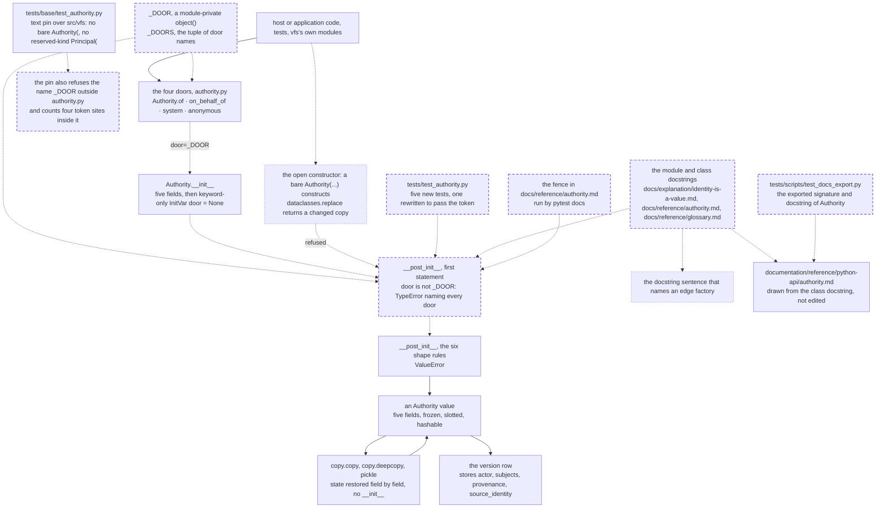

# A bare `Authority(...)` built outside `vfs.authority` raises `TypeError` naming the doors, while `copy` and `pickle` round-trip

A feature that hardens one landed type: it closes the constructor of `vfs.Authority`, so that the only way to build an authority is one of the functions written for it. It changes the public API: the constructor of an exported class refuses every caller, and its signature gains one keyword-only parameter. It is not structural, changes no schema format, needs no engine legs and does not touch the engine. It touches the value every rights judgement reads and changes no judgement, so it carries no leak test; criterion 1 pins that a forged `provenance="edge"` no longer constructs. It is not parallel-safe with [149-2](../2026-11-25-a-verified-token-becomes-an-authority-at-the-edge-and-nowhere-else/spec.md), which edits the same module after it. It serves story I1, gate b, of [the roadmap](../../context/standards/roadmap.md), by criterion 5 alone. It is converted from the door-token paragraph that closes [the source](../../context/specifications/archive/149-serve-auth-token-to-authority/spec.md), the only part of that source this unit carries; the rest of the source goes to the units listed under Scope. It stands on [the study of the source](../2026-11-25-the-backlog-converted/studies/051-162/149-serve-auth-token-to-authority.md) and on three probes run on 2026-11-25 against copies of the module in a scratch directory, cited where they are used. It depends on no spec that is not landed: the type, its four doors and the construction-site pin landed with [spec 070](../../context/specifications/archive/070-principal-scoped-sessions/spec.md) on 2026-09-06. Build order: this unit first, then 149-2.

## The problem

Every fact below is at commit `9daedd2b`.

- READ, `src/vfs/authority.py:115-128`: `Authority` is a frozen, slotted dataclass of five fields, `subjects`, `actor`, `provenance`, `narrowing` and `source_identity`. Its constructor is the one a dataclass generates, open to any caller.
- READ, `src/vfs/authority.py:130-149`: `__post_init__` checks six shape rules and raises `ValueError` on each. None of them can tell who called the constructor.
- READ, `src/vfs/authority.py:151-186`: four classmethods build an authority, `of`, `on_behalf_of`, `system` and `anonymous`. Three pass `provenance="constructed"` and one passes `"system"`. No code passes `"edge"` (READ, `src/vfs/authority.py:40`, the `Provenance` literal lists it).
- EXECUTED, `uv run --no-sync python -I -c ...`: `Authority(subjects=frozenset({Principal('alice')}), actor=Principal('alice'), provenance='edge')` constructs, and `dataclasses.replace(Authority.of(Principal('bob')), provenance='edge')` returns an authority whose provenance is `edge`. A caller can state a proof nobody made.
- READ, `src/vfs/models/version.py:181` and `src/vfs/models/rows.py:552`: every version row stores the `provenance` of the authority that wrote it. A forged `edge` is therefore a false line in the stored history, not only a false value in memory. The study of the source says provenance is persisted nowhere; that was true of an earlier tree and is not true at this commit.
- READ, `tests/base/test_authority.py:246-259`: the only guard is a text search. It fails when a file under `src/vfs` other than `authority.py` holds a bare `Authority(` or a `Principal(` of a reserved kind. It reads `src/vfs` alone, so it says nothing about a host's code, and it does not see `dataclasses.replace`.
- READ, `tests/test_authority.py:119` and `:121`: two tests build a bare `Authority(...)` to reach a shape no door produces. EXECUTED, `git grep -n "Authority(" -- ':!context' ':!agents'`: these two lines are the only bare constructions in the repository outside `authority.py`; the other hits are prose.
- READ, `src/vfs/authority.py:18-19`: the module docstring names "the edge factory that turns a verified token into an authority". No such function exists (EXECUTED, `grep -rn "authority_from_token" src/ tests/` returns nothing).
- READ, `docs/explanation/identity-is-a-value.md:53` and `:59`: the published explanation says "Python has no private constructor" and that "a stricter door, a module-private token the constructor demands, is planned for the day the edge factory exists". READ, `docs/reference/glossary.md:21`: "The bare constructor is not a door."
- READ, the source, `spec.md:34`: the door token was deferred as "overkill before the edge exists". READ, `context/standards/roadmap.md:384`: story I1 now asks for it as criterion 5, because 149-2 is the first code to mint `edge`.

What is wrong: once `edge` is minted, it is a claim that only the function that verified a token can make, and no check of the five fields can confirm who made it. The constructor has to refuse everyone but the doors before that value means anything.

## Architecture

A **door** is a function in `src/vfs/authority.py` that returns an `Authority`. There are four at this commit, all classmethods. The **door token** is one private object of that module, which a door passes to the constructor and nothing else holds by design. A **bare construction** is any call of the constructor that does not pass the token: `Authority(...)` written out, or the call `dataclasses.replace` makes.

## Decisions

### 1. A construction that does not pass the door token raises `TypeError`, wherever the call is written.

The check is on the token, not on the caller's module, so it refuses a host, a test and a forgetful line inside `vfs.authority` alike. The roadmap's sentence says "outside `vfs.authority`"; this is the same rule and slightly stricter, since a door that forgets the token fails its first test. It is a raise and not a classified `Result` because no request can cause it: it is a mistake in the calling program, as the shape rules already are. It departs from one landed line: the coding standard says a constructor argument raises `ValueError` (READ, `context/standards/how-we-code.md:24`). The type here is `TypeError`, because the fault is the call itself and not a value out of range, and because that is the type the roadmap's criterion names. The study cites the constitution as the precedent for raising; the constitution's Article 2 says only that a public operation returns the envelope, so the precedent taken is the two lines below, which do say it.

Basis: verified lean, the source's door-token paragraph as adopted by roadmap story I1 criterion 5 (`context/standards/roadmap.md:384`); precedent: `src/vfs/authority.py:20-22`, where a construction violation is a raise "because it can only come from vfs's own code, never from a caller", and `context/standards/how-we-code.md:24`, which allows an exception at construction.

### 2. The token is a module-private `_DOOR = object()`, passed through a keyword-only `InitVar` named `door` whose default is `None`.

Each part is there for a reason. An `InitVar` is a constructor parameter that is not a field, so the token is absent from `dataclasses.fields`, from `repr`, from equality, from the hash, from `__slots__` and from pickled state (EXECUTED, probe on a copy of the module: `fields` lists the same five names, `__slots__` the same five). Keyword-only, by the `KW_ONLY` marker, so a sixth positional argument cannot land in it (EXECUTED: six positional arguments raise Python's own arity `TypeError`). A default of `None`, so that a bare call reaches `__post_init__` and gets the message of decision 4; without a default Python would raise "missing 1 required keyword-only argument" and name no door. `None` is never the token, so `door=None` and `door=object()` are refused like no argument at all (EXECUTED). The name `door` is free: the only `door` in `src/` is an unrelated `ShareLock` field (READ, `src/vfs/storage/backends/database/dialects.py:161`). One artefact is accepted: `Authority.door` reads as the class-level default `None`; it is never the token and no instance stores one (EXECUTED). `ty check` passes on the changed copy, and `ruff check` passes on it with the repository's configuration (EXECUTED).

Basis: the source spec, the door-token paragraph ("a module-private sentinel passed as an `InitVar` (`door`) that `Authority.__post_init__` demands"); still true at `9daedd2b` (the mechanism was run on a copy of `src/vfs/authority.py` under CPython 3.11.18, 3.12.3 and 3.13.18).

### 3. The token is checked before the six shape rules.

A bare call with an illegal shape raises `TypeError`, never `ValueError`. The caller's first mistake is calling the constructor, and the message that names the doors is the one that helps; a shape message would invite a second bare attempt with the shape corrected.

Basis: decided in drafting, because criterion 5 asks that a bare construction raise `TypeError` without condition on its fields, and one test can hold that only if the order is fixed.

### 4. The message names every door, and the names come from one tuple.

The module holds `_DOORS: Final = ("Authority.of", "Authority.on_behalf_of", "Authority.system", "Authority.anonymous")`, and the message is `f"an Authority is built through a door, never by its constructor: {', '.join(_DOORS)}"`. One tuple, so that a later door adds one entry and the message cannot fall behind the code; the test of criterion 1 reads the public classmethods off the class and fails when one is missing from the message. The string is built only on the failing path. Tests match on each door's name and on the type, not on the whole sentence.

Basis: decided in drafting, because criterion 5 says the error names the doors and a list written twice goes stale.

### 5. `dataclasses.replace` on an authority raises the same `TypeError`, from every module, and no door that changes one field is added here.

`replace` calls the constructor with the old fields and the changes, and passes the default for `door`, so it is a bare construction (EXECUTED: `replace` with a change and `replace` with none both raise; on 3.13 `copy.replace` takes the same path and raises). Inside `vfs.authority` a door may still write `dataclasses.replace(authority, ..., door=_DOOR)` (EXECUTED), which is how a later door that derives one authority from another would be written. No caller in `src/` or `tests/` uses `replace` on an authority today (EXECUTED, `git grep` for `replace(` near `authority` returns nothing), so nothing breaks. The source expected the session-narrowing work to become such a door; that work is not built, and its door is its own unit's to add.

Basis: the source spec, the door-token paragraph ("This also retires `dataclasses.replace` from outside the module"); still true at `9daedd2b` (the probe above, and the search for callers).

### 6. `copy.copy`, `copy.deepcopy` and `pickle` return an equal authority with no code written for them, and restoring one checks neither the token nor the shape rules.

A frozen, slotted dataclass restores its state field by field through the `__getstate__` and `__setstate__` that `dataclasses` generates, and never calls `__init__`, so the token is not asked for and not stored. EXECUTED on the changed copy of the module: for an authority from each of the four doors and a two-subject one, `copy.copy`, `copy.deepcopy` and `pickle` at protocols 0 to 5 each return a value equal to the original, with the same hash and of type `Authority`. EXECUTED on CPython 3.11.18, 3.12.3 and 3.13.18; 3.14 is not installed where this was drafted, so it is INFERRED there from the same standard-library mechanism, and the 3.14 leg of CI runs criterion 4. No `__reduce__`, `__copy__` or `__deepcopy__` is written. A host needs the round trip to hand an authority to a worker process or to keep one in a cache.

Basis: the source spec, the door-token paragraph ("`copy`/`pickle` keep working"), which roadmap story I1 criterion 5 repeats; still true at `9daedd2b` (the round trips above ran with the token in place).

### 7. The door guards against a mistake and is not a wall inside the process; the documentation says so.

Three ways to hold an authority no door built remain, and none is closed: unpickling bytes written by hand, `object.__new__` with `object.__setattr__`, and importing the private name `_DOOR`. Each takes deliberate work that a reviewer can see, where a bare `Authority(...)` looked like ordinary use. Code in the process already holds the database credentials and can call `Authority.system()`, so a wall there would protect nothing. The wall is the wire, where an authority is never accepted as data; that is 149-2 and the units after it. The published explanation page keeps this argument and loses only its statement that nothing stops a bare call.

Basis: decided in drafting, because the roadmap states that "In process the gate is a convention" and that "any caller can construct the system authority" (`context/standards/roadmap.md:360`), and the published page makes the same case (`docs/explanation/identity-is-a-value.md:55`).

### 8. `Principal`'s constructor stays open.

A principal is a name, not a proof. Callers build one for every door call (READ, `documentation/tutorials/control-who-can-access-files.md:83`), and its own rules already refuse the reserved names and kinds (READ, `src/vfs/authority.py:88-99`). The existing text pin on a reserved-kind `Principal(` in `src/vfs` is kept as it is.

Basis: decided in drafting, because criterion 5 names `Authority` alone and closing `Principal` would break every caller's first line.

### 9. A test that needs a shape no door produces imports `_DOOR` and passes it; no helper is added to `src/` or to `tests/support/`.

The two bare constructions at `tests/test_authority.py:119` and `:121` gain `door=_DOOR` and keep their assertions. One of the two shapes, a non-system actor with `provenance="system"`, is reachable through no door; the rule that refuses it is kept for the doors written later, and the token is the only way a test can reach it. The other is also reachable as `Authority.on_behalf_of(set(), actor=Principal(SYSTEM_NAME, kind="system"))` (EXECUTED), so the rule's line is covered through a door as well. A helper in `src/` would be a fifth door for tests alone, and a helper in `tests/support/` would hide one import behind one function.

Basis: decided in drafting, because tests already import private names from the module under test (READ, `tests/storage/database/test_trash.py:53-54`, `tests/results/test_result_laws.py:32`) and spec 070 lists tests among the sanctioned construction sites (`context/specifications/archive/070-principal-scoped-sessions/spec.md:52`).

### 10. The text pin also refuses the name `_DOOR` anywhere under `src/vfs` outside `authority.py`, and a second pin counts the token sites inside it.

The pattern of `tests/base/test_authority.py:251` gains the alternative `\b_DOOR\b`. It is the name that is searched for, not `door=`, because `ShareLock(door=True)` is legitimate code (READ, `src/vfs/storage/backends/database/dialects.py:533`). The name `_DOOR` appears nowhere in `src/`, `tests/`, `crates/` or `scripts/` today (EXECUTED, `grep -rn "_DOOR"`). A pin on absence can pass for the wrong reason, so a second test counts presence: `authority.py` holds `door=_DOOR` exactly four times, once in the source of each of the four doors. The run-time check makes a bare `Authority(` in `src/` fail on its first call; the text pin stays because it fails without the line ever running.

Basis: decided in drafting, because the pin is a search over `src/vfs` for a construction nobody agreed to (READ, `tests/base/test_authority.py:247-249`), and importing the token is the one such construction the run-time check cannot see.

### 11. The docstrings and three pages under `docs/` state the closed constructor, and the sentence that names an edge factory leaves the module docstring.

A docstring under `src/vfs/` is a page's content, so it states the tree as it is: four doors, a constructor that raises `TypeError`, and no factory that does not exist; 149-2 writes its own sentence when its function exists. The older site built from `docs/` is still the published one (READ, `.github/workflows/deploy-docs.yml:7`) and landed changes keep it true to the code (EXECUTED, `git log --oneline -- docs/`: the last four commits are code changes that edited it), so the three statements this change makes false are corrected in the same pull request.

Basis: decided in drafting, because AGENTS.md, "Tooling", makes a docstring a page's content, and a published page that says the constructor is open would contradict the first error a caller meets.

### 12. This unit adds no door and lands as its own pull request before 149-2.

The token is useful only once something mints `edge`, and the mint needs the token to exist, so the order is this unit and then 149-2. Between the two landings the tree is green and stricter than before, with nothing half-built: the four doors behave as they did.

Basis: decided in drafting, because [the map of units](../2026-11-25-the-backlog-converted/units.md) gives this unit no dependency and makes 149-2 depend on it.

## Intent

After this spec, a caller who writes `Authority(...)` or `dataclasses.replace(authority, ...)` gets a `TypeError` whose message lists the four doors, whatever fields were passed, and a caller who uses `Authority.of`, `Authority.on_behalf_of`, `Authority.system` or `Authority.anonymous` sees no difference: the same values, equal and hashable as before. An authority still survives `copy.copy`, `copy.deepcopy` and `pickle` unchanged. The reference page for `Authority` shows the constructor with a trailing `*, door: InitVar[object] = None` and says in its first lines that the constructor is not for callers.

## Design

The order of work is tests, then code, then prose. Nothing in this change issues a statement, takes a lock or reads a row.

Step 1, `tests/test_authority.py`, five new tests under a new banner "The door" after "Invariants at construction". `test_a_bare_authority_raises_a_type_error_naming_every_door`, `test_the_door_is_checked_before_the_shape` and `test_replace_is_refused_like_a_bare_construction` are seen failing at `9daedd2b`: each reports that nothing was raised. `test_copy_and_pickle_round_trip_every_door` and `test_the_door_is_not_a_field` pass before the change and after it: they pin what the change must not break, so the tests-first rule asks for no failing run of them. The door names in the first test are read off the class, as every public name in `vars(Authority)` that is a `classmethod`.

Step 2, the same file: the two constructions at `:119` and `:121` gain `door=_DOOR`, with `_DOOR` added to the import at `:8`; the test errors at import until step 4. The module docstring at `:1` and the banner at `:48` say four doors, not three.

Step 3, `tests/base/test_authority.py`: the pattern at `:251` gains `|\b_DOOR\b`; a new test `test_the_token_is_passed_at_exactly_one_site_per_door` follows it and is seen failing with a count of zero; the comment at `:247-249` says four classmethods and no longer names an edge factory. `tests/scripts/test_docs_export.py` gains `test_the_authority_page_says_the_constructor_is_closed` on the module's `real_export` fixture, seen failing on the signature.

Step 4, `src/vfs/authority.py`, about fifteen lines. The import becomes `from dataclasses import KW_ONLY, InitVar, dataclass, field`. `_DOOR` and `_DOORS` sit under the "The authority" banner, directly above the class, since a private constant lives beside what it supports. The class gains `_: KW_ONLY` and `door: InitVar[object] = None` after `source_identity`. `__post_init__` takes `door: object` and begins with the check of decision 1. Each of the four `cls(...)` calls at `:154`, `:170`, `:180` and `:186` gains `door=_DOOR`.

Step 5, the prose. The module docstring at `:18-22` and the class docstring state decision 1 and decision 6 in a sentence each, and name `door` as the module's own token and no caller's argument. `docs/explanation/identity-is-a-value.md`: the paragraph at `:49` says the constructor refuses and the scan remains; the paragraph at `:53` says a bare call raises and lists the three ways of decision 7 that remain; the paragraph at `:59` is removed. `docs/reference/authority.md`: a section "Construction" before "Doors" states the `TypeError`, with one runnable fence that calls the constructor bare, catches `TypeError` and asserts the message holds `Authority.of`; the line at `:73` says each shape rule raises `ValueError` at a door. `docs/reference/glossary.md:21`: "The bare constructor is not a door and raises `TypeError`." `documentation/reference/python-api/authority.md` needs no edit: it draws the class from the docstring, and the export shows the new signature (EXECUTED, `scripts/docs_export.py` run over the changed copy: the signature ends `*, door: InitVar[object] = None) -> None`, the member list is unchanged, and `__post_init__` is listed with `(door: object) -> None`).

Step 6, the gates: `scripts/ci.sh`, because `src/` and `tests/` change, and `scripts/docs.sh check`, because a docstring under `src/vfs/` changes. No engine leg, no `cargo test` and no reinstall of the extension: no storage code and no Rust is touched.

What grows with input: nothing. The change adds one identity comparison to each construction, one module-level tuple of four strings, and one object. The multiplier is per verb call. vfs's own code builds three authorities, all at import (READ, `src/vfs/base.py:125`, `:137`; `src/vfs/storage/backends/database/backend.py:116`), and none per call, so vfs adds nothing per call. A host that builds one authority for each verb call pays 150,000 comparisons a day at the reference deployment, about 20 a second at peak. The subject set is still bounded by `MAX_SUBJECTS`, 64, which this change does not touch. No statement is added, so no engine budget applies; no lock is taken, so no read waits on anything.

## Scope

In: decisions 1 to 12. Files: `src/vfs/authority.py`; `tests/test_authority.py`; `tests/base/test_authority.py`; `tests/scripts/test_docs_export.py` (one test); `docs/explanation/identity-is-a-value.md`; `docs/reference/authority.md`; `docs/reference/glossary.md`.

Out, with where each belongs.

- `authority_from_token`, the `TokenVerifier`, the `serve` extra, the mint of `provenance="edge"`, and the fifth entry in `_DOORS`: [149-2](../2026-11-25-a-verified-token-becomes-an-authority-at-the-edge-and-nowhere-else/spec.md), not yet written. It relies on decision 2 here (it passes `door=_DOOR` from inside `vfs.authority`), on decision 4 (it adds its name to `_DOORS`) and on criterion 9 (the count of four becomes its count). The roadmap line it answers is I1 criterion 1: "`authority_from_token(claims) -> Authority | ResultError` is the fifth door and the only site in `src/` that mints `provenance=\"edge\"`; the construction-site pin asserts exactly one."
- The `attested` provenance and the member list a trusted subsystem names: [149-3](../2026-11-25-a-trusted-subsystem-names-the-members-of-a-room-and-the-authority-says-attested/spec.md).
- The rest of the source: its rule 3 and the open-mount refusal go to [171-2](../2026-11-25-serve-answers-each-request-under-its-own-authority-and-refuses-an-open-mount/spec.md), its rule 4 to [170-5](../2026-11-25-a-mounted-server-is-called-with-the-credential-the-host-resolves-for-the-caller/spec.md), and its rule 5 to roadmap story M3, which has no spec.
- A door that returns a narrowed authority: [148-2](../2026-11-25-a-session-narrows-by-a-subtractive-profile-and-a-child-session-inherits-it/spec.md). After this unit a narrowing cannot be set by `dataclasses.replace` from `session.py`; that unit adds its door in `vfs.authority`.
- A door that rebuilds an authority from stored fields. Roadmap story H4, which has no spec, records "the starting authority (actor, subjects, narrowing, provenance)" on a run row (`context/standards/roadmap.md:324`); whether `resume` rebuilds it, and through which door, is that story's.
- Checking the token or the shape rules when an authority is unpickled, and closing the three ways of decision 7. Not planned: decision 7 says why.
- Closing `Principal`'s constructor: decision 8.
- Retiring the site built from `docs/` and moving its identity pages into `documentation/`: the docs deployment work, not this unit.

## Acceptance criteria

1. `tests/test_authority.py::test_a_bare_authority_raises_a_type_error_naming_every_door`: four bare calls (keyword arguments with `provenance="edge"`, three positional arguments, `door=None`, `door=object()`) each raise `TypeError`, and each message contains `Authority.` followed by the name of every public classmethod of `Authority`, of which there are exactly four.
2. `tests/test_authority.py::test_the_door_is_checked_before_the_shape`: a bare call whose fields break a shape rule (a user actor with `provenance="system"`) raises `TypeError` and not `ValueError`.
3. `tests/test_authority.py::test_replace_is_refused_like_a_bare_construction`: `dataclasses.replace(Authority.of(ALICE), source_identity="x")` raises `TypeError` naming the doors.
4. `tests/test_authority.py::test_copy_and_pickle_round_trip_every_door`: for five authorities (one from each door and one `on_behalf_of` with two subjects, a scoped service actor and a source identity), `copy.copy`, `copy.deepcopy` and `pickle` at every protocol from 0 to `pickle.HIGHEST_PROTOCOL` return a value equal to the original, with the same hash and of type `Authority`: 40 round trips at a highest protocol of 5.
5. `tests/test_authority.py::test_the_door_is_not_a_field`: the names of `dataclasses.fields(Authority)` and `Authority.__slots__` are exactly `subjects`, `actor`, `provenance`, `narrowing`, `source_identity`, and `repr(Authority.system())` does not contain `door`.
6. `tests/test_authority.py::test_the_system_provenance_goes_with_the_system_actor_and_nothing_else`: with `door=_DOOR` passed, the two illegal shapes still raise `ValueError` matching "system provenance".
7. `tests/test_authority.py::test_of_is_a_subject_acting_as_itself`, `::test_on_behalf_of_is_a_set_with_an_actor`, `::test_system_is_the_marked_exception` and `::test_anonymous_is_nobody_by_name` pass with no edit: each door returns the fields it returned before.
8. `tests/base/test_authority.py::test_only_the_authority_module_constructs_the_types_bare`: zero lines under `src/vfs` outside `authority.py` match a bare `Authority(`, a `Principal(` of kind `system` or `anonymous`, or the name `_DOOR`.
9. `tests/base/test_authority.py::test_the_token_is_passed_at_exactly_one_site_per_door`: `src/vfs/authority.py` contains `door=_DOOR` exactly four times, and the source of each of `of`, `on_behalf_of`, `system` and `anonymous` contains it exactly once.
10. `tests/scripts/test_docs_export.py::test_the_authority_page_says_the_constructor_is_closed`: in the export of the real tree, the signature of `Authority` ends `*, door: InitVar[object] = None) -> None` and its docstring contains `TypeError` and the names `of`, `on_behalf_of`, `system` and `anonymous`.
11. The fence under "Construction" in `docs/reference/authority.md` runs green in the `docs examples` step of `scripts/ci.sh` (`pytest docs`): a bare `Authority(...)` raises `TypeError` and the message contains `Authority.of`.

## Landing notes

Filled in when the pull request is opened.

## One line

The constructor of `Authority` demands a private token that only the four doors pass, so a bare `Authority(...)` or `dataclasses.replace` raises `TypeError` naming the doors while `copy` and `pickle` still return an equal value.
