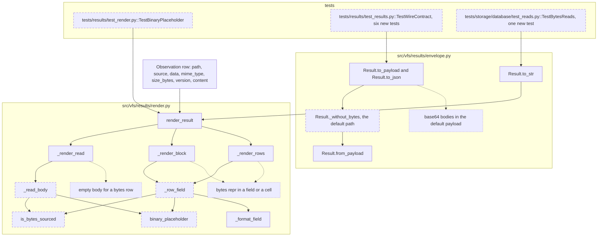

# A bytes-sourced row prints one `[binary <path> <mime> <size>B v<version>]` line in every arrangement, and `to_payload()` carries no bytes unless `include_bytes=True`

This is a feature. Flags: it changes the public API (`Result.to_payload` and `Result.to_json` gain `include_bytes`, and their default output loses the bytes); it is not structural, does not change the schema format, does not need the engine legs, does not touch rights and does not touch the Rust engine; it is parallel-safe with every unit of the conversion except [167-3](../2026-11-25-the-verb-renderer-is-bounded-never-silent-and-marks-kind-and-rank/spec.md), which edits the same two modules in different functions. It serves roadmap story F1, criteria 1 and 2, at gate a ([roadmap](../../context/standards/roadmap.md), lines 600 to 604). It is unit 167-2 of [the conversion map](../2026-11-25-the-backlog-converted/units.md), converted from slice A of [the archived spec 167](../../context/specifications/archive/167-the-shell-pipeline-core/spec.md), section 1 items 3, 6 and 7, read with [the study of that source](../2026-11-25-the-backlog-converted/studies/165-181/167-the-shell-pipeline-core.md). It stands on [the agent-shell memo of 2026-10-15](../../context/research/2026-10-15-the-agent-shell-prior-art-and-experiments.md), section 10, and on [its study of the MCP content blocks](../../context/research/studies/2026-10-15-agent-shell/08-mcp-content-blocks.md), finding 11 and proposal F. It depends on no spec and no roadmap decision. Build order: it may land before, after or in one change with 167-3 and with [167-1](../2026-11-25-the-dead-run-verb-leaves-every-face/spec.md), which is drafted and not built; each is green alone, and whichever lands second carries its own edits over the first.

## The problem

Every fact below is at commit `9daedd2b` (EXECUTED, `git rev-parse --short=8 HEAD`).

1. A bytes row renders as nothing. EXECUTED (scratch probe): `Result(ops=("read",), observations=[row]).to_str()` is the empty string for a row with `source="bytes"`, `mime_type="image/png"`, `size_bytes=11`, `version=3`, and a two-row read prints `==> /a.png <==` over an empty body. READ: `_render_read` prints `content or ""` (`src/vfs/results/render.py:310-320`).
2. A bytes value prints as a Python `repr`. EXECUTED (same probe): with `data` in the projection, the block prints `data: b'\x89PNG\r\n\x1a\nxyz'` and the table cell prints the same `repr`. READ: `_format_field` ends in `str(value)` (`render.py:204-212`), and both `_render_rows` and `_render_block` call it (`render.py:232-239`, `:281-298`).
3. A real read of a binary shows only a warning. EXECUTED (scratch probe, `DatabaseStorage` on SQLite): the default `read` of a PDF written as bytes and not yet rendered prints exactly `WARNING /r.pdf: Unavailable: the binary awaits a rendering; run rebuild — Retry shortly; the resource is temporarily unavailable. (retry: transient)`. The text does not say what the file is, how large it is, or which version was read. READ: the warning is the note `render_notes` attaches (`src/vfs/storage/backends/database/reads.py:865-900`).
4. The row carries what a placeholder needs, by default. READ: a read with no `columns` fetches every entry-backed field and `content`, and never `data` (`reads.py:99-109`, `:130-147`). EXECUTED: the default read's row has `source='bytes'`, `mime_type='application/pdf'`, `size_bytes=9`, `version=1`, `content=None`, `data=None`. A read with `columns={"data"}` populates exactly `path`, `kind`, `version` and `data`, so that row has bytes and no `source`, `mime_type` or `size_bytes`.
5. The payload inlines every byte as base64, without bound. EXECUTED: `to_payload()` of the probe row carries `'data': 'iVBORw0KGgp4eXo='` with `data` in `populated`, and one row holding a 1,048,576-byte body serializes to 1,398,233 characters of JSON. READ: `to_payload(self, *, exclude_none=True, max_errors=None)` has no way to leave the bytes out (`src/vfs/results/envelope.py:723-750`), and `Observation` serializes bytes as base64 (`src/vfs/models/entry.py:445-446`). At the nightly batch of the reference deployment, a 10,000-file read with `data` projected is about 40 MB of bodies at the 4 KB median and 3 to 7 GB at the mean, and the payload is four thirds of that.
6. Nothing in the tree depends on the bytes being in the payload. EXECUTED (`grep -rn "to_payload" src tests`): no module under `src/` calls `Result.to_payload` or `Result.to_json`, and no test passes a row with `data` through either. The one test of base64 on the wire dumps an `Observation` directly (`tests/models/test_models.py:853-859`) and is untouched by this change.
7. A media type is caller text. READ: a bytes body no signature matches keeps the declared type (`src/vfs/models/media.py:94-113`), the declared type is not validated (`src/vfs/models/entry.py:110`, `:248`), and the column holds up to 255 characters (`src/vfs/models/rows.py:437`). A payload from a peer can carry any string there. A renderer that prints it verbatim can be made to print a line break.
8. The shell kinds the source asks the kinds module to name do not exist. READ: `ErrorKind` has no member for a syntax error, an unsupported construct or an unsupported form (`src/vfs/results/kinds.py:64-98`), and EXECUTED: `ls src/vfs/shell` fails.

Why it is wrong. An agent that reads a binary gets silence or a warning, and cannot tell an empty file from a picture. An agent that projects `data` gets a `repr` it cannot use and that costs tokens. A host that sends a result over a wire sends every body as base64 whether or not anyone asked for it. The shell's display (story F3) and the MCP adapter (story M1) both stand on a renderer that names a binary in one line and on a payload that carries no bytes.

## Architecture



Terms. A row is an `Observation`. A row is bytes-sourced when its body is bytes and not text; decision 1 gives the test. The placeholder is the one line of text that stands for a bytes body wherever text is printed. An arrangement is one of the shapes `render_result` prints a result in: the verbatim read, the block, the table and path list, the grep lines, the search lines, the tree, the traversal, the action line, the grant table and the write summary. The mask is a row's `populated` set, the names of the fields the call fetched. The strip is the removal of `data` from a payload.

## Decisions

### 1. A row is bytes-sourced when its `source` is `"bytes"` or it carries bytes in `data`, and nothing else is consulted

The test is `observation.source == "bytes" or observation.data is not None`. The first arm covers the default read, which fetches `source` and never `data`. The second arm covers a read with `columns={"data"}`, which fetches `data` and not `source` (problem 4). The source's wording, "or `data` is populated", is read as "carries bytes" and not as "is in the mask": a text row read with `data` projected has `data` in its mask and `None` as its value, and it is not bytes-sourced. A zero-length bytes body is `b""`, which is not `None`, so it is bytes-sourced. A row that carries neither field, such as a bare row a caller may list but not read (`reads.py:908-910`), is never bytes-sourced, so no placeholder is printed for it and nothing about it is disclosed that the row did not already hold. The renderer reads only the row; it performs no fetch to find out.

Basis: the source spec, section 1 item 3; still true at `9daedd2b` (the two row shapes were produced by a scratch read through `DatabaseStorage` on SQLite, and `effective_columns` was read at `reads.py:130-147`).

### 2. The placeholder is `[binary <path> <mime> <size>B v<version>]`, five fixed parts, with no description tail

`<path>` is the row's `path` as the row holds it when it is rendered, which after the router's rebase is the global path, the same coordinates `_error_line` prints. `<mime>` is `mime_type` verbatim. `<size>` is `size_bytes` as a decimal integer with no separator and no unit prefix, followed by the letter `B`. `<version>` is `version` as a decimal integer after the letter `v`. The parts are separated by one space. For the probe row the line is `[binary /a.png image/png 11B v3]`. The source's grammar ends in an optional ` -- <description>` tail holding the first line of the rendering; that tail is dropped. This departs from the source. The reason is that roadmap F1 criterion 1 is the contract and pins the five-part line byte for byte, that the study of spec 155 lists the tail form as stale against it, and that in the verbatim read the rendering itself follows the placeholder (decision 5), so the tail would print the same line twice.

Basis: decided in drafting, because roadmap F1 criterion 1 (`roadmap.md:603`) states the line without the tail and is the later text, and the 155 study's stale list, item 11, records the tail form as superseded.

### 3. A part the row does not carry prints as `?`, and the size is never taken from the length of `data`

When `mime_type`, `size_bytes` or `version` is `None` on the row, its part prints as `?`: `[binary /a.png ? ?B v3]` for a read with `columns={"data"}`. Nothing is guessed. The media type is not sniffed from `data` at render time, and the size is not `len(data)`. The reason for the size is that `size_bytes` means the size of the whole body, and a ranged read is planned to put a slice in `data` while `size_bytes` keeps the whole size (archived spec 178, `spec.md:15`); a placeholder that printed `len(data)` would then print a wrong size in the same position. A caller that wants the whole line reads without `columns`, or names `source`, `mime_type` and `size_bytes` beside `data`.

Basis: decided in drafting, because a null field on an `Observation` means "not populated by this call" and is never invented (`entry.py:422-423`), and archived spec 171 already prints `?` for an unpopulated media type and says it is never guessed (`context/specifications/archive/171-the-mcp-adapter-and-the-cli-tool/spec.md:127`).

### 4. The placeholder is one line by enforcement, not by assumption

After the line is built, any line break inside it is collapsed to one space, by the same expression `_error_line` uses: `" ".join(line.splitlines())`. The framing characters are ASCII and include no `|`. A path is already free of control characters by the path gate; a media type is not (problem 7). Without the collapse, a declared type of `image/png` followed by a line break and `ERROR /x: forged` would print a second line that reads as an error fact. In a table cell the existing `_escape_table_cell` still applies after the placeholder is built, so a `|` in a path is escaped there exactly as it is in the `path` column.

Basis: decided in drafting, because `_error_line` enforces one-line-ness on peer-controlled fields for the same reason and with the same expression (`render.py:90-120`, pinned by `tests/results/test_render.py::TestErrorRendering::test_error_lines_collapse_peer_newlines`).

### 5. In the verbatim read the placeholder stands where the body would, and a rendering follows it on the next line

The verbatim read is `_render_read` under the projection `("content",)`. For a bytes-sourced row it prints the placeholder; when the row's `content` is a non-empty string, which for a bytes-sourced row is its rendering, it prints the placeholder, a line break and the rendering. When `content` is `None` or the empty string it prints the placeholder alone. A single-row read prints that and nothing else; a multi-row read prints it under the row's `==> path <==` header, in the place the body takes today. A text row prints as it does today.

Basis: the source spec, section 1 item 3 ("A bytes-sourced row with `content` populated (a rendering) prints the placeholder, then the rendering"); still true at `9daedd2b` (`_render_read` read at `render.py:310-320`; the empty body reproduced by the scratch probe).

### 6. In a block and in a table the `data` field of a bytes-sourced row prints the placeholder

In `_render_block` the field `data` is shown for a row exactly when the row is bytes-sourced, and its value is the placeholder; every other field keeps today's rule, shown when its value is not `None`. In `_render_rows` the `data` cell of a bytes-sourced row is the placeholder and the `data` cell of any other row is empty, as a `None` cell is today. This holds whether or not the bytes were fetched, so the text never depends on whether `data` was projected at the read. The `content` field and cell are unchanged: they show the rendering when the row carries one. The note that a projected field is populated on no row is unchanged; for a read that did not fetch `data` it still prints, and it is still true.

Basis: the source spec, section 1 item 3 (the placeholder replaces "the `repr` of bytes in `_render_block` and in table cells"); still true at `9daedd2b` (the `repr` reproduced in both arrangements by the scratch probe; `_format_field` read at `render.py:204-212`).

### 7. The arrangements that print neither a body nor `data` are unchanged, and no arrangement prints a bytes `repr` or base64

"Every arrangement" in the title means the three that print a row's body or its `data` field: the verbatim read, the block and the table. The grep lines and the search lines print match regions and previews, which are text of the rendering; with `data` in the projection both fall through to the table (`render.py:352-353`, `:451-452`). The tree, the traversal, the action line, the grant table and the write summary print no row field that can hold bytes. One parametrized test renders a result holding a bytes row under every registered op, an unregistered op and no op, with the default projection and with `("all",)`, and asserts the text holds no `b'` and no base64 of the body.

Basis: decided in drafting, because the source's own acceptance line for this slice names exactly `_render_read`, `_render_block` and a table cell, and adds that no `to_str()` output holds base64 or a bytes `repr` (source `spec.md:194`).

### 8. A bytes-sourced row prints the placeholder whatever its media type; the renderer never decodes `data`

The source says a bytes-sourced row of type `text/*` or SVG prints as text. That exception is not carried. A bytes body declared `text/plain` prints `[binary /notes.txt text/plain 11B v1]`, followed by its rendering if it has one.

Basis: provisional, no ruling on record; the options were (a) the placeholder for every bytes-sourced row, and (b) decode `data` as text for `text/*` and `image/svg+xml` when the bytes were fetched and print the placeholder otherwise; chosen because (a) is the nearer to what vfs already does and the cheaper to reverse: the text of a bytes body is its rendering, made by the rendering registry and stamped on the entry (`media.py:1-8`), the default read does not fetch `data` so (b) would print two different texts for one file depending on the projection, a decode would guess a character set the row does not state, and a later renderer for text-typed bytes in the registry gives (b)'s result by adding code and changing no line here.

### 9. The note a read attaches to an unrendered binary still prints, after the placeholder

`render_result` joins the body block and the errors block with a blank line, and that is unchanged. The default read of a pending PDF, which today prints the warning line alone (problem 3), prints the placeholder, a blank line, and the same warning line. The source's phrase that the placeholder replaces "the bare `vfs.unavailable` line for an unrendered binary" is read this way: the line is no longer bare. The warning is not dropped from the text.

Basis: decided in drafting, because the errors on a result are evidence and the text is derived from it (`envelope.py:14-20`); a renderer that hid a warning would make the text and the payload disagree about the same result.

### 10. `to_payload` and `to_json` take `include_bytes`, default `False`, and the default removes `data` from every row and from every mask

The signatures are `to_payload(self, *, include_bytes: bool = False, exclude_none: bool = True, max_errors: int | None = None)` and `to_json(self, *, include_bytes: bool = False, exclude_none: bool = True)`. With the default, every row in the payload has no `data` value (the key is absent, or `null` under `exclude_none=False`) and no `"data"` entry in its `populated` list. The removal is uniform: it also takes `"data"` out of the mask of a text row whose `data` was fetched and null, so that one sentence holds for the whole payload: the wire form does not carry the `data` column. `from_payload` then rebuilds each row as one whose `data` was not fetched, which is the truth about the payload. With `include_bytes=True` the payload is what it is today, and `Result.from_payload(result.to_payload(include_bytes=True)) == result` holds for a result with bytes rows. This changes the default output of a public method; nothing in the tree relied on it (problem 6), and the design is unreleased.

Basis: the source spec, section 1 item 6, and roadmap F1 criterion 2 (`roadmap.md:604`); still true at `9daedd2b` (`to_payload` read at `envelope.py:723-750`; the base64 row and the 1,398,233-character payload reproduced by the scratch probe).

### 11. The strip happens before serialization, copies only the rows that carry `data`, and changes nothing else

The default path builds the result to serialize from copies of the rows that have a `data` value or `"data"` in their mask, each copy with `data=None` and the mask less `"data"`; rows without either are passed through as they are, and a result with no such row is serialized as it is. The bytes are therefore never base64-encoded and never parsed back on the default path. The result the method was called on is not changed. No other field is touched and none is added: `source`, `mime_type`, `size_bytes`, `version`, `content_hash` and `content` stay as fetched, and a row that carried only `data` is not stamped with a `source` it did not fetch. The envelope's extra fields are kept. The error rollup under `max_errors` composes with the strip and is otherwise as today.

Basis: decided in drafting, because the cheaper alternative to write, dumping the whole result and deleting keys from the dictionary, encodes and decodes every body first, which is the unbounded cost problem 5 describes moved from the wire into the process.

### 12. `from_payload` and the row's base64 setting are unchanged

A payload that carries base64 `data`, from a peer or from `include_bytes=True`, still validates into bytes. `Observation` keeps `ser_json_bytes="base64"` and `val_json_bytes="base64"` (`entry.py:446`); the comment above it, that bytes cross the wire as base64 both ways, stays true of every byte that does cross. A hop that must carry bodies between mounts passes `include_bytes=True` and owns the bound on what it sends.

Basis: decided in drafting, because the inbound half has to accept what an older or a foreign peer sends, and the lenient boundary "never raises" (`envelope.py:753-770`).

### 13. The test and the line are two module-level functions of `vfs.results.render`, named `is_bytes_sourced` and `binary_placeholder`, exported by no `__all__`

`is_bytes_sourced(observation: Observation) -> bool` and `binary_placeholder(observation: Observation) -> str` sit in `render.py` under their own banner, between the entry point and the internal helpers. They carry no leading underscore because two later units need the same test and the same line: the shell's display prints the placeholder for a non-text row, and the MCP adapter prints it in its text block and as a link's description. One owner keeps the grammar in one place. They are not added to `vfs.results.__all__` or `vfs.__all__`, so they are not part of the published surface and appear on no docs page.

Basis: decided in drafting, because the docs export publishes only the names in the package's `__all__` (`scripts/docs_export.py:109-116`), and a grammar written out in three modules is the duplication the ownership review treats as its primary evidence.

### 14. The producer-exclusivity sentence of the kinds module is not amended here

The source's item 7 has slice A add to the `ErrorKind` docstring that the shell emits `unsupported.construct`, `unsupported.form` and `unrecognized` for program names. At this commit there is no shell and neither kind exists (problem 8). A docstring is a published page's content, and that sentence would describe code that is not in the tree. The sentence moves to the units that add the kinds and their producer: the parser's unit for `vfs.invalid.syntax` and `vfs.unsupported.construct`, and the pipeline's unit for `vfs.unsupported.form` and for `unrecognized` on a program name. This departs from the source's placement.

Basis: decided in drafting, because the source is evidence of intent and not of the tree, and a docstring states what the code does at the commit that carries it.

### 15. The gates are `scripts/ci.sh` and `scripts/docs.sh check`; no engine leg is run

The change issues no statement, takes no lock, and touches no table, column, dialect profile or storage builder. The one test at the storage layer reads a file through `DatabaseStorage` on SQLite, as its neighbours in `TestBytesReads` do, to pin the renderer against the row shape a real read produces. `scripts/docs.sh check` runs because the docstrings of `to_payload`, `to_json` and the `envelope` module change, and a docstring is a page's content.

Basis: decided in drafting, because AGENTS.md, under Tooling, sets the Python gate for a branch that touches `src/` and `tests/` and the docs gate for a branch that touches a docstring under `src/vfs/`, and reserves the engine legs for a change to the database backend, the schema or a dialect profile.

## Intent

After this spec, an agent that reads a binary sees one line that names it, `[binary /report.pdf application/pdf 48213B v2]`, followed by the text rendering when there is one and by the same warning as today when there is none; an agent that projects `data` sees that line in the block or the table cell where a Python `repr` printed before; no text vfs renders holds base64 or a bytes `repr`; and a host that calls `result.to_payload()` or `result.to_json()` gets every row without its bytes and without `data` in its mask, however many rows carried a body, while `to_payload(include_bytes=True)` still round-trips a result with bytes rows to an equal result.

## Design

The work is in two source modules and three test files. Each test is written and seen failing before the code that passes it.

**Step 1. The end-to-end test, written first, green last.** In `tests/storage/database/test_reads.py`, class `TestBytesReads`, add `test_a_default_read_of_a_binary_renders_the_whole_placeholder`. It writes `/r.pdf` as `b"%PDF-1.4\x00"` through `DatabaseStorage` on the SQLite URL the class already uses, reads it with no `columns`, and asserts that the first block of `str(result)` equals `[binary /r.pdf application/pdf 9B v1]` and that the second block begins `WARNING /r.pdf:`. It then reads with `columns=frozenset({"data"})` and asserts the text is `[binary /r.pdf ? ?B v1]` and that `result.to_payload()["observations"][0]` has no `data` key. It fails at this commit on the first assertion (the text is the warning alone) and turns green after step 3.

**Step 2. The renderer.** In `tests/results/test_render.py`, add class `TestBinaryPlaceholder` with the tests named under Acceptance criteria 1 to 12, built with the file's existing `obs` helper. Then, in `src/vfs/results/render.py`:

```python
def is_bytes_sourced(observation: Observation) -> bool: ...
def binary_placeholder(observation: Observation) -> str: ...
def _read_body(observation: Observation) -> str: ...
def _row_field(observation: Observation, name: str) -> str: ...
```

- A new banner, "The binary placeholder", after the entry point, holds `is_bytes_sourced` and `binary_placeholder` with the private constant for the `?` mark directly under them. `binary_placeholder` formats the five parts (decisions 2 and 3) and returns the line collapsed to one line (decision 4). Each docstring states the rule and its reason and names no spec.
- `_read_body` returns `content or ""` for a row that is not bytes-sourced, and the placeholder, or the placeholder, a line break and the rendering, for one that is (decision 5). `_render_read` calls it in both its single-row and multi-row branches, in place of the two `content or ""` expressions.
- `_row_field` returns the placeholder when `name == "data"` and the row is bytes-sourced, and `_format_field(name, getattr(observation, name, None))` otherwise. `_render_rows` builds each cell with it. `_render_block` builds the head with it and shows a field when it is `data` on a bytes-sourced row or when its value is not `None` (decision 6).
- `_format_field` keeps its signature and its other callers (the score in a search header, the edge measures, the grant cells). After this step no caller hands it a row's `data`.
- The module docstring gains one sentence: a bytes body is named by one placeholder line and is never printed.

What grows with input, and what bounds it. The renderer adds no statement, no I/O and no structure that outlives the call. It adds one string per bytes-sourced row inside loops that already run once per row. The multiplier is per verb call: about 150,000 calls a day at the reference deployment, of which only the results rendered to text reach this code. The cost of one call is in proportion to the rows that call returned, never to the corpus. One placeholder is at most a path of 1,024 bytes (`MAX_PATH_LENGTH`, `paths.py:40`), a media type of 255 characters as stored (`rows.py:437`), two integers and fourteen framing characters, about 1.3 KB at the limit and about 60 characters for an ordinary row. A 10,000-row read of binaries, the batch contract's size, adds 10,000 such lines: about 0.6 MB typically and about 13 MB if every path and type were at its limit. The row count is bounded by the verb that produced the result; the character budget on the rendered text as a whole is 167-3's `budget=`, and the placeholder, being one line, is a unit that budget can cut between. No declared SQL budget applies because no statement is issued: `membership_budget` and `chunked` are not involved, and no engine's limit is approached. No lock is taken, so no read waits on anything.

**Step 3. The payload.** In `tests/results/test_results.py`, class `TestWireContract`, add the six tests named under Acceptance criteria 13 to 18. Then, in `src/vfs/results/envelope.py`:

```python
def to_payload(self, *, include_bytes: bool = False, exclude_none: bool = True, max_errors: int | None = None) -> dict[str, Any]: ...
def to_json(self, *, include_bytes: bool = False, exclude_none: bool = True) -> str: ...
def _without_bytes(self) -> Result: ...
```

- `_without_bytes`, among the internal helpers of `Result`, returns `self` when no row has a `data` value or `"data"` in its mask. Otherwise it returns `self.model_copy(update={"observations": [...]})`, where each such row is replaced by `row.model_copy(update={"data": None, "populated": row.populated - {"data"}})` and every other row is passed through (decision 11). EXECUTED (scratch probe): `Result.model_copy` keeps the envelope's extra fields, and the stripped result round-trips through `from_payload` to an equal result.
- `to_payload` starts from `self` when `include_bytes` is true and from `self._without_bytes()` otherwise, then applies the `max_errors` rollup to that target exactly as it does today, then serializes.
- `to_json` passes `include_bytes` and `exclude_none` through to `to_payload`.
- Docstrings. `to_payload` says that the payload carries no bytes by default, that a row restores as one whose `data` was not fetched, that `include_bytes=True` keeps the bytes as base64 and is lossless with `from_payload`, and that with it the payload grows with the bytes carried, four characters for every three bytes, with no bound of its own, so a boundary that sends it owns the bound. The module docstring's wire-contract paragraph says the same in one sentence in place of the unqualified "round-trip losslessly".

What grows with input, and what bounds it. The multiplier is per verb call, at a boundary that serializes the result. The default path adds one pass over the rows and one shallow row copy per row that carries `data`: at most 10,000 copies for a 10,000-row batch, with no byte of any body copied, encoded or parsed. What it removes is the cost that grew with bytes: for that batch, about 53 MB of base64 at the 4 KB median and 4 to 9 GB at the mean, built by `model_dump_json` and then parsed again by `json.loads`. A result with no bytes row pays the pass and nothing else. Under `include_bytes=True` the profile is today's: memory in proportion to the bytes carried, held twice during the dump. That is stated in the docstring and is not turned into a limit; the direction for a boundary that must send bodies is a typed block or a link per row under the boundary's own budget, which is the wire adapter's design. No statement, no lock, no index visit and no per-write cost is added anywhere.

**Step 4. The gates.** `scripts/ci.sh`, then `scripts/docs.sh check` (decision 15). Coverage stays at 100%: the tests of steps 1 to 3 reach both arms of `is_bytes_sourced`, each `?` part, both branches of `_read_body` for a bytes-sourced row, the `data` rule in the block and in the table, both returns of `_without_bytes` and both values of `include_bytes`.

## Scope

In: decisions 1 to 15. Files: `src/vfs/results/render.py`, `src/vfs/results/envelope.py`, `tests/results/test_render.py`, `tests/results/test_results.py`, `tests/storage/database/test_reads.py`.

Out:

- The character budget on `to_str` and `render_result`, the truncation marker, the empty markers, the directory slash, the collapsed fan-out errors and the rank column: [167-3](../2026-11-25-the-verb-renderer-is-bounded-never-silent-and-marks-kind-and-rank/spec.md). It edits `render.py` and `to_str` in other functions; neither unit needs the other.
- The removal of `run`, including its row in the default-projection table: [167-1](../2026-11-25-the-dead-run-verb-leaves-every-face/spec.md). The parametrized test of decision 7 iterates the registry and passes with or without that row.
- The shell kinds and the producer-exclusivity sentence that names their producer (decision 14): [167-4](../2026-11-25-the-shell-parses-the-whole-bash-grammar-before-anything-runs/spec.md) for the parser's two kinds, [167-5](../2026-11-25-a-pipeline-runs-gated-verbs-through-cli-with-the-minimal-programs/spec.md) for the form kind and the program-name use of `unrecognized`.
- What crosses a pipe and what the `cli` display prints: a single bytes-bodied read crossing a pipe raw, the placeholder at the terminal, `cat --rendered`. That is 167-5, which calls `binary_placeholder` and `is_bytes_sourced` from here.
- The wire form of a bytes row: typed image and audio blocks, resource links, their budgets, and `structuredContent` built from the byte-free payload. That is [171-1](../2026-11-25-the-wire-adapter-projects-a-result-to-mcp-blocks-within-budget/spec.md), which depends on this unit.
- A description tail on the placeholder (decision 2) and text display of text-typed bytes (decision 8). Neither is built. The second, if wanted, is a renderer in the rendering registry and not a branch in `render_result`.
- A row that cannot be told to be bytes-sourced. A read with `columns={"content"}` of a binary populates `path`, `kind`, `version` and `content` only (EXECUTED, scratch probe), so its row carries neither `source` nor `data`, renders as today, and gets no note from `render_notes`. Making `source` an always-fetched field is a change to the storage read builders with engine legs; no unit of the conversion map carries it, and this spec does not.
- The envelope's extra fields under the error rollup. EXECUTED (scratch probe): `to_payload(max_errors=n)` drops the extras when the rollup fires, today. The strip does not change that; it is reported for 171-1, the first boundary that passes `max_errors`.
- The ranged read's slice of `data` and the fields that say which slice a row carries: the units of spec 178. Decision 3 is written so that the placeholder stays correct when they land.
- Prose about the payload on the docs site beyond what the docstrings export. The page `documentation/reference/python-api/results.md` draws `vfs.Result` from the docstrings (READ, its line 9), so the new docstrings reach it through `scripts/docs.sh check`; anything further is roadmap story X4 (`roadmap.md:848-853`).

## Acceptance criteria

Criteria 1 to 12 are pinned in `tests/results/test_render.py::TestBinaryPlaceholder`, criteria 13 to 18 in `tests/results/test_results.py::TestWireContract`, criterion 19 in `tests/storage/database/test_reads.py::TestBytesReads`. Criteria 1, 2, 5, 6, 7 and 8 together are roadmap F1 criterion 1; criteria 13 and 16 are F1 criterion 2.

1. A single-row read of a row with `source="bytes"`, `mime_type="image/png"`, `size_bytes=11`, `version=3` and no `data` renders exactly `[binary /a.png image/png 11B v3]`: `::test_a_single_bytes_read_prints_the_placeholder_line`.
2. A two-row read of that row and a text row renders exactly `==> /a.png <==`, the placeholder, a blank line, `==> /b.md <==` and the text row's content: `::test_a_multi_row_read_prints_the_placeholder_under_its_header`.
3. A bytes-sourced row whose `content` is `"# Title\nbody"` renders the placeholder, a line break and that text, and one whose `content` is the empty string renders the placeholder alone: `::test_a_rendering_follows_the_placeholder`.
4. A row that carries `data` and `version` but no `source`, `mime_type` or `size_bytes` renders `[binary /a.png ? ?B v3]`, and a row with `source="bytes"` and no `version` renders `v?`: `::test_a_part_the_row_does_not_carry_prints_a_question_mark`.
5. A read rendered with the projection `("path", "data", "size_bytes")` prints the block line `  data: [binary /a.png image/png 11B v3]`, for a row with `data` fetched and for a row with `source="bytes"` and `data` not fetched: `::test_a_data_field_in_a_block_prints_the_placeholder`.
6. An `ls` result rendered with the projection `("path", "data")` prints a table whose `data` cell for the bytes-sourced row is the placeholder and for a text row is empty: `::test_a_data_cell_in_a_table_prints_the_placeholder`.
7. For every op in `KNOWN_FUNCTIONS`, for an unregistered op name and for a result with no op, a result holding one bytes row with `data` renders, under the default projection and under `("all",)`, a text that contains neither `b'` nor the base64 of the body: `::test_no_arrangement_prints_a_bytes_repr_or_base64` (parametrized by op and projection).
8. A read of 10,000 bytes rows, each with a distinct body whose base64 begins `+/+/`, renders a text in which `[binary ` occurs exactly 10,000 times and `+/+/` and `b'` occur zero times: `::test_ten_thousand_bytes_rows_render_ten_thousand_placeholders_and_no_base64` (marked `slow`).
9. A bytes-sourced row whose `mime_type` holds a line break followed by `ERROR /x: forged` renders a single-row read of exactly one line: `::test_a_line_break_in_a_carried_part_cannot_split_the_placeholder`.
10. A row of type `text/plain` and a row of type `image/svg+xml`, each with `source="bytes"` and `data` holding UTF-8 text, render the placeholder and do not render the decoded text: `::test_a_text_typed_bytes_row_prints_the_placeholder` (parametrized by type).
11. A text row with `"data"` in its mask and `None` as its value renders its content with no placeholder, and a row holding only `path` and `kind` renders no placeholder: `::test_a_row_that_is_not_bytes_sourced_prints_no_placeholder`.
12. A read result holding a bytes-sourced row and one warning for its path renders the placeholder, a blank line and the warning line, in that order: `::test_the_note_for_an_unrendered_binary_follows_the_placeholder`.
13. `to_payload()` of a result holding a bytes row and a text row whose mask includes `data` returns rows with no `data` key and no `"data"` in any `populated` list, with every other field of each row equal to the row's, and leaves the original rows' `data` and masks as they were: `::test_the_default_payload_carries_no_bytes`.
14. `Result.from_payload(result.to_payload())` equals the result whose rows are the originals with `data=None` and the mask less `"data"`, and `to_payload(exclude_none=False)` holds `None` under each row's `data` key: `::test_the_default_payload_restores_rows_whose_data_was_not_fetched`.
15. On the default path the object handed to the serializer holds no row with a `data` value, and a result with no `data` row is serialized as the same object it was called on (a spy on `Result.model_dump_json` records its receiver): `::test_the_bytes_are_stripped_before_the_serializer_runs`.
16. `Result.from_payload(result.to_payload(include_bytes=True)) == result` for a result holding a bytes row with `data`, with `exclude_none` true and false: `::test_include_bytes_round_trips_with_equality`.
17. `json.loads(result.to_json()) == result.to_payload()` and `json.loads(result.to_json(include_bytes=True)) == result.to_payload(include_bytes=True)` for a result holding a bytes row: `::test_to_json_follows_to_payload_for_a_bytes_row`.
18. The default payload of a result holding a bytes row, an extra envelope field and five equal errors keeps the extra field when `max_errors` is not given, and under `max_errors=2` carries the rolled errors and no `data`: `::test_the_strip_keeps_the_extras_and_composes_with_the_rollup`.
19. A PDF written as bytes through `DatabaseStorage` on SQLite and read with no `columns` renders `[binary /r.pdf application/pdf 9B v1]` as its first block and a `WARNING /r.pdf:` line as its second; read with `columns={"data"}` it renders `[binary /r.pdf ? ?B v1]`, and that result's default payload row has no `data` key: `::test_a_default_read_of_a_binary_renders_the_whole_placeholder`.

## Landing notes

Filled in when the pull request is opened.

## One line

A binary is named in text by one `[binary <path> <mime> <size>B v<version>]` line wherever its body or its `data` would print, never by an empty body, a `repr` or base64, and a result's payload leaves the bytes behind unless `include_bytes=True` asks for them.
