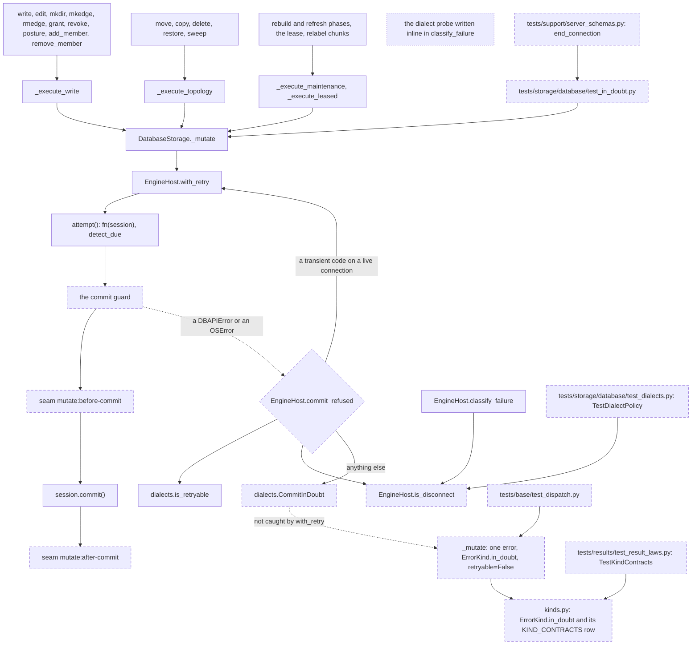

# A connection lost during `COMMIT` answers `vfs.unavailable.in_doubt`, retry class `refresh`, and is never redriven

A fix. Flags: it is not structural (one test file is added and no module under `src/` is added or removed); it changes the public API by one value on the wire, the error kind `vfs.unavailable.in_doubt`, and by the kind one existing failure answers (decision 12), and it adds no verb, argument or exported name; it does not change the schema format (no statement, table, column or index changes); it needs the engine legs, because what a lost connection raises at the commit call is each driver's own; it does not touch rights; it does not touch the Rust engine; it is parallel-safe with every unit that does not edit `_mutate` in `backend.py` or `classify_failure` in `engine.py`, which leaves [177-3](../2026-11-25-a-keyed-call-stores-its-answer-with-its-change-and-a-resend-gets-it-back/spec.md), which builds after this one, and [179-5](../2026-11-25-a-failed-engine-call-carries-the-engines-own-code-as-a-field/spec.md), which may build before or after it as a matter of merge order. It serves roadmap story K5 at gate b, acceptance item 6 ([the roadmap](../../context/standards/roadmap.md), line 176). It is converted, by amendment, from [spec 177](../../context/specifications/archive/177-replay-the-contract-and-the-request-key/spec.md), section 5, with the `in_doubt` half of task 2 and task 3 of [its task list](../../context/specifications/archive/177-replay-the-contract-and-the-request-key/tasks.md), read through [the study of that source](../2026-11-25-the-backlog-converted/studies/165-181/177-replay-the-contract-and-the-request-key.md). It stands on principle 5 of [the 2026-10-24 study of distribution](../../context/research/studies/2026-10-24-ostep-principles-for-vfs/06-distribution-nfs-afs.md), lines 92 to 97, which found the gap. It depends on no unit of [the unit map](../2026-11-25-the-backlog-converted/units.md) and on no unbuilt roadmap story: story K5 names story K2 under "Depends on" for "the `unchanged` row", a row of the replay table that [177-1](../2026-11-25-every-mutating-verb-sent-twice-answers-as-a-pinned-replay-table-says/spec.md) carries and nothing here reads. It builds on two landed pieces and changes neither: the seam mechanism (`src/vfs/storage/backends/database/seams.py`) and the commit-point fence ([the archived 2026-11-14 spec](../../context/specifications/archive/2026-11-14-a-mutation-is-authorized-for-the-rows-it-acts-on-at-its-commit-point.md)). Build order: this unit is the first of spec 177's four units to build; 177-3 builds after it and changes one argument of the answer added here, quoted under Scope.

## The problem

Every fact below is at commit `4a221cc3` (EXECUTED, `git rev-parse --short=8 HEAD`). The probes ran at `5b20fd4f`, and nothing under `src/` or `tests/` differs between the two (EXECUTED, `git diff --stat 5b20fd4f HEAD -- src tests` prints nothing). The probe scripts are in the session scratchpad, `177-2/probe.py` and `177-2/probe2.py`, run with `uv run python` against a SQLite file store as the system actor.

- Every mutation commits in one place, with nothing around the commit. `_mutate` runs `fn(session)` and, when the `Result` succeeded, calls `await session.commit()` bare (READ, `src/vfs/storage/backends/database/backend.py:1488-1498`, the commit at `:1497`). All four runners end there: `_execute_write` (`:1400`), `_execute_maintenance` (`:1413`), `_execute_leased` (`:1418`) and `_execute_topology` (`:1463`).
- A failure of the commit call is treated as a failure of any statement. It leaves `attempt()` raw; `with_retry` redrives it when the profile's retry policy names its code and re-raises it otherwise (READ, `src/vfs/storage/backends/database/engine.py:370-381`); `_mutate` hands what escapes to `classify_failure` (READ, `backend.py:1507-1508`), whose two liveness answers are both `retryable=True` (READ, `engine.py:403`, `:410`).
- So a write that landed is answered "retry shortly". Four faults were staged at the commit call of a one-file `write` (EXECUTED, `177-2/probe.py`):

| What happened at the commit call | Kind answered | `retryable` | Retry class | Calls to commit | The file afterwards |
|---|---|---|---|---|---|
| The driver connection is closed just before it; aiosqlite raises `OperationalError`, `connection_invalidated=True` | `vfs.unavailable.backend` | `True` | `transient` | 1 | absent |
| The commit lands, then a `DBAPIError` with `connection_invalidated=True` is raised | `vfs.unavailable` | `True` | `transient` | 1 | present |
| The commit lands, then `ConnectionResetError` is raised | `vfs.unavailable` | `True` | `transient` | 1 | present |
| A `DBAPIError` that is not invalidated is raised in place of the commit | `vfs.unavailable` | `True` | `transient` | 1 | absent |

- A caller that obeys the answer can apply a change twice. `edit("foo" -> "foo!")` sent twice leaves `foo!!`, and a `move` sent twice refuses `vfs.not_found` with no data, so the caller cannot tell a landed move from a path that never existed (EXECUTED in the study, 2026-11-25, on memory and SQLite).
- The commit is not redrived today only because of what the code sets happen to hold. The retryable sets are SQLSTATE `40001` and `40P01` on every profile, SQLite code 5, MariaDB codes 1020, 1205 and 1213, and Oracle codes 60 and 8177 (EXECUTED, `177-2/probe2.py`; READ, `src/vfs/storage/backends/database/dialects.py:430-434`, `:501`, `:612`, `:643`); none is a connection loss, so each row of the table shows one call to commit. No test pins that a lost commit is never run again.
- The disconnect test at HEAD is the dialect's alone, asked with no connection. `classify_failure` calls `dialect.is_disconnect(origin, None, None)` inside a `try` that reads a raising check as no disconnect (READ, `engine.py:391-401`), and a test pins that guard (READ, `tests/storage/database/test_dialects.py:301-313`). It does not read `exc.connection_invalidated`, which the source said it did; one other site in the tree reads the flag (READ, `engine.py:655`).
- SQLAlchemy's own verdict is computed with the live connection and written on the wrapper. `Connection._handle_dbapi_exception` asks `dialect.is_disconnect(e, self._dbapi_connection, cursor)` and passes the answer as `connection_invalidated` (READ, `.venv/lib/python3.13/site-packages/sqlalchemy/engine/base.py:2248-2257`, `:2293`; SQLAlchemy 2.0.52).
- On Postgres the two verdicts differ. The asyncpg dialect, given no connection, calls a disconnect only an `InterfaceError` whose text holds "connection is closed"; given a connection it asks the connection whether it is closed (READ, `sqlalchemy/dialects/postgresql/asyncpg.py:1176-1182`). The adapted errors for SQLSTATE 08003 (`ConnectionDoesNotExistError`) and 57P01 (`AdminShutdownError`) both answer `False` with no connection, and neither is retryable (EXECUTED offline, `177-2/probe2.py`). At HEAD a backend terminated mid-statement on Postgres is therefore `vfs.unavailable`, not `vfs.unavailable.backend` (INFERRED from the two facts; no server ran in drafting).
- An exception that is not the driver's own error class leaves the commit call unwrapped. `_commit_impl` hands every exception of `do_commit` to `_handle_dbapi_exception` with no statement, which wraps only an instance of the driver's `Error` and re-raises anything else as it is (READ, `sqlalchemy/engine/base.py:1146-1149`, `:2280-2284`, `:2368`), and the asyncpg adapter re-raises what its translation table does not map (READ, `sqlalchemy/dialects/postgresql/asyncpg.py:786-801`). A socket reset or a driver timeout (`TimeoutError` is a subclass of `OSError`) so reaches `_mutate` raw and is caught by its `OSError` arm (READ, `backend.py:1507`), the third row of the table.
- Nothing vfs does itself fails at the commit call. No table declares a deferred constraint and no session holds ORM state to flush (EXECUTED, `grep -rni deferr src/vfs` hits prose only; `grep -rn "session.add\|\.flush()" src/vfs` hits a membership verb's name and three batchers), so a failure of `COMMIT` is the engine's or the transport's.
- None of this unit's names exists. `in_doubt`, `CommitInDoubt`, `mutate:before-commit` and `mutate:after-commit` have no hit under `src/` or `tests/` (EXECUTED, grep).
- The roadmap asks for exactly this split. Story K5, acceptance item 6: "A fault at the `mutate:after-commit` seam answers `vfs.unavailable.in_doubt` (retry class `refresh`); one inside the statement answers `vfs.unavailable.backend` (retryable)." (READ, `context/standards/roadmap.md:176`).

## Architecture



- **Commit call**: `await session.commit()` in the mutation runner, together with the two seams on either side of it.
- **In doubt**: the state of a mutation whose commit call failed without the engine saying which way the transaction went. The change is either wholly in the store or wholly absent; vfs does not know which.
- **Redrive**: `with_retry` running the whole attempt again from its first read, on a fresh session.
- **Transient refusal**: a commit failure whose code is in the profile's retryable sets. It is the engine saying that it rolled the transaction back.
- **Keyless**: a call that carries no request key. Every call is keyless until 177-4 lands.

## Decisions

### 1. The commit call of the mutation runner is guarded, and a failure there that leaves the outcome unknown is answered as its own kind instead of reaching the general classifier.

The guard is a `try` around three awaits in `attempt()`: the seam `mutate:before-commit`, `session.commit()`, the seam `mutate:after-commit`. Everything before it, the verb's body and the statistics detection, is outside it: a failure there was raised before anything was sent to commit, so the transaction is gone and today's answers are true. The reason for the split is the table under The problem: the same answer, "retry shortly", is given to a change that is absent and to one that is present.

Basis: the source spec, section 5.1; still true at 4a221cc3 (`backend.py:1488-1498` read: the commit is bare; the probe's four rows).

### 2. In doubt is every driver error and every `OSError` that escapes the commit call and that the retry policy does not redrive, not only the errors a dialect calls a disconnect.

The source drew the line at a disconnect: an error SQLAlchemy or the dialect calls one is in doubt, and every other failure of the commit keeps its classification, "the engine answered, so the outcome is known". Three facts at HEAD move the line. First, the common-case engine's driver is the one whose disconnects the dialect test misses: with no connection, asyncpg's errors for a terminated backend are not disconnects (EXECUTED), and whether SQLAlchemy's flag is set depends on whether the driver had marked the connection closed at the instant the error surfaced (INFERRED). Second, a socket reset or a driver timeout arrives as a bare `OSError` that no disconnect test sees (READ; the probe's third row). Third, the two mistakes do not cost the same: calling an answered failure in doubt costs the caller one read before the resend, and calling a lost commit retryable costs a second application of an `edit`, a refused `move` nobody can interpret, or a duplicated append. What the wider line gives up is precision in one case: a commit the engine refused with a code outside the retryable sets (a full disk or log, SQLite's full or I/O error at commit) is answered "outcome unknown" although the engine did answer. vfs holds no per-engine table of which of those codes mean "rolled back", and it sends nothing of its own that can fail at commit (no deferred constraint, no flush), so the line is drawn with the one engine fact the profiles already declare, the retryable sets, and with no message text.

Basis: provisional, no ruling on record; the options were (a) the source's line, in doubt only for an error SQLAlchemy or the dialect calls a disconnect, with every other commit failure classified as at HEAD, (b) every failure at the commit call that the retry policy does not redrive, and (c) the source's line widened by a declared set of connection-loss codes (SQLSTATE class 08 and Postgres 57P01 to 57P03); chosen (b) because it is the only option whose mistake costs a read and never a second application, it adds no engine fact for a profile to carry, and narrowing it to (a) or (c) after a release only turns some "verify first" answers back into "retry", which harms no caller written against (b).

### 3. A commit failure whose code the profile's retry policy names is redriven as today, unless SQLAlchemy or the dialect says the connection is gone.

A serialization failure, a deadlock or SQLite's busy code at `COMMIT` is a transient refusal: the engine says the transaction is rolled back, and a redrive from a fresh snapshot is the landed behaviour. The test is one method, `EngineHost.commit_refused(exc)`, true only for a `DBAPIError` for which `is_retryable(profile, exc)` holds and `is_disconnect(exc)` does not. When one error carries a retryable code and also reports the connection gone, in doubt wins, for the reason of decision 2: a redrive of a commit that landed is the mistake this unit exists to prevent. No retryable set at HEAD holds a connection-loss code, so the tie-break changes no case that exists today (EXECUTED, the sets listed under The problem).

Basis: the source spec, section 5.1 ("a serialization failure at `COMMIT` on Postgres ... is unchanged"); still true at 4a221cc3 (`engine.py:373-381` read; the retryable sets printed by `177-2/probe2.py`).

### 4. An error SQLAlchemy raises by itself at the commit call, a cancelled task and any other exception keep the path they have at HEAD.

The guard catches `DBAPIError` and `OSError` and nothing else. A `SQLAlchemyError` that is not a `DBAPIError` (a session in an invalid state, for one) is raised by SQLAlchemy before anything is sent to the engine, so the change did not land and `classify_failure`'s answer stands. `asyncio.CancelledError` is a `BaseException` and is not caught anywhere in the runner today (READ, `backend.py:1500-1508`): the caller that cancelled gets no `Result`, as now. An exception of any other class is a defect and propagates, as now.

Basis: decided in drafting, because the guard must name what it catches and the rule that "a raw exception from an in-process backend is a bug" (`context/standards/how-we-code.md:23`) forbids it from catching what it cannot classify.

### 5. The signal is an exception of its own, `CommitInDoubt`, declared beside `StaleSnapshot`, and `with_retry` does not catch it.

`with_retry` catches `DBAPIError` and `StaleSnapshot` and nothing else (READ, `engine.py:373`), so an exception outside both families passes through it after exactly one attempt. That is the whole mechanism of "never redriven": no flag, no counter, no change to `with_retry`. `CommitInDoubt(Exception)` carries one attribute, `context: str`, the driver's own text, as `StaleSnapshot` does (READ, `dialects.py:61-63`), and is raised `from` the original error so the cause stays on the chain. It lives in `dialects.py` because that module already holds the runner's other control-flow signal and `backend.py` imports from it.

Basis: the source spec, section 5.1; still true at 4a221cc3 (`engine.py:373` read: the catch names two families; `dialects.py:49-63` read).

### 6. The kind is `vfs.unavailable.in_doubt`, member `ErrorKind.in_doubt`, a child of `unavailable`.

A consumer that does not know the child degrades it to `vfs.unavailable` through `kind_family` (READ, `src/vfs/results/kinds.py:306-323`), which is the family it gets today, so no older reader is worse off. The string is the one roadmap story K5 names in its acceptance item 6 and roadmap decision D46 reuses for a durable run's step (READ, `context/standards/roadmap.md:176`, `:1117`). No release has shipped a kind of this design, so the rule that a shipped value is never renamed (READ, `kinds.py:45-47`) starts to bind this string at the first release and not before.

Basis: the source spec, section 5.2; still true at 4a221cc3 (grep for `in_doubt` under `src/` and `tests/` returns nothing; the roadmap lines read).

### 7. Its retry class is `refresh`, its phrase is "Outcome unknown", and its hint names no request key.

The contract row is `KindContract("Outcome unknown", RetryClass.refresh, "The commit did not answer, so the change may or may not have landed. Read the affected entries (stat, read) to see which before sending the call again.", "None — source carries the mount")`. `refresh` is the class that already means "re-read state first, then retry" (READ, `kinds.py:131`). The hint the source wrote also told the caller to resend with the same `request_key`; no verb takes that argument until 177-4, and a hint must not name an argument that does not exist, so the sentence is left for the keyed units to add. The kind is not added to the set that requires a detail (`_DETAIL_REQUIRED`, `src/vfs/results/envelope.py:236`): the runner always passes one, and a second producer need not.

Basis: verified lean, the study's open choice on section 5.2 (holds); precedent: `RetryClass.refresh` in `src/vfs/results/kinds.py:126-134`, and a child of `unavailable` whose class differs from its parent's already exists, `vfs.unavailable.schema` with `never` at `kinds.py:279-284`, which decision 9 of [the kernel rulings](../../context/specifications/active/2026-11-15-the-kernels-public-names-and-argument-families-are-ruled.md) (line 81) cites for the same purpose.

### 8. Every in-doubt answer of this unit carries `retryable=False`.

A blind resend of a keyless call is not safe: the study's probe applied an `edit` twice. So the flag a host reads to decide on an automatic resend is `False`, and the retry class says what to do first. The runner passes the argument explicitly, `retryable=False`, so that the unit which adds the request key changes one visible argument.

Basis: verified lean, the study's open choice on section 5.2 (holds: `retryable` is true only for a keyed in-doubt call); precedent: `ResultError.retryable` defaults to `False` (`src/vfs/results/envelope.py:121`), and an `unavailable` that a blind retry cannot cure is already minted with `retryable=False` at `src/vfs/storage/backends/database/indexing.py:493-502`.

### 9. The answer is one batch-level error with no `path` and no `data`, and its detail names the verb and the driver's own text.

The runner returns `Result(ops=(op,), errors=[classified(ErrorKind.in_doubt, retryable=False, detail=f"{op} failed at commit: {exc.context}")])`. The batch is one transaction, so the doubt is about every row of it and no single path is the locus; the rebase on the way out stamps the mount on `source`, which is what the contract's referent says. The detail follows the shape `classify_failure` uses for the same error today, `f"{context} failed: {origin}"` (READ, `engine.py:403`, `:410`), so the caller is shown no text it is not already shown, and no path, grant or row is named. The result carries no rows: a row would say the change landed.

Basis: decided in drafting, because the phrase-then-detail rule of `classified` (`src/vfs/results/envelope.py:255-273`) fixes the message's form and the driver's text is a subset of what `classify_failure` returns to the same caller at HEAD.

### 10. vfs does not reconnect to find out whether the commit landed.

A keyless call leaves no row that says "this call committed": the rows it wrote are indistinguishable from the same rows written by anyone else, so a second connection has nothing to read that would settle the question. A probe would also wait inside the call for the engine to notice the dead connection and release what the dead transaction holds, which is a wait AGENTS.md's per-lock rule does not allow a call to hide. The runner therefore returns as soon as the driver raises. The study's verdict on the source's section 5.3 is "holds" with no precedent found in the tree, so the basis is the rule and not a precedent.

Basis: decided in drafting, because a keyless mutation writes no marker a server-side check could read, and AGENTS.md ("A lock other callers need is held for the length of a commit") rules out waiting on the dead transaction inside the call.

### 11. The disconnect test has one owner, `EngineHost.is_disconnect(exc)`: SQLAlchemy's verdict first, then the dialect's, with the landed guard kept.

`is_disconnect` returns `True` when *exc* is a `DBAPIError` whose `connection_invalidated` is set, without consulting the dialect; otherwise it asks `dialect.is_disconnect(origin, None, None)` on the driver's exception, inside the same `try` that reads a raising check as `False` (cx_Oracle's check unpacks `e.args` and raises on an error of another shape, READ `sqlalchemy/dialects/oracle/cx_oracle.py:1461-1462`). The flag comes first because it is the verdict SQLAlchemy reached with the live connection in hand, which the second call cannot repeat. An `OSError` is not a disconnect by this method; decision 2 handles it at the commit call, and outside the commit call it keeps `vfs.unavailable`.

Basis: decided in drafting, because the study's stale list requires both halves (the guard pinned by `tests/storage/database/test_dialects.py:301` kept, the flag the source assumed added) and AGENTS.md says to read a fact SQLAlchemy models from SQLAlchemy.

### 12. `classify_failure` calls the same method, so a failure whose connection SQLAlchemy invalidated is `vfs.unavailable.backend` for every caller of the classifier, reads included.

This is a change of public behaviour beyond the commit call, and it is named here as one. At HEAD an invalidated error the dialect does not recognise falls through to `vfs.unavailable`; after this unit it is `vfs.unavailable.backend`. Both are `retryable=True` and both are of the `unavailable` family, so a caller that dispatches on the family or on the flag sees no difference; a caller that compares the exact kind sees the more precise child. It is what makes the second half of the roadmap line true on Postgres: a connection lost inside the statement answers `vfs.unavailable.backend`. One landed test asserts the old kind for exactly this input and is updated: `tests/storage/database/test_sqlite_vec.py::TestInstallExtensions::test_a_probe_that_cost_the_connection_is_classified_and_never_read_as_missing` (READ, its lines 215 to 219).

Basis: decided in drafting, because roadmap story K5's acceptance item 6 requires `vfs.unavailable.backend` for a fault inside the statement and the dialect-only test contradicts it on asyncpg (EXECUTED offline, `177-2/probe2.py`).

### 13. The two seams are named `mutate:before-commit` and `mutate:after-commit` and sit inside the guard.

A handler on the second that raises simulates "the commit landed and the reply was lost"; a handler on the first that raises simulates "the connection was lost before the commit was sent". With no handler a seam is one dictionary lookup and an immediate return (READ, `seams.py:41-52`). The names follow the `verb:position` form of the twenty-six seams in the tree (EXECUTED, grep for `seam("` under `src/vfs`), with `mutate` for the runner because the seam fires for every verb that commits through it.

Basis: the source spec, section 5.1; still true at 4a221cc3 (`seams.py` read; roadmap story K5's acceptance item 6 names `mutate:after-commit`).

### 14. The guard is in `_mutate`, so all four runners answer in doubt, and no maintenance caller is changed.

The public runners return the answer to the caller. The maintenance runners return it to the phase that called them, and every such caller tests `success` and none reads the kind or the flag (EXECUTED, grep of `src/vfs/storage/backends/database/maintenance.py` for `.kind`, `kind_family` and `.retryable` finds no reader). Two cases were read through. A `posture` whose first transaction is in doubt returns that answer and does not start the relabel (READ, `backend.py:1049-1051`); a relabel chunk in doubt fails the call with the posture's own warnings kept (READ, `backend.py:1346-1348`), and the next `posture` call finishes what is pending (READ, `backend.py:1326-1332`). A rendering landing in doubt is re-landed row by row (READ, `maintenance.py:501-517`), and a row that already carries the stamp misses the guarded update and is left whole (READ, `src/vfs/storage/backends/database/render.py:328-336`), so the re-landing of a batch that did land writes nothing twice. These re-landings are the phases' own, of derived rows, and exist at HEAD; "never redriven" in the title is the runner's promise about the transaction it was handed.

Basis: the source spec, section 5.2 (the relabel chunk "is harmless ... so the same answer serves"); still true at 4a221cc3 (the four call sites of `_mutate` and the lines above read).

### 15. An in-doubt answer requests no planner-statistics pass.

`_mutate` requests the analysis after `with_retry` returns (READ, `backend.py:1509-1510`); the in-doubt return leaves before that line. If the commit did land and crossed a threshold, the growth listing still names the table and the next successful mutation detects it (READ, `engine.py:451-454`, "the next write detects again").

Basis: decided in drafting, because the analysis must follow a commit known to have landed and the listing is re-read by every later mutation.

### 16. Commits outside the mutation runner are not guarded.

Four other sites commit or release: the vector-function install (`engine.py:631`), provisioning at first touch (`engine.py:700`), the statistics analysis pass (`engine.py:929`) and a savepoint release inside a write's body (`src/vfs/storage/backends/database/writes.py:906`). The first three are idempotent setup that the next call verifies or repeats, and none is a caller's change; the fourth is inside `fn`, before the commit, where a lost connection means nothing landed. They keep their classification.

Basis: decided in drafting, because the doubt this unit names is about a caller's change, and each of the four sites is either re-verified by its next run or precedes the commit (EXECUTED, `grep -rn "\.commit()" src/vfs` lists exactly these four beside `backend.py:1497`).

### 17. No producer-exclusivity rule is written for the kind.

The source's task 2 added "only the mutation runner emits `in_doubt`" to the `ErrorKind` docstring. Roadmap story H4, rule iii, and roadmap decision D46 have a durable run answer the same kind for a step a crash left `running` (READ, `context/standards/roadmap.md:322`, `:1117`), so the sentence would be false at gate b. The docstring says what the kind means and names no sole producer.

Basis: decided in drafting, because the later roadmap text gives the kind a second producer and the docstring's exclusivity list (`kinds.py:49-50`) is a promise a reader may rely on; the departure from the source is that one sentence.

### 18. The kind maps to the base `VFSError` at the raising boundary, and no exception class is added.

`exception_for_kind` resolves the family and falls back to `VFSError` for every `unavailable` kind (READ, `src/vfs/exceptions.py:67-72`, `:97-100`). The in-doubt kind follows its family.

Basis: decided in drafting, because the mapping table leaves the whole `unavailable` family unmapped by design (`src/vfs/exceptions.py:67-69`) and a new class would be a new exported name no story asks for.

### 19. The real-loss test ends the connection the way each engine can be made to lose one, and asserts the answer, never which way the commit went.

On SQLite the test closes the driver connection, which is the case the probe ran. On the four server engines it terminates the writer's session from a second connection, because a client-side close is not a loss on every driver: SQLAlchemy's aioodbc adapter makes `commit()` a silent no-op on a connection the client closed (READ, `sqlalchemy/connectors/aioodbc.py:94-98`), which would turn the SQL Server case into a false success staged by the test itself. A terminated session's commit can go either way on Postgres, where the termination is a signal the backend handles when it next checks, so the criterion asserts the kind, the flag, one commit call and that the mount serves the next call, and it accepts the file present or absent. The two deterministic states, landed and not landed, are pinned by the seam tests on SQLite.

Basis: decided in drafting, because the title's claim is about a real connection and decision 2's rule must hold for whatever each driver raises, while "counts and states, never clocks" forbids a test that waits for the engine to settle.

### 20. The behaviour is stated in docstrings and in no documentation page.

The `ErrorKind` docstring gains the kind's meaning. The module docstrings of `backend.py`, `engine.py` and `dialects.py` each say today that a transport failure is classified by `dialect.is_disconnect()` or that a failure escaping retry returns a classified `Result` (READ, `backend.py:22-26`, `engine.py:30-31`, `dialects.py:5-6`); each gains the commit's own answer, and the two that name the dialect call name `EngineHost.is_disconnect` in its place. The docstrings of `_mutate` and `with_retry` gain one sentence each. No page under `documentation/` or `docs/` lists the error kinds (EXECUTED, grep for `vfs.unavailable` finds `docs/reference/sync.md` and one how-to, neither a list), so no page changes.

Basis: decided in drafting, because a docstring is the reference page's content (AGENTS.md, Tooling) and no kind list exists to extend.

## Intent

After this spec, a caller whose mutation lost its connection at the commit is told so. The call returns one error of kind `vfs.unavailable.in_doubt`, retry class `refresh`, `retryable=False`, whose words say that the change may or may not have landed and that the affected entries should be read before the call is sent again. vfs has not run the call a second time. The change is wholly in the store or wholly absent, never half. A caller that dispatches on the family still sees `vfs.unavailable`. A connection lost inside a statement, before the commit, is answered `vfs.unavailable.backend`, retryable, on every engine, Postgres included. A call that succeeds issues exactly the statements it issued before.

## Design

Order of work. Each step writes its tests first and sees them fail, then the code that passes them.

**Step 1, the kind (`src/vfs/results/kinds.py`).**

Test first, in `tests/results/test_result_laws.py`, class `TestKindContracts`: criterion 1. The two table-wide tests there and the parametrized tests of `tests/results/test_facts.py` iterate `ErrorKind` and cover the new member with no edit (READ, `tests/results/test_result_laws.py:135-144`, `tests/results/test_facts.py:36-52`).

Then the code: under the `# runtime liveness` group, after `schema_mismatch`, the member `in_doubt = "vfs.unavailable.in_doubt"` with the comment "EIO at COMMIT: the commit did not answer; the change may or may not have landed"; the contract row of decision 7 after `ErrorKind.schema_mismatch`'s; and one sentence in the `ErrorKind` docstring, after the producer paragraph: "`unavailable.in_doubt` answers a mutation whose commit did not report an outcome: the change is wholly present or wholly absent, and the caller reads state before sending the call again."

**Step 2, the disconnect test (`src/vfs/storage/backends/database/engine.py`).**

Tests first, in `tests/storage/database/test_dialects.py`, class `TestDialectPolicy`, beside `test_classify_failure_survives_a_raising_is_disconnect`: criteria 2, 3 and 5. Criterion 4 is the landed guard test, run unedited. Criterion 6 is the one landed assertion that changes (decision 12).

Then the code, in `EngineHost`, between `with_retry` and `classify_failure`:

```python
def is_disconnect(self, exc: BaseException) -> bool:
    """Whether *exc* says the connection is gone: SQLAlchemy's verdict, else the dialect's."""
    if isinstance(exc, DBAPIError) and exc.connection_invalidated:
        return True
    origin = driver_origin(exc)
    try:
        return isinstance(origin, Exception) and self._policy().dialect.is_disconnect(origin, None, None)
    except Exception:
        return False
```

`classify_failure` replaces its inline `try` (`engine.py:392-401`) with `if self.is_disconnect(exc):` and is otherwise unchanged; the `ty: ignore` on the dialect call and its two-line comment move with the call.

**Step 3, the signal and the guard (`dialects.py`, `engine.py`, `backend.py`).**

Tests first, in a new file `tests/storage/database/test_in_doubt.py` (SQLite, `DatabaseStorage(url=_url(tmp_path))` as its neighbours build it): one module-level test for criterion 7 and a class `TestCommitInDoubt` for criteria 8 to 17. The staged faults are raised by seam handlers: `DBAPIError("COMMIT", None, Exception("lost"), connection_invalidated=True)` for a lost connection, `ConnectionResetError("reset")` for the bare transport error, `DBAPIError("COMMIT", None, Exception("refused"))` for a failure no policy names, `DBAPIError("COMMIT", None, _SqliteError(5))` for a transient refusal (`_SqliteError` from `tests/support/database_helpers.py:83`), and `sqlalchemy.exc.InvalidRequestError("inactive")` for SQLAlchemy's own. Attempts are counted by a counting handler on `mutate:before-commit`, and, where the fault is inside the body, by the `attempts` helper of `tests/support/commit_worlds.py:129`.

Then the code:

- `dialects.py`: under the banner that holds `StaleSnapshot`, renamed "Control-flow signals", `class CommitInDoubt(Exception)` with `__init__(self, context: str)` storing `self.context`, the same `noqa: N818` note as its neighbour, and a docstring that says what it means and that the retry layer never catches it.
- `engine.py`: `EngineHost.commit_refused(self, exc: BaseException) -> bool`, placed after `with_retry`, returning `isinstance(exc, DBAPIError) and is_retryable(self.profile, exc) and not self.is_disconnect(exc)`.
- `backend.py`, in `attempt()` of `_mutate`, the bare commit becomes:

```python
try:
    await seam("mutate:before-commit")
    await session.commit()
    await seam("mutate:after-commit")
except (DBAPIError, OSError) as exc:
    if self._host.commit_refused(exc):
        raise
    raise CommitInDoubt(str(driver_origin(exc))) from exc
```

- `backend.py`, in `_mutate`, a third `except` arm between the `StaleSnapshot` arm and the `(SQLAlchemyError, OSError)` arm returns the `Result` of decision 9. `DBAPIError`, `CommitInDoubt` and `driver_origin` join the imports at the top of the file.

No signature of `_mutate`, of a runner or of a storage method changes.

**Step 4, the router (`tests/base/test_dispatch.py`).** One test, criterion 18: an `AsyncVirtualFileSystem` with an `InMemoryStorage` mounted at `/a`, a write beneath it, the fault raised at `mutate:after-commit`. No code changes for it; it pins that the rebase and the renderer carry the new kind as they carry every kind.

**Step 5, the harness and the legs (`tests/support/server_schemas.py`, `tests/storage/database/test_in_doubt.py`).**

`tests/support/server_schemas.py` gains one public helper, `end_connection(session: AsyncSession, env_var: str | None) -> None`, which ends the database connection *session* holds from outside the session. With `env_var` `None` (SQLite) it awaits `close()` on the driver connection, reached through `get_raw_connection()` (EXECUTED on aiosqlite, the probe's first row). Otherwise it reads the session's own identifier with one statement on that session and issues one statement on a short-lived engine built from the leg's URL, in autocommit, from a private table keyed by dialect name:

| Dialect | Read on the writer's session | Issued on the second connection |
|---|---|---|
| `postgresql` | `SELECT pg_backend_pid()` | `SELECT pg_terminate_backend(<id>)` |
| `mariadb`, `mysql` | `SELECT CONNECTION_ID()` | `KILL <id>` |
| `mssql` | `SELECT @@SPID` | `KILL <id>` |
| `oracle` | `SELECT sid, serial# FROM v$session WHERE sid = SYS_CONTEXT('USERENV', 'SID')` | `ALTER SYSTEM KILL SESSION '<sid>,<serial#>' IMMEDIATE` |

The identifiers are integers the engine itself returned and are formatted through `int()`, since none of the three kill statements takes a bind. The four pairs are INFERRED from each engine's documented administration statements; no server ran in drafting, and the legs' own roles are a superuser, `sa` and a role that already creates users (READ, `tests/support/server_schemas.py:42-50`). A pair a leg rejects is corrected in this table; criterion 19 does not move with it.

The leg test, criterion 19, is module-level in `tests/storage/database/test_in_doubt.py`, parametrized over `pytest.param(None, id="sqlite")` and `ENGINE_LEGS` (`tests/support/server_schemas.py:60-65`), so `tests/conftest.py` deselects each leg whose URL is unset. It captures the writer's session with the `attempts` helper, installs on `mutate:before-commit` a handler that counts its calls and calls `end_connection`, and drives one `write`. It carries `@pytest.mark.timeout(120)` from pytest-timeout, already a development dependency (READ, `pyproject.toml:85`): the test waits on a driver noticing a dead socket, and AGENTS.md requires anything that waits on something else to carry its own deadline. The mark stops a hang; it asserts nothing about speed, and a timeout that fires is a finding to diagnose.

**Step 6, the docstrings and the gates.** The docstrings of decision 20. Then `scripts/ci.sh`; `scripts/docs.sh check` (docstrings under `src/vfs/` changed); and the four engine legs through the `db_test` skill, whole, because `_mutate` carries every mutation of every conformance row: Postgres, MariaDB, SQL Server and Oracle each run criterion 19's case and the suite they ran before.

**What grows with input, and what bounds it.**

- *Statements*: none is added. Per verb call (about 150,000 a day), per file write (about 1,050,000 a day), per index visit (about 11,000,000 a day), per batch (100 a night) and per corpus (once a day) the count of statements is what it is at HEAD, and criterion 20 holds the landed pins at 8, 8 and 7. No `IN` list is built and nothing is batched, so `membership_budget`, `chunked` and `statement_budget` have nothing to bound.
- *Loops and structures*: none is added. The failure path allocates one exception object. `is_retryable` walks at most `_UNWIND_DEPTH` links of the context chain, 4 (READ, `dialects.py:964`, `:995`), and only after an error has escaped the commit call.
- *The two seams*: two dictionary lookups per committing transaction, no statement and no await that yields. The multiplier is per transaction, not per row: at the ceiling of 100,000 single-file writes a day plus 100 nightly batches that is 100,100 transactions and 200,200 lookups a day on the write path. The index passes commit per phase, per cut or per slice, never per file visited (READ, `maintenance.py:499`, `:533-554`, `:636`), so the per-index-visit multiplier does not reach the seams one for one.
- *Per lock*: no lock is taken, held longer or waited on. The guard wraps a call that exists; on its failure path the runner returns as soon as the driver raises and opens no second connection (decision 10), so no call waits inside vfs on the dead transaction. What the dead transaction holds on the engine, the entry rows it wrote and, on Postgres, the mount's serialization point for a topology verb, is released when the engine notices the connection is gone; that window is the engine's, exists at HEAD, and is neither created nor lengthened here (INFERRED). A read never waits on it where the engine serves snapshot reads; on SQL Server that is the setting [the drafted snapshot-read spec](../../context/specifications/active/2026-11-15-on-sql-server-a-read-never-waits-on-a-write.md) requires, which this unit neither needs nor changes. No read path is edited: `_execute` and `_rows` are untouched (READ, `backend.py:1355-1388`), and decision 12 changes the kind a failed read is given, not what it waits for.
- *The harness*: `end_connection` issues two statements per call, each returning one row or none, in one test per leg.

## Scope

In: decisions 1 to 20. Files: `src/vfs/results/kinds.py`, `src/vfs/storage/backends/database/dialects.py`, `src/vfs/storage/backends/database/engine.py`, `src/vfs/storage/backends/database/backend.py`, `tests/results/test_result_laws.py`, `tests/storage/database/test_dialects.py`, `tests/storage/database/test_sqlite_vec.py` (one assertion), `tests/storage/database/test_in_doubt.py` (new), `tests/base/test_dispatch.py`, `tests/support/server_schemas.py`.

Out:

- `retryable=True` for a call that carried a request key, and the resend that returns the stored answer: [177-3](../2026-11-25-a-keyed-call-stores-its-answer-with-its-change-and-a-resend-gets-it-back/spec.md), not yet written. What it relies on here is the source's section 5.2, "`retryable` is `True` only when the call carried a request key", and task 6 of the source's task list, "`CommitInDoubt` now sets `retryable` from the request"; this unit gives it the explicit `retryable=False` argument of decision 9 to change.
- The sentence of the hint that names `request_key`, and the argument itself on the verbs: [177-4](../2026-11-25-request-key-is-an-argument-of-every-keyed-verb-at-the-router/spec.md), with 177-3.
- The kind `vfs.replayed`, the other half of the source's task 2: 177-3.
- What a keyless caller reads to verify each verb after an in-doubt answer (the replay table's last column in the source's section 0.1): [177-1](../2026-11-25-every-mutating-verb-sent-twice-answers-as-a-pinned-replay-table-says/spec.md).
- Server-side resolution of a keyed in-doubt call: the source's section 5.3 declines it and 177-3 owns the keyed path; decision 10 here covers the keyless call only.
- The engine's own error code in `data["vfs.engine_error"]`, on this answer as on every classified engine failure: [179-5](../2026-11-25-a-failed-engine-call-carries-the-engines-own-code-as-a-field/spec.md).
- A fault at every mutating statement and a crash at every named seam, which will use the two seams added here: [179-7](../2026-11-25-a-crash-at-any-mutating-statement-or-seam-leaves-the-store-whole/spec.md).
- The exit status the shell gives the kind: it follows the `unavailable` family, in [167-5](../2026-11-25-a-pipeline-runs-gated-verbs-through-cli-with-the-minimal-programs/spec.md).
- A durable run's step left `running` by a crash, the kind's second producer: roadmap story H4, which has no spec.
- A wire backend whose transport fails in the middle of a mutation: it is answered `vfs.unavailable.backend` at the router (READ, `src/vfs/base.py:2988-2989`) and carries the same doubt; no unit of the map and no roadmap story carries it.
- A task cancelled during the commit call: no `Result` is returned, as at HEAD (decision 4). [The deadline unit](../2026-11-25-a-deadline-on-a-read-fan-out-cancels-the-hung-mount-and-reports-a-timeout/spec.md) refuses a deadline on a mutating verb before any statement, so vfs itself never cancels one.
- A per-engine table of commit-time codes that mean "rolled back", which would let an answered failure outside the retryable sets keep a more precise kind: not built (decision 2, option (c) is its nearest form).
- A commit that returns without error on a connection its adapter treats as closed (SQLAlchemy's aioodbc adapter): no path in `src/` closes a driver connection between a verb's body and its commit (INFERRED), and nothing at the commit call can detect it; no unit carries it.
- The commits of decision 16, `with_retry`, the seam mechanism, the fence, the schema, `docker/`, `.github/` and `pyproject.toml`: no change.

## Acceptance criteria

Criteria 1 to 18 and 20 run on SQLite in the 3.13 gate. Criterion 19 is the engine-leg case; its bracket names the leg. `TestCommitInDoubt` is in `tests/storage/database/test_in_doubt.py`, and "the commit ran N times" means a counting handler on `mutate:before-commit` was called N times.

1. `ErrorKind.in_doubt` has the value `vfs.unavailable.in_doubt`, its contract has the phrase "Outcome unknown" and retry class `refresh`, `kind_family("vfs.unavailable.in_doubt.x")` is `ErrorKind.in_doubt`, and `exception_for_kind(ErrorKind.in_doubt)` is `VFSError`: `tests/results/test_result_laws.py::TestKindContracts::test_in_doubt_is_a_child_of_unavailable_whose_retry_class_is_refresh`.
2. `EngineHost.is_disconnect` returns `True` for a `DBAPIError` built with `connection_invalidated=True`, and the dialect's `is_disconnect` is called zero times (spied): `tests/storage/database/test_dialects.py::TestDialectPolicy::test_an_invalidated_connection_is_a_disconnect_without_asking_the_dialect`.
3. With the flag unset, `EngineHost.is_disconnect` returns what the dialect's check returns, `True` in one case and `False` in the other, and returns `False` for a bare `OSError`: `tests/storage/database/test_dialects.py::TestDialectPolicy::test_the_dialects_verdict_decides_when_the_flag_is_unset`.
4. A dialect check that raises is still read as no disconnect, and the error classifies `vfs.unavailable`, retryable: `tests/storage/database/test_dialects.py::TestDialectPolicy::test_classify_failure_survives_a_raising_is_disconnect`, the landed test, passing unedited.
5. `classify_failure` given a `DBAPIError` with `connection_invalidated=True` that the dialect does not recognise returns `vfs.unavailable.backend` with `retryable is True`: `tests/storage/database/test_dialects.py::TestDialectPolicy::test_an_invalidated_connection_classifies_backend_unavailable`.
6. `install_extensions` over a probe that cost the connection returns one error of kind `vfs.unavailable.backend` whose message holds the driver's text: `tests/storage/database/test_sqlite_vec.py::TestInstallExtensions::test_a_probe_that_cost_the_connection_is_classified_and_never_read_as_missing`, its kind assertion updated.
7. `EngineHost.commit_refused` is `True` for a `DBAPIError` carrying SQLite code 5 and `False` for the same error built with `connection_invalidated=True`, for a `DBAPIError` with no retryable code and for an `OSError`, four cases: `tests/storage/database/test_in_doubt.py::test_only_a_transient_code_on_a_live_connection_is_a_refusal`.
8. A lost connection raised at `mutate:after-commit` during a `write` returns exactly one error, of kind `vfs.unavailable.in_doubt`, with `retry_class` `refresh`, `retryable is False`, `path is None` and `data is None`, and no observation; the commit ran once; and `stat` of the written path then succeeds: `TestCommitInDoubt::test_a_reply_lost_after_the_commit_is_in_doubt_and_the_change_is_there`.
9. The same fault raised at `mutate:before-commit` returns the same single error, the commit ran once, and `stat` of the written path answers `vfs.not_found`: `TestCommitInDoubt::test_a_connection_lost_before_the_commit_is_in_doubt_and_the_change_is_absent`.
10. A `ConnectionResetError` raised at `mutate:after-commit` returns one error of kind `vfs.unavailable.in_doubt`, and the commit ran once: `TestCommitInDoubt::test_a_bare_transport_error_at_the_commit_is_in_doubt`.
11. A `DBAPIError` with no retryable code and no invalidated connection raised at `mutate:before-commit` returns one error of kind `vfs.unavailable.in_doubt`, and the commit ran once: `TestCommitInDoubt::test_a_commit_failure_no_policy_names_is_in_doubt`.
12. A `DBAPIError` carrying SQLite code 5 raised once at `mutate:before-commit` is redriven: the `write` succeeds, the commit ran twice, and the file is at version 1 with no version row beyond its first state (counted in the versions table): `TestCommitInDoubt::test_a_transient_refusal_at_the_commit_is_redriven_and_lands_once`.
13. The same code on an error built with `connection_invalidated=True` is not redriven: one error of kind `vfs.unavailable.in_doubt`, and the commit ran once: `TestCommitInDoubt::test_a_transient_code_on_a_dead_connection_is_in_doubt`.
14. A lost connection raised at `write:before-apply`, inside the body, returns one error of kind `vfs.unavailable.backend` with `retryable is True`; the body ran once (one gate session recorded), the commit ran zero times, and the file is absent: `TestCommitInDoubt::test_a_connection_lost_inside_the_statement_is_backend_unavailable`.
15. A `sqlalchemy.exc.InvalidRequestError` raised at `mutate:before-commit` returns one error of kind `vfs.unavailable`, not `vfs.unavailable.in_doubt`, and the file is absent: `TestCommitInDoubt::test_an_error_sqlalchemy_raises_itself_keeps_its_classification`.
16. A `move` with a lost connection at `mutate:after-commit` returns one error of kind `vfs.unavailable.in_doubt`, and afterwards `stat` of the source answers `vfs.not_found` and `stat` of the destination succeeds: `TestCommitInDoubt::test_a_move_in_doubt_after_its_commit_has_moved`.
17. A `posture` whose second commit, the first relabel chunk, meets a lost connection at `mutate:after-commit` returns a failed `Result` holding one error of kind `vfs.unavailable.in_doubt` and its `grants` extra, and a second `posture` call with the same arguments and no fault succeeds: `TestCommitInDoubt::test_a_relabel_chunk_in_doubt_fails_the_call_and_the_next_call_settles`.
18. Through the router, a write beneath a mount at `/a` whose commit is in doubt returns one error with kind `vfs.unavailable.in_doubt`, `source == Path("/a")` and `path is None`, and the rendered result has one line that begins `ERROR mount /a: Outcome unknown` and ends `(retry: refresh)`: `tests/base/test_dispatch.py::test_an_in_doubt_commit_names_its_mount_and_renders_the_refresh_directive`.
19. With the writer's connection ended at `mutate:before-commit`, a `write` returns exactly one error, of kind `vfs.unavailable.in_doubt` with `retryable is False`; the commit ran once; a following `stat` of `/` on the same storage succeeds; and a following `stat` of the written path returns either success or one `vfs.not_found`: `tests/storage/database/test_in_doubt.py::test_a_connection_ended_at_the_commit_is_in_doubt_and_the_mount_still_serves[sqlite]`, `[postgres]`, `[mariadb]`, `[mssql]` and `[oracle]`.
20. A successful keyless write and edit issue the statements they issued before, 8 for a one-file create, 8 for its overwrite and 7 for a one-edit `edit`: `tests/storage/database/test_writes.py::TestWriteMechanics::test_write_statement_counts_are_pinned` and `::test_edit_statement_count_is_pinned_and_probes_no_misses`, the landed pins, passing unedited.

## Landing notes

Filled in when the pull request is opened.

## One line

A mutation whose commit call fails without a transient refusal from the engine is answered `vfs.unavailable.in_doubt`, retry class `refresh` and not retryable, after exactly one attempt, and a connection lost before the commit is `vfs.unavailable.backend` on every engine.
