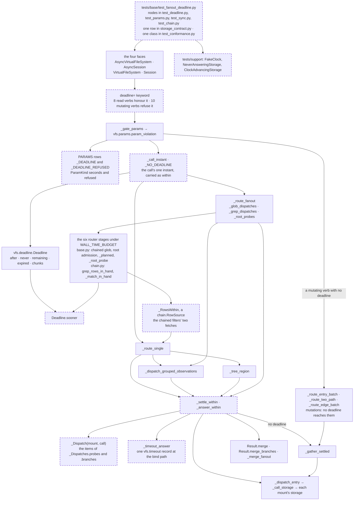

# A read verb given a deadline returns within it, keeping every settled mount's rows and one `vfs.timeout` record at each unanswered mount's prefix, and a mutating verb given one is refused `vfs.invalid` before any statement

A feature. Flags: it changes the public API (the keyword `deadline=` is added to eighteen verbs on the four public faces, and no name is added to `vfs.__all__`); it needs the engine legs (one new conformance row and one statement count parametrized over the legs, with no change to storage code); it is not structural (no module is added or removed); it changes no schema format; it does not touch rights; it does not touch the Rust engine; it is not parallel-safe with a unit that edits verb signatures in `src/vfs/base.py`, `src/vfs/params.py`, `src/vfs/session.py` or `src/vfs/sync.py`, which is a matter of merge order and not of design. It serves roadmap story H6 at gate f, criteria 1, 2, 3 and 5 of [the roadmap](../../context/standards/roadmap.md), under roadmap decision D2. It is converted, by rewrite, from [spec 051](../../context/specifications/archive/051-fanout-deadline-budget/spec.md): that spec's Intent, its Why, Scope bullets 1 and 2, and acceptance 1, 2, 4 and 5. Its inputs are [the study of that source](../2026-11-25-the-backlog-converted/studies/051-162/051-fanout-deadline-budget.md) and [the verification of D2](../2026-11-25-the-backlog-converted/decisions/g-release-and-repository.md); it stands on no research memo of its own. It depends on one spec, [bounded work has one home](../../context/specifications/archive/2026-11-07-bounded-work-has-one-home.md), landed (commit `4a6d3e0`), and relies on that spec's decision 2 (the `Deadline` value: an absolute instant, `after`, `never`, `remaining`, `expired`), decision 4 (the one truncation mint, `wall_truncation`) and decision 6 (each stage's wall is taken where the stage starts). Story H1, which the roadmap names as H6's dependency, is not relied on: criteria 1, 2, 3 and 5 touch no ask, no ticket and no ledger, and criterion 4 is the sibling unit [cancel marks a pending ask](../2026-11-25-cancel-marks-a-pending-ask-or-a-stopped-run-and-the-re-send-answers-cancelled/spec.md), not written yet. Build order: this unit can be built now, since its one dependency has landed; no other unit must land before it and none waits on it.

## The problem

Labels: READ means read in the file cited, at `9daedd2b`; EXECUTED means a command ran at that commit and the claim reports its output; INFERRED means reasoning.

A call that reaches more than one mount waits for the slowest mount, with no limit. `_gather_settled` awaits every sibling with `asyncio.gather(*coros, return_exceptions=True)` and takes no deadline (READ, `src/vfs/base.py:3035-3058`). It has six call sites: `_dispatch_grouped_observations` at `:1833`, `_tree_region` at `:1903`, `_route_fanout` at `:2031`, `_route_two_path` at `:2437`, `_route_entry_batch` at `:2540` and `_route_edge_batch` at `:2635` (EXECUTED, `grep -n "_gather_settled" src/vfs/base.py`). The first three serve reads; the last three serve only mutations. A call that reaches one mount by a path is awaited in place, also with no limit (READ, `src/vfs/base.py:1785`, `:1882`).

So one mount that accepts a call and never answers holds every caller of an unscoped `glob`, `grep` or `search`, every `tree` above it and every read addressed to it. The caller gets no classified failure and nothing to act on (INFERRED from the lines above). The router does not probe a mount's health before dispatch, so nothing else stands between the caller and the wait (INFERRED: a downed peer is only learned from a `TransportError` raised by the call itself, READ `src/vfs/base.py:2988-2989`).

The kind for this exists and nothing produces it. `ErrorKind.timeout = "vfs.timeout"` is declared with its contract: phrase "Timed out", retry class transient, hint "Retry with a longer deadline or a narrower scope." (READ, `src/vfs/results/kinds.py:95`, `:285-290`). `grep -rn "ErrorKind\.timeout\|ErrorKind\.cancelled" src/vfs --include=*.py` matches only the declarations (EXECUTED). The roadmap's state table says the same: "`cancelled`, `timeout` kinds: declared, no producer in `src/`" and "Deadline on fan-out: missing as H6 defines it: no public verb takes `deadline=`" (READ, `context/standards/roadmap.md:264-265`).

No verb takes a deadline. None of the 25 routed verbs has a `deadline` parameter on `AsyncVirtualFileSystem`, `AsyncSession`, `VirtualFileSystem` or `Session`, and no row of the parameter table is named `deadline` (EXECUTED, a scratch script over `inspect.signature` and `vfs.params.PARAMS`). The 25 are 8 read verbs, 10 mutating verbs and 7 others: `run` and the six grant verbs (EXECUTED, the same script over `vfs.ops`).

What landed beside the gap does not close it. The `Deadline` value is in `src/vfs/deadline.py`: one absolute instant on the monotonic clock, passed as an argument and never stored on a long-lived object (READ, `src/vfs/deadline.py:14-15`, `:46-89`). It is not exported from `vfs` (EXECUTED). Six router stages run under `Deadline.after(WALL_TIME_BUDGET)`, ten seconds: chained glob's judge (`src/vfs/base.py:1347`), grep's root admission judge (`:2208`), the planning walk (`:2267`), the root probe's judge (`:2347`), and chained grep's two stages (`src/vfs/chain.py:141`, `:228`) (READ). Each is a CPU stage on the worker pool, and a stage that reaches its wall records `vfs.budget_exhausted.truncated` through `wall_truncation` (READ, `src/vfs/offload.py:96`). A wall is checked between chunks of CPU work. It does not bound an await on a storage, so a mount hung in a network or database call is outside it (INFERRED).

The only bounded await on a storage is its disposal: `asyncio.wait_for(storage.close(), timeout=self._close_timeout)` (READ, `src/vfs/base.py:685`), with `close_timeout: float = 10.0` on the constructor (READ, `src/vfs/base.py:373`).

No storage in the tree hangs on a network today: `src/vfs/storage/backends/` holds `database/` and `memory.py` only (EXECUTED, `ls`). The hung remote mount arrives with roadmap story T4, the MCP server as a view, at gate b (READ, `context/standards/roadmap.md:715-722`), and MCP ships with 0.1.0 (Decided 2026-11-15, READ `context/standards/roadmap.md:1074`). A database mount can already hang on a lock or a lost connection (INFERRED).

The source is stale in these names, each corrected here: `VFSErrorKind.timeout` is `ErrorKind.timeout`; `glean` is not a verb; `_spine_tree` is `_tree_region` (READ, `src/vfs/base.py:1855`); the source's list of chokepoints omits `_route_edge_batch` (`:2553`) and `_route_pairs` (`:2460`); "story 034" is roadmap story T4; a downed mount's kind is `vfs.unavailable.backend`. The source's first acceptance line, "returns within the budget", is a wall-clock assertion, which [AGENTS.md](../../AGENTS.md), *Performance tests*, rules out.

One design fact was checked by running it. The settle that decision 7 and the Design describe was written as a scratch prototype against the real `vfs.deadline` module with a fake clock patched on `vfs.deadline.monotonic`. It printed: one answering call and one hung call give one result and one timeout with 1 coroutine cancelled; a hung call alone gives one timeout with 1 cancelled; an instant already passed starts 0 coroutines; 64 answering calls settle in 1 pass with 2 clock reads; an outer cancel re-raises with both hung coroutines cancelled (EXECUTED, `uv run python` on the project's interpreter, no test suite run).

## Architecture

Solid is what exists. Dashed is what this spec adds. Nothing is removed.

Terms. The **instant** is the one absolute point on the monotonic clock a call's deadline names, held as a `Deadline` and carried inside the router under the name `within`. A **dispatch** is one coroutine that calls one mount's storage, paired with that mount's bind path. A **settle** is the wait on a call's dispatches: it ends when every dispatch has answered or the instant has passed. A dispatch is **unanswered** when the instant passes before it returns. The **mount's prefix** is its bind path, the path the mount is mounted at. A **stage** is one bounded piece of CPU work the router runs on the worker pool under a wall. The **four faces** are `AsyncVirtualFileSystem`, `AsyncSession`, `VirtualFileSystem` and `Session`. The **read verbs** are the eight members of `READ_OPS`: `read`, `stat`, `ls`, `tree`, `glob`, `grep`, `search`, `traverse`. The **mutating verbs** are the ten members of `MUTATING_OPS`: `write`, `edit`, `delete`, `restore`, `sweep`, `mkdir`, `mkedge`, `rmedge`, `move`, `copy`.

## Decisions

### 1. The deadline is a per-call keyword, `deadline=`, on the eight read verbs of all four faces; there is no default on the filesystem and no attribute on a mount

Every member of `READ_OPS` takes `deadline=`, keyword-only, default `None`, placed directly before `authority` on the two filesystem faces and last on the two session faces. All eight take it, not only the three that fan out, because a `read`, `ls` or `traverse` addressed to one hung mount hangs the same way, and the source's second acceptance line asks that a scoped read into a single hung mount fail with a timeout. The constructor gains no default deadline and `add_mount` gains no per-mount budget: a deadline that is stored on a long-lived object is what the `Deadline` law forbids, and the wall a transport owns belongs to the view that owns the transport. The source left this as a clarification marker with four options and no lean.

Basis: verified lean, the study's open choice 2 (holds, amended to "a per-call `deadline=` on the read verbs"); precedent: roadmap H6 criterion 1 names `grep(pattern, deadline=…)` (`context/standards/roadmap.md:350`), `src/vfs/deadline.py:14-15` ("A deadline is passed as an argument and never stored on a long-lived object"), and roadmap T4 criterion 2, which places the per-server wall in the MCP view (`context/standards/roadmap.md:719`).

### 2. The value of `deadline=` is a number of seconds counted from the verb's entry, and `Deadline` stays unexported

The annotation is `float | None`. A caller writes `await fs.grep("needle", deadline=5)`. The router turns the seconds into an absolute instant once and carries that instant from there on (decision 4), so the public value is relative and the internal value is absolute. The name `deadline=` is kept although the value is a duration, because roadmap H6 criterion 1 names the argument. No name is added to `vfs.__all__`. Seconds are taken because they need no new public type, they match the one time argument the constructor already has, and they can be written in a tool schema, which an instant on one process's monotonic clock cannot. Accepting a `Deadline` beside a number later would be an addition; withdrawing an exported `Deadline` after the beta begins would not be allowed.

Basis: provisional, no ruling on record; the options were (a) seconds as a number, as `asyncio.timeout(delay)` and this class's own `close_timeout: float` at `src/vfs/base.py:373`, (b) an absolute `vfs.Deadline`, as `asyncio.timeout_at(when)` and the router's internal convention since 2026-11-07, (c) either; chosen (a) because it exports no new name, it is the nearer to the one public time argument vfs has, and (c) remains open as a later addition while (b) once exported could not be withdrawn inside a beta.

### 3. A `deadline` that is not a finite number above zero is refused `vfs.invalid` at the params gate, and `None` or omission means no deadline

An `int` or a `float` passes when it is finite and greater than zero. `True` and `False` are refused, as on every numeric channel of the table. Zero, a negative number, `nan` and `inf` are refused with a message that names the parameter: `"grep deadline must be a finite number of seconds above zero, got 0"`. A caller who wants no limit omits the argument. There is no upper bound: a long deadline is the caller's choice, and no seam carries the value in a fixed-width field. Zero is refused, not read as "already expired", because a call that can dispatch nothing is a caller's mistake and the gate exists to say so before anything runs.

Basis: decided in drafting, because the params gate refuses a value outside its domain before any dispatch and names the parameter (`src/vfs/base.py:2734-2749`), and the table's other numeric channels refuse a `bool` and a value below their minimum the same way (`src/vfs/params.py`, the `int` arm of `_check_value`).

### 4. A call has one instant, taken once after the params gate passes, and every later step reads the time left from it

The verb calls `_call_instant(deadline)` as its first statement after the gate: `Deadline.never()` for `None`, else `Deadline.after(deadline)`, one clock read. The instant is passed down as the keyword `within`, a named parameter of each router function it crosses, so it is never swept into the keywords forwarded to a storage. Nothing adds seconds to the clock a second time. On the two synchronous faces the instant is still taken at the router verb's entry, on the loop thread: the face passes the number through unchanged.

Basis: decided in drafting, because the landed law of `vfs.deadline` is that a relative budget becomes an absolute instant once and time spent in an earlier step shortens what is left (`src/vfs/deadline.py:3-7`; [bounded work has one home](../../context/specifications/archive/2026-11-07-bounded-work-has-one-home.md), decision 2).

### 5. A mutating verb given a deadline is refused `vfs.invalid` at the params gate, before any dispatch and any statement

No mutation is ever cut by a deadline. A write that is cancelled mid-flight may or may not have committed, so the caller would be told "timed out" about a change whose outcome nobody knows; and a write that is left running behind a caller who was told it failed is what the settle rule exists to prevent. The source listed three options: no deadline on mutations; a deadline that waits but stops reporting; a deadline with an "outcome unknown" kind. The second misreports. The third needs a new kind, and roadmap H1 criterion 2 allows exactly one new core kind, for `pending`. The refusal's message is `"write takes no deadline: a mutation is never cut mid-flight, so its outcome is always reported"`, with the verb's own name.

Basis: verified lean, the source's Scope bullet 3 marker and roadmap H6 criterion 2 (`context/standards/roadmap.md:351`), which the study amends to "refused `vfs.invalid` at ingress, before any statement"; precedent: the settle rule at `src/vfs/base.py:3039-3043` ("a partial batch can never keep mutating behind a caller who already saw a failure") and roadmap T4 criterion 4, a call cut by a wall is issued once and never retried (`context/standards/roadmap.md:721`).

### 6. The ten mutating verbs declare `deadline=` so that the refusal is a `Result`; `run` and the six grant verbs do not declare it

A Python call with a keyword the signature lacks raises `TypeError`, which is not the classified refusal roadmap H6 criterion 2 asks for. So each member of `MUTATING_OPS` declares `deadline: float | None = None` on all four faces, hands it to the params gate, and uses it for nothing else. Its row in the parameter table has the kind `refused`: `None` passes and any other value is the violation of decision 5. `run`, `grant`, `revoke`, `grants`, `posture`, `add_member` and `remove_member` do not declare the argument, so on those seven a caller who passes it gets Python's own `TypeError` before anything runs. `sweep` is the verb's name at this commit; when it is renamed `destroy` (Decided 2026-11-15, [the kernel names ruling](../../context/specifications/active/2026-11-15-the-kernels-public-names-and-argument-families-are-ruled.md), decision 3) its row and its argument move with it.

Basis: provisional, no ruling on record; the options were (a) the ten mutating verbs declare the argument only to refuse it and the other seven do not declare it, (b) all seventeen verbs that are not reads declare and refuse it, (c) the mutating verbs do not declare it and the refusal is a `TypeError`; chosen (a) because it is the smallest surface that makes H6 criterion 2 true as written, (c) contradicts that criterion on the Python faces, and declaring the argument on one of the seven later is an addition.

### 7. When the instant passes, each unanswered dispatch is cancelled and awaited, and its place is taken by one `vfs.timeout` record at the mount's bind path

A settle under a deadline starts every dispatch as a task and waits. When the instant passes with dispatches still running, each is cancelled, and the settle then awaits the cancelled tasks so that every one has unwound before the verb returns. The answers of the dispatches that returned in time are kept whole. Each unanswered dispatch is answered for by `_timeout_answer(op, mount)`: a `Result` whose one error is `classified(ErrorKind.timeout, mount, source=mount, detail="the storage mounted here did not answer in the time the call allowed")`. The record's `path` and `source` are both the bind path, it carries no `data`, and it is minted at error severity. It is minted in router coordinates above the rebase seam, as a capability skip is. The record names the mount and nothing the caller passed: no pattern, no row path, no storage text.

Basis: verified lean, the study's open choice 4 (holds) and the source's Scope bullet 2; precedent: roadmap H6 criterion 1 (`context/standards/roadmap.md:350`) and `_skip_entry`, which stamps the bind path as both `path` and `source` on a record the router mints itself (`src/vfs/base.py:3060-3074`).

### 8. A mount is reported once per settle, however many of its dispatches went unanswered

A scoped `glob`, `grep` or `search` can send one mount two dispatches: its root probe and its branch (`src/vfs/base.py:2147`, `:2245`). If both are unanswered, the first in dispatch order carries the record and each later one for the same bind path answers with an empty `Result()`, which merges as the identity. Probes are dispatched before branches, so the record of a mount whose root the caller named is merged as a named answer and stays fatal (decision 9).

Basis: decided in drafting, because the unit's contract is one record at each unanswered mount's prefix, and two records for one mount would differ only in severity once the merge had demoted one of them (`src/vfs/base.py:2357-2373`).

### 9. A timeout answer merges exactly where the mount's own answer would have merged, so it fails the call wherever a dead mount fails it today and is a warning wherever a dead mount is a warning today

No merge rule is added. In an unscoped fan-out and in a tree's descents, the timeout answer enters `Result.merge_branches`: if any other branch answered, the record is demoted to a warning and the call succeeds with the answering mounts' rows; if no branch answered, every record stays fatal. Where the caller named the mount (a scope path inside it, a single-path read, a grouped read over rows in it, the owner of a tree's target), the answer merges plain and the call fails, with the other mounts' rows still present. This departs from the source, which says `success=False` in every case while also calling the record "the fan-out analogue of a downed mount's `unavailable`": the two cannot both hold, because a downed mount among answering ones is a warning today. The analogue is kept. It also keeps the partial rows for a caller who wraps the call in `raise_if_failed`, which raises on a failed result and would otherwise discard them.

Basis: provisional, no ruling on record; the options were (a) the timeout answer rides the existing merge seams, a warning among answering mounts in an unscoped call and fatal for a named mount or when nothing answered, (b) any timeout fails the call, as the source's Scope bullet 2 says; chosen (a) because it is what vfs already does for a mount that is down (`src/vfs/results/envelope.py:590-605`; `tests/base/test_dispatch.py::test_fanout_one_dead_mount_demotes_to_warning`, `::test_fanout_all_dead_branches_stay_fatal`, `::test_scoped_dispatch_at_a_dead_mount_never_demotes`), it adds no second demotion rule, and roadmap H6 criterion 1 asks for the rows and the record without stating a verdict.

### 10. When the instant has already passed as a settle begins, nothing is dispatched

The settle reads the time left once before it starts any task. If none is left, it closes each coroutine without starting it and answers every dispatch with a timeout answer under decisions 7 and 8. No storage is called, so no statement is issued and nothing is cancelled. This is the case where the call's time went to a router stage before dispatch.

Basis: decided in drafting, because a dispatch started after the instant could only be cancelled at once, and a statement issued for a result nobody will read is work the reference deployment pays per verb call for nothing ([AGENTS.md](../../AGENTS.md), *Per verb call*).

### 11. A router stage runs under the sooner of its own wall and the call's instant; a stage that stops records `vfs.truncated`, a mount that does not answer records `vfs.timeout`, and neither record replaces the other

`Deadline.sooner(other)` returns whichever of two deadlines comes first and reads no clock. Each of the six router stages takes `within.sooner(Deadline.after(WALL_TIME_BUDGET))` where it takes `Deadline.after(WALL_TIME_BUDGET)` today, at the same place. With no call deadline that is today's wall exactly. When both a wall and the call's instant fire in one call, the rule is by what was cut. A stage cut by either one returns what it finished and records `vfs.budget_exhausted.truncated` once through `wall_truncation`, as today; it cannot tell which of the two stopped it and does not need to. A mount whose storage reached its own wall and returned before the instant has settled: its rows and its `truncated` record stand. A mount still running at the instant is cancelled and only its `vfs.timeout` record stands; nothing else it would have returned is kept. The verdict is then decided by the timeout records under decision 9, since a `truncated` record is a warning and never fails a call. A mount that minted `vfs.timeout` itself and returned, as an MCP view's own wall will, has also settled, and its record stands as it came.

Basis: decided in drafting, because the `Deadline` law says time spent in an earlier step shortens what is left and never extends the wall (`src/vfs/deadline.py:3-7`), a stage's truncation has one mint ([bounded work has one home](../../context/specifications/archive/2026-11-07-bounded-work-has-one-home.md), decision 4), and no source says which record wins.

### 12. "Returns within it" means every router stage has stopped and every dispatch has answered or been cancelled by the instant; four things are outside it and are named

The verb returns once the cancelled coroutines have unwound. Four limits are stated in the docstring. First, a storage coroutine that suppresses `CancelledError` holds the call until it lets go: the settle awaits its cancelled tasks, as `asyncio.wait_for` does, because a read left running behind a returned call would still hold a storage session. Second, a hop already running on a worker thread cannot be interrupted: it runs to its own wall, `WALL_TIME_BUDGET` at most, and its result is dropped. Third, `search`'s rerank stages run after the settle and are not cut. Fourth, the instant does not cross the storage seam: a storage receives no deadline, so it cannot return partial rows at the instant; it is cancelled whole.

Basis: decided in drafting, because the settle rule is that every sibling has settled before the router reports (`src/vfs/base.py:3036-3049`), and [AGENTS.md](../../AGENTS.md), *Production posture*, asks that a suboptimal profile be acknowledged in the docstring and never converted into a declared limit.

### 13. Cancellation from outside still re-raises untouched and outranks a timeout, and an implementation bug still propagates only after every sibling has settled

If the verb's own task is cancelled during a settle, every dispatch is cancelled and awaited and `CancelledError` re-raises; no result is built. A dispatch that ends cancelled without the settle having cancelled it (a storage that raised `CancelledError` itself) is not a timeout: it re-raises as cancellation, as it does today. An exception raised by a dispatch is an implementation bug: it is raised after the settle ends, through `raise_lone_or_group`, with the unanswered dispatches already cancelled. The order of precedence is cancellation, then bugs, then results, unchanged.

Basis: the source spec, acceptance 4; still true at `9daedd2b` (READ `src/vfs/base.py:3045-3057` and `tests/base/test_dispatch.py::test_cancellation_reraises_untouched`; roadmap H6 criterion 3 states the same, `context/standards/roadmap.md:352`).

### 14. A call with no deadline takes today's path: the same awaits, the same statements, no clock read and no task added

With `within` equal to `Deadline.never()`, `_settle_within` hands its coroutines to `_gather_settled` unchanged, `_answer_within` awaits its one coroutine in place, and `never().sooner(wall)` is the wall. The `deadline` value is never forwarded to a storage, so a storage receives the same keywords with the argument omitted, passed as `None`, or passed as a number. This is what makes the change an addition under the beta rule.

Basis: verified lean, the study's open choice 6 (holds, amended to the counted form) and the source's acceptance 5; precedent: roadmap H6 criterion 5, "statement counts are identical to today on every leg" (`context/standards/roadmap.md:354`).

### 15. A read cancelled in flight leaves its storage serving, and a conformance row holds that on every leg

This unit makes the router cancel storage reads on its own, where before only a caller or `close()` did. A cancelled read must hand back its connection and hold nothing another caller waits on. The database storage runs each read inside `async with self._host.session_factory() as session`, which closes the session when the block is left by cancellation (READ, `src/vfs/storage/backends/database/backend.py:1382-1386`), so no storage code changes. The row added to `StorageContract` starts a `grep`, cancels it after one turn of the loop, awaits it, and then asserts that a `write` and a `read` on the same storage succeed and, where the storage's pool is a `QueuePool`, that `checkedout()` is 0.

Basis: decided in drafting, because [AGENTS.md](../../AGENTS.md), *Per lock*, costs every design on who waits behind it, and a claim about what a cancelled transaction holds is true per engine, not in general.

### 16. No retry, no circuit breaker and no health probe is added

A timed-out mount is called again by the next call that reaches it. The record's retry class is transient, from the kind's contract, and the caller decides.

Basis: verified lean, the study's open choice 7 (holds) and the source's Scope bullet 5; precedent: roadmap T4 criterion 4, a call cut by a wall is never retried (`context/standards/roadmap.md:721`).

### 17. Every test of this unit drives a fake clock and asserts counts and states; a timer is used only to wake a wait

The clock is `vfs.deadline.monotonic`, patched with `FakeClock`, whose reads are counted and whose time a test double moves. The settle re-reads the time left each time a dispatch settles, so a double that answers and then moves the clock past the instant ends the wait with no real time passing. Where no mount answers, the hung double moves the clock as it starts and a one-millisecond timer wakes the settle; the test asserts only what was cancelled and recorded. The source's "returns within the budget" is pinned as "the hung coroutine was cancelled, counted 1".

Basis: verified lean, the study's open choice 6; precedent: [AGENTS.md](../../AGENTS.md), *Performance tests*, and the landed nodes of `tests/test_deadline.py`, which patch `vfs.deadline.monotonic` and assert read counts.

### 18. The unit lands at gate f as an addition to the public surface

Gate f binds 0.1.0 final: the final ships when a beta has held and every story the roadmap tags `f` has landed. If this unit lands after the beta begins, it is lawful there because it adds an argument and, by decision 14, changes the meaning of no existing call. It is listed under *Added* in the release notes.

Basis: verified lean, roadmap decision D2, whose verification reads "settled by landed work" ([the verification](../2026-11-25-the-backlog-converted/decisions/g-release-and-repository.md)); precedent: [the release standard](../../context/standards/release.md), `context/standards/release.md:13` (a beta may add names, listed under *Added*, and may not rename, remove or change a meaning) and `:18` (the final waits for every `f` story), with "MCP ships with 0.1.0" Decided 2026-11-15 (`context/standards/roadmap.md:1074`).

## Intent

After this spec, an agent, a software developer or an ETL developer can put a limit on any read. `await fs.grep("needle", deadline=5)` over one mount that answers and one that hangs comes back with the first mount's rows and one `vfs.timeout` record at the second mount's path; the hung call has been cancelled and its connection is back in the pool. The same argument on `read`, `stat`, `ls`, `tree`, `glob`, `search` and `traverse` behaves the same, on the asynchronous and the synchronous filesystem and on a session. A read addressed to a mount that hangs fails with `vfs.timeout`. A `write`, or any other mutating verb, given `deadline=` is refused `vfs.invalid` before anything runs, because a change is never cut halfway. A call that passes no deadline does exactly what it does today.

## Design

**The order of work.** Each step writes its tests first, sees them fail, then writes the code. Steps 1 and 2 are leaves. Step 3 is the settle. Steps 4 to 6 thread the instant. Step 7 is the engine evidence. Step 8 is the words.

**Step 1, `src/vfs/deadline.py`.** Test first: `tests/test_deadline.py::test_sooner_keeps_the_earlier_instant_and_reads_no_clock`. Then `Deadline.sooner(self, other: Deadline) -> Deadline`: `other` when `self.at` is `None`, `self` when `other.at` is `None`, else the one with the smaller `at`. It reads no clock. The module still imports the standard library only.

**Step 2, `src/vfs/params.py` and the four faces.** Tests first, in `tests/test_params.py`: `test_the_deadline_rows_are_seconds_on_the_read_verbs_refused_on_the_mutating_verbs_and_absent_elsewhere`, `test_a_deadline_that_is_not_a_finite_number_above_zero_is_invalid_with_zero_dispatch` (parametrized over `True`, `"5"`, `0`, `-1.0`, `nan`, `inf` on each read verb's row), and `test_a_deadline_on_a_mutating_verb_is_invalid_with_zero_dispatch` (parametrized over the ten). In `tests/test_sync.py`: `test_every_face_declares_deadline_on_the_same_eighteen_verbs`. The landed drift nodes `tests/test_params.py::test_every_verb_signature_matches_the_table`, `tests/test_sync.py::test_every_router_coroutine_has_a_sync_twin` and `::test_every_session_coroutine_has_a_sync_twin` go red until table, router, sessions and facade agree, and are not edited. Then the code. `ParamKind` gains `"seconds"` and `"refused"`. Two shared rows are added beside `_AUTHORITY`: `_DEADLINE = ParamSpec("deadline", "seconds", doc="seconds from the call's entry after which a mount that has not answered is cut; None waits")` on the eight read verbs, and `_DEADLINE_REFUSED = ParamSpec("deadline", "refused", doc="a mutating verb takes no deadline; any value is refused")` on the ten mutating verbs, each placed directly before `_AUTHORITY`. `_check_value` gains two arms with the messages of decisions 3 and 5; the `seconds` arm uses `math.isfinite`. Each of the eighteen verbs gains `deadline: float | None = None` on `AsyncVirtualFileSystem`, `AsyncSession`, `VirtualFileSystem` and `Session`, in the position decision 1 gives, and passes it to `_gate_params`; the sessions and the facade pass it through to the router. At this step the read verbs gate the value and do nothing else with it.

**Step 3, the settle, in `src/vfs/base.py`.** Doubles first. `tests/support/fake_clock.py` holds `FakeClock`: a callable with `now`, a `reads` count and the scripted jump that `tests/test_deadline.py`'s private `_Clock` has; that file imports it and drops its own copy. `tests/support/base_doubles.py` gains `NeverAnsweringStorage` (each read verb counts `started`, calls an optional `on_start` hook, awaits an event that is never set, and counts `cancelled` when `CancelledError` arrives, then re-raises) and `ClockAdvancingStorage` (an `EchoStorage` that moves a `FakeClock` to a given time after it has built its answer). Tests next, in the new `tests/base/test_fanout_deadline.py`, driving the settle through the read verbs once step 4 has threaded it: the nodes named by acceptance criteria 6 to 21. Then the code, in the settlement section beside `_gather_settled`:

- `_Dispatch(NamedTuple)`: `mount: Path`, `call: Coroutine[Any, Any, Result]`. It replaces the bare `tuple[Path, Coroutine]` of a fan-out branch, and `_Dispatches.probes` and `.branches` become `list[_Dispatch]`.
- `_NO_DEADLINE: Final = Deadline.never()`, a module constant, the default of every internal `within` parameter.
- `_call_instant(seconds: float | None) -> Deadline`, a module-level helper (decision 4).
- `_timeout_answer(op: Op, mount: Path) -> Result` (decision 7).
- `_settle_within(self, op: Op, within: Deadline, dispatches: Sequence[_Dispatch]) -> list[Result]`, one result per dispatch in order. With no instant it returns `await self._gather_settled(d.call for d in dispatches)`. Otherwise it reads `within.remaining()`; at zero it closes every coroutine and returns timeout answers (decision 10). Else it starts one task per dispatch, adds one done-callback to each that lowers a count and sets one `asyncio.Event`, and loops: clear the event, wait on it under `asyncio.timeout(budget)`, and, if dispatches remain, read `within.remaining()` again; the loop ends when none remain or the time left is zero. In a `finally` it cancels every task not done and awaits those with `asyncio.gather(..., return_exceptions=True)`, which also serves an outer cancel (decision 13). It then reads each task's state: a result is kept; a task the settle cancelled becomes a timeout answer, one per bind path (decision 8); a task cancelled by anything else re-raises `CancelledError`; exceptions are raised through `raise_lone_or_group(bugs, "impl errors during dispatch")`.
- `_answer_within(self, op: Op, within: Deadline, dispatch: _Dispatch) -> Result`: `await dispatch.call` with no instant, else the one result of `_settle_within`.

`_gather_settled` and its three mutation call sites are not edited.

**Step 4, the instant through the read routes, in `src/vfs/base.py`.** Each read verb computes `within = _call_instant(deadline)` after its gate and passes `within=` on. `_route_single`, `_dispatch_grouped_observations`, `_tree_region` and `_route_fanout` each gain the named keyword `within: Deadline = _NO_DEADLINE`. `_route_single` answers its one dispatch through `_answer_within` (`:1785`). `_tree_region` answers the owner through `_answer_within` (`:1882`) and its descents through `_settle_within` (`:1903`). `_dispatch_grouped_observations` settles through `_settle_within` (`:1833`); the mutating verbs reach it with the default and so take `_gather_settled` as today. `_route_fanout` settles probes and branches in one `_settle_within` (`:2031`). `_root_probes` returns `_Dispatch` values, pairing each probe with its owning bind path, and the named dispatches built at `:2019` and the branches built at `:2024`, `:2148` and `:2229` are `_Dispatch` values, each carrying its binding's path.

**Step 5, the six stages.** Test first: `tests/base/test_fanout_deadline.py::test_a_router_stage_stops_at_the_calls_instant_and_records_truncated`. Then `_glob_dispatches`, `_grep_dispatches`, `_planned`, `_root_probes` and `_root_probe` each gain `within` and take `within.sooner(Deadline.after(WALL_TIME_BUDGET))` at `:2208`, `:2267` and `:2347`; chained glob does the same at `:1347`. `_planned`'s in-place path keeps `Deadline.never()`: it is linear in the arms and makes no hop.

**Step 6, the chained filters, `src/vfs/chain.py` and `src/vfs/base.py`.** Test first: `tests/base/test_fanout_deadline.py::test_a_chained_grep_reports_the_hung_mount_it_could_not_fetch_from`. Then `grep_rows_in_hand` and `_match_in_hand` gain the keyword `within: Deadline` and clamp their walls at `:141` and `:228` with `sooner`; `tests/test_chain.py`'s helper at `:57` passes `within=Deadline.never()`. `RowSource` is unchanged. The router hands the filters `_RowsWithin(fs, within)` in place of itself: a frozen, slotted dataclass in `base.py` whose `read` and `stat` call `fs._route_single(op, None, observations, columns=..., authority=..., within=within)`. It lives for one call, so the instant is still an argument and not state on a long-lived object.

**Step 7, the engine evidence.** `tests/support/storage_contract.py` gains the row `StorageContract::test_a_read_cancelled_in_flight_leaves_the_storage_serving` (decision 15), which runs on the memory, SQLite, Postgres, MariaDB, SQL Server and Oracle legs through the six subclasses in `tests/storage/test_conformance.py`. That file gains `TestDeadlineStatements::test_a_deadline_that_does_not_fire_adds_no_statement`, parametrized over SQLite and the four server legs the way `TestStatisticsStatements` is: two storages of the leg under one router, one warming call, then `grep`, `glob`, `ls` and `read` each issued with `deadline` omitted and with `deadline=3600.0`, the statements recorded by a `before_cursor_execute` listener with the statistics statements left out through `tests/support/statements.py`, and the two counts asserted equal per verb. An hour is used so that the real clock cannot fire it; nothing about time is asserted.

**Step 8, the words.** `AsyncVirtualFileSystem`'s class docstring gains one paragraph: what `deadline=` is, which verbs take it, what a timeout record is and when it fails the call, that a mutating verb refuses it, and the four limits of decision 12. The docstrings of `glob`, `grep`, `search` and `traverse` gain one sentence each. No comment or docstring names this spec. `scripts/docs.sh check` runs, since docstrings under `src/vfs/` change.

**Scale.** Costed against [the reference deployment](../../AGENTS.md). The change adds no SQL statement, no row and no lock, so no engine budget (`membership_budget`, `chunked`, a bind-parameter cap) is involved: a deadline can only stop a wait, and a call that passes none is statement-identical (decision 14; criterion 24 on every leg).

- *Per verb call*, about 150,000 a day, about three in four of them reads: a call that passes `deadline=` builds one `Deadline`, and each settle holds one task and one callback per dispatch and one event. Dispatches per settle are at most twice the mounts the call reaches (a probe and a branch each), so the structure is bounded by `2 * len(self._bindings)`: the mount table, which is configuration and never caller input or corpus size. The table gives no mount count; at 10 mounts, an *assumption*, that is at most 20 tasks, at most 21 passes and at most 22 clock reads a call, about 440 clock reads a second at the 20-calls-a-second peak. The wait is linear in dispatches: each pass clears one event, sets one timer and reads the clock once, and a pass ends only when a dispatch settles or the timer fires, so passes are at most dispatches plus one. A grouped read of 10,000 rows groups its rows by mount as it does today and adds one dispatch per mount, nothing per row.
- *Per file write*, about 1,050,000 a day: one extra `None` check in the params gate. A write never carries a deadline.
- *Per index visit, per batch, per corpus*: nothing. No index pass, batch or rebuild path is touched.
- *Per lock*: none is taken. A read never waits on a writer after this change any more than before it. A cancelled read rolls back as its session block exits and holds nothing afterwards; before the cancel it holds what an uncancelled read holds, for less time. A hung database mount holds one pooled connection per waiting call: today for as long as the hang lasts, after this change for at most the caller's deadline.
- *The worker pool*: a hop that was running for a cancelled dispatch keeps its `OFFLOAD_WORKERS` slot until its own wall, ten seconds at most. That is the cost the same hop has today with the caller still waiting; the deadline adds none and removes none. The docstring says so (decision 12).

## Scope

In: decisions 1 to 18. Files: `src/vfs/deadline.py`, `src/vfs/params.py`, `src/vfs/base.py`, `src/vfs/chain.py`, `src/vfs/session.py`, `src/vfs/sync.py`; `tests/test_deadline.py`, `tests/test_params.py`, `tests/test_sync.py`, `tests/test_chain.py`, `tests/base/test_fanout_deadline.py` (new), `tests/support/fake_clock.py` (new), `tests/support/base_doubles.py`, `tests/support/storage_contract.py`, `tests/storage/test_conformance.py`.

Out, with where each belongs.

- `cancel(ticket)`, `cancel(run_id)` and the production of `vfs.cancelled` (H6 criterion 4): the sibling unit [cancel marks a pending ask](../2026-11-25-cancel-marks-a-pending-ask-or-a-stopped-run-and-the-re-send-answers-cancelled/spec.md).
- The wall on one MCP server's transport, its `vfs.timeout` with exit 124, and the rule that a wall-cut call is issued once: the unit [a connected MCP server is a directory](../2026-11-25-a-connected-mcp-server-is-a-directory-of-tools-resources-and-prompts/spec.md) (roadmap T4). A record that view mints is kept as it comes (decision 11).
- Whether a served tool's schema shows `deadline`, and that a `refused` row is left out of it: the unit [serve answers each request under its own authority](../2026-11-25-serve-answers-each-request-under-its-own-authority-and-refuses-an-open-mount/spec.md). No schema projection reads the parameter table at this commit (EXECUTED, `grep -rn "PARAMS" src/vfs` matches `params.py` alone).
- Passing the instant across the storage seam so that a storage clamps its own walls and returns partial rows: not built here; it changes every storage protocol, and no roadmap story asks for it.
- A bound on `search`'s rerank stages: the reranker protocol's matter; not built here.
- `deadline=` on `run`, `grants` and the grant writes: not declared (decision 6); `run` leaves every face in the unit [the dead run verb leaves every face](../2026-11-25-the-dead-run-verb-leaves-every-face/spec.md).
- A default deadline on the filesystem, a per-mount budget, retries, a circuit breaker, a health probe (decisions 1 and 16).
- A dedicated exception class for a timeout: `raise_if_failed` raises `VFSError` for the kind, as today.
- If the unit [chaining moves onto the result](../2026-11-25-chaining-moves-onto-the-result-and-the-query-verbs-lose-rows-in-hand/spec.md) lands, `glob` and `grep` lose `observations=` and step 6's two filters move with them; that unit carries the instant along.
- The roadmap's state rows for H6 and story R7's line that spec 051 is replaced by H6: corrected where the roadmap is next revised; no file under `context/` is edited by this unit.

## Acceptance criteria

Counts and states, never clocks. Unless a criterion says otherwise, its node is in `tests/base/test_fanout_deadline.py`, runs on storage doubles, and patches `FakeClock` on `vfs.deadline.monotonic`.

1. `Deadline.sooner` returns the deadline with the smaller instant, returns the other when one side has none, and reads the clock 0 times: `tests/test_deadline.py::test_sooner_keeps_the_earlier_instant_and_reads_no_clock`.
2. The parameter table has a `deadline` row of kind `seconds` on exactly the 8 read verbs, of kind `refused` on exactly the 10 mutating verbs, and none on the other 7: `tests/test_params.py::test_the_deadline_rows_are_seconds_on_the_read_verbs_refused_on_the_mutating_verbs_and_absent_elsewhere`.
3. On each of the four faces the verbs whose signature has a keyword-only `deadline` defaulting to `None` are exactly those 18: `tests/test_sync.py::test_every_face_declares_deadline_on_the_same_eighteen_verbs`.
4. A `deadline` of `True`, `"5"`, `0`, `-1.0`, `nan` or `inf` on a read verb returns one `vfs.invalid` error naming `deadline` with 0 storage calls recorded: `tests/test_params.py::test_a_deadline_that_is_not_a_finite_number_above_zero_is_invalid_with_zero_dispatch`.
5. Each of the ten mutating verbs called with `deadline=5` returns one `vfs.invalid` error with 0 storage calls recorded: `tests/test_params.py::test_a_deadline_on_a_mutating_verb_is_invalid_with_zero_dispatch`.
6. `write(path=..., content=..., deadline=5)` on a touched SQLite `DatabaseStorage` returns `vfs.invalid` with 0 statements recorded between the call and its return: `::test_a_write_given_a_deadline_issues_no_statement`.
7. An unscoped `grep` with a deadline over one answering mount and one mount that never answers returns the answering mount's rows and exactly one `vfs.timeout` record, with the hung mount's `started` equal to 1 and `cancelled` equal to 1, the record at warning severity and `success` true: `::test_an_unscoped_grep_keeps_the_answering_mounts_rows_and_reports_the_hung_mount`.
8. That record's `path` and `source` both equal the hung mount's bind path, its retry class is transient, its `data` is empty, and its message is "Timed out: the storage mounted here did not answer in the time the call allowed": `::test_the_timeout_record_names_the_mount_and_nothing_else`.
9. Each of the eight read verbs addressed into a single mount that never answers returns `success` false with exactly one fatal `vfs.timeout` record at that mount, and the mount's `cancelled` equals its `started`: `::test_every_read_verb_at_a_hung_mount_answers_timeout`.
10. A `grep` scoped by `paths` to one answering and one hung mount returns `success` false with one fatal `vfs.timeout` whose `source` is the hung mount, and the answering mount's rows present: `::test_a_named_hung_mount_fails_the_call_beside_the_other_mounts_rows`.
11. An unscoped `glob` over two mounts that never answer returns `success` false with exactly 2 fatal `vfs.timeout` records, one per bind path, and each mount's `cancelled` equal to 1: `::test_every_mount_unanswered_stays_fatal_with_one_record_each`.
12. A `grep` scoped to a directory inside a hung mount, whose root probe and branch are both unanswered, returns exactly 1 `vfs.timeout` record with the mount's `cancelled` equal to 2: `::test_one_record_per_mount_when_its_probe_and_its_branch_are_both_unanswered`.
13. A `tree` whose owner answers and whose mounted descent never answers returns the owner's rows, `success` true, and one `vfs.timeout` warning at the descent's bind path: `::test_a_tree_keeps_the_owners_rows_and_demotes_a_hung_descent`.
14. A `read` over observations in one answering and one hung mount returns the answering mount's rows and `success` false with one fatal `vfs.timeout` at the hung mount: `::test_a_grouped_read_keeps_the_answering_mounts_rows_and_fails_on_the_hung_one`.
15. A `grep` over observations whose content must be fetched from a hung mount returns one `vfs.timeout` record at that mount with its `cancelled` equal to 1: `::test_a_chained_grep_reports_the_hung_mount_it_could_not_fetch_from`.
16. When the clock has passed the instant before the settle begins, every mount's recorded calls are empty, every `started` is 0, and the result holds one `vfs.timeout` per mount: `::test_nothing_is_dispatched_once_the_instant_has_passed`.
17. A chained `glob` whose clock passes the call's instant before its judge starts, while its ten-second wall has not passed, returns 0 rows and exactly one `vfs.budget_exhausted.truncated` warning and no `vfs.timeout`: `::test_a_router_stage_stops_at_the_calls_instant_and_records_truncated`.
18. A fan-out over one mount that returns rows with its own `truncated` warning and one mount that never answers returns those rows, that warning and one `vfs.timeout` at the hung mount: `::test_a_settled_mounts_truncation_stands_beside_another_mounts_timeout`.
19. Cancelling the task of a `grep` with a deadline, once two hung mounts have both started, raises `CancelledError` from the verb with each mount's `cancelled` equal to 1: `::test_an_outer_cancel_reraises_and_cancels_every_dispatch`.
20. A `grep` with a deadline over a mount whose storage raises `RuntimeError` and a mount that never answers raises that `RuntimeError` with the hung mount's `cancelled` equal to 1: `::test_an_impl_bug_beside_a_hung_mount_raises_after_the_hung_mount_is_cancelled`.
21. A `grep` with a deadline over a mount whose storage raises `CancelledError` itself raises `CancelledError` and returns no `vfs.timeout` result: `::test_a_storage_that_cancels_itself_is_not_reported_as_a_timeout`.
22. An unscoped `grep` with `deadline` omitted reads the fake clock 0 times and settles through `_gather_settled`, spied, called 1 time: `::test_without_a_deadline_no_clock_is_read_and_the_settle_is_todays`.
23. For each of the eight read verbs, the keywords each storage records are equal with `deadline` omitted, with `deadline=None` and with `deadline=60.0`, and none holds a `deadline` or a `within` key: `::test_the_deadline_never_crosses_the_storage_seam`.
24. On SQLite and on each of the four server legs, after one warming call, each of `grep`, `glob`, `ls` and `read` over two storages issues the same count of recorded statements with `deadline=3600.0` as with `deadline` omitted: `tests/storage/test_conformance.py::TestDeadlineStatements::test_a_deadline_that_does_not_fire_adds_no_statement`.
25. A fan-out with a deadline over 64 answering mounts reads the fake clock at most 66 times: `::test_a_settle_reads_the_clock_at_most_once_per_dispatch_plus_twice`.
26. On every conformance leg (memory, SQLite, Postgres, MariaDB, SQL Server, Oracle), a `grep` task cancelled after one turn of the loop ends cancelled, a following `write` and `read` on the same storage succeed, and a `QueuePool`'s `checkedout()` is 0: the conformance row `tests/support/storage_contract.py::StorageContract::test_a_read_cancelled_in_flight_leaves_the_storage_serving`.
27. Through `VirtualFileSystem` and through a `Session`, a `grep` with a deadline over one answering and one hung mount returns the same rows and the same single `vfs.timeout` record as criterion 7: `tests/test_sync.py::test_a_deadline_through_the_sync_facade_and_a_session_reports_the_hung_mount`.
28. `scripts/ci.sh` exits 0 and `scripts/docs.sh check` exits 0, with `tests/base/test_dispatch.py` unedited and every landed node of its settled-dispatch and fan-out demotion sections passing.

## Landing notes

Filled in when the pull request is opened.

## One line

The eight read verbs take `deadline=` in seconds: at that instant every mount that has not answered is cancelled and reported as one `vfs.timeout` record at its bind path beside the rows of the mounts that did answer, a mutating verb given a deadline is refused `vfs.invalid` before anything runs, and a call with no deadline is unchanged.
