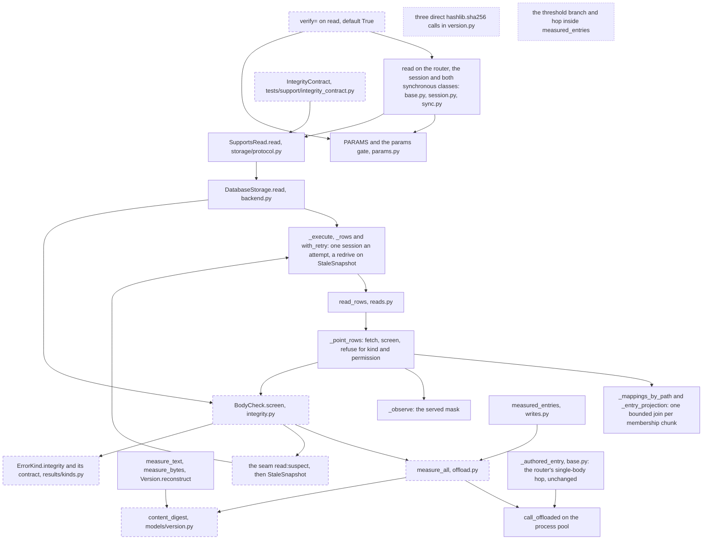

# `read` checks every body it serves against its recorded hash and refuses a mismatched, missing or unhashed body with `vfs.unavailable.integrity`, unless the caller asks for the salvage read

A feature and a fix. Flags: it changes the public API (one new error kind, one new argument `verify=` on `read`, and a new answer from `read` for a damaged body); it changes no schema format; it needs the engine legs, because it changes the read path's select list and what a read answers on every engine; it changes no rights rule, and it carries a leak test because the new error says something about a body's state; it touches no Rust; it is parallel-safe with every unit that leaves `reads.py`, `integrity.py`, `offload.py`, the `read` method of `backend.py` and `measured_entries` alone, and the units of spec 174 edit `writes.py` elsewhere. It serves roadmap story K3 at gate b (READ, `context/standards/roadmap.md:152-158`) and carries roadmap decisions D8 and D59. It is converted, by amendment, from [spec 175](../../context/specifications/archive/175-integrity-verify-on-read-and-scrub/spec.md) sections 1.1, 1.3, 2, 3 and 7 and its criteria 1 to 13, with tasks 1 and 3 to 8 of [its task list](../../context/specifications/archive/175-integrity-verify-on-read-and-scrub/tasks.md), read with [the study of that source](../2026-11-25-the-backlog-converted/studies/165-181/175-integrity-verify-on-read-and-scrub.md); it is unit 175-1 of [the map of units](../2026-11-25-the-backlog-converted/units.md). It stands on sections 2.3 and 6 of [the OSTEP memo](../../context/research/2026-10-24-what-ostep-teaches-vfs-eight-studies-and-what-changes-in-the-kernel-plan.md) for the hash and hop measurements, on [the lint memo](../../context/research/2026-11-15-a-lint-verb-that-finds-integrity-issues.md) for how other tools answer a damaged object, and on [the reference deployment memo](../../context/research/2026-11-09-what-an-enterprise-scale-deployment-looks-like.md) for every cost below. It depends on two specs. [The kernel rulings spec](../../context/specifications/active/2026-11-15-the-kernels-public-names-and-argument-families-are-ruled.md) is drafted and changes no code; its edits to the roadmap are in the tree (EXECUTED, `git log --oneline -- context/standards/roadmap.md` names `bc91cc3`; rows D8, D58 and D59 read "Decided", READ, `roadmap.md:1080`, `:1130`, `:1131`). Relied on from it: decision 9, quoted in decisions 3, 4 and 19 below, and decision 12, the rule for reading the source's citations of retired records. [The measure spec](../../context/specifications/archive/2026-11-07-storage-measures-every-body-it-stores.md) is landed and archived. Relied on from it: decision 3, the per-call offload rule, which decision 2 below gives one owner, and decision 4, that the router and the validator keep measuring. Build order: nothing has to land first. This unit lands before [175-2](../2026-11-25-every-written-row-reports-its-hash-and-no-verb-launders-a-damaged-body/spec.md), [175-3](../2026-11-25-the-system-actor-accepts-a-damaged-body-as-found/spec.md), [178-3](../2026-11-25-a-ranged-read-meets-the-integrity-check/spec.md) and [180-2](../2026-11-25-any-prior-version-of-a-file-is-read-back-whole-and-verified-by-its-hash/spec.md), each of which names it as a dependency.

## The problem

Labels: EXECUTED means a command ran at `5b20fd4f` and the claim reports its output; READ means read at the cited `path:line` at `5b20fd4f`; INFERRED means reasoning. The probes are scratch scripts on a SQLite file through `DatabaseStorage`, run with `uv run python` as the system actor unless a caller is named. Statement counts leave out `BEGIN` and the planner-statistics step, as `tests/support/statements.py` does.

- vfs stores a sha256 of every file body on the file's own row, and nothing compares it with the body. `read_rows` and `_point_rows` fetch, screen and observe with no hash comparison (READ, `src/vfs/storage/backends/database/reads.py:155-170`, `:817-860`).
- A body rewritten underneath vfs is served as success. After a raw `UPDATE vfs_content SET content='ROTTEN'`, `read` returns `success=True` and the content `ROTTEN` (EXECUTED).
- A body deleted underneath vfs is served as success. After the `vfs_content` row is deleted, `read` returns `success=True` with `content=None` and no error (EXECUTED).
- On SQLite a text body rewritten to bytes that are not UTF-8 reads as `vfs.unavailable` with `retryable=True`, the driver's "Could not decode to UTF-8 column" (EXECUTED). The caller is told to retry a fault that never heals.
- Every file row carries a hash and a body row, the empty file included: an empty text file has a `vfs_content` row of length 0, an empty bytes file a `vfs_blobs` row of length 0, and a directory has a `NULL` hash and no body row (EXECUTED). `vfs_entries.content_hash` is nullable (READ, `src/vfs/models/rows.py:436`), and storage has measured every written body itself since the measure spec landed (READ, `src/vfs/storage/backends/database/writes.py:144-170`), so a file row with no body row, or with a `NULL` hash, was changed underneath vfs (INFERRED).
- A healthy read costs one statement at the system actor, the join of `vfs_entries` to `vfs_content`, and a read projected to `{path, size_bytes}` joins no body table. A named caller's first read issues six rights statements before that one (EXECUTED).
- Three places take a body's hash on their own: `measure_text`, `measure_bytes` and `Version.reconstruct` each call `hashlib.sha256` (READ, `src/vfs/models/version.py:79`, `:84`, `:223`). No `content_digest` exists (EXECUTED, a grep of `src/vfs`).
- The offload rule has no owner. `measured_entries` carries it inline: every body of a call is hashed on the loop while the call's bodies total under `MEASURE_OFFLOAD_BYTES`, and otherwise every body of the call in one `call_offloaded` hop (READ, `writes.py:152-170`; `src/vfs/models/version.py:60`; `src/vfs/offload.py:146`). The source's `measure_all` does not exist, and its hop per blob page was never built (EXECUTED, grep). Roadmap story K3's fourth criterion still asks for `len(byte_chunked(items, BLOB_PAGE_BYTES))` hops (READ, `roadmap.md:158`).
- The kind does not exist. `ErrorKind` has `unavailable`, `unavailable.backend` and `unavailable.schema` and no integrity child, 24 kinds in all (READ, `src/vfs/results/kinds.py:92-94`; EXECUTED, `len(ErrorKind)`).
- `read` takes no `verify` argument on any face (READ, `src/vfs/base.py:904-915`, `src/vfs/session.py:96-105`, `src/vfs/sync.py:279-287`, `src/vfs/params.py:140-145`, `src/vfs/storage/protocol.py:126-133`).
- Every other verb already works on a damaged file. With a text body rewritten underneath vfs, `stat`, `ls`, `tree`, `glob`, `copy`, `move`, `delete` and `restore` each succeed; the copy holds the damaged body under the source's recorded hash; a `write` over the file succeeds and a following `read` returns the written body (EXECUTED). `grep` with `allow_scan=True` returns the damaged file as a hit, and raises a raw `UnicodeDecodeError` when the planted bytes are not UTF-8 (EXECUTED).
- A redrive already exists for a reader. `_rows` runs one session per attempt under `with_retry`, which restarts the whole call on `StaleSnapshot`, four attempts with a jittered wait from a 0.05 second base, the wait taken after the attempt's session has closed (READ, `src/vfs/storage/backends/database/backend.py:1374-1388`; `src/vfs/storage/backends/database/engine.py:182-183`, `:353-382`; `src/vfs/storage/backends/database/dialects.py:49-58`). On a SQLite file a rival write commits while a read session is open, and the open session keeps its snapshot (EXECUTED).
- Why it is wrong. Story K3: "an out-of-band writer (an ETL job with SQL credentials) can change or delete a body and `read` serves it as success. The hash is stored and never compared" (READ, `roadmap.md:154`). The roadmap's state table lists "verify `content_hash` on read" as missing (READ, `roadmap.md:124`).

## Architecture

Terms. A body is the bytes of a file: a text file's is `vfs_content.content`, a bytes file's is `vfs_blobs.data`. The recorded hash is `vfs_entries.content_hash`. The actual hash is the sha256 of the body as fetched now. A fault is a served body that fails the check, for one of three reasons: `mismatch` (the hashes differ), `missing` (no body row) or `unhashed` (no recorded hash). A finding is one sighting of a fault: the path, the row's version, the recorded hash, the reason and the actual hash. A hop is one hand-off of work to the process pool through `call_offloaded`. The threshold is `MEASURE_OFFLOAD_BYTES`, 100,000. A redrive is the retry layer's restart of a whole call in a fresh session. A body statement is one whose text names `vfs_content` or `vfs_blobs`. The salvage read is `read(verify=False)`.

## Decisions

### 1. One function, `content_digest`, turns a body into its hash, and `hashlib` stays the engine

`content_digest(body: str | bytes) -> str` in `src/vfs/models/version.py` returns the sha256 hex of `body` when it is bytes and of `body.encode()` when it is text. `measure_text`, `measure_bytes` and `Version.reconstruct` call it and their results do not change; the read check calls it and nothing else. It is exported from `vfs.models`. The check needs the hash without the size and the line count, and a second or fourth place that spells the hash is how two bodies come to hash equal under one law and unequal under another. `hashlib` stays because it measured faster than the Rust `sha2` crate, 2.46 GB/s against 0.35 GB/s by default and 2.1 GB/s with its assembly feature (READ, the OSTEP memo, `:214`), and it releases the interpreter lock for a large input, which is what lets a hop hash beside the loop. It is the standard library, not a numeric acceleration library, so the rule that sends hot paths to the project's own Rust crate is not departed from.

Basis: the source spec, section 1.1; still true at `5b20fd4f` (READ, three direct `hashlib.sha256` calls at `src/vfs/models/version.py:79`, `:84`, `:223`; EXECUTED, a grep finds no `content_digest`).

### 2. Every hash storage takes goes through `measure_all`, which applies the landed rule: on the loop while the call's bodies total under the threshold, otherwise one hop for the whole call

`measure_all(executor, items, measure, size_of)` in `src/vfs/offload.py` returns `[measure(item) for item in items]`, in input order. When `sum(size_of(item))` is under `MEASURE_OFFLOAD_BYTES` it runs on the loop and makes no hop; otherwise the whole comprehension runs in one `call_offloaded`. No items is no hop. `measured_entries` moves onto it with the same counts, and the read check uses it; the write-side hashes of unit 175-2 use it by that unit's own decisions. The router's `_authored_entry` keeps its own call: it is the same rule for one body, `len(body)` against the threshold and one hop, and its pin names the function it hops (READ, `src/vfs/base.py:323-337`; `tests/base/test_dispatch.py:63-93`), so moving it would rewrite a pin for no change in behaviour. The source's form, one hop per blob page gathered in parallel, is not built: the landed write path chose one hop, both forms bound the loop's time per call at one threshold's worth of hashing, and one hop keeps one pool thread per call, which at the reference deployment's 20 calls a second leaves the pool shared across calls. Hops per blob page, in parallel, are the direction if a measurement shows one worker thread is the bottleneck. This departs from roadmap story K3's fourth criterion as written, which the kernel rulings spec leaves to this conversion (READ, that spec, `:144`); the Design corrects the line to "exactly one".

Basis: verified lean, the study's open choice 6, holds amended; precedent: the landed write path (READ, `src/vfs/storage/backends/database/writes.py:152-170`) and decision 3 of the measure spec.

### 3. The threshold stays 100,000 bytes

Decided 2026-11-15: "the threshold stays". It is a cost knob and not a correctness rule, and every pin below counts hops on both sides of whatever value it holds.

Basis: ruled, 2026-11-15, roadmap row D8 (`context/standards/roadmap.md:1080`) and decision 9 of the kernel rulings spec.

### 4. The kind is the child `vfs.unavailable.integrity`, and it is never retryable

Decided 2026-11-15: "the child kind `vfs.unavailable.integrity`, never retryable". `ErrorKind.integrity = "vfs.unavailable.integrity"`, retry class `never`, and every error of the kind is minted with `retryable=False`. A consumer that does not know the child degrades it to `vfs.unavailable`, the family whose errno is EIO, the right one for a bad block; `vfs.unavailable.schema` is already a child of that family whose retry class is `never` (READ, `src/vfs/results/kinds.py:94`, `:279-284`). A caller that knows the child can tell "the database is down, retry" from "this body is damaged, do not retry".

Basis: ruled, 2026-11-15, roadmap row D8 (`context/standards/roadmap.md:1080`) and decision 9 of the kernel rulings spec.

### 5. The kind's contract words and its `data` record are fixed here, and no byte of a body ever rides an error

The contract row: phrase "Integrity check failed"; hint "The stored body is damaged; do not retry. Overwrite the file from a trusted copy, or read it with verify off to salvage what is stored."; `path` means "the entry whose body failed its check". The detail is one fixed phrase per reason: "the body does not match its recorded hash", "the body is missing", "no hash is recorded for the body". The `data` record, added to the `ErrorKind` docstring's list of per-kind records:

| Key | Value |
|---|---|
| `reason` | `"mismatch"`, `"missing"` or `"unhashed"` |
| `expected_hash` | the recorded hash; `None` when `unhashed` |
| `actual_hash` | the actual hash; `None` when no hash was taken (`missing`, `unhashed`) |
| `body` | the observation field whose body failed: `"content"` or `"data"` |
| `version` | the entry's `version` |

The path is the error's own `path`. No part of the body appears in `data`, in the detail or in the message, so an error can be logged and shown where the body could not. The source's `deleted` key belonged to its scrub and is not carried.

Basis: the source spec, section 2; still true at `5b20fd4f` (READ, the `ErrorKind` docstring lists per-kind `data` records at `src/vfs/results/kinds.py:53-58`, and `classified` composes the message from the contract phrase and a path-free detail, `src/vfs/results/envelope.py:239-273`).

### 6. `body` names the observation field, not a storage table

The source's values were table names, `vfs_content`, `vfs_blobs` and `vfs_versions`. An error's `data` is public wire data, and a table name is one backend's private fact: the contract "MUST hold across any backend that claims the capability" (READ, `context/standards/constitution.md`, Article 4). The field name is what the caller asked for and what a backend with no such table can still say. This departs from the source's section 2.

Basis: decided in drafting, because the constitution's Article 4 keeps backend facts out of the public contract.

### 7. The check covers a text file's `content` and a bytes file's `data`, and nothing else a read serves

| Row | Served field | Checked against |
|---|---|---|
| a file whose `source` is `text` | `content` | `content_hash` |
| a file whose `source` is `bytes`, `data` projected | `data` | `content_hash` |
| a file whose `source` is `bytes`, `content` only | `content`, the rendering | nothing |
| a file whose `source` is `text`, `data` only | nothing: a text file has no `data` | nothing |
| a directory | none | nothing |
| any row, a projection with no body field | none | nothing: no extra column, no hash, no hop |

A bytes file's rendering has no hash of its own: `render_source_hash` records which bytes it was made from, not what the rendering is, so a read that serves only the rendering cannot be checked, and the `read` docstring says so. The trash view serves deleted rows through the same path, so its bodies are checked by the same rule. `stat`, `ls` and `tree` pass no check and fetch no body. The source's table applied `unhashed` to a row serving any body; here a rendering-only read is outside the check whole, so that one sentence states where a check runs: where a served body has a recorded hash to meet.

Basis: the source spec, section 3.2; still true at `5b20fd4f` (EXECUTED, a default read of a bytes file serves `content` and no `data`, a read projected to `data` serves the bytes, and `SOURCES` is `{"text", "bytes"}`; READ, `src/vfs/storage/backends/database/reads.py:99-106`).

### 8. A missing body is judged by the body table's own key, a `NULL` hash is `unhashed`, and the order is missing, unhashed, mismatch

When a check is on, the read's statement selects each joined body table's `entry_id` beside the body, and a body is `missing` when that key is `NULL`. A body row whose value reads as `NULL` is hashed as the empty body. A design that took a `NULL` body value for a missing row would hold only where an empty string is stored as one: Oracle stores an empty string as `NULL` (INFERRED from Oracle's documented behaviour; not reproduced here, and criterion 12 pins the empty file on every leg). A `missing` or `unhashed` body takes no hash and no hop. `missing` is judged first because nothing can be served or salvaged from it; `unhashed` second; a body that has a row and a recorded hash is hashed and compared.

Basis: decided in drafting, because `AGENTS.md` forbids a design that works only within SQLite's behaviour, and the source's rule, "no `vfs_content` row", cannot be read off a left join's `NULL` body on every engine.

### 9. A row refused for kind or permission is refused before any hash

`_point_rows` keeps its order: a miss, then `wrong_kind`, then `permission_denied` for a row the caller may name and not read, each exactly as today, and only a row past all three reaches the check. A caller who may not read a row therefore learns nothing about its body: the answer for a damaged row is the answer for a healthy one, no hash is taken, and no second read is made. Criteria 31 and 32 are the leak tests.

Basis: the source spec, section 3.1; still true at `5b20fd4f` (READ, the refusals at `src/vfs/storage/backends/database/reads.py:855` and `:859` precede the observation at `:861`).

### 10. A fault is believed only when two reads in two transactions report the same finding

The first sighting of a finding is never reported. The check holds, for the length of one `read` call, the set of findings it has seen; a call's attempt that sees any finding not in the set adds all of that attempt's findings, reaches the seam `read:suspect`, and asks for a second read. A finding seen again, with the same path, version, recorded hash, reason and actual hash, is confirmed. A finding that differs in any part is new: a row a rival rewrote has a new version and is judged on its own body, and a body still being rewritten has a new actual hash. Each distinct path is hashed once an attempt, however often the batch names it. The law is story K3's second criterion, "A fault is reported only when two reads agree". Its causes, restated because the source's one cause is narrower than the tree: a dialect with no declared isolation, the unknown-dialect floor and SQL Server until [the SQL Server spec](../../context/specifications/active/2026-11-15-on-sql-server-a-read-never-waits-on-a-write.md) lands, can read an entry row before a rival's commit and its body after it within one join (INFERRED from locking read committed; not reproduced); an out-of-band writer can be caught between two of its own statements; and a fault between the engine and the hash is not a fault in the store. The source matched a suspect on path, version and recorded hash only; requiring the reason and the actual hash to agree as well means the `actual_hash` an error reports was seen twice.

Basis: verified lean, the study's open choice 7, holds amended; precedent: roadmap story K3 criterion 2 (`context/standards/roadmap.md:156`) and decision 6 of the lint spec, "a finding is reported only when a second read agrees".

### 11. The second read is a redrive of the whole call through the retry layer

On a new finding the check raises `StaleSnapshot("a body failed its hash; confirming")`. `with_retry` discards the session, waits its jittered step and runs the call again from its first statement, rights reads included; the check object is made once per call in `DatabaseStorage.read`, outside the retry loop, so its set survives the redrive. A confirmed fault therefore costs exactly two attempts. If findings keep changing through every attempt, the budget of four runs out and the read answers a retryable `vfs.conflict`, the answer any call gives under that much churn. One mechanism serves both outcomes of the second read, the confirmed fault and the row that changed and must be served fresh under a fresh rights judgment; a second fetch of the suspects alone would settle the first and still need the redrive for the second. Story K3's second criterion says "the second read is exactly one extra statement"; that holds at the system actor, whose read is one statement, and not for a named caller, whose redrive repeats its rights reads (EXECUTED, six before the one), so the Design corrects the line to count body statements.

Basis: the source spec, section 3.3; still true at `5b20fd4f` (READ, `src/vfs/storage/backends/database/engine.py:353-382`; `src/vfs/storage/backends/database/dialects.py:49-58`; `_copy_bodies` already redrives a reader on a changed version and hash pair, `src/vfs/storage/backends/database/topology.py:559-560`).

### 12. The hash runs inside the attempt's session, and the wait between attempts runs outside it

The check runs between the screen and the observation, with the session open, because the confirmation is a redrive of the same attempt. A read takes no lock another caller waits on: on every server engine it is a snapshot read, and the session is held for the fetch of the same bytes the hash then reads at a higher rate. The wait before the second attempt is taken after the first attempt's session has closed (READ, `backend.py:1382-1388` inside `engine.py:370-381`), so no connection is held through it. On `InMemoryStorage` the host lock spans the session, hash included, which is that backend's declared posture. If a pool ever runs short on large reads, the direction is to carry the bodies and recorded hashes out of the session and hash after it closes.

Basis: the source spec, section 3.1; still true at `5b20fd4f` (READ, `src/vfs/storage/backends/database/backend.py:1374-1388`; `src/vfs/storage/backends/memory.py:13-16`).

### 13. A refused target yields no observation, the rest of the batch is served, and errors keep target order

A target whose fault is confirmed returns one `integrity` error at its path and no row: the body never reaches the caller, not even as a field set to `None`. Every other target of the batch is served as today. `_point_rows` builds rows and errors in one pass over the targets after the check, so the error stands where the row would have.

Basis: the source spec, section 3.4 and criterion 7; still true at `5b20fd4f` (READ, a batch read already keeps good rows beside classified misses, `tests/storage/database/test_reads.py:157`).

### 14. `read(verify=False)` is the salvage read: the same check, and a confirmed fault is served with a warning

Decided 2026-11-15: "an explicit opt-in on `read`; it succeeds with a warning that the body failed its check", open to "anyone who may read it". The salvage read is judged at the same `read` rung by the same screen, runs the same check and the same confirmation, and differs in one thing: a confirmed `mismatch` or `unhashed` body is served in its row, with one `integrity` error at `Severity.warning` carrying the same `data` record, so `success` is unaffected. Running the check is what lets the warning exist, and confirming it keeps a salvage read from warning about a body that is whole. A healthy body read with `verify=False` is served with no warning and at the same cost as any read.

Basis: ruled, 2026-11-15, roadmap row D59 (`context/standards/roadmap.md:1131`).

### 15. A salvage read of a missing body is still refused

A `missing` body under `verify=False` answers the same `integrity` error at `Severity.error` and no row. The ruling's salvage read "returns a damaged file's bytes on request", and a missing body has none; a row whose body field is `None` would say the file is empty or unrendered, which it is not. The file is not locked by this: it can be overwritten, moved, deleted and restored (decision 19).

Basis: decided in drafting, because roadmap row D59 defines the salvage read by the bytes it returns.

### 16. `verify` is a boolean on every face of `read`, default `True`, and the router always passes it to storage

`AsyncVirtualFileSystem.read`, `Session.read`, `VirtualFileSystem.read` and the synchronous session's `read` take `verify: bool = True`, keyword only. `PARAMS["read"]` gains `ParamSpec("verify", "bool", nullable=False, default=True, doc="check each served body against its recorded hash; False serves a damaged body with a warning")`, so a non-boolean is `vfs.invalid` at the params gate. `SupportsRead.read` gains `verify: bool = True`, and the router passes it on every call, as it passes `columns`; a backend that records no hash accepts the argument and serves the body. Chained `grep` reads absent content through `read` with the default, so it is checked (decision 18). No other verb takes the argument.

Basis: decided in drafting, because the signature drift test compares every verb's parameters with the table (READ, `tests/test_params.py:28-33`), and roadmap row D59 spells the argument `read(verify=False)`.

### 17. Where the profile declares `content_bytes`, a checked read fetches the text body as bytes, hashes them, and decodes once

`content_bytes` is declared where casting the content column to the engine's bytes type returns its exact UTF-8 bytes cheaply; only SQLite declares it, and `grep` already fetches bodies that way (READ, `src/vfs/storage/backends/database/dialects.py:209-216`, `:439`, `:503`; `reads.py:696`). There a checked read selects `cast(content, LargeBinary)`, the check hashes the bytes as fetched, and `_observe` decodes them once for the row: two passes in place of the driver's decode, an encode and a hash. A body that matches its hash is the UTF-8 vfs wrote, so its decode cannot fail. It also closes the defect of the fourth problem bullet: bytes that are not UTF-8 reach the check and are a `mismatch`, never a driver error that tells the caller to retry. Every other dialect returns `str`, and `content_digest` encodes it inside `measure_all`. A read with no check on fetches as today.

Basis: the source spec, section 3.5; still true at `5b20fd4f` (READ, the lines above; EXECUTED, the retryable `vfs.unavailable` on a body that is not UTF-8).

### 18. A salvaged text body that is not UTF-8 is served with U+FFFD in place of each invalid sequence

It arises only where the body is in hand as bytes (decision 17), so only on SQLite; the other tuned engines refuse or transcode such bytes in a text column (INFERRED). The warning's `actual_hash` is the hash of the stored bytes, and the `read` docstring states the substitution.

Basis: provisional, no ruling on record; the options were to serve the text with replacement characters, to refuse the salvage read of such a body with the `integrity` error, or to decode with surrogate escapes; chosen because the salvage read exists to hand over what is stored, replacement keeps the row a valid string on every face where a lone surrogate would break JSON encoding, and the choice touches one dialect and is a one-line change to reverse.

### 19. `grep` and the scan tier of `search` serve lines from bodies they do not hash; a hit is a pointer to `read`, which checks

Decision 9 of the kernel rulings spec leaves this to the conversion: "which other verbs read a body (`edit`, `copy`, a cross-mount `move`, `grep`) and what each answers is spec 175's decision at conversion". `grep` and `search` fetch candidate bodies through `content_for_entries` (READ, `src/vfs/storage/backends/database/grep.py:362`; `src/vfs/storage/backends/database/search.py:716`, `:753`) and are left as they are: a hit on a damaged file returns the damaged line, the docstring of `grep` says a hit is not a verified read, and the `read` that follows a hit refuses. Chained `grep` over rows in hand reads absent content through `read` (READ, `src/vfs/chain.py:147`), so there a damaged row is one `integrity` error beside the healthy rows' matches.

Basis: provisional, no ruling on record; the options were to leave `grep` and `search` unverified with `read` as the checked door, or to hash every candidate body in the verify batch and drop a damaged one with an `integrity` warning; chosen because it is what vfs does today and adds no cost to a call that is among the three in four that are reads, where the second option adds a sha256 pass over up to 32 MiB a batch beside the match, and because adding the check later only turns a hit on a damaged file into a warning, the cheaper direction to reverse.

### 20. Every verb that does not hand out the body works on a damaged file as on any file, and a `write` over it heals it

Decided 2026-11-15: "the check refuses a call only where it must hand out or build on the damaged body, `read` first", "a `write` over the file succeeds and heals it", "`stat`, a listing, `delete`, `move` and `restore` of the file work as on any file", and "K3 does not land with a path on which a damaged file can be neither read, rewritten nor removed". This unit adds the check to `read` and to nothing else. A damaged file can be read by the salvage read, rewritten by `write` and removed by `delete`; criteria 14 to 21 pin one verb each. What `edit` answers on a damaged body is decided by unit 175-2.

Basis: ruled, 2026-11-15, decision 9 of the kernel rulings spec (`context/specifications/active/2026-11-15-the-kernels-public-names-and-argument-families-are-ruled.md:79-81`).

### 21. `copy` within a mount does not hash: it copies the body under the source's recorded hash, so the copy is damaged in the same way and reads as `integrity`

The copy hands no body to the caller, so the condition of decision 20 does not reach it, and it launders nothing: the destination's row carries the source's recorded hash over the source's body as found, and a `read` of the copy refuses with the same `expected_hash`.

Basis: verified lean, the study's open choice 8, holds; precedent: the landed `_copy_bodies`, which reads each body with its row's version and hash and inserts it verbatim under the new id (READ, `src/vfs/storage/backends/database/topology.py:546-562`; EXECUTED, the copy of a damaged file holds the damaged body and the source's recorded hash).

### 22. No exception class is added: `raise_if_failed` raises the base `VFSError` for the kind

The exception table maps by family and leaves the `unavailable` family on the base class (READ, `src/vfs/exceptions.py:68-84`). The integrity kind degrades to that family and raises as it does.

Basis: decided in drafting, because the table's rule is that an unmapped family raises the base class and nothing asks for a narrower one.

### 23. The seam's promise is written where the seam is declared

`SupportsRead`'s docstring gains one sentence: a backend that records a body's hash never serves a body that fails it unless `verify` is false, and reports the failure as `vfs.unavailable.integrity`. `AsyncVirtualFileSystem.read` gains a docstring, as `write`, `edit`, `delete` and `restore` carry theirs, that states the check, the three reasons, the salvage read, the unchecked rendering and the substitution of decision 18. The module docstring of `offload.py` adds a large read's check to its list of offloaded stages. No docstring or comment names this spec or a roadmap row.

Basis: decided in drafting, because `AGENTS.md` makes a docstring a page's content and keeps spec citations out of code.

### 24. The integrity family runs on every conformance leg through a mixin that plants faults the way an out-of-band writer would

`IntegrityContract` in `tests/support/integrity_contract.py` joins `StorageContract` and `GrantsContract` on the six conformance classes. Its planters write through the backend's own `tables` and `session_factory` with Core statements, so they follow each leg's schema: `plant_rewrite(path, text)` updates `vfs_content`, `plant_blob_rewrite(path, data)` updates `vfs_blobs`, `plant_delete(path, table)` deletes the body row, `plant_null_hash(path)` sets `content_hash` to `NULL`. The source's fifth planter rewrote a version row and is left to the unit that reads one.

Basis: the source spec, section 7; still true at `5b20fd4f` (READ, `GrantsContract` is a database-aware mixin on every leg, `tests/storage/test_conformance.py:62`, `:99`, `:182`, `:243`, `:253`, `:263`).

## Intent

After this spec, an ETL developer whose other jobs touch the same database with raw SQL, and an agent reading through any face, can trust a body `read` returns: it is the body whose hash vfs recorded. A file whose body was rewritten, deleted or stripped of its hash underneath vfs reads as one `vfs.unavailable.integrity` error at its path, never retryable, naming the reason and both hashes and carrying no byte of the body, while the other files of the same batch are served. The error is reported only after a second read agrees. `read(verify=False)` hands a caller who may read the file the body as it stands, with a warning. `stat`, listings, `glob`, `copy`, `move`, `delete` and `restore` treat the file as any file, and a `write` over it heals it. A healthy read issues the statements it issues today and adds one hash of what it returns.

## Design

The work, in order. Each test is written and seen failing before the code that passes it. Test names are the ones the acceptance criteria cite.

1. **The one hash.** Tests first: `TestContentDigest` in `tests/models/test_models.py`. Then `content_digest` in `src/vfs/models/version.py`, under the measure functions' group; `measure_text`, `measure_bytes` and `Version.reconstruct` call it; `src/vfs/models/__init__.py` exports it.
2. **The one offload rule.** Test first: `TestMeasureAll` in `tests/test_offload.py`, spying `vfs.offload.call_offloaded`. Then `measure_all` in `src/vfs/offload.py`, under the hop's banner, importing `MEASURE_OFFLOAD_BYTES` from `vfs.models.version` (no cycle: `vfs.models` imports nothing from `vfs.offload`, EXECUTED, grep). Then `measured_entries` calls `measure_all(executor, bodies, _measure, len)` in place of its own branch. Two existing pins move their spy from `writes_module.call_offloaded` to `vfs.offload.call_offloaded` and keep every count: `test_large_bodies_are_measured_in_one_offloaded_hop` and `test_a_body_changed_during_the_hop_is_never_stored_under_another_hash` (READ, `tests/storage/database/test_writes.py:1442`, `:1472`).
3. **The kind.** Test first: `TestKindContracts.test_integrity_degrades_to_unavailable_and_is_never_retried` in `tests/results/test_result_laws.py`. Then the enumerator, its `KIND_CONTRACTS` row and the `data` record in the `ErrorKind` docstring, in `src/vfs/results/kinds.py`.
4. **The check, on plain mappings.** Tests first: `TestBodyCheck` in a new `tests/storage/database/test_integrity.py`. Then a new `src/vfs/storage/backends/database/integrity.py`, about 150 lines: the labels `CONTENT_ROW` and `DATA_ROW` for the two body-table keys; `Finding`, a `NamedTuple` of path, version, expected, reason, actual and body; and `BodyCheck(executor, *, salvage=False)` with `async screen(rows, served) -> dict[str, ResultError]`. `screen` walks the distinct paths of `rows` once, picks each row's checked field by decision 7, records `missing` and `unhashed` without hashing, sends the rest through `measure_all(executor, bodies, content_digest, len)`, and compares. If any finding is new it adds the attempt's findings to its set, awaits `seam("read:suspect")` and raises `StaleSnapshot`; otherwise it returns one error per confirmed path, at `Severity.warning` for a salvaged `mismatch` or `unhashed` and at `Severity.error` for the rest.
5. **The read path.** Tests first: the rows of `IntegrityContract` (criteria 8 to 21) mixed into the six conformance classes, and the counted tests of `test_integrity.py` (criteria 22 to 27). Then, in `reads.py`: `read_rows` takes `check: BodyCheck | None`; it computes `served = effective_columns(columns, content=True)` and, when a check is given and `served` holds a body field, `fetched = served | {"content_hash", "source"}`. `_entry_projection` takes a flag that adds each joined body table's `entry_id` under its label. `_point_rows` takes `served` and `check`: its loop collects, in target order, each target's refusal or its mapping; with a check it awaits `check.screen(collected, served)` once; then one pass builds the rows with the `served` mask and the errors in target order, dropping the row of an error-severity fault. `stat_rows` passes neither. In `backend.py`, `DatabaseStorage.read` takes `verify: bool = True`, makes `BodyCheck(offload_pool(), salvage=not verify)` once and passes it into `read_rows` through the `_viewed` lambda.
6. **The argument on every face.** Tests first: criteria 33 to 35. Then the `PARAMS` row, the four `read` signatures and the `SupportsRead` signature of decision 16.
7. **Bytes in hand on SQLite.** Tests first: criteria 28 and 29. Then `_entry_projection` selects the cast body when the profile declares `content_bytes` and a check is on, and `_observe` decodes a bytes `content` once, with replacement only for a salvaged fault.
8. **The leak, the rival and the chain.** Tests first: criteria 30 to 32 and 36. They pass with the wiring of step 5 as placed; criterion 32 fails if the check is moved above the refusals.
9. **Words and gates.** The docstrings of decision 23. In `context/standards/roadmap.md`, story K3's second criterion reads "A fault is reported only when two reads agree; a damaged single-file read issues exactly two statements that name a body table, one an attempt." and its fourth reads "Hashing is offloaded per call: a call whose bodies sum below `MEASURE_OFFLOAD_BYTES` makes zero offload calls; one that sums to it or above makes exactly one; a single 16 MB body makes one." Then `scripts/ci.sh`, `scripts/docs.sh check`, and the four server legs through the `db_test` skill.

What is added, the multiplier it rides on, and the budget that bounds it. Figures are the reference deployment's (READ, `AGENTS.md`, "The reference deployment"). `B` is `membership_budget(profile, parameter_budget)`, 1,000 on Oracle and 2,000 on SQL Server (READ, `src/vfs/storage/backends/database/dialects.py:568`, `:639`, `:760-767`). sha256 ran here at 0.6 to 1.2 GB/s, 6 µs for 4 KB, 94 µs for 100,000 bytes, 1.7 ms for 1 MB (EXECUTED on this machine, a scratch timing for costing and never a test); the memo's laptop measured 2.46 GB/s.

| Added | Grows with | Multiplier and arithmetic | Bound on the least generous engine |
|---|---|---|---|
| a hash of each served body | bytes the read returns | per verb call, about 150,000 a day: if every call were a read at the 4 KB median, 150,000 × 6 µs is about 1 second of CPU a day; at a 0.5 MB mean, about 0.9 ms a call and about 130 seconds a day. A read costs in proportion to what it returns | on the loop under `MEASURE_OFFLOAD_BYTES` a call, about 0.1 ms; at or above it one hop |
| `content_hash`, `source` and the body-table key on the read's select | rows of the call, only when a narrowed projection left them out | per verb call: at most 64 + 8 + 26 characters a row on a statement that already runs | no statement is added; `rows_by_path` already chunks the paths by `B` |
| the hop | calls at or above the threshold | per verb call: one pool thread for the length of the hash; at the peak of 20 calls a second, each of 1 MB, 20 × 1.7 ms is about 3% of one of `OFFLOAD_WORKERS` threads | one hop a call, whatever the batch; the pool's width is the machine's |
| the findings set and the digest list | targets of the call | per batch: a 10,000-path read holds at most 10,000 digests of 64 characters and, on a fault, one finding a damaged path an attempt | the batch size the caller chose; no body is copied, and a text body is encoded one at a time inside the hop |
| the redrive | damaged reads only | per verb call that meets a fault: twice the statements of a healthy read when the fault is confirmed, at most four times under churn, and one wait of 25 to 50 ms taken with no session open | `retry_attempts`, four |

Per batch: a 10,000-path read issues `ceil((targets + ancestors) / B)` statements today, 11 on Oracle for one directory of 10,000 files, and issues the same number with the check on; it makes one hop. The profile is stated, not capped: a batch read holds every body it returns in memory at once today (READ, `reads.py:1028-1054`), and the check adds no second copy of them.

Per file write: nothing is added. `measured_entries` makes the hops it makes today through one more function call.

Per index visit and per corpus: nothing. No pass and no whole-table statement is added.

Per lock: none is taken. A read stays a plain snapshot read on every server engine and waits on no writer and no rights change; its session is open for the length of the hash, 6 µs at the median and 1.7 ms at 1 MB, which is less than the fetch of the same bytes (decision 12).

## Scope

In: decisions 1 to 24. Files: `src/vfs/models/version.py`, `src/vfs/models/__init__.py`, `src/vfs/offload.py`, `src/vfs/results/kinds.py`, `src/vfs/storage/backends/database/integrity.py` (new), `src/vfs/storage/backends/database/reads.py`, `src/vfs/storage/backends/database/backend.py` (`read` only), `src/vfs/storage/backends/database/writes.py` (`measured_entries` only), `src/vfs/storage/protocol.py`, `src/vfs/params.py`, `src/vfs/base.py` (`read` only), `src/vfs/session.py`, `src/vfs/sync.py`, the `grep` docstring; `tests/models/test_models.py`, `tests/test_offload.py`, `tests/results/test_result_laws.py`, `tests/storage/database/test_integrity.py` (new), `tests/support/integrity_contract.py` (new), `tests/storage/test_conformance.py`, `tests/storage/database/test_races.py`, `tests/storage/database/test_writes.py` (two spies), `tests/base/test_dispatch.py`, `tests/base/test_grep_namespace.py`, `tests/test_sync.py`; two lines of `context/standards/roadmap.md`.

Out, each with where it belongs.

- `content_hash` on every row `write`, `edit`, `copy` and `move` return, the edit's check of the body it edits, the overwrite's warning and the version mint's recorded-hash rule: unit [175-2](../2026-11-25-every-written-row-reports-its-hash-and-no-verb-launders-a-damaged-body/spec.md). Until it lands, an `edit` of a damaged body behaves as it does today.
- Accepting a damaged body as found, the system actor's act of roadmap row D58: unit [175-3](../2026-11-25-the-system-actor-accepts-a-damaged-body-as-found/spec.md).
- A ranged read. No range exists at `5b20fd4f`, and this check covers whole-body reads only; how a range meets the check is unit [178-3](../2026-11-25-a-ranged-read-meets-the-integrity-check/spec.md).
- Reading a prior version and checking it against its version row's hash: unit [180-2](../2026-11-25-any-prior-version-of-a-file-is-read-back-whole-and-verified-by-its-hash/spec.md). `vfs_versions.content_hash` is `NOT NULL`, so `unhashed` never applies there (READ, `src/vfs/models/rows.py:548`).
- A walk over the bodies nobody reads, the source's slice D, `scrub`: the byte layer of `lint` in [the lint spec](../../context/specifications/active/2026-11-15-lint-finds-what-is-broken-in-a-mount-and-changes-nothing.md), whose decision 1 adds no `scrub` verb.
- A cross-mount `copy` or `move`. The router refuses every cross-mount pair today; unit [160-1](../2026-11-25-a-cross-mount-file-copy-is-a-read-on-one-mount-and-a-write-on-the-other/spec.md) builds the copy as a read and a write, and its read meets this check.
- The same-body write's verify pass, which hashes stored bodies by its own decision 6: unit [174-1](../2026-11-25-an-identical-body-write-reports-unchanged-and-leaves-the-version-alone/spec.md).
- How a backend declares which arguments it serves, `verify` among them: unit [179-10](../2026-11-25-a-backend-that-lacks-a-derivable-verb-is-still-served-it/spec.md).
- The shell's EIO line, the MCP adapter's `isError` with no retry hint, and the guest's `EIO`: the units of specs 167, 171 and 172, which read the kind through its family and its retry class.
- A hash of a bytes file's rendering. None is stored (decision 7); a rendering hash column is the direction if one is wanted.
- The raw `UnicodeDecodeError` that `grep` raises on a text body that is not UTF-8 on SQLite (the problem's eleventh bullet). It is a defect outside the read path and is reported, not fixed here.
- The router's `_authored_entry` hop and its pins (decision 2).
- Hashing in Rust (decision 1).

## Acceptance criteria

"Every leg" means the row is in `IntegrityContract`, so it is collected under `tests/storage/test_conformance.py` as `TestMemoryConformance`, `TestSqliteConformance`, `TestPostgresConformance`, `TestMariaDBConformance`, `TestMSSQLConformance` and `TestOracleConformance`. "The server legs" means a test parametrized by `ENGINE_LEGS`: Postgres, MariaDB, SQL Server and Oracle. Counted tests run on a SQLite file as the system actor with a `before_cursor_execute` listener, leaving out control statements and the statistics step; hops are counted by a spy on `vfs.offload.call_offloaded`; hashes by a spy on `integrity.content_digest`. "A damaged file" is a text file whose body `plant_rewrite` changed. Counts and states, never clocks.

1. For an ASCII text, a multibyte text, the empty text and a bytes body, `measure_text(t).content_hash == content_digest(t)`, `measure_bytes(b).content_hash == content_digest(b)`, and a text and its UTF-8 bytes give one digest: `tests/models/test_models.py::TestContentDigest::test_every_measure_agrees_with_the_one_digest`.
2. The text of `src/vfs/models/version.py` holds exactly one `hashlib.sha256(` and the text of `src/vfs/storage/backends/database/integrity.py` holds none: `tests/models/test_models.py::TestContentDigest::test_the_hash_is_spelled_in_one_place`.
3. `measure_all` makes 0 hops for no items, for one 99,999-byte item and for 99 items of 1,000 bytes, and exactly 1 hop for one 100,000-byte item, for 100 items of 1,000 bytes, for 20 items of 1,000,000 bytes and for one 16,000,000-byte item, and each result equals the inline list in input order: `tests/test_offload.py::TestMeasureAll::test_hops_follow_the_call_total`.
4. The write path's hop counts are what they were, 1, 0, 1, 1 and 0 for the five batches of the existing pin, with the spy on `vfs.offload.call_offloaded`: `tests/storage/database/test_writes.py::test_large_bodies_are_measured_in_one_offloaded_hop`.
5. `kind_family("vfs.unavailable.integrity")` is `ErrorKind.integrity`, an unknown sibling `vfs.unavailable.x` degrades to `ErrorKind.unavailable`, the contract's retry class is `never`, and a classified integrity error has `retryable is False`: `tests/results/test_result_laws.py::TestKindContracts::test_integrity_degrades_to_unavailable_and_is_never_retried`.
6. A `BodyCheck` screening the same damaged mapping raises `StaleSnapshot` on the first call and returns one error on the second, and screening a healthy mapping at a new version on the second call returns none: `tests/storage/database/test_integrity.py::TestBodyCheck::test_a_fault_is_reported_only_on_its_second_sighting`.
7. A second sighting whose actual hash differs from the first raises `StaleSnapshot` again, and a batch naming one path three times takes one hash an attempt: `tests/storage/database/test_integrity.py::TestBodyCheck::test_a_changed_finding_is_new_and_a_repeated_path_is_hashed_once`.
8. A `read` of a damaged file has `success is False`, zero observations and one `vfs.unavailable.integrity` error at the file's path whose `data` holds `reason == "mismatch"`, `expected_hash` equal to the hash `stat` reports, `actual_hash` equal to the sha256 of the planted text, `body == "content"` and the entry's `version`, and the planted text appears nowhere in `result.to_payload()` or `result.to_str()`: `IntegrityContract.test_a_rewritten_body_reads_as_an_integrity_error`, every leg.
9. A text file whose `vfs_content` row was deleted, and a bytes file read with `data` projected whose `vfs_blobs` row was deleted, each read as one integrity error with `reason == "missing"` and `actual_hash is None` and zero observations: `IntegrityContract.test_a_deleted_body_row_reads_as_missing`, every leg.
10. A file row whose `content_hash` was set to `NULL` reads as one integrity error with `reason == "unhashed"`, `expected_hash is None` and `actual_hash is None`: `IntegrityContract.test_a_row_with_no_recorded_hash_reads_as_unhashed`, every leg.
11. A batch read of four targets, the third damaged, returns three observations in target order and one integrity error at the third path: `IntegrityContract.test_a_batch_serves_the_healthy_rows_beside_the_damaged_one`, every leg.
12. An empty text file, and an empty bytes file read with `data` projected, each read with one observation and zero errors: `IntegrityContract.test_empty_bodies_read_clean`, every leg.
13. A bytes file whose blob was rewritten reads by default, serving its rendering, with zero integrity errors, and read with `data` projected answers one integrity error with `body == "data"`: `IntegrityContract.test_a_rendering_is_unchecked_and_the_bytes_are_checked`, every leg.
14. `stat`, `ls` of the parent, `tree` of the parent and `glob` of the path each return the damaged file's row with zero errors, and `stat` reports the recorded hash: `IntegrityContract.test_stat_and_the_listings_answer_a_damaged_file_as_any_file`, every leg.
15. `delete` of a damaged file reports `deleted`, a `read` through the trash view answers the integrity error, and `restore` brings the file back live at its path: `IntegrityContract.test_a_damaged_file_is_deleted_and_restored_as_any_file`, every leg.
16. `move` of a damaged file succeeds, and a `read` at the new path answers the integrity error with the same `expected_hash`: `IntegrityContract.test_a_damaged_file_moves_as_any_file`, every leg.
17. `copy` of a damaged file succeeds, and a `read` of the copy answers the integrity error with the source's `expected_hash`: `IntegrityContract.test_a_copy_of_a_damaged_file_is_damaged_the_same_way`, every leg.
18. A `write` over a damaged file succeeds, and the `read` that follows returns the written body with zero errors: `IntegrityContract.test_a_write_over_a_damaged_file_heals_it`, every leg.
19. `grep` with `allow_scan=True` for a word of the planted text returns the damaged file as a hit with zero integrity errors: `IntegrityContract.test_grep_serves_a_hit_from_a_body_it_does_not_hash`, every leg.
20. `read(verify=False)` of a damaged file has `success is True`, one observation whose content is the planted text, and one integrity error at `Severity.warning` with the same `data` record; of a healthy file, one observation and zero errors: `IntegrityContract.test_the_salvage_read_serves_a_damaged_body_with_a_warning`, every leg.
21. `read(verify=False)` of a file whose body row was deleted has zero observations and one integrity error at `Severity.error` with `reason == "missing"`: `IntegrityContract.test_the_salvage_read_refuses_a_missing_body`, every leg.
22. A `read` of a damaged file issues exactly two body statements, and a `read` of a healthy file exactly one statement in all: `tests/storage/database/test_integrity.py::test_a_damaged_read_issues_two_body_statements_and_a_healthy_one_a_single_statement`.
23. A healthy `read` of a 99,999-byte body makes 0 hops and of a 100,000-byte body exactly 1: `tests/storage/database/test_integrity.py::test_a_read_hops_once_at_the_threshold`.
24. `read(columns={"path", "size_bytes"})` of a damaged file succeeds with no body statement, zero hashes and zero hops, and `read(columns={"path", "content"})` of a healthy file has `populated == {"path", "kind", "version", "content"}`: `tests/storage/database/test_integrity.py::test_a_projection_without_a_body_checks_nothing_and_the_mask_is_what_was_asked`.
25. `stat`, `ls` and `tree` over a 4 MiB file issue no body statement and make zero hops: `tests/storage/database/test_integrity.py::test_stat_and_the_listings_fetch_no_body`.
26. With `in_list_budget` narrowed to 1,000, a read of 10,000 healthy 16-byte files in one directory issues exactly 11 statements, binds no more than 1,000 keys in any of them and makes exactly 1 hop; with one of them damaged it issues exactly 22, makes exactly 2 hops and returns 9,999 observations and 1 error: `tests/storage/database/test_integrity.py::test_a_ten_thousand_path_read_adds_no_statement_and_one_hop`, marked `slow`.
27. With a handler on `read:suspect` that rewrites the body to a different text on every attempt, the read issues exactly four body statements and answers one retryable `vfs.conflict` and no integrity error: `tests/storage/database/test_integrity.py::test_a_body_that_keeps_changing_exhausts_the_redrive_as_a_conflict`.
28. The checked read's statement selects the content column through a cast to the bytes type when compiled for the SQLite profile and selects it bare for the Postgres profile, and a healthy multibyte body reads back equal on SQLite: `tests/storage/database/test_integrity.py::test_the_text_body_is_fetched_as_bytes_only_where_the_profile_declares_it`.
29. On SQLite a text body rewritten to bytes that are not UTF-8 reads as one integrity error with `reason == "mismatch"` and `retryable is False`, and `read(verify=False)` serves it with U+FFFD in place of the invalid byte and one warning: `tests/storage/database/test_integrity.py::test_a_body_that_is_not_utf8_is_a_mismatch_never_a_driver_error`.
30. With a handler on `read:suspect` that commits a `write` of a fresh body to the damaged path, the read succeeds with the fresh body at the new version and zero integrity errors: `tests/storage/database/test_races.py::TestReadConfirmation::test_a_rival_write_between_the_two_reads_is_served_fresh`, the server legs, and the same test on a SQLite file as `tests/storage/database/test_integrity.py::test_a_rival_write_between_the_two_reads_is_served_fresh`.
31. On a private mount, a caller for whom a damaged file is hidden reads it as `vfs.not_found`, and a caller holding only `list` on it as `vfs.permission_denied`, each with the kind, message and `data` the same call gave before the damage was planted, with `verify=True` and with `verify=False`: `IntegrityContract.test_a_caller_who_may_not_read_a_damaged_file_learns_nothing_of_it`, every leg.
32. The `list`-only caller's read of a damaged file takes zero hashes, makes zero hops and issues exactly one body statement: `tests/storage/database/test_integrity.py::test_a_refused_row_is_never_hashed_and_never_redriven`.
33. Every verb's signature matches the parameter table with `verify` in `PARAMS["read"]`, and `read(path, verify="no")` is `vfs.invalid` with zero dispatches: `tests/test_params.py::test_every_verb_signature_matches_the_table` and a new row of the garbage table of `tests/test_params.py::test_garbage_classifies_invalid_with_zero_dispatch`.
34. The router passes `verify=True` to storage on a plain `read` and `verify=False` on a salvage read, for a path and for observations: `tests/base/test_dispatch.py::test_read_passes_verify_to_storage`.
35. `Session.read`, `VirtualFileSystem.read` and the synchronous session's `read` take `verify` with default `True` and pass it through: `tests/test_sync.py::test_read_takes_verify_on_every_face`.
36. Chained `grep` over four rows in hand with no content, one of them a damaged file, returns the three healthy rows' matches and one integrity error at the damaged path: `tests/base/test_grep_namespace.py::test_a_chained_grep_reports_a_damaged_row_beside_the_healthy_matches`.
37. `rg -c 'byte_chunked\(items, BLOB_PAGE_BYTES\)' context/standards/roadmap.md` exits 1, and `rg -c 'exactly two statements that name a body table' context/standards/roadmap.md` prints 1.
38. `scripts/ci.sh` is green at 100% coverage, `scripts/docs.sh check` is green, and criteria 8 to 21, 30 and 31 are green on the Postgres, MariaDB, SQL Server and Oracle legs through the `db_test` skill.

## Landing notes

Filled in when the pull request is opened.

## One line

`read` hashes each text body and each projected bytes body it serves through one digest and one offload rule, reports a body that fails twice as `vfs.unavailable.integrity` with no row and no byte of it, serves it with a warning when asked with `verify=False`, and leaves every other verb working on the damaged file.
