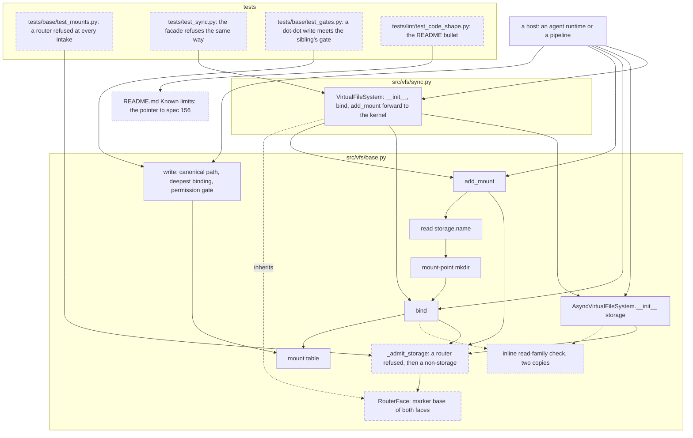

# Binding a `VirtualFileSystem` or `AsyncVirtualFileSystem` as storage raises a `TypeError` that says a router is not a storage, and a write through `..` into a read-only sibling mount is refused at the sibling's path

A fix, converted by amendment from [spec 156](../../context/specifications/archive/156-mount-admission/spec.md): its Decided semantics items 3 and 4, both slices. Flags. It changes the public API: three intakes on each face refuse an argument the kernel admits today, `add_mount` judges its storage before it reads a name or makes a directory, and both faces gain a base class that is exported from nowhere and shows on their reference pages. It changes two docstrings and the README, so the docs gate runs. It touches no rights rule: it adds two tests of a gate that already holds, and each counts the calls that reached the read-only mount, which is the leak test. It is not structural (no module is added or removed), changes no schema format, needs no engine legs (no storage code changes) and touches no Rust. It is parallel-safe except with a unit that edits `AsyncVirtualFileSystem.__init__`, `bind` or `add_mount`, the class statement of either face, or the Known limits list of the README; [the cross-mount copy](../2026-11-25-a-cross-mount-file-copy-is-a-read-on-one-mount-and-a-write-on-the-other/spec.md) edits another bullet of that list (INFERRED from its title). No roadmap story names this change and its gate is unplaced; decision 1 places it at gate b, ahead of the re-check story R5 runs at the first beta. R5 has no spec and reads this unit's result; its acceptance line 7 is "Every README and docs claim is re-checked against ADR 058 pin 7 at b1." ([the roadmap](../../context/standards/roadmap.md), line 947). The spec stands on [the study of the source](../2026-11-25-the-backlog-converted/studies/051-162/156-mount-admission.md), on [the integration memo](../../context/research/2026-10-08-smartowl-workspace-integration-issues.md) (item 17 at line 144, the missed crash at line 234) and on the probes run for this draft. It depends on no spec that is not landed. It builds on three landed specs: [the sync facade](../../context/specifications/archive/2026-11-06-the-sync-facade.md) and [the two faces named](../../context/specifications/archive/2026-11-06-the-two-faces-named.md), which made `VirtualFileSystem` the synchronous face and `AsyncVirtualFileSystem` the kernel, and [the docs tell the truth](../../context/specifications/archive/153-docs-tell-the-truth-about-v2/spec.md), which wrote the README bullet this spec makes true. Build order: nothing precedes it, and it lands before R5's re-check. No choice waits on a ruling. Decisions 1 and 6 are provisional.

## The problem

Labels: READ means read in the file cited at `5b20fd4f`; EXECUTED means a command ran and the claim reports its output; INFERRED means reasoning. The probes are scratch scripts run with `uv run python` against the tree at `5b20fd4f`, the commit `git rev-parse --short=8 HEAD` prints. The study ran at `0ed462f`; `git diff --stat 0ed462f 5b20fd4f -- src tests README.md crates` lists one file, `tests/lint/allowlist.py` (EXECUTED), so the study's facts were re-run and hold.

**The kernel passes for a storage.** READ. Mount admission is one structural check, `isinstance(storage, StorageBackend)`, written twice: in `AsyncVirtualFileSystem.__init__` (`src/vfs/base.py:379-381`) and in `bind` (`src/vfs/base.py:441-443`). `add_mount` reaches it only by calling `bind` (`base.py:554`), after it has read `storage.name` (`base.py:539`) and made the mount-point directory (`base.py:547`). `StorageBackend` is a `@runtime_checkable` protocol: the read family's method names plus `name`, `description` and `capabilities()` (`src/vfs/storage/protocol.py:440-458`). The kernel has every one of those names (`base.py:387-389`, `base.py:799`). EXECUTED. `isinstance(AsyncVirtualFileSystem(), StorageBackend)` is `True`.

**A mounted kernel breaks `glob` for the whole namespace.** EXECUTED. `add_mount(AsyncVirtualFileSystem(), "/n")` succeeds. So do `bind` of a kernel over an existing directory, `AsyncVirtualFileSystem(storage=AsyncVirtualFileSystem())`, `VirtualFileSystem(storage=AsyncVirtualFileSystem())`, `VirtualFileSystem().add_mount(AsyncVirtualFileSystem(), "/k")` and `add_mount(RecorderFS(), "/sub")`, where `RecorderFS` is a subclass of the kernel. Through the mount, `write`, `read`, `stat`, `ls`, `tree`, `grep` and `search` answer without an error. `glob("/n/**")` and `glob("**/*.md")` from the root each raise `TypeError: AsyncVirtualFileSystem.glob() got an unexpected keyword argument 'patterns'. Did you mean 'pattern'?`. READ. The storage seam's `glob` takes `patterns: tuple[str, ...]` (`protocol.py:277-280`) and the kernel's verb takes `pattern: str` (`base.py:1265-1267`). One mounted kernel therefore makes every root-wide `glob` raise, and the constitution forbids the shape: "Partial or silent implementations are forbidden" (`context/standards/constitution.md:110`).

**The synchronous face is refused in words that mislead, and after a directory is made.** EXECUTED. `isinstance(VirtualFileSystem(), StorageBackend)` is `False`. READ. Its `__slots__` hold no `name` and no `description` (`src/vfs/sync.py:97`), two members the protocol requires. EXECUTED. Every intake on either face refuses it with `TypeError: storage must implement the read family (see vfs.storage), got VirtualFileSystem`, although it has every read verb. `AsyncVirtualFileSystem().add_mount(VirtualFileSystem(), "/o")` raises that error and leaves `/o` behind: `stat("/o")` succeeds afterwards. Any non-storage does the same: `add_mount(object(), "/x")` leaves `/x`, and `add_mount` of an `AsyncSession` leaves its directory. With no path, `add_mount(VirtualFileSystem())` raises `AttributeError: 'VirtualFileSystem' object has no attribute 'name'`, `add_mount(object())` raises `AttributeError`, and `add_mount(AsyncVirtualFileSystem())` raises `ValueError: add_mount needs a path or a named storage`. READ. A rejected `deny_ops` mask is already refused ahead of the mkdir, under the comment "a rejected mask must not mint the site" (`base.py:544-545`), and a test counts zero `mkdir` calls for it (`tests/base/test_mount_admin.py:402-420`).

**No check names a router, and no adapter exists.** EXECUTED. A grep of `src/vfs` for `isinstance(storage` finds the two structural lines and the tests of the protocol families, and nothing that names a face. A grep of `src`, `tests` outside the fixture corpora, `documentation` and the README for "router, not a storage" and "node adapter" finds nothing.

**The README states the refusal as fact and points at a file that moved.** READ. `README.md:141` says "Neither face is a storage and neither can be mounted." and that spec 156 "makes the refusal explicit", with a link to `context/specifications/active/156-mount-admission/spec.md`. The first sentence is false for the kernel (the probes above). EXECUTED. The link's target does not exist: the folder is under `context/specifications/archive/`.

**The `..` gate holds and no router test says so.** EXECUTED. With a `RecorderStorage` at `/mine` and another at `/course` mounted `permissions="read"`, `write(path="/mine/../course/x.md", content="x")` answers one `vfs.read_only` error whose `path` is `/course/x.md`, and neither storage records a call. `write(path="/course/../mine/x.md", content="x")` succeeds with exactly one `write` dispatched to the storage at `/mine`, at the local path `/x.md`, and none to the other. READ. The pins are below the router: `normalize_path` (`tests/test_paths.py:83-84`, `:99-103`) and `locate` (`tests/base/test_mount_admin.py:540`). EXECUTED. A grep of `tests/` for a `/../` path finds, outside `tests/test_paths.py`, the skill and model validators and one payload fixture, that `locate` line and no mutating verb.

**The law is held twice, which decides what the new test can prove.** READ. `write` gates its path (`base.py:1009`), and the `Entry` it then builds canonicalizes the path again (`base.py:323-339`). EXECUTED. A scratch process that made the router's gate hand back the path as typed left both answers above unchanged. A scratch process that made `normalize_path` drop a `..` segment without popping its parent (`src/vfs/paths.py:505-508`) flipped both: the first write succeeded with one call on the storage at `/mine`, and the second was refused `vfs.read_only` at `/course/mine/x.md`.

## Architecture



Terms. A **face** is one of the two classes a host holds a namespace through: the kernel `AsyncVirtualFileSystem` and the synchronous `VirtualFileSystem`. A **router** is what a face is: the object that owns a mount table and sends each path to the storage bound deepest at or above it. An **intake** is a call that accepts a storage: `__init__(storage=)`, `bind` and `add_mount`. **Admission** is the check an intake runs on that argument before it does anything else.

## Decisions

### 1. The change lands at gate b, before story R5's re-check of the README.

The roadmap places this change nowhere. The README already states the refusal as fact, R5's seventh criterion re-checks every README claim at the first beta, and R5's fifth criterion writes the beta rule as "no rename, no removal, no change of meaning" (`context/standards/roadmap.md:945`). Before the freeze, refusing an argument that is admitted today is an ordinary pre-release change and can be withdrawn freely. After it, the same refusal changes the meaning of a frozen method. The change is a few lines and waits on nothing.

Basis: provisional, no ruling on record; the options were gate b ahead of R5's re-check, a landing after the freeze with R5 rewriting the README bullet to say that a kernel is admitted and then fails `glob`, and 0.2 beside an adapter; chosen because a refusal added before the freeze is the cheapest of the three to reverse and the only one that leaves the published README sentence true at the first beta.

### 2. A router handed over as a storage is refused, and no adapter is built.

The alternative was an adapter that serves a router's verbs under the storage protocol's names (`patterns=` for `pattern`, and the rest). No such adapter exists, the roadmap's cut list defers "reference adapters for host frameworks" to 0.2 or later (`context/standards/roadmap.md:1059`), and until one exists an admitted kernel is a storage that cannot answer a call it declared. Refusing makes the README's sentence true. Nesting stays what it is today: deeper bindings in one table (`README.md:62`).

Basis: verified lean, the marker in the source's item 4 (refuse now, an adapter as a spec of its own); precedent: `context/standards/constitution.md:110`, which forbids a partial implementation of a declared capability, and the landed structural refusals at `src/vfs/base.py:379-381` and `:441-443`.

### 3. The refusal is a `TypeError` raised by the call, never a `Result` row.

The intakes are a constructor and two mount-administration methods. None of them returns a `Result`: `bind` and `add_mount` return `None` and are listed apart from the ops (`src/vfs/ops.py:106-111`), and the facade says a management method "raises by contract" (`src/vfs/sync.py:66-67`). A wrong argument type is the caller's programming error, and the check beside it already raises `TypeError`.

Basis: the source spec, Decided semantics item 4; still true at `5b20fd4f` (READ, the two structural refusals raise `TypeError` at `src/vfs/base.py:381` and `:443`).

### 4. The refusal covers `__init__(storage=)`, `bind` and `add_mount`, on both faces.

The source named `add_mount` and `__init__`. `bind` is the public primitive that holds the landed check, and `add_mount` only reaches it by calling `bind`, so the three are one rule. The synchronous face has the same three intakes and forwards each to the kernel (`src/vfs/sync.py:116-129`, `:188-207`, `:212-233`), so the kernel's refusal is the facade's. `VirtualFileSystem.wrap` is not an intake: it takes the kernel a facade will serve, not a storage (`src/vfs/sync.py:131-142`), and is unchanged.

Basis: verified lean, the study's amendment that `bind` joins `add_mount` and `__init__`; precedent: `src/vfs/base.py:441` and `:554`, where the landed check sits in `bind` and `add_mount` reaches it by calling `bind`.

### 5. The check is nominal and takes in subclasses.

A router is recognized by what it is, with `isinstance`, not by which methods it has. A subclass of either face is a router too and is refused: the one-line rule of the source is "a mount is a storage", and a subclass of a router is not one. The tree holds eight test doubles that subclass the kernel (`tests/support/base_doubles.py:275`, `:343`, `:416`, `:428`, `:509`, `:525`, `:540`, `:560`). EXECUTED: a syntax-tree scan of `tests`, `src` and `scripts` finds 492 places where a storage is handed over and none where the name handed over was bound from a face or from one of those doubles in the same file. INFERRED: no existing test goes red; the scan does not trace a name that arrives as a parameter or a fixture, so a test the gate finds mounting a double is changed to mount the storage that double holds.

Basis: verified lean, the study's choice of `isinstance` over an exact-class test; precedent: the archived spec's item 4, which writes the check as `isinstance(storage, VirtualFileSystem)`.

### 6. Both faces inherit one marker class, `RouterFace`, and the kernel alone holds the check.

`src/vfs/base.py` cannot import `VirtualFileSystem`: `src/vfs/sync.py` imports `vfs.base` at run time (`sync.py:33`), and AGENTS.md forbids an import placed mid-file to dodge a cycle. The kernel still has to recognize the synchronous face, because the plain name is the one a host reaches for and `AsyncVirtualFileSystem().add_mount(VirtualFileSystem(), "/n")` is one of the calls the title covers. So `base.py` defines a class with no behaviour, `RouterFace`; `AsyncVirtualFileSystem` inherits it; `sync.py` imports it beside `AsyncVirtualFileSystem` and `VirtualFileSystem` inherits it; and admission tests `isinstance(storage, RouterFace)`. One check in one place then covers both receivers, all three intakes and both arguments, twelve combinations. `sync.py` gains no check: its contract is that "a management method's exception is raised unchanged" (`sync.py:16-17`) and that a refused constructor argument "raises the router's own error" (`sync.py:114-115`). This departs from the study's lean, which put a second nominal check in `sync.py`'s three intakes: that leaves the kernel naming a synchronous face with the read-family words in three of the twelve combinations and writes one rule in two files. The cost of the choice is visible: the docs export records a class's bases (`scripts/docs_export.py:196`) and the reference page prints them (`docs-app/src/lib/docs/ApiBlock.svelte:42-43`), so both faces' pages gain the line "Bases: RouterFace". EXECUTED: on a scratch file under the project's configuration, the inheriting marker passes `ruff check`, `ruff format --check` and `ty`, and a marker whose members register on an abstract base class fails `ruff` rule B024.

Basis: provisional, no ruling on record; the options were a marker base class that both faces inherit, a marker whose members register on an abstract base class (nothing shows in a face's bases, but it needs a lint suppression and `src/vfs` holds no abstract base class today), and a second check in `sync.py` with no new class (nothing new is visible, but the kernel then names a synchronous face with the read-family message); chosen because it is additive, it is the only option under which one check gives every combination the same message with no suppression, and the name is in no `__all__`, so it can be withdrawn after a release.

### 7. `RouterFace` declares empty slots, sits with the kernel's shared types and is exported from nowhere.

`VirtualFileSystem` declares `__slots__` (`src/vfs/sync.py:97`), and a slotted class that inherits a class without slots gains a `__dict__`; `__slots__ = ()` on the marker keeps the facade as it is (EXECUTED on a scratch file). The class goes in `base.py` above `AsyncVirtualFileSystem`, after `ResolvedTerminal`, where the module keeps the public types its class uses (`base.py:140-257`). It is not added to `vfs.__all__`: it is a mechanism of admission, not a name a host needs, and `Binding`, `Location` and `EdgeLocation` are already public names of `vfs.base` that `sync.py` imports (`sync.py:45`) and `vfs.__all__` does not hold. Its docstring uses no glossary marker.

Basis: decided in drafting, because the facade's slots are a landed property that a base class must not undo, and AGENTS.md's file organization puts a shared type beside its user and above the public class.

### 8. One private static method, `_admit_storage`, holds both refusals, the router's first.

The structural check is written twice today, word for word. Both copies are replaced by one call. The method is a `@staticmethod` of `AsyncVirtualFileSystem`, placed beside `_normalize_mount_path` and `_validate_deny_ops`, the two intake validators that already raise (`base.py:846-888`). The router's refusal runs first because the kernel passes the structural check, so only an earlier test can refuse it; the synchronous face fails the structural check, so only an earlier test can give it the right words. The structural refusal keeps its message to the letter. An `AsyncSession` or a `Session` handed over is not a `RouterFace` and is still refused by the structural branch with the read-family words (EXECUTED today).

Basis: decided in drafting, because duplicated code is the first smell AGENTS.md lists, and the kernel's own intake validators are private static methods of the class.

### 9. `add_mount` judges its storage before it reads a name or makes a directory.

`add_mount` calls `_admit_storage` as its first statement, ahead of `path or storage.name` and ahead of the mkdir; `bind` keeps its own call, because `bind` is public. Three things change beyond the router. A non-storage handed to `add_mount` is refused before the mkdir, so the mount-point directory it leaves behind today is no longer made. `add_mount` with no path raises the `TypeError` for a non-storage, where today it raises `AttributeError` on the missing `name`. `add_mount(AsyncVirtualFileSystem())` with no path raises the router's `TypeError`, where today it raises `ValueError` for the missing name. The docstring's sentence that a failed bind leaves the directory behind stays true of a refusal that comes after admission: an occupied site, an aliased storage, a closed table. This goes beyond the source, which named only the nominal check.

Basis: decided in drafting, because a call runs every check before any work (`context/standards/how-we-code.md:20`, "Gate, then act"), and `add_mount` already refuses a bad `deny_ops` mask before the mkdir for the reason written at `src/vfs/base.py:544`.

### 10. The message names the argument's class, says it is a router and not a storage, and names no adapter.

The text is `"{class} is a router, not a storage; mount its storages directly (see vfs.storage)"`, where the class is `type(storage).__name__`, so a subclass is named as itself. The source's message told the caller to "wrap it in the node adapter"; no adapter exists, so the message says what the caller can do today. A storage object may be bound into more than one router's table: the aliasing rule is one object, one path, within one table (`base.py:482-484`).

Basis: verified lean, the source's item 4 as the study amended it (no adapter exists to name); precedent: `src/vfs/base.py:380`, whose message names the argument's class and points at `vfs.storage`.

### 11. The refusal of a `..` write into a read-only sibling is pinned at the router, and nothing in `src/` changes for it.

The behaviour holds today. The test is written and passes on its first run, and the spec says so plainly: this is a pin of landed behaviour, not a test seen red before a fix. It lives in `tests/base/test_gates.py`, in the section "mutation gates across the full verb surface", and uses two `RecorderStorage` mounts so the proof is a count: one error, of kind `read_only`, at `/course/x.md`, and zero calls on both storages.

Basis: the source spec, Decided semantics item 3 and Scope; still true at `5b20fd4f` (EXECUTED, the probe in The problem; READ, `tests/base/test_gates.py:215-228` holds the neighbouring gate tests).

### 12. A second test pins the other direction: a `..` out of the read-only mount lands in the writable sibling.

A test that asserts only a refusal still passes under a gate that refuses too much, for example one that judges every mount named along the path as typed. The second test writes `/course/../mine/x.md` and counts one `write` on the storage at `/mine`, at the local path `/x.md`, and none on the storage at `/course`. Together the two say the gate that judges a write is the gate of the canonical path's mount and no other.

Basis: decided in drafting, because the source's rule is that a `..` path meets the sibling's gate, and a writable sibling's gate admits.

### 13. Each new test names the mutation it guards in its docstring, and the landing adds no row to the mutant ledger.

The testing standard asks that a pin be proven by the mutation it kills and that the test's docstring record that mutation (`context/standards/testing.md:48-53`). For the two `..` tests the mutation is the one simulated above: `normalize_path` drops a `..` without popping its parent. The unit test at `tests/test_paths.py:83` already kills it, so it never survived the suite; the ledger holds bugs that once did (`context/standards/mutant-ledger.md:3`), and it gains no row here. For the admission tests the mutations are those listed under Design. Each is applied under the safe-restore rule of AGENTS.md: a copy in the session scratchpad, the mutation, the targeted nodes, the file restored from the copy, `ruff` on the restored file.

Basis: decided in drafting, because the testing standard requires the mutation in the docstring and the ledger's own first paragraph limits its rows to bugs that survived the whole suite.

### 14. The README bullet and the two docstrings state the refusal as fact, and the pointer to spec 156 goes.

The Known limits bullet becomes: "**Neither face is a storage and neither can be mounted.** `add_mount`, `bind` and `storage=` take a storage backend and raise a `TypeError` for a `VirtualFileSystem` or an `AsyncVirtualFileSystem`; mount the storages a router holds instead." The pointer goes because the tree now does what the sentence says and because its target is no longer at that path. `bind`'s docstring gains one sentence: a router is refused with `TypeError`, because a mount binds a storage. `add_mount`'s docstring gains one sentence: the storage is judged before anything is created, so a refused argument makes no directory. Neither docstring names a spec. A lint test holds the README sentence.

Basis: decided in drafting, because a docstring is a page's content (AGENTS.md, Tooling), a public document must not promise what a spec will do once the tree does it, and the link is dead at `5b20fd4f` (EXECUTED).

### 15. The admission tests sit beside the tests of the structural refusal, in `tests/base/test_mounts.py`.

The source put the case in `tests/base/test_mount_admin.py`. At `5b20fd4f` the tests of the landed refusal are in `tests/base/test_mounts.py` (`:80-86` for `__init__`, `:200-203` for `bind`), whose docstring claims the bind and add-mount primitives; `test_mount_admin.py` claims `mounts()`, `remount` and `deny_ops`. The facade's tests go in `tests/test_sync.py`, which holds every pin of the synchronous face, and the README's in `tests/lint/test_code_shape.py`, beside `test_the_readme_tells_the_truth_after_the_yank` (`:327`).

Basis: decided in drafting, because a test lives at the layer and in the file where its neighbours already are.

## Intent

After this spec, a host that hands a `VirtualFileSystem`, an `AsyncVirtualFileSystem` or a subclass of either to `__init__(storage=)`, `bind` or `add_mount`, on either face, gets a `TypeError` at that call. The message names the class, says it is a router and not a storage, and says to mount its storages directly. Nothing has happened by then: no directory is made, no storage is asked anything, the mount table is unchanged and, for a refused `VirtualFileSystem(...)`, no loop thread is started. The crash that an admitted kernel brought to every root-wide `glob` can no longer be reached through either face. Any other object that is not a storage is refused by `add_mount` as early, with the words it gets today. The README's sentence that neither face can be mounted is true, and it points at no spec. Two router-level tests say that a write through `..` is judged by the mount its canonical path belongs to: refused at `/course/x.md` when that mount is read-only, with no call reaching either storage, and dispatched once when it is writable.

## Design

No statement, row, table, column or lock is added. The order of work puts each test before the code that passes it.

**Step 1, the `..` tests, which pass at once.** In `tests/base/test_gates.py`, after `test_writable_mount_dispatches_every_mutation_once`, two async tests. Each builds `AsyncVirtualFileSystem()`, mounts a `RecorderStorage` at `/mine` and another at `/course` with `permissions="read"`. `test_a_dot_dot_write_into_a_read_only_sibling_is_refused_at_the_siblings_path` writes `/mine/../course/x.md` and asserts `result.success is False`, that the errors as `(kind, path)` pairs equal `[(ErrorKind.read_only, "/course/x.md")]`, and that both storages' `calls` are empty. `test_a_dot_dot_write_out_of_a_read_only_mount_lands_in_the_writable_sibling` writes `/course/../mine/x.md` and asserts success, that the storage at `/mine` holds exactly one call, a `write` whose single entry has the path `/x.md`, and that the storage at `/course` holds none. Both pass on the first run (decision 11). Each docstring names the mutation of decision 13, and the build applies it once to `src/vfs/paths.py` under the safe-restore rule to see both tests fail.

**Step 2, the kernel's admission tests, seen red.** In `tests/base/test_mounts.py`, beside the two structural tests, with `VirtualFileSystem` and `RecorderFS` added to the imports. The argument is built by a factory under one of three ids: `kernel` (`AsyncVirtualFileSystem`), `sync` (`VirtualFileSystem`) and `subclass` (`RecorderFS`). A `sync` argument owns a loop thread and is closed in the test's `finally`. Where a test counts storage calls, the receiver is `AsyncVirtualFileSystem(storage=root)` with `root` a `BindableStorage` whose `calls` are cleared after construction.

| Test | What it asserts | Red at `5b20fd4f` | The mutation it guards |
|---|---|---|---|
| `test_init_refuses_a_router_as_storage[kernel\|sync\|subclass]` | `AsyncVirtualFileSystem(storage=argument)` raises `TypeError` matching "is a router, not a storage" | `kernel` and `subclass` do not raise; `sync` raises the read-family words (EXECUTED) | the router branch deleted from `_admit_storage`; for `sync`, `VirtualFileSystem` no longer inheriting `RouterFace` |
| `test_bind_refuses_a_router_and_asks_no_storage[kernel\|sync\|subclass]` | `bind(argument, "/n")` raises the same; `mounts()` holds only `/`; `root.calls == []` | as above; an admitted kernel is probed and bound (EXECUTED) | the same |
| `test_add_mount_refuses_a_router_before_the_site_mkdir[kernel\|sync\|subclass]` | `add_mount(argument, "/n")` raises the same; `mounts()` holds only `/`; `root.calls == []` | an admitted kernel records `mkdir`, `stat`, `ls` on the root (EXECUTED); `sync` records the `mkdir` (INFERRED from the directory it leaves) | `add_mount` calling `_admit_storage` after the mkdir |
| `test_add_mount_refuses_a_router_before_it_reads_a_name[kernel\|sync]` | `add_mount(argument)` with no path raises the same `TypeError` | `ValueError` for `kernel`, `AttributeError` for `sync` (EXECUTED) | `add_mount` reading `storage.name` before `_admit_storage` |
| `test_add_mount_refuses_a_non_storage_before_the_site_mkdir[with-path\|no-path]` | `add_mount(object(), "/x")` and `add_mount(object())` raise `TypeError` matching "read family"; `root.calls == []` | `with-path` leaves a directory, `no-path` raises `AttributeError` (EXECUTED) | `add_mount` testing only `RouterFace` and leaving the structural test to `bind` |
| `test_the_router_refusal_names_the_arguments_class_and_no_adapter` | for `bind(RecorderFS(), "/n")`, `str(error)` equals `RecorderFS is a router, not a storage; mount its storages directly (see vfs.storage)` | does not raise | the message built from a fixed class name |

**Step 3, the facade's tests, seen red.** In `tests/test_sync.py`, after `test_the_management_twins_drive_the_mount_tree`.

| Test | What it asserts | Red at `5b20fd4f` | The mutation it guards |
|---|---|---|---|
| `test_the_facade_refuses_a_router_at_every_intake[init\|bind\|add_mount x kernel\|sync]`, six ids | on a `VirtualFileSystem(storage=root)` with `root` a `BindableStorage`, the intake raises `TypeError` matching "is a router, not a storage"; for `bind` and `add_mount`, `mounts()` holds only `/` and `root.calls == []` | every `kernel` id is admitted; every `sync` id raises the read-family words (EXECUTED) | a check written into `sync.py` that tests only one of the two classes |
| `test_a_refused_router_starts_no_loop_thread[kernel\|sync]` | the number of threads named `vfs-sync-loop` is the same before and after the refused `VirtualFileSystem(storage=argument)` | `kernel` is admitted and starts a thread (EXECUTED) | admission moved after `_attach` in the facade's constructor |
| `test_both_faces_carry_the_marker_base_with_no_dict_and_no_export` | both faces are subclasses of `vfs.base.RouterFace`, read as an attribute of the module inside the test; a `VirtualFileSystem` instance has no `__dict__`; `"RouterFace"` is not in `vfs.__all__` | `AttributeError`: `vfs.base` has no `RouterFace` (INFERRED) | `__slots__ = ()` removed from `RouterFace` |

**Step 4, the code.** In `src/vfs/base.py`, about twenty lines in a module of 3,184.

```python
class RouterFace:
    """What both faces of the router are, and the one thing a mount never binds.

    ``AsyncVirtualFileSystem`` and ``VirtualFileSystem`` inherit it so that
    mount admission can refuse either by name: a mount binds a storage, and
    a router is not one. It carries no behaviour and no state.
    """

    __slots__ = ()
```

```python
    @staticmethod
    def _admit_storage(storage: object) -> None:
        """Refuse what a mount cannot bind: a router first, then anything that is no storage."""
        if isinstance(storage, RouterFace):
            msg = f"{type(storage).__name__} is a router, not a storage; mount its storages directly (see vfs.storage)"
            raise TypeError(msg)
        if not isinstance(storage, StorageBackend):
            msg = f"storage must implement the read family (see vfs.storage), got {type(storage).__name__}"
            raise TypeError(msg)
```

The class statement becomes `class AsyncVirtualFileSystem(RouterFace):`. In `__init__`, lines 379 to 381 become `self._admit_storage(storage)`, in the same place: after the default `InMemoryStorage()` and before the rerankers are judged. In `bind`, lines 441 to 443 become the same call, still the first statement. In `add_mount`, the same call is added as the first statement, above line 539. The docstrings of `bind` and `add_mount` gain the sentences of decision 14. In `src/vfs/sync.py`, two lines change: the import at line 33 becomes `from vfs.base import AsyncVirtualFileSystem, RouterFace` and the class statement becomes `class VirtualFileSystem(RouterFace):`. The facade's three intakes are not edited. Its lifecycle refusals keep their place ahead of the forward (`sync.py:696-702`), so a closed facade handed a router raises the closed `RuntimeError`, as it does today for any argument. Its constructor builds the kernel before it starts the thread (`sync.py:116-129`), so a refused argument leaves no thread. The two existing structural tests, `test_init_rejects_backend_missing_the_read_family` and `test_bind_rejects_non_storage_backend`, are not edited and stay green.

**Step 5, the README.** `tests/lint/test_code_shape.py::test_the_readme_states_the_router_refusal_and_points_at_no_spec` first: it asserts that the README holds the bullet of decision 14 word for word and does not hold the text `156-mount-admission`. It is red at `5b20fd4f`. Then the bullet at `README.md:141` is replaced.

**Step 6, the gates.** `scripts/ci.sh`, because `src/` and `tests/` change, then `scripts/docs.sh check`, because two docstrings under `src/vfs/` change and the export gains a base on two classes. No engine leg runs: no storage code, schema or dialect profile is touched.

**Cost at the reference deployment.** Each addition, the multiplier it rides on in [AGENTS.md](../../AGENTS.md), and what bounds it.

| Addition | Multiplier | Arithmetic | Bound |
|---|---|---|---|
| `_admit_storage`: two `isinstance` tests | none of the six; per router built and per mount bound, which is a process start or an operator's act | a process with M mounts runs it 2M + 1 times at start (`add_mount` once and `bind` once per mount, the constructor once); at 100 mounts that is 201 calls and at most 402 `isinstance` tests per process start | constant work per call; no loop over input |
| Per verb call, about 150,000 a day | zero | the three call sites are the intakes; the verb funnel is not edited | nothing added |
| Per file write, per index visit, per batch, per corpus | zero | no write, index or batch path is edited | nothing added |
| Per lock | none taken | `_admit_storage` runs before `_mount_lock` is acquired (`base.py:459`) and awaits nothing; a refused `add_mount` now issues zero storage calls where today it issues the mkdir | no read waits on it and no lock is held |
| Statements | zero | no statement is added, so no budget (`membership_budget`, `chunked`) is drawn on and no engine floor applies | nothing to chunk |
| In-memory structures | zero | `RouterFace` holds no state and its empty slots add no field to an instance | constant |

## Scope

In: decisions 1 to 15. Source files: `src/vfs/base.py` (`RouterFace`, the class statement, `_admit_storage`, its three call sites, two docstrings), `src/vfs/sync.py` (one import, the class statement), `README.md` (one bullet of Known limits). Test files: `tests/base/test_gates.py`, `tests/base/test_mounts.py`, `tests/test_sync.py`, `tests/lint/test_code_shape.py`.

Out, each with where it belongs.

- An adapter that serves a router under the storage protocol's names, and with it a router mounted inside a router: the roadmap's cut list, "reference adapters for host frameworks", 0.2 or later (`context/standards/roadmap.md:1059`). No unit of this conversion carries it.
- The re-check of every other README and docs claim: roadmap story R5, criterion 7, which has no spec.
- The other bullets of Known limits. The one on `copy` and `move` across mounts belongs to [the cross-mount copy](../2026-11-25-a-cross-mount-file-copy-is-a-read-on-one-mount-and-a-write-on-the-other/spec.md).
- The default root's policy, which the source's item 1 dropped: the README states it (`README.md:60`), and nothing here changes it.
- The trash rule the source's item 2 held: [the trash as a tombstone on the row](../../context/specifications/archive/162-trash-as-a-tombstone-on-the-row/spec.md), landed.
- Row-level grants: [the landed grants spec](../../context/specifications/archive/058-row-level-permission-grants/spec.md). The `..` tests use mount permissions only.
- A session handed over as a storage. It is refused today by the structural check and stays so, now before the mkdir; it is not given the router's message, because a session holds no mount table.
- A foreign object with the storage protocol's method names and the wrong parameters. The structural check compares names and still admits it; what proves a backend's signatures is the conformance battery in `tests/support/storage_contract.py`.
- `normalize_path`, `resolve_path` and the permission gate: read, pinned and not edited. The batch form `write(entries=...)` with a `..` path answers the same refusal (EXECUTED) and gets no test here; the unit pins in `tests/test_paths.py` hold the `Path` brand it passes through.
- The mutant ledger and every file under `context/`: not edited.

## Acceptance criteria

Counts and states, never clocks. An id in brackets is a parametrized case of the node named.

1. `AsyncVirtualFileSystem(storage=X)` raises a `TypeError` whose message matches "is a router, not a storage" for X an `AsyncVirtualFileSystem`, a `VirtualFileSystem` and a `RecorderFS`. Test: `tests/base/test_mounts.py::test_init_refuses_a_router_as_storage`, ids `kernel`, `sync`, `subclass`.
2. `bind(X, "/n")` on a kernel raises that `TypeError` for the same three arguments, `mounts()` then holds one row, `/`, and the root storage has recorded zero calls. Test: `tests/base/test_mounts.py::test_bind_refuses_a_router_and_asks_no_storage`, three ids.
3. `add_mount(X, "/n")` on a kernel raises that `TypeError` for the same three arguments, `mounts()` then holds one row, and the root storage has recorded zero calls, so no `mkdir`. Test: `tests/base/test_mounts.py::test_add_mount_refuses_a_router_before_the_site_mkdir`, three ids.
4. `add_mount(X)` with no path raises that `TypeError`, not `ValueError` and not `AttributeError`, for an unnamed `AsyncVirtualFileSystem` and for a `VirtualFileSystem`. Test: `tests/base/test_mounts.py::test_add_mount_refuses_a_router_before_it_reads_a_name`, ids `kernel`, `sync`.
5. `add_mount(object(), "/x")` and `add_mount(object())` each raise a `TypeError` whose message matches "read family", and the root storage has recorded zero calls. Test: `tests/base/test_mounts.py::test_add_mount_refuses_a_non_storage_before_the_site_mkdir`, ids `with-path`, `no-path`.
6. The message of the refusal for a `RecorderFS` argument equals `RecorderFS is a router, not a storage; mount its storages directly (see vfs.storage)`, character for character. Test: `tests/base/test_mounts.py::test_the_router_refusal_names_the_arguments_class_and_no_adapter`.
7. On a `VirtualFileSystem`, each of the constructor's `storage=`, `bind(X, "/n")` and `add_mount(X, "/n")` raises that `TypeError` for X a `VirtualFileSystem` and for X an `AsyncVirtualFileSystem`; after `bind` and `add_mount`, `mounts()` holds one row and the root storage has recorded zero calls. Test: `tests/test_sync.py::test_the_facade_refuses_a_router_at_every_intake`, six ids.
8. A refused `VirtualFileSystem(storage=X)` leaves the count of threads named `vfs-sync-loop` unchanged, for X an `AsyncVirtualFileSystem` and for X a `VirtualFileSystem`. Test: `tests/test_sync.py::test_a_refused_router_starts_no_loop_thread`, ids `kernel`, `sync`.
9. `VirtualFileSystem` and `AsyncVirtualFileSystem` are both subclasses of `vfs.base.RouterFace`, a `VirtualFileSystem` instance has no `__dict__`, and `RouterFace` is not in `vfs.__all__`. Test: `tests/test_sync.py::test_both_faces_carry_the_marker_base_with_no_dict_and_no_export`.
10. With `/mine` writable and `/course` mounted `permissions="read"`, `write(path="/mine/../course/x.md", content="x")` answers exactly one error, of kind `read_only` with `path == "/course/x.md"`, and both storages have recorded zero calls. This is the leak test. Test: `tests/base/test_gates.py::test_a_dot_dot_write_into_a_read_only_sibling_is_refused_at_the_siblings_path`.
11. On the same mounts, `write(path="/course/../mine/x.md", content="x")` succeeds, the storage at `/mine` has recorded exactly one call, a `write` whose one entry has the path `/x.md`, and the storage at `/course` has recorded zero. Test: `tests/base/test_gates.py::test_a_dot_dot_write_out_of_a_read_only_mount_lands_in_the_writable_sibling`.
12. The README holds the Known limits bullet of decision 14 word for word and does not hold the text `156-mount-admission`. Test: `tests/lint/test_code_shape.py::test_the_readme_states_the_router_refusal_and_points_at_no_spec`.
13. `scripts/ci.sh` exits 0 with coverage at 100%, and `scripts/docs.sh check` exits 0.

## Landing notes

Filled in when the pull request is opened.

## One line

A mount is a storage: either face of the router, handed over as one, is refused by name before anything is made, and a `..` path is judged by the mount it resolves to.
