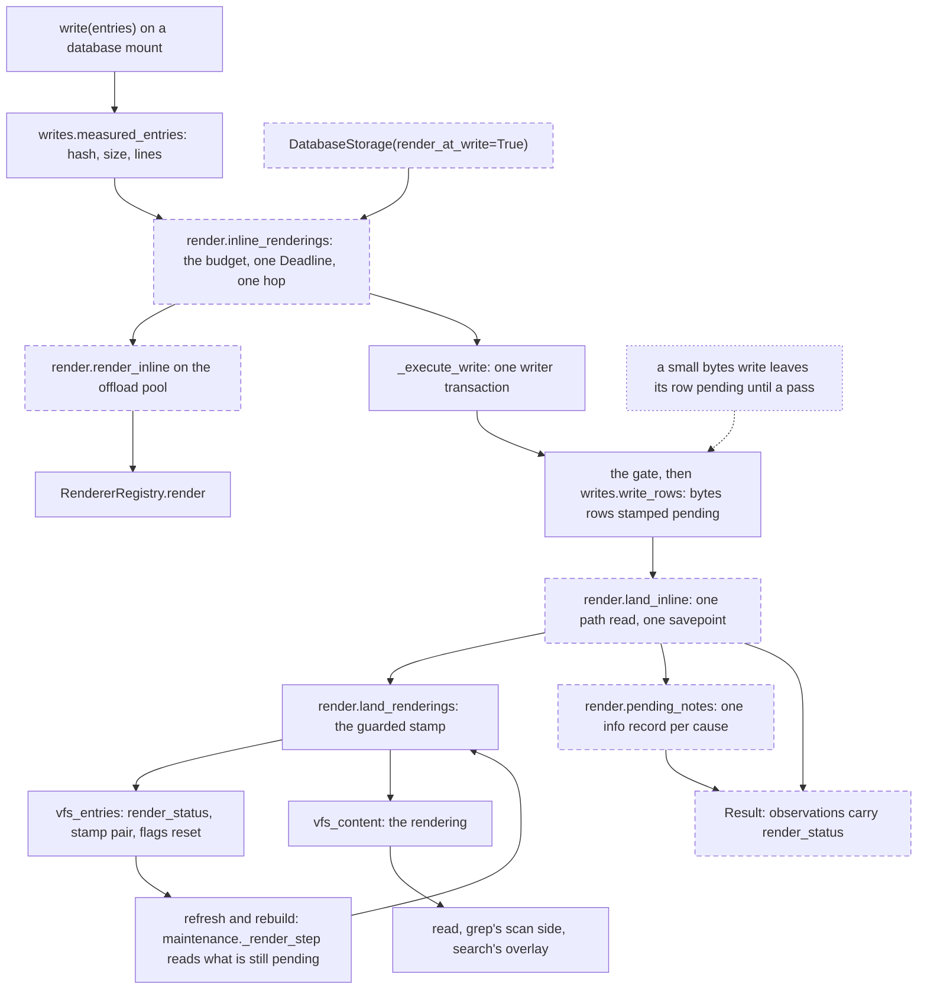

# A write of at most sixteen binaries totalling one blob page renders them outside its transaction and returns them readable and greppable; a larger write stays pending for the next refresh or rebuild

This is a feature. Flags: it changes the public API by addition only (the constructor argument `render_at_write` on `DatabaseStorage`, the field `render_status` on the observations of a write that rendered, and one info record with a `reason` key); it needs the engine legs (the write's transaction gains a path read, a savepoint, the guarded stamp and a content insert on every engine); it is not structural (no module is added), changes no schema format and does not touch the Rust engine; it changes no rights rule, and because the render runs before the gate judges the write, criterion 27 pins that a refused write lands nothing and says nothing of a rendering; it edits `DatabaseStorage.write`, so it is not parallel-safe with unit 174-2, and it edits no line of `writes.py`, so it is parallel-safe with every other unit of the conversion. It serves roadmap story E8 at gate 0.2 ([the roadmap](../../context/standards/roadmap.md), "E8 — Render at write (159), images (152 C), `imports` edges (147), tuned fusion defaults"); the story's whole text is "Independent of theme 3. Render at write moves up if D21 says so." and it carries no acceptance line, so the criteria below are this unit's own. It is unit 159-1 of [the conversion map](../2026-11-25-the-backlog-converted/units.md), converted by amendment from [the archived spec 159](../../context/specifications/archive/159-render-at-write/spec.md), sections Scope and Decided semantics, as verified against the tree by [the study of that source](../2026-11-25-the-backlog-converted/studies/051-162/159-render-at-write.md) and by [the verification of roadmap decision D21](../2026-11-25-the-backlog-converted/decisions/f-shell-tools-guests-and-search.md). It stands on [the workspace integration memo](../../context/research/2026-10-08-smartowl-workspace-integration-issues.md), item 21. It depends on two landed pieces: slices A and B of [the archived spec 152](../../context/specifications/archive/152-binary-bodies-and-text-renderings/spec.md) (the renderer seam, the registry, the guarded landing) and [the refresh spec](../../context/specifications/archive/2026-10-31-refresh-the-incremental-index-verb.md). It is written to hold beside four drafted units that are not built: [174-1](../2026-11-25-an-identical-body-write-reports-unchanged-and-leaves-the-version-alone/spec.md), [174-2](../2026-11-25-an-exclusive-create-replaces-overwrite-on-write-and-is-judged-at-add/spec.md), [152-1](../2026-11-25-an-unchanged-bytes-overwrite-keeps-its-rendering/spec.md) and [152-3](../2026-11-25-an-image-written-as-bytes-renders-a-metadata-header/spec.md). Nothing in it waits on a ruling; three decisions are provisional (3, 6 and 15).

## The problem

Every fact below is at commit `4a221cc3`. EXECUTED (`git diff --stat 5b20fd4f 4a221cc3 -- src tests crates AGENTS.md`, no output): `src/`, `tests/` and `AGENTS.md` are what the study and the sibling units read at `5b20fd4f`.

- READ `src/vfs/storage/backends/database/writes.py:1217-1223`: every write of a bytes entry stamps `render_status = 'pending'` and clears the stamp pair, the detail, the units and the two dimensions. EXECUTED (`grep -rn "INLINE_RENDER\|render_at_write" src/`, no hit): nothing on the write path renders.
- READ `src/vfs/storage/backends/database/backend.py:690-713`: `write` measures its entries in one hop before any session opens, then runs the gate and `write_rows` inside one writer transaction. No renderer is reached.
- READ `src/vfs/storage/backends/database/reads.py:885-887`: a `read` of a pending bytes row returns no text and a retryable `unavailable` warning, "the binary awaits a rendering; run rebuild". READ `src/vfs/storage/backends/database/render.py:36-39`: a pending row has no content row, so `grep` and `search` have nothing of it to match.
- READ `writes.py:376-383`: the observation a write returns carries the path, the kind, the size, the version and the status. It carries no `render_status`, so the write's own answer does not say that the binary is unreadable.
- READ `src/vfs/storage/backends/database/maintenance.py:152-176` and `render.py:176`: `refresh()` renders the bytes rows a write changed, at a cost in proportion to what changed. READ `maintenance.py:169-171` and `:203-204`: it claims the one index lease first, and a rival pass makes it refuse with a retryable `conflict`.
- READ [AGENTS.md](../../AGENTS.md), the reference deployment: a partial index pass runs every 15 minutes with a floor of 1 minute, and overnight the daily rebuild is running beside the batches.
- READ `src/vfs/storage/backends/memory.py:32-39`: `InMemoryStorage` is a construction-only subclass of `DatabaseStorage`, so it writes, renders and passes through the same code.
- READ `tests/lint/allowlist.py:27` and `:30`: `backend.py` is held at exactly 1,511 lines and `writes.py` at exactly 1,294; a module that grows fails the gate.

What is wrong follows from these. An agent that writes a PDF and reads it in its next call gets a warning and no text, and a grep for a word of the PDF finds nothing. That lasts until the next pass: up to 15 minutes in the reference deployment (INFERRED from the pass interval). A host can shorten it by calling `refresh()` after every upload, but that call holds the index lease and refuses `conflict` whenever another pass is running, which overnight is most of the time. The source stated the gap as "a whole-corpus pass after every upload"; `refresh()` has since removed the whole-corpus part, and the gap that remains is that the write itself returns an unreadable binary and does not say so.

## Architecture

- **Inline step**: the two halves this spec adds to a write. The first half renders before the transaction opens; the second half lands inside the write's own transaction.
- **Budget**: the two bounds that decide whether a storage call renders at write: at most `INLINE_RENDER_ROWS` bytes entries, totalling at most `INLINE_RENDER_BYTES`.
- **Deadline**: one absolute instant, `INLINE_RENDER_SECONDS` after the step's entry, shared by every render of the call.
- **Settled**: a row whose `render_status` is anything but `pending`: a rendering with text, `empty`, or a failure with its reason.
- **Cause**: why a bytes row of a write that could have rendered stayed pending: `over_budget`, `deadline` or `landing`.
- **Pass**: `refresh()` or `rebuild()`.

## Decisions

### 1. This unit is built at gate 0.2 and is not in 0.1.0.

Until it lands, a binary written through `write` stays `pending` until the next pass, and a host that needs it searchable at once calls `refresh()` after the upload. The reason: the gap is bounded by the pass interval since `refresh()` landed, and inline rendering puts render latency on the agent's write path, so it is not worth holding the first release for. A served pilot that hits the gap moves the unit forward without changing its text.

Basis: verified lean, roadmap decision D21, verified holds-amended in the decisions file ("Spec 159 is out of 0.1.0 ... its premise is restated over `refresh()`"); precedent: `src/vfs/storage/backends/database/maintenance.py:152-176` (the incremental pass renders what a write changed) and the partial index pass row of AGENTS.md.

### 2. A database mount renders at write by default: a storage call whose bytes entries are within the budget renders them before it returns.

The reason is the caller's expectation: an agent that wrote a document reads or greps it next, and no agent can configure the host it runs on. Above the budget the call is served exactly as it is today.

Basis: the source spec, Decided semantics 1 and 2; still true at `4a221cc3` (READ `writes.py:1217`: a bytes write is stamped pending; EXECUTED grep for `INLINE_RENDER` over `src/`: no hit, so nothing of it is built).

### 3. The switch is one constructor argument, `render_at_write: bool = True`, on `DatabaseStorage`; the verb gains no argument.

A mount constructed with `render_at_write=False` writes as today: no render, no stamp, no record, and the observation unchanged. The reason for a switch: an ingest host that writes one small binary per call wants the write's latency and leaves rendering to the pass, and the tests that pin the pass need a small write that stays pending. The reason it is the mount's and not the verb's: rendering is configured per mount already (`renderers`, `render_limits`), and [the ruled argument families](../../context/specifications/active/2026-11-15-the-kernels-public-names-and-argument-families-are-ruled.md) give `write` no such argument. This departs from the source, which had no switch. A ruling for "off unless asked" changes one word of the default and removes step 6 of the Design and criteria 31 to 36; nothing else moves.

Basis: provisional, no ruling on record; the options were no switch (the source), a boolean that defaults to on, a boolean that defaults to off, and a seconds argument whose `None` turns the step off; chosen because the boolean is the smallest public name, a default of on is what the source and decision 2 say, either default is reversed by one word while a missing switch could only be added, and a seconds argument can be added beside the boolean later.

### 4. `InMemoryStorage` is in scope by inheritance and gains no argument.

It renders at write because it is `DatabaseStorage` over a private SQLite database; it exposes neither `renderers` nor `render_limits` today, so it does not expose the switch either. This corrects the study, which read the absence of the word "render" in `memory.py` as the absence of a render step.

Basis: decided in drafting, because `InMemoryStorage` is a construction-only subclass whose docstring promises "every verb, capability, and trait comes from `DatabaseStorage`" (READ `src/vfs/storage/backends/memory.py:32-39`).

### 5. The budget is at most 16 bytes entries totalling at most one blob page, counted per storage call, and it is three declared constants.

`render.py` gains `INLINE_RENDER_ROWS = 16`, `INLINE_RENDER_BYTES = BLOB_PAGE_BYTES` (8 MiB) and `INLINE_RENDER_SECONDS = 5.0`, beside `RENDER_PAGE_ROWS`. An entry counts when it carries `data`; text entries and directories of the same call do not count, so a call of 10,000 text files and three PDFs renders the three. Every bytes entry counts, a repeat of one path included, and the byte total is the sum of their measured sizes; both comparisons are inclusive. The count is taken on the call the storage receives, after the router has split a batch by mount. The budget is a branch on the size of one call, not a limit on what vfs renders: above it the pass renders every row as today, at any size.

Basis: verified lean, the study's open choice 2 (holds); precedent: `writes.py:166` (the write path already branches on a byte total before its transaction) and `maintenance.py:453` (the pass cuts its pages by `BLOB_PAGE_BYTES`).

### 6. The whole step runs under one deadline, and each render runs under the time left on it.

The deadline is `Deadline.after(INLINE_RENDER_SECONDS)`, read once on the loop before the hop, so time queued for a worker shortens it. Before each render the step reads the time left: with none left it stops, and the bodies not yet rendered stay pending. Otherwise the render runs under the host's `RenderLimits`, unchanged when its `seconds` is no more than the time left, and with `seconds` replaced by the time left when it is more. The reason: `RenderLimits.seconds` is a per-render clock (READ `src/vfs/rendering/markdown.py:115`), so sixteen renders under a lowered per-render clock would bound a write at 80 seconds, not 5. The bound is honest about its edge: a library's own open cannot be interrupted (READ `src/vfs/rendering/seam.py:62-63`), so one render may overrun the deadline before it is checked again.

Basis: verified lean, the study's open choice 3 (holds-amended: one deadline for the batch in place of a lowered per-render clock); precedent: `src/vfs/deadline.py:3-7` ("a relative budget becomes an absolute instant once, at a stage's entry") and [the bounded work spec](../../context/specifications/archive/2026-11-07-bounded-work-has-one-home.md), which defines the wall as the deadline a bounded stage takes at its entry.

### 7. A rendering that comes back with no time left on the deadline is dropped, and its row stays pending for the pass.

The step keeps a rendering only when time remains after the render returns; the first one that fails this ends the step. A render given less than the host's own clock can only have been cut by that lowered clock after the deadline's instant, so every rendering the step keeps is one the pass would have produced under the host's full limits. A rendering cut by the host's own, shorter clock is kept, since the pass would cut it the same way. The cost is stated: a document that takes longer than the deadline costs each write of it up to the deadline and lands nothing, and it is readable only after the next pass. This departs from the source, which landed the cut text as `partial` and promised that no entry leaves `write` pending.

Basis: provisional, no ruling on record; the options were (a) land the cut rendering `partial` and stamped, so it is greppable at once and stays cut until the bytes change, (b) land the cut text and leave the row stamped pending so the next pass renders it whole, and (c) land nothing and leave the row pending; chosen because (c) leaves the row exactly as a write leaves it today and stores nothing a later ruling would have to find and undo, while (a) stores cut renderings the skip law never retries and that no column tells apart from the pass's own, and (b) creates a row state, pending with a content row, that no reader, donor probe or pass expects.

### 8. The render runs with no transaction open and before the gate judges the write.

The step sits between `measured_entries` and `_execute_write`. A write the gate then refuses, or whose plan fails, has rendered for nothing; that work is bounded by the budget and the deadline, the bytes are the caller's own, and nothing of the rendering is stored or returned. The reason for the order: the gate reads grants inside the write's transaction, and no render may run while a transaction is open.

Basis: verified lean, the study's open choices 5 and 6 (hold); precedent: `backend.py:690` (`measured_entries` hashes every body before the gate) and `maintenance.py:466-468` (the pass renders on the offload pool with no transaction open).

### 9. The step renders the measured snapshots, once per bytes hash and generation, and borrows nothing from stored rows.

It reads the entries `measured_entries` returned, so the hash a rendering is keyed by is storage's own measurement, never one the caller vouched for. Two entries with the same bytes whose types resolve to one generation render once, as twins do in the pass. The step does not probe the mount for a settled twin: it has no session, and a read before the transaction would add a round trip to every small binary write.

Basis: decided in drafting, because storage stores only the metrics it measured (READ `writes.py:144-173`) and the pass's twin key is the bytes hash with the generation (READ `render.py:82-84`).

### 10. A redrive of the write never renders again.

The renderings are computed once, outside the function the retry loop re-enters, and every attempt lands from the same map.

Basis: verified lean, the study's open choice 7 (holds); precedent: `backend.py:690-713` (the measured entries are computed once outside `run`, which is what `_mutate` re-enters at `backend.py:1489-1503`).

### 11. The renderings land in the write's own transaction, through `land_renderings`, after `write_rows` has succeeded.

Body, pending stamp, rendering stamp and rendering text commit together or not at all. The stamp is the pass's guarded UPDATE: it writes only where the row holds the bytes the rendering was made from and does not already carry this stamp. `land_renderings` answers under `ops=("rebuild",)`; the write discards that answer and its own Result keeps `ops=("write",)`.

Basis: verified lean, the study's open choice 5 (holds, amended: the landing's ops are not forwarded); precedent: `render.py:346-373` (the guard) and `render.py:344` and `:392` (its ops).

### 12. The landing lives in `render.py` and finds its rows by one path read; `writes.py` is not edited.

`land_inline` takes the Result `write_rows` returned, reads the entry rows at the paths of the call's bytes entries that the Result reports `created` or `updated`, and stamps those. The read is `rows_by_path`, chunked by the membership budget, over at most sixteen paths. The alternative, threading the renderings through `write_rows`, `_finish` and the plan, was rejected: `writes.py` is held at its exact line count, three drafted units edit those functions, and the plan's staged rows would become a second contract between two modules. The cost is one indexed read of at most sixteen rows per write that renders.

Basis: decided in drafting, because `tests/lint/allowlist.py:30` holds `writes.py` at 1,294 lines and the shared helper already bounds a path lookup on every engine (READ `src/vfs/storage/backends/database/descent.py:150-172`).

### 13. A row the call left `unchanged`, and a row that already carries the stamp, are not stamped.

Only observations whose status is `created` or `updated` are read. A row read back whose stamp pair already equals its bytes hash and the rendering's generation is left as it is, and its observation carries the status the row holds. The reason: both cases are decided by sibling units, and this unit must hold whichever of them has landed. The cost is stated: a pending binary sent again with the same bytes stays pending once unit 174-1 has landed, and its render before the transaction was wasted.

Basis: decided in drafting, because unit 174-1's decision 14 says an `unchanged` write "leaves `chunked`, `encoded`, `indexable` and every render stamp as they stand", and unit 152-1's decision 1 says a guarded overwrite of the bytes a row already holds "leaves the seven render columns and the content row as they are".

### 14. The inline landing takes no lease.

It stamps only rows its own transaction has just written, which are pending with a null stamp, so it can never write over a stamp another run made. The lease exists to order two runs that stamp the same committed rows under different generations; a write and a pass never meet that way, because a pass cannot see the row until the write commits, and after the commit the row is stamped and no pass selects it. A pass that rendered the row's earlier bytes misses the guard, as it does today.

Basis: decided in drafting, because the guard's two terms already settle every interleaving of one write and one pass (READ `render.py:19-29`), and a lease on the write path would make every small binary write queue behind a rebuild.

### 15. A rendering never fails the write that carried it.

The landing runs inside a savepoint. If the engine refuses any statement of it, or the landing reaches fewer rows than it was handed, the savepoint is rolled back, every row of the landing stays pending with the cause `landing`, and the write commits as it would have without the step. The pass then renders the row and, if the engine still refuses it, quarantines it as `failed` row by row, as today. A dropped connection fails the write, as it fails any write. On an engine that dooms the whole transaction when a statement is refused, the write would fail classified; no such refusal is known for a rendering's text, which the seam cleans before it reaches a bind (READ `src/vfs/rendering/seam.py:231-239`), and criterion 37 proves the recovery on every engine.

Basis: provisional, no ruling on record; the options were a savepoint that rolls the landing back alone, letting a refused landing fail the write, and the pass's row-by-row retry inside the write; chosen because a write of a binary succeeds today whatever its rendering would be, so only the savepoint adds nothing a caller can lose, and the savepoint is the write path's own tool for a statement that may be refused (READ `writes.py:618` and `:903`).

### 16. On an engine that declares a single-value cap, each text lands in its own statement, and a text past the cap is left pending.

Where the host carries a `ValueCap` (the MariaDB family's packet), a rendering whose text is larger on the wire than the cap is not handed to the landing and stays pending with the cause `landing`, and the rest land one `land_renderings` call each, so no statement carries two texts. The reason: `land_renderings` pages texts by characters under `BLOB_PAGE_BYTES`, which can pass a packet smaller than the page, and an oversize packet drops the connection, which a savepoint cannot recover. Engines with no cap land in one call.

Basis: decided in drafting, because the write path already meters a body as the driver sends it against the engine's own cap (READ `writes.py:439-441` and `src/vfs/storage/backends/database/staging.py:207-223`) and AGENTS.md requires a design to hold on the least generous engine.

### 17. The observation of each row the step judged carries `render_status`; an over-budget write and a mount that does not render at write return observations as today.

For a bytes row the call created or updated within the budget, the observation carries the status the row holds at commit: the rendering's status, or `pending` with one of the causes. The field mask gains the name. The reason: the constitution's Article 2 fails a pattern that makes an agent guess or parse prose, and without the field the caller cannot tell a readable binary from one that waits. Above the budget the observations are untouched, because marking them would copy up to 10,000 rows per batch to say what one record says.

Basis: decided in drafting, because the source's first acceptance line asks for an observation whose `render_status` is `ok`, and [the constitution](../../context/standards/constitution.md), Article 2, requires state to be read from fields.

### 18. Each cause of a pending binary is one info record on the Result, with the counts in `data`.

The record is `ErrorKind.unavailable`, severity `info`, not retryable, with no path, and it never fails the write. Its `data` carries `render_status: "pending"`, `reason` and `pending` (the number of binaries), and for `over_budget` the two bounds as `max_entries` and `max_bytes`, for `deadline` the bound as `seconds`. The details are: "N binaries await a rendering: the write held more than 16 binaries or 8388608 bytes of them; run refresh or rebuild", "N binaries await a rendering: rendering at write stopped at 5 seconds; run refresh or rebuild", and "N binaries await a rendering: the text could not be stored at write; run refresh or rebuild", with the numbers read from the constants. A call has at most one record per cause: one above the budget, at most two within it. A failed write carries none.

Basis: verified lean, the study's open choice 8 (holds-amended: the record names `refresh` and `rebuild`, never `reindex`); precedent: `backend.py:612-617` (the search path's info record, the same kind and severity, with its reason in `data`).

### 19. The rendering lands exactly as the pass lands it, so grep serves it at once and the next pass chunks, indexes and embeds it.

The stamp resets `chunked`, `encoded`, `indexable` and the chunk stamp, and the text is one content row under the entry's id. `grep` reads rows that are not yet encoded on its scan side, so it finds the text with no pass. The entry's version and `updated_at` are the write's own; a rendering never moves either.

Basis: the source spec, Decided semantics 1; still true at `4a221cc3` (READ `render.py:360-373`: the landing's values; READ `src/vfs/storage/backends/database/grep.py:17-18`: the scan side unions rows that are not encoded).

### 20. `rebuild` and `refresh` are unchanged, and a pass reports no work for a row rendered at write.

Both still claim the one index lease, and a rival still refuses `conflict`. A row stamped at write is not pending, so `refresh` never reads it, and its stamp is current, so `rebuild` never selects it; the `rendering` extra counts only rows a pass landed. The read note's words, "run rebuild", are not changed here. The source's third rule, that no scoped pass exists, is dropped: `refresh` is that pass.

Basis: verified lean, the study's open choices 9 and 10 (the first holds-amended, the second holds); precedent: `maintenance.py:145-146` and `:169-171` (the claim), `render.py:176` (a refresh reads `pending` rows) and `render.py:170-175` (the full pass's stale predicate).

### 21. Neither held module grows: `writes.py` is untouched, and `backend.py` pays for its lines inside itself.

`backend.py` gains about five lines: the argument, its attribute, the call of the step, and the call of the landing. They are paid by folding the constructor's four identical positive-seconds checks (`grep_wall_seconds`, `glob_wall_seconds`, `embed_timeout_seconds`, `search_wall_seconds`; twelve lines, READ `backend.py:172-177`, `:181-183` and `:202-204`) into one loop over the four names, each message word for word. If a unit that lands first has already taken that saving, the lines are paid by another fold in `backend.py` that keeps behaviour, named in the landing notes; the baseline entry is never raised.

Basis: decided in drafting, because `tests/lint/allowlist.py:27` holds `backend.py` at 1,511 lines and its docstring says "a module that grows fails".

### 22. An existing test that pinned `pending` after a small bytes write is amended in one of two ways and no other.

A test that pins the pass, or the statements of a write alone, constructs its storage with `render_at_write=False`. A test that pins what a caller sees after a write, which is every conformance row, changes its expectation to the settled state, or reaches `pending` through a write past the budget. No test is deleted and none is skipped. Step 6 of the Design lists the known sites.

Basis: decided in drafting, because AGENTS.md holds the tree green at every landing and the conformance rows run the default a caller gets.

### 23. The behaviour is documented in the docstrings that describe a write and a rendering; the docs site page is another unit's.

The `DatabaseStorage` class docstring gains the argument, the `render.py` module docstring gains the write-time entry with its cost profile, and the three constants carry their reasons. No name is added to any `__all__`.

Basis: decided in drafting, because a docstring is a page's content (AGENTS.md, Tooling) and the pages on binary bodies belong to unit 152-4 of the conversion map.

## Intent

After this spec, a caller who writes up to sixteen binaries of up to 8 MiB in all to a database mount, or to the in-memory backend, gets back observations that say where each one stands: `ok`, `truncated` or `partial` for a document whose text is now stored, or the reason no text exists (`empty`, `unsupported`, `unavailable`, `encrypted`, `corrupt`, `failed`). The next `read` returns the text and the next `grep` finds a word of it, with no `refresh` or `rebuild` in between. A binary whose rendering did not finish inside 5 seconds, and every binary of a larger write, stays `pending` exactly as today, and the write's Result carries one info record that says how many wait, why, and that `refresh` or `rebuild` renders them. A rendering never makes a write fail, never takes the index lease, and never holds a transaction open. A host that wants the lowest write latency constructs its mount with `render_at_write=False` and sees no change at all.

## Design

The order of work is below. Each test is written and seen failing before the code that passes it. The new tests live in one new file, `tests/storage/database/test_render_at_write.py`, which follows `tests/storage/database/test_render.py`: real SQLite rows, renderer doubles registered through `RendererRegistry`, statements recorded through `before_cursor_execute`, the clock driven by a fake patched on `vfs.deadline.monotonic`.

**1. The constants and the pure render.** Tests first: `TestInlineStep`, criteria 1 to 4. Then `src/vfs/storage/backends/database/render.py`:

- the three constants of decision 5, directly under `RENDER_PAGE_ROWS`;
- `PendingCause`, a `Literal` of `"over_budget"`, `"deadline"` and `"landing"`;
- `InlineRendering`, a named tuple of `generation` and `rendering`;
- `InlineRenderings`, a named tuple of `paths` (the paths of the call's bytes entries, a frozen set, empty above the budget), `found` (a mapping from `(bytes hash, media type)` to an `InlineRendering`) and `over_budget` (the number of bytes entries of a call past the budget, else 0);
- `render_inline(entries, registry, limits, deadline)`, under the banner "Rendering — the offload hop's share": pure, no session. It walks the entries in order. For each it resolves the generation of the entry's media type; a `(hash, generation)` already rendered lends its rendering to this `(hash, media type)`; otherwise it reads `deadline.remaining()`, stops when nothing remains, renders through `registry.render` under the limits decision 6 gives, reads `deadline.remaining()` again, and stops without keeping the rendering when nothing remains.

The module reads the clock only through `Deadline`, because `tests/lint/test_code_shape.py` admits no other clock reader outside the renderers (READ `:73-75`).

**2. The step before the transaction.** Tests first: criteria 5 to 7. Then `inline_renderings(entries, registry, limits, executor)` in `render.py`, an async function. It collects the entries that carry `data`. With none it answers `None`. Past either bound it answers `InlineRenderings(frozenset(), {}, n)` and takes no hop. Otherwise it builds the deadline, runs `render_inline` in one `call_offloaded` hop, and answers the paths and the map.

**3. The records.** Test first: criterion 16 and the three records of criteria 20, 21 and 23. Then `pending_notes(causes)` in `render.py`: one `classified` record per cause with a count above zero, in the order `over_budget`, `deadline`, `landing`, with the fields of decision 18.

**4. The landing.** Tests first: `TestLanding`, criteria 21 to 25. Then `land_inline(session, tables, profile, membership_budget, value_cap, result, inline)` in `render.py`, under the landing banner:

- it returns `result` unchanged when `inline` is `None` or the Result failed;
- above the budget it returns the Result with the one `over_budget` record appended, and issues no statement;
- within the budget it takes the distinct paths of the observations whose status is `created` or `updated` and that are in `inline.paths`, and reads `entry_id`, `path`, `content_hash`, `mime_type`, `render_status`, `render_source_hash` and `render_generation` for them through `rows_by_path`, keeping rows whose `source` is `bytes`;
- per row: no entry in `found` for its `(content_hash, mime_type)` is the cause `deadline`; a stamp that is already current is left (decision 13); a text past the value cap is the cause `landing` (decision 16); every other row becomes a `Rendered` with `cached=False`;
- it opens a savepoint, calls `land_renderings` once for all the items, or once per item where a value cap is declared, with a fresh `RenderReport`, and compares the report's landed count with the items handed; a `SQLAlchemyError` or a short count rolls the savepoint back and turns every item into the cause `landing`;
- it returns a new Result with the same ops, each judged observation copied with its `render_status` and the mask extended, and the notes of `pending_notes` after the Result's own records.

**5. The switch and the wiring.** Tests first: `TestWrite`, `TestWindow`, `TestClock`, `TestBounds` and `TestRights`, criteria 8 to 20 and 26 to 28. Then `src/vfs/storage/backends/database/backend.py`: the constructor takes `render_at_write` and keeps it; `write` calls `inline_renderings` after `measured_entries` has refused nothing, when the mount renders at write; inside `run`, the Result of `write_rows` passes through `land_inline` before it is returned, so the rights fence and the commit follow the landing. The constructor fold of decision 21 lands in the same step. This text shows no signature of `write`: unit 174-2 replaces one of its arguments, and nothing here reads it.

**6. The existing pins.** Applied with step 5, by the rule of decision 22. The sites below are from an EXECUTED grep for bytes writes under `tests/` at `4a221cc3`; the suite is run once after step 5, every further failure is amended by the same rule, and the landing notes list each amended test.

| File | Sites | Amendment |
|---|---|---|
| `tests/storage/database/test_render.py` | the `_mount` helper, `:51-52`, which every test of the file uses | the helper passes `render_at_write=False` unless a test asks otherwise; the file pins the pass |
| `tests/storage/database/test_refresh.py` | `:588`, `:653`, `:687-690`, `:853-857`, `:1064`, `:1093`, `:1199` | the storages of those tests are constructed with `render_at_write=False`; the writes of 50 binaries at `:985` and `:1176` are past the budget and need nothing |
| `tests/storage/database/test_indexing.py` | `:224`, `:596-600`, `:693-699` | `render_at_write=False` |
| `tests/storage/database/test_writes.py` | `:1303-1422`, `:1463`, `:1479-1480` | `render_at_write=False`: they pin the write's own statements and the pending stamp |
| `tests/storage/database/test_reads.py`, `test_search.py`, `test_trash.py`, `test_races.py` | `:914`; `:1503`, `:1524`; `:436`, `:452-453`; `:1455` | `render_at_write=False` where the test fails; a test that passes is left |
| `tests/support/storage_contract.py` | `test_bytes_round_trip_byte_identical_with_the_bytes_metrics` (`:3007`), `test_a_write_switches_the_source_both_ways` (`:3030`), `test_listings_show_the_source_and_render_state_without_bodies` (`:3080`) | the expected status of a body no renderer claims is `unsupported` |
| `tests/support/storage_contract.py` | `test_copy_carries_the_bytes_and_the_render_state` (`:3060`) | the copy's `render_status` is compared with the source's own, so the row holds whichever renderers are bundled |
| `tests/support/storage_contract.py` | `test_a_binary_not_yet_rendered_reads_as_no_text_with_a_transient_note` (`:3015`), `test_rebuild_renders_binaries_and_grep_hits_inside_them` (`:3092-3098`) | the write goes through a new helper, `_past_the_inline_budget(entries)`, which appends `INLINE_RENDER_ROWS` one-byte bodies under `/pad/`, so the row still starts from `pending` |

A conformance row a sibling unit has added by then that starts from a small pending binary follows the last line of the table.

**7. The conformance rows and the engine pin.** Tests: criteria 29, 30 and 37. `tests/support/storage_contract.py` gains the two rows; `tests/storage/test_conformance.py` gains one shared body and its five engine tests, in the form `_a_directory_is_never_awaiting_the_index` takes there (READ `tests/storage/test_conformance.py:681-732`). No code follows these; they prove steps 4 and 5 on every engine.

**8. The docstrings.** Decision 23.

**What grows with input, and what bounds it.** The multipliers are the reference deployment's in AGENTS.md.

- *The scan for bytes entries, per file write.* One pass over the call's entries, reading one attribute each and keeping references to the bytes entries; no body is copied and no statement runs. A 10,000-entry batch costs 10,000 attribute reads, 100 times a night. It ends in the count and the byte total that the budget judges.
- *The renders, per file write that is within the budget.* At most `INLINE_RENDER_ROWS` renders over at most `INLINE_RENDER_BYTES` of input, under one deadline of `INLINE_RENDER_SECONDS`. They ride the organic single-file writes: 50,000 a day at the centre and 100,000 at the ceiling, of which the binaries are a share no study measures (an assumption); human saves, 1,000 to 5,000 a day, are the likely documents. At one write in ten that is 5,000 renders a day moved from the pass to the write. The nightly million rides 10,000-file batches, which are past the budget: they render nothing at write and cost one info record per batch, 100 a night.
- *The renderings held, per file write.* The map holds at most 16 renderings of at most `RenderLimits.chars` characters each, 2 MiB by default, from the hop until the commit: at most 32 MiB of characters, and typically a few kilobytes. The pass holds the same per row.
- *The statements, per file write that is within the budget.* One path read through `rows_by_path`, chunked by `membership_budget` (at most 16 paths, one statement on every engine, since the tightest membership cap is 1,000); one savepoint and its release; at most 16 guarded UPDATEs, one row each; one DELETE per membership chunk of the landed ids, one statement; the content insert, paged by `byte_chunked` under `BLOB_PAGE_BYTES` and by the parameter budget inside `bulk_insert`, or one statement per text where a value cap is declared. That is at most 37 statements and 6 for one document. At the assumption above it is 30,000 statements a day beside about a million; if every organic write were a binary it would be 300,000 at the centre. No statement grows with the batch: the largest list in any of them holds 16 keys.
- *Per index visit.* Nothing is added. One visit is removed: the render step of the next pass does not read a row stamped at write (decision 20). The chunk pass visits it as it visits any written text.
- *Per corpus.* Nothing. The step reads no row it did not write.
- *Per lock.* No lock is added and none is held longer than a commit. The render runs before the transaction opens, so on SQLite the write lock that `BEGIN IMMEDIATE` takes is not held through it (READ `backend.py:1393-1394`). The guarded UPDATEs touch only rows this transaction has already written and therefore already locks; the content rows are new. The write's transaction is longer by the statements above, milliseconds, and commits as before. A read never waits on any of it: the rows are the write's own uncommitted rows, which a reader does not see on any engine setting vfs accepts. The index-state row is not read or written (decision 14), so a write never queues behind a pass and a pass never queues behind a write.
- *The offload pool.* The renders of one call take one worker of the shared pool for at most the deadline plus one library open. Under load they queue, and time queued counts against the deadline (decision 6), so a busy host sheds renders to the pass instead of stacking them. A document parser is Python and holds the interpreter in turns, as it does in the pass today; the difference is that the work now falls in working hours. The switch of decision 3 is the remedy for a host that minds.
- *A fleet with two renderer versions.* A host on one generation stamps at write what a host on another re-renders at its next rebuild, since the full pass's predicate compares each stamp with its own registry. That is the skip law as it stands between two pass hosts today, and `refresh` does not do it.

**Gates.** `scripts/ci.sh` (the branch touches `src/` and `tests/`) and `scripts/docs.sh check` (docstrings under `src/vfs/` change). The engine legs of Postgres, MariaDB, SQL Server and Oracle run for criteria 29 to 37. `cargo test -p vfs-core` is untouched. The gate's 100% coverage is met by the tests named: every branch of the four new functions is reached by criteria 1 to 28.

**Build order.** Both landed dependencies are in the tree, so nothing blocks the build. Units 174-1 and 174-2 are at gate b and are expected to land first; this unit is written to hold in either order, and is built after them at gate 0.2. What it relies on from each drafted unit is quoted here so a disagreement can be read off the page.

- Unit 174-1, decision 1: "A staged update of a live file whose final material equals the stored row's, and whose stored body is intact, is dropped from the plan and reports `unchanged` at the stored version", and decision 14, quoted in decision 13 above. This unit reads only `created` and `updated` rows, so it holds before and after.
- Unit 174-2, decision 1: "`overwrite=` leaves `write` on the four public classes, the seam, `DatabaseStorage.write` and `PARAMS[\"write\"]`". This unit shows no signature and reads no argument of `write` but `entries`; the two units edit the same method, so they are built one after the other.
- Unit 152-1, decision 1, quoted in decision 13 above. If it has landed, a same-bytes overwrite of a rendered row finds its stamp current and is left; if it has not, the overwrite resets the row and this unit stamps it again.
- Unit 152-3 adds a renderer to the bundled registry. This unit renders through whatever the registry holds, so whichever of the two lands second gains images at write with no further change, and that unit's conformance row follows the last line of the table in step 6.

## Scope

In: decisions 1 to 23. Files: `src/vfs/storage/backends/database/render.py`, `src/vfs/storage/backends/database/backend.py`, `tests/storage/database/test_render_at_write.py` (new), `tests/support/storage_contract.py`, `tests/storage/test_conformance.py`, and the existing test files of step 6.

Out:

- Any change to `rebuild`, `refresh`, the lease, or a rule for waiting on it: unchanged (decision 20). The source's path-scoped pass is `refresh`, which is landed.
- The words of the read note for a pending binary, "run rebuild": unchanged here; a change of those words belongs to the unit that next edits `reads.render_notes`.
- New renderers, OCR, image headers: [the image unit](../2026-11-25-an-image-written-as-bytes-renders-a-metadata-header/spec.md).
- Keeping a rendering across a same-bytes overwrite: [the unchanged-overwrite unit](../2026-11-25-an-unchanged-bytes-overwrite-keeps-its-rendering/spec.md). An `unchanged` answer for an identical write: [the identical-body unit](../2026-11-25-an-identical-body-write-reports-unchanged-and-leaves-the-version-alone/spec.md).
- `if_absent=` and the removal of `overwrite=`: [the exclusive-create unit](../2026-11-25-an-exclusive-create-replaces-overwrite-on-write-and-is-judged-at-add/spec.md).
- A count of unrendered binaries on a `search` result: [the search-count unit](../2026-11-25-search-says-how-many-bytes-rows-it-could-not-read/spec.md). `search` serves a rendering landed at write as it serves any text written since the last pass, through its overlay (READ `src/vfs/storage/backends/database/search.py:34-46`); this unit pins `read` and `grep` and adds no criterion on `search`.
- The how-to and the explanation pages for binary bodies: [the documentation unit](../2026-11-25-binary-bodies-are-documented-on-the-docs-site/spec.md), which describes rendering at write once this has landed.
- Rendering in `copy` and `move`: a transfer carries the render state of its source, as today.
- A host-tunable deadline or budget: the three constants are module constants; an argument beside the switch is additive later (decision 3).
- Borrowing a settled twin's rendering from the mount at write: not done (decision 9); the pass still dedups across the mount.
- How the pass pages rendering texts on an engine with a small packet: unchanged; decision 16 covers the write path only.
- A subprocess pool that can stop a native parser: the fork archived spec 152 names in its section 7, not built.

## Acceptance criteria

Criteria 1 to 28 are pinned in `tests/storage/database/test_render_at_write.py`; each names its class and test.

1. `render_inline` over three entries, two of which share bytes and media type, calls the renderer twice and answers one rendering per distinct `(bytes hash, media type)`, pinned by `TestInlineStep::test_twins_render_once`.
2. `render_inline` under a deadline that has already passed calls the renderer zero times and answers an empty map, pinned by `TestInlineStep::test_a_deadline_already_passed_renders_nothing`.
3. Under a fake clock on which each render costs 2 seconds, `render_inline` over four distinct bodies with a 5-second deadline calls the renderer three times, with `seconds` of 5, 3 and 1, and keeps the first two renderings, pinned by `TestInlineStep::test_each_render_gets_the_time_left_and_a_late_answer_is_dropped`.
4. With host limits whose `seconds` is 2 and a 5-second deadline, the first render receives the host's own `RenderLimits` object, pinned by `TestInlineStep::test_a_lower_host_clock_is_passed_as_it_is`.
5. `inline_renderings` over seventeen bytes entries takes zero hops and answers `over_budget` 17 with no path, and over sixteen it takes one hop and answers sixteen paths, pinned by `TestInlineStep::test_seventeen_binaries_are_past_the_budget_and_sixteen_are_within`.
6. With `INLINE_RENDER_BYTES` patched to 1,000, two 500-byte binaries are within the budget and two 600-byte binaries are past it, pinned by `TestInlineStep::test_the_byte_total_is_judged_inclusive`.
7. `inline_renderings` over a call that holds no bytes entry answers `None` and takes zero hops, pinned by `TestInlineStep::test_a_call_without_binaries_takes_no_hop`.
8. A write of one one-page PDF returns a successful Result under `ops == ("write",)` with no record and an observation whose `render_status` is `ok`, and with no pass run `stat` shows `ok`, `read` returns the page's text with no note and `grep` for a word of it returns the path, pinned by `TestWrite::test_a_small_binary_is_readable_and_greppable_with_no_pass`.
9. After that write the row holds `render_source_hash` equal to its `content_hash`, the registry's generation for its type, `chunked`, `encoded` and `indexable` false, a null chunk stamp and version 1, with one content row and its blob byte-identical, pinned by `TestWrite::test_the_row_carries_the_stamp_and_the_text_and_awaits_only_the_index`.
10. A body no renderer claims, a PDF whose renderer's library is absent, a corrupt PDF and an encrypted PDF each leave `write` stamped `unsupported`, `unavailable`, `corrupt` and `encrypted` with no content row and the same status on the observation, pinned by the four cases of `TestWrite::test_each_settled_state_lands_at_write_with_no_body`.
11. A `rebuild` after a write that rendered calls the renderer zero more times, carries no `rendering` extra, leaves the stamp as the write set it and leaves the row chunked with at least one chunk, pinned by `TestWrite::test_the_next_pass_renders_nothing_and_splits_the_text`.
12. A call of 100 text entries and two PDFs calls the renderer twice and leaves both PDFs `ok`, pinned by `TestWrite::test_a_mixed_call_renders_only_its_binaries`.
13. A call that names one path twice with two different PDFs leaves one content row holding the second body's text, pinned by `TestWrite::test_a_repeat_target_lands_the_last_body`.
14. New bytes written over a rendered PDF leave one content row holding the new text, version 2 and an observation of `ok`, pinned by `TestWrite::test_new_bytes_over_a_rendered_binary_replace_its_text`.
15. On a mount constructed with `render_at_write=False`, a write of one PDF calls the renderer zero times, leaves the row `pending`, returns an observation with no `render_status` and carries no record, pinned by `TestWrite::test_a_mount_that_does_not_render_at_write_writes_as_before`.
16. A write of seventeen PDFs calls the renderer zero times, leaves seventeen rows `pending` with observations that carry no `render_status`, and carries exactly one record of kind `unavailable`, severity `info`, not retryable, with no path and the data `{"render_status": "pending", "reason": "over_budget", "pending": 17, "max_entries": 16, "max_bytes": 8388608}`, and a following `rebuild` reports `rendered` 17, pinned by `TestWrite::test_a_write_past_the_budget_stays_pending_and_says_so`.
17. A renderer double that appends a marker to the list the statement recorder fills is called on a thread other than the loop's, and its marker precedes every statement of the write, pinned by `TestWindow::test_the_render_runs_off_the_loop_before_the_first_statement`.
18. A write forced to redrive once by a rival installed at the `write:before-apply` seam calls the renderer once and leaves the row `ok`, pinned by `TestWindow::test_a_redrive_lands_the_renderings_it_already_has`.
19. A write of one PDF while another holder's token and heartbeat stand on the index-state row returns `ok` and leaves that token and that heartbeat as they were, pinned by `TestWindow::test_a_write_neither_takes_nor_waits_on_the_index_lease`.
20. Under a fake clock on which each render costs 2 seconds, a write of three distinct PDFs leaves two rows `ok` and the third `pending` with no content row, returns `pending` on the third observation, and carries one record with the data `{"render_status": "pending", "reason": "deadline", "pending": 1, "seconds": 5.0}`, pinned by `TestClock::test_a_render_the_deadline_reaches_stays_pending_and_the_rest_land`.
21. When `land_renderings` raises an engine error, the write still succeeds, the blob is stored, the row is `pending` with no content row, and the Result carries one record whose reason is `landing` and whose count is 1, pinned by `TestLanding::test_a_refused_landing_rolls_back_alone_and_the_write_commits`.
22. When `land_renderings` reaches one row of the two it was handed, both rows are `pending` with no content row and the record counts 2, pinned by `TestLanding::test_a_landing_that_misses_a_row_is_rolled_back_whole`.
23. With a value cap set on the host, a write of two PDFs issues two INSERT statements on `vfs_content`, and a write of one PDF whose rendering is larger on the wire than the cap beside one that is not leaves the first `pending` under the reason `landing` and the second `ok`, pinned by `TestLanding::test_on_a_capped_engine_each_text_lands_alone_and_an_oversize_one_waits`.
24. `land_inline` handed a row whose stamp already equals its bytes hash and the rendering's generation issues no UPDATE and returns that row's own status on its observation, pinned by `TestLanding::test_a_row_that_already_carries_the_stamp_is_left`.
25. `land_inline` handed a Result whose only observation is `unchanged` issues no statement and returns the observation as it was, pinned by `TestLanding::test_an_unchanged_row_is_not_read_and_not_stamped`.
26. A write of sixteen new one-page PDFs issues, beyond the statements of the same write on a mount with `render_at_write=False`, exactly one SELECT on `vfs_entries` by path, sixteen UPDATEs that set `render_generation`, and one DELETE and one INSERT on `vfs_content`, pinned by `TestBounds::test_sixteen_binaries_add_a_fixed_set_of_statements`.
27. A write of one PDF by a caller the gate refuses returns its refusal alone, with no observation and no record, and afterwards no entry row, no blob and no content row exist at the path, pinned by `TestRights::test_a_refused_write_lands_nothing_and_says_nothing_of_a_rendering`.
28. A write of one PDF under a missing parent directory fails `not_found`, calls `land_renderings` zero times and carries no record of a rendering, pinned by `TestRights::test_a_failed_plan_lands_nothing`.
29. On every backend, a call that writes a PDF, a docx, an xlsx and a pptx returns `ok` on each observation, and with no pass run each reads back with its needle in the text and each needle's `grep` returns its path alone, pinned by the conformance row `tests/support/storage_contract.py::StorageContract::test_a_small_binary_write_is_readable_and_greppable_when_it_returns`, which runs on the memory, SQLite, Postgres, MariaDB, SQL Server and Oracle legs.
30. On every backend that exposes `rebuild`, a call of seventeen PDFs leaves every one `pending` and unseen by `grep` and carries one `over_budget` record counting 17, and after `rebuild` every one is `ok` and found, pinned by the conformance row `tests/support/storage_contract.py::StorageContract::test_a_binary_write_past_the_budget_stays_pending_until_a_pass`, on the same six legs.
31. A body no renderer claims is `unsupported` on `stat` as soon as its write returns, pinned by `StorageContract::test_bytes_round_trip_byte_identical_with_the_bytes_metrics` as amended.
32. A text file overwritten with bytes no renderer claims is `("bytes", "unsupported", 2)` and written back as text is `("text", None, 3)`, pinned by `StorageContract::test_a_write_switches_the_source_both_ways` as amended.
33. A listing shows a text file with no render status and a binary no renderer claims as `unsupported`, with no body on either, pinned by `StorageContract::test_listings_show_the_source_and_render_state_without_bodies` as amended.
34. A copy of a binary carries the bytes, the type and the `render_status` its source shows, pinned by `StorageContract::test_copy_carries_the_bytes_and_the_render_state` as amended.
35. A PDF written in a call past the budget reads as no text with one retryable `unavailable` warning at its path, pinned by `StorageContract::test_a_binary_not_yet_rendered_reads_as_no_text_with_a_transient_note` as amended.
36. Four documents written in a call past the budget are `pending` and unseen by `grep` before `rebuild`, and rendered, readable and found under the right marker after it, pinned by `StorageContract::test_rebuild_renders_binaries_and_grep_hits_inside_them` as amended.
37. On each of the five engines, a landing that executes a statement the engine refuses and raises its error leaves the write committed, the blob stored and the row `pending`, and a second write on the same storage succeeds, pinned by one shared body run as `tests/storage/test_conformance.py::test_a_refused_inline_landing_leaves_the_write_committed_on_sqlite`, `::test_a_refused_inline_landing_leaves_the_write_committed_on_postgres`, `::test_a_refused_inline_landing_leaves_the_write_committed_on_mariadb`, `::test_a_refused_inline_landing_leaves_the_write_committed_on_mssql` and `::test_a_refused_inline_landing_leaves_the_write_committed_on_oracle`.
38. A `refresh` started while another run holds the index lease refuses with a retryable `conflict`, pinned by `tests/storage/database/test_refresh.py::TestRefusals::test_a_held_lease_refuses_with_conflict` passing unedited.
39. `backend.py` and `writes.py` are at or under their baseline counts and no baseline entry is raised, pinned by `tests/lint/test_code_shape.py::test_a_listed_module_never_grows_and_an_unlisted_one_stays_under_the_ceiling`.

## Landing notes

Filled in when the pull request is opened.

## One line

A database mount renders the binaries of a small write on the offload pool before the write's transaction opens, under one 5-second deadline, and stamps them through the pass's own guarded landing inside that transaction, so the write returns them readable and greppable without a lease, while a larger write, a slow render and a refused landing leave the row pending for the next `refresh` or `rebuild` and say so in one info record.
