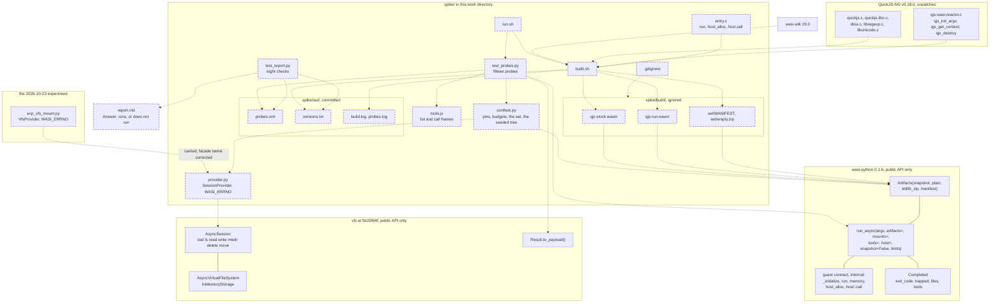

# A one-afternoon spike runs a QuickJS-NG `wasm32-wasip1` module under the wasi-python runner's mount and tool protocols and reports whether it can host it.

A spike. Flags: it is not structural; it changes no public name, verb, argument or error kind; it does not change the schema format; it needs no engine legs, because it changes no storage code and issues every verb through `InMemoryStorage`; it touches no rights; it does not touch the Rust engine; it is parallel-safe with every unit, because the only paths it writes are in this work directory. It serves the spike of roadmap story T5b at gate a, sized S ([the roadmap](../../context/standards/roadmap.md), lines 735 to 743), and it carries roadmap decision D49 (line 1121). It is converted, by rewrite, from section 6 of [spec 172](../../context/specifications/archive/172-the-wasi-python-runtime/spec.md), read with [the study of that spec](../2026-11-25-the-backlog-converted/studies/165-181/172-the-wasi-python-runtime.md), [the verification of D49](../2026-11-25-the-backlog-converted/decisions/f-shell-tools-guests-and-search.md) and [the map of units](../2026-11-25-the-backlog-converted/units.md), where it is unit 172-2. The rewrite is this: the source wrote the JavaScript guest as a second guest of a WebAssembly host that vfs would build; the roadmap and the study now ask first whether a host that already exists, the wasi-python runner, can carry it, and the source never asked that. It stands on [the 2026-10-23 memo](../../context/research/2026-10-23-wasi-python-0-1-0-over-vfs-the-mount-and-the-tool-door.md), which ran the Python guest over that runner and left the question of a second language unanswered. It depends on no spec. Two units wait on its answer and neither is drafted: [172-3, the JavaScript guest](../2026-11-25-the-javascript-guest-runs-over-the-same-door-as-the-python-guest/spec.md), and, only on one branch of the answer, [169-4, the generic host](../2026-11-25-a-generic-wasm-host-runs-stored-programs-with-the-callers-verbs/spec.md). Nothing here waits on a ruling; decisions 4 and 12 are provisional.

## The problem

The facts below are at commit `5b20fd4f` (EXECUTED, `git rev-parse --short=8 HEAD`), at release 0.1.6 of the published wheel `wasi-python` (EXECUTED: downloaded from the package index on 2026-11-25, 123,032,382 bytes, SHA-256 `4f96d2f9b79412daaac8637fdb88739c1399f649911855f20130de98a1253073`, equal to the index's own digest; its Python files were read and nothing in it was run), and at tag `v0.18.0` of QuickJS-NG, commit `d7215b0a` (EXECUTED: `git ls-remote --tags` and a shallow clone; MIT, READ `LICENSE:1`).

What the tree holds.

1. No guest code exists. `grep -rli "wasi\|wasm\|quickjs\|wasmtime" src tests crates pyproject.toml scripts` matches only the built extension and files of a ranking fixture's corpus (EXECUTED). `pyproject.toml:49-67` declares no `python` and no `javascript` extra, and `uv.lock` names neither `wasi-python` nor `wasmtime` (EXECUTED, grep).
2. The public surface a guest's host would call exists: `AsyncVirtualFileSystem.session(authority)` returns an `AsyncSession` (READ, `src/vfs/base.py:789`), whose verbs include `stat`, `ls`, `read`, `write`, `mkdir`, `delete` and `move` (READ, `src/vfs/session.py:96-243`), and `Result.to_payload()` returns a JSON-ready dict (READ, `src/vfs/results/envelope.py:723`). The seeded tree of the Design behaves at this commit as the memo's did: a scratch script built it through these names, and a session for a principal with no grant listed two rows under `/docs`, read and statted one, wrote `/out/result.json`, was answered `vfs.read_only` for a write under the read-only mount `/ro`, and got a payload whose keys are `errors`, `observations`, `ops` and `success` (EXECUTED).
3. The memo's two experiment scripts no longer run as written (INFERRED): they construct `VirtualFileSystem` and await its verbs (READ, [`exp_vfs_mount.py`](../../context/research/studies/2026-10-23-wasi-python-over-vfs/experiments/exp_vfs_mount.py), lines 18 and 233), and at this commit that name is the synchronous facade (READ, `src/vfs/__init__.py:21`, `src/vfs/sync.py:82`); the asynchronous class is `AsyncVirtualFileSystem` (READ, `src/vfs/__init__.py:5`).

What is known about the runner.

4. The memo ran a CPython guest over release 0.1.0 with a provider and three tools closed over one vfs session, through public APIs only (READ, memo lines 11 and 89). Of a second language it says only that the wheel "is Python only" (memo line 28). Six releases have been published since, 0.1.1 to 0.1.6 (EXECUTED, the index's release list).
5. The wheel declares its public surface as the package's `__all__`, the module `wasi_python.tools`, the `wasi-python` command and two environment variables, and calls everything else internal (READ, wheel `wasi_python/__init__.py:24-28`). `Artifacts` is in `__all__` (`:107`); it is a frozen dataclass of four paths, `snapshot`, `plain`, `stdlib_zip` and `manifest`, "made by `artifacts()`, or by you for `run(artifacts=…)`" (READ, `_artifacts.py:44-59`), and of the `artifacts=` argument the runner says "A set you pass is used as you give it" (READ, `runner.py:214-215`, `:413-414`).
6. What the runner does with the module it is given is internal code, read here and promised nowhere in the wheel: it instantiates the module, calls the export `_initialize` when there is one, then calls the export `run` and takes its `i32` result as the exit code (READ, `_call.py:676-686`); it links WASI preview1 and one more import, `host::call` with four `i32` parameters and one `i32` result (READ, `_call.py:1001-1007`); the door reads the exports `memory` and `host_alloc` and answers a fault when either is missing (READ, `_call.py:1308-1310`); a deadline is an epoch interruption that needs nothing from the guest and a fuel cap is wasmtime's (READ, `_call.py:1230-1233`).
7. Four things in that path are shaped for CPython (READ): the manifest must hold a line beginning `python `, or a `ValueError` is raised (`_artifacts.py:132-145`), and the zip is granted to the guest under the name that line yields (`_zip.py:45`); `tools=` is refused unless the manifest holds a `recipe` line ending `recipes/guest/host/tools.py` (`_call.py:168-173`); the guest's first argument is `/usr/local/bin/python.wasm` (`_call.py:56`, `:480`); and the base environment sets `PYTHONTZPATH` (`_call.py:66`).

What is known about QuickJS-NG.

8. Its build has a reactor target, `qjs_wasi`, behind the option `QJS_WASI_REACTOR` (READ, clone `CMakeLists.txt:397-429`), and its release workflow publishes that module as `qjs-wasi-reactor.wasm` beside the command module `qjs-wasi.wasm` (READ, `.github/workflows/release.yml:152-166`), both built with wasi-sdk 29.0 (`:148`). The reactor exports `qjs_init`, `qjs_init_argv`, `qjs_get_context`, `qjs_destroy`, the allocator and the C API (READ, `qjs-wasi-reactor.c:38`, `:45`, `:190`, `:196`; `.github/workflows/ci.yml:482-490`). It exports no `run` and no `host_alloc`, and it imports nothing from a module named `host` (EXECUTED, grep of the clone's C files for `export_name` and `import_module`).

What is missing.

9. Whether the runner can host a QuickJS-NG module is unknown, and it is the fact that sizes story T5b. Read together, facts 6 and 8 say the published reactor cannot run unmodified, since the runner calls an export it does not have, and that a module built to the runner's guest contract might (INFERRED). Nobody has executed either. The roadmap records the question as unknown and asks for this spike before the story is sized (READ, `context/standards/roadmap.md:737`), and the verification of D49 records that the spike could not run where D49 was verified, for want of a checkout of the runner (READ, the decisions file, line 82). The wheel and the QuickJS-NG sources were both reachable while this spec was drafted (EXECUTED); the release pages of `github.com`, where wasi-sdk is published, answered 403 from the drafting session (EXECUTED).
10. The source's own design for this guest is stale. Section 6 of spec 172 puts QuickJS-NG "under the same host and the same door (`host::call`)", meaning the host that spec 169's second slice was to build, and leaves open whether the guest is a wasm artifact or a native binding (READ, the source, lines 51 to 53). The study finds that host unbuilt and the Python guest moved onto the runner (READ, the study, "Verdict" and "What is stale").

## Architecture

Nothing retires. The terms the diagram and the text use:

- The runner: the functions `run` and `run_async` of the `wasi-python` wheel, which start one WebAssembly guest per call under limits.
- The mount protocol: the runner's way of serving a guest's files from embedder code. A provider is an object with the methods `stat`, `list` and `read`, and for a writable mount `write`, `mkdir`, `remove`, `rmdir` and `rename`; `Mount(provider, "/")` makes it the guest's whole file system (READ, wheel `mounts.py:79-190`).
- The door: the one custom import `host::call`, through which the guest hands the host a frame of bytes and receives one back.
- The tool protocol: JSON frames over the door. A request is `{"v": 1, "id": n, "op": "list"}` or `{"v": 1, "id": n, "op": "call", "tool": name, "args": {…}}`; an answer is `{"v": 1, "id": n, "ok": true, …}` carrying `tools` or `value`, or `{"ok": false, "error": {"kind", "message"}}` (READ, wheel `_tool_host.py:38`, `:311`, `:337-339`, `:993-1049`).
- The guest contract: what the runner asks of the module it instantiates, fact 6.
- A stand-in: a file or a line the artifact set carries only because the runner expects a CPython set, fact 7.
- A probe: one test of `test_probes.py`. Its passing or failing is a finding; neither outcome fails the spike.
- An ask: a change or a promise the runner would have to make, written for the runner's own project in words that name no embedder.

## Decisions

### 1. The spike comes before the JavaScript guest is sized, and its answer selects the branch of D49

D49 is carried as verified: "Before T5b is sized, a one-afternoon spike runs a QuickJS-NG `wasm32-wasip1` module under wasi_python's runner, over its mount and tool protocols, through public APIs only. If it runs, or wasi_python accepts the proposal, the JavaScript guest is a second thin adapter over that runner beside the Python one. If not, the host half of spec 169b moves into 0.1.0 for QuickJS alone, and its program-install half stays in 0.2." The answer `runs` (decision 12) settles the first branch: unit 172-3 is drafted as an adapter over the runner. The answer `does not run` settles nothing by itself: the report's asks go to the runner's project, and whether the JavaScript guest waits for them or the host half of unit 169-4 moves into 0.1.0 is a ruling recorded before 172-3 is drafted. The reason for the order is cost: the adapter is sized M and the host XL (READ, `context/standards/roadmap.md:735`, `:745`), a guest's file calls pass the gate either way, and the question the spike asks costs an afternoon.

Basis: verified lean, roadmap decision D49 (the verification's verdict is "holds", the decisions file, lines 76 to 85); precedent: the memo's finding that the Python guest is "a thin adapter, not a host" (memo line 112), its record that the runner's project decided to "converge on our runner" (line 21), and its statement that the host of spec 169's second slice is "the same contract wasi_python's runner now implements" (line 113).

### 2. The spike drives both projects through their public APIs and changes nothing in either

On the runner's side "public" is what the wheel declares (fact 5): the names of `wasi_python.__all__` and of `wasi_python.tools`. The spike imports nothing else from the wheel and patches nothing in it. On vfs's side it is `vfs.__all__` (READ, `src/vfs/__init__.py:26-49`). The spike adds no file under `src/`, `tests/` or `crates/` and no line to `pyproject.toml` or `uv.lock`. A finding that the public surface is not enough is the answer `does not run` with an ask, never a patch. The reason: the question is whether the runner hosts the module as it is published, and an answer reached by reaching into internals says nothing about what an adapter may rely on.

Basis: verified lean, D49's decision text ("through public APIs only"); precedent: the memo's method, "over the public APIs of both projects only, with no change to either tree" (memo line 7), and its finding F1 (line 89).

### 3. The guest is a WebAssembly module, never a native binding

The source left open whether QuickJS-NG is built as a wasm artifact or taken as a native dependency in the shape of `quickjs-rs`. The spike probes the wasm module only. A native binding runs JavaScript inside the vfs process with no wall between the script and the host's file system, which is the wall the guests exist for.

Basis: verified lean, the source's marker in section 6 (the study's open choice 5 holds for the shape); precedent: the roadmap's product line, "Python and JavaScript at 0.1.0 are WASI guests" (`context/standards/roadmap.md:53`), and T5b's criterion 5, "the extra pins the QuickJS-NG artifact by hash" (`:742`).

### 4. The runner is pinned at release 0.1.6 by version and SHA-256

The wheel file is fetched from the package index, its SHA-256 is compared with `4f96d2f9b79412daaac8637fdb88739c1399f649911855f20130de98a1253073` before use, and the probes run with that file. `conftest.py` holds the version and the digest as the constants `WHEEL_VERSION` and `WHEEL_SHA256`, and a probe run on any other version fails at collection. The pin is one line; a rerun on another release is the same command.

Basis: provisional, no ruling on record; the options were release 0.1.0, which the memo executed and names for the extra (memo line 124), and release 0.1.6, the newest published on 2026-11-25; chosen because no pin exists in the tree to agree with (the Python guest's spec is not drafted and `uv.lock` names no such package), because an ask is judged by the runner's project against the release it maintains now, and because the choice is the cheaper to reverse: it is one constant, and a rerun on 0.1.0 costs minutes.

### 5. QuickJS-NG is pinned at `v0.18.0`, and the toolchain is the one its own release workflow uses

The sources are cloned at tag `v0.18.0` and the build refuses any commit but `d7215b0ad3fc2c562e8317fd9bca058fd4863804`. The toolchain is wasi-sdk 29.0, the version QuickJS-NG's own workflows install (fact 8), fetched into the build directory with its SHA-256 recorded on first fetch. If the wasi-sdk release host cannot be reached from the session, the build falls back to `zig cc -target wasm32-wasi` from the `ziglang` distribution on the package index, at the newest version there, whose bundled WASI libc makes it a second clang-compatible driver (INFERRED; this fallback was not executed in drafting). If neither can be fetched, the spike stops and the report names the blocked host; criterion 2 then fails and the spike is not done. `versions.txt` records which toolchain built the module.

Basis: decided in drafting, because AGENTS.md's rule for a reference clone asks for the license check and a recorded commit, the upstream workflow is the one configuration known to build this tree (READ, clone `.github/workflows/ci.yml:464-478`), and a named host was already refused once in drafting (fact 9).

### 6. The module under test is upstream's library and reactor file, unpatched, plus one entry file written in the spike

`entry.c` is new code. It includes upstream's `qjs-wasi-reactor.c` as part of its own translation unit, which is how that file itself reaches the static helpers of `qjs.c` (READ, clone `qjs-wasi-reactor.c:29-31`), and it adds the three things the guest contract asks and upstream lacks (facts 6 and 8): the export `run`, the export `host_alloc`, and a JavaScript function `host.call(text)` bound to the import `host::call`. No upstream file is edited, no upstream line is copied into the repository, and the clone lives in the ignored build directory. A second module, `qjs-stock.wasm`, is upstream's reactor target built with no entry file, for the one probe that asks whether a published module runs as it is.

Basis: decided in drafting, because the runner calls `run` unconditionally and the published reactor does not export it, so the smallest thing that can answer the question is a module with that export, and because AGENTS.md's rule for other projects' code allows building a dependency from its own source and forbids copying it.

### 7. The artifact set is made by hand, and every stand-in in it is a counted finding

The probes pass `artifacts=Artifacts(snapshot=…, plain=…, stdlib_zip=…, manifest=…)` with `snapshot=False`, so the runner runs `plain`. `plain` and `snapshot` both name `qjs-run.wasm`; `stdlib_zip` names a zip with no member; `manifest` names a two-line file, `python 3.15.0` and `recipe 0 recipes/guest/host/tools.py`. `conftest.py` lists these as the tuple `STAND_INS`, five names: `python-line`, `recipe-line`, `empty-zip`, `snapshot-path` and `entry-file`. The report lists each, and two informational probes run without the first two to record what the runner does then.

Basis: decided in drafting, because the type and the argument are public and say a caller may make the set (fact 5), while what the runner reads from the set is internal and shaped for CPython (fact 7), so a pass that rests on those lines must say so.

### 8. The files side is a provider over one vfs session, carried from the memo's experiment

`provider.py` holds `SessionProvider(session, loop)` with the eight provider methods and the memo's errno table, carried from `exp_vfs_mount.py` (lines 23 to 151) with three corrections: the file system is `AsyncVirtualFileSystem`; a path with a `.vfs` segment answers `ENOENT` before any verb on all eight methods, where the experiment's write half did not check; and the provider keeps a list of the verbs it issued. Each method posts its verb to the loop that awaits `run_async` with `asyncio.run_coroutine_threadsafe`, as the memo found (line 54), so a guest never blocks the event loop. The guest runs as `Authority.of(Principal("alice"))`; the tree is seeded as `Authority.system()`. A plain dictionary would answer the runner's half of the question, but T5b's criteria count vfs verbs and name vfs error kinds, and the spike is the first place those numbers can be measured.

Basis: decided in drafting, because D49's text says "over its mount and tool protocols" and T5b's criteria 2 and 3 are stated in verbs and kinds (`context/standards/roadmap.md:739-740`), and the experiment's provider is the executed precedent for the seam (memo sections 2 and 3).

### 9. The door is probed twice, raw and through the tool protocol, and the guest's half of the protocol is written in the spike

One probe passes `host=` and sends one frame. One probe passes `tools=` with a single tool, `ls`, an `async def` closed over the session that returns `(await session.ls(path)).to_payload()`, and the guest sends a `list` frame and a `call` frame. `tools.js` is the guest's half: two functions, `tools.list()` and `tools.call(name, args)`, that build the request frames given under Architecture, call `host.call`, parse the answer and throw on `ok: false`. It is written from the frames the host reads, not from the wheel's Python guest package, which is CPython's.

Basis: decided in drafting, because the Python guest's door is the tool protocol (memo line 125) and T5b's criterion 6 requires "one door" for both guests (`context/standards/roadmap.md:743`), so the raw door alone would not answer for the adapter.

### 10. The spike installs no interrupt handler and sets no QuickJS memory limit; the runner's limits are what is probed

The source asks for "the interrupt import for the deadline, and a 64 MB heap cap" inside the guest. The spike builds neither. Every guest call passes `memory_bytes=GUEST_MEMORY_BYTES`, 64 MiB, to the runner, and three probes ask whether the runner's own fuel cap, deadline and file-call cap end a QuickJS guest with the promised words. This departs from the source's section 6: the runner ends a guest from outside by epoch interruption and by wasmtime's memory limit (fact 6), and a second mechanism inside the guest is what a host of vfs's own would have needed.

Basis: decided in drafting, because the roadmap states the limits as the runner's `trapped` words (T5b criterion 4, `context/standards/roadmap.md:741`) and the memo maps every budget onto a runner limit (finding F7).

### 11. There are fifteen probes; eleven are required and four are informational

The Design lists them. The required eleven are the smallest set that covers what T5b's acceptance asks of a host: a program runs and its exit code comes back, a script is loaded through the mount, a job reads a row and writes a sibling, a refused write reaches the guest as an errno and the host as a record, the hidden tree costs no verb, the door carries a frame, a tool call returns a payload, each of three limits ends a guest, and two guests run at once. The informational four record facts the JavaScript guest's spec needs and the answer does not turn on: whether a published module runs unmodified, how the memory cap ends a guest, and what the runner does without each of the two manifest stand-ins. The ladder of two authorities and `os.replace` are not probed again: the provider is the same class for any guest language, the memo executed both for it (memo section 4), and a guest's language changes only how an errno surfaces, which the two errno probes measure.

Basis: decided in drafting, because T5b's acceptance lines 1 to 4 and 6 name these behaviours (`context/standards/roadmap.md:738-743`), and the reference deployment in AGENTS.md has about 20 verb calls a second at peak on one process, so a host that cannot run two guests at once is not a host for it.

### 12. The answer is one of two phrases and follows from the required probes with no judgement

The report's third line is `Answer: runs` when all eleven required probes passed, and `Answer: does not run` otherwise. A pass that rests on stand-ins still reads `runs`; the stand-ins are listed under the report's Conditions, and each becomes an ask for a promise.

Basis: provisional, no ruling on record; the options were that a pass resting on stand-ins and on the unpromised guest contract reads `runs` with its conditions listed, that it reads `does not run` until the runner's project promises a contract for a module that is not CPython, or a third phrase between the two; chosen because D49's verified text has two branches and its first begins "If it runs", and because it is the cheaper to reverse: the report carries the conditions and the asks either way, so a ruling that prefers the stricter reading re-reads the same report without a rerun.

### 13. The probes and their checks live in this work directory and run in an ephemeral environment

The probe file is `spike/test_probes.py` and the report's checks are `spike/test_report.py`, both run by path with `uv run --with <the wheel file> pytest … -n 0`. No test is added under `tests/`. This departs from the rule that an acceptance criterion names a test under `tests/`: the wheel is not a dependency of vfs, and making it one is the Python guest's decision behind its own extra; `uv run pytest` collects `tests/` only (READ, `pyproject.toml:149`) and must stay runnable with no download of 123 MB; and a test under `tests/` that pins a throwaway finding would outlive the work directory it reads.

Basis: decided in drafting, because the work rules place spike code in the work directory (`documentation/maintainers/how-we-work.md:71`, "A work directory holds whatever the work needs"), the memo installed the wheel "into an ephemeral `uv` environment, never into vfs's lockfile" (memo line 7), and the earlier spike changed nothing under `src/`, `crates/` or `tests/` ([spec 173](../../context/specifications/archive/173-spike-a-static-wasi-cpython-with-numpy-compiled-in/spec.md), its Kind line).

### 14. The answer is recorded in `report.md` beside this spec, in a fixed shape, and its asks name no embedder

The report's first line is a title sentence, its third line is the answer, and it has seven sections in this order: `## Pins`, `## Probes`, `## Conditions`, `## Asks of the runner`, `## What this means for D49`, `## Numbers for the JavaScript guest` and `## One line`. Probes is a table of fifteen rows: node id, required or informational, outcome, recorded counts, and the first line of the failure. Asks is written in the runner's own terms, without the string `vfs` in any case, and reads "None." when it is empty. Every claim carries EXECUTED, READ or INFERRED. No file under `context/` is edited: the roadmap's D49 row is corrected where the roadmap is next revised, and unit 172-3 cites the report.

Basis: decided in drafting, because AGENTS.md closes `context/` to new work and gives working material to the work directory, the runner's project admits no embedder's name in its tree (memo line 23), and the checks of decision 13 need a shape to read.

### 15. Every guest call and every command is bounded, and the spike is four hours of work

Every `run_async` call names `deadline_s`, `memory_bytes`, `max_file_calls` and `cache_dir=False`, from constants in `conftest.py`: `PROBE_DEADLINE_S = 30`, `GUEST_MEMORY_BYTES = 64 * 2**20`, `JOB_FILE_CALL_BUDGET = 64`. `cache_dir=False` keeps compiled modules in the process and out of the user's cache folder. The build is estimated at ten minutes and runs under `timeout 1200`; the probe run is estimated at five minutes and runs under `timeout 600` with `--timeout 120` for each probe; the report's checks are estimated at ten seconds and run under `timeout 60`. A timeout that fires is recorded as that probe's failure and is not raised and rerun. The time box is four hours; a step blocked for more than forty-five minutes is written down with its cause and passed over, and the probes it starves fail with that cause.

Basis: decided in drafting, because AGENTS.md's Tooling section requires a timeout of about twice the estimate on every command and a deadline inside any script that waits, and the earlier spike set a time box with the same rule for a blocked step ([spec 173](../../context/specifications/archive/173-spike-a-static-wasi-cpython-with-numpy-compiled-in/spec.md), its Rules).

### 16. Nothing built or downloaded is committed; the pins, the logs and the outcomes are

`spike/build/` holds the wheel file, the toolchain, the clone, the two modules and the stand-in set, and is ignored: the repository's `.gitignore` already ignores any `build/` directory (READ, `.gitignore:22`), and `spike/.gitignore` says so again beside the files. `spike/out/` is committed: `versions.txt`, `build.log`, `probes.log` and `probes.xml`. `versions.txt` holds four lines, `wheel`, `quickjs-ng`, `toolchain` and `module`, each with its version and its SHA-256, or for `quickjs-ng` its tag and its 40-character commit, and the `module` line also carries the size of `qjs-run.wasm` in bytes.

Basis: decided in drafting, because a module is rebuilt from pinned inputs by one script and a binary in the repository is not reviewable, and the earlier spike kept "the logs, the patches, the scripts and the small fixtures" and ignored build trees ([spec 173](../../context/specifications/archive/173-spike-a-static-wasi-cpython-with-numpy-compiled-in/spec.md), its Rules).

## Intent

After this spec, the work directory holds a report whose third line says whether release 0.1.6 of the wasi-python runner runs a QuickJS-NG `wasm32-wasip1` module with its files served by a provider over a caller's vfs session and its door calls answered by a tool over the same session, with fifteen recorded probe outcomes behind that line, the pins that reproduce them, the conditions a pass rests on, the asks a failure leaves for the runner's project, and the first measured verb counts for a JavaScript job. A reader who drafts the JavaScript guest reads which branch of D49 holds. A caller of vfs sees no change: no verb, argument, error kind, dependency or extra is added.

## Design

All paths below are under `agents/2026-11-25-a-spike-asks-whether-the-wasi-python-runner-can-host-quickjs/`. The directory `spike/` has ten children: `.gitignore`, `build.sh`, `run.sh`, `entry.c`, `tools.js`, `provider.py`, `conftest.py`, `test_probes.py`, `test_report.py` and `out/`, under the limit of sixteen. The Python files follow AGENTS.md's rules for imports, file order and comments; `ruff` and `ty` gate `src/` and `tests/` only (READ, `scripts/ci.sh:63-66`) and are run by hand over `spike/` once. The order of work is the order of the steps, and each test is written and seen failing before what passes it.

1. **The report's checks.** `spike/test_report.py`, eight tests, named under Acceptance criteria. It reads `spike/out/probes.xml` with `xml.etree.ElementTree`, `spike/out/versions.txt`, `report.md`, `pyproject.toml` and `uv.lock`, and it holds two constants: `PROBES`, the fifteen node ids in the order of the table below, and `REQUIRED`, the first eleven. It imports the wheel nowhere, so it runs under plain `uv run pytest <path> -n 0`. All eight fail: there is no report and no outcome file.
2. **The probes.** `spike/provider.py` (decision 8), `spike/conftest.py` and `spike/test_probes.py`. `conftest.py` holds the constants of decisions 4, 7 and 15, a session fixture that asserts `wasi_python.__version__ == WHEEL_VERSION`, a fixture that builds the `Artifacts` of decision 7 from `spike/build/`, and a fixture that makes the seeded tree: `AsyncVirtualFileSystem(storage=InMemoryStorage())`, a second `InMemoryStorage` mounted with `add_mount(…, "/ro", permissions="read")`, and, as the system actor, four files written with `parents=True`, `/docs/hello.md`, `/docs/policy.md`, `/work/job.js` and `/work/in.json` holding `{"x": [1, 2, 3]}`, and one directory made, `/out`. Each probe records its counts with pytest's `record_property`, which the `--junitxml` file carries. No probe is skipped: with no module built, all fifteen fail with "module not built", and that run is the first failing run.
3. **The module.** `spike/build.sh` and `spike/entry.c` (decisions 5 and 6). The script fetches and checks the pins, compiles `quickjs.c`, `quickjs-libc.c`, `dtoa.c`, `libregexp.c` and `libunicode.c` once, links them with `qjs-wasi-reactor.c` into `qjs-stock.wasm` and with `entry.c` into `qjs-run.wasm`, both with `-mexec-model=reactor` and upstream's definitions and link options (READ, clone `CMakeLists.txt:170-180`, `:400-429`), writes the stand-in set, and writes `out/versions.txt` and `out/build.log`. `entry.c` holds three functions. `run` reads the arguments through the WASI calls, splits the options from the program (`-e text`, or a script path), calls upstream's `qjs_init_argv` with `--std` and the options only, which makes the runtime and the context and evaluates nothing (READ, clone `qjs-wasi-reactor.c:129-179`), sets `host.call` on the global object of `qjs_get_context()`, evaluates the program with upstream's `eval_buf` or `eval_file`, drains pending jobs with `js_std_loop`, calls `qjs_destroy`, and returns 0, or 1 when evaluation reported an exception. `host_alloc(len)` returns `malloc(len)`. `host.call` passes its argument's UTF-8 bytes to the import, returns the answer as a string, frees the answer, and throws when the import returns a negative status. The file is expected under 150 lines; its line count goes in the report.
4. **The guest's half of the tool protocol.** `spike/tools.js` (decision 9). The tool probe prepends its text to the program text, so loading it costs no file call.
5. **The run.** `spike/run.sh` runs the build, then `uv run --with spike/build/<wheel file> pytest spike/test_probes.py -n 0 --timeout 120 --junitxml spike/out/probes.xml`, each under the timeouts of decision 15, and tees the second to `out/probes.log`. `entry.c` and `tools.js` are corrected until the outcomes stop changing or the time box ends. A probe's assertion is changed only when it was wrong about QuickJS-NG's own API, and the report says which and why.
6. **The report.** `report.md` (decision 14), then the checks of step 1, which pass.
7. **The pull request.** The branch touches no path that either gate names, so neither `scripts/ci.sh` nor `scripts/docs.sh check` is run; the Landing notes say so with the list of files.

The fifteen probes, each a node id of `spike/test_probes.py`. The first eleven are required. Every guest call uses the artifact set of decision 7 and the limits of decision 15 unless the row says otherwise.

| # | Node id | The guest does | Passing means |
|---|---|---|---|
| 1 | `test_a_program_runs_and_reports_its_exit_code` | `-e` prints `6 * 7`; a second call throws | first call: `exit_code == 0`, `stdout == b"42\n"`, `trapped is None`; second call: `exit_code == 1` and stderr is not empty |
| 2 | `test_a_script_file_is_loaded_through_the_mount` | argv is `/work/job.js`, which prints one line | `exit_code == 0`; the provider issued exactly one `read` for `/work/job.js` |
| 3 | `test_a_json_job_reads_a_row_and_writes_a_sibling` | `std.loadFile("/work/in.json")`, sums `x`, writes `/out/result.json` | `exit_code == 0` under `max_file_calls=JOB_FILE_CALL_BUDGET`; the row read back as the system actor holds `{"sum":6}`; the count of each verb is recorded |
| 4 | `test_a_refused_write_surfaces_as_erofs_and_is_recorded` | `std.open("/ro/x.json", "w", err)` and prints `err.errno` | `exit_code == 0`; the printed number equals `Errno.EROFS`; `len(done.files.refused) == 1`; the provider's one `write` answered `vfs.read_only` |
| 5 | `test_the_hidden_tree_is_enoent_with_zero_verbs` | `std.open("/.vfs/trash", "r", err)` and prints `err.errno` | the printed number equals `Errno.ENOENT`; the provider issued zero verbs for a path with a `.vfs` segment |
| 6 | `test_the_raw_door_round_trips_one_frame` | `host.call("ping")` with `host=` a function that reverses bytes | `stdout == b"gnip\n"`; the host function was called exactly once with `b"ping"` |
| 7 | `test_a_tool_call_returns_a_result_payload` | `tools.list()`, then `tools.call("ls", {path: "/docs"})` | `stdout == b"1 true 2\n"` (one tool, `success`, two observations); `done.tools.frames == 2` and both outcomes are `ok` |
| 8 | `test_a_limit_ends_the_guest_with_its_promised_word[fuel]` | an endless loop with `fuel=50_000_000` | `trapped == "out of fuel"` and `exit_code is None` |
| 9 | `test_a_limit_ends_the_guest_with_its_promised_word[deadline]` | an endless loop with `deadline_s=2` | `trapped == "deadline"` and `exit_code is None` |
| 10 | `test_a_limit_ends_the_guest_with_its_promised_word[file_calls]` | ten `std.loadFile` calls with `max_file_calls=3` | `trapped == "out of file calls"` and `exit_code is None` |
| 11 | `test_two_guests_run_at_once_and_keep_their_own_output` | two calls under one `asyncio.gather`, printing `a` and `b` | both `exit_code == 0`; the two outputs are `b"a\n"` and `b"b\n"` |
| 12 | `test_the_upstream_reactor_runs_unmodified` | probe 1's first program on `qjs-stock.wasm` | `exit_code == 0` and `stdout == b"42\n"`; expected to fail (fact 9) |
| 13 | `test_a_memory_cap_ends_an_allocating_loop` | a loop that keeps every array it allocates | the call returns a `Completed` whose `exit_code` is not 0 or whose `trapped` is not `None`; which of the two is recorded |
| 14 | `test_a_set_without_a_stand_in_is_accepted[python-line]` | probe 1's first program, manifest without the `python` line | `exit_code == 0`; expected to fail (fact 7) |
| 15 | `test_a_set_without_a_stand_in_is_accepted[recipe-line]` | probe 7's program, manifest without the `recipe` line | `stdout == b"1 true 2\n"`; expected to fail (fact 7) |

Probe 9 names a deadline and asserts a state; no probe asserts elapsed time.

What the spike adds at the reference deployment, by multiplier. It adds no statement, no loop over stored rows, no lock and no code that ships, so nothing it writes rides a multiplier in production (INFERRED from decision 2). What it measures does, and the report carries the numbers forward:

- Per verb call. A guest run is one call by the caller that fans out into file calls, each one vfs verb. Probe 3 records that fan-out, N verbs for the JSON job. At about 150,000 verb calls a day, a share s of them guest runs costs 150,000 × s × N further verbs a day; s is not measured anywhere and is the JavaScript guest's assumption to state. The spike's bound on N is the declared `JOB_FILE_CALL_BUDGET` of 64, passed as the runner's own `max_file_calls`, against the runner's default of 10,000 (READ, wheel `__init__.py:71-73`). The memo measured 21 verbs for a CPython job of the same shape, 17 of them `stat` calls from path probing (memo section 4); whether QuickJS-NG probes less is what N shows.
- Per file write. A file a guest creates may arrive as two `write` verbs, one at open and one at close (memo finding F9). Probe 3 records the count of `write` for one created file.
- In memory. The runner stages a file whole at open (memo line 26), so a guest's memory grows with the largest file it opens; the bound is `memory_bytes`, set to `GUEST_MEMORY_BYTES` on every call. The provider's list of issued verbs grows by one entry a file call and is bounded by `max_file_calls`. The seeded tree is four files and three directories.
- Per lock. None is taken. The provider posts each verb to the event loop and waits on its own worker thread (decision 8), so a guest that blocks holds no vfs lock and stalls no other caller; probe 11 runs two guests on one loop.
- Engines. Every verb goes through `InMemoryStorage`. No statement is counted and no storage code changes, and a verb count is taken above the storage seam, so it is the same number on every engine (INFERRED). No engine leg is run.

## Scope

In: decisions 1 to 16. Files, all new: `report.md`; `spike/.gitignore`, `spike/build.sh`, `spike/run.sh`, `spike/entry.c`, `spike/tools.js`, `spike/provider.py`, `spike/conftest.py`, `spike/test_probes.py`, `spike/test_report.py`; `spike/out/versions.txt`, `spike/out/build.log`, `spike/out/probes.log`, `spike/out/probes.xml`. This file's Landing notes are filled in.

Out:

- The JavaScript guest itself: the `javascript` extra, the program kind and its names (`qjs`, `node`, `js`), the line `type node` prints, the exit-code mapping, the registration in the guest table, and who builds and publishes the module: [172-3](../2026-11-25-the-javascript-guest-runs-over-the-same-door-as-the-python-guest/spec.md), not drafted. What this spike relies on from it is nothing; what it hands to it is the report. The story's acceptance line that the spike feeds is T5b's second: "A script that reads a JSON row, transforms it and writes a sibling completes with exit 0 in a counted number of verbs (the test pins the measured number as T5a criterion 2 does)."
- The Python guest, the `python` extra and its pin of the wheel, the adapter class both guests share, and `WASI_ERRNO` in `src/vfs/results/kinds.py` with its drift test: [172-1](../2026-11-25-the-python-guest-runs-over-wasi-python-as-the-caller/spec.md), not drafted. The spike's errno table is a private copy of the memo's and is deleted with the work directory.
- A WebAssembly host of vfs's own: [169-4](../2026-11-25-a-generic-wasm-host-runs-stored-programs-with-the-callers-verbs/spec.md), not drafted, at 0.2 unless a ruling after the answer `does not run` moves its host half forward (decision 1).
- The ruling that follows `does not run`, and any exchange with the runner's project. The spike writes the asks; it sends nothing.
- The ladder of two authorities through the provider, and `os.replace` onto an existing file: executed for the provider class by the memo (section 4), and criteria of 172-3 and of the unit that gives `move` its `replace=` flag.
- The durable run's rule for a guest that is resumed (roadmap story H5, decision D42): that story's.
- Snapshots of a started guest, a persistent guest session, and a module loader that resolves `import` from stored rows: 172-3's, if it wants them. Probe 2 loads one script by path and no more.
- Any edit under `src/`, `tests/`, `crates/`, `context/`, `documentation/` or `docs-app/`, and any change to `pyproject.toml` or `uv.lock`.

Dependencies and build order. This unit depends on nothing in the tree beyond the public API at `5b20fd4f` and on no other unit (the map of units lists "nothing"). It can be built at any time. It is built before 172-3 is drafted, which the roadmap's batch line states as "T1 → T5a → T5b (after D49's spike)" (`context/standards/roadmap.md:997`). It does not wait for 172-1: the provider it needs is carried from the memo's experiment, not from the adapter that unit will land.

## Acceptance criteria

Every node id below is in `agents/2026-11-25-a-spike-asks-whether-the-wasi-python-runner-can-host-quickjs/spike/test_report.py`. A probe's own outcome is a finding and not a criterion: the spike is accepted when the outcomes are recorded and the report follows from them, whichever way the answer falls.

1. `out/probes.xml` holds exactly fifteen test cases, one for each node id of `PROBES`, each passed or failed, none skipped and none an error: `test_every_probe_has_one_recorded_outcome`.
2. The third line of `report.md` is `Answer: runs` when all eleven node ids of `REQUIRED` passed and `Answer: does not run` when any failed: `test_the_answer_follows_from_the_required_probes`.
3. Every failed probe's node id appears in the report's Probes table with the first line of its failure, and every failed required probe is named in at least one entry under `## Asks of the runner`: `test_every_failed_probe_is_explained`.
4. `out/versions.txt` holds the four lines `wheel`, `quickjs-ng`, `toolchain` and `module`, each ending in a 64-character SHA-256 or a 40-character commit, and the `wheel` line holds `0.1.6` and the digest of decision 4: `test_the_pins_are_recorded`.
5. When probe 3 passed, its recorded verb counts sum to at least 2 and at most 64 and the same total appears in `## Numbers for the JavaScript guest`; when it failed, that section says the number was not measured: `test_the_job_verb_count_is_recorded_and_reported`.
6. `## Conditions` names each of the five entries of `STAND_INS`: `test_every_stand_in_is_listed`.
7. The text under `## Asks of the runner` holds zero occurrences of `vfs` in any letter case: `test_the_asks_name_no_embedder`.
8. `pyproject.toml` and `uv.lock` hold zero occurrences of `wasi-python` and of `wasmtime`, and no `.py` file under `src/vfs` holds `wasi_python`: `test_the_tree_gained_no_dependency`.

## Landing notes

Filled in when the pull request is opened.

## One line

Fifteen probes run a QuickJS-NG reactor, built from unpatched upstream sources and one entry file, under release 0.1.6 of the wasi-python runner with a provider and a tool over one vfs session, and a report in this work directory says `runs` or `does not run`, which selects the branch of D49.
