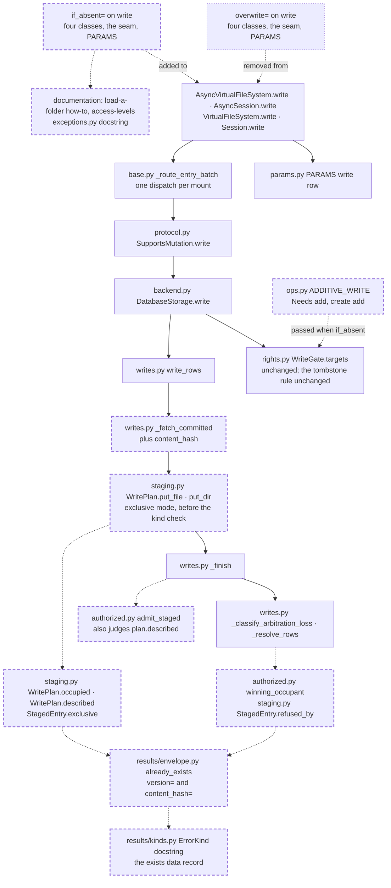

# `write(if_absent=True)` creates only where no live row stands, refuses `exists` carrying the occupant's version and hash, and `overwrite=` leaves `write`

A feature that also removes a public argument. Flags: it changes the public API (`overwrite=` leaves `write` on the four public classes, the storage seam and the parameter table, and `if_absent=` takes its place); it is not structural; it does not change the schema format; it needs the engine legs, because the write snapshot, the arbitration probe and the refusal are storage paths that run on every engine; it touches rights, because an occupied target of an exclusive write is judged at `add` where it was judged at `contribute`, and criteria 15 to 19 and 21 are its leak tests; it does not touch the Rust engine; it is not parallel-safe with units 174-1 and 174-3 of [the unit map](../2026-11-25-the-backlog-converted/units.md), which edit the same functions. It serves roadmap story K2 at gate b, criteria 3 and 6 ([the roadmap](../../context/standards/roadmap.md), lines 142 to 150). It is converted from [spec 174](../../context/specifications/archive/174-write-preconditions-and-the-guarded-append/spec.md), sections 1.1, 1.3, 2 step 2, 5, 6.6 and 8 and criteria 16 to 18 and 25, and from section 2 of [its task list](../../context/specifications/archive/174-write-preconditions-and-the-guarded-append/tasks.md), read through [the study of that source](../2026-11-25-the-backlog-converted/studies/165-181/174-write-preconditions-and-the-guarded-append.md). It stands on [the deletes memo](../../context/research/2026-11-15-deletes-tombstones-and-a-move-that-keeps-its-identity.md), on [the ladder study's verb table](../../context/research/studies/2026-10-14-permission-ladder/03-traversal-and-verbs-on-the-ladder.md) and on [the reference deployment memo](../../context/research/2026-11-09-what-an-enterprise-scale-deployment-looks-like.md). It depends on one spec, [the kernel rulings spec](../../context/specifications/active/2026-11-15-the-kernels-public-names-and-argument-families-are-ruled.md): drafted, changing no code, its edits to the roadmap and the constitution in the tree (commit `bc91cc3`), its file still under `active/` with its landing notes unfilled. This spec relies on its decision 7 and on the row of its decision 12 that reads `write(overwrite=False)` as `write(if_absent=True)`. It depends on no unbuilt unit; in the build order it follows unit [174-1](../2026-11-25-an-identical-body-write-reports-unchanged-and-leaves-the-version-alone/spec.md), drafted and not built, and relies on none of that unit's decisions. The deletes spec, which is not yet written and has no roadmap story, owns what a write at a deleted path does; decision 10 leaves that behaviour as the tree has it and pins nothing a ruling there would have to undo.

## The problem

Every fact below is at commit `5b20fd4f` (EXECUTED, `git rev-parse --short=8 HEAD`). EXECUTED means a command ran for this spec, READ means the cited line was read, INFERRED means reasoning. The probes are scratch scripts on `InMemoryStorage` and on a SQLite file; none is in the tree.

1. `write` carries `overwrite: bool = True` on every public surface: `AsyncVirtualFileSystem.write` (READ, `src/vfs/base.py:967`), `AsyncSession.write` (READ, `src/vfs/session.py:151`), the synchronous `VirtualFileSystem.write` and `Session.write` (READ, `src/vfs/sync.py:330`, `:825`), the seam `SupportsMutation.write` (READ, `src/vfs/storage/protocol.py:176`), `DatabaseStorage.write` (READ, `src/vfs/storage/backends/database/backend.py:685`) and `PARAMS["write"]` (READ, `src/vfs/params.py:169`). Neither `if_absent` nor `ADDITIVE_WRITE` occurs under `src/`, `tests/` or `crates/` (EXECUTED, a grep that counts 0 lines).
2. The argument was ruled out. Decided 2026-11-15: `overwrite=` leaves `write`, `if_absent=True` says what `overwrite=False` says, and the removal lands with the build that adds `if_absent=` (READ, the rulings spec, decision 7; roadmap row D7 at `context/standards/roadmap.md:1079`; K2 criterion 6 at `roadmap.md:150`). Until this unit lands, three numbered specs are read through a table that maps the old spelling to the new one (READ, the rulings spec, decision 12).
3. `overwrite=False` is already an exclusive create on a live file, and it describes nothing. A second write of `/a.txt` with `overwrite=False` answers `vfs.exists` with `data` `None` (EXECUTED). The refusal is the bare `already_exists(target)` (READ, `src/vfs/storage/backends/database/staging.py:307-309`; `src/vfs/results/envelope.py:288-294`), and the plan's snapshot does not select `content_hash` (READ, `src/vfs/storage/backends/database/writes.py:325-338`). A caller whose reply was lost cannot tell its own create from another caller's: both look the same.
4. The kind check runs before the occupancy check. A file entry over a live directory under `overwrite=False` answers `vfs.wrong_kind`, and a directory entry over a live directory answers `unchanged` and succeeds (EXECUTED; READ, `staging.py:300-309`, `:328-337`). `mkdir` without `exist_ok` already answers `exists` on any occupant, whatever its kind (READ, `writes.py:243-246`, `:253-261`).
5. An occupied target is judged as a replacement even when the write could never replace it. The gate judges a seen target of an `upsert` at the verb's primary rung, `contribute`, with the owner floor (READ, `src/vfs/storage/backends/database/rights.py:935-937`; `src/vfs/ops.py:151`). So a caller holding `add` on a folder who writes with `overwrite=False` over another caller's file hears `vfs.permission_denied`, and hears `vfs.exists` only at `contribute` or above; anonymous under a posture that gives everyone `add` hears `vfs.unauthenticated` there (EXECUTED). The true answer, that the name is taken, is withheld from callers who may read the file.
6. Twenty concurrent `overwrite=False` creates of one absent path on `InMemoryStorage` give 1 success and 19 `vfs.exists`, each with `data` `None` (EXECUTED). A create that loses arbitration after its snapshot probes the occupant one row at a time, selects `entry_id`, `kind`, `path` and `version`, and answers the bare `already_exists` (READ, `writes.py:570-583`, `:652-669`); a directory that loses to a directory adopts it and reports `unchanged` (READ, `writes.py:578-580`, `:660-661`, `:372-374`).
7. A refused `overwrite=False` write issues no mutation statement. By the system actor it is 1 non-control statement, the snapshot `SELECT`, for one entry and for a 1,001-entry batch alike on SQLite; by a named caller it is 6 `SELECT` statements once the rights are cached and 10 before (EXECUTED, a `before_cursor_execute` listener on a SQLite file).
8. At a deleted path the argument is ignored. A tombstoned file at the target is staged as an update with `revive = True` and reports `updated`, "whatever ``overwrite`` says" (READ, `staging.py:287-289`, `:320-326`; EXECUTED), and the gate judges any mutation there as a restore, `read_write` or own (READ, `rights.py:938-942`). The deletes memo finds the revive wrong, and roadmap K2 criterion 3 says the revive "reports `created`" (READ, the memo's section 2; `roadmap.md:147`). No ruling on record settles it.
9. The call sites are wider than the source counted. `overwrite=` occurs 66 times in 15 Python test files: 25 on a `write` of the seam or a public class (18 pass `True`, 6 pass `False`, 1 passes `"yes"`), 5 on `WritePlan.put_file`, 5 on `write_rows`, and the rest on `_finish`, `_apply` and the arbitration helpers or in comments (EXECUTED, greps). Two assertions read the recorded keyword (READ, `tests/base/test_dispatch.py:59`, `:1173`). Twelve more occurrences are in the recorded ranking corpus under `tests/fixtures/ranking/` (EXECUTED). One published page teaches the argument (READ, `documentation/how-to/load-a-folder-of-files.md:229-232`), and one docstring names it (READ, `src/vfs/exceptions.py:54`). The source's "~45 test call sites" and its `VirtualFileSystem.write` in `base.py` are stale.
10. Four of the modules this change touches are held at an exact line count: `base.py` at 3,184, `backend.py` at 1,511, `writes.py` at 1,294 and `sync.py` at 1,098 (READ, `tests/lint/allowlist.py:25-34`; `tests/lint/test_code_shape.py:222-243`). A listed module that grows fails the lint with "move out as many as were added".

## Architecture

Solid is what exists and keeps its shape. Dashed is what this spec adds or changes. Dotted is what it removes.

Terms. An **exclusive write** is a `write` called with `if_absent=True`. An **occupant** is the live row at a target: a row whose `deleted_at` is null, a file or a directory. A **described row** is a stored occupant whose `version` and `content_hash` a refusal carries. A **late loss** is a create that passed the snapshot, inserted, and lost the `(parent_id, name)` unique key to a rival that committed inside the window.

## Decisions

### 1. `overwrite=` leaves `write` on the four public classes, the seam, `DatabaseStorage.write` and `PARAMS["write"]`, with no alias and no deprecation step.

`if_absent=True` says what `overwrite=False` said, and two arguments for one fact would be frozen into the beta. The design is unreleased, so there is no caller to migrate. A call that still passes `overwrite=` raises Python's own `TypeError` for an unexpected keyword, on all four classes alike, because none of them takes `**kwargs`.

Basis: ruled, 2026-11-15, decision 7 of the kernel rulings spec and row D7 of the roadmap (`context/standards/roadmap.md:1079`).

### 2. `if_absent` is a keyword-only `bool`, default `False`, on both forms of `write`, and it applies to every entry of the call.

The default replaces an occupant, as `overwrite=True` does today, so every call that passed nothing keeps its behaviour. The argument sits after `data` and before `parents` in each signature. A batch that spans two mounts stays atomic per mount, as any refusal is today: the router dispatches one group per mount (READ, `src/vfs/base.py:2540-2551`), so an occupied target on one mount refuses that mount's group whole and leaves the other mount's group to land.

Basis: the source spec, section 1.1; still true at `5b20fd4f` (READ, `src/vfs/base.py:959-970`, where the argument it replaces is keyword-only with default `True`, and `:987-989`, where `parents` already "applies per call").

### 3. The seam and `write_rows` spell the argument `if_absent`, the plan spells its mode `exclusive`, and the helpers below `_finish` keep their `overwrite` parameter.

`if_absent` is the caller's condition and travels unchanged from the public classes through `SupportsMutation.write` and `DatabaseStorage.write` to `write_rows`. Inside the plan the same fact is a mode of staging, so `WritePlan.put_file` takes `exclusive: bool` in place of `overwrite: bool`, and `WritePlan.put_dir` gains `exclusive: bool = False`. `_finish`, `_apply`, `_insert_creates`, `_upsert_layer`, `_catch_retry_layer` and `_resolve_rows` keep `overwrite: bool`, which there means "a file create may land on an occupant" and is passed by `mkdir` and `edit` too; `write_rows` passes `overwrite=not if_absent`.

Basis: the source spec, section 1.1 and task section 2; still true at `5b20fd4f` (READ, `src/vfs/storage/backends/database/writes.py:224-226`, `:259`, `:271`, `:306`, where `write_rows`, `mkdir_rows` and `edit_rows` each pass `overwrite=` to `_finish`).

### 4. Under `if_absent`, any occupant of a target refuses `vfs.exists` at that target, and the judgment runs before the kind check.

The address gates that run first are unchanged: the trash view, the key-byte budget, the engine's value cap and the parent rule. After them, a live file or a live directory at the target refuses `exists`, for a file entry and for a directory entry alike. A file entry over a directory therefore answers `exists`, not `wrong_kind`. This is what `open` with `O_CREAT` and `O_EXCL` answers, `EEXIST` whatever the name holds, and it is what lets the shell's `touch` treat one refusal as "the name is taken" for a file and a directory both. Every occupied target of a batch is listed, the batch fails whole, and no mutation statement runs.

Basis: the source spec, section 2 step 2 and section 5; still true at `5b20fd4f` (EXECUTED, the probe of fact 4 shows the kind check first today; READ, `src/vfs/storage/backends/database/writes.py:243-246`, where `mkdir` already answers `exists` "whatever its kind").

### 5. An occupant that holds the very body the caller sent still refuses `exists`; the refusal is never turned into success.

Two callers that create the same lock file with the same content must not both hold the lock, and equal content does not prove that the earlier create was the caller's own. A caller that lost its reply recognises its create from the refusal's data (decision 6). Exactly-once recognition needs a request key, which is unit 177-1's.

Basis: verified lean, the study's open choice 7; precedent: `src/vfs/results/kinds.py:65`, where the kind is defined as "the site is occupied and this verb never replaces an occupant", and POSIX `open` with `O_EXCL`, which fails `EEXIST` whenever the name exists (INFERRED from the published standard, not fetched for this spec).

### 6. The refusal carries the occupant's `version` and `content_hash` in `data`, through `already_exists`, and adds no kind.

`already_exists` in `src/vfs/results/envelope.py` gains two keyword arguments, `version: int | None = None` and `content_hash: str | None = None`, and writes each one that is not `None` into `data` under the unprefixed keys `version` and `content_hash`. A file occupant gives both. A directory occupant has no hash and gives `version` alone, since absence in `data` means "not known". `retryable` stays `False`, and the kind's retry class stays `never`. The `ErrorKind` docstring's list of per-kind data records gains: `exists` may carry `version` and `content_hash`, the occupant an exclusive write met. The data is no leak: it is answered only to a caller the gate admitted at `add`, and `add` includes `read` (decisions 11 and 12).

Basis: verified lean, the study's open choice 7; precedent: `src/vfs/results/kinds.py:52-57`, the per-kind data records where `conflict` "may carry ``version``" and absence means "not known", and `src/vfs/ops.py:117-121`, where each rung includes every one below it.

### 7. A directory entry under `if_absent` refuses `exists` on any stored occupant, a directory included.

`write([Entry(path, kind="directory")], if_absent=True)` creates the directory or refuses, which makes it the batch form of `mkdir` without `exist_ok`. This departs from today's `overwrite=False`, under which a directory entry over a standing directory answers `unchanged` and succeeds (fact 4). A caller that wants standing directories forgiven leaves the directory entries out and passes `parents=True`, or does not pass `if_absent`.

Basis: the source spec, section 5; still true at `5b20fd4f` (READ, `src/vfs/storage/backends/database/staging.py:328-346`, where `put_dir` has no such mode, and `writes.py:253-261`, the `mkdir` rule it matches).

### 8. A target the same call already staged is judged through the staged overlay: a file target listed twice refuses `exists` with no data, and a directory the call itself staged is created by the call.

The plan's gates read staged rows over committed ones. Under `exclusive`, a target whose occupant is a row this call staged has no stored row to describe, so `put_file` refuses with the bare `exists` and the batch writes nothing, as it does today (EXECUTED, a duplicate target under `overwrite=False` answers `exists` and `stat` then finds nothing). One case is not a refusal: a directory entry whose target this call already staged as a directory, as an earlier entry or as an ancestor minted under `parents=True`, reports `created`, because the call is creating that directory; the staged row is then marked `exclusive`. Through the four public classes the router sorts a batch parents first, so only a path listed twice reaches this rule; a direct caller of the seam may list a child before its parent.

Basis: decided in drafting, because the router hands a storage its batch to be adjudicated "as a set" and "never as a sequence the caller had to order" (READ, `src/vfs/base.py:2509-2511`), and the plan already overlays staged rows on committed ones for every gate (READ, `src/vfs/storage/backends/database/staging.py:144-146`).

### 9. A deleted row is absent to `if_absent`: a tombstone at the target never refuses `exists`.

Every read already treats a deleted path as empty, and an exclusive create judges what a caller can see. The plan's `kind_of` answers `None` for a tombstoned row, so the exclusive judgment of decision 4 does not fire there.

Basis: verified lean, the first half of the study's open choice 8; precedent: the deletes memo, line 35, "Where a system has both an id and a unique path, the deleted item gives the path up", and `src/vfs/storage/backends/database/staging.py:170-176`, where a tombstone is absent to the plan's occupancy check.

### 10. At a deleted path an exclusive write does what a plain write at that path does, and this spec pins only that equality.

The plan takes the plain write's arm unchanged: a tombstoned file is staged as today, a tombstoned directory refuses as today, and the gate's rule for a mutation at a tombstone, restore's rung or own, is not touched. The acceptance criteria compare an exclusive write with a plain write at an identically prepared deleted path and require the same success, the same status and the same kind; they pin neither `updated` nor `created` and say nothing of the row's `entry_id`. Two existing tests that pass `overwrite=False` at a deleted path to show the revive drop the argument and keep their assertions as tests of the plain write (`tests/support/storage_contract.py:902-915`, `tests/storage/database/test_trash.py:395-405`). One cell differs for anonymous, and it follows from decision 11: anonymous is first judged at the verb's primary rung, which is `add` for an exclusive write and `contribute` for a plain one, so under a posture that gives everyone exactly `add` the plain write is refused `vfs.unauthenticated` and the exclusive write passes that judgment, meets the tombstone rule and is refused `vfs.permission_denied`, the answer a plain write already gives anonymous under a `contribute` posture (EXECUTED). Both refuse, both write nothing, and neither reveals more than the other. This departs from roadmap K2 criterion 3, which names the status `created`, and from the source's criterion 16, which pins that the revived row keeps its `entry_id`: neither is pinned here.

Basis: provisional, no ruling on record; the options were (a) a write at a deleted path revives the deleted row and reports `updated`, as the tree does, and (b) it creates a new file beside the deleted one and reports `created`, as K2 criterion 3's word and the deletes memo's finding suggest; chosen because leaving the path as the tree has it adds no behaviour, and pinning only equality with the plain write lets the deletes spec take either option without changing a test of this unit.

### 11. An exclusive write is judged at `ADDITIVE_WRITE`, `Needs("add", create="add")`, so an occupied target needs `add` and no more.

`src/vfs/ops.py` gains the constant beside `VERB_RUNGS`, with the docstring "The rungs of a write that removes no stored byte." `DatabaseStorage.write` passes it to the gate when `if_absent` is set and `VERB_RUNGS["write"]` otherwise; the gate mode stays `"upsert"`. An exclusive write never lands on an occupant, so it cannot alter or destroy anything a caller did not create, which is what `add` permits. The consequences, each a criterion: a caller holding `add` hears `exists` where it heard `permission_denied`; a caller holding `list` or `read` is refused by the gate before any judgment that describes the row, with the refusal it would get at an absent path; anonymous under a posture that gives everyone `add` hears `exists`, and under a lower posture hears `unauthenticated` at an occupied and an absent path alike; the owner floor still rides, so an owner hears `exists` at its own file. The two judgments after the gate that read `VERB_RUNGS["write"].primary`, `admit_staged` for a staged update of a live row and `admit_landed` for a create that landed on a rival's row, are left as they are: an exclusive plan stages no update of a live row and no create that may land on one, so neither has a row to judge. The constant is named for both of its users: unit 174-4 passes it for an append.

Basis: verified lean, the study's open choices 9 and 10; precedent: `src/vfs/ops.py:151`, where `write` already creates at `add`, and `tests/support/grants_contract.py:1133-1134`, where an `add` holder's `mkdir(exist_ok=True)` over a standing directory is "judged at the create rung" and answers.

### 12. Every stored row an `exists` refusal describes is judged at the `add` rung in memory before the plan answers, and a row that fails redrives the attempt.

The plan's snapshot is a second read after the gate, and it can return a row the gate never saw. `WritePlan` records each described row in `described`, and `admit_staged` in `authorized.py`, which `_finish` already calls ahead of its return on `plan.errors`, judges them as well: `admit(judging(session, ADDITIVE_WRITE.primary), plan.described)`. A failing row raises `StaleSnapshot`, the attempt redrives, and an attempt that keeps failing ends as the existing retryable, pathless `conflict` that names no row. The judgment issues no statement: the snapshot already selects `owner_id` and `everyone_level` (READ, `src/vfs/storage/backends/database/writes.py:333-334`).

Basis: decided in drafting, because `authorized.py` states the rule for every read a mutation makes after its gate, "Each such read is judged here, in memory over the columns it already fetches" (READ, `src/vfs/storage/backends/database/authorized.py:3-8`), and `edit` already judges its targets "before any is matched or answered from" (READ, `authorized.py:309-312`).

### 13. A create that loses arbitration answers `exists` carrying the winner's `version` and `content_hash`.

Two exclusive creates of one absent path both pass the snapshot and both insert; one wins the `(parent_id, name)` key. The loser's occupant probe selects `content_hash`, `deleted_at`, `owner_id` and `everyone_level` beside the four columns it selects today, and the refusal it builds for a row marked `StagedEntry.exclusive` carries the same data as a refusal at the snapshot. A create that is not marked, `mkdir`'s and a plain write's directory entry, answers the bare `exists` it answers today. The probe stays one statement per losing row.

Basis: the source spec, section 5, "Arbitration"; still true at `5b20fd4f` (READ, `src/vfs/storage/backends/database/writes.py:570-583`, `:652-669`; EXECUTED, the 20-task probe of fact 6).

### 14. A late occupant that is deleted, or that lies beyond the caller's `add` rung, redrives the attempt, and an exclusive directory that loses to a rival's directory refuses and never adopts.

The late refusal describes a row, so the row is proved first. A deleted occupant raises `StaleSnapshot`: the fresh snapshot sees the tombstone and decision 10 applies. An occupant that fails `admit` at `ADDITIVE_WRITE.primary` raises `StaleSnapshot` as decision 12's does. A directory create marked `exclusive` that loses to a rival's directory skips the adoption that `mkdir -p` forgiveness grants and answers `exists` with the rival's `version`: the exclusive call did not create the directory, so it must not report that it stands by the call's doing.

Basis: decided in drafting, because the title's promise is a refusal only where a live row stands, because a refusal that describes a row follows the rule of decision 12 wherever it is built, and because `_finish` reports an adopted create as `unchanged` (READ, `src/vfs/storage/backends/database/writes.py:372-374`), which an exclusive create may never report.

### 15. The write snapshot selects `content_hash`, one more column on a statement that already runs.

`_fetch_committed` adds `entry.c.content_hash` to its column list. No statement is added and the chunking is unchanged. Unit 174-1 needs the same column for its own rule; whichever of the two lands second finds the column present and adds nothing.

Basis: the source spec, sections 3 and 5; still true at `5b20fd4f` (READ, `src/vfs/storage/backends/database/writes.py:325-338`, a column list without `content_hash`).

### 16. No module held at an exact line count grows: the arbitration probe that two helpers repeat moves to `authorized.py`.

`base.py`, `backend.py` and `sync.py` change line for line. `writes.py` would gain a column and four probe columns twice over, so three things are placed outside it. The occupant probe that `_classify_arbitration_loss` and `_resolve_rows` each spell out in six lines becomes one function in `authorized.py`, `winning_occupant`, which each calls in one line. The refusal a lost create answers becomes a method of the staged row, `StagedEntry.refused_by`, in `staging.py`. The judgment of decision 12 is added inside `admit_staged`, which `_finish` already calls, so `writes.py` gains no call and imports one new name on a line that still fits. `writes.py` ends no longer than it began, 1,294 lines at `5b20fd4f`, and its entry in `MODULE_LINE_BASELINE` is lowered to the new count. `authorized.py` (426 lines), `staging.py` (473) and `envelope.py` (914) stay under the 1,000-line ceiling.

Basis: decided in drafting, because `context/standards/how-we-code.md:64` holds a module over 1,000 lines at its exact count and `tests/lint/test_code_shape.py:237-238` fails one that grows.

### 17. The ingress row is `ParamSpec("if_absent", "bool", nullable=False, default=False)`, and the rules that pair `if_absent` with later arguments belong to the units that add those arguments.

A value that is not a `bool` is refused `vfs.invalid` by the parameter gate with no dispatch, as `overwrite="yes"` is today. The rule that refuses `if_absent=True` beside `if_version=` or `if_versions=` is unit 174-3's, and the rule that refuses it beside `append=True` is unit 174-4's; neither argument exists when this unit is built. This unit therefore lands before 174-3.

Basis: the source spec, section 1.3; still true at `5b20fd4f` (READ, `src/vfs/params.py:164-172`; `tests/test_params.py:111`, the garbage case for a truthy `overwrite`).

### 18. Mixing exclusive and plain rows in one call is not offered.

One call is one transaction per mount, and a flag of the call applies to each of its entries. A caller that needs both in one transaction is asking for a per-row options type, which no verb has.

Basis: verified lean, the study's open choice 16; precedent: `src/vfs/base.py:987-989`, where `parents` "applies per call — every entry in a batch shares it".

### 19. Every backend that serves `write` serves `if_absent`, and no capability is declared for it.

The seam already carried the same fact as `overwrite=False` for every backend, so the rename takes nothing from any backend and adds no question a caller must ask first. The test doubles take `**kwargs` and need no change.

Basis: decided in drafting, because `src/vfs/storage/protocol.py:173-180` gives the argument to every implementer of `SupportsMutation.write` today, and the declaration of per-argument features is unit 179-10's.

### 20. The published how-to and the access-levels page follow the change, the two docstrings that name the old argument are rewritten, and the recorded ranking corpus is left as it is.

`documentation/how-to/load-a-folder-of-files.md` teaches `if_absent=True` in place of `overwrite=False`. `documentation/reference/access-levels.md` gains one row for an exclusive write at an occupied path. The `write` docstring in `base.py`, the `WriteConflictError` docstring in `exceptions.py`, the module docstring and the `put_file` docstring in `staging.py` say what the code now does. The twelve occurrences under `tests/fixtures/ranking/` are recorded documents that a ranking fixture measures; editing them would change a measurement and document nothing. The source's task named `docs/reference/api.md`, which holds no mention of the argument (EXECUTED, a grep), so nothing changes there.

Basis: decided in drafting, because `AGENTS.md` makes a docstring "a page's content" and `documentation/` the published tree, and because a fixture's recorded text is data, not a call site.

## Intent

After this spec, a caller says "create this only if nothing is there" with `write(..., if_absent=True)`, on the asynchronous and synchronous file systems and on both kinds of session. Where no live file or directory stands, the write creates and reports `created`. Where one stands, nothing is written and the answer is `vfs.exists` at that path, carrying the version and content hash of what is there, so a caller that lost a reply can see whether its own create landed. A caller who may add to a folder hears that true answer, and a caller who may not add hears the same refusal it would hear at an empty path. Twenty callers racing to create one path get exactly one success on every engine. `overwrite=` is gone from `write`: a plain `write` replaces, as it always did by default.

## Design

**The order of work.** Each step writes its tests, sees them fail, then writes the code that passes them. The whole change is one pull request, green at its end; the removal of `overwrite=` cannot be split from the call sites that pass it.

1. **The rung constant.** Test: criterion 7, `tests/test_ops.py::test_the_additive_write_needs_add_on_both_slots`. Code: `ADDITIVE_WRITE: Final[Needs] = Needs("add", create="add")` in `src/vfs/ops.py`, directly under `VERB_RUNGS`.
2. **The refusal fact.** Test: criterion 8, `tests/results/test_facts.py::test_the_exists_fact_describes_its_occupant_when_given_one`. Code: `already_exists(path, *, target=None, version=None, content_hash=None)` in `src/vfs/results/envelope.py`; the data record in the `ErrorKind` docstring in `src/vfs/results/kinds.py`.
3. **The seam and the plan.** Tests: the seven `StorageContract` rows of criteria 9 to 14 and 22 in `tests/support/storage_contract.py`; the row `test_write_onto_an_existing_file_without_overwrite_is_exists` is replaced by the row of criterion 10. Code, in `src/vfs/storage/protocol.py`, `backend.py`, `writes.py` and `staging.py`:
   - `SupportsMutation.write` and `DatabaseStorage.write` take `if_absent: bool = False` where they took `overwrite: bool = True`.
   - `write_rows` takes `if_absent: bool`, passes `exclusive=if_absent` to `put_file` and `put_dir`, and `overwrite=not if_absent` to `_finish`.
   - `_fetch_committed` selects `entry.c.content_hash`.
   - `StagedEntry` gains `exclusive: bool = False`, with the comment "the create refuses any occupant, and its refusal describes the occupant".
   - `WritePlan` gains `described: list[RowMapping]` and the method `occupied(target) -> ResultError`: when `target` is in `staged` it returns the bare `already_exists(target)`; otherwise it appends the committed row to `described` and returns `already_exists(target, version=row["version"], content_hash=row["content_hash"])`.
   - `put_file`, after the parent gate and before the kind checks: `if exclusive and occupant is not None`, append `self.occupied(target)` and return `None`. After staging under `exclusive`, set `self.staged[target].exclusive = True`.
   - `put_dir`, on an occupant under `exclusive`: a directory this call staged sets that row's `exclusive` and returns `"created"`; any other occupant appends `self.occupied(target)` and returns `None`. A create staged under `exclusive` is marked the same way. The tombstone and budget branches are unchanged.
4. **The rung at the gate.** Tests: the four `GrantsContract` rows of criteria 15 to 18 in `tests/support/grants_contract.py`. Code: `DatabaseStorage.write` builds its gate with `ADDITIVE_WRITE if if_absent else VERB_RUNGS["write"]`, on the one line that names the rung today.
5. **The judgment after the gate.** Test: criterion 19, `tests/storage/database/test_writes.py::TestStagedRowsAreJudged::test_an_exclusive_write_never_describes_an_occupant_beyond_the_callers_rung`. Code: `admit_staged` in `authorized.py` gains one line, `admit(judging(session, ADDITIVE_WRITE.primary), plan.described)`, and its docstring says so; `_finish` is not edited for it.
6. **The late loss.** Tests: the two parametrized tests of criteria 20 and 21 in `tests/storage/database/test_writes.py::TestArbitration`. Code, in `authorized.py`: `winning_occupant(session, entry, staged, row_values)`, which runs the one probe statement both helpers issue today with the four added columns, raises `StaleSnapshot` on no row with today's message, and returns the row; for a staged row marked `exclusive` whose occupant holds the requested path it then raises `StaleSnapshot` on a deleted occupant and runs `admit` at `ADDITIVE_WRITE.primary` over the occupant, so an occupant at another stored path still reaches the helpers' existing incoherent-row answer. `land` in `tests/support/commit_worlds.py` gains a `kind` argument so that a test can land a rival's directory. In `staging.py`: `StagedEntry.refused_by(occupant) -> ResultError`, which returns the bare `already_exists(self.path, target=self.path)` for a row not marked `exclusive` and `already_exists` with the occupant's `version` and `content_hash` for a marked one. In `writes.py`, `_classify_arbitration_loss` and `_resolve_rows` take their occupant from `winning_occupant`, build their final `exists` with `staged.refused_by(occupant)`, and their adoption branch gains `and not staged.exclusive`.
7. **The public classes.** Tests: criteria 1 to 6, in `tests/test_params.py`, `tests/base/test_dispatch.py`, `tests/base/test_mounts.py` and `tests/test_sync.py`. Code: `AsyncVirtualFileSystem.write` and `_route_entry_batch` in `base.py`, `AsyncSession.write` in `session.py`, and `VirtualFileSystem.write` and `Session.write` in `sync.py` take and forward `if_absent`; `PARAMS["write"]` holds the row of decision 17 with the doc string "create only where no file or directory stands". The last paragraph of the `write` docstring is rewritten within its three lines to say that `parents=True` mints the missing chain, that `if_absent=True` creates only where nothing stands and is refused `exists` otherwise with nothing written, and that both apply per call.
8. **The call sites.** The 18 calls that pass `overwrite=True` to a `write` of the seam or a public class drop the argument; the 6 that pass `overwrite=False` pass `if_absent=True`, except the two of decision 10, which drop it; the garbage case becomes `write-truthy-if-absent`; the two keyword assertions in `tests/base/test_dispatch.py` read `kwargs["if_absent"]`; the 5 `put_file` calls pass `exclusive=`, and the 5 `write_rows` calls pass `if_absent=`, each the negation of what it passed. The calls on `_finish`, `_apply` and the arbitration helpers are untouched. `tests/storage/database/test_ladder.py:291` keeps its `permission_denied`, since a `list` holder is below `add`.
9. **The pages.** Test: criterion 25, `tests/lint/test_code_shape.py::test_no_published_page_teaches_the_overwrite_argument`. Edits: the how-to's sentence and its fence; the access-levels row "`write(if_absent=True)` at the file's path", whose three cells below `add` repeat the cells of the row "`write` to a new path, `mkdir`" and whose cells at `add`, `contribute` and `read_write` read "Already exists"; the docstrings of decision 20.
10. **The size baseline and the scale pin.** `tests/lint/allowlist.py` lowers the `writes.py` entry to the module's new count, which criterion 26 holds. Test: criterion 24, `tests/base/test_write_at_scale.py::test_a_refused_ten_thousand_entry_exclusive_batch_pages_its_reads_and_writes_nothing`, marked `slow`.

**The gates before the pull request.** `scripts/ci.sh`; `scripts/docs.sh check`, because docstrings under `src/vfs/` and pages under `documentation/` change; and the four server engine legs, Postgres, MariaDB, SQL Server and Oracle, through the `db_test` skill, because the snapshot column, the probe and both contract classes run on each.

**Scale.** Costed against [the reference deployment](../../AGENTS.md#the-reference-deployment-the-scale-every-idea-is-filtered-through). The change adds no statement, no table, no index and no lock.

- *The snapshot column* rides per file write, about 1,050,000 a day. It adds one 64-character column to rows a statement already fetches: the targets and their ancestors, chunked by `membership_budget(profile, parameter_budget)` through `rows_by_path`. A single-file write at the mean depth of 6 fetches about 7 rows, so about 450 bytes more per write and about 0.5 GB a day across the deployment, beside bodies that average hundreds of kilobytes. A 10,000-file batch holds about 11,000 snapshot rows, so about 0.7 MB more for the life of the batch, and still `ceil(11,000 / 1,000)` = 11 snapshot statements on Oracle's 1,000-element floor, as today.
- *The exclusive judgment* rides per file write and is pure Python: one dictionary lookup per entry, no statement. `WritePlan.described` holds at most one reference per refused entry, to a row the snapshot already holds, so it is bounded by the batch and adds no copy.
- *A refused exclusive write* rides per verb call, about 150,000 a day. It costs what it reads: the gate's reads and the snapshot, zero mutation statements, zero rows locked on the server engines. For the shell's `touch` on a standing file it is one call where a `stat` and a `write` would be two.
- *The refusal list* rides per batch, 100 a night. A batch refused whole returns one error per occupied target, each with a two-key record; it grows with the batch as the observations of a successful batch do, and no statement grows with it.
- *The late-loss probe* is unchanged in count and wider by four columns. It is the tree's existing profile, stated honestly: one indexed point `SELECT` per losing row, reached only for rows a rival created inside the window between this call's snapshot and its insert. Two identical 10,000-file exclusive loads that overlap could each issue up to 10,000 such probes before failing whole. The direction, when a measured workload asks for it, is one read over the losers chunked by `membership_budget`; no cap is declared, and this unit does not change the count.
- *Locks.* None is added and none is held longer. A read never waits on an exclusive write: the refusal is reads only, and the successful arm is the plain create. On SQLite the write transaction opens `BEGIN IMMEDIATE` as every write attempt does today.
- *Nothing* rides per index visit or per corpus.

## Scope

In: decisions 1 to 20. Files: `src/vfs/ops.py`, `src/vfs/params.py`, `src/vfs/base.py`, `src/vfs/session.py`, `src/vfs/sync.py`, `src/vfs/exceptions.py`, `src/vfs/results/envelope.py`, `src/vfs/results/kinds.py`, `src/vfs/storage/protocol.py`, and under `src/vfs/storage/backends/database/` the files `backend.py`, `writes.py`, `staging.py` and `authorized.py`; `documentation/how-to/load-a-folder-of-files.md` and `documentation/reference/access-levels.md`; `tests/test_ops.py`, `tests/test_params.py`, `tests/test_sync.py`, `tests/results/test_facts.py`, `tests/base/test_dispatch.py`, `tests/base/test_mounts.py`, `tests/base/test_write_at_scale.py`, `tests/support/storage_contract.py`, `tests/support/grants_contract.py`, `tests/support/commit_worlds.py`, `tests/lint/test_code_shape.py`, `tests/lint/allowlist.py`, and the call sites of fact 9 in `tests/storage/test_conformance.py` and under `tests/storage/database/` in `test_writes.py`, `test_coherence.py`, `test_trash.py`, `test_races.py`, `test_search.py`, `test_ladder.py`, `test_indexing.py`, `test_grep.py`, `test_embed.py`, `test_dialects.py` and `test_authorized.py`.

Dependencies and build order. The kernel rulings spec is in the tree; what is relied on is its decision 7, "The flag that lets `move` or `copy` land on an existing file is `replace=`, default refuse, and `overwrite=` leaves `write`", with its sentence "The removal lands with the build of spec 174, which adds `if_absent=`". Nothing else must land first. Unit 174-1 is drafted and states in its first paragraph that it is the first of the four units of spec 174; this unit takes that order and relies on no decision of 174-1. With 174-1 landed, its Design step 3 has already added the snapshot column (decision 15 here), and its decision 11 places its settle pass after the return on `plan.errors`, so an exclusive refusal never reaches that pass. Built the other way round, both units are still green; they are never built at once, since both edit `_fetch_committed`, `staging.py` and the `writes.py` line count. This unit lands before 174-3 (decision 17), and before 174-4, 167-5 and 172-1, which the unit map lists as depending on it. The order is 174-1, this unit, 174-3, 174-4.

Out, with where each belongs:

- The `unchanged` answer for an identical body, and `WritePlan.settle`: unit [174-1](../2026-11-25-an-identical-body-write-reports-unchanged-and-leaves-the-version-alone/spec.md). Under `if_absent` an identical body over a live file is `exists` with or without that unit.
- `if_version=`, `if_versions=`, the `conflict` data record, and the rule that refuses them beside `if_absent=True`: unit [174-3](../2026-11-25-a-write-that-names-the-version-it-read-is-refused-when-the-row-moved-on/spec.md).
- `append=True`, its use of `ADDITIVE_WRITE`, and the rule that refuses it beside `if_absent=True`: unit [174-4](../2026-11-25-append-is-one-locked-read-modify-write-so-concurrent-appends-keep-every-line/spec.md).
- What a write at a deleted path does, the status it reports, whether the deleted row's `entry_id` survives, and the rung it is judged at: the deletes spec, not yet written and with no roadmap story. Decision 10 is this unit's whole position.
- The replay table's row for `write(if_absent=True)` sent twice, and the request key that makes a replayed create recognisable for certain: unit [177-1](../2026-11-25-every-mutating-verb-sent-twice-answers-as-a-pinned-replay-table-says/spec.md).
- The shell's `touch` as `write(content="", if_absent=True)`: unit [167-5](../2026-11-25-a-pipeline-runs-gated-verbs-through-cli-with-the-minimal-programs/spec.md). The cross-mount copy's use of the argument: unit [160-1](../2026-11-25-a-cross-mount-file-copy-is-a-read-on-one-mount-and-a-write-on-the-other/spec.md). The Python guest's use: unit [172-1](../2026-11-25-the-python-guest-runs-over-wasi-python-as-the-caller/spec.md).
- `replace=` on `move` and `copy`: unit [167-7](../2026-11-25-move-and-copy-take-replace-and-a-move-keeps-the-moved-file/spec.md).
- `content_hash` on every row a successful write returns: unit [175-2](../2026-11-25-every-written-row-reports-its-hash-and-no-verb-launders-a-damaged-body/spec.md). This unit puts the hash only on the `exists` refusal.
- A per-argument feature declaration on the seam: unit [179-10](../2026-11-25-a-backend-that-lacks-a-derivable-verb-is-still-served-it/spec.md).
- A strict session counting `if_absent=True` as a stated precondition: roadmap story K10, which has no spec.
- A content-hash precondition, `if_version=` on a read, and per-row options inside one batch: not built by any unit of story K2.
- `mkdir`, `edit` and the plain write: their rungs, their refusals and their statement counts are unchanged, and `mkdir`'s `exists` stays bare.
- A chunked occupant read for late losses: named under Scale as a direction, built by no unit.

## Acceptance criteria

"Every leg" means a row of `StorageContract` or `GrantsContract`, which `tests/storage/test_conformance.py` runs as `TestMemoryConformance`, `TestSqliteConformance`, `TestPostgresConformance`, `TestMariaDBConformance`, `TestMSSQLConformance` and `TestOracleConformance`. Statement counts are taken on a SQLite file with the `before_cursor_execute` listener the file already uses. Counts and states, never clocks.

1. No `write` signature holds `overwrite` and each holds `if_absent` with default `False`: `AsyncVirtualFileSystem.write`, `AsyncSession.write`, `VirtualFileSystem.write`, `Session.write`, `SupportsMutation.write` and `DatabaseStorage.write`, six cases, and `PARAMS["write"]` likewise: `tests/test_params.py::test_write_takes_if_absent_and_no_overwrite_on_every_face`.
2. The parameter names of `AsyncVirtualFileSystem.write` equal the names in `PARAMS["write"]`: `tests/test_params.py::test_every_verb_signature_matches_the_table`, unchanged.
3. `write(path="/f.txt", content="x", if_absent="yes")` is one `vfs.invalid` error and the storage records zero calls: `tests/test_params.py::test_garbage_classifies_invalid_with_zero_dispatch[write-truthy-if-absent]`.
4. The single form through a mount reaches the storage with `kwargs["if_absent"] is True`, `kwargs["parents"] is False` and no `overwrite` key: `tests/base/test_dispatch.py::test_write_localizes_path_and_passes_kwargs`.
5. `VirtualFileSystem.write` has the signature of `AsyncVirtualFileSystem.write`, parameter for parameter: `tests/test_sync.py::test_every_router_coroutine_has_a_sync_twin[write]`, unchanged; the session pair is among the six cases of criterion 1.
6. Through a mount at `/m` on an in-memory storage, `write(path="/m/a.txt", content="two", if_absent=True)` over a standing file answers one `vfs.exists` whose `path` is `/m/a.txt` and whose `data` holds the `version` and `content_hash` a `stat` of `/m/a.txt` returns: `tests/base/test_mounts.py::test_an_exclusive_write_through_a_mount_is_exists_at_the_mounted_path_with_its_data`.
7. `ADDITIVE_WRITE == Needs("add", create="add")`, its `passing` is `None`, and its `create` rank is not above its `primary` rank: `tests/test_ops.py::test_the_additive_write_needs_add_on_both_slots`.
8. `already_exists(Path("/a"))` has `data` `None`; with `version=3, content_hash="h"` its `data` is `{"version": 3, "content_hash": "h"}`; with `version=3` alone it is `{"version": 3}`; `retryable` is `False` in each: `tests/results/test_facts.py::test_the_exists_fact_describes_its_occupant_when_given_one`.
9. On every leg, `write(if_absent=True)` at an absent path reports `created` at version 1 and a `read` returns the body: `StorageContract::test_if_absent_creates_an_absent_file`.
10. On every leg, `write(if_absent=True)` over a live file fails with one `vfs.exists` at the path whose `data` equals `{"version": v, "content_hash": h}` for the `v` and `h` a `stat` of the path returns, `retryable` is `False`, the file keeps its body and version, and the same holds when the entry carries the body the file already holds: `StorageContract::test_if_absent_over_a_live_file_is_exists_with_its_version_and_hash`.
11. On every leg, a file entry over a live directory, a directory entry over a live directory and a directory entry over a live file each answer `vfs.exists` and never `wrong_kind` or `unchanged`, with `data` `{"version": v}` for a directory occupant: `StorageContract::test_if_absent_refuses_any_occupant_before_the_kind_check`.
12. On every leg, a five-entry exclusive batch with two occupied targets fails with exactly two `vfs.exists` errors, one per occupied path, and a `stat` of each of the other three paths is `not_found`: `StorageContract::test_if_absent_batch_with_occupied_targets_writes_nothing`.
13. On every leg, a file path listed twice in one exclusive call fails with one `vfs.exists` whose `data` is `None` and leaves the path `not_found`, and the entries `[/p/q/c.txt, directory /p]` with `parents=True` succeed with `/p` reported `created`: `StorageContract::test_if_absent_judges_a_target_the_same_call_staged`.
14. On every leg, with two files prepared and deleted alike, an exclusive write at one and a plain write at the other give equal `success` and equal `status`, both paths read back the new body, and neither answers `exists`; with two directories prepared and deleted alike, a file entry at each gives errors of equal kind: `StorageContract::test_if_absent_at_a_deleted_path_answers_as_a_plain_write_does`.
15. On every leg, a caller holding `add` on a folder who writes `if_absent=True` over another caller's file there hears `vfs.exists` with that file's `version` and `content_hash`, the same caller's plain write of that path is `vfs.permission_denied`, and the file keeps its body and its owner: `GrantsContract::test_if_absent_over_anothers_file_is_exists_at_add`.
16. On every leg, for a caller holding `list` and for one holding `read` on the folder, the exclusive write at the occupied path and at an absent sibling path are both `vfs.permission_denied`, equal field for field apart from `path`, each with `data` `None`: `GrantsContract::test_if_absent_below_add_is_refused_alike_at_an_occupied_and_an_absent_path`.
17. On every leg, anonymous under a posture of `add` hears `vfs.exists` with data at an occupied path and `created` at an absent one, and under a posture of `read` hears `vfs.unauthenticated` at both, equal field for field apart from `path`, each with `data` `None`: `GrantsContract::test_anonymous_if_absent_is_exists_under_add_and_unauthenticated_below`.
18. On every leg, at a deleted file, an exclusive write and a plain write at an identically prepared path answer alike, the same status where they succeed and the same kind where they are refused, for the file's owner holding `add`, for another caller holding `contribute` and for another holding `read_write`; anonymous under a posture of `add` is refused with the kind a plain write is refused with under a posture of `contribute`, with `data` `None`, and the row stays deleted: `GrantsContract::test_if_absent_at_a_deleted_file_is_judged_as_a_plain_write_is`.
19. With a row owned by another caller and labelled `none` landed at the `write:before-snapshot` seam, a caller's exclusive write at that path makes as many attempts as the host's `retry_attempts`, and its result is one retryable `vfs.conflict` whose `path` and `data` are `None`, with no `exists` error: `tests/storage/database/test_writes.py::TestStagedRowsAreJudged::test_an_exclusive_write_never_describes_an_occupant_beyond_the_callers_rung`.
20. With a rival's row labelled `add` landed at the `write:before-apply` seam, an exclusive create at that path answers in one attempt with `vfs.exists` carrying the rival's `version` and `content_hash`, and an exclusive directory create against a rival's directory answers `vfs.exists` with its `version` and never `unchanged`; on the `upsert` arm and on the `catch_retry` arm, four cases: `tests/storage/database/test_writes.py::TestArbitration::test_an_exclusive_create_that_loses_arbitration_is_exists_with_the_winners_version_and_hash`.
21. With a rival's row landed at the `write:before-apply` seam deleted, or labelled `none`, the exclusive create makes more than one attempt and its result holds no `exists` error and no `data` naming the rival's hash; on both arms, four cases: `tests/storage/database/test_writes.py::TestArbitration::test_a_late_occupant_that_is_deleted_or_beyond_the_callers_rung_redrives`.
22. On every leg, twenty concurrent exclusive writes of twenty different bodies to one absent path give exactly 1 success reporting `created` and 19 `vfs.exists`, each carrying `version` 1 and the `content_hash` of the body a `read` then returns: `StorageContract::test_twenty_racing_if_absent_creates_admit_exactly_one`.
23. A refused exclusive write by the system actor over a live file issues exactly 1 non-control statement, a `SELECT`, and zero `INSERT`, `UPDATE` or `DELETE` statements, and the same write by a named caller holding `add` issues zero `INSERT`, `UPDATE` or `DELETE` statements: `tests/storage/database/test_writes.py::TestWriteMechanics::test_a_refused_exclusive_write_is_reads_only`.
24. A 10,000-entry exclusive batch with one occupied target, under the shrunken budget the file already uses, fails with exactly one `vfs.exists`, issues `ceil(paths / membership_budget)` committed-fetch statements with `paths` the batch's targets, their ancestors and the root, and issues zero `INSERT`, `UPDATE` or `DELETE` statements: `tests/base/test_write_at_scale.py::test_a_refused_ten_thousand_entry_exclusive_batch_pages_its_reads_and_writes_nothing`.
25. No page under `documentation/` or `docs/`, and not `README.md`, holds the text `overwrite=`: `tests/lint/test_code_shape.py::test_no_published_page_teaches_the_overwrite_argument`.
26. `src/vfs/storage/backends/database/writes.py`, `backend.py`, `src/vfs/base.py` and `src/vfs/sync.py` each equal their entry in `MODULE_LINE_BASELINE`, no entry of that table is higher after this unit than before it, and no unlisted module exceeds 1,000 lines: `tests/lint/test_code_shape.py::test_a_listed_module_never_grows_and_an_unlisted_one_stays_under_the_ceiling`.

## Landing notes

Filled in when the pull request is opened.

## One line

`write(if_absent=True)` creates only where no live file or directory stands and otherwise refuses `vfs.exists` with the occupant's version and hash, judged at `add` and described only to a caller who may read it, while `overwrite=` leaves `write` everywhere it was public.
