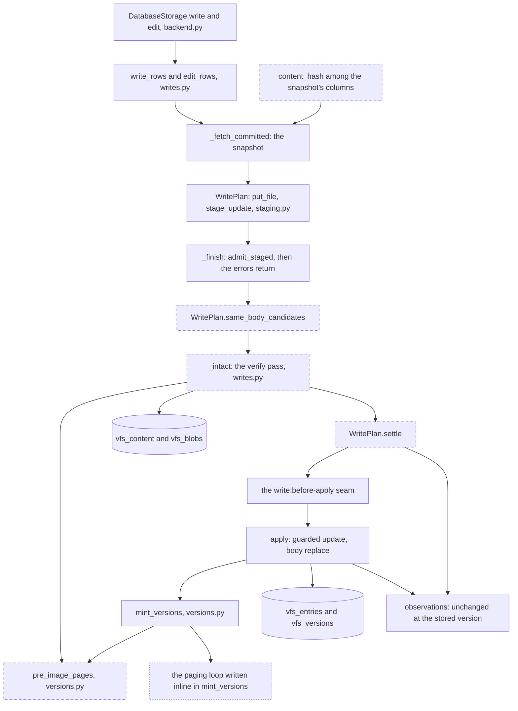

# A write or edit whose final body, kind, source and type equal the stored row's reports `unchanged`, mints nothing and writes nothing

A feature. Flags: it changes what `write` and `edit` answer for a call that changes nothing, and adds no name, argument, status value, error kind or column to the public API; it changes no schema format; it needs the engine legs, because it adds one read to the write path and removes every mutation statement from a call that changes nothing; it changes no rights rule, and it carries a leak test because the new answer tells a caller that its body equals a stored one; it touches no Rust; it is not parallel-safe with units 174-2, 174-3, 174-4 and 175-2, which edit the same three modules. It serves roadmap story K2 at gate b, whose acceptance line 5 reads "An identical rewrite reports `unchanged`, leaves `version` untouched and issues no content insert" (READ, `context/standards/roadmap.md:149`), and it is the row story K5 names as its dependency (READ, `context/standards/roadmap.md:170`). It is converted, by amendment, from [spec 174](../../context/specifications/archive/174-write-preconditions-and-the-guarded-append/spec.md) sections 3, 7 (the zero-statement row) and 10 (row 1), its criteria 3 to 9 and section 1 of [its task list](../../context/specifications/archive/174-write-preconditions-and-the-guarded-append/tasks.md), read with [the study of that source](../2026-11-25-the-backlog-converted/studies/165-181/174-write-preconditions-and-the-guarded-append.md). It stands on section 2.4 of [the OSTEP memo](../../context/research/2026-10-24-what-ostep-teaches-vfs-eight-studies-and-what-changes-in-the-kernel-plan.md), which records the replayed identical write as a defect, and on [the reference deployment memo](../../context/research/2026-11-09-what-an-enterprise-scale-deployment-looks-like.md) for every cost below. It depends on one spec, [the kernel rulings spec](../../context/specifications/active/2026-11-15-the-kernels-public-names-and-argument-families-are-ruled.md): drafted, signed fit to build, changing no code, its constitution edit already in the tree (EXECUTED, `grep -c if_revision context/standards/constitution.md` prints 0). Relied on from it: decision 9, quoted in decision 3 below, and decision 12, the rule for reading the source's citations of retired records. Build order: nothing in the tree has to land first; this unit is the first of the four units of spec 174 and lands before [174-2](../2026-11-25-an-exclusive-create-replaces-overwrite-on-write-and-is-judged-at-add/spec.md), [174-3](../2026-11-25-a-write-that-names-the-version-it-read-is-refused-when-the-row-moved-on/spec.md), [174-4](../2026-11-25-append-is-one-locked-read-modify-write-so-concurrent-appends-keep-every-line/spec.md), [175-2](../2026-11-25-every-written-row-reports-its-hash-and-no-verb-launders-a-damaged-body/spec.md) and [177-1](../2026-11-25-every-mutating-verb-sent-twice-answers-as-a-pinned-replay-table-says/spec.md), each of which names it in [the unit map](../2026-11-25-the-backlog-converted/units.md). One decision is provisional: decision 4, how the `unchanged` test treats a stored body that no longer matches its recorded hash.

## The problem

Labels: EXECUTED means a command ran at `5b20fd4f` and the claim reports its output; READ means read at the cited `path:line` at `5b20fd4f`; INFERRED means reasoning. The probes are scratch scripts on a SQLite file and on the in-memory store, run with `uv run python` as the system actor unless a caller is named; statement counts leave out `BEGIN`, `COMMIT`, `PRAGMA`, `SAVEPOINT`, `RELEASE`, `ROLLBACK` and the planner-statistics step, as `tests/support/statements.py` does.

- A write of the body a file already holds reports `updated` and moves the version from 1 to 2. It issues 7 statements: the snapshot, the guarded `UPDATE` of the entry row, the grant-revision read, the mint's read of the pre-image, a `DELETE` on each body table and the content `INSERT`. It leaves no version row (EXECUTED). A bytes row behaves the same (EXECUTED).
- A 10,000-entry batch of identical bodies reports 10,000 `updated`, updates 10,000 entry rows, inserts 10,000 content rows, reads every pre-image in the mint, leaves 0 version rows and resets `chunked` on all 10,000 rows, so the next index pass visits every one (EXECUTED).
- An `edit` whose operations cancel out, `one` to `two` and back, reports `updated`, moves the version and issues 6 statements (EXECUTED).
- The plan cannot see the no-op. The snapshot selects eleven entry columns and `content_hash` is not among them (READ, `src/vfs/storage/backends/database/writes.py:326-338`). Every staged update writes all twenty material columns, the stamps included: `chunked`, `encoded` and `indexable` are reset and `updated_at` is set (READ, `writes.py:1194-1227`).
- Half the rule is already in the tree. The version mint says "a body replaced by an identical one mints nothing", decides it by measuring the stored body, "never copied from the entry row", and reads those bodies a page at a time (READ, `src/vfs/storage/backends/database/versions.py:13`, `:19-20`, `:91`, `:146`). The status `unchanged` exists, and the write family answers it for a standing directory and an adopted create only (READ, `src/vfs/storage/backends/database/staging.py:50`, `:337`; `writes.py:257`, `:373-374`). The renderer already counts an `unchanged` bucket for files (READ, `src/vfs/results/render.py:619`).
- Why it is wrong. The constitution makes the version the unit of cache invalidation and says "No-op writes and internal maintenance MAY keep the stamp" (READ, `context/standards/constitution.md:69`, `:74`). A version that moves on a no-op makes every cache keyed on it discard a good copy, and once `if_version=` exists a caller that lost the reply to its own write and sends it again would be refused (READ, the OSTEP memo, `:66`).
- What it costs at the reference deployment. The nightly batch re-ingests 1,000,000 files in 100 batches of 10,000 (READ, `AGENTS.md`, "The reference deployment"). Each file whose body did not change costs today one entry update, one body delete and insert, one pre-image read, and one index visit in the next pass, the multiplier the same section calls the one that most often makes a small idea unaffordable (INFERRED from the two facts above).
- A same-body write heals a damaged body today. After a raw `UPDATE vfs_content SET content='ROTTEN'`, writing the original body again reports `updated`, a `read` returns the written body, and the version row keeps the damaged body under the damaged body's own measured hash (EXECUTED). Two rulings of 2026-11-15 rely on that outcome (decision 3).
- Who may hear the new answer. `write` and `edit` judge an occupied target at `contribute`, and every rung includes the ones below it, so a caller who may overwrite a row may read it (READ, `src/vfs/ops.py:118`, `:151-152`). On a private mount, a same-body write by a `read` holder and by an `add` holder who does not own the row is refused `vfs.permission_denied`, and by anonymous under a `read` posture `vfs.unauthenticated` (EXECUTED). The plan judges each staged update again from its own read (READ, `src/vfs/storage/backends/database/authorized.py:315-328`; `writes.py:359`).
- Three tests use a same-body overwrite as the way to dirty an entry whose chunk rows are still good: `TestChunkProvenance.test_same_body_overwrite_skips_the_resplit` (READ, `tests/storage/database/test_indexing.py:1371`), `TestLedger.test_a_same_body_overwrite_and_a_rename_re_extract_nothing` (READ, `tests/storage/database/test_links.py:190`) and the `overwrites` rows of `_changed` (READ, `tests/storage/database/test_refresh.py:1191`) (EXECUTED, a grep of `tests/` for the phrase).

## Architecture

Terms, each used in this sense below.

- **Snapshot.** The one bounded read that seeds a write or edit batch: each target's row, its ancestors and any tombstone.
- **Plan.** The `WritePlan`, which judges every entry against the snapshot in pure Python. A plan with an error runs no mutation statement.
- **Material.** The four columns that say what a file is: `kind`, `source`, `content_hash` and `mime_type` (decision 2).
- **Candidate.** A staged update of a live row whose material, as the write would store it, equals the stored row's.
- **Intact.** A stored body whose measured hash equals the row's recorded `content_hash`. A body that is changed or missing is **damaged**.
- **Verify pass.** The read that measures each candidate's stored body.
- **Settle.** Dropping each intact candidate from the plan and marking its path `unchanged`.
- **Mutation statement.** An `INSERT`, `UPDATE` or `DELETE`.

## Decisions

### 1. A staged update of a live file whose final material equals the stored row's, and whose stored body is intact, is dropped from the plan and reports `unchanged` at the stored version

The call succeeds. The row keeps its version, its body rows, its stamps and its place in the index. A batch in which every row is dropped issues no mutation statement at any size, because `_apply` returns at its first line when nothing is staged (READ, `writes.py:404`). A `write` sent twice with the same body therefore answers `updated` or `created` the first time and `unchanged` the second, which is row 1 of the source's replay table and the row story K5 takes. The reason is the constitution's: the version says that the public state of the entry changed, and here it did not.

Basis: the source spec, section 3 and section 10 row 1; still true at `5b20fd4f` (the probes of an identical rewrite, a 10,000-entry batch and a cancelling edit report `updated` and a moved version).

### 2. Material is `kind`, `source`, `content_hash` and `mime_type`, compared as the write would store them

`mime_type` is in the set because a text write that declares no type stores `NULL`, and a caller who declares a type on the same body is changing the row: that write reports `updated` and stores the type (EXECUTED). `source` is in the set because the text `hi` and the bytes `b"hi"` hash equal, and a text row rewritten as bytes changes its source and its sniffed type (EXECUTED). The owner is not in the set: a write never changes it. Every other column a write sets is derived from the four or is a stamp that stays true while the body stands. A stored row with no recorded hash is never a candidate, because a staged file always carries one.

Basis: verified lean, the source's section 3 as verified by the study's open choice 4; precedent: `_material_values` never writes the owner and derives or stamps every other column (`writes.py:1194-1227`), and the mint already treats an equal hash as no new version (`versions.py:146`).

### 3. A same-body write over a damaged body writes the body and reports `updated`

Decided 2026-11-15: "a `write` over the file succeeds and heals it", and the integrity story "does not land with a path on which a damaged file can be neither read, rewritten nor removed"; and "named callers and agents fix a damaged file by overwriting it or restoring a prior version". The body that corrects a damaged file is the body whose hash the row records, so it is exactly the write the four-column comparison would call a no-op. The source accepted that consequence and told spec 175 to find another repair; the two rulings came later and reverse it. This unit lands first, so the outcome holds at this unit's own landing and at every commit after it. The heal moves the version by one and mints one version row holding the damaged body, as the mint does today.

Basis: ruled, 2026-11-15, decision 9 of the kernel rulings spec and row D58 of `context/standards/roadmap.md` section 16 (`:1130`).

### 4. The `unchanged` test measures each candidate's stored body before it skips the write

A candidate is settled only when its stored body, read and hashed, gives the recorded hash. A candidate whose body is changed or missing stays staged as an update, and the write heals it as decision 3 requires. The rulings fix the outcome and not the mechanism, and two mechanisms meet it.

The cost, stated plainly: one read of each unchanged file's stored body, where the alternative reads nothing. That read is no larger than the one the mint makes today for the same write, and it replaces the entry update, the body delete and the body insert. The Design section multiplies it out.

Basis: provisional, no ruling on record; the options were (a) trust the recorded hash, add nothing to the write path, and have the integrity units mark a row damaged when a read or a lint pass finds it, a marked row being excluded from `unchanged`, or (b) measure the stored body of each candidate before skipping; chosen because (b) is the nearer to what vfs already does, the mint deciding "nothing was lost" from the body itself and a same-body write healing today, because (a) needs a damage mark that no table holds and no unit owns and until one exists would answer `unchanged` to the very overwrite decision 3 rules must heal, and because moving from (b) to (a) later removes one read and changes no name, no schema and no answer for an intact file.

### 5. The verify read asks one question, whether the stored body still gives the recorded hash, and carries no version, path or tombstone term

A rival may commit between the snapshot and the verify read on an engine that reads at READ COMMITTED. If the rival wrote a different body, the candidate measures as damaged, stays a staged update, and the guarded update that already exists adjudicates it exactly as it does a plain write that raced: `conflict` on a `reprobe` dialect, a rerun on a `redrive` dialect. If the rival deleted or moved the row and left its body, the candidate is settled and the call answers `unchanged` at the version its snapshot read. That answer is honest, because a call that writes nothing erases nothing: the outcome equals the call having run at its snapshot, before the rival. A false verdict of "damaged" costs one write that changes nothing but the version; a false verdict of "intact" cannot be reached without a body that hashes to the recorded hash.

Basis: decided in drafting, because the guard's three terms exist to stop a write landing on a row that moved on (`writes.py`, the `_update_materials` docstring), and a settled row lands nothing.

### 6. The verify pass reads bodies by primary key from the one body table the row's source names, a blob page at a time, and hashes each page under the landed offload threshold

A text candidate's body is read from `vfs_content` and a bytes candidate's from `vfs_blobs`, so a bytes row's rendering is never fetched. Pages are cut by the rule the mint already uses: `byte_chunked` over each row's size at the snapshot against `BLOB_PAGE_BYTES`, then `chunked` by `membership_budget`. A page whose sizes sum below `MEASURE_OFFLOAD_BYTES` is hashed inline and a larger page in one `call_offloaded` hop. A body the snapshot already joined, an edit's, is hashed from that copy and not read again. No cap is declared on the count or the bytes: one body larger than a page rides alone.

Basis: decided in drafting, because `AGENTS.md` requires every `IN` list to chunk by `membership_budget` and every body read to be bounded in flight, and the two rules reused are landed: the mint's page (`versions.py:91-95`) and the per-call threshold of [the measure spec](../../context/specifications/archive/2026-11-07-storage-measures-every-body-it-stores.md) (`writes.py:144-173`).

### 7. The test runs once, on the final staged state, after every entry of the batch is staged

A batch that writes `/a` as B and then as its stored body A is a no-op: a repeated target folds into one staged row, and the comparison sees only the last material. Both of the path's observations report `unchanged`. Today that batch reports `updated` twice and moves the version once (EXECUTED).

Basis: the source spec, section 3; still true at `5b20fd4f` (`stage_update` refreshes the one staged row of a repeated target, READ, `staging.py:416-428`).

### 8. A create and a write at a deleted path are never `unchanged`

A create adds a row. A write at a deleted path changes what every read sees, whatever body the deleted row held, so it does what a plain write at a deleted path does at that commit: at `5b20fd4f` the revive, which reports `updated` (EXECUTED). What a write at a deleted path should do is the deletes spec's to rule, and this unit takes no position on it beyond "not `unchanged`".

Basis: the source spec, section 3 and criterion 9; still true at `5b20fd4f` (a same-body write at a deleted path reports `updated`, EXECUTED; `put_file` marks the staged row a revive, READ, `staging.py:324-326`).

### 9. A create that loses arbitration and lands on a rival's row is never `unchanged`, whatever the rival wrote

The snapshot never saw that row, so there is no stored material to compare and no size to page a read by. The clobber moves the version and the mint skips an identical body, as today.

Basis: decided in drafting, because the test is a judgment of the snapshot, and the two arbitration paths (`absorb`, and the `ON CONFLICT` update) run after it on rows it does not hold (`writes.py:485-548`, `:626-670`).

### 10. `edit` follows the same rule through the same pass

An edit whose operations leave the body it started from reports `unchanged`, mints nothing and writes nothing. An edit whose `old` equals its `new` stays the `vfs.invalid` refusal it is today (READ, `src/vfs/storage/replace.py:212`). An edit keeps the row's type and source, so only its hash can differ. An edit whose result happens to equal the recorded hash over a damaged body is a heal, by decision 4: the held pre-image is measured, found damaged, and the result is written. An edit that would write a damaged body back under a fresh hash is not changed here; refusing it is unit 175-2's.

Basis: the source spec, section 3; still true at `5b20fd4f` (`edit_rows` ends in `_finish`, READ, `writes.py:306`; the cancelling edit reports `updated`, EXECUTED).

### 11. Settling runs after the plan's rights judgment and its errors return, and before the `write:before-apply` seam

The source put the pass at the top of `_finish`, before the errors return. This spec departs from that for two reasons. First, `admit_staged` judges every staged update from the row the plan's own read returned; a candidate dropped before it would answer `unchanged`, which says "this body equals that row's", about a row the caller was never judged against. Second, a plan with an error answers its errors and should read no body to do so. The pass sits before the seam because the seam marks the end of the reading half of a write. Unit 174-3, which refuses a stale version in the same pass, places that refusal in its own spec.

Basis: decided in drafting, because the judgment of a staged row precedes any answer drawn from it (`authorized.py:315-328`), and that order is what `TestStagedRowsAreJudged` pins for an update and an edit (`tests/storage/database/test_writes.py:1629`).

### 12. An `unchanged` file's observation carries the stored kind, the stored version, the stored size and the status

`_finish` builds the row of a path with no staged entry from the snapshot. It gains `size_bytes` for a content row, so an `unchanged` file row carries what an `updated` one does. A directory's `unchanged` row stays as it is. Observations stay in input order. The row's `content_hash` is unit 175-2's to add, to every written row at once.

Basis: decided in drafting, because the branch's own comment requires the observation to "equal a post-commit stat of its path" (`writes.py:385-386`) and the default `stat` row carries `size_bytes` (`src/vfs/results/projection.py:56`).

### 13. An `unchanged` write leaves `updated_at` where it was, a departure from Unix written down as the constitution's Article 3 asks

The principle: follow Unix where it has a convention, and in POSIX a `write` of one byte or more marks the file's modification time for update whether or not the bytes differ (INFERRED, recalled from POSIX.1-2017 `write` and not fetched). The deviation: a vfs write that changes nothing leaves `updated_at`, which the default `stat` row shows. The constraint: moving `updated_at` is one `UPDATE` per row, 10,000 for a 10,000-file re-ingest and up to a million a night at the reference deployment, taken under a row lock; and a timestamp that moves while the version stands would give callers two answers to "did this change". The expiry: none. A caller that wants the time moved writes a different body.

Basis: decided in drafting, because the unit's title, the roadmap's line 5 and the source's section 3 all say the call writes nothing, and Article 3 requires the departure to be a numbered decision in four parts (`context/standards/constitution.md:104`).

### 14. A same-body overwrite stops being a way to dirty an entry for the index

An `unchanged` write leaves `chunked`, `encoded`, `indexable` and every render stamp as they stand, so the next index pass does not visit the row. No line under `src/vfs` names a same-body overwrite as a way to force an index visit (EXECUTED, a grep). The index's fingerprint-skip law, which keeps the chunk rows of an entry whose hash did not move (READ, `src/vfs/storage/backends/database/indexing.py:264-266`), stays needed: entries dirtied with good chunk rows still arise from a write at a deleted path and from a trash then a restore. The three tests named in the problem section reach that state through a same-body write at a deleted path instead.

Basis: decided in drafting, because [the refresh spec](../../context/specifications/archive/2026-10-31-refresh-the-incremental-index-verb.md) lists the same-body overwrite beside the revive and the restore as one kind of dirty entry (`:214`), so removing the first leaves the skip law its other two sources and takes nothing from the index's contract.

### 15. Nothing public is added, and nothing is added for a later unit to fill

No argument, error kind, status value, column or capability is added. The source's task list landed `StagedEntry.expected_version` here as a field that is always `None`, for unit 174-3 to fill; this spec departs from that and leaves the field to the unit that uses it. Inside storage, `write_rows` gains a required `executor` and `_finish` an optional one; `mkdir_rows` passes none, because a plan of directories has no body to measure, and `_finish` settles only when it holds one.

Basis: decided in drafting, because `AGENTS.md` names speculative generality as a smell to remove, and `edit_rows` already takes its executor as a parameter (`writes.py:285`).

### 16. The rule is documented in the docstrings that already describe a write, and on no new page

`AsyncVirtualFileSystem.write` and `edit` each gain one sentence: a call that leaves the file as it is reports `unchanged` and leaves its version. The module docstrings of `writes.py`, `staging.py` and `versions.py` state the settle pass, the candidate and the shared page. No page under `documentation/` states the old behaviour (EXECUTED, a grep of `documentation/` and `README.md` for the rule's words finds nothing), so none is edited; the docs site picks the two sentences up from the export.

Basis: decided in drafting, because `AGENTS.md` makes a docstring a page's content and requires `scripts/docs.sh check` when one changes.

## Intent

After this spec, an agent or a pipeline that writes a file the body it already holds, with the same kind, source and type, gets a successful result whose row says `unchanged` and carries the version, kind and size the file already had; the version does not move, no version row is minted, no row of any table is written, `updated_at` stays, and the next index pass has nothing to do for that file. The same holds for an `edit` whose operations cancel out, for a batch that changes a file and changes it back, and for every unchanged row of a mixed batch, whose changed rows are written as before. A re-ingest of 10,000 unchanged files issues reads only. A caller who rewrites a file whose stored bytes were damaged beneath vfs is not told `unchanged`: the body is written, the version moves, and the file reads back whole. A caller who may not overwrite a file learns nothing new: the refusal comes first.

## Design

The work, in order. Each test is written and seen failing before the code that passes it. Test names are the ones the acceptance criteria cite.

1. **The shared page (a refactor that keeps behaviour).** `versions.py` gains a public generator, `pre_image_pages(staged, membership_budget)`, which yields pages of staged entries: `byte_chunked(staged, size at snapshot, BLOB_PAGE_BYTES)`, each page cut again by `chunked(page, membership_budget)`. `mint_versions` walks it in place of its inline loop and takes each page's entry ids, and `_pre_image_size` stays the generator's private metering. The existing pin, `TestRevive.test_the_mint_reads_pre_image_bodies_in_byte_bounded_pages` (`tests/storage/database/test_trash.py:520`), is run first and stays green with no edit.
2. **The plan (pure Python, no statement).** Test first: `TestUnchanged.test_a_staged_update_is_a_candidate_only_when_the_four_columns_match` in `tests/storage/database/test_writes.py`, on a `WritePlan` built from plain mappings. Then, in `staging.py`: a private `_same_material(staged, row)` under a trailing internal-helpers banner; `WritePlan.same_body_candidates()`, which returns each staged entry with `persistence == "update"`, `revive` false and equal material; and `WritePlan.settle(intact)`, which deletes each given entry from `staged` and rewrites every `pending` tuple of its path to `unchanged`.
3. **The snapshot's column.** `_fetch_committed` adds `entry.c.content_hash` to its column list: one more column on a statement that already runs, 64 characters a row.
4. **The verify pass and its wiring.** Tests first: the six conformance rows, then the counted tests of `TestUnchanged`. Then, in `writes.py`: `_intact(session, tables, profile, membership_budget, candidates, executor)` returns the candidates whose stored body is intact. It walks `pre_image_pages` three times: over the candidates whose body the snapshot holds (`base_content`), which it hashes from memory with no statement, then over the unread text candidates, then over the bytes candidates. For each page of the last two it issues one statement, `select(body.c.entry_id, body.c.<column>).where(membership(body.c.entry_id, ids, profile))` on `vfs_content` or `vfs_blobs`, hashes the page with `measure_text` or `measure_bytes` under the threshold rule of decision 6, and keeps the ids whose hash equals the staged one. An id the statement does not return is damaged. `_finish` gains `executor: Executor | None = None`; after `admit_staged` and the errors return, and before the seam, it calls `plan.settle(await _intact(...))` when it holds an executor and the plan has candidates. Its committed-row branch passes `size_bytes` for a content row. `write_rows` gains `executor` and passes it on; `edit_rows` passes the one it has; `DatabaseStorage.write` passes `offload_pool()`, as its `edit` does.
5. **The leak and the race.** Tests first: `TestStagedRowsAreJudged.test_a_same_body_write_over_a_replaced_row_is_judged_before_it_answers`, the grants conformance row, and `TestUnchangedUnderRivals.test_an_unchanged_answer_leaves_a_rival_write_standing`. They pass with the wiring of step 4 as placed; the first fails if the settle call is moved above `admit_staged`.
6. **Tests that move.** `test_same_body_overwrite_skips_the_resplit` becomes `test_a_same_body_revive_skips_the_resplit`, and `test_a_same_body_overwrite_and_a_rename_re_extract_nothing` becomes `test_a_same_body_revive_and_a_rename_re_extract_nothing`: each deletes the file and writes its stored body back in place of the bare rewrite. The two `overwrites` rows of `test_refresh.py`'s `_changed` do the same, and any pinned refresh count that moves is recorded in the landing notes with its old and new value. The first full run of the suite, in the autonomous pass, finds any other test that rewrites a row's own body and asserts `updated`, a version or a dirtied flag; each moves to a different body or asserts `unchanged`, and the landing notes list them.
7. **Docstrings and gates.** The docstrings of decision 16. Then `scripts/ci.sh`, `scripts/docs.sh check`, and the four server legs through the `db_test` skill, since the change adds a statement to the write path.

What is added, the multiplier it rides on, and the budget that bounds it. Figures are the reference deployment's; `B` is `membership_budget(profile, parameter_budget)`, 1,000 on Oracle and 2,000 on SQL Server (READ, `src/vfs/storage/backends/database/dialects.py:568`, `:639`, `:760-767`).

| Added | Grows with | Multiplier and arithmetic | Bound on the least generous engine |
|---|---|---|---|
| `content_hash` in the snapshot | targets and ancestors of the batch | per file write, about 1,050,000 a day: 64 characters a row on a select that already runs; no statement | the snapshot's own `rows_by_path` chunks by `B` |
| the candidate list | staged updates of the batch | per batch: at most 10,000 references to staged entries; no statement, no copy of a body | the batch size, which the caller chose |
| the verify read | unchanged files of the batch, and their stored bytes | per file write: at most one body read per unchanged write, so at an unchanged share `s` of the day's 1,050,000 writes, `s` × 1,050,000 bodies. Per batch, all 10,000 unchanged: at the 4 KB median 40 MB in 5 blob pages, at most 5 + 10 = 15 statements on Oracle and 10 on SQL Server, 1,500 a night; at a 0.5 MB mean 5 GB in about 625 pages of about 16 bodies, about 625 statements a batch, 62,500 a night | each statement's `IN` list is one `chunked` slice of at most `B` ids, and its bodies sum to at most `BLOB_PAGE_BYTES` or are one body; statements are at most the page count plus `ceil(n / B)` |
| hashing a page | bytes of the page | per file write: the stored body is hashed once, the incoming body having been hashed once already by `measured_entries`; 4 GB a night at the median and about 500 GB at the mean when every file of the nightly batch is unchanged | one page in flight; inline below `MEASURE_OFFLOAD_BYTES`, one hop a page at or above it |
| memory | one page | per batch: one page of bodies and one dictionary of that page's hashes | `max(BLOB_PAGE_BYTES, the largest single body)` |

Read against today, at the same share `s`: the same writes already make the same body reads, in the mint, and on top of them write an entry row, delete and insert a body, and send the entry through the next index pass. So the change removes, per unchanged file, an entry update, two body deletes, a body insert and one index visit, and adds no read that is not made today. The profile is stated, not capped: where a measured re-ingest workload finds the body read too dear, the direction is option (a) of decision 4.

Per verb call: nothing is added to a read, a list, a glob, a grep or a search; `write` and `edit` are the calls costed per file write above.

Per index visit: nothing is added. An unchanged file is no longer dirtied, so at share `s` of the nightly million the next partial pass visits `s` × 1,000,000 fewer entries.

Per corpus: nothing. No whole-table statement is added.

Per lock: the verify read is a plain select by primary key and takes no lock another caller needs. A batch in which every row settles holds no row lock at all on a server engine, where today it holds one on every target from the guarded update to the commit. On SQLite a write transaction holds the writer lock from its first read (READ, `src/vfs/storage/backends/database/backend.py:1394`), so the verify read lengthens that hold by its own length and removes the longer mutation statements after it. A read never waits on any of this. On SQL Server with snapshot reads off, the verify read can wait on an uncommitted writer of the same body row, exactly as the snapshot read before it can; [the read-never-waits spec](../../context/specifications/active/2026-11-15-on-sql-server-a-read-never-waits-on-a-write.md) owns that setting.

## Scope

In: decisions 1 to 16. Files: `src/vfs/storage/backends/database/staging.py`, `writes.py`, `versions.py` and `backend.py` (the one argument `write` passes); the docstrings of `write` and `edit` in `src/vfs/base.py`; `tests/support/storage_contract.py` (six rows), `tests/support/grants_contract.py` (one row), `tests/storage/database/test_writes.py`, `test_races.py`, `test_indexing.py`, `test_links.py` and `test_refresh.py`.

Out, each with where it belongs.

- `if_absent=` and the removal of `overwrite=` from `write`: [174-2](../2026-11-25-an-exclusive-create-replaces-overwrite-on-write-and-is-judged-at-add/spec.md).
- `if_version=`, `if_versions=`, the stale-version refusal in the settle pass, `StagedEntry.expected_version`, the guard-miss reprobe that learns a rival wrote the same body, and the replay of one's own guarded write: [174-3](../2026-11-25-a-write-that-names-the-version-it-read-is-refused-when-the-row-moved-on/spec.md). It relies on decision 1 here.
- `append=True`, and an append with an empty tail answering `unchanged`: [174-4](../2026-11-25-append-is-one-locked-read-modify-write-so-concurrent-appends-keep-every-line/spec.md).
- `content_hash` on every written row, the warning on an overwrite of a damaged body, the version row that keeps the recorded hash, and an `edit` refusing a damaged pre-image: [175-2](../2026-11-25-every-written-row-reports-its-hash-and-no-verb-launders-a-damaged-body/spec.md). Until it lands, the heal of decision 3 is silent and its version row carries the damaged body's own hash, as today.
- A `read` refusing a damaged body, and the system actor accepting one as found: [175-1](../2026-11-25-a-read-refuses-a-body-that-fails-its-recorded-hash/spec.md) and [175-3](../2026-11-25-the-system-actor-accepts-a-damaged-body-as-found/spec.md).
- The replay table of every mutating verb, of which the `write` row is decision 1: [177-1](../2026-11-25-every-mutating-verb-sent-twice-answers-as-a-pinned-replay-table-says/spec.md).
- A same-bytes overwrite keeping its rendering: [152-1](../2026-11-25-an-unchanged-bytes-overwrite-keeps-its-rendering/spec.md). Once this unit lands, a same-bytes write with the same type and source writes nothing and so keeps its rendering by decision 1; what is left of 152-1 is that spec's to state.
- What a write at a deleted path does, and whether it reports `updated` or `created`: the deletes spec, not yet written, on [the deletes memo](../../context/research/2026-11-15-deletes-tombstones-and-a-move-that-keeps-its-identity.md).
- A `copy` or `move` that lands a body equal to the one already at its destination: no unit carries it; the transfer verbs do not run through the write plan.
- The split of the conformance battery into a package: [179-1](../2026-11-25-the-conformance-battery-is-split-by-kernel-operation-with-no-test-lost/spec.md). The six rows added here are named so that they carry over by name.
- A content-hash precondition, and `if_version=` on a read: no unit of this conversion builds either.

## Acceptance criteria

"Every leg" means the row is in a contract class, so it is collected under `tests/storage/test_conformance.py` as `TestMemoryConformance`, `TestSqliteConformance`, `TestPostgresConformance`, `TestMariaDBConformance`, `TestMSSQLConformance` and `TestOracleConformance`. "The server legs" means a test parametrized by `ENGINE_LEGS`: Postgres, MariaDB, SQL Server and Oracle. Statement counts are taken on a SQLite file by the system actor with the `before_cursor_execute` listener `test_writes.py` already uses, leaving out control statements and the statistics step.

1. Writing a text file its own body, and a bytes file its own bytes, succeeds with status `unchanged` and the version the file had, and a `read` returns the body: `StorageContract.test_an_identical_write_is_unchanged_and_keeps_its_version` in `tests/support/storage_contract.py`, every leg.
2. A batch of three changed and three identical bodies reports three `updated` rows one version up and three `unchanged` rows at their old versions, in input order, and a `stat` of each agrees: `StorageContract.test_a_mixed_batch_writes_only_what_changed`, every leg.
3. A batch that writes a path as a new body and then as its stored body reports `unchanged` for both of the path's rows and leaves its version: `StorageContract.test_a_batch_that_writes_a_path_back_to_its_body_is_unchanged`, every leg.
4. A same-body write that declares a new `mime_type` reports `updated` and stores the type, and a text body rewritten as the same bytes reports `updated` with `source == "bytes"`: `StorageContract.test_a_new_mime_or_source_on_the_same_body_is_an_update`, every leg.
5. An `edit` whose two operations cancel out reports `unchanged` at the version the file had: `StorageContract.test_an_edit_that_changes_nothing_is_unchanged`, every leg.
6. Writing a deleted file the body it held reports `updated`, never `unchanged`, and the file is live after: `StorageContract.test_a_revive_with_the_old_body_is_updated`, every leg.
7. A staged update is a candidate when its four material columns equal the stored row's, and is not one when any of the four differs, when the stored hash is `NULL`, when the row is a revive, or when the entry is a create: `tests/storage/database/test_writes.py::TestUnchanged::test_a_staged_update_is_a_candidate_only_when_the_four_columns_match`.
8. An identical rewrite after a `rebuild` issues exactly two statements, the snapshot and one body read, and no `INSERT`, `UPDATE` or `DELETE`; the count of `vfs_versions` rows, and the entry row's `version`, `updated_at`, `chunked`, `encoded` and `indexable`, are what they were: `tests/storage/database/test_writes.py::TestUnchanged::test_an_identical_rewrite_issues_two_reads_and_no_mutation`.
9. With `in_list_budget` narrowed to 1,000, a 10,000-entry identical rewrite reports 10,000 `unchanged` rows, issues no mutation statement, issues exactly 10 body reads, and binds no more than 1,000 keys in any of them: `tests/storage/database/test_writes.py::TestUnchanged::test_ten_thousand_identical_rewrites_write_no_row`, marked `slow`.
10. A cancelling edit issues exactly one statement, the snapshot, and no mutation statement: `tests/storage/database/test_writes.py::TestUnchanged::test_a_cancelling_edit_issues_one_statement`.
11. After the stored body is changed by raw SQL beneath an unchanged recorded hash (a text body, a bytes body, and a body row deleted), writing the recorded body reports `updated` one version up and a `read` returns the written body: `tests/storage/database/test_writes.py::TestUnchanged::test_a_same_body_write_over_a_damaged_body_writes_the_body`, on SQLite and the server legs.
12. After a stored text body is changed by raw SQL, an `edit` whose result is the recorded body reports `updated` and a `read` returns that body: `tests/storage/database/test_writes.py::TestUnchanged::test_an_edit_that_restores_a_damaged_body_writes_it`.
13. With `BLOB_PAGE_BYTES` patched so that five stored bodies fill five pages, an identical rewrite of the five issues exactly five body reads: `tests/storage/database/test_writes.py::TestUnchanged::test_the_verify_pass_reads_one_blob_page_at_a_time`.
14. An identical rewrite of one body of `MEASURE_OFFLOAD_BYTES` makes exactly two `call_offloaded` hops, one for the incoming body and one for the stored page, and of a smaller body none: `tests/storage/database/test_writes.py::TestUnchanged::test_the_verify_pass_hashes_a_large_page_in_one_hop`.
15. When the row at a path is replaced, after the gate and before the plan's read, by another owner's unreadable row that holds the body being written, the call redrives (two attempts counted) and no attempt answers `unchanged` from that row: `tests/storage/database/test_writes.py::TestStagedRowsAreJudged::test_a_same_body_write_over_a_replaced_row_is_judged_before_it_answers`.
16. On a private mount, a same-body write by a `read` holder and by an `add` holder who does not own the row is refused `vfs.permission_denied`, by anonymous under a `read` posture `vfs.unauthenticated`, none of the three results carries a row, and the owner's same-body write reports `unchanged`: `GrantsContract.test_a_same_body_write_below_the_overwrite_rung_is_refused` in `tests/support/grants_contract.py`, every leg.
17. When a rival write of a different body commits at the `write:before-apply` seam, the same-body call reports `unchanged` at the version its snapshot read, and a `read` afterwards returns the rival's body one version up: `tests/storage/database/test_races.py::TestUnchangedUnderRivals::test_an_unchanged_answer_leaves_a_rival_write_standing`, on the server legs.
18. A same-body write at a deleted path still dirties the entry, and the next `rebuild` re-splits nothing: `tests/storage/database/test_indexing.py::TestChunkProvenance::test_a_same_body_revive_skips_the_resplit`.
19. The version mint pages its pre-image reads exactly as before the shared generator: `tests/storage/database/test_trash.py::TestRevive::test_the_mint_reads_pre_image_bodies_in_byte_bounded_pages`, unedited.

## Landing notes

Filled in when the pull request is opened.

## One line

A write or edit that would leave a file's body, kind, source and type as they are reads the stored body once to prove it intact, then reports `unchanged` at the stored version and writes no row, while the same write over a damaged body still heals it.
