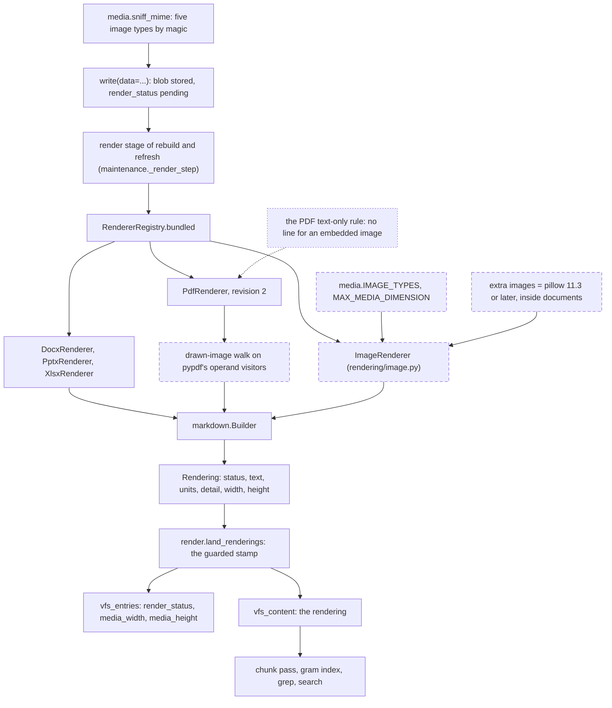

# An image written as bytes renders a header of format, dimensions and readable EXIF tags, stores its width and height, and a PDF's embedded images get the same placeholder line docx and pptx emit

This is a feature. Flags: it changes the public API by addition only (the class `vfs.rendering.ImageRenderer`, the extra `images`, and seven constants in `vfs.models.media`); it needs the engine legs (one conformance row and one stored-dimension pin on every server engine, although no storage code changes); it is not structural, changes no schema format, touches no rights and does not touch the Rust engine; it is parallel-safe. It serves roadmap story E8 at gate 0.2 ([the roadmap](../../context/standards/roadmap.md), "E8 — Render at write (159), images (152 C), `imports` edges (147), tuned fusion defaults"); the story's whole text is "Independent of theme 3. Render at write moves up if D21 says so." and it carries no acceptance line, so the criteria below are this unit's own. It is converted by amendment from [the binary bodies spec](../../context/specifications/archive/152-binary-bodies-and-text-renderings/spec.md), sections 4 (embedded images), 7 and 8, slice C and the image-header acceptance criterion, as verified against the tree by [the study of that source](../2026-11-25-the-backlog-converted/studies/051-162/152-binary-bodies-and-text-renderings.md). It stands on [the binary renderings memo](../../context/research/2026-10-05-binary-files-and-derived-text-renderings.md). It depends on slices A and B of the same source, which are landed: the schema, the renderer seam, the registry, the four document renderers and the render stage are in the tree at `5b20fd4f`. It has no dependency that is not landed.

## The problem

Every fact below is at commit `5b20fd4f`.

- READ `src/vfs/rendering/registry.py:44-46`: the bundled registry holds four renderers, pdf, docx, pptx and xlsx. EXECUTED (`ls src/vfs/rendering/`): the package holds `seam.py`, `registry.py`, `markdown.py`, `pdf.py`, `docx.py`, `pptx.py`, `xlsx.py` and no image renderer.
- READ `src/vfs/models/media.py:81-103`: the sniffer already answers five image types by magic, `image/png`, `image/jpeg`, `image/gif`, `image/tiff` and `image/webp`. READ `registry.py:99-103`: a type no renderer claims is answered `unsupported` with the detail `no renderer for image/png`. So an image written as bytes is stored and readable as bytes, and after a `rebuild` its `render_status` is `unsupported`: `read` returns no text and a warning (READ `src/vfs/storage/backends/database/reads.py:891-894`), and `grep` and `search` never see it.
- READ `src/vfs/models/rows.py:473-474`, `src/vfs/storage/backends/database/render.py:366-367` and `:417-418`, `src/vfs/rendering/seam.py:178-179`: the columns `media_width` and `media_height`, the `width` and `height` fields of `Rendering`, and the stamp that carries one to the other all exist. EXECUTED (`grep -rn "\.width\|\.height\|media_width" src/`): no renderer sets a width or a height, so both columns are null on every row.
- READ `pyproject.toml:60-67`: the extras are `pdf`, `docx`, `pptx`, `xlsx` and `documents`, which names those four; there is no `images` extra. READ `uv.lock:2271-2272` and `:2751-2758`: pillow 12.3.0 is already locked, as a dependency of python-pptx.
- READ `src/vfs/rendering/pdf.py:7-9` and `:47`: the PDF renderer writes each page's text and nothing for an image, and its docstring says so. READ `src/vfs/rendering/docx.py:206` and `src/vfs/rendering/pptx.py:100`: docx and pptx write one `` line per picture through `Builder.image` (`src/vfs/rendering/markdown.py:263-273`). The source promised that line for an embedded image "in any document" (the source, section 4).

What is missing follows from these. An agent cannot find a photograph by its camera, its date or the caption its file carries. A listing cannot show an image's size, because nothing stores it. A reader of a PDF's rendering cannot tell that a page holds a figure.

## Architecture



- **Header**: the whole rendering of an image, between three and nine lines of the form `label: value`.
- **Opener**: the class Pillow ships for one image format, such as `PIL.PngImagePlugin.PngImageFile`. Constructing it parses the file's header and decodes no pixel.
- **Drawn image**: an image a PDF page's content stream paints, either an image XObject named by a `Do` operator, at the page's level or inside a form XObject, or an inline image.
- **Stored dimensions**: the width and height of the pixel matrix as the file encodes it, before any EXIF rotation.

## Decisions

### 1. The bundled `image` renderer claims exactly the five image types the sniffer proves by magic.

`vfs.models.media` gains the names `PNG`, `JPEG`, `GIF`, `TIFF` and `WEBP` for the five type strings and the tuple `IMAGE_TYPES` holding them in that order; `_MAGIC` and the WebP branch of `sniff_mime` use the names. `ImageRenderer.mimes` is `IMAGE_TYPES`. An image type the sniffer cannot prove (BMP, HEIC, AVIF, SVG) keeps its declared type and stays `unsupported`. The reason: magic decides the family and a declaration never overrides it, so these five are the only image types a row can carry with proof. A body no signature matches keeps its declared type (READ `media.py:113`), so a body declared as one of the five with no signature at all still reaches its opener, which refuses it (decision 12).

Basis: the source spec, sections 1 and 8; still true at `5b20fd4f` (READ `src/vfs/models/media.py:81-103`: the same five types are sniffed and no other image type is).

### 2. Pillow is the parser, behind a new extra named `images`.

`pyproject.toml` gains `images` under the renderer extras and `ImageRenderer.extra` is `images`. The reason: Pillow reads the header of every one of the five formats and their EXIF blocks, it is already installed wherever `vfs[pptx]` is, and third-party parsers are a dependency decision on their own merits, outside the rule that engine code is Rust ([AGENTS.md](../../AGENTS.md), Tooling).

Basis: verified lean, the source's marker in section 7 (bundled renderers and extras) and the study's open choice 11; precedent: `uv.lock:2751-2758` (python-pptx depends on pillow, so the lock already carries it) and the binary renderings memo, line 69 ("Pillow for image dimensions").

### 3. The extra's floor is `pillow>=11.3`.

The reason: 11.3.0 is the oldest release that ships a wheel for every interpreter of the CI matrix, 3.11 to 3.14. EXECUTED 2026-11-25 against PyPI's file listing: 10.4.0, 11.0.0, 11.1.0 and 11.2.1 list no `cp314` wheel, and 11.3.0 and 12.0.0 do. Every Pillow name the renderer reads (`ExifTags.Base`, `ExifTags.IFD`, `ExifTags.GPS`, `Image.Exif.get_ifd`, the five opener classes) is older than that floor (INFERRED from Pillow's reference; the tests prove them on the locked release only). The lock stays at 12.3.0, the version the tests run on.

Basis: decided in drafting, because an extra's floor names the oldest release the project can claim on every interpreter it tests, as `xlsx` names the oldest release its parity test proves (READ `pyproject.toml:63-65`).

### 4. The `documents` umbrella gains `images`, and `all` follows through it.

`documents` becomes `vfs-py[pdf,docx,pptx,xlsx,images]`; the `all` line is unchanged because it names `documents`. The umbrella installs no new distribution, since `pptx` already brings Pillow. The reason: one install line gives every bundled renderer, and a renderer left out of the umbrella would be `unavailable` on a host that asked for all of them.

Basis: the source spec, section 7 and slice C ("the umbrella `vfs[documents]` for all five"); still true at `5b20fd4f` (READ `pyproject.toml:66-67`: the umbrella names four today and no later ruling narrows it).

### 5. No describer, caption, OCR or image vector is built.

Decided 2026-10-05: no image description provider is built; the rendering of an image is its header alone. The generation string of decision 15 leaves room for a later suffix, and nothing else here is shaped for one.

Basis: ruled, 2026-10-05, recorded in the source spec, section 8 and its non-goals, and in the study's open choice 7.

### 6. The rendering of an image is a header of `label: value` lines in one fixed order, with no heading and no unit marker.

The lines are `format`, `dimensions`, `orientation`, `camera`, `captured`, `gps`, `title`, `keywords`, `description`, in that order. The first three are always written. Each of the other six is written only when its value is present and non-blank after flattening to one line. `format` is Pillow's name for the format (`PNG`, `JPEG`, `GIF`, `TIFF`, `WEBP`). `dimensions` is `<width>x<height>` with no spaces, so one token finds it. Every value is flattened as a table cell is (whitespace runs to one space, NULs and lone surrogates removed), because every construct of a rendering is one line. An image has no pages, so it has no unit marker and an empty unit table. The reason for labels: a grep for `camera: ` finds every photograph with a known camera, and a hit shows what the value is.

```text
format: JPEG
dimensions: 4032x3024
orientation: portrait
camera: Acme Cam 1
captured: 2024-04-30T18:01:02
gps: 40.446111, -79.982222
title: Barn
keywords: barn;dusk
description: a red barn at dusk
```

Basis: decided in drafting, because the source (section 8) fixes which facts the header states and section 4 fixes that every construct is line-delimited, and both leave the labels and their order to the build.

### 7. Each tag line reads one named EXIF tag, and `title` and `keywords` read the XP tags only.

| Line | Read from | Form |
|---|---|---|
| `camera` | `Make` and `Model` of the first directory | joined by one space; the model alone when it already begins with the make, compared without case |
| `captured` | `DateTimeOriginal` of the Exif directory, else `DateTime` of the first directory | decision 8 |
| `gps` | `GPSLatitude`, `GPSLatitudeRef`, `GPSLongitude`, `GPSLongitudeRef` of the GPS directory | decision 8 |
| `title` | `XPTitle` | its bytes decoded as UTF-16-LE, NULs dropped |
| `keywords` | `XPKeywords` | the same decoding, the file's own `;` separators kept |
| `description` | `ImageDescription` | verbatim, flattened to one line |

EXIF itself has no title or keyword tag other than the XP pair; the other carriers of a title (IPTC, XMP, a PNG text chunk) are separate containers with separate parsers. The reason for stopping at EXIF: it is the one block all five openers hand over already parsed, and each further container is a new parser to bound.

Basis: provisional, no ruling on record; the options were the XP tags alone, the XP tags with IPTC, the XP tags with XMP, and all of those with PNG text chunks; chosen because the XP tags alone are the smallest reading of the source's "readable EXIF subset" and any wider carrier is additive later: a bump of the renderer's revision re-renders every image on the next `rebuild`.

### 8. A capture date is written in ISO form and a position in signed decimal degrees.

A date that parses as EXIF's `YYYY:MM:DD HH:MM:SS` is written `YYYY-MM-DDTHH:MM:SS`; any other value is written as found. No time zone is added, because the tag carries none. A position is `<latitude>, <longitude>`, each degrees plus minutes over 60 plus seconds over 3,600, negated for a `S` or `W` reference, with six decimals. The reason: an agent greps a date as `2024-04-30` and a position as one number pair, and the xlsx renderer already writes its dates in ISO form.

Basis: decided in drafting, because the one landed renderer that writes a date writes `isoformat()` (READ `src/vfs/rendering/xlsx.py:243`) and the header should not carry a second date form.

### 9. `dimensions` and the two columns state the pixel matrix as stored, and an EXIF orientation turns only the `orientation` line.

`dimensions`, `Rendering.width` and `Rendering.height` are the width and height the file encodes. `orientation` is `landscape`, `portrait` or `square`, from the shape as displayed: the stored width and height, exchanged when the EXIF `Orientation` tag is 5, 6, 7 or 8. The reason for stored dimensions: they describe the bytes, as `content_hash` and `size_bytes` do, and a consumer that decodes the bytes gets that matrix. The reason for the displayed word: it is what a person means by a portrait photograph.

Basis: provisional, no ruling on record; the options were the stored matrix in the columns with the rotation in the `orientation` line, or the displayed size in the columns; chosen because the stored matrix is the nearer to what the entry row already does for a bytes entry (its hash and size describe the bytes), and either choice is reversed by a revision bump that re-stamps every image.

### 10. A dimension past the column's range is printed and not stored.

`vfs.models.media` gains `MAX_MEDIA_DIMENSION`, 2,147,483,647, the largest value a 32-bit signed `INTEGER` column holds. When either dimension exceeds it, the `dimensions` line still states both and the rendering carries `width` and `height` as `None`, so both columns stay null. The reason: `media_width` and `media_height` are SQLAlchemy `Integer` (READ `src/vfs/models/rows.py:473-474`), which is 32 bits on Postgres, SQL Server and MariaDB and wider on SQLite and Oracle (INFERRED from the engines' type references); without this rule a crafted header would land on SQLite and be refused on the others, and a renderer's answer must not depend on the engine. A PNG header declaring a width of 2,147,483,648 opens (EXECUTED, scratch probe on Pillow 12.3.0).

Basis: decided in drafting, because the constitution's Article 4 requires the caller-facing contract to hold across backends, and the bound is the engines' own column range, not a size vfs chooses.

### 11. The renderer constructs the format's own opener and reads tags through the base `getexif`, so no pixel is decoded and Pillow's pixel-count guard does not apply.

`image.py` maps each of the five types to its opener (`PngImageFile`, `JpegImageFile`, `GifImageFile`, `TiffImageFile`, `WebPImageFile`), resolved through `load_library`, and constructs it over the body. It never calls `PIL.Image.open` and never calls `load`. It reads tags by calling `PIL.Image.Image.getexif` on the image, the base method, never the image's own `getexif`. Three executed facts on Pillow 12.3.0 fix this shape. First, `Image.open` refuses a header declaring 20,000 by 20,000 pixels with `DecompressionBombError` and warns at 10,000 by 10,000, while the opener class reads the same header and reports its size; the guard protects a decode this renderer never performs, and applying it would refuse a large scan whose header reads in full. Second, `PngImageFile.getexif` decodes the whole image when no `eXIf` chunk precedes the pixel data, while the base method decodes nothing for any of the five formats, with or without tags. Third, an opener runs only the parser the row's type names, where `Image.open` offers the body to every decoder Pillow has registered until one accepts it (EXECUTED: `Image.open` restricted to the wrong format refuses the body; unrestricted, it identifies it). The cost of the second fact is stated: an `eXIf` chunk that follows a PNG's pixel data is not read. The WebP opener calls libwebp's demuxer natively, and the render clock cannot interrupt it, as it cannot interrupt any library's open today (READ `src/vfs/rendering/seam.py:62-63`).

Basis: decided in drafting, because AGENTS.md forbids a designed scale cap that no external system imposes, and the three probes show that the cap and the decode are both avoidable.

### 12. A body its opener refuses is `corrupt`.

Any exception from constructing the opener is `corrupt`, with the bounded detail `image: <exception class>: <message>` and no body. The body either matched the format's signature or was declared as that format and matched none, so a refusal means it is not a readable file of that format. Anything raised after the opener returned reaches the registry, which answers `failed` (READ `registry.py:106-109`).

Basis: the source spec, section 6 (`corrupt`: the renderer refused the file); still true at `5b20fd4f` (READ `src/vfs/rendering/pptx.py:44-47`: a file its library cannot open is `corrupt`, caught as `Exception`).

### 13. An unreadable tag omits its line, and the rendering stays `ok`.

The three reads (the first directory, the Exif directory, the GPS directory) are each guarded: a read that raises yields no lines from that directory. A value of the wrong type, a title or keyword that does not decode as UTF-16-LE, a date that is blank, or a position that is not three finite numbers within 90 degrees of latitude and 180 of longitude omits its own line and no other. The reason: format and dimensions are true whatever the tags hold, Pillow's own EXIF loader passes over some malformed directories without a signal (INFERRED from its loader's guarded reads), so absent and unreadable cannot be told apart reliably, and a zero denominator reads as not-a-number (EXECUTED: `float(IFDRational(1, 0))` is `nan`).

Basis: decided in drafting, because the source (section 8) says the image renderer always produces a header, and a failure state is for a rendering that could not be made, not for an optional line.

### 14. No render limit is added: the ten fields of `RenderLimits` bound the header.

`chars` cuts a header whose lines pass the budget, as it cuts any rendering; `seconds` is read when the header's one unit opens; `ratio` cannot be reached, since every value comes out of the body. Because no pixel is decoded (decision 11), no pixel or memory limit is needed. The reason for adding none: a new limit would open the question of how a raised limit retries what it refused, which [the placeholder memo](../../context/research/2026-11-13-how-an-entry-refused-under-a-render-limit-is-retried-once-the-limit-is-raised.md) holds and no spec has answered.

Basis: decided in drafting, because `RenderLimits` already bounds every line a Builder writes (READ `src/vfs/rendering/markdown.py:336-349`) and the header is written through the Builder.

### 15. The generation is `image/1+pillow-<version>`, and an absent Pillow is `unavailable` naming `vfs[images]`.

`ImageRenderer` is a `BundledRenderer` with `name = "image"`, `extra = "images"`, `package = "PIL"`, `distribution = "pillow"` and the default `revision` of 1. Without Pillow its generation is `image/unavailable` and the registry answers `the image renderer needs vfs[images]`, so installing the extra changes the stamp and the next `rebuild` retries.

Basis: the source spec, sections 7 and 8; still true at `5b20fd4f` (READ `src/vfs/rendering/seam.py:402-439`: a bundled renderer's version is `<revision>+<distribution>-<version>`; READ `registry.py:104-105`: the `unavailable` answer names the extra).

### 16. An image stamped `unsupported` before this lands is rendered by the next `rebuild`, with no migration, and `refresh` leaves it.

The dirty predicate compares a row's stamp with the generation its own type resolves to today, so a type newly claimed makes its rows dirty in the full pass. `refresh` reads only rows whose bytes a write changed, so it renders a new image and leaves an old one for the `rebuild`.

Basis: the source spec, section 6 (a generation change retries); still true at `5b20fd4f` (READ `render.py:150-177` and `registry.py:83-97`; pinned for a generic type by `tests/storage/database/test_render.py:714`).

### 17. No statement, table, column or schema format changes, and no verb projects the two dimensions in this unit.

The width and height ride the existing guarded stamp into `media_width` and `media_height`; a twin borrows them with the rendering (READ `render.py:235-249`); an overwrite clears them (READ `src/vfs/storage/backends/database/writes.py:1222-1223`). Both stay row-only columns (READ `rows.py:90`). The reason for not projecting them: a field on `Entry` or on an observation is a public name, and no listing or wire consumer is specified for it yet.

Basis: the source spec, section 8 and its acceptance criterion ("`media_width` and `media_height` are stored"); still true at `5b20fd4f` (READ `render.py:366-367`, `:417-418`).

### 18. Each image a PDF page draws gets one placeholder line after that page's text, numbered across the document.

A drawn image is an image XObject painted by `Do`, at the page's level or inside a form XObject, or an inline image. Each paint is one line, so an image painted twice is two lines, and an image listed in a resource dictionary and never painted is none. The lines follow the page's text, in painting order, because pypdf returns a page's text whole. The number runs across the document, as it does in docx and pptx.

Basis: the source spec, section 4 (embedded images in any document get a placeholder line); still true at `5b20fd4f` (READ `pdf.py:7-9`: none is written; `docx.py:206` and `pptx.py:100`: the same line through `Builder.image`).

### 19. Drawn images are counted on pypdf's operand visitors during the page's one text extraction.

`PdfRenderer` passes `visitor_operand_before` and `visitor_operand_after` to the one `extract_text` call it already makes per page. The walk keeps a stack whose top is the XObject dictionary in force: the page's, read from its inherited `/Resources`. Before a `Do`, the name is resolved in the top dictionary and one entry is pushed: for a form, the form's own `/Resources` XObject dictionary; for an image, an empty entry, after adding one to the page's count; for a name that does not resolve, an empty entry. After a `Do`, one entry is popped, so the stack is balanced whatever the name was. Before an inline image, the count rises by one. A lookup that raises is treated as a name that does not resolve, so a malformed entry never fails a page that rendered before. The reasons: the page's content stream is parsed once, as today; pypdf already resolves every painted XObject to read its subtype (READ pypdf 6.19.0 `_page.py:2021-2024`), so the walk resolves nothing new and decodes no image; and a resource dictionary shared by every page, which some producers write, would put every image on every page if the dictionary were read in place of the paints. `page.images` is not used: it decodes each image. EXECUTED on pypdf 6.19.0 (scratch probe): a page painting one image twice, a form holding its own image under the same name, an inline image and one unpainted resource reports four paints in order, resolves the form's image in the form's dictionary, and leaves the stack balanced. READ in the pypdf 5.0.0 wheel (`_page.py:1974-2047`): the visitors are called in the same order around `Do`, and `get_inherited` and the inline-image operation exist, so the `pdf` extra's floor stands.

Basis: decided in drafting, because a PDF render rides the per-index-visit multiplier and the design that adds no parse and no decode to it is the one AGENTS.md's reference deployment admits.

### 20. A PDF placeholder carries an empty alt text.

The line is ``. A docx picture with no alt text already renders this way (READ `markdown.py:272`). A PDF's alternate text lives in its structure tree, joined to a paint through marked-content identifiers, and only tagged PDFs have one.

Basis: provisional, no ruling on record; the options were an empty alt text, the XObject's resource name (such as `Im0`), and the structure tree's `/Alt` text; chosen because the empty form is what the Builder already writes for a picture with no alt text, a resource name is a producer's internal label and not the document's words, and reading the structure tree later is additive behind a revision bump.

### 21. PDF placeholders count against `embedded_count`, are structure and not text, and form nesting is not measured against `embedded_depth`.

Past `embedded_count` placeholders, the rest are dropped and the rendering is `partial` with the detail the Builder writes today. A consequence is stated: a PDF that paints more than 1,000 images at the default limit, for example a scanned document of more than 1,000 pages with a text layer, is `partial` where it was `ok`, with its text whole, and a `read` of it then carries the info note every cut rendering carries (READ `reads.py:888-890`). A PDF whose pages hold images and no text is still `empty` and still has no content row, because a placeholder is not the document's text. `embedded_depth` bounds containers a renderer itself follows; here pypdf follows forms, refuses a cycle and stops at its own cap of 5,000 form invocations per extraction (READ pypdf `_configuration.py:90`), and the walk follows wherever pypdf goes.

Basis: the source spec, section 7 (`embedded_count` is non-throwing and sets `partial`); still true at `5b20fd4f` (READ `markdown.py:263-275`, `:297`, `:310-312`).

### 22. `PdfRenderer.revision` rises to 2, so the next `rebuild` renders every PDF again.

The renderer's output changes for any PDF that paints an image, and the generation is per renderer, not per file. The reason: a stamp must name the renderer that made the text, or an old rendering without placeholders would be taken as current.

Basis: the source spec, section 7 (the generation changes when the renderer's own output changes); still true at `5b20fd4f` (READ `seam.py:402-417`; the landed precedent is the xlsx revision pinned at `tests/rendering/test_renderers.py:244`).

## Intent

After this spec, a caller who writes a PNG, JPEG, GIF, TIFF or WebP file as bytes and runs `refresh` or `rebuild` can `read` it as a short header (its format, its pixel dimensions, whether it is landscape or portrait, and its camera, capture date, position, title, keywords and description where the file carries them), can find it with `grep` and `search` by any of those, and sees `render_status` `ok` on `stat` and `ls`; the entry's row holds the image's width and height; an install without Pillow says `unavailable` and names `vfs[images]`; and the rendering of a PDF shows one `` line for each image a page draws, as docx and pptx renderings already do. An image written before the upgrade is picked up by the next `rebuild` without any migration.

## Design

The order of work is below. Each test is written and seen failing before the code that passes it.

**1. The type names.** Test first: `tests/models/test_media.py::test_the_image_types_are_exactly_the_ones_magic_proves`. Then `src/vfs/models/media.py`: the constants `PNG`, `JPEG`, `GIF`, `TIFF`, `WEBP`, the tuple `IMAGE_TYPES` directly under them, and `MAX_MEDIA_DIMENSION` beside the other row bounds; `_MAGIC` and `sniff_mime` use the names. No behaviour of the sniffer changes.

**2. The extra.** Test first: `tests/rendering/test_registry.py::TestExtras::test_every_bundled_renderer_names_a_declared_extra_inside_the_umbrella`, which reads `pyproject.toml` with `tomllib`, as `tests/scripts/test_bump_version.py` does. Then `pyproject.toml`: `images = ["pillow>=11.3"]` with a comment giving decision 3's reason in words, and `documents = ["vfs-py[pdf,docx,pptx,xlsx,images]"]`. `uv lock` is run; it adds the extra's entry to `uv.lock` and no new distribution.

**3. The fixtures.** `tests/support/documents.py` gains `image_bytes(format, size, exif=None)`, built with Pillow as every builder there uses its own library; `png_header_bytes(width, height, chunks=())`, hand-built like the existing `png_bytes`, for headers no encoder would write (20,000 by 20,000; a width of 2,147,483,648; an `eXIf` chunk after the pixel data); and `drawn_pdf_bytes(pages)`, built with `pypdf.PdfWriter` like `pdf_bytes`, where each page states its text, the image paints in its content stream, its forms and its resource dictionary, including a dictionary inherited from the page tree.

**4. The image renderer.** Tests first: the `TestImage` class in `tests/rendering/test_renderers.py` (criteria 5 to 16) and the two registry tests (criteria 3 and 4). Then `src/vfs/rendering/image.py`, about 150 lines, laid out as AGENTS.md's File organization orders a module:

- a private `_Opener` named tuple (`module`, `name`) and the table `_OPENERS` from each of the five types to its opener, so no position decodes a hidden field;
- `class ImageRenderer(BundledRenderer)` with the attributes of decision 15 and `mimes = IMAGE_TYPES`;
- `render(source, limits)`: read `monotonic()`; construct the opener over `BytesIO(source.data)` inside a `try` whose `except Exception` answers `failure_from(exc, self.name, "corrupt")`; inside the image's context manager read `size` and `format` and gather the tag lines; build with `Builder(limits, input_bytes=len(source.data), total_units=1, started=started)`, opening the one unit with `boundary(1)` and writing the lines with `paragraph`; return `builder.build()` with `width` and `height` replaced, both `None` when either passes `MAX_MEDIA_DIMENSION`;
- internal helpers last: `_tag_lines`, `_camera`, `_captured`, `_position`, `_windows_text`, `_orientation_word`, each a few lines, each returning `None` for a value it cannot read.

Every Pillow module is reached through `load_library` (`PIL.Image`, `PIL.ExifTags` and the five plugin modules), the pattern `docx.py:72` and `pptx.py:47` use, so every import stays at the top of the file and an absent Pillow is the `unavailable` state, never an `ImportError`. The module docstring states the profile honestly: the header parse is bounded by the body's bytes; a PNG `eXIf` chunk after the pixel data is not read; the WebP opener copies the body once.

**5. The registry and the package.** `RendererRegistry.bundled()` returns the five renderers and its docstring says so; `src/vfs/rendering/__init__.py` imports and exports `ImageRenderer` and its docstring names images. One existing pin is amended with this step, because it enumerates the bundled generations: `tests/rendering/test_registry.py::TestResolution::test_generations_cover_every_renderer_and_the_unsupported_mark` adds an image type to the types it resolves. `test_the_bundled_set_claims_the_four_plain_types` holds unedited.

**6. The PDF walk.** Tests first: criteria 17 to 25 in `TestPdf`. Then `src/vfs/rendering/pdf.py`: a private `_Paints` class beside `PdfRenderer` holding the stack and the page's count, with `before(operator, operands, cm, tm)` and `after(...)` as its two visitor methods and `reset(page)` to start a page; `render` passes them to `extract_text`, writes the page's text, then writes the placeholders in a loop that stops when the Builder has stopped or the document's count reaches `limits.embedded_count`, where it calls `drop_embedded()` once and breaks. `revision = 2`. The docstring's sentence that images are not marked is replaced by the rule of decisions 18 to 21 in words.

**7. Storage pins, with no storage code.** `tests/storage/database/test_render.py` gains `TestImages` (criteria 26 to 30); `tests/support/storage_contract.py` gains the conformance row of criterion 31; `tests/storage/test_conformance.py` gains one shared body and its five engine tests (criterion 32), in the form `_a_directory_is_never_awaiting_the_index` already takes there (READ `tests/storage/test_conformance.py:681-732`).

**What grows with input, and what bounds it.**

- *Statements added: none.* The render stage, its dirty selection, its twin probes, its blob read and its guarded stamp are unchanged (decision 17). Every membership list in them is already cut by `membership_budget` through `chunked`, and the content insert is paged by `byte_chunked` under `BLOB_PAGE_BYTES` (READ `render.py:211`, `:227`, `:267`, `:380`, `:388`). An image's blob is read by the stage today, since every row of a cut that borrowed no rendering has its blob read whatever its type (READ `src/vfs/storage/backends/database/maintenance.py:463-465`).
- *Rows added, per index visit of a dirty image.* One content row of at most nine lines where there was none, then one chunk, its postings and, where a provider is configured, one embedding. Only a new or changed image is dirty (the skip law), so this rides the 1,050,000 file writes a day, not the 11,000,000 index visits. The share of images is an assumption: at one file in twenty, that is about 52,500 header parses a day, each bounded by its body's bytes and decoding no pixel, and the 10,000,000-file corpus gains 500,000 chunks on its 100,000,000, half of one percent.
- *Per corpus, once.* The first `rebuild` after the upgrade renders every image row stamped `unsupported` (decision 16) and every PDF again (decision 22). It runs where a whole-corpus operation is admitted: inside the daily rebuild, in keyset pages of `RENDER_PAGE_ROWS` (256) cut by `BLOB_PAGE_BYTES` (8 MiB), each landing one short write, the lease checked before each, and resumable, since a stamped row is not selected again. At one file in ten being a PDF or an image (an assumption), that is 1,000,000 renders in at least 3,907 pages, beside the 10,000,000 visits the rebuild makes every day. Twins borrow and are not rendered.
- *Memory per image render.* The body is already in flight, bounded by the stage's cut: `BLOB_PAGE_BYTES` per cut, with one larger body riding alone. The opener holds the header's fields and the EXIF block, which is part of the body. The WebP opener reads the body into its demuxer, one further copy (READ Pillow 12.3.0 `WebPImagePlugin.py:47-54`), so the peak is about twice the largest single body. Renders run one cut at a time on the offload pool with no transaction open (READ `maintenance.py:466-468`).
- *The header's text.* At most nine lines; `RenderLimits.chars` cuts it like any rendering, so a description longer than the budget yields `truncated`, never an oversized row.
- *The PDF walk.* Two Python calls per content-stream operator inside the loop pypdf already runs; each is one comparison unless the operator is `Do` or an inline image. The stack is as deep as the forms pypdf follows, which it bounds (decision 21). The page's count is one integer. The placeholder loop calls `Builder.image` at most `embedded_count` times per rendering, 1,000 by default and about 20 characters each, at most about 20 KB of the 2 MiB budget. The landing notes record the profiled call counts of one fixed PDF before and after, as counts.
- *Locks and readers.* Nothing here takes a lock or opens a transaction. A read never waits on a render: the stage renders outside any transaction and lands in one short guarded write, as today.

**Gates.** `scripts/ci.sh` (the branch touches `src/`, `tests/` and `pyproject.toml`) and `scripts/docs.sh check` (docstrings under `src/vfs/` change). The engine legs of Postgres, MariaDB, SQL Server and Oracle run for criteria 31 and 32. `cargo test -p vfs-core` is untouched. The gate's 100% coverage is met by the tests named: every branch of `image.py` and of the PDF walk is reached by criteria 5 to 25.

**Build order.** Nothing this unit needs is unlanded, so it can be built at any time. It shares no file under `src/` with its three siblings, as far as their titles say (INFERRED; their specs are not written, so their titles are quoted in place of decision numbers). The sibling "Writing the same bytes over a bytes entry keeps its rendering and its stamp, so the next index pass renders nothing" will keep the dimension columns across an unchanged overwrite; criterion 29 here overwrites with different bytes and with text, so it holds in either order. The sibling "A write of at most sixteen binaries totalling one blob page renders them outside its transaction and returns them readable and greppable" renders through the same registry, so whichever of the two lands second gains images at write with no further change.

## Scope

In: decisions 1 to 22. Files: `pyproject.toml`, `uv.lock`, `src/vfs/models/media.py`, `src/vfs/rendering/image.py` (new), `src/vfs/rendering/pdf.py`, `src/vfs/rendering/registry.py`, `src/vfs/rendering/__init__.py`, `tests/models/test_media.py`, `tests/rendering/test_registry.py`, `tests/rendering/test_renderers.py`, `tests/support/documents.py`, `tests/storage/database/test_render.py`, `tests/support/storage_contract.py`, `tests/storage/test_conformance.py`.

Out:

- An image describer, captions, OCR, an image-vector space, thumbnails: not built (decision 5).
- The two dimensions as fields of `Entry` or of an observation on `stat` and `ls`: an additive public name for the unit that first has a consumer; the wire form of an image belongs to [the wire adapter unit](../2026-11-25-the-wire-adapter-projects-a-result-to-mcp-blocks-within-budget/spec.md).
- Titles and keywords from IPTC, XMP or PNG text chunks; a PNG `eXIf` chunk after the pixel data; a frame count for an animated image; image types the sniffer does not prove: a later revision of the renderer (decisions 1, 7 and 11).
- A PDF image's alternate text from the structure tree; images in annotation appearance streams; extracting an embedded image as its own entry; OCR of an embedded image: later work on the PDF renderer (decision 20).
- Keeping a rendering and the dimensions across an unchanged bytes overwrite: [the unchanged-overwrite unit](../2026-11-25-an-unchanged-bytes-overwrite-keeps-its-rendering/spec.md).
- A count of unrendered bytes rows on a `search` result: [the search-count unit](../2026-11-25-search-says-how-many-bytes-rows-it-could-not-read/spec.md).
- Rendering at write: [the render-at-write unit](../2026-11-25-a-small-binary-write-renders-its-own-bytes-before-it-returns/spec.md).
- The how-to, the explanation page and the glossary entries for renderings: [the documentation unit](../2026-11-25-binary-bodies-are-documented-on-the-docs-site/spec.md), which describes the image header once this has landed.
- How a raised render limit retries what it refused: the placeholder memo of decision 14; this unit adds no limit.
- Reading only the leading bytes of an image: the stage reads whole bodies today, and a ranged read of `data` belongs to [the ranged read unit](../2026-11-25-read-takes-a-byte-range-and-the-row-says-which-slice-it-carries/spec.md). The future direction is named here and is not a limit.
- A subprocess pool that can stop a native parser: the fork the source names in section 7, not built.

## Acceptance criteria

1. `IMAGE_TYPES` holds exactly the image types `sniff_mime` can answer, each proven by its signature, pinned by `tests/models/test_media.py::test_the_image_types_are_exactly_the_ones_magic_proves`.
2. Every bundled renderer's `extra` is a declared extra of `pyproject.toml` and is named inside `documents`, pinned by `tests/rendering/test_registry.py::TestExtras::test_every_bundled_renderer_names_a_declared_extra_inside_the_umbrella`.
3. The bundled registry resolves each of the five image types to the renderer named `image`, whose generation begins `image/1+pillow-`, pinned by `tests/rendering/test_registry.py::TestResolution::test_the_bundled_set_claims_the_five_image_types`.
4. An `ImageRenderer` whose library is absent has the generation `image/unavailable` and renders `unavailable` with no text and the detail `the image renderer needs vfs[images]`, pinned by `tests/rendering/test_registry.py::TestClassifiedStates::test_a_missing_images_extra_is_unavailable_and_names_it`.
5. A 3 by 2 PNG with no tags renders `ok` with the exact text `format: PNG`, `dimensions: 3x2`, `orientation: landscape` on three lines, an empty unit table, a width of 3 and a height of 2, pinned by `tests/rendering/test_renderers.py::TestImage::test_an_image_without_tags_is_ok_with_three_lines`.
6. Each of the five image types renders its own `format` line and its `dimensions` line, pinned by the five cases of `tests/rendering/test_renderers.py::TestImage::test_each_image_type_renders_its_format_and_dimensions`.
7. A JPEG carrying all six tag groups renders the nine lines in the order of decision 6, each tag line in the form decisions 7 and 8 give and with the value its fixture set, pinned by `tests/rendering/test_renderers.py::TestImage::test_a_jpeg_with_tags_renders_every_line_in_order`.
8. A 40 by 30 image whose EXIF orientation is 6 renders `orientation: portrait` and `dimensions: 40x30` and carries a width of 40 and a height of 30, pinned by `tests/rendering/test_renderers.py::TestImage::test_a_turned_image_changes_the_orientation_line_and_not_the_dimensions`.
9. Rendering each of the five types, once with tags and once without, calls `PIL.ImageFile.ImageFile.load` zero times, pinned by `tests/rendering/test_renderers.py::TestImage::test_no_render_decodes_a_pixel`.
10. A PNG whose `eXIf` chunk follows its pixel data renders its three lines and no tag line, with `PIL.ImageFile.ImageFile.load` called zero times, pinned by `tests/rendering/test_renderers.py::TestImage::test_a_trailing_png_exif_chunk_is_not_read_and_not_decoded`.
11. A PNG header declaring 20,000 by 20,000 pixels renders `ok` with a width and a height of 20,000, pinned by `tests/rendering/test_renderers.py::TestImage::test_a_header_past_pillows_pixel_guard_renders`.
12. A PNG header declaring a width of 2,147,483,648 renders the line `dimensions: 2147483648x1` and carries neither a width nor a height, pinned by `tests/rendering/test_renderers.py::TestImage::test_a_dimension_past_the_columns_range_is_printed_and_not_carried`.
13. A body that begins with the PNG signature and holds no valid header renders `corrupt` with no text and a detail that begins `image: `, pinned by `tests/rendering/test_renderers.py::TestImage::test_a_body_its_opener_refuses_is_corrupt`.
14. A JPEG whose position has a zero denominator and whose title is not UTF-16-LE renders `ok` without a `gps` line and without a `title` line and with every other line it carries, pinned by `tests/rendering/test_renderers.py::TestImage::test_an_unreadable_tag_omits_its_own_line`.
15. A description holding line breaks renders as one `description` line, pinned by `tests/rendering/test_renderers.py::TestImage::test_a_description_is_one_line`.
16. A description longer than `RenderLimits.chars` renders `truncated` with the lines before it and keeps the width and the height, pinned by `tests/rendering/test_renderers.py::TestImage::test_a_description_past_the_budget_is_cut_and_keeps_the_dimensions`.
17. A two-page PDF whose first page paints one image twice and one inline image, and whose second page paints one image, renders `` to `` after the first page's text and `` after the second's, pinned by `tests/rendering/test_renderers.py::TestPdf::test_drawn_images_are_placeholders_after_their_pages_text`.
18. An image painted inside a form XObject, under a name the page's own dictionary gives to a different object, is counted once and resolved in the form's dictionary, pinned by `tests/rendering/test_renderers.py::TestPdf::test_an_image_inside_a_form_is_resolved_in_the_forms_resources`.
19. A page that inherits a resource dictionary listing an image and paints nothing renders no placeholder, pinned by `tests/rendering/test_renderers.py::TestPdf::test_a_listed_image_never_painted_gets_no_placeholder`.
20. With `embedded_count` at 2, a page holding text and painting 500 images renders two placeholders, is `partial` with the detail `embedded objects past 2 dropped`, and calls `Builder.image` exactly twice, pinned by `tests/rendering/test_renderers.py::TestPdf::test_placeholders_past_the_embedded_count_make_it_partial`.
21. A PDF whose pages paint images and hold no text is `empty` with no text, pinned by `tests/rendering/test_renderers.py::TestPdf::test_a_document_of_images_alone_is_still_empty`.
22. A page whose content names an XObject its resources do not hold renders its text, no placeholder and `ok`, pinned by `tests/rendering/test_renderers.py::TestPdf::test_a_name_that_does_not_resolve_never_fails_the_page`.
23. Rendering a three-page PDF calls `extract_text` three times and never reads `page.images`, pinned by `tests/rendering/test_renderers.py::TestPdf::test_the_page_is_extracted_once_and_no_image_is_decoded`.
24. `PdfRenderer.revision` is 2 and its version begins `2+pypdf-`, pinned by `tests/rendering/test_renderers.py::TestPdf::test_the_revision_marks_the_changed_output`.
25. A PDF that paints no image renders the text it rendered before, pinned by `tests/rendering/test_renderers.py::TestPdf::test_one_page_block_per_page_with_empty_pages_visible` passing unedited.
26. After a PNG and a tagged JPEG are written as bytes and `rebuild` runs, each row has `render_status` `ok`, a generation beginning `image/`, its `media_width` and `media_height`, one content row holding its header and one chunk, the report counts `rendered` 2, and a grep for the JPEG's camera returns its path alone, pinned by `tests/storage/database/test_render.py::TestImages::test_rebuild_stores_the_header_and_the_dimensions`.
27. An image stamped `unsupported` under a registry with no image renderer is left `unsupported` by `refresh` and rendered by the next `rebuild` under the bundled registry, whose report counts `rendered` 1, pinned by `tests/storage/database/test_render.py::TestImages::test_an_old_image_waits_for_rebuild_and_not_refresh`.
28. A second entry holding the bytes of a rendered image is stamped by the next `rebuild` with the report counting `cached` 1 and `rendered` 0, and its row holds the same width and height, pinned by `tests/storage/database/test_render.py::TestImages::test_a_twin_image_borrows_the_header_and_the_dimensions`.
29. Overwriting a rendered image with different image bytes leaves it `pending` with both dimensions null, and overwriting it with text leaves both dimensions and `render_status` null, pinned by `tests/storage/database/test_render.py::TestImages::test_an_overwrite_clears_the_stored_dimensions`.
30. A `rebuild` over one image issues exactly the statements on `vfs_content` that a `rebuild` over one one-page PDF issues, pinned by `tests/storage/database/test_render.py::TestImages::test_an_image_lands_with_the_statements_of_any_rendering`.
31. On every backend that exposes `rebuild`, a PNG written as bytes is `pending` and unseen by grep before the pass, and after it `stat` shows `ok`, `read` returns its header and a grep for `dimensions: 3x2` returns its path, pinned by the conformance row `tests/support/storage_contract.py::StorageContract::test_rebuild_renders_an_image_header_and_grep_hits_it`, which runs on the SQLite, Postgres, MariaDB, SQL Server and Oracle legs.
32. On each of the five engines the row of a rebuilt 3 by 2 PNG holds `media_width` 3 and `media_height` 2 as integers, pinned by one shared body run as `tests/storage/test_conformance.py::test_image_dimensions_are_stored_on_sqlite`, `::test_image_dimensions_are_stored_on_postgres`, `::test_image_dimensions_are_stored_on_mariadb`, `::test_image_dimensions_are_stored_on_mssql` and `::test_image_dimensions_are_stored_on_oracle`.

## Landing notes

Filled in when the pull request is opened.

## One line

A bundled Pillow renderer behind a new `images` extra turns a PNG, JPEG, GIF, TIFF or WebP body into a greppable header and its stored width and height without decoding a pixel, and the PDF renderer marks each image a page draws with the placeholder line docx and pptx already write.
