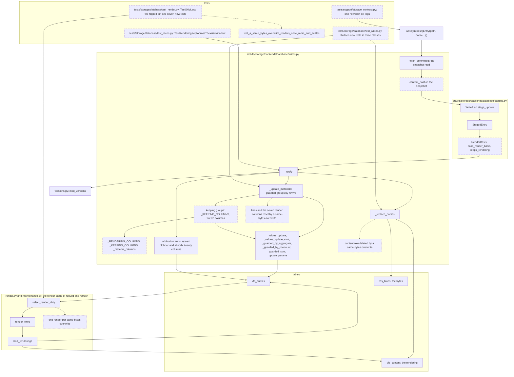

# Writing the same bytes over a bytes entry keeps its rendering and its stamp, so the next index pass renders nothing

This is a fix: a promise of a landed spec that the tree does not keep. Flags: it needs the engine legs (it changes the statements of the database write path); it is not structural, changes no public API, changes no schema format, does not touch rights and does not touch the Rust engine; it is parallel-safe with every unit of the conversion except 174-1, 174-2, 174-3, 174-4 and 175-2, which edit the same two modules of the write path. No roadmap story names it and its gate is unplaced; the roadmap's state row for the renderers says "built" ([roadmap](../../context/standards/roadmap.md), line 531) and story R7, which archives the landed half of the source, is where the remainder is named (lines 960 to 965). It is unit 152-1 of [the conversion map](../2026-11-25-the-backlog-converted/units.md), converted by amendment from [the archived spec 152](../../context/specifications/archive/152-binary-bodies-and-text-renderings/spec.md), section 5, first bullet, and item (1) of the paragraph "Where the spec bent" in its slice B progress note (line 188), read with [the study of that source](../2026-11-25-the-backlog-converted/studies/051-162/152-binary-bodies-and-text-renderings.md), open choice 8. It stands on [the memo on binary files and derived text renderings](../../context/research/2026-10-05-binary-files-and-derived-text-renderings.md) and, for decision 9, on [the placeholder memo on retrying a refused render](../../context/research/2026-11-13-how-an-entry-refused-under-a-render-limit-is-retried-once-the-limit-is-raised.md). It depends on three landed changes and on nothing unlanded: slices A and B of spec 152 (landed: the archived spec above, and the code read under The problem), [the incremental pass `refresh`](../../context/specifications/archive/2026-10-31-refresh-the-incremental-index-verb.md) (landed) and [the full pass named `rebuild`](../../context/specifications/archive/2026-11-12-the-full-pass-is-named-rebuild-and-its-pipeline-leaves-the-backend.md) (landed). It carries no roadmap decision and nothing in it waits on a ruling; one decision, decision 10, is provisional. Build order: nothing has to land first, and this unit is built before [174-1](../2026-11-25-an-identical-body-write-reports-unchanged-and-leaves-the-version-alone/spec.md), which is drafted and not built and on which this unit does not depend; what 174-1 changes when it lands over this unit is stated under Scope, by its decision numbers.

## The problem

Every fact below is at commit `5b20fd4f` (EXECUTED, `git rev-parse --short=8 HEAD`; `git status --short src tests crates` printed nothing, so the lines cited are that commit's).

1. A write resets the rendering's columns whatever the row held. READ: the material update of a write sets the twenty columns of `_CLOBBER_COLUMNS`, among them `lines` and the seven render columns `render_status`, `render_source_hash`, `render_generation`, `render_detail`, `render_units`, `media_width` and `media_height` (`src/vfs/storage/backends/database/writes.py:115-136`). `_material_values` stages `render_status` as `"pending"` for a bytes body and the other six as NULL (`writes.py:1206-1227`), and `lines` comes from `measure_bytes(data)`, which is 0 without a rendering (`src/vfs/models/version.py:82-84`, `writes.py:1259-1260`).
2. A write deletes the rendering. READ: `_replace_bodies` deletes the row in `vfs_content` and the row in `vfs_blobs` of every body-bearing row that existed before the batch, then inserts the new body (`writes.py:1021-1032`). For a bytes entry the content row is its rendering.
3. The write path cannot see that the bytes are the same. READ: the snapshot read `_fetch_committed` selects eleven columns and `content_hash` is not one of them (`writes.py:326-338`). The first code that learns the bodies are equal is the version mint, which reads the whole replaced body and mints nothing when its hash equals the staged hash (`src/vfs/storage/backends/database/versions.py:140-147`).
4. So a same-bytes overwrite re-renders. EXECUTED (scratch probe, `DatabaseStorage` on SQLite, a three-page PDF): after a write and a `rebuild` the row has `render_status='ok'`, `lines=8`, one content row and one chunk row. Writing the same bytes again answers `updated`, moves `version` from 1 to 2, and leaves `render_status='pending'`, a NULL stamp, `lines=0`, no content row, one blob row, one chunk row and no version row. The write issued ten statements of its own, leaving out the three of the planner-statistics step: `BEGIN IMMEDIATE`, the snapshot `SELECT`, a savepoint, one `UPDATE vfs_entries`, its release, the grant-revision `SELECT`, the pre-image `SELECT`, `DELETE FROM vfs_content`, `DELETE FROM vfs_blobs` and `INSERT INTO vfs_blobs`. The next `refresh`, and in a second run the next `rebuild`, each called the renderer once and reported `rendered: 1`.
5. Until that pass the document's text is gone. EXECUTED (same probe): between the second write and the pass, `stat` says `pending`, `read` returns `content=None` with one `vfs.unavailable` warning, and `grep` for a word inside the PDF returns no row. Before the second write all three answered.
6. The pin is named for the defect. READ: `test_a_same_bytes_overwrite_renders_once_more_and_settles` asserts `pending` after the second write and `rendered=1` on the next pass (`tests/storage/database/test_render.py:183-195`). The source's own acceptance line says the opposite: "a same-bytes overwrite re-renders nothing (statement count)" (source `spec.md:138`).
7. The chunk stamp does not have the defect, and the rest of the pipeline already copes. READ: `chunk_source_hash` and `chunk_generation` are not in the clobber set (`writes.py:115-136`), and the chunk pass skips a row whose `content_hash` equals its `chunk_source_hash` under the current generation (`src/vfs/storage/backends/database/indexing.py:699-705`). EXECUTED (same probe, with the eight columns and the content row put back by hand after the second write): `refresh` and `rebuild` each called the renderer zero times and returned no `rendering` extra, the one chunk row stayed, the row came back to `chunked`, `encoded` and `indexable`, and `read` and `grep` answered before any pass.
8. Both passes pay. READ: the full pass selects the bytes rows whose stamp pair misses and the incremental pass selects `render_status = 'pending'` (`src/vfs/storage/backends/database/render.py:169-183`); the render stage runs in both (`src/vfs/storage/backends/database/maintenance.py:339`, `:571`).
9. The guarded update has three arms, and the engines split across them. READ: `_update_materials` takes the set-based `VALUES` join where the dialect supports it, an executemany proven by its aggregate rowcount otherwise, and a per-row floor under that (`writes.py:722-755`). EXECUTED (scratch probe over the dialect classes and the profiles, no connection): PostgreSQL and SQL Server take the `VALUES` join; SQLite, MariaDB and Oracle take the executemany.
10. A tombstone keeps the rendering. READ: `trash.py` deletes body rows only in its purge and its orphan sweep (`src/vfs/storage/backends/database/trash.py:604-605`, `:642`), and EXECUTED (`grep -n render src/vfs/storage/backends/database/trash.py`): no statement there names a render column. A `restore` therefore brings a binary back with its rendering.

Why it is wrong. The source promised that the skip law covers a rewrite: "same bytes hash under the same generation, do nothing" (source `spec.md:67`). The tree breaks that promise in the write path and pays for it twice. First, in work: the ETL audience re-pushes documents whose bytes did not change, and each such write of a binary costs one full parse of the file on the next pass, one delete and one insert of its rendering, and the landing that stamps it. The reference deployment's nightly batch is 1,000,000 files in 10,000-file batches ([AGENTS.md](../../AGENTS.md), the reference deployment); the share of that batch that is an unchanged binary is an assumption no study measures, and the cost is linear in it: every 1% is 10,000 renders a night, of files whose mean size is 0.3 to 0.7 MB, each producing the text it replaces. A row that has a settled twin borrows the twin's rendering and skips the parse, and still pays the delete, the insert and the landing (READ, `render.py:198-205`). Second, in truth: for up to one pass interval, fifteen minutes in working hours, an agent that reads or greps a document someone just re-uploaded unchanged is told there is no text.

## Architecture



Terms. A bytes entry is an entry whose `source` is `bytes`: its body is a row in `vfs_blobs`. Its rendering is the text a renderer made from those bytes, held as the entry's row in `vfs_content`. The stamp is the pair `render_source_hash` and `render_generation` on the entry row. The rendering columns are the eight entry columns that describe the rendering: `lines` and the seven render columns of problem 1. A same-bytes overwrite is a write of a bytes body onto a bytes entry whose stored hash equals the new body's. The snapshot is the one read that seeds a write's plan. The guarded arm is the material update of a row the snapshot saw, proven by `WHERE version = <the snapshot's version>`. The arbitration arms are the two updates that land a create on a row the snapshot did not see: the upsert's clobber and the absorb. A keeping group is a set of guarded rows whose update leaves the rendering columns out; a clearing group is a set whose update names all twenty columns, as every update does today. An index pass is `rebuild` (full) or `refresh` (incremental).

## Decisions

### 1. A guarded overwrite that lands the bytes its row already holds leaves the seven render columns and the content row as they are

When the row the write lands on is a bytes entry, the body written is bytes, and the staged `content_hash` equals the row's, the write does not change `render_source_hash`, `render_generation`, `render_status`, `render_detail`, `render_units`, `media_width` or `media_height`, and it does not delete or insert the entry's row in `vfs_content`. The stamp then still names the bytes the row holds, so the full pass's predicate finds the row clean and the incremental pass's predicate finds it not pending. This is the source's stated fix, placed where the source placed it, in the write path. Decisions 2 and 3 complete the condition and the column set; decisions 5 to 8 say where and how it is proven.

Basis: verified lean, the source's slice B progress note, item (1) of "Where the spec bent" ("Keeping the stamp and the content row across a bytes write whose hash is unchanged is the fix, and it lives in the write path", source `spec.md:188`), held as amended by the study's open choice 8; precedent: the chunk stamp, which is outside the clobber set (`src/vfs/storage/backends/database/writes.py:115-136`) and which the chunk pass compares to `content_hash` to skip a same-hash overwrite (`src/vfs/storage/backends/database/indexing.py:699-705`), both read, and the probe of problem 7.

### 2. `lines` stays with the render columns

The kept set is eight columns, not seven. For a bytes entry `lines` is the line count of the rendering: the render landing writes it (`render.py:368`) and the write path stages 0 for it (problem 1). A write that kept the stamp and the content row and reset `lines` would leave a row that says `ok` with zero lines over a rendering of eight. The study's amended text lists the seven render columns and omits `lines`; this decision adds it.

Basis: decided in drafting, because `measure_bytes` defines a bytes body's line count as its rendering's (`src/vfs/models/version.py:82-84`), the render landing is the one writer of that count (`render.py:360-373`), and the probe of problem 4 shows the write turning 8 into 0.

### 3. The media type must be unchanged as well

The condition of decision 1 has a third term: the staged `mime_type` equals the row's. A rendering is made from the bytes and the media type together: the registry picks the renderer by type, and the expected generation is computed from the row's type (`render.py:254-258`). A body that no signature matches keeps the type its writer declared (`src/vfs/models/media.py:94-113`), and EXECUTED (scratch probe): the same two bytes written as `application/x-one` and as `application/x-two` have one hash and two types. If such a write kept the stamp, the full pass would notice the mismatch at the next `rebuild`, and the incremental pass, which reads only pending rows, would not: until then `stat` would report the old type's verdict. So a type change clears, the row is pending, and the next `refresh` renders it. The study's amended text has two terms; this decision adds the third.

Basis: decided in drafting, because the incremental pass selects `render_status = 'pending'` alone (`render.py:176-180`), so a rendering that is stale by type is repaired within one pass interval only if the write marks it pending.

### 4. Every other write clears the rendering as today, a source switch included even when the two bodies hash alike

A write of different bytes, a write under another media type, a text body over a bytes entry and a bytes body over a text entry each reset the eight columns and delete both body rows before inserting the new body, exactly as at this commit. The source test is its own term and is not implied by the hash: a text body and a bytes body with the same UTF-8 bytes have the same `content_hash` (EXECUTED, scratch probe: `Entry(content="same body\n")` and `Entry(data=b"same body\n")` agree on the hash and differ in `source`). Without the source term a text body would be kept as the "rendering" of the bytes that replaced it.

Basis: the source spec, section 2, first bullet ("Writing text onto a bytes path replaces the entry's source (the blob row is deleted, the rendering stamp cleared); writing bytes onto a text path does the reverse"); still true at `5b20fd4f` (`_replace_bodies` read at `writes.py:1021-1032`; pinned by `tests/storage/database/test_writes.py:1323-1343` and `tests/support/storage_contract.py:3025-3038`, both read).

### 5. The judgment is made from the write's snapshot, on the final staged body, and the version guard is its proof

The snapshot read gains one column, `content_hash`; it already reads `source` and `mime_type`. `WritePlan.stage_update` records the row's three facts on the staged entry, and the staged entry answers whether its final body keeps the rendering. A path written twice in one batch is one staged row whose material is replaced by the later entry (`staging.py:415-428`), so the answer is about the body the row ends with: a batch that writes other bytes and then the stored bytes keeps the rendering, and a batch that writes the stored bytes and then other bytes clears it. The proof that the snapshot's three facts still hold when the update runs is the guard the update already carries, `version = <the snapshot's version>`: READ, every statement that sets `content_hash`, `source` or `mime_type` on an existing row also moves `version` (`writes.py:521-522`, `:781`, `:867-870`, `:979`), and EXECUTED (`grep -n content_hash src/vfs/storage/backends/database/*.py`): no other module writes those columns except the copy's insert of fresh rows at version 1 (`topology.py:91-106`, `:494`). A rival that changed the bytes therefore misses the guard, and the write conflicts or redrives as it does today. No statement and no round trip is added to learn the answer.

Basis: decided in drafting, because the write path is plan-then-execute and adjudicates a batch from one snapshot before any mutation statement runs (`writes.py:3-19`), and a judgment made anywhere else would add a read per batch or a branch inside the engine.

### 6. A create that lands on a rival's row clears as today

The two arbitration arms keep their twenty columns: the upsert's `ON CONFLICT DO UPDATE` (`writes.py:518-527`) and the absorb's unguarded update (`writes.py:756-799`). Both land a create whose snapshot saw no row at the path, so the write holds no proof of what the rival's row contains, and the absorb's update carries no version term that could turn a later probe into one (`writes.py:861-870`). A kept stamp that was wrong would be served by `read` until the next full pass, because the incremental pass never looks at a row that is not pending. The cost of clearing is one re-render in the case where two writers race to create the same path with the same bytes, which is the rare case, and the row's twin law still applies to it.

Basis: decided in drafting, because the keep rule is safe only where a statement proves the row's bytes are the snapshot's (decision 5), and an arbitration arm has no snapshot of the row it lands on.

### 7. A revive is judged like any guarded overwrite

A write at a tombstoned file's path stages a guarded update with `revive` set (`staging.py:311-325`), and the snapshot carries the tombstoned row. The condition of decisions 1 and 3 is applied to it unchanged: a write of the same bytes under the same type at a deleted binary's path brings the row back with its rendering, which is what `restore` of that row would have brought back (problem 10). A tombstoned row that was never rendered is pending, stays pending, and is rendered by the next pass like any pending row. The tombstone is not a term of the condition.

Basis: decided in drafting, because a tombstone keeps both body rows and every render column until the purge (`trash.py:604-605`, `:642`; `tests/support/storage_contract.py:3062-3071`), a revive's guard is the same version term (`writes.py:715-720`), and a second rule for one flag would be a branch with no difference in outcome.

### 8. Keeping is done by omission: the update does not name the eight columns and no statement writes the content row

A keeping group's `UPDATE` sets the twelve columns that are not rendering columns, and `_replace_bodies` leaves the kept rows out of its delete on `vfs_content`. The write never reads the rendering columns and never writes a value back into them. That matters because a render landing does not move `version` (`render.py:347-374`): a row the snapshot saw as pending can be rendered and stamped by an index pass between the snapshot and the update, the version guard still matches, and a write that put back "what the snapshot saw" would erase a landing committed inside its window. A statement that does not name a column cannot. The alternative of deciding inside SQL, with a `CASE` per column comparing the stored hash to the incoming one, is not taken, for two reasons. `_replace_bodies` must know which content rows stand before it runs, and a `CASE` decides inside the engine. And the MySQL family evaluates the assignments of a single-table `UPDATE` left to right against values already assigned unless a session mode says otherwise (INFERRED from the engines' documented behaviour; not executed here), and `content_hash` is assigned before the render columns, so the comparison would always be true on MariaDB.

Basis: decided in drafting, because the render landing is guarded on `content_hash` and not on `version` (`render.py:347-359`), so only an update that leaves the rendering columns out is correct against a landing in the write's window.

### 9. The rule holds for every render status, and a same-bytes rewrite stops being a way to retry a render

The condition does not consult `render_status`. A row that is `ok`, `truncated` or `partial` keeps its text; a row that is `empty`, `unsupported`, `unavailable`, `encrypted`, `corrupt` or `failed` keeps its verdict and its `render_detail`; a row that is `pending` stays pending and is rendered once by the next pass. One consequence is a change a caller can observe and is named here: at this commit, rewriting the same bytes makes the next pass render them again, which retries a `failed`, `partial` or `truncated` rendering as a side effect. After this change it does not. What retries a verdict is what the skip law names: new bytes, a new renderer generation, or a type newly claimed. How a raised render limit retries what a lower limit cut is the open subject of the placeholder memo named in the first paragraph, and is not decided here. Consulting the status was the alternative, and it cannot be proven: the status can change without the version moving (decision 8), so a rule keyed on it would be decided on a stale read.

Basis: decided in drafting, because the source's section 6 says both that "the same bytes under the same generation are not retried" and that "a new write retries" (source `spec.md:91`), the first is the law the tree states (`render.py:35-38`) and already applies to the same bytes at another path, where a failed twin lends its verdict (`render.py:198-205`, `tests/storage/database/test_render.py:253-261`), and the second is read as a write of new bytes.

### 10. The rule trusts the stored hash, and the blob row is still replaced

The condition compares the staged hash to the hash on the entry row. It does not hash the stored blob. The write still deletes and inserts the row in `vfs_blobs`, so the bytes stored after the write are the bytes the caller sent, whatever the old blob row held. A rendering that was made from a blob that had rotted under an intact hash is therefore kept by a same-bytes rewrite, where at this commit the rewrite replaces it; nothing in the tree detects such a blob today (EXECUTED, `grep -rn "integrity\|damaged" src/vfs`: only the SQL constraint classifiers match).

Basis: provisional, no ruling on record; the options were (a) trust the hash on the entry row, as the chunk stamp does, and leave to the integrity story the question of what is rebuilt from a body found damaged, and (b) keep the rendering only when the stored blob, measured in the write, hashes to the staged hash, clearing otherwise; chosen because (a) is the nearer to what vfs already does (a same-hash text overwrite keeps chunk rows made from the old content row, `indexing.py:699-705`), adds no statement and no read, and is the cheaper to reverse: (b) can be added later inside the write path with no schema change, using the measurement the version mint already makes of every replaced body (`versions.py:140-147`), while the ruling of 2026-11-15 that a write over a damaged file heals it ([the rulings spec](../../context/specifications/active/2026-11-15-the-kernels-public-names-and-argument-families-are-ruled.md), decision 9) is kept for the bytes under either option, since this unit never skips the body's write; 174-1 takes the measuring option for its own question (its decision 4, provisional) because there the alternative is to leave a damaged body in place, which is not at stake here.

### 11. Everything else about the write is what it is today

A same-bytes overwrite still answers `updated`, still moves `version` by one, still sets `updated_at`, still resets `chunked`, `encoded` and `indexable`, still has its replaced body judged by the version mint (which mints nothing for an identical body, `versions.py:146-147`), and still replaces the blob row. A revive still clears the tombstone and bumps the parent. The chunk pass then finds the row's `chunk_source_hash` equal to its `content_hash`, keeps the chunk rows and re-stamps the flags, and the gram index covers the row again, exactly as for a same-hash text overwrite (problem 7). No verb, argument, result field, error kind, table or column is added, removed or renamed. Making the write itself a no-op is another unit's decision and is listed under Scope.

Basis: the source spec, section 5, second bullet ("A write to a bytes entry resets `chunked`, `encoded` and `indexable` exactly as a text write does"); still true at `5b20fd4f` (`writes.py:1213-1215` read; the probe of problem 4 shows the status, the version and the three flags after the write, and the probe of problem 7 shows the chunk row spared).

### 12. The guarded rows run in up to four groups, and each group's statements are sized by its own measured width

`_update_materials` groups its guarded rows by `revive` today, two groups, because a statement has one shape. It groups them by `revive` and by `keeps_rendering` after this change, at most four groups. A keeping group's statement names twelve material columns and a clearing group's twenty. Each group is chunked as today: on the `VALUES` arm by `statement_budget` with the group's own row width (sixteen binds a row for a keeping group, twenty-four for a clearing group) under `row_cap=membership_budget`, and on the executemany arm as one executemany per group inside its own savepoint, re-driven row by row with the same group's statement when the aggregate rowcount falls short. The delete on `vfs_content` is chunked by `membership_budget` over the clearing rows alone. No size is written into the code; every bound is one the helpers in `dialects.py` already compute from the live dialect and the profile.

Basis: decided in drafting, because AGENTS.md, under Production posture, requires that no statement grow with batch size and that chunk sizes come from `membership_budget`, `chunked` and SQLAlchemy's bind budget, and the two `revive` groups are the standing precedent for one statement shape per group (`writes.py:728-755`).

### 13. The names and their homes

In `staging.py`: a `NamedTuple` named `RenderBasis` with the fields `source`, `mime_type` and `content_hash`, among the module's shared types; on `StagedEntry` the field `base_render_basis: RenderBasis | None = None` beside the other `base_` fields, set only by `stage_update`, and the read-only property `keeps_rendering`. In `writes.py`: the constants `_RENDERING_COLUMNS` (a frozenset of the eight names) and `_KEEPING_COLUMNS` (the clobber columns less those, in clobber order) directly under `_CLOBBER_COLUMNS`, and the helper `_material_columns(*, keeps: bool)` among the internal helpers. The functions of the guarded arm take `keeps: bool` beside `revive: bool`. A value type is used, and not three more loose `base_` fields, because the three facts are compared as one and are meaningless apart. The names say "rendering" and "render basis" because that is what the tree calls the thing (`render.py:1-12`); none names a spec.

Basis: decided in drafting, because AGENTS.md, under File organization, puts a derived private constant directly under the name it comes from and a small shared type among the module's types, and, under Code smells, asks for a small type where bare values travel together.

### 14. The pin named for today's behaviour is renamed and flipped, and the gates are the Python gate, the docs gate and four engine legs

`test_a_same_bytes_overwrite_renders_once_more_and_settles` becomes `test_a_same_bytes_overwrite_renders_nothing` and asserts zero renders, counted as calls to the renderer and as `INSERT` and `DELETE` statements on `vfs_content`, for both passes. The other tests are listed under Acceptance criteria; every one counts calls, statements or rows, or compares states, and none reads a clock. The gates before the pull request are `scripts/ci.sh`, `scripts/docs.sh check` (docstrings under `src/vfs/` change), and the storage conformance and race tests on PostgreSQL, MariaDB, SQL Server and Oracle through the `db_test` procedure. All four legs are needed because the change edits both the `VALUES` arm, which only PostgreSQL and SQL Server run, and the executemany arm, which MariaDB and Oracle run with different guard-miss modes (problem 9).

Basis: decided in drafting, because AGENTS.md, under Tooling, sets the Python gate for a branch that touches `src/` and `tests/` and the docs gate for a branch that touches a docstring under `src/vfs/`, and, under Performance tests, forbids a wall-clock assertion; and the source's acceptance line asks for the count: "a same-bytes overwrite re-renders nothing (statement count)" (source `spec.md:138`).

## Intent

After this spec, a pipeline or an agent that writes a PDF, an Office document or any other binary over itself with the same bytes and the same media type finds the file exactly as searchable as before: `stat` still reports its render status, `read` returns its text at once, `grep` finds its words at once, and the next `refresh` or `rebuild` parses nothing and writes no rendering for it; a write of different bytes, of the same bytes under another type, or of text over a binary or a binary over text starts the rendering over as it does today, and so does a create that collides with a rival's row.

## Design

The work is in two source modules, one docstring in a third, and four test files. Each test is written and seen failing before the code that passes it. The order is the order below.

**Step 1. The two end-to-end pins, written first, green last.** In `tests/storage/database/test_render.py`, class `TestSkipLaw`, rename the pin of problem 6 to `test_a_same_bytes_overwrite_renders_nothing`, parametrize it by pass (`rebuild`, `refresh`), and assert criterion 2. In `tests/support/storage_contract.py`, in the section "Bytes bodies", add `test_a_same_bytes_overwrite_keeps_the_rendering` under `@needs("write", "read", "stat", "grep")` with `_rebuilder_of(storage)`, asserting criterion 23. Both fail at this commit on their first assertion after the second write (`pending`).

**Step 2. The judgment, in `staging.py`.** Add to `tests/storage/database/test_writes.py`, class `TestBytesBodies`, the tests of criteria 10 and 11. Then:

```python
class RenderBasis(NamedTuple):
    source: str
    mime_type: str | None
    content_hash: str | None

@dataclass
class StagedEntry:
    ...
    base_render_basis: RenderBasis | None = None

    @property
    def keeps_rendering(self) -> bool: ...
```

- `keeps_rendering` is `self.source == "bytes" and self.base_render_basis == RenderBasis(self.source, self.mime_type, self.content_hash)`. It reads the staged entry's present material, so `refresh_material` needs no change and a repeat target is judged by its final body (decision 5).
- `stage_update` sets `base_render_basis=RenderBasis(row["source"], row["mime_type"], row["content_hash"])` where it builds a new `StagedEntry` from the committed row. `stage_create` sets nothing, so a create, and the absorb and adopt a create can turn into, never keep (decision 6).
- In `writes.py`, `_fetch_committed` appends `entry.c.content_hash` to its column list. `mkdir_rows` and `edit_rows` share that read and receive the column unused.

What grows with input, and what bounds it. The multiplier is per file write: about 1,050,000 a day at the reference deployment, 10,000 rows a call in the nightly batch. The snapshot is one existing select per call, already chunked by `membership_budget` inside `rows_by_path`; it gains one 64-character column and no statement. In memory the plan holds one more string per snapshot row and one three-field tuple per staged update: for a 10,000-file batch about 10,000 hashes of 64 bytes, under 2 MB with Python's object overhead, released with the plan when the call returns. A daytime single-file write holds one target and its ancestors, about seven rows at the mean depth of six. Nothing is read from `vfs_content` or `vfs_blobs` to make the judgment.

**Step 3. The statements, in `writes.py`.** Add to `test_writes.py` the tests of criteria 12 to 15 in `TestBytesBodies` and criteria 17 to 20 in `TestGuardedAttribution`. The tests of criteria 12, 15 and 19 take a snapshot with `_fetch_committed`, stage through `WritePlan.put_file` and run `_finish`, the pattern of `test_create_to_clobber_conversion_flows_through_apply` (`test_writes.py:655-700`), recording statements with the `before_cursor_execute` listener the class already uses. Then:

```python
_RENDERING_COLUMNS: Final[frozenset[str]] = frozenset({...})   # lines and the seven render columns
_KEEPING_COLUMNS: Final[tuple[str, ...]] = tuple(name for name in _CLOBBER_COLUMNS if name not in _RENDERING_COLUMNS)

def _material_columns(*, keeps: bool) -> tuple[str, ...]: ...
async def _values_update(session, entry, parameter_budget, membership_budget, staged, *, now, guard, revive=False, keeps=False) -> dict[str, int]: ...
def _values_update_stmt(entry, rows, *, guard, revive=False, keeps=False) -> Update: ...
async def _guarded_by_aggregate(session, entry, profile, membership_budget, guarded, *, now, revive, keeps) -> list[ResultError]: ...
async def _guarded_by_rowcount(session, entry, profile, membership_budget, guarded, *, now, revive, keeps) -> list[ResultError]: ...
def _guarded_stmt(entry, *, revive, keeps) -> Update: ...
```

- `_update_materials` builds its guarded groups over the pairs of `revive` and `keeps`, selecting `s.persistence == "update" and s.revive is revive and s.keeps_rendering is keeps`, skips an empty group, and passes `keeps` to whichever arm the dialect takes. The unguarded branch for absorbs is unchanged and passes nothing, so it keeps the twenty columns.
- `_values_update` builds each row's tuple from `_material_columns(keeps=keeps)` in place of `_CLOBBER_COLUMNS`, and hands `keeps` to `_values_update_stmt` both in the `statement_budget` probe and in the executed statement, so the measured width and the executed width are the same statement's.
- `_values_update_stmt` and `_guarded_stmt` declare, set and bind `_material_columns(keeps=keeps)`. `_update_params` picks the same tuple from `staged.keeps_rendering`, so a row's parameters always match the statement of the group it is in. `_material_values` is unchanged: it still computes all twenty values, and a keeping row's eight are not sent.
- `_guarded_by_aggregate` passes `keeps` on to `_guarded_by_rowcount` when it re-drives.

What grows with input, and what bounds it. The multiplier is per file write, counted per batch: 100 batches a night. A batch's guarded rows cost, on the `VALUES` arm, the sum over its groups of `ceil(rows / statement_budget(...))` statements, which is at most two more than today's count for the same rows, one for each `revive` side that splits in two, and usually fewer, because a keeping row is narrower and more of them fit a statement. EXECUTED (scratch probe calling `statement_budget` on today's statement with SQLAlchemy's bind budgets): on SQL Server, the least generous engine of this arm at 2,099 binds, a clearing group carries 87 rows a statement, 115 statements for 10,000 rows; the same arithmetic at a keeping group's sixteen binds gives 130 rows a statement, 77 statements for 10,000 rows. On PostgreSQL the figures are 1,362 rows and 8 statements, and 2,043 rows and 5 statements. On the executemany arm (SQLite, MariaDB, Oracle) a batch issues one executemany per group, at most four where today it issues at most two, each one statement text with one parameter set a row; the per-row floor issues one statement a row as today. No statement's size depends on the batch: `statement_budget` is charged the declared width and capped by `membership_budget`, which on Oracle is the 1,000-element floor. Locks: the update takes the same row locks on `vfs_entries` it takes today and holds them to the write's commit, which is today's profile and is not changed here; it writes fewer columns and adds no lock, no table lock and no statement a read waits on.

**Step 4. The bodies, in `writes.py`.** The tests of criteria 12 and 15 already assert this step. In `_replace_bodies`, the ids deleted from `vfs_content` are the pre-existing bearing rows whose staged entry does not keep its rendering; the ids deleted from `vfs_blobs` are all pre-existing bearing rows, as today. The two deletes stop sharing one list and each is still chunked by `membership_budget`. The inserts are unchanged: a keeping row has `data` and no `content`, so it contributes one blob row and no content row.

What grows with input, and what bounds it. Per file write. The delete on `vfs_content` binds one id per clearing row in chunks of `membership_budget`: ten statements for 10,000 clearing rows at Oracle's floor of 1,000, as today, and none for a batch whose rows all keep. A kept content row is not locked, deleted or re-inserted. The blob delete and the byte-paged blob insert under `BLOB_PAGE_BYTES` are today's, row for row. The version mint is untouched and still reads each replaced body in bytes-bounded pages.

**Step 5. The remaining pins.** Add the tests of criteria 1 and 3 to 8 to `TestSkipLaw`, of criterion 16 to `TestBytesBodies`, of criterion 21 to `TestArbitration`, of criterion 22 to `TestBytesBodies` (marked `slow`), and the class `TestRenderingKeptAcrossTheWriteWindow` with the test of criterion 24 to `tests/storage/database/test_races.py`, parametrized over `ENGINE_LEGS` as its neighbours are. They need no further code. Criterion 16 uses the same pattern with a pass in the middle: take the snapshot and build the plan, let `rebuild` land a rendering, then run `_finish` on the plan. Criterion 22 uses it at 10,000 rows. Criterion 24 stages the same thing through the real verb with a self-clearing handler on the seam `write:before-apply` (`test_races.py:106-118`). INFERRED: at that seam the write holds no lock a pass needs, because its only statement so far is the snapshot read and an overwrite of an existing row labels nothing; the test is what shows it on each server engine, and a pass that did wait there would be a finding against the rule that an index pass and a batch run side by side.

What the index passes pay after the change. Nothing is added to either pass: no statement, no predicate and no column. Per same-bytes overwrite the pass no longer pays one render on the offload pool, one guarded stamp `UPDATE`, one delete and one insert on `vfs_content`, and the chunk-stamp reset that follows a landing. It still pays what a same-hash text overwrite costs: the chunk pass visits the row because the write reset `chunked`, finds the fingerprint equal and re-stamps the flags without splitting, and the gram index covers the row again (decision 11).

**Step 6. Docstrings and comments, so the text matches the code.** In `writes.py`: the comment over `_CLOBBER_COLUMNS` and the docstrings of `_material_values`, `_replace_bodies` and `_update_materials` say that a guarded overwrite of the same bytes under the same type leaves the rendering columns and the content row alone, and why. In `render.py`: the docstring of `render_rows` stops saying that the write which replaced a missing blob "reset its stamp" and says that the row is still dirty and the next run reads it again. In `tests/storage/database/test_render.py`: the comment in `test_a_stamp_from_other_bytes_is_dirty` stops saying every write clears the stamp and says a write keeps a stamp only over the bytes it was made from. No docstring or comment names this spec, and each comment is at most two lines.

**Step 7. The gates.** `scripts/ci.sh`; `scripts/docs.sh check`; then the engine legs of decision 14. Coverage stays at 100%: both values of `keeps_rendering`, each of the four groups, the keeping statement on each of the three arms, the re-drive of a keeping group, and both lists of `_replace_bodies` are reached by the tests of steps 1 to 5.

## Scope

In: decisions 1 to 14. Files: `src/vfs/storage/backends/database/staging.py`, `src/vfs/storage/backends/database/writes.py`, `src/vfs/storage/backends/database/render.py` (one docstring), `tests/storage/database/test_render.py`, `tests/storage/database/test_writes.py`, `tests/storage/database/test_races.py`, `tests/support/storage_contract.py`.

Out:

- A write that changes nothing answering `unchanged`, minting nothing and writing nothing: [174-1](../2026-11-25-an-identical-body-write-reports-unchanged-and-leaves-the-version-alone/spec.md), drafted and not built. This unit does not depend on it and is built first, because it waits on nothing. Nothing of 174-1 is relied on; what follows is quoted so that the two can be read against each other. When 174-1 lands over this unit: by its decisions 1, 2 and 4, a write over a live file whose `kind`, `source`, `content_hash` and `mime_type` equal the stored row's, and whose stored body measures intact, is dropped from the plan before any statement, so it keeps its rendering by writing nothing and no longer reaches the keeping groups; by its decision 8, a same-bytes write at a deleted path stays a write, and decision 7 here still keeps its rendering; by its decisions 3 and 4, a same-bytes write over a body found damaged stays a write, and decision 10 here says what it does to the rendering; by its decision 9, a create that lands on a rival's row is never `unchanged`, which agrees with decision 6 here. Its decision 14 says for every body what decision 9 here says for a rendering. Every criterion below holds as written before and after 174-1: criteria 1 to 9, 23 and 24 assert the rendering's state and count renders, and none asserts the write's status, version or flags; criteria 12, 15, 16, 19, 20 and 22 reach the guarded update below the verb, where 174-1's settle does not run (its Design step 4 runs the settle only when `_finish` is handed an executor), and criteria 17 and 18 use a session double. Two overlaps are mechanical: 174-1's Design step 3 adds the same `content_hash` column to the snapshot, and whichever unit lands second finds it there; and 174-1's `_same_material` compares four columns of which `RenderBasis` holds three, and the second to land may express one through the other with no change of behaviour. Built in the other order, a same-bytes overwrite of a live row would already keep its rendering by 174-1's decision 1 and this unit would add the revive of decision 7 and the pins; this spec is written for the order stated.
- Sparing the blob rewrite, the pre-image read of the version mint, the version bump, `updated_at` and the reset of `chunked`, `encoded` and `indexable` on a same-bytes overwrite (decision 11): 174-1, by its decisions 1 and 13.
- Refusing to hand out or build on a body that fails its recorded hash, the render stage's read of a blob included, and any check of a stored blob in the write (decision 10): the units of archived spec 175, of which [175-2](../2026-11-25-every-written-row-reports-its-hash-and-no-verb-launders-a-damaged-body/spec.md) is the one that edits the write path. Neither it nor 175-1 is written yet; what is quoted is the ruling they must carry, decision 9 of the rulings spec: the check refuses a call "only where it must hand out or build on the damaged body".
- How a raised render limit retries what a lower limit cut or refused (decision 9): the placeholder memo of 2026-11-13 and the spec that follows it.
- Rendering a small binary inside the write that stores it: [159-1](../2026-11-25-a-small-binary-write-renders-its-own-bytes-before-it-returns/spec.md). A same-bytes overwrite that keeps its rendering has nothing left for that unit to render; neither unit needs the other.
- A count of unrendered rows on a `search` result: [152-2](../2026-11-25-search-says-how-many-bytes-rows-it-could-not-read/spec.md). The image renderer and the placeholder for a PDF's embedded images: [152-3](../2026-11-25-an-image-written-as-bytes-renders-a-metadata-header/spec.md); the two dimension columns it will fill are already in the kept set. The pages of the docs site about binaries: [152-4](../2026-11-25-binary-bodies-are-documented-on-the-docs-site/spec.md).
- `copy` and `move`. A copy already carries every render column and both bodies to the fresh row (`topology.py:91-106`), so it re-renders nothing today and is not touched.
- The arbitration arms (decision 6) and any probe that would let them keep a rendering.
- One list of the render columns for the three modules that each spell them out (`writes.py`, `topology.py`, `render.py`). The duplication is older than this change; this unit adds one derived constant under the list it derives from and a behavioural test (criterion 1) that fails if a render column is added to the landing and the clobber set and not to the kept set.

## Acceptance criteria

Criteria 1 to 9 are in `tests/storage/database/test_render.py::TestSkipLaw`; 10 to 16 and 22 in `tests/storage/database/test_writes.py::TestBytesBodies`; 17 to 20 in `tests/storage/database/test_writes.py::TestGuardedAttribution`; 21 in `tests/storage/database/test_writes.py::TestArbitration`; 23 is a conformance row; 24 is in `tests/storage/database/test_races.py`. Criterion 23 runs on SQLite, on the in-memory backend and on the four engine legs PostgreSQL, MariaDB, SQL Server and Oracle; criterion 24 runs on the four engine legs; every other criterion runs on SQLite in the default suite. Each counts calls, statements or rows, or compares states. Criteria 12, 15, 16, 19 and 22 build a plan from `_fetch_committed` and run it through `_finish`, and criterion 20 calls `_update_materials`, as the arbitration tests of that file do (`test_writes.py:655-700`), so they count the statements of the guarded update whatever the verb above it decides to stage.

1. After a PDF is written, rebuilt and written again with the same bytes, every column of its entry row other than `version`, `updated_at`, `chunked`, `encoded` and `indexable` equals its value before the second write, and its row in `vfs_content` has the same text and the same `created_at`: `::test_a_same_bytes_overwrite_leaves_the_rendering_as_it_was`.
2. The pass that follows that write calls `RendererRegistry.render` zero times, returns no `rendering` extra, and issues no `INSERT` and no `DELETE` on `vfs_content`, for `rebuild` and for `refresh`: `::test_a_same_bytes_overwrite_renders_nothing` (parametrized by pass; the renamed pin).
3. After that pass the row is `chunked`, `encoded` and `indexable`, its count of chunk rows equals the count before the second write, and the pass issued no `INSERT` into `vfs_chunks`: `::test_a_same_bytes_overwrite_spares_the_chunk_rows`.
4. After the second write and before any pass, `stat` reports `ok`, `read` returns the rendering with no error record, and `grep` for a word inside the PDF returns the file: `::test_a_same_bytes_overwrite_stays_readable_and_greppable_before_any_pass`.
5. A corrupt docx that is written, rebuilt to `corrupt` and written again with the same bytes still has `render_status='corrupt'` and the same `render_detail`, and the next `rebuild` calls the renderer zero times: `::test_a_same_bytes_overwrite_keeps_a_failure_verdict_and_is_not_retried`.
6. A PDF written twice with the same bytes before any pass is `pending` with no content row, and the next `rebuild` reports `rendered: 1` from exactly one renderer call: `::test_a_same_bytes_overwrite_of_a_pending_row_renders_once`.
7. A settled PDF whose `render_generation` is set by SQL to another generation, then written again with the same bytes, still carries that other generation after the write, and the next `rebuild` reports `rendered: 1`: `::test_a_kept_stamp_of_another_generation_is_re_rendered_by_rebuild`.
8. A settled PDF that is deleted and then written again at the same path with the same bytes is live with `render_status='ok'` and its content row, `grep` finds it, and the next `rebuild` calls the renderer zero times: `::test_a_revive_with_the_same_bytes_keeps_the_rendering`.
9. A settled PDF overwritten with different bytes is re-rendered and serves only the new text: the existing `::test_changed_bytes_re_render` passes unedited.
10. `StagedEntry.keeps_rendering` is true for a bytes update whose source, media type and hash equal its `base_render_basis`, and false for each of a different hash, a different media type, a text body over a bytes basis, a bytes body over a text basis with an equal hash, and a staged entry with no basis: `::test_a_staged_update_keeps_its_rendering_only_over_the_same_bytes_and_type` (parametrized, six cases).
11. A plan built from `_fetch_committed` over a stored binary, whose rows now carry `content_hash`, stages the stored bytes with `keeps_rendering` true, then other bytes at the same path with it false, then the stored bytes again with it true, in one staged row throughout: `::test_a_repeat_target_is_judged_by_its_final_body`.
12. A plan that stages the stored bytes over a binary whose eight rendering columns and content row were set by SQL, run through `_finish`, issues exactly one `UPDATE` of `vfs_entries` that names none of the eight columns, no `INSERT` and no `DELETE` on `vfs_content`, one `DELETE` and one `INSERT` on `vfs_blobs`, and leaves the eight columns and the content row as set and the blob equal to the bytes written: `::test_a_same_bytes_overwrite_names_no_rendering_column_and_writes_no_content_row`.
13. Two bytes that match no signature, written under the declared type `application/x-one` and rebuilt to `unsupported`, then written again as `application/x-two`, leave the row `pending` with a NULL stamp: `::test_the_same_bytes_under_another_type_restart_the_stamp`.
14. A settled binary overwritten by a text body with the same UTF-8 bytes becomes a text row with NULL render columns, the text in `vfs_content` and no blob; a text entry overwritten by a bytes body with the same bytes becomes `pending` with no content row and one blob: `::test_a_source_switch_with_an_equal_hash_clears_the_rendering_both_ways`.
15. One plan over three settled binaries, staging the first with the same bytes, the second with other bytes and the third with text, run through `_finish`, leaves the first settled with its content row, the second `pending` with none and the third a text row; it issues exactly two material `UPDATE` executemany statements on `vfs_entries` and its `DELETE` on `vfs_content` binds exactly two ids: `::test_a_mixed_batch_keeps_only_the_rows_whose_bytes_stood`.
16. A plan built from a snapshot that saw a pending binary, applied by `_finish` after a `rebuild` rendered that binary, leaves the row `ok` with the stamp and the content row the rebuild wrote: `::test_a_rendering_landed_after_the_snapshot_survives_the_same_bytes_write`.
17. The keeping group's statement on the `VALUES` arm, compiled for PostgreSQL, contains `FROM (VALUES` and `incoming.v_base` and none of the eight `v_` names of the rendering columns, and three keeping rows under a parameter budget of `2 * (len(_KEEPING_COLUMNS) + 4) - 1` ride three statements: `::test_values_arm_keeping_group_names_no_rendering_column_and_chunks_by_its_own_width`.
18. 10,000 keeping rows and 10,000 clearing rows through the `VALUES` arm, under the bind budget read from SQL Server's dialect and the membership budget of the `MSSQL` profile, issue exactly `ceil(10,000 / k) + ceil(10,000 / c)` statements, where `k` and `c` are what `statement_budget` returns for each group, and no statement compiles to more binds than the budget: `::test_ten_thousand_keeping_and_clearing_rows_stay_under_sql_servers_bind_budget` (marked `slow`).
19. With the dialect's `supports_sane_multi_rowcount` forced false, a plan of one same-bytes row and one other-bytes row run through `_finish` keeps the first row's rendering set by SQL and clears the second's, each row landing through its own statement: `::test_forced_per_row_floor_keeps_the_rendering`.
20. Two keeping rows handed to `_update_materials` on the executemany arm, one with a stale `base_version`, return exactly one `conflict` for the stale row, and the other row's version moves by one with its eight rendering columns unchanged: `::test_aggregate_arm_redrive_keeps_the_rendering_of_the_row_that_matched`.
21. A create staged from a snapshot taken while the path was vacant, applied after a rival wrote the same bytes there and had them settled, leaves the row `pending` with a NULL stamp and no content row, on the upsert arm and on the absorb arm: `::test_a_create_that_lands_on_a_rival_with_the_same_bytes_restarts_the_stamp` (parametrized by arbitration mode).
22. 10,000 binaries that match no signature, written and rebuilt to `unsupported`, then staged again with the same bytes in one plan and run through `_finish`, are all still `unsupported` with their stamp; that run issues no `INSERT` and no `DELETE` on `vfs_content` and one material `UPDATE` executemany, and the next `rebuild` calls the renderer zero times and returns no `rendering` extra: `::test_a_ten_thousand_file_same_bytes_batch_keeps_every_verdict_and_renders_nothing` (marked `slow`).
23. On every conformance leg, a PDF written, rebuilt and written again with the same bytes reports `ok` from `stat`, returns its text from `read` with no error record, is found by `grep` before any pass, and the next `rebuild` returns no `rendering` extra; written once more with different bytes it reports `pending`: the conformance row `tests/support/storage_contract.py::StorageContract::test_a_same_bytes_overwrite_keeps_the_rendering`, collected under `TestSqliteConformance`, `TestMemoryConformance`, `TestPostgresConformance`, `TestMariaDBConformance`, `TestMSSQLConformance` and `TestOracleConformance` in `tests/storage/test_conformance.py`.
24. On each server engine, a `rebuild` that runs to completion inside a same-bytes write's window, after its snapshot and before its first mutation statement, renders the pending binary, and after the write commits the row is `ok` with its content row and the next `refresh` calls the renderer zero times: `tests/storage/database/test_races.py::TestRenderingKeptAcrossTheWriteWindow::test_a_rendering_landed_inside_the_window_survives_a_same_bytes_write` (parametrized over `ENGINE_LEGS`: postgres, mariadb, mssql, oracle).

## Landing notes

Filled in when the pull request is opened.

## One line

A guarded write of the same bytes under the same type over a bytes entry leaves `lines`, the seven render columns and the content row untouched, proven by the version guard and done by omission, so the document stays readable and the next `refresh` or `rebuild` renders nothing, while every other write, and every create that collides with a rival, starts the rendering over as before.
