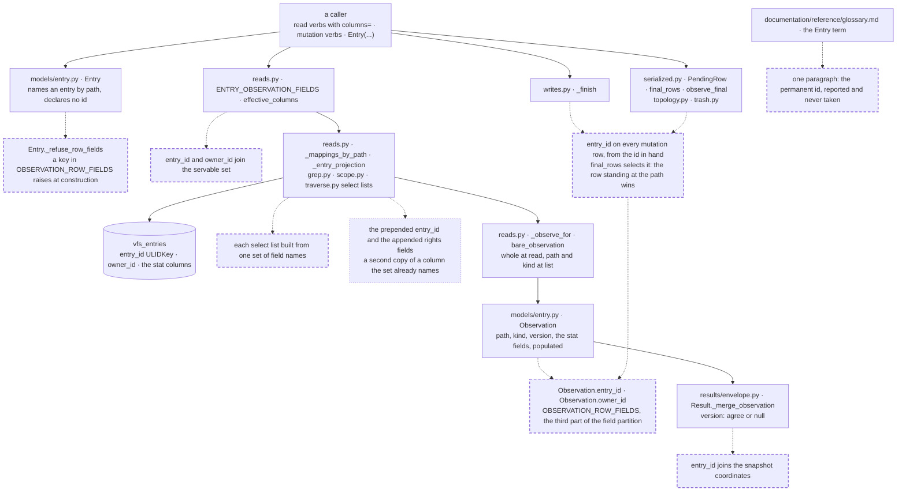

# Read rows carry `entry_id` and `owner_id` as projectable, read-only columns at the read rung, mutation rows carry `entry_id`, a bare row carries neither, and an `Entry` naming `entry_id` is refused as invalid input before anything is written

A feature. It changes the public API: two fields on `Observation`, two names in the `columns=None` default of every read verb, one field on every mutation row, and one refusal in `Entry`. It changes no schema format, because both columns exist. It needs the engine legs, because every read select list and the batch re-read change. It touches rights, because it changes what a row shows at each rung. It does not touch the Rust engine, is not structural, and is parallel-safe with the units named under Scope. It is unit 181-2 of [the unit map](../2026-11-25-the-backlog-converted/units.md) and serves roadmap story K9 at gate b, whose third acceptance line reads "`stat` and `ls` rows carry `entry_id`; a `write` of an `Entry` carrying `entry_id` is `vfs.invalid`" (READ, [the roadmap](../../context/standards/roadmap.md), line 209). It is converted from [spec 181](../../context/specifications/archive/181-the-public-surface-regrouped-by-kernel-group/spec.md), sections 3 and 10, criteria 1 to 11 and 18, tasks 4 to 7, read with [the study of that spec](../2026-11-25-the-backlog-converted/studies/165-181/181-the-public-surface-regrouped-by-kernel-group.md). It stands on [the operating-systems memo](../../context/research/2026-10-24-what-ostep-teaches-vfs-eight-studies-and-what-changes-in-the-kernel-plan.md) with its studies [02](../../context/research/studies/2026-10-24-ostep-principles-for-vfs/02-files-and-directories-the-api.md) and [06](../../context/research/studies/2026-10-24-ostep-principles-for-vfs/06-distribution-nfs-afs.md), and on [the deletes memo](../../context/research/2026-11-15-deletes-tombstones-and-a-move-that-keeps-its-identity.md). It depends on no spec, landed or drafted. The one ruling it carries, roadmap decision D55, is recorded in [the kernel rulings spec](../../context/specifications/active/2026-11-15-the-kernels-public-names-and-argument-families-are-ruled.md), decision 6. No choice here waits on a ruling; decisions 9 and 16 are provisional.

## The problem

Labels: EXECUTED means a command ran on 2026-11-25 against the tree at `9daedd2b`, on the in-memory store, which is the database backend over an in-process SQLite; READ means read at the cited `path:line` at that commit; INFERRED means reasoning from the two.

Every entries row has had a permanent id since the table was designed, and no row a caller receives shows it. READ, `src/vfs/models/rows.py:429`: `entry_id` is a `ULIDKey` column, unique and not null. EXECUTED: `Observation.model_fields` holds neither `entry_id` nor `owner_id`. READ, `src/vfs/storage/backends/database/reads.py:99-102`: `ENTRY_OBSERVATION_FIELDS`, the set of row fields a read may fetch, holds eleven names and neither of the two.

A caller that asks for either column is answered as if it had not asked. EXECUTED: `ls("/", columns={"owner_id", "kind"})` populates `{kind, path, version}`, and `stat("/a.md", columns={"entry_id"})` populates the same three; neither call reports an error. READ, `reads.py:144`: a requested field outside the servable set is dropped from the mask.

Without the id, a caller cannot tell a moved file from a new file at an old name. EXECUTED: after `write /m1`, `move /m1 /m2`, `write /m1`, the row at `/m1` has a new id. READ, `src/vfs/storage/backends/database/staging.py:81`: a created row starts at version 1. So `(/m1, 1)` has named two files with different bodies, and only `entry_id` tells them apart (INFERRED). READ, study 06, lines 99 to 107: a cache keyed by `(path, version)` is unsafe for this reason. Roadmap stories K10 and H4 key a stamp and a ledger on `(entry_id, version, content_hash)`, and story K5's replay row names `data["dest"]["entry_id"]` (READ, the roadmap, lines 215, 322 and 171); none can be built from rows that carry no id.

The id's life today, EXECUTED by direct selects on `vfs_entries` after each step: a `move` keeps the id; a `delete` then a `restore` keeps it; a new file at a path a move left free gets a fresh one; a `copy`'s destination gets a fresh one; a `write` after `delete` and `sweep` gets a fresh one. A `delete` then a `write` at the same path keeps the old id, because the write revives the deleted row; the deletes memo reports that revive as a defect (READ, the deletes memo, section 2, third item).

Mutation rows hold the id in hand and drop it. READ, `src/vfs/storage/backends/database/writes.py:376-389`: a written row is built from `path`, `kind`, `size_bytes`, `version` and `status`, while `StagedEntry.entry_id` (`staging.py:68`) and `plan.committed[path]["entry_id"]` (`writes.py:327`) are both in scope. READ, `serialized.py:91-104`, `:283-307`: `PendingRow`, `final_rows` and `observe_final` carry no id for `move`, `copy` and `restore`. READ, `trash.py:660-668`: `_observe_deleted` reads four columns of a snapshot row whose columns include `entry_id` (`serialized.py:72-81`).

An input that names `entry_id` is accepted in silence. READ, `src/vfs/models/entry.py:70`: `Entry` declares no model config, so pydantic drops an unknown key. EXECUTED: `Entry(path="/a.md", content="x", entry_id="01ABC")` constructs with no such attribute, and `write(entries=[that])` succeeds with status `created`. A caller who believed the id addressed or pinned a file is told nothing.

Six select-list sites would name a column twice if the servable set were only widened: five repeat `entry_id` and one repeats `owner_id`. EXECUTED, with `ENTRY_OBSERVATION_FIELDS` widened at runtime: the point fetch of `ls` selects `vfs_entries.entry_id` and `vfs_entries.entry_id AS entry_id__1` (READ, `reads.py:1144-1146`); the indexed and the scan fetch of `grep` do the same (READ, `grep.py:580`, `scope.py:329`); both statements of `traverse` do the same (READ, `traverse.py:216`, `:297`); and a judged point fetch selects `owner_id` twice (READ, `reads.py:1049`). `search` builds its list from one set and has no duplicate (READ, `search.py:516`, `:604`).

A mount point is two rows. EXECUTED: with a second storage mounted at `/data` and three files written beneath it, `stat("/data")` reports version 4, the mounted storage's root, while `ls("/")`, `tree("/")` and `glob("/da*")` report version 1 for `/data`, the directory stored in the storage above. The two rows live in two storages, each of which mints its own ids, so their ids are unrelated (INFERRED).

## Architecture

Solid is what exists. Dashed is what this spec adds. Dotted is what it removes.

Terms. The **permanent id** is the 26-character ULID in `vfs_entries.entry_id`: minted once when the row is created, unique within a storage, never reused. A **bare row** is a row the caller holds only `list` on, or a directory shown only because a row the caller may name lies beneath it: `path` and `kind`, nothing else. A **row field** is an `Observation` field that mirrors an entries-row column no domain model carries. A **snapshot coordinate** is a field that says which snapshot of which entry a row describes; two rows that disagree on one cannot be merged into a row that claims either. The **three authorities** are the system actor, a named principal holding `read` on the row, and the anonymous caller under a `read` posture. A **servable set** is the set of `Observation` fields a read may fetch from the entries table.

## Decisions

### 1. A row reports the entry's permanent id as `Observation.entry_id`, read-only, and this is a recorded deviation from the constitution's Article 3

The constitution's Article 3 lists "raw inode exposure" among what vfs rejects from Unix and requires a deviation to be a numbered decision naming four things (READ, [the constitution](../../context/standards/constitution.md), lines 100 and 104). The principle: a caller names a file by its path, and rights, routing and every verb's address are keyed by path (Article 1.2). The deviation: every row a caller may read reports the entry's ULID in a field named `entry_id`. It is reported and never accepted: no parameter, no input model and no inbound row can address or pin an entry by it (decisions 9 to 11). The constraint: `(path, version)` repeats with a different body after a move and a create at the old path (EXECUTED, The problem), so a client cache, the session stamp of story K10, the run ledger of story H4 and the replay row of story K5 each need a name that does not repeat; and a caller cannot otherwise tell "the same file moved here" from "a new file took this name", which is the reason `stat` reports an inode number at all (READ, study 02, line 38). The expiry: none while no verb takes the id. The decision is revisited in the spec that first proposes a verb argument that takes it; the deletes memo leans to naming one of several deleted rows at one path by the item's own id (READ, the deletes memo, section 4, last paragraph), and that spec would amend this decision in its own text.

Basis: verified lean, the study's open choice 12 (holds, amended to carry the four parts); precedent: the roadmap's non-goal line, "`entry_id` appears on `stat` as an identity you can read, never an address you can use" (line 50), and the kernel rulings spec, decision 6, "Showing it on a row is spec 181's to justify under Article 3 when it is converted".

### 2. `entry_id` and `owner_id` are served by every read that builds rows from the entries table, by default under `columns=None`, and under a narrow `columns=` only when named

`read`, `stat`, `ls`, `tree`, `glob`, `grep`, `search` and the node rows of `traverse` all take their fetched set from `effective_columns` (READ, `reads.py:130-147`, and its callers at `reads.py:164`, `:183`, `:211`, `:259`, `:386`, `grep.py:224`, `search.py:306`, `backend.py:409`), so adding the two names to `ENTRY_OBSERVATION_FIELDS` serves all eight. `columns=None` means every servable field, so both join that default. A narrow projection includes one only when it names it. `ALWAYS_ON_FIELDS` stays `{"path", "kind", "version"}`: the id is not forced onto a caller that asked for less, because it costs a decode per row (decision 18). A row built under a narrow projection never shows a column the statement fetched for its own use; `ls`, `grep`, `search` and `traverse` select `entry_id` on every call to key their own work, and it reaches the row only when the fetched set names it. A deleted row shown through the trash view is built by the same functions and follows the same rule.

Basis: the source spec, sections 3.1 and 3.5; still true at `9daedd2b` (READ of `effective_columns` and its eight callers; EXECUTED, both columns dropped from the mask today).

### 3. Both columns are shown at the `read` rung, and a bare row carries neither whatever `columns=` names

A row the caller reads comes back whole, with whatever the fetched set names; a row the caller holds only `list` on, and a directory on the road, come back as `path` and `kind` (READ, `reads.py:1161-1165`, `:908-910`; `traverse.py:572-580`). Nothing new is needed for either column: the per-row choice already exists and already ignores the projection for a bare row. `owner_id` is a principal's subject name, so showing it to every reader tells a reader who created a row. That is accepted. A reader needs the owner to predict what it may do, because the `add` rung lets a caller alter only its own rows; ownership is an authored fact about the row, where a grant row is a fact about another caller's rights; and a judged read already fetches `owner_id` on every row to decide the rung (READ, `rights.py:152`, `:567-569`), so the stricter rule would save no column and would add a second rung check per row and a rights fetch at `read_write` on every listing, on the per-verb-call multiplier.

Basis: verified lean, the source's marker at section 3.4 (the study's open choice 1, holds); precedent: POSIX `stat()` returns the owner to any caller who can reach the file ("Read, write, or execute permission of the named file is not required"), roadmap story F4's first criterion prints `owner_id` in `ls -l` for any lister (line 634), and `docs/explanation/ownership-and-attribution.md:15` documents the column as a plain fact of the row.

### 4. Every mutation status row carries `entry_id`

The rows of `write`, `edit`, `mkdir`, `delete`, `restore`, `move`, `copy` and `sweep` carry the id of the entry they report. The id is already a Python string in scope at every site (READ, The problem), so it costs no statement and no decode on the write family, the delete and the sweep, and one column on an existing statement for the serialized verbs (decision 6). A client should not need a second `stat` to learn which entry it just changed. Every mutation's rung is `add` or above and each rung includes the ones below it (READ, `src/vfs/ops.py:117-121`, `:151-165`), so a caller that receives a mutation row holds `read` on it and decision 3 is kept.

Basis: verified lean, the study's open choice 11 (holds); precedent: roadmap story K5's first criterion names `data["dest"]["entry_id"]` on a replayed `move` (line 171), and story K10's stamp is refreshed "from its own result" by a successful mutation and holds the path's `entry_id` (line 215).

### 5. A mutation row carries no `owner_id`

A mutation has no `columns=`; a write never changes a row's owner after creation; and the owner is not in hand at every site: a write that loses insert arbitration takes over a rival's row by its id and version alone (READ, `staging.py:111-132`), so that row's owner was never read (INFERRED), and the snapshots of `delete`, `move`, `copy` and `sweep` do not select the column (READ, `serialized.py:72-81`). No roadmap story reads an owner off a mutation row. A caller that wants it names it in a `stat`.

Basis: decided in drafting, because the source spec's section 3.1 puts only `entry_id` on mutation rows, and adding `owner_id` would add a column or a statement to the per-file-write multiplier for a field no consumer asks for.

### 6. A row of a batch `move`, `copy` or `restore` reports the id of the row standing at its path after the batch, and the id captured at execution only when no row stands there

`final_rows` already re-reads every pending path once after the batch, and `observe_final` already lets the re-read row's `kind`, `size_bytes` and `version` win over the values captured when the pair ran (READ, `serialized.py:283-307`). `entry_id` follows the same rule, so `final_rows` selects it. Otherwise one row could report the version of one entry and the id of another. EXECUTED at `9daedd2b`: the `move` batch `/a` to `/b`, `/b` to `/c`, `/x` to `/b` succeeds, and the first pair's row, at `/b`, reports the size and version of `/x`'s entry, which stands at `/b` when the batch ends. This departs from the source spec, which said `final_rows` needs no new column.

Basis: decided in drafting, because the conformance contract already states the rule the id must follow, "every observation a successful batch returns must equal a post-commit stat of its path" (READ, `tests/support/storage_contract.py:2606-2609`).

### 7. Edge rows and grant answers never carry either column

A `mkedge` or `rmedge` row and an edge row of `traverse` name two entries, a source in `path` and a target in `edge_target`, so one id on the row would be ambiguous (READ, `edges.py:553-561`, `traverse.py:583-593`). The `grants=` and `members=` answers are not observations.

Basis: the source spec, section 3.1; still true at `9daedd2b` (READ of both edge-row builders).

### 8. `Observation` gains two fields, the field partition gains a third part, and `Entry` still declares no id

`entry_id: str | None = None` sits directly after `path`, identity first. `owner_id: str | None = None` sits before `created_at`, where `Entry` keeps it. `owner_id` is an ordinary Entry-owned mirror: `Entry.owner_id` (`entry.py:120`) owns it, `OBSERVATION_MIRROR_OWNERS` and `ENTRY_OWNED_MIRRORS` pick it up with no new table entry, and `Entry.to_observation` projects it. `entry_id` has no domain-model owner and none is added, so the partition of `Observation`'s fields becomes three-way: `OBSERVATION_ROW_FIELDS = frozenset({"entry_id"})`, the mirrors of an entries-row column no domain model carries, beside the mirror fields and the query fields. The drift test pins each row field to a column: it is in `ENTRY_ROW_ONLY_COLUMNS` (`rows.py:86`), the column's type is `ULIDKey`, and the field's inner type is `str`. The source spec pinned the type through the column's `python_type`; that attribute raises `NotImplementedError` on `ULIDKey` (EXECUTED), so the test checks the type class.

Basis: the source spec, section 3.3; still true at `9daedd2b` (READ, `entry.py:419-549`; EXECUTED, the `python_type` probe), with the type pin amended as stated.

### 9. `Entry` refuses an input that names `entry_id`, at construction, with pydantic's `ValidationError`, and a door where vfs builds the entry itself answers `vfs.invalid`

An input mapping that holds any key of `OBSERVATION_ROW_FIELDS`, whatever its value, a `None` included, fails `Entry`'s validation with a message that names the key. This is a named check on that one set, not a model-wide `extra="forbid"`: every other unknown key keeps today's treatment. Because the check lives in the model, it covers every door at once: the router, a direct call on a storage backend, a session, and a wire adapter. A caller that builds its own entries, as `write(entries=)` requires (READ, `src/vfs/base.py:2526-2529`), meets the refusal as an exception on the line that built the entry, before any call; the roadmap's line "a `write` of an `Entry` carrying `entry_id` is `vfs.invalid`" is therefore met one step earlier than it is worded, since no `Entry` can carry the key. An exception raised while `write` walks its `entries` iterable already propagates with nothing dispatched (READ, `base.py:981-985`; EXECUTED). Wherever vfs constructs a model from caller input it maps `ValidationError` to `vfs.invalid` through `validation_message` (READ, `base.py:1012-1015`, `:2616-2617`, `src/vfs/storage/editing.py:43-45`), and a later door that builds an `Entry` from a caller's mapping follows that pattern.

Basis: provisional, no ruling on record; the options were (a) the model refuses at construction and the refusal reaches a `Result` only where vfs builds the entry, (b) the model constructs, remembers that the key was named, and the router's write gate returns a `Result` with `vfs.invalid`, which is the roadmap line as worded, and (c) `extra="forbid"` on the model, refusing every unknown key; chosen because (a) is what `Entry` already does for every contradictory input (READ, `entry.py:140-147`, `:181-192`), covers a direct storage call that (b)'s gate would miss, and is the cheaper to reverse after a release, since a refusal at construction can later be loosened to a refusal at the gate while a constructed entry cannot later be made to raise.

### 10. The check is on `Entry` alone, and a drift test holds that no input model declares a row field

`Entry` is the one input model that describes an entry, and it is the model the roadmap line names. `EditOperation` is a dataclass and `TwoPathOperation` a named tuple; each already raises `TypeError` on an unknown keyword (EXECUTED). `Edge` is a pydantic model that drops any unknown key (EXECUTED), `entry_id` among them; it names two entries by path and has no identity of its own on any row (decision 7), so its treatment of unknown keys is not changed here. `Version` and `Chunk` are minted by storage and are not inputs. The drift test asserts that none of the six declares a field in `OBSERVATION_ROW_FIELDS`.

Basis: decided in drafting, because roadmap story K9's third criterion names `Entry`, and the study's wider wording, "and every input model", is met for the other inputs by a refusal that already exists or by a model that describes no entry.

### 11. No public parameter is named `entry_id`, and an inbound row's `entry_id` addresses nothing

No `ParamSpec` in `PARAMS`, no parameter of a public method of `AsyncVirtualFileSystem`, `VirtualFileSystem`, `AsyncSession` or `Session`, no parameter of a method of a `Supports*` protocol in `vfs.storage.protocol`, and no parameter of a public function of `vfs.chain` is named `entry_id`; one drift test holds all four. A projection value, `columns={"entry_id"}`, names a field to read and is allowed. An `Observation` passed back through `observations=` may now carry an `entry_id`; the router and the seam address rows by `path` alone (READ, `src/vfs/storage/protocol.py:533-544`), so a forged id changes nothing: `stat` and `delete` of `Observation(path="/a", entry_id=<the id of /b>)` act on `/a`, and the row returned is storage's own. The chained forms of `glob` and `grep` serve each row as held, as they do for every field (READ, `src/vfs/chain.py:1-8`); the kernel reads no id from them.

Basis: the source spec, section 3.6, doors 1 and 4; still true at `9daedd2b` (READ, `targets_of`; READ, the four public classes at `base.py:359`, `sync.py:82`, `sync.py:734`, `session.py:51`), amended from two classes to four.

### 12. The merge law's agree-or-null rule covers `entry_id` beside `version`

`Result._merge_observation` nulls `version`, and keeps it in the mask, when both sides carry it and disagree (READ, `src/vfs/results/envelope.py:476-490`). `entry_id` is the same kind of coordinate and a stronger one: two rows at one path with different ids are two different entries. The rule runs over `_COORDINATES = ("version", "entry_id")`. Equal ids and one-sided ids keep the value. The law stays associative, commutative and idempotent. `owner_id` is not a coordinate; it fills by the mask like any other field.

Basis: verified lean, the study's open choice 13 (holds); precedent: the landed `version` rule at `envelope.py:476-490` and its tests, `tests/results/test_result_laws.py::TestMaskedMerge`.

### 13. At a mount point each verb reports the id of the row that answered, and a merged row whose two sides disagree reports none

A mount point is two entries: the directory stored in the storage above, and the root of the storage mounted there (EXECUTED, The problem). `stat` of the mount point reports the mounted root's id; a listing of the parent reports the stored directory's id; where both rows reach one result, decision 12 nulls the id. The router issues no statement to reconcile them. An id is unique within a storage by constraint (READ, `rows.py:429`) and across storages only by the ULID's random bits; the router checks neither.

Basis: decided in drafting, because the same two rows already report two unrelated versions for one path (EXECUTED; READ, `tests/results/test_result_laws.py:515-530`), and reconciling them would add a statement to every verb call that touches a mount point.

### 14. A move's row and the row at its destination report the moved entry's id

Decided 2026-11-15: a move keeps the moved file's identity, a replacing move included, as POSIX has it; a replacing copy keeps the destination's identity. No move replaces an occupant today (READ, `topology.py:186-191`), so the rule this spec pins is the plain one: after `move(src, dest)`, `stat(dest).entry_id` equals the id `stat(src)` reported before, and the move's own row carries it. The replacing forms are pinned by the unit that builds `replace=`.

Basis: ruled, 2026-11-15, roadmap decision D55 (line 1127) and the kernel rulings spec, decision 6.

### 15. A restore keeps the id, and a new entry gets a new one

After `delete` then `restore` the id is unchanged. The id is fresh, different from every id seen earlier, for a create at a path a move left free, for a `copy`'s destination, and for a `write` after `delete` and `sweep`. Ids are never reused.

Basis: the source spec, section 3.2; still true at `9daedd2b` (EXECUTED, the five sequences in The problem).

### 16. This spec pins nothing about the id after a `delete` then a `write` at the same path

Today that write revives the deleted row, so the id is unchanged; the deletes memo reports the revive as a defect and recommends a schema under which the write creates a new row. The source spec's second criterion pinned the revive. Pinning it would turn a reported defect into a contract and add a test the deletes spec must then delete; pinning a fresh id cannot pass today. A row reports the id of the stored row at its path, whichever of the two that is, and the criteria leave the sequence out.

Basis: provisional, no ruling on record; the options were (a) pin today's revive, the same id, as the source did, (b) make this unit wait on the deletes spec and pin a fresh id, and (c) pin neither and leave the sequence to the deletes spec; chosen because (c) adds no contract, so it is the cheapest to reverse, and it keeps this unit free of a dependency on a spec that is not written.

### 17. Each read select list is built from one set of field names, so no statement names a column twice

Six sites prepend or append a column to a list that may already hold it once decision 2 lands (EXECUTED, The problem): two in `reads.py`, one each in `grep.py` and `scope.py`, two in `traverse.py`. `_mappings_by_path` folds the fetched fields, `deleted_at`, the id when the caller needs it and the rights fields when the row is judged into one set, and `_entry_projection` builds the list from that set and loses its `with_entry_id` parameter. `grep.py:580`, `scope.py:329`, `traverse.py:216` and `traverse.py:297` add `"entry_id"` to the set they already sort, as `search.py:516` and `:604` do today. Readers take columns by name from the row mapping at every one of these sites (READ), so the column order may change.

Basis: the source spec, section 3.5; still true at `9daedd2b` and wider than the source's two sites (EXECUTED, the widened probe found a duplicate at six).

### 18. The cost of the two columns is pinned by counted decodes and by equal statement counts, on SQLite

No statement is added by any read. What is added is one ULID decode and one 26-character string per returned row that fetches `entry_id`, plus one decode per ancestor on a point read, because the point fetch returns the target and its ancestors in one statement (READ, `reads.py:1050-1052`). EXECUTED at `9daedd2b`, with the servable set widened at runtime and `ULID.from_bytes` counted: `stat` of a file at depth 2 decodes 3 where it decoded 0; `ls` of a directory with 1,000 children decodes 2,004 where it decoded 1,002, of which 2 are the duplicate column of decision 17, so 2,002 once that is fixed; `glob` matching 1,000 files decodes 1,000 where it decoded 0; `tree` of 1,000 files decodes 1,002 where it decoded 0. Each call issued the same number of statements with and without the two columns, for the system actor and for a principal holding a `read` grant. `grep`, `search` and `traverse` already select the id for their own use, so they decode nothing more. The pins compare a call under `columns={"kind"}` with the same call under `columns=None`, so they need no number from an earlier commit.

Basis: the source spec, criterion 8 and section 10; still true at `9daedd2b` (EXECUTED, the counted probe run again; the source's figures 3, 2,002 and 1,000 hold, and `tree` is added).

### 19. The wire carries both fields where populated, and no default render changes

`Result.to_payload` serializes the model, so it emits `entry_id` and `owner_id` wherever they are set and `from_payload` reads them back. `OBSERVATION_FIELDS` is derived from the model (READ, `src/vfs/results/projection.py:30`), so the two names become valid projection names with no edit. The per-verb default projections are unchanged (READ, `projection.py:49-61`): `stat` still renders `path, kind, size_bytes, updated_at`. The `all` sentinel includes the two fields when a row's mask holds them.

Basis: the source spec, section 3.8; still true at `9daedd2b` (READ, `projection.py:30`, `:49-61`, `envelope.py:748`).

### 20. The glossary's Entry term and the two model docstrings say what the id is

`documentation/reference/glossary.md` gains one paragraph under the Entry term: every entry has a permanent id, rows report it as `entry_id`, it stays with the entry through a move and a restore, a new entry gets a new one, and no call takes it. The docstrings of `Observation` and `Entry` and the module docstring of `models/entry.py` say the same in their own words; none names a spec.

Basis: decided in drafting, because AGENTS.md requires that anything that must outlive the work is promoted to `documentation/`, and a field on every row with a rule about what it may not be used for is such a thing.

## Intent

After this spec, a caller that reads a file, lists a directory, searches or walks edges can see two more facts on every row it is allowed to read: `entry_id`, a 26-character name that stays with the file when it is moved or restored and is never given to another file, and `owner_id`, the subject that created the row. Both arrive by default and can be asked for by name in `columns=`. A caller that may only list a row sees its path and kind and neither fact. Every row a `write`, `edit`, `mkdir`, `delete`, `restore`, `move`, `copy` or `sweep` returns says which entry it acted on, with no second call. The id is something to read and compare, never something to send: no verb has an argument for it, a row handed back to a verb is addressed by its path whatever id it carries, and building an `Entry` with an `entry_id` fails at once with a message that says so. Two results that describe different entries at one path merge into a row that claims no id.

## Design

The order of work is seven steps. In each, the tests are written first and seen failing, then the code that passes them.

**Step 1, the model.** Tests, in `tests/models/test_models.py`. `TestObservationMirrors::test_partition_is_total_and_disjoint` becomes three-way: mirror, query and row fields together are every field, pairwise disjoint. New `TestObservationMirrors::test_every_row_field_is_an_entries_row_only_column`: `OBSERVATION_ROW_FIELDS <= ENTRY_ROW_ONLY_COLUMNS`, `build_vfs_tables().entry.c.entry_id.type` is a `ULIDKey`, and the field's inner type is `str`. New `TestObservationMirrors::test_no_input_model_declares_a_row_field`, over `Entry`, `Edge`, `Version`, `Chunk`, the dataclass fields of `EditOperation` and `TwoPathOperation._fields`. `TestEntryToObservation::test_projection_covers_every_entry_owned_mirror` gives its text entry `owner_id="ann"`. New `TestEntryToObservation::test_an_entry_projects_its_owner_and_no_entry_id`. New `TestConstructionValidation::test_an_entry_naming_entry_id_is_refused`: with a ULID string and with `None` as the value, construction raises `pydantic.ValidationError` whose flattened message names `entry_id`; `Entry(path="/a.md", content="x", flavour="y")` still constructs. Code, in `src/vfs/models/entry.py`: `OBSERVATION_ROW_FIELDS` among the module constants; a before-validator `Entry._refuse_row_fields` that, when the input is a mapping whose keys meet that set, raises `ValueError` with the message `<key> is reported on rows and never authored; an entry is named by its path`, naming the first such key in sorted order; the two fields on `Observation`; `owner_id=self.owner_id` in `to_observation`; `OBSERVATION_MIRROR_FIELDS` computed as every field less the query fields less the row fields; the docstrings of decision 20, where the module docstring's sentence "Database identifiers never appear on these models." becomes "The integer row locator never appears on these models and `Entry` carries no id at all; `Observation.entry_id` reports the entry's permanent id, read-only." `src/vfs/models/__init__.py` exports `OBSERVATION_ROW_FIELDS`. The validator is one set intersection of a one-element set with the input's keys per `Entry` built: constant work on the per-file-write multiplier, about 1,050,000 a day.

**Step 2, the read builders.** Tests. The existing pin `tests/storage/database/test_reads.py::TestReadFamily::test_entry_observation_fields_track_the_column_vocabulary` fails as soon as step 1 lands, because it requires the servable set to equal the `Observation` fields the entries table backs; it is the failing test for the widening. New in the same file: `TestReadFamily::test_entry_id_and_owner_id_are_served_only_when_fetched`; `TestReadCost::test_the_id_costs_one_decode_per_row_and_no_statement`, parametrized over `stat`, `ls`, `tree` and `glob` with the figures of decision 18, counting `ULID.from_bytes` and recording statements with a `before_cursor_execute` listener, for the system actor and for a principal holding `read`; `TestReadCost::test_the_search_verbs_decode_no_more_for_the_id`, over `grep`, `search` and `traverse`; `TestReadCost::test_no_read_select_list_names_a_column_twice`, which records every statement of the eight read verbs, for the system actor and for a judged caller, and finds no select-list label ending `__1`. Code: the two names join `ENTRY_OBSERVATION_FIELDS` in `reads.py`; decision 17's change at `reads.py:1047-1049`, `:1139-1154`, `grep.py:580`, `scope.py:329`, `traverse.py:216` and `:297`. Nothing else in the read path changes: `_observe`, `_observe_hit`, `_observe_node` and the search row builder already copy exactly the fetched fields from the row mapping.

**Step 3, the conformance and rights rows.** Tests, as methods of `StorageContract` in `tests/support/storage_contract.py` and of `GrantsContract` in `tests/support/grants_contract.py`, so each is collected once per engine class in `tests/storage/test_conformance.py`; the criteria name them. They pass on SQLite after step 2 for the read rows and after step 4 for the mutation rows. If [the split of the conformance battery](../2026-11-25-the-conformance-battery-is-split-by-kernel-operation-with-no-test-lost/spec.md) lands first, the methods go into the mixins that hold the `stat` family, the mutation families and the grants ladder; the map's title for that unit promises that the collected node ids are equal before and after the split, so the ids named here hold either way.

**Step 4, the mutation rows.** Tests: the conformance rows of criteria 6 and 7; new `tests/storage/database/test_topology.py::TestFinalRows::test_the_final_reread_is_one_statement_per_membership_slice_and_selects_the_id_once`, which calls `final_rows` with 10,000 paths, the Oracle profile, that profile's membership budget of 1,000 and a statement-capturing session double in the manner of `_StatementCapture` in the same file, and counts 10 statements; new `tests/base/test_write_at_scale.py::test_a_ten_thousand_entry_write_returns_ten_thousand_distinct_ids_at_the_formulas_statements`, marked `slow`. Code. `writes.py`, `_finish`: `entry_id=staged.entry_id` for a staged row, read after `_apply`, by which point an adopted or absorbed row holds the standing row's id (READ, `staging.py:111-132`), and `entry_id=row["entry_id"]` for an unchanged row. `serialized.py`: `PendingRow` gains `entry_id: str` as its second field; `final_rows` adds `entry.c.entry_id` to its select list; `observe_final` passes `final["entry_id"]` where a row stands and `pending.entry_id` otherwise. `topology.py`: the two `PendingRow` sites pass the id by keyword, `src_row["entry_id"]` for a rename-to-self and for a move, and for a copy the new id of the copied root, which `_execute_copy` now returns from its `id_map`. `trash.py`: the restore site passes `fetched["entry_id"]`, and `_observe_deleted` passes `row["entry_id"]`. All four `PendingRow` sites construct by keyword, since the tuple now has six fields.

**Step 5, the doors.** Tests: new `tests/test_params.py::test_no_public_parameter_is_named_entry_id`, which walks `PARAMS`, the public methods of the four classes of decision 11, every method of every `Supports*` protocol found in `vfs.storage.protocol`, and the public functions of `vfs.chain`; new `tests/base/test_dispatch.py::test_a_forged_entry_id_on_an_inbound_row_addresses_nothing`, over the in-memory store; new `tests/base/test_dispatch.py::test_a_write_whose_entries_name_entry_id_writes_nothing`, whose `entries` generator yields one lawful entry and then builds one naming `entry_id`. Code: none beyond step 1; the tests hold the contract.

**Step 6, the merge law, the wire and the mount point.** Tests: in `tests/results/test_result_laws.py`, new `TestMaskedMerge::test_cross_entry_merge_nulls_the_id_but_keeps_it_masked`, `TestMaskedMerge::test_same_entry_and_one_sided_merges_keep_the_id` and `TestMaskedMerge::test_masked_merge_is_associative_and_commutative_across_id_disagreement`; in `tests/results/test_results.py`, `rich_result()` gains both fields on one row, so the existing `TestWireContract::test_payload_round_trip_is_lossless` covers them; new `tests/base/test_mounts.py::test_a_mount_point_reports_the_id_of_the_row_that_answered`. Code, in `src/vfs/results/envelope.py`: a private constant `_COORDINATES = ("version", "entry_id")` among the module's constants, the last check of `_merge_observation` as a loop over it, and the method's docstring naming both coordinates.

**Step 7, the published words and the gates.** The glossary paragraph of decision 20, under the Entry term: "Every entry has a permanent id. Rows report it as `entry_id`. It stays with the entry through a move and a restore, a new entry gets a new one, and no call takes it: an entry is always named by its path." Then `scripts/ci.sh`, `scripts/docs.sh check`, because docstrings under `src/vfs/` and a page under `documentation/` change, and the four server legs through the `db_test` skill.

**Scale, against [the reference deployment](../../AGENTS.md#the-reference-deployment-the-scale-every-idea-is-filtered-through).** Each addition is named with the multiplier it rides on.

- Per verb call, about 150,000 a day: no statement, no round trip and no lock is added. A returned row that fetches `entry_id` adds 16 bytes from the engine, one decode and one 26-character string; `owner_id` adds a string of at most 255 characters that a judged read already fetches. The cost is in proportion to the rows a call returns and never to the corpus. A 1,000-row listing adds 1,000 decodes and about 26 KB of ids to a payload. `ls` already decodes one `parent_id` per child, so its decodes double under the default projection; a caller that wants neither column names a narrower `columns=`.
- Per file write, about 1,050,000 a day: the write family, `delete` and `sweep` add no statement, no column and no decode; the id is a string already in scope.
- Per batch, 100 a night: `final_rows` selects one more column on the statements it already issues, `ceil(n / membership_budget)` of them through `rows_by_path` and `chunked()` (READ, `src/vfs/storage/backends/database/descent.py:150-173`). For 10,000 paths that is 10 statements on Oracle, whose `in_list_budget` is 1,000, and 5 on SQL Server, whose `in_list_budget` of 2,000 is tighter than its bind-parameter budget of about 2,100 (READ, `dialects.py:568`, `:639`, `:760-767`); the count is unchanged by this spec. A 10,000-row batch decodes 10,000 more ids and holds 10,000 more references to strings that already exist. No statement's bind count changes: a select-list column binds nothing.
- Per index visit, about 11,000,000 a day: nothing. The rebuild and the partial pass build no observation and call no function this spec edits (EXECUTED, a search for `effective_columns` and `Observation(` under `src/vfs/storage/backends/database/`).
- Per corpus: nothing.
- Per lock: none is taken and none is held longer. A read still issues the statements it issued, so a read still waits on no writer; the serialized verbs read the id inside the transaction they already hold.

The default select list was never index-only: it already names `content_hash`, `mime_type` and nine more columns no index covers (READ, `reads.py:99-102`), so two more columns of the same row add no page read (INFERRED). `tests/support/plan_store.py:408` builds its planned statement from `ENTRY_OBSERVATION_FIELDS`, so the plan pins on each server leg referee that claim.

## Scope

In: decisions 1 to 20. Files: `src/vfs/models/entry.py`, `src/vfs/models/__init__.py`, `src/vfs/storage/backends/database/reads.py`, `grep.py`, `scope.py`, `traverse.py`, `writes.py`, `serialized.py`, `topology.py` and `trash.py` in the same directory, `src/vfs/results/envelope.py`, `documentation/reference/glossary.md`, and the tests named in the Design and the criteria.

Dependencies and build order. Nothing must land before this unit: it builds on landed code only, and the ruling it carries is recorded. The order is this unit first, then units 167-7 and 167-8, which read what it adds; units 181-1, 175-2, 177-1, 171-1 and 176-1 land before or after it in any order. None of them is needed for it to be green.

Out, each with where it belongs.

- The operation groups and the order of the four faces: [unit 181-1](../2026-11-25-every-routed-op-sits-in-one-group-and-every-face-lists-the-verbs-in-that-order/spec.md). Independent; no shared source file.
- `Result.pipe`, public chain functions, and `glob` and `grep` losing `observations=`: [unit 181-3](../2026-11-25-chaining-moves-onto-the-result-and-the-query-verbs-lose-rows-in-hand/spec.md). If it lands, decision 11's sweep gains its new public names in that unit.
- `replace=` on `move` and `copy`, the replaced file kept undoable, and the ids after a replacing transfer: [unit 167-7](../2026-11-25-move-and-copy-take-replace-and-a-move-keeps-the-moved-file/spec.md), which reads `entry_id` off rows and lands after this unit.
- What a `write` at a deleted path does to identity, how `restore` names one of several deleted rows at one path, and the rename of `sweep` to `destroy` (decided 2026-11-15, roadmap decision D56): the deletes spec, which is not written and has no roadmap story. The tests here call `sweep` by today's name and are renamed with the verb.
- `content_hash` on written rows: [unit 175-2](../2026-11-25-every-written-row-reports-its-hash-and-no-verb-launders-a-damaged-body/spec.md). It edits the same three row constructors, `_finish`, `observe_final` and `_observe_deleted`; neither needs the other, and whichever lands second rebases.
- A replayed `move` naming the occupant's `entry_id` in its error data: [unit 177-1](../2026-11-25-every-mutating-verb-sent-twice-answers-as-a-pinned-replay-table-says/spec.md).
- The walk of every tool input schema for a property named `entry_id`, the `columns` enum and the payload schema: [unit 171-1](../2026-11-25-the-wire-adapter-projects-a-result-to-mcp-blocks-within-budget/spec.md), where those schemas are built. That unit's mapping of an `Entry` it fails to build to `vfs.invalid` is its own decision; decision 9 states only what `Entry` raises.
- The session stamp and the run ledger that key on the id: roadmap stories K10 and H4, which have no spec; the lines relied on are quoted in The problem.
- `ls -l` printing `owner_id`: [unit 167-8](../2026-11-25-the-program-forms-set-e-and-the-never-table-answer-as-gnu-and-bash-do/spec.md).
- Paging a listing: [unit 176-1](../2026-11-25-ls-tree-and-glob-page-on-a-path-key-served-by-a-derived-page-in-the-router/spec.md). Until it lands a listing returns every child, and the id costs what every other column costs: one value per row returned.
- Story K9's other criteria: the removal of `run` and the groups are units 167-1 and 181-1; the frozen list and the conformance reorganisation are not in the source sections this unit carries.
- A stricter disclosure rule for `owner_id`; `extra="forbid"` on any model; refusing `version` or any other key on `Entry`; any verb argument that takes an id. None is built.

## Acceptance criteria

Counts and states, never clocks. A criterion marked "conformance row" is a method of `StorageContract` or `GrantsContract`; its node id is `tests/storage/test_conformance.py::<Class>::<method>` for each of `TestSqliteConformance`, `TestPostgresConformance`, `TestMariaDBConformance`, `TestMSSQLConformance`, `TestOracleConformance` and `TestMemoryConformance`, and it must pass on all six. The four server classes run where their `VFS_TEST_<ENGINE>_URL` is set.

1. `stat` of a file and `ls` of its directory each return the file's row with `entry_id` populated, 26 characters long and equal in the two rows. Conformance row `test_stat_and_ls_report_the_same_entry_id`.
2. `read`, `stat`, `ls`, `tree`, `glob`, `grep`, `search` and the node rows of `traverse` each populate `entry_id` and `owner_id` under `columns=None`, populate `entry_id` under `columns={"entry_id"}`, and populate neither under `columns={"kind"}`; the edge rows of `traverse`, `mkedge` and `rmedge` populate neither. Conformance row `test_every_read_verb_serves_the_id_and_the_owner_only_when_fetched`.
3. After `move(src, dest)` the move's row and `stat(dest)` carry the id `stat(src)` reported before, and after `delete` then `restore` the restore's row and `stat` carry the id reported before the delete. Conformance row `test_the_entry_id_follows_the_entry_through_a_move_and_a_restore`.
4. A create at a path a move left free, a `copy`'s destination, and a `write` after `delete` and `sweep` at one path each report an id that differs from every id seen earlier in the test. Conformance row `test_a_new_entry_reports_a_new_id`.
5. `ENTRY_OBSERVATION_FIELDS` equals the `Observation` fields the entries table backs, with `entry_id` and `owner_id` among them. `tests/storage/database/test_reads.py::TestReadFamily::test_entry_observation_fields_track_the_column_vocabulary`.
6. The rows of `write` (one created, one updated, one unchanged), `edit`, `mkdir`, `restore`, `move` and `copy` each carry an `entry_id` equal to a following `stat`'s, none carries `owner_id`, and the rows of `delete` and `sweep` carry the id `stat` reported before the call. Conformance row `test_every_mutation_row_reports_the_id_of_the_entry_it_acted_on`.
7. In one `move` batch of `/a` to `/b`, `/b` to `/c`, `/x` to `/b`, the first and third rows carry the id `stat("/b")` reports afterwards and the second carries the id `stat("/c")` reports; in the batch of the first two pairs alone, the first row carries the id `stat("/c")` reports. Conformance row `test_a_batch_row_reports_the_id_standing_at_its_path`.
8. `final_rows` over 10,000 paths under the Oracle profile issues exactly 10 statements, and each names `entry_id` once in its select list. `tests/storage/database/test_topology.py::TestFinalRows::test_the_final_reread_is_one_statement_per_membership_slice_and_selects_the_id_once`.
9. A `write` of 10,000 entries returns 10,000 rows whose `entry_id` values are 10,000 distinct strings, and its per-family statement counts equal the formula the existing 10,000-entry pin uses. `tests/base/test_write_at_scale.py::test_a_ten_thousand_entry_write_returns_ten_thousand_distinct_ids_at_the_formulas_statements`.
10. Under `columns={"entry_id"}` a `stat` row's mask is exactly `{path, kind, version, entry_id}`, under `columns={"owner_id", "kind"}` an `ls` row's mask is exactly `{path, kind, version, owner_id}`, and under `columns={"kind"}` neither name is in the mask. `tests/storage/database/test_reads.py::TestReadFamily::test_entry_id_and_owner_id_are_served_only_when_fetched`.
11. On SQLite, for the system actor and for a principal holding `read`: `stat` of a file at depth 2 decodes 0 ids under `columns={"kind"}` and 3 under `columns=None`; `ls` of a directory with 1,000 children decodes 1,002 and 2,002; `glob` matching 1,000 files decodes 0 and 1,000; `tree` of the same directory decodes 0 and 1,002; and each pair of calls issues the same number of statements. `tests/storage/database/test_reads.py::TestReadCost::test_the_id_costs_one_decode_per_row_and_no_statement`.
12. `grep`, `search` and `traverse` each decode the same number of ids, and issue the same number of statements, under `columns=None` as under `columns={"kind"}`. `tests/storage/database/test_reads.py::TestReadCost::test_the_search_verbs_decode_no_more_for_the_id`.
13. No statement issued by `read`, `stat`, `ls`, `tree`, `glob`, `grep` (indexed and scan), `search` or `traverse`, for the system actor or for a judged caller, holds a select-list label ending `__1`. `tests/storage/database/test_reads.py::TestReadCost::test_no_read_select_list_names_a_column_twice`.
14. `stat` of one file at the three authorities returns one row each with equal `entry_id` and equal `owner_id`. Conformance row `test_three_authorities_read_the_same_id_and_owner`.
15. The leak test: a principal holding only `list` gets `populated == {"path", "kind"}` from `stat`, `ls`, `tree` and `glob`, and `{"path", "kind", "depth"}` from a `traverse` node, under `columns=None` and under `columns={"entry_id", "owner_id"}`; a directory on the road is the same; and a row hidden from the caller answers `not_found` with the message a missing path gets. Conformance row `test_a_bare_or_hidden_row_never_shows_the_id_or_the_owner`.
16. A row created by a named principal reports that principal's subject as `owner_id`, and a row the system actor wrote with no declared owner reports `None` with `owner_id` in the mask. Conformance row `test_owner_id_reports_the_creator_and_null_for_an_unowned_row`.
17. `Entry(path="/a.md", content="x", entry_id=v)` raises `pydantic.ValidationError` whose flattened message names `entry_id`, for `v` a ULID string and for `v` `None`, and `Entry(path="/a.md", content="x", flavour="y")` constructs. `tests/models/test_models.py::TestConstructionValidation::test_an_entry_naming_entry_id_is_refused`.
18. A `write` whose `entries` generator yields one lawful entry and then builds one naming `entry_id` raises that error to the caller, and afterwards `stat` of both paths is `not_found`. `tests/base/test_dispatch.py::test_a_write_whose_entries_name_entry_id_writes_nothing`.
19. No `ParamSpec`, no public method of the four public classes, no method of a `Supports*` protocol and no public function of `vfs.chain` has a parameter named `entry_id`. `tests/test_params.py::test_no_public_parameter_is_named_entry_id`.
20. `stat` and `delete` with `observations=[Observation(path="/a", entry_id=<the id of /b>)]` each return one row at `/a` carrying `/a`'s own id, and `/b` is live afterwards with its id unchanged. `tests/base/test_dispatch.py::test_a_forged_entry_id_on_an_inbound_row_addresses_nothing`.
21. The union of two rows at one path whose masks both hold `entry_id` and whose ids differ has `entry_id is None` with `entry_id` in the mask. `tests/results/test_result_laws.py::TestMaskedMerge::test_cross_entry_merge_nulls_the_id_but_keeps_it_masked`.
22. The union keeps the id when both sides carry the same one and when only one side's mask holds it. `tests/results/test_result_laws.py::TestMaskedMerge::test_same_entry_and_one_sided_merges_keep_the_id`.
23. For three rows at one path of which two disagree on `entry_id`, `(a | b) | c` equals `a | (b | c)` and `a | b` equals `b | a` in the id and the mask. `tests/results/test_result_laws.py::TestMaskedMerge::test_masked_merge_is_associative_and_commutative_across_id_disagreement`.
24. With a second storage mounted at `/data`, `stat("/data").one().entry_id` and the `entry_id` of the `/data` row of `ls("/")` are both populated and differ. `tests/base/test_mounts.py::test_a_mount_point_reports_the_id_of_the_row_that_answered`.
25. The mirror, query and row fields of `Observation` are pairwise disjoint and together are every field. `tests/models/test_models.py::TestObservationMirrors::test_partition_is_total_and_disjoint`.
26. Every row field is in `ENTRY_ROW_ONLY_COLUMNS`, its column's type is `ULIDKey`, and its inner type on `Observation` is `str`. `tests/models/test_models.py::TestObservationMirrors::test_every_row_field_is_an_entries_row_only_column`.
27. None of `Entry`, `Edge`, `Version`, `Chunk`, `EditOperation` and `TwoPathOperation` declares a field in `OBSERVATION_ROW_FIELDS`. `tests/models/test_models.py::TestObservationMirrors::test_no_input_model_declares_a_row_field`.
28. `Entry(path="/a.md", content="x", owner_id="ann").to_observation()` has `owner_id == "ann"` in its mask and `entry_id` neither set nor in its mask. `tests/models/test_models.py::TestEntryToObservation::test_an_entry_projects_its_owner_and_no_entry_id`.
29. A result whose row carries `entry_id` and `owner_id` equals itself after `to_payload` and `from_payload`. `tests/results/test_results.py::TestWireContract::test_payload_round_trip_is_lossless`.
30. `scripts/docs.sh check` exits 0, and `rg -c 'entry_id' documentation/reference/glossary.md` prints at least 1.
31. `scripts/ci.sh` exits 0 at 100% coverage, and the Postgres, MariaDB, SQL Server and Oracle legs pass the conformance rows of criteria 1 to 4, 6, 7 and 14 to 16.

## Landing notes

Filled in when the pull request is opened.

## One line

Every row a caller may read reports the entry's permanent id and its owner, every mutation row reports the id, a row the caller may only list reports neither, and nothing a caller sends can name an entry by that id.
