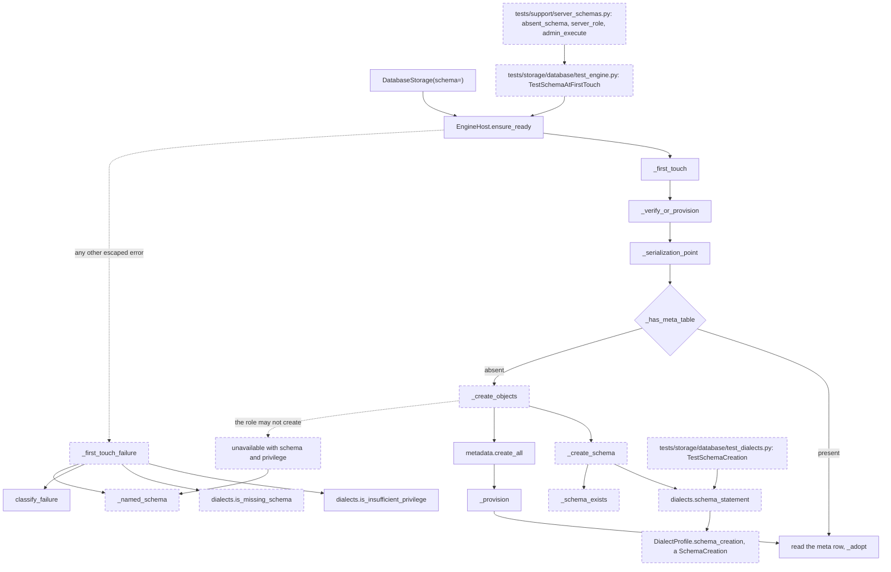

# A mount with `schema=` on Postgres or SQL Server creates its schema at first touch when it is absent, and a role that may not create it is refused `unavailable` naming the schema and the privilege, never `internal`

A feature. Flags: it is not structural; it adds no public name and changes one public behaviour (`DatabaseStorage(schema=...)` now makes its schema on two engines) and the kind of three first-touch refusals; it does not change the schema format (no table, column or index changes, and `SCHEMA_FORMAT_VERSION` is untouched); it needs the engine legs, Postgres and SQL Server for the behaviour and MariaDB and Oracle for the zero count of criterion 15; it does not touch rights (a database role's privileges are the deployment's, not vfs grants, and no grant, label or posture code changes); it does not touch the Rust engine; it is parallel-safe with every unit but [157-3](../2026-11-25-a-borrowed-sql-server-factory-is-checked-and-the-facade-installs-extensions/spec.md), which adds a check at the same first-touch site and builds after this one. It serves roadmap story D3, acceptance items 1 and 2, at gate b ([the roadmap](../../context/standards/roadmap.md), lines 472 to 476). It is converted from [spec 157](../../context/specifications/archive/157-postgres-provisioning-for-host-apps/spec.md), rules 1 and 2, the no-create role of rule 5 and acceptance bullets 1 and 2, read through [the study of that source](../2026-11-25-the-backlog-converted/studies/051-162/157-postgres-provisioning-for-host-apps.md) and [the verification of roadmap decision D3](../2026-11-25-the-backlog-converted/decisions/e-engines-schema-and-kernel.md). It stands on item 19 of [the 2026-10-08 integration memo](../../context/research/2026-10-08-smartowl-workspace-integration-issues.md). It depends on no unit of [the unit map](../2026-11-25-the-backlog-converted/units.md) and on no unbuilt roadmap story: story D3 names story D2 (the schema lifecycle, a roadmap story with no spec) under "Depends on", and nothing here relies on a line of it, because D2's acceptance items 1 and 2 ("A meta row at `SCHEMA_FORMAT_VERSION + 1` refuses `schema_mismatch`", "A meta table present with no row, or a non-integer version, classifies `vfs.unavailable.corrupt`") change what first touch answers after the meta row is read, and every statement this unit adds runs before a meta table exists. Build order: this unit builds before or after D2 in either order; 157-3 builds after it; [157-2](../2026-11-25-the-bulk-insert-path-follows-the-driver-on-the-connection/spec.md) is independent of it.

## The problem

Every fact below is at commit `9daedd2b` (EXECUTED, `git rev-parse --short=8 HEAD`).

- `schema=` only qualifies the tables. `EngineHost.__init__` takes `schema` and passes it to `build_vfs_tables(schema=schema, ...)` and does nothing else with it (READ, `src/vfs/storage/backends/database/engine.py:178`, `engine.py:199`).
- No code path issues schema DDL. A search for `schema_ddl`, `CreateSchema`, `CREATE SCHEMA` and `has_schema` over `src/`, `tests/`, `docker/`, `scripts/` and `.github/` hits only the test harness (EXECUTED, grep; the two hits are `tests/support/server_schemas.py:43-44`). `_verify_or_provision` opens the connection, takes the serialization point, and when the meta table is absent runs `create_all(checkfirst=True)` with no schema statement before it (READ, `engine.py:671-677`).
- A host therefore makes the schema by hand, which is item 19 of the integration memo (READ, `context/research/2026-10-08-smartowl-workspace-integration-issues.md:158-160`).
- No engine leg meets an absent schema. The harness creates each test's schema before the backend exists (READ, `tests/support/server_schemas.py:69-87`), so first touch against a database without the schema is run by no test.
- A privilege refusal at first touch is `internal`. `ensure_ready` hands every escaped driver error to `classify_failure` (READ, `engine.py:321-324`), which answers `ErrorKind.internal` for a permanent statement defect (READ, `engine.py:408-409`), and SQLSTATE 42501 sits in class 42, one of the two defect classes (READ, `dialects.py:1051-1067`, `dialects.py:1090`). The message a host reads is "Report this failure" (READ, `src/vfs/results/kinds.py:297-300`) for a condition a database administrator fixes with one grant (INFERRED from the code path; no server ran here).
- The predicate exists and first touch does not consult it. `is_insufficient_privilege` reads SQLSTATE 42501 (READ, `dialects.py:1070-1080`) and its one caller is `install_extensions`, which answers `permission_denied` (READ, `engine.py:346-350`; EXECUTED, grep for the name over `src/vfs`).
- A missing schema on Postgres is `unavailable` and retryable. SQLSTATE 3F000 is in neither defect class, so it falls to the last line of `classify_failure`, `retryable=True`, with a detail that names no schema (READ, `engine.py:410`). On SQLite the same shape was observed: `DatabaseStorage(schema="absent")` answers `vfs.unavailable`, `retryable=True`, "First touch failed: unknown database" (EXECUTED, a scratch first touch on a file database).
- Postgres checks the privilege before the existence. `CreateSchemaCommand` checks `CREATE` on the database before it tests `if_not_exists`, so `CREATE SCHEMA IF NOT EXISTS` raises 42501 for a role without database `CREATE` even when the schema exists (READ in the study, from `src/backend/commands/schemacmds.c` of the Postgres source; not re-read here, no clone of Postgres is beside this checkout).
- SQLAlchemy's schema DDL is one text for every dialect. `CreateSchema(name, if_not_exists=True)` compiles to `CREATE SCHEMA IF NOT EXISTS name` on the SQL Server dialect as on Postgres (EXECUTED, SQLAlchemy 2.0.52 compiled offline against each dialect), and T-SQL has no such form (INFERRED, from SQL Server's documented `CREATE SCHEMA` grammar).
- SQLAlchemy's existence test is bounded on Postgres and a listing on SQL Server. The Postgres dialect's `has_schema` is one query on `pg_namespace` with the name bound (READ, `.venv/lib/python3.13/site-packages/sqlalchemy/dialects/postgresql/base.py:3632-3636`). The SQL Server dialect defines none of its own (EXECUTED, `type(mssql.dialect()).has_schema is DefaultDialect.has_schema`), so it inherits `schema_name in self.get_schema_names(connection)`, which selects every schema name in the database and compares in Python, case-sensitively (READ, `sqlalchemy/engine/default.py:616-619`, `sqlalchemy/dialects/mssql/base.py:3342-3347`).
- On SQL Server a `schema=` with an unbracketed dot is a database and a schema. `quote_schema("tenant.vfs")` renders `tenant.vfs`, two identifiers, where `quote("tenant.vfs")` renders `[tenant.vfs]`, one (EXECUTED, offline; READ, `sqlalchemy/dialects/mssql/base.py:2858-2882`). On Postgres, SQLite, Oracle and the MySQL family the two renderings are equal for every name tried (EXECUTED, seven names per dialect).
- The legs' own roles can create schemas and roles. The Postgres leg connects as the container's `POSTGRES_USER`, a superuser, and the SQL Server leg as `sa` (READ, `docker/compose.test.yml:33`, `.github/workflows/test-dialects.yml:40`, `:46`). `docker/initdb/postgres/` holds one file, `01-vector.sql`, and the SQL Server service mounts no init directory (EXECUTED, `ls`; READ, `docker/compose.test.yml:74-106`).

## Architecture

Nothing retires. `is_insufficient_privilege` and `classify_failure` exist; the first gains SQL Server's native number (decision 12) and the second is unchanged.

- **Schema creation**: the pair of facts a profile declares for an engine whose schemas vfs makes: how to prove a schema exists, and the statement that makes it.
- **Provisioning step**: the two statement groups that need a `CREATE` privilege, the schema statement and `create_all`, run only when the meta table is absent.
- **No-create role**: a database login that can connect and holds no privilege to create a schema or a table.
- **Single identifier**: a `schema=` value the dialect renders as one quoted name, tested as `quote_schema(schema) == quote(schema)` on the dialect's identifier preparer.

## Decisions

### 1. First touch makes the mount's schema on Postgres and SQL Server when `schema=` is set, inside the provisioning transaction, after the serialization point and before `create_all`.

The schema statement runs on the connection `_verify_or_provision` already holds, so on both engines it joins the transaction that creates the tables and plants the meta row, and a first touch that fails later leaves no schema behind where the engine keeps DDL transactional (INFERRED: both engines do). It runs only inside the branch that found no meta table, so a mount that is already provisioned pays no added statement at any first touch. The order relative to story D2 is the only thing that story asks of this one, and it is met: nothing here reads the meta row. The reason is the roadmap's: a host provisions on its own Postgres or SQL Server without hand-made schemas.

Basis: the source spec, rule 1; still true at 9daedd2b (grep for `CREATE SCHEMA` over `src/` returns nothing; `engine.py:671-677` read).

### 2. First touch tests for the schema before issuing the statement, and issues nothing when the schema is present.

The source issued `CREATE SCHEMA IF NOT EXISTS` unconditionally. On Postgres that refuses a role without database `CREATE` even when the schema exists, so a host that pre-made the schema and granted vfs a least-privilege role would be refused by a statement that had nothing to do. Testing first serves that host, and it matches how first touch already treats its tables.

Basis: verified lean, the study's open choice 1 (holds-amended); precedent: `_has_meta_table` runs before `create_all`, itself `checkfirst=True`, at `engine.py:676-677`.

### 3. The existence test is SQLAlchemy's `Inspector.has_schema` on Postgres and a declared one-row statement on SQL Server.

The study's amended text named `Inspector.has_schema` for both engines. On SQL Server that call lists every schema in the database and compares names in Python, which fails twice: its result grows with the number of schemas, in a product whose own table builder expects a host with thousands of tenant schemas (READ, `src/vfs/models/rows.py:401-402`), and its comparison is case-sensitive under collations that are not, so `schema="Vfs"` beside an existing `vfs` would read as absent and the statement would then fail on a mount that serves today. SQL Server's test is therefore `SELECT 1 FROM sys.schemas WHERE name = :schema`, the name bound, one row or none, compared by the database's own collation. Postgres keeps SQLAlchemy's call because it is already that query.

Basis: decided in drafting, because AGENTS.md "No statement may grow unboundedly" and "Lean on SQLAlchemy; keep profiles lightweight" settle each engine separately; the lean of one call for both is contradicted by `sqlalchemy/engine/default.py:616-619`, which the SQL Server dialect inherits.

### 4. One profile field, `schema_creation: SchemaCreation | None`, carries the decision; Postgres and SQL Server declare it and its default is `None`.

`SchemaCreation` is a `NamedTuple` of `create: str`, the statement with one `{schema}` placeholder, and `probe: str | None = None`, the existence statement with one bound `:schema`, where `None` means SQLAlchemy's own `has_schema` is a bounded single-name query on this dialect. The source proposed a bare `schema_ddl: str | None`; the pair replaces it because decision 3 gives SQL Server a second engine fact, and grouping the two keeps a statement from being issued with no existence test declared beside it. Which engines have a schema vfs may make is a decision SQLAlchemy takes no position on (`supports_schemas` is true on every dialect, SQLite included), which is what admits a profile field.

Basis: verified lean, the study's open choice 2 (holds); precedent: `VectorFunction` groups a probe, a fix and an install statement on the profile for the same reason, `dialects.py:131-147`, and AGENTS.md admits a profile field "only for a decision SQLAlchemy takes no position on".

### 5. Postgres's statement is `CREATE SCHEMA IF NOT EXISTS {schema}` and SQL Server's is `CREATE SCHEMA {schema}`, with no `EXEC` wrapper.

The source wrapped SQL Server's statement as `IF NOT EXISTS (SELECT 1 FROM sys.schemas WHERE name = N'{schema}') EXEC('CREATE SCHEMA {schema}')`. With the existence test now its own bound statement the wrapper tests twice, and it embeds the name in two string literals that identifier quoting does not escape, so a name holding a quote would break the statement. A lone `CREATE SCHEMA` already runs through `aioodbc` inside a transaction: the harness issues exactly that on every SQL Server leg test (READ, `tests/support/server_schemas.py:44`, `:119-135`). Postgres keeps `IF NOT EXISTS` for a schema made between the test and the statement by something that does not take the mount's advisory lock, such as the host's own migration.

Basis: decided in drafting, because decision 2 moves the existence test out of the statement and the wrapper's literals are an escaping fault the plain form does not have; the departure from the source spec, rule 1, is the wrapper alone.

### 6. The name is rendered by the dialect's `quote_schema`, and a name the dialect does not render as a single identifier gets no schema statement.

`{schema}` is filled with `dialect.identifier_preparer.quote_schema(schema)`, the rendering SQLAlchemy gives the same name in every table reference, never the raw string. On SQL Server a dotted or bracketed `schema=` is SQLAlchemy's database-and-schema form; `CREATE SCHEMA` cannot take it, and creating a schema whose name is the whole dotted string would put the schema in one place and the tables in another. For such a name first touch issues no existence test and no statement, exactly as at HEAD, and the host makes that schema. The test is `quote_schema(schema) == quote(schema)`, public API of the identifier preparer, false on SQL Server for `tenant.vfs`, `[db].[sch]` and `[my schema]` and true for every name on the other dialects (EXECUTED offline).

Basis: decided in drafting, because the source's rule ("The name goes through `dialect.identifier_preparer.quote_schema`, never an f-string") is kept and the single-identifier guard follows from `sqlalchemy/dialects/mssql/base.py:2858-2882`, which splits the name the source did not consider.

### 7. SQLite, MariaDB, Oracle and every unknown dialect declare no schema creation, and first touch issues no schema statement on them.

A MariaDB schema is a database and an Oracle schema is a user; making either is a server-wide act under privileges an application role does not hold, and a SQLite schema is a database attached per connection. MariaDB is a second-tier engine: served and in CI, with no added provisioning behaviour. An unknown dialect resolves to the generic floor, which claims nothing. A missing schema on these engines keeps today's classification.

Basis: verified lean, roadmap decision D3 (second tier, holds-amended, with spec 157 listed as "MariaDB issues no schema statement"); precedent: roadmap story D3's acceptance item 1 ("on SQLite, MariaDB and Oracle first touch issues no schema statement (counted)", `context/standards/roadmap.md:475`) and the harness's own table, where MariaDB's schema is `CREATE DATABASE` and Oracle's is `CREATE USER`, `tests/support/server_schemas.py:45-50`.

### 8. A privilege refusal in the provisioning step is `vfs.unavailable`, `retryable=False`, with `data == {"schema": <name>, "privilege": "CREATE"}`.

The kind is `unavailable` and not `permission_denied`: `permission_denied` means the vfs caller is known and may not, its hint tells the caller to target another path, and its referent is an entry (READ, `src/vfs/results/kinds.py:71`, `:189-194`); a database role that lacks `CREATE` is the deployment's condition, the same for every caller, and no path fixes it. It is never retryable because no retry grants a privilege. The detail names the fix, as the vector function's refusal does: for the schema statement, "this database role may not create the schema <name> (<the driver's text>); create it once under a role that may, or grant this role the right to create schemas in this database"; for `create_all`, "this database role may not create tables in the schema <name> (<the driver's text>); grant it CREATE on the schema". No new child kind is minted: the roadmap line names `vfs.unavailable` itself.

Basis: verified lean, the study's open choice 3 (holds) and roadmap story D3's acceptance item 2; precedent: the never-retryable `unavailable` that names its fix when the vector function is missing, `engine.py:658-659`.

### 9. The provisioning step that carries `privilege: "CREATE"` is both the schema statement and `create_all`.

Decision 2 lets a least-privilege role past the schema statement when the schema is pre-made, so the first statement that can refuse it is `CREATE TABLE`, one line later. If only the schema statement were covered, the host decision 2 exists to serve would meet `internal` whenever its grant was `USAGE` without `CREATE`. Both statements need a privilege whose name is `CREATE` (on the database for the schema, on the schema for the tables), so one data shape names both, and the detail says which.

Basis: decided in drafting, because the title's "never `internal`" for a role that may not create would otherwise hold for one statement and fail for the next, a case decision 2 creates.

### 10. Any other insufficient-privilege failure that escapes first touch is `vfs.unavailable`, `retryable=False`, with `data == {"schema": <name>}` and no `privilege` key.

A role that may not read an existing mount's tables, or may not use its schema, fails at the meta-row read, outside the provisioning step. The engine names the denied object in its own text, which the detail carries ("this database role lacks a privilege first touch needs (<the driver's text>)"); vfs does not guess which privilege, so the key is absent and never wrong.

Basis: decided in drafting, because the same reasoning as decision 8 applies to every statement of first touch (the role is the deployment's, no retry cures it, `internal` tells the host to report a bug that is a missing grant), and only the provisioning step knows the privilege's name.

### 11. The reclassification lives at first touch, in `EngineHost`, and `classify_failure` and `is_permanent_defect` are unchanged.

The source's scope line put the carve-out in `is_permanent_defect` and `classify_failure`. Both are shared by every verb's failure path (READ, `src/vfs/storage/backends/database/backend.py:1372`, `:1508`), so a change there would reclassify a 42501 raised by any statement of any verb, which nothing here has examined. `ensure_ready`'s handler calls a new `_first_touch_failure`, which tests the two predicates and otherwise delegates to `classify_failure` as today. A 42501 from a verb after first touch stays `internal`, pinned by criterion 13.

Basis: decided in drafting, because the study's conversion note scopes the carve-out to first touch "so a 42501 elsewhere is not silently reclassified", and the source's site contradicts that scope.

### 12. `is_insufficient_privilege` also answers true for SQL Server's native message 262 under SQLSTATE 42000.

pyodbc reports SQL Server's permission refusals under the bare class state 42000, never 42501, with the native number in the diagnostic's parentheses; message 262 is "%ls permission denied in database", the refusal of `CREATE SCHEMA` and of `CREATE TABLE` for a role without the database permission (INFERRED, from SQL Server's message catalogue; no SQL Server ran in drafting, and criterion 17's `mssql` case is the execution). The number is read the way `is_unique_violation` reads 2627 and 2601, through one private helper both predicates share, and only when the state is 42000. The predicate's other caller, `install_extensions`, is unaffected: the SQL Server profile declares no vector function, so that verb returns before any statement (READ, `dialects.py:563-590`, `engine.py:339-341`).

Basis: decided in drafting, because the title promises the refusal on SQL Server and the tree classifies by code and never by message text (`dialects.py:1003-1019` reads SQL Server's native numbers for the same reason).

### 13. A missing schema at first touch is `vfs.unavailable`, `retryable=False`, with `data == {"schema": <name>}`, read from SQLSTATE 3F000 and from SQL Server's native message 2760.

At HEAD 3F000 is `unavailable` and retryable with a detail that names nothing; a missing schema is not cured by waiting. After decision 1 the case is reached on Postgres only by a schema dropped mid-flight, and on SQL Server by a name decision 6 does not create or a schema the role cannot see: there the engine answers message 2760, "The specified schema name either does not exist or you do not have permission to use it", under state 42000 (INFERRED, from SQL Server's message catalogue; criterion 21 is the execution). A new predicate, `is_missing_schema`, reads both. The detail is "the schema <name> does not exist or this role may not use it (<the driver's text>); create it, or name one that exists". MariaDB and Oracle expose no SQLSTATE through their drivers and keep today's classification.

Basis: verified lean, the study's open choice 4 (holds-amended: `retryable=False` with `data["schema"]`); precedent: the missing vector function is refused `unavailable` and never retryable for the same reason, `engine.py:658-659`.

### 14. `data["schema"]` is the `schema=` argument as given, and when none was given it is the live dialect's `default_schema_name`.

A mount with no `schema=` can be refused too: on a Postgres database where the role may not create in the default schema, `create_all` raises the same 42501. The refusal names where the tables were headed, read off the dialect SQLAlchemy initialised at first connect (`main` on SQLite, EXECUTED; `public` and `dbo` by default on the two server engines, INFERRED), and never a constant in vfs.

Basis: decided in drafting, because AGENTS.md says to read facts off the live `Dialect` object and the roadmap's `data["schema"]` must have a value in every refusal of decisions 8, 10 and 13.

### 15. The refusal's detail and data are shown to whichever caller's verb triggered first touch, and that exposes nothing new.

First touch runs lazily under the first routed verb, so the refusal reaches that caller, anonymous included. Every first-touch failure at HEAD already carries the driver's own text in its detail (READ, `engine.py:409-410`), and the driver's text for these refusals names the schema. The schema name and the word `CREATE` add no fact that text did not hold, and no path, grant or entry is named.

Basis: decided in drafting, because the refusal's content is a subset of what `classify_failure` already returns to the same caller for the same error.

### 16. The source's rule 3, the extension step during provisioning, is not carried.

First touch never installs pgvector: it proves the function and refuses naming the fix, and a separate verb installs it for a role that may.

Basis: ruled, 2026-10-08, the source spec's rule 3 records the point as resolved; the landed design then overtook the rule (`dialects.py:541-552`, `engine.py:326-351`, `engine.py:633-661`), so nothing of it remains to build.

### 17. `install_extensions` keeps `permission_denied` for the same SQLSTATE.

After this unit one SQLSTATE yields two kinds: `unavailable` when first touch meets it, `permission_denied` when the explicit install verb does. The verb's answer is landed and pinned (`tests/storage/database/test_sqlite_vec.py::TestInstallExtensions::test_a_role_that_may_not_install_is_permission_denied_naming_the_fix`) and this unit does not edit it.

Basis: provisional, no ruling on record; the options were to keep `permission_denied` on the install verb because it is an explicit act of the developer who chose the role, or to move it to `unavailable` so one SQLSTATE has one kind; chosen because keeping it changes no landed behaviour and no pinned test, and either answer can be changed before the release with a one-line edit and one assertion.

### 18. The no-create role of the engine legs is made and dropped per test by the harness, on both engines, and no Docker init file is added.

The source added a fixed role `vfs_nocreate` to `docker/initdb/postgres/`. Three facts move it into the harness: the SQL Server service runs no init directory, so the SQL Server case needs the harness regardless; a per-test role name keeps the legs reentrant, which the harness's own contract requires ("concurrent runs against one server never tear each other down", `tests/support/server_schemas.py:3-7`); and an init file runs only on an empty data directory, so a long-lived local server would lack the role. The role's URL is the leg's URL with the user and password replaced through `sqlalchemy.engine.make_url(...).set(...)` (EXECUTED offline on the SQL Server URL, query string kept), so no second environment variable is added. The leg's own role must be able to create roles, which both CI roles are.

Basis: decided in drafting, because the harness rule of one fresh, uniquely named object per test already governs schemas and the source's init file cannot serve the SQL Server leg; the departure from the source spec, rule 5, is where the role is made.

### 19. The harness keeps its own schema table and does not adopt the profile field.

The source said the harness table "adopts the profile field". The table also makes MariaDB databases and Oracle users, which the profile declares `None` for, and it drops what it makes, which the profile never does.

Basis: decided in drafting, because `tests/support/server_schemas.py:42-50` carries four engines and a drop statement and decision 7 leaves two of those engines undeclared.

### 20. This unit adds no serialization point for first touch on SQL Server.

On Postgres two first touches of one mount are serialized by the advisory lock taken before the meta-table test (READ, `engine.py:672`, `:736-741`), so exactly one issues the schema statement (criterion 22). On SQL Server nothing serializes them at HEAD: `_serialization_point` issues a statement on Postgres only, and two first touches of one fresh mount can both reach `create_all`, where the loser meets the engine's duplicate-object error (INFERRED; no test at HEAD races first touch on a server engine, `tests/storage/database/test_engine.py:255` races it on SQLite only). The schema statement joins that existing window with the same class of failure and adds none of its own.

Basis: decided in drafting, because the window and its classification exist at HEAD for the tables, closing it is a change to first touch's arbitration on one engine that no roadmap story of this unit asks for, and adding it here would change behaviour beyond the title.

### 21. The behaviour is stated in two docstrings and in no documentation page.

The `DatabaseStorage` class docstring gains the sentence that says which engines make an absent schema and what a role without the privilege is answered; the module docstring of `engine.py` gains the schema step in its account of first touch. The class docstring is what `documentation/reference/python-api/storage.md` renders (READ, its line 9, `::: vfs.DatabaseStorage`), so the reference page changes with it; the new names in `dialects.py` are not in the package's `__all__` and reach no page. No page under `documentation/` names `schema=` today (EXECUTED, grep), and the roadmap's how-to for story D3 is carried by no unit of the map.

Basis: decided in drafting, because a docstring is the reference page's content (AGENTS.md, Tooling) and a how-to is a separate document with its own unit.

## Intent

After this spec, a host that constructs `DatabaseStorage(url=..., schema="vfs")` or hands vfs a session factory on Postgres or SQL Server, against a database that has no such schema, gets its first `write` served: first touch makes the schema, then the tables, in one transaction. A host that pre-made the schema and granted vfs a role with rights on that schema alone is served too, and first touch issues no schema statement for it. A host whose role may not create what first touch needs is answered once, in the result of its first call, with `vfs.unavailable`, `retryable=False`, the schema's name in `data["schema"]` and, where the missing privilege is to create, `data["privilege"] == "CREATE"`, in words that name the grant to make; it never reads "Internal error" for a missing grant. On SQLite, MariaDB, Oracle and unknown dialects first touch issues no schema statement, as before.

## Design

Order of work. Each step writes its tests first and sees them fail, then the code that passes them. The engine-leg cases of steps 3 and 4 are first run red through the `db_test` skill.

**Step 1, the profile and the predicates (`src/vfs/storage/backends/database/dialects.py`).**

Tests first, in `tests/storage/database/test_dialects.py`: a new class `TestSchemaCreation` (criteria 1 to 3) and two module-level tests beside `test_a_unique_violation_is_told_from_every_other_integrity_failure` (criteria 4 and 5), built on that file's `_PgError` and a variant of its `_odbc` helper that takes the SQLSTATE.

Then the code:

- `SchemaCreation(NamedTuple)`, fields `create: str` and `probe: str | None = None`, placed beside `VectorFunction` among the shared types.
- `DialectProfile.schema_creation: SchemaCreation | None = None`. `POSTGRESQL` declares `SchemaCreation(create="CREATE SCHEMA IF NOT EXISTS {schema}")`. `MSSQL` declares `SchemaCreation(create="CREATE SCHEMA {schema}", probe="SELECT 1 FROM sys.schemas WHERE name = :schema")`. No other profile declares it.
- `schema_statement(profile: DialectProfile, dialect: Dialect, schema: str | None) -> str | None`, public, under its own banner after the profile lookup: `None` when `schema` is `None`, when the profile declares no creation, or when `quote_schema(schema) != quote(schema)`; otherwise the profile's `create` with `{schema}` filled by `quote_schema(schema)`.
- `is_insufficient_privilege` gains the SQL Server arm (decision 12). `is_missing_schema(exc: BaseException) -> bool` is added beside it (decision 13).
- Private constants, each named, in the internal helpers: `_SQLSTATE_INVALID_SCHEMA = "3F000"`, `_SQLSTATE_BARE_ACCESS = "42000"`, `_MSSQL_PRIVILEGE_NUMBERS = frozenset({262})`, `_MSSQL_MISSING_SCHEMA_NUMBERS = frozenset({2760})`, and `_native_numbers(origin) -> frozenset[int]`, the parenthesised numbers of an ODBC diagnostic, which `is_unique_violation` is changed to call in place of its inline expression with no change of result.

**Step 2, the schema step (`src/vfs/storage/backends/database/engine.py`).**

Tests first, in `tests/storage/database/test_engine.py`, a new class `TestSchemaAtFirstTouch`, SQLite cases (criteria 6 to 8). They run the real first touch on a file database with `schema="main"`, SQLite's name for the default database, which serves at HEAD (EXECUTED), under a profile replaced through `monkeypatch.setattr(engine_module, "profile_for", ...)` as `TestFirstTouch` already does: `replace(SQLITE, schema_creation=SchemaCreation(create="CREATE TABLE IF NOT EXISTS {schema}.schema_marker (id INTEGER)", probe="SELECT 1 WHERE :schema = 'elsewhere'"))` stands for an absent schema with a statement SQLite accepts, and the same with `probe=None` exercises SQLAlchemy's `has_schema`, which finds `main`. These cases keep the 3.13 gate at 100% coverage with no server.

Then the code, three private methods of `EngineHost` and one changed branch:

- `_schema_exists(self, connection: Connection, probe: str | None) -> bool`, synchronous, run through `conn.run_sync` as `_has_meta_table` is: `inspect(connection).has_schema(schema)` when `probe` is `None`, else whether `connection.execute(text(probe), {"schema": schema})` answers a row.
- `_create_schema(self, conn: AsyncConnection) -> None`: asks `schema_statement` for the statement; returns when it is `None`; returns when `_schema_exists`; otherwise `await conn.exec_driver_sql(statement)`.
- `_create_objects(self, conn: AsyncConnection) -> ResultError | None`: runs `_create_schema`, then `conn.run_sync(self.tables.metadata.create_all, checkfirst=True)`, inside one `try`; a `DBAPIError` for which `is_insufficient_privilege` is true becomes the refusal of decision 8, its detail chosen by which of the two was running; every other error propagates unchanged.
- In `_verify_or_provision`, the branch `if not await conn.run_sync(self._has_meta_table):` calls `_create_objects` in place of the bare `create_all`, and returns its refusal without committing when there is one; the session's exit rolls the transaction back.

**Step 3, the classification (`engine.py`).**

Tests first, in `TestSchemaAtFirstTouch`, SQLite cases (criteria 9 to 13), which raise driver-shaped errors at a named statement the way `tests/storage/database/test_sqlite_vec.py:34-52` does: SQLAlchemy's asyncpg adapter error carrying `sqlstate = "42501"`, wrapped in `ProgrammingError`.

Then the code: `_first_touch_failure(self, exc: BaseException) -> ResultError`, called by `ensure_ready`'s `except (SQLAlchemyError, OSError)` handler in place of the direct `classify_failure` call. It returns the refusal of decision 10 when `is_insufficient_privilege(exc)`, the refusal of decision 13 when `is_missing_schema(exc)`, and `self.classify_failure(exc, context="First touch")` otherwise. A private `_named_schema(self) -> str | None` gives the name for `data["schema"]` in every refusal here (decision 14). The `StaleSnapshot` arm of `ensure_ready` is untouched.

**Step 4, the harness and the engine-leg cases.**

`tests/support/server_schemas.py` gains three helpers, for Postgres and SQL Server only:

- `absent_schema(env_var)`, an async context manager that yields `(url, schema)` with a fresh `vfs_t_<12 hex>` name and creates nothing; on exit it drops the schema and its tables if they exist.
- `server_role(env_var)`, an async context manager that yields a `LegRole(name, url)` for a fresh login `vfs_r_<12 hex>` that can connect and holds no other privilege (Postgres: `CREATE ROLE ... LOGIN PASSWORD ...`; SQL Server: `CREATE LOGIN ... WITH PASSWORD = ..., CHECK_POLICY = OFF` and `CREATE USER ... FOR LOGIN ...` in the URL's database); on exit it drops what the role owns, then the role.
- `admin_execute(env_var, statement)`, which runs one statement as the leg's own role on a short-lived engine, for the grants and the pre-made schemas the cases need.

The engine-leg cases of `TestSchemaAtFirstTouch` (criteria 14 to 22) are parametrized with marked parameters in the form `tests/support/server_schemas.py:60-65` uses, so `tests/conftest.py` deselects each leg whose URL is unset. The roadmap's literal `vfs_demo` becomes the per-test name in every case, since a fixed name would make the leg non-reentrant. Schema statements are counted from a `before_cursor_execute` listener on the mount's engine, as `tests/storage/test_conformance.py:501` does: a statement counts when its text begins `CREATE SCHEMA`, `CREATE DATABASE` or `CREATE USER`.

**Step 5, the docstrings and the gates.** The two docstrings of decision 21. Then `scripts/ci.sh`, `scripts/docs.sh check` (a docstring under `src/vfs/` changed), and the four engine legs through the `db_test` skill: the Postgres and SQL Server legs carry the new cases, and the MariaDB and Oracle legs carry criterion 15 and prove first touch is unchanged there.

**What grows with input, and what bounds it.**

- *The existence test*: one statement returning at most one row, its only input one name. It rides on none of the reference deployment's daily multipliers: it runs once in the life of a mount, at the first touch that finds no meta table. Per verb call it is zero statements, because `ensure_ready` returns at `self._ready` (READ, `engine.py:309-310`) and 150,000 calls a day pay nothing. Per process start of an existing mount it is zero, because it sits behind the meta-table test (criterion 8). For a host with T tenant schemas it is T statements over the deployment's life; the listing decision 3 refuses would have read T names on each, T squared in all, 100,000,000 name reads at 10,000 tenants.
- *The schema statement*: one statement, at most once in the life of a mount, its size fixed by one identifier.
- *No loop, list or in-memory structure is added.* Nothing here is batched, no `IN` list is built and no statement's size depends on a batch, so `membership_budget`, `chunked` and `statement_budget` have nothing to bound; the per-batch, per-file-write, per-index-visit and per-corpus multipliers are each zero.
- *Per lock*: the statement runs in the first-touch transaction, which exists at HEAD, and adds no lock another caller needs. On Postgres it runs under the advisory transaction lock keyed on the schema-qualified table name (READ, `engine.py:236`, `:741`), which only a rival first touch of the same mount waits on, for the length of one provisioning commit. The schema it creates is read by no serving mount, since it did not exist. No read verb of any mount waits on it, and no table is locked. On SQL Server with `READ_COMMITTED_SNAPSHOT` off the open transaction holds its own new catalog row until the commit; the only reader of that row is a rival first touch of the same schema (INFERRED).
- *The refusals*: each adds no statement; the failed transaction is rolled back by the session's exit and its locks go with it.

## Scope

In: decisions 1 to 21. Files: `src/vfs/storage/backends/database/dialects.py`, `src/vfs/storage/backends/database/engine.py`, the class docstring in `src/vfs/storage/backends/database/backend.py`, `tests/storage/database/test_dialects.py`, `tests/storage/database/test_engine.py`, `tests/support/server_schemas.py`.

Out:

- The bulk insert path chosen by driver, the psycopg leg and the `postgres` extra: [157-2](../2026-11-25-the-bulk-insert-path-follows-the-driver-on-the-connection/spec.md).
- The `use_setinputsizes` refusal for a borrowed SQL Server factory and `install_extensions(path)` on the facade: [157-3](../2026-11-25-a-borrowed-sql-server-factory-is-checked-and-the-facade-installs-extensions/spec.md).
- The kind `install_extensions` answers for a role that may not install: unchanged here (decision 17); a ruling would change it in the unit that touches that verb, 157-3.
- The directional schema mismatch, the corruption kind and the migration registry: roadmap story D2, which has no spec.
- The engine support matrix that will state which engines make a schema: roadmap story D1.
- Creating a MariaDB database or an Oracle user, and classifying a missing schema or a privilege refusal on MariaDB, Oracle, SQLite and unknown dialects: not done (decision 7); no roadmap story asks for it.
- A schema named in SQL Server's database-qualified or bracketed form: not created (decision 6); the host makes it.
- A serialization point for first touch on SQL Server: not added (decision 20); no roadmap story places it.
- A privilege refusal raised by a verb after first touch: keeps `internal` (decision 11).
- `ALTER` migrations, a schema-per-mount convention and dropping a schema: as the source left them, outside this unit.
- A how-to for host-app provisioning, where the roadmap also places the `engine_kwargs` note: carried by no unit of the map (decision 21).
- `docker/`, `.github/workflows/test-dialects.yml` and `pyproject.toml`: no change.

## Acceptance criteria

Criteria 1 to 13 run on SQLite in the 3.13 gate. Criteria 14 to 22 are engine-leg cases; the bracket names the leg. All test classes named `TestSchemaAtFirstTouch` are in `tests/storage/database/test_engine.py`.

1. `POSTGRESQL.schema_creation` is `SchemaCreation(create="CREATE SCHEMA IF NOT EXISTS {schema}", probe=None)`, `MSSQL.schema_creation` is `SchemaCreation(create="CREATE SCHEMA {schema}", probe="SELECT 1 FROM sys.schemas WHERE name = :schema")`, and the field is `None` on `SQLITE`, `MARIADB`, `ORACLE` and `GENERIC`: `tests/storage/database/test_dialects.py::TestSchemaCreation::test_only_postgres_and_sql_server_declare_it`.
2. `schema_statement` returns `CREATE SCHEMA IF NOT EXISTS vfs_demo` and `CREATE SCHEMA IF NOT EXISTS "Mixed Case"` on the Postgres dialect and `CREATE SCHEMA vfs_demo` and `CREATE SCHEMA [Mixed Case]` on the SQL Server dialect, four cases: `tests/storage/database/test_dialects.py::TestSchemaCreation::test_the_statement_carries_the_dialects_own_quoting`.
3. `schema_statement` returns `None` for a `None` schema, for the SQLite profile, and on the SQL Server dialect for each of `tenant.vfs`, `[db].[sch]` and `[my schema]`, and returns a statement for `tenant.vfs` on the Postgres dialect, six cases: `tests/storage/database/test_dialects.py::TestSchemaCreation::test_no_statement_without_a_schema_a_declaration_or_a_single_identifier`.
4. `is_insufficient_privilege` is true for SQLSTATE 42501 and for a pyodbc-shaped error with state 42000 and native number 262, and false for state 42000 with native number 102 and for SQLSTATE 42601: `tests/storage/database/test_dialects.py::test_a_privilege_refusal_is_read_from_the_sqlstate_or_sql_servers_native_number`.
5. `is_missing_schema` is true for SQLSTATE 3F000 and for state 42000 with native number 2760, and false for SQLSTATE 42P01 and for state 42000 with native number 262: `tests/storage/database/test_dialects.py::test_a_missing_schema_is_read_from_the_sqlstate_or_sql_servers_native_number`.
6. Under a declared creation whose probe answers no row, first touch issues the creation's statement exactly once, and before the first `CREATE TABLE` of a `vfs_` table: `TestSchemaAtFirstTouch::test_an_absent_schema_gets_one_statement_before_the_tables`.
7. Under a declared creation with `probe=None` and `schema="main"`, first touch succeeds and issues the creation's statement zero times: `TestSchemaAtFirstTouch::test_a_present_schema_gets_no_statement`.
8. A second `DatabaseStorage` opened on a provisioned mount calls `_schema_exists` zero times and issues the creation's statement zero times at its first touch: `TestSchemaAtFirstTouch::test_an_existing_mount_never_tests_for_its_schema`.
9. When the schema statement raises SQLSTATE 42501, first touch returns one error of kind `vfs.unavailable` with `retryable is False` and `data == {"schema": "main", "privilege": "CREATE"}`: `TestSchemaAtFirstTouch::test_a_refused_schema_statement_names_the_schema_and_create`.
10. When `create_all` raises SQLSTATE 42501, first touch returns one error of kind `vfs.unavailable` with `retryable is False` and `data == {"schema": "main", "privilege": "CREATE"}`: `TestSchemaAtFirstTouch::test_a_refused_table_creation_names_the_schema_and_create`.
11. When SQLSTATE 42501 is raised outside the provisioning step on a mount built with no `schema=`, first touch returns one error of kind `vfs.unavailable` with `retryable is False` and `data == {"schema": "main"}`: `TestSchemaAtFirstTouch::test_a_privilege_refusal_elsewhere_names_the_schema_only`.
12. When SQLSTATE 3F000 is raised at first touch, the one error is `vfs.unavailable` with `retryable is False` and `data == {"schema": "main"}`: `TestSchemaAtFirstTouch::test_a_missing_schema_is_refused_and_never_retryable`.
13. SQLSTATE 42601 raised by the schema statement is still `vfs.internal`, and SQLSTATE 42501 passed to `classify_failure` with a verb's context is still `vfs.internal`, two cases: `TestSchemaAtFirstTouch::test_other_failures_keep_their_classification`.
14. On a database with no such schema, `DatabaseStorage(url=..., schema=<name>)` serves its first `write` with `success is True`, and the leg's own role then finds the schema present: `TestSchemaAtFirstTouch::test_first_touch_creates_an_absent_schema[postgres]` and `[mssql]`.
15. First touch issues zero schema statements where the profile declares none: `TestSchemaAtFirstTouch::test_no_schema_statement_where_none_is_declared[sqlite]`, `[mariadb]` and `[oracle]`.
16. On a schema made before the backend exists, first touch under the leg's own role issues zero schema statements and succeeds: `TestSchemaAtFirstTouch::test_a_pre_made_schema_gets_no_schema_statement[postgres]` and `[mssql]`.
17. Through a no-create role on a database with no such schema, the first `write` returns one error of kind `vfs.unavailable`, never `vfs.internal`, with `retryable is False`, `data["schema"]` equal to the name and `data["privilege"] == "CREATE"`, and the schema is still absent afterwards: `TestSchemaAtFirstTouch::test_a_role_without_create_is_refused_naming_the_schema_and_the_privilege[postgres]` and `[mssql]`.
18. Through a no-create role granted `USAGE` and `CREATE` on a pre-made schema and nothing on the database, the first `write` succeeds and zero schema statements are issued: `TestSchemaAtFirstTouch::test_a_least_privilege_role_is_served_on_a_pre_made_schema[postgres]`.
19. Through a no-create role granted `USAGE` alone on a pre-made schema, first touch returns one error of kind `vfs.unavailable` with `retryable is False` and `data == {"schema": <name>, "privilege": "CREATE"}`: `TestSchemaAtFirstTouch::test_a_role_that_may_not_create_tables_is_refused_naming_create[postgres]`.
20. Through a no-create role with no grant, on a schema the leg's own role already provisioned as a mount, first touch returns one error of kind `vfs.unavailable` with `retryable is False` and `data == {"schema": <name>}`: `TestSchemaAtFirstTouch::test_a_role_that_may_not_use_an_existing_mount_is_refused_naming_the_schema[postgres]`.
21. With `schema="master.<absent name>"`, first touch issues zero schema statements and returns one error of kind `vfs.unavailable` with `retryable is False` and `data == {"schema": "master.<absent name>"}`: `TestSchemaAtFirstTouch::test_an_absent_database_qualified_schema_is_refused_naming_it[mssql]`.
22. Two `DatabaseStorage` instances on one absent schema whose first touches are gathered both succeed, and the two engines together issue exactly one schema statement: `TestSchemaAtFirstTouch::test_two_first_touches_of_one_absent_schema_issue_one_statement[postgres]`.

## Landing notes

Filled in when the pull request is opened.

## One line

First touch makes an absent `schema=` on Postgres and SQL Server after testing for it, and a database role that lacks a privilege first touch needs is answered `vfs.unavailable`, never retryable, naming the schema and, where it is the right to create, `CREATE`.
