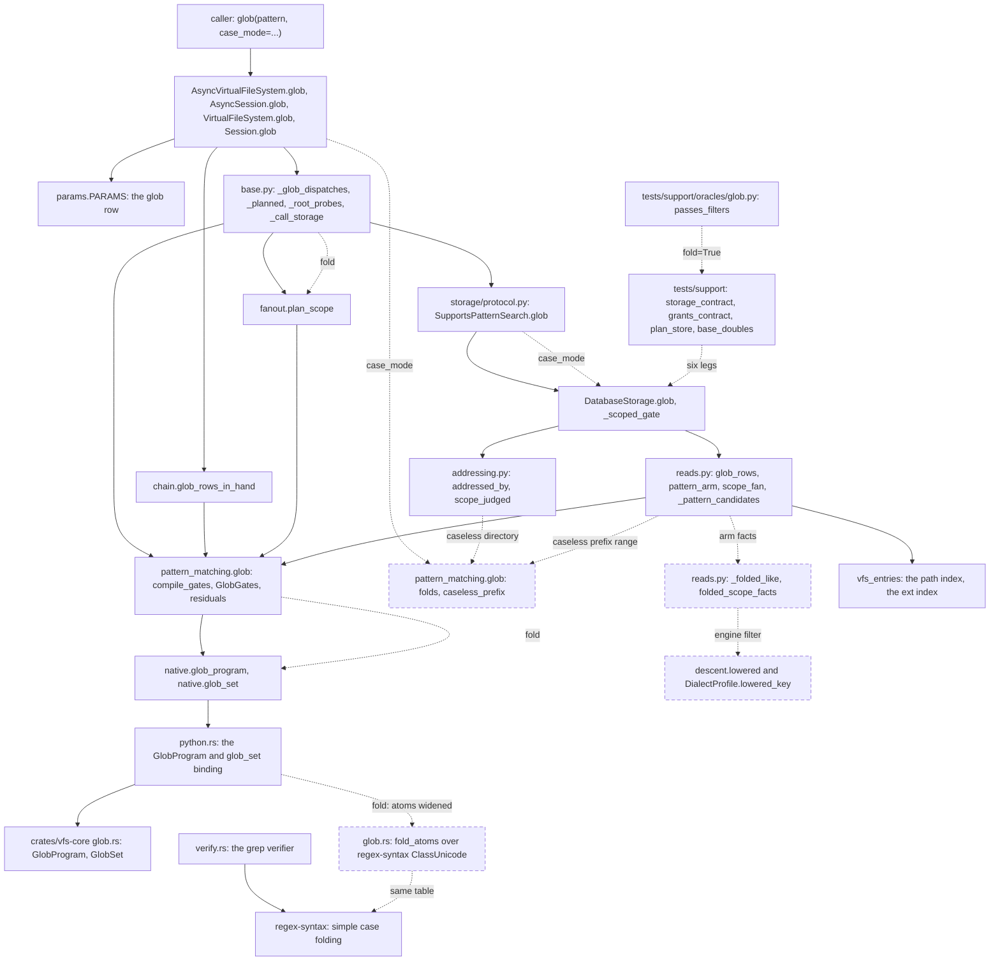

# `glob(case_mode="insensitive")` matches a case-folded filter in one statement per mount on SQLite and on each engine leg, with an index-served prefilter costed at the reference deployment

A feature. Flags: it changes the public API (one keyword argument, `case_mode`, on `glob` on both kernel classes, both synchronous classes and the storage protocol; nothing leaves); it is not structural; it does not change the schema format (decision 12: no column and no index is added); it needs the engine legs (Postgres, MariaDB, SQL Server and Oracle, beside SQLite); it touches rights in one place, the directory at which an anonymous caller of a folded pattern is judged (decision 14), and criteria 31 and 32 are its leak tests; it touches the Rust engine (decision 6); it is parallel-safe with every unit that does not edit the `glob` signature or its row of the parameter table, and it rebases mechanically over those that do (Design, "Order against sibling units"). It serves roadmap story F4, criterion 3, at gate b ([the roadmap](../../context/standards/roadmap.md), lines 631 to 636), which reads: "`glob(case_mode="insensitive")` matches a case-folded Python filter on SQLite and each engine leg in one statement per mount." It is converted from [spec 167](../../context/specifications/archive/167-the-shell-pipeline-core/spec.md), decision 10 (`spec.md:29`) and the paragraph "`glob` gains `case_mode`" (`spec.md:118`), and from task 18 of [its task list](../../context/specifications/archive/167-the-shell-pipeline-core/tasks.md) (`tasks.md:33`), read through [the study of that source](../2026-11-25-the-backlog-converted/studies/165-181/167-the-shell-pipeline-core.md), open choice 17. It stands on no research memo: the probes it needed were run for this spec and are reported under The problem. It depends on no unit and on no roadmap decision. It builds on three landed specs, each in the tree at the commit below: [the two faces named](../../context/specifications/archive/2026-11-06-the-two-faces-named.md) and [the sync facade](../../context/specifications/archive/2026-11-06-the-sync-facade.md), which give `glob` its four faces, and [bounded work has one home](../../context/specifications/archive/2026-11-07-bounded-work-has-one-home.md), which gives every glob stage its `Deadline`. Three decisions are provisional (3, 4 and 11); none waits on a ruling, because each is reversible without touching stored data.

## The problem

Every fact below is at commit `9daedd2b` (EXECUTED, `git rev-parse --short=8 HEAD`). EXECUTED means a command ran for this spec, READ means the cited line was read, INFERRED means reasoning. No `VFS_TEST_<ENGINE>_URL` is set in the checkout the probes ran in (EXECUTED, `env`), so every statement about a server engine's behaviour is READ from the tree or INFERRED, and is proved by the engine legs of the acceptance criteria.

1. `glob` has no case argument on any face, and `grep` has one. `AsyncVirtualFileSystem.glob` takes `pattern, paths, observations, ext, ext_not, globs_not, kind, max_count, columns, authority` (READ, `src/vfs/base.py:1265-1278`); `AsyncSession.glob`, `VirtualFileSystem.glob` and `Session.glob` forward the same list (READ, `src/vfs/session.py:267-290`, `src/vfs/sync.py:456-480`, `:921-945`); the storage protocol's `glob` and `DatabaseStorage.glob` take `patterns, globs_not, ext, ext_not, kind, max_count, columns, scope, authority` (READ, `src/vfs/storage/protocol.py:277-289`, `src/vfs/storage/backends/database/backend.py:426-437`). The names of `PARAMS["glob"]` are those ten and hold no `case_mode`, while `PARAMS["grep"]` holds it straight after `globs_not` (EXECUTED, a print of both rows; READ, `src/vfs/params.py:243-256`, `:265`). The type exists: `CaseMode = Literal["sensitive", "insensitive", "smart"]` (READ, `src/vfs/ops.py:183`).
2. Matching is case-sensitive by declaration and by test. The pattern module's docstring says "Matching is case-sensitive" (READ, `src/vfs/pattern_matching/glob.py:6-7`). On a SQLite store holding `/Docs/README.MD` and `/docs/readme.md`, `glob(patterns=("readme.md",))` returns `/docs/readme.md` alone (EXECUTED, a scratch probe).
3. The native glob program has no fold. The host walks a pattern into atoms (`lit`, `class`, `nclass`, `one`, `star`, `dot`, `never`, `sep`, `mid`, `tail`) and hands them to `glob_program(atoms)` or `glob_set(programs, groups, budget=)` (READ, `src/vfs/native.py:90-122`, `crates/vfs-core/src/glob.rs:33-56`, `crates/vfs-core/src/python.rs:170-260`). The same crate already folds case for `grep`: the verifier parses with `regex_syntax::ParserBuilder::new().case_insensitive(...)` (READ, `crates/vfs-core/src/verify.rs:86-88`), `regex-syntax` is a direct dependency locked at 0.8.11 (READ, `crates/vfs-core/Cargo.toml`, `Cargo.lock:238-239`), and that crate exposes `hir::ClassUnicode::try_case_fold_simple` (READ, the vendored `regex-syntax-0.8.11/src/hir/mod.rs:1122`).
4. The fold `grep` uses is Unicode simple case folding, one code point to one code point. Under `compile_verifier(..., case_mode="insensitive")`, `é` matches `U+00C9`, `σ` matches `U+03C2` and `U+03A3`, `ß` matches `U+1E9E`, `ss` does not match `ß`, and `i` matches neither `U+0130` nor `U+0131`. Of the 26 ASCII letters exactly two have a case partner outside ASCII: `k` with `U+212A` (KELVIN SIGN) and `s` with `U+017F` (LATIN SMALL LETTER LONG S) (EXECUTED, a scratch probe that ran each lowercase ASCII letter against every code point from `U+0080` up).
5. Python's `re.IGNORECASE` agrees with that fold on every pair tried but the Turkic ones. Over the 2,927 code points whose `lower()` or `upper()` differs from themselves, each compared with its one-character `lower()`, `upper()`, `casefold()` and `title()`, the two disagree on one pair, `U+0131` with `U+0049`, which `re` calls equal; `re` also calls `i` equal to `U+0130` and to `U+0131` (EXECUTED, Python 3.13.18, `unicodedata` 15.1.0).
6. Every fact the SQL prefilter carries today can be falsified by a change of case. One pattern's arm is `path != '/'`, a `LIKE` of the pattern's translation over `path` or `name`, the derived extension as `ext = :e OR name = :dot_suffix`, the kind, the caller's wanted extensions and the liveness terms (READ, `src/vfs/storage/backends/database/reads.py:704-744`, `:1214-1243`). `path` and `name` are bytewise on every engine: binary collation on SQLite, `COLLATE "C"` on Postgres, `Latin1_General_100_BIN2_UTF8` on SQL Server, `VARBINARY` on MariaDB, and the engine default on Oracle (READ, `src/vfs/models/rows.py:191-229`, `:432-433`), and every SQLite session runs `PRAGMA case_sensitive_like = ON` (READ, `src/vfs/storage/backends/database/dialects.py:488`). So no engine's `LIKE` over these columns folds case.
7. Three claims of the source's one paragraph are therefore false of the tree. "SQLite's `LIKE` is ASCII-insensitive" is switched off by the pragma of fact 6. "SQL Server and MariaDB follow collation" names collations the key columns do not have. "Both backends" names two implementations where there is one: `InMemoryStorage` is `DatabaseStorage` constructed over an in-process SQLite database and overrides no verb (READ, `src/vfs/storage/backends/memory.py:32-60`). The fourth claim, that Postgres `lower()` "skips the btree", is true of any engine: no index in the schema is on an expression (READ, `src/vfs/models/rows.py:432-504`).
8. Two access paths serve a sensitive glob from an index today, and an unprefixed pattern walks. On a SQLite store of 2,877 files with statistics gathered, `/d000/**/*.py` and the scope root `/d000` with the arm `*.py` each plan as one range of the path index bounded by the prefix (`SEARCH ... ix_vfs_entries_path (path>? AND path<?)` with the bind `/d000/%%.py`); `**/*.py` plans as the same operator over the bind `/%%.py`, which is the whole index; the name arm `README*` plans as a skip-scan of the `(parent_id, name)` unique index, one probe per directory (EXECUTED, `EXPLAIN QUERY PLAN` of the statements the backend issued). `name` has no index of its own (READ, `src/vfs/models/rows.py:433`, `:486`). What the other four engines do with an unprefixed arm is not pinned by any test (READ, `tests/support/storage_contract.py:1420-1437` pins the scope fan alone).
9. A scope's roots are already exact and index-served on every engine. Roots strictly beneath an entry ride beside the uncomposed arms (READ, `src/vfs/base.py:2093-2166`, `src/vfs/fanout.py:105-193`); storage fetches by one of two plans, the roots composed with the arms into pattern text while roots times arms is at most `COMPOSED_PREFILTER_LIMIT` (200), else one strict-descendant `LIKE` per root (READ, `reads.py:312`, `:478-496`, `:572-631`); and the root-clause statement is pinned as index-served by plan operator on all five engines, alone and with the arms' leaf facts beside it (READ, `tests/support/storage_contract.py:1420-1437`). The law is the scope's under either plan: a row is paired with each root by an exact string lookup of its ancestors (READ, `glob.py:385-398`).
10. An anonymous caller is judged at the directory a pattern's literal prefix names, before any row is read: `/pub/**` at `/pub`, `**` at the root (READ, `src/vfs/storage/backends/database/addressing.py:60-89`, `:159-166`, `backend.py:1193-1204`; pinned by `tests/support/grants_contract.py:1186-1196`). A scope is judged at each root's stored path joined with each arm's literal directory, and a root that holds a metacharacter at the deepest directory above its first one (READ, `addressing.py:92-151`).
11. The budgets a glob statement is cut by: an arm spends at most `ARM_FIXED_BINDS` (7) bind slots and a root clause `ROOT_ARM_BINDS` (5) (READ, `reads.py:301-308`); `arm_budget(profile, parameter_budget, 7)` is 200 arms a statement on SQLite, Postgres, SQL Server and MariaDB and 142 on Oracle and on the generic floor, and a pattern expands to at most `MAX_PATTERN_ARMS` (64) (EXECUTED, the tree's own helpers over each SQLAlchemy dialect's `insertmanyvalues_max_parameters`; READ, `dialects.py:760-786`, `glob.py:50`). One pattern is one fan statement on every profile today.
12. A candidate statement carries no row limit, and the wall bounds the judging, not the fetch: `_pattern_candidates` reads every row each statement returns into one dict before the native set judges them (READ, `reads.py:1057-1080`, `:372-378`). A sensitive arm keeps that fetch near its answer because the engine evaluates the arm's `LIKE`; a statement with no such filter returns every row of its scope.

What is missing: a caller cannot ask for `readme.md` and be given `README.MD`. What makes it more than a flag: every index-served fact of fact 6 is case-bearing, so the plain way to add the flag (drop the facts, or wrap the column in `lower()`) turns a call that reads a subtree into one that reads the mount, on a deployment of 10,000,000 files.

## Architecture

Solid boxes exist at `9daedd2b`; the four dashed boxes are added; the dashed arrows are the paths the new argument travels through existing code. Nothing retires.

Terms. A fold is the relation that calls two characters equal when they differ only in case. An orbit is the set of characters a fold calls equal to one character: the orbit of `a` is `a` and `A`. A folded call is a `glob` call whose case mode resolved to insensitive. An access path is the predicate an engine uses to decide which rows to read; a residual is a predicate it evaluates on the rows it has read, which decides which rows it returns. The caseless prefix of a text is its longest prefix that no fold can change. The folded residual is a `LIKE` over the engine's own lowercasing of `path` or `name`, built so that it is true of every row the folded pattern admits.

## Decisions

### 1. `glob` takes `case_mode: CaseMode = "sensitive"`, keyword-only, straight after `globs_not`, on the four faces, the parameter table, the storage protocol and `DatabaseStorage`.

The argument is spelled and typed as `grep`'s is, and sits where `grep`'s sits, so the two verbs read alike: `PARAMS["glob"]` gains `ParamSpec("case_mode", "str", nullable=False, choices=CASE_MODES, default="sensitive", doc="case sensitivity")` between `globs_not` and `kind`, and each method gains the keyword in that position. The default keeps every existing call's answer. The router passes the argument to the seam on every glob dispatch, resolved to `"sensitive"` or `"insensitive"` (decision 2), so the protocol method is the contract and a test double of the seam takes the keyword. The reason for one name on both verbs is that a caller who has learnt `grep(case_mode=)` should not learn a second word for the same wish.

Basis: the source spec, decision 10 and the paragraph "`glob` gains `case_mode`" (`spec.md:29`, `:118`); still true at `9daedd2b` (the argument is absent from every `glob` signature and present on `grep`, READ `base.py:1265-1278`, `:1384`, `params.py:243-256`, `:265`).

### 2. `glob` accepts all three values of `CaseMode`, and `smart` is resolved once, from the caller's raw `pattern`, before anything is expanded or composed.

`folds(case_mode, pattern)` answers whether the call folds: `True` for `"insensitive"`, `False` for `"sensitive"`, and for `"smart"` whether `pattern` holds no character for which `str.isupper()` is true, the rule `grep` applies to its own pattern (READ, `src/vfs/pattern_matching/grep.py:167`). The router calls it on the argument as typed, so a scope root or a mount path that composition later joins to an arm can never flip the mode, and `globs_not` follows the call's answer without being read for it. The seam resolves a direct caller's `smart` by the same function over the text it was given, its `patterns` joined with its scope's arms. The reason for taking the whole type is that a two-valued twin of `CaseMode` would be a second vocabulary for one argument; the reason for resolving once is that the mode is a fact about the call, and every later stage needs one answer.

Basis: decided in drafting, because the argument shares `grep`'s type and table row (`params.py:51`, `:265`) and `grep` already defines `smart` on the raw pattern, and because composition writes root text into pattern text (`glob.py:535-570`), which a later resolution would read as the caller's.

### 3. A folded call matches under Unicode simple case folding, one code point to one code point, the fold `grep` already uses.

Two characters are equal when the simple case folding of the Unicode standard puts them in one orbit: `é` and `É`, `σ`, `ς` and `Σ`, `ß` and `ẞ`, `k` and the Kelvin sign. Nothing changes length: `ß` is not `ss`. The Turkic letters stay apart: `i` is equal to neither `U+0130` nor `U+0131`. No normalization is applied, so a precomposed and a decomposed spelling of one letter stay different, as they are in a sensitive call. The fold widens the pattern and leaves the subject alone: a literal becomes the class of its orbit, a class gains the orbits of its members, and a negated class refuses a character when any member of that character's orbit is in the class, so `[!a]` does not match `A`. `*`, `?`, `**` and `/` are unchanged. The reason is that one argument value should mean one thing in the kernel: `grep(case_mode="insensitive")` is this fold (problem fact 4), and a file named `Übersicht.docx` should answer `übersicht*` as its contents answer a folded search.

Basis: provisional, no ruling on record; the options were an ASCII-only fold (`A` to `Z` alone, which would make the engine-side filter of decision 9 exact for every letter and would leave `É` unequal to `é`), Unicode simple folding as `grep` has it, and full folding by `str.casefold()` on both sides (which makes `ß` equal `ss` and cannot be expressed character by character); chosen because it is the nearest to what vfs already does, the fold of the same argument on `grep`, and because a later change to either other option touches the matcher alone and no stored data.

### 4. The mode governs `pattern` and `globs_not` together; `paths`, `ext`, `ext_not` and `kind` are untouched by it.

One call has one case law: its admissions and its exclusions are judged by one native set built under one flag, so `glob("*.md", globs_not=("readme*",), case_mode="insensitive")` drops `README.md`. `ext` and `ext_not` are already folded in every mode by their own law (READ, `src/vfs/paths.py:730-740`), and `kind` is an exact word. `paths` are addresses, not patterns (decision 5). The reason is that an exclusion which stayed case-exact inside a call the caller declared case-blind would let through exactly the rows the caller wrote the exclusion for.

Basis: provisional, no ruling on record; the options were that the mode folds `pattern` and `globs_not` together, or that it folds `pattern` alone and leaves exclusions exact; chosen because the call's gates are one set under one deadline today (`glob.py:276-292`), which the first option keeps and the second would split in two, and because narrowing to the second later removes rows from no answer that the first did not already remove for a caller who typed the exclusion in the stored case.

### 5. Scope roots, the meta root and the trash head are read exactly in every case mode, and a row outside the meta root is admitted only by an unmarked admission.

A root in `paths` is a path the router asserts exists (READ, `base.py:1296-1299`): rows are paired with it by exact string, so `paths=("/Repo",)` never reaches `/repo`, folded or not, and the arm alone folds against the remainder beneath the root. A pattern is addressed to the trash view by the exact text of its head, and the head is cut off before the rest is matched (READ, `addressing.py:42-58`); the meta subtree is opened only by a pattern or a root whose head is literally `/.vfs` (READ, `reads.py:780-789`). One hole would open under a fold: a pattern headed `/.vfs/`, typed or composed from the root `/.vfs`, would also match a caller's own directory named `/.VFS`. `GlobGates.admits` therefore admits a row that is not beneath the meta root only on an unmarked admission. In a sensitive call the rule changes nothing, because a marked pattern's literal head can match no path outside the meta root; in a folded call it keeps the head exact. The reverse direction needs no change: `/.VFS/**` is unmarked, so its statement excludes the meta rows and its law refuses them (READ, `glob.py:438-459`, `reads.py:743`).

Basis: decided in drafting, because a root is an address and the scope law already pairs rows with roots by exact lookup (`glob.py:385-398`), and because the rule that hides `/.vfs` is stated as the law's (`reads.py:356-359`), which a fold must not be able to widen.

### 6. The fold is applied in the Rust kernel, by `fold_atoms` over the atoms the host already builds, with the fold table of `regex-syntax`; Python computes no orbit.

`fold_atoms(atoms: &[Atom]) -> Vec<Atom>` in `crates/vfs-core/src/glob.rs` maps `Lit(c)` to `Class` of the orbit of `c` (and leaves it a `Lit` when the orbit is `c` alone), `Class(r)` to `Class` of `r` folded, `NClass(r)` to `NClass` of `r` folded, and every other atom to itself, using `regex_syntax::hir::ClassUnicode::try_case_fold_simple`. The binding takes `fold` on `GlobProgram(atoms, fold=False)` and on `glob_set(programs, groups, *, budget, fold=False)` and folds before it builds; `vfs.native.glob_program` and `vfs.native.glob_set` carry the keyword through. The matcher's loop is not touched. The reasons: the table is the one the `grep` verifier parses with, so the two verbs cannot disagree about a letter; a table read from the running interpreter would drift between Python versions, the bug class the engine rule exists to end; and no second table is added to the crate.

Basis: decided in drafting, because AGENTS.md puts vfs's own matching in `crates/vfs-core` with no pure-Python runtime twin and names interpreter-derived Unicode classes as the drift it retired, and `regex-syntax` is already a direct dependency (`crates/vfs-core/Cargo.toml`).

### 7. The native set is the only authority on every engine; SQL nominates a superset and decides nothing, and no engine collation, `ILIKE` or case-blind `LIKE` is used.

A folded call's answer is the set of rows the folded gates admit, the same on SQLite, Postgres, MariaDB, SQL Server and Oracle, because the same kernel judges every candidate. A SQL term may only fail to narrow; it may never drop a row the gates would admit. This departs from the source, which gave each engine its own case-blind operator: the key columns are bytewise everywhere (problem fact 6), so there is no collation to follow, and an operator whose fold differed from the kernel's by one letter would answer differently per engine.

Basis: decided in drafting, because Constitution Article 4 requires the contract to hold across every backend that claims the capability, and the tree already states the rule for exclusions, that an over-approximating SQL term must never cause a false negative (`reads.py:363-366`); the source's per-engine operators contradict problem facts 6 and 7.

### 8. A folded arm carries only facts that no fold can falsify: the root-row exclusion, the caseless prefix of a path arm as a range of the path index, the kind, the caller's wanted extensions, the liveness terms, and the folded residual of decision 9.

The sensitive translation `LIKE`, the derived-extension equality and its dot-suffix name equality do not ride a folded arm, and a folded arm is never declared dead by its derived extension, because a name the fold admits can carry a stored extension the derivation does not predict (`x.jſ` answers `*.JS`, and its stored extension is `jſ`). `caseless_prefix(text)` is the longest prefix of `text` that holds no ASCII letter and no character outside ASCII; a path arm's range is `path LIKE :p` with `p` the escaped caseless prefix of the arm's literal prefix and a trailing `%`, added only when that prefix is longer than `/`, so `/2024/11/**/*.md` keeps the range `/2024/11/%` and `/Docs/**` gets none. Treating every character outside ASCII as one a fold could change costs range length on a few arms and needs no table. The caller's `ext=` rides as it does today (`reads.py:646-657`): it is exact against the stored column in every mode, and it is the index-served way to ask for an extension in a folded call. So an index serves a folded call through three facts: its scope roots (decision 10), a caseless prefix, and `ext=`.

Basis: verified lean, the study's open choice 17, held as amended ("each server engine's case-insensitive prefilter is served by an index or by the existing match engine's own bound, never by a scan of every path per call"); precedent: AGENTS.md, the reference deployment's per-verb-call rule ("A read must cost in proportion to what it returns, never to the corpus"), and `reads.py:363-366`, which already withholds every SQL term that could wrongly exclude.

### 9. Where the profile declares how to lowercase a key column, each folded arm also carries the folded residual, `lowered(subject) LIKE :f`, as an engine-evaluated filter and never as an access path.

`DialectProfile.lowered_key: Literal["lower", "cast_lower"] | None = None` declares it: `"lower"` renders `lower(col)`, and `"cast_lower"` renders `lower(CAST(col AS CHAR CHARACTER SET utf8mb4))`, which MariaDB needs because `LOWER` of a `VARBINARY` changes nothing (EXECUTED, both spellings compiled under SQLAlchemy 2.0.52). SQLite, Postgres, SQL Server and Oracle declare `"lower"`, MariaDB declares `"cast_lower"`, and the generic floor declares nothing. `lowered(column, profile)` in `descent.py` builds the expression or returns `None`. `_folded_like(pattern)` in `reads.py` translates one canonical pattern, or one leaf component, by these rules: everything from the first `[` on is one `%`; a whole `**` component with the separator after it is one `%`; `*` and `?` are each `%`; an ASCII letter other than `k`, `K`, `s` and `S` is its lowercase; an ASCII character that is not a letter is itself, escaped as `escape_like` escapes; `k`, `K`, `s`, `S` and every character outside ASCII are `%`; adjacent `%` are one; and a result of `%` or `/%` is `None`, the vacuous translation, for which no residual is added. The translation is true of every row the fold admits on any engine whose lowercasing maps `A` to `Z` onto `a` to `z` and leaves other ASCII characters alone: a position kept literal is an ASCII character whose whole orbit is its two ASCII cases (problem fact 4), every other position is a wildcard that accepts whatever the engine made of the character there, at whatever length, and that is why `?` is not kept as a one-character wildcard. A scratch prototype of these rules, run against SQLite's `lower()` and the oracle of decision 16 over 66,112 generated pairs of pattern and path, found no admitted pair the translation rejects among the 176 admitted under a non-vacuous translation (EXECUTED); criterion 23 is the pin, over a larger admitted sample. The residual gives the planner nothing to seek on, since no index is on an expression; its work is to keep the rows fetched near the rows answered (problem fact 12). On a profile that declares nothing the arm has no residual, fetches every row of its scope, and answers the same rows. `lowered_key` passes the test AGENTS.md sets for a profile field: SQLAlchemy renders `lower()` on every dialect and takes no position on whether a binary-typed column lowers, as `stored_length` is a function name SQLAlchemy does not model (`dialects.py:465-467`).

Basis: decided in drafting, because the source asked for a per-dialect prefilter and named `lower()` (`spec.md:118`), the study's amendment forbids it as the thing that decides which rows are read, and problem fact 12 shows that with no engine-side filter the fetch is every row of the scope; this departs from the source on SQLite, SQL Server and MariaDB, whose claims problem fact 7 found false.

### 10. A folded call with a scope always fetches by root clauses, never by composed patterns, and the arms' folded leaf facts ride beside the root fan where the profile declares both `scope_facts_beside_fan` and `lowered_key`.

Composition writes a root and an arm into one pattern text and loses the line between the exact part and the folded part, so `glob_rows` does not call `AdmittedScope.composed` for a folded call: every root is one strict-descendant `LIKE` on the path index, chunked by `scope_fan` exactly as a sensitive scope past `COMPOSED_PREFILTER_LIMIT` is today. `folded_scope_facts(entry, profile, parameter_budget, membership_budget, arms)` is the fold's twin of `scope_facts`: one `OR` over the arms of `lowered(name) LIKE :leaf`, each `leaf` the folded translation of the arm's last component, declined whole (`NO_SCOPE_FACTS`) when any arm's translation is vacuous, when the arms outnumber `arm_budget(profile, parameter_budget, CHANNEL_ARM_BINDS)`, or when their binds exceed half the membership budget, the three conditions `scope_facts` applies (`reads.py:561-569`). The statement with those facts beside the root fan is pinned as index-served on every leg (criterion 30). A leg on which that pin fails, or on which the oracle row of criterion 26 fails for want of a sound lowering, lands with `lowered_key` withdrawn from that profile: the residual and the facts go together, the leg fetches more, and no answer changes.

Basis: decided in drafting, because the scope law is the same under either plan and the choice "changes what is fetched, never what is admitted" (`reads.py:489-490`), and because a plan-quality declaration is made only where the engine's own plan pin passes (`dialects.py:358-367`).

### 11. A folded arm with no scope root, no caseless prefix and no `ext=` is served by one read of its side of the entry, filtered by the folded residual; it is not refused.

`glob("readme*", case_mode="insensitive")` with no `paths` names the whole entry, and its statement reads the entry's live rows once and returns the ones the residual keeps. That is the walk a sensitive pattern with a leading wildcard makes at `9daedd2b` (problem fact 8), and it is costed under Design: about 11,000,000 rows read for one call at the reference deployment. The docstring of `glob_rows` says so, names the calls it applies to, and names the direction, a stored folded name key with its own index (decision 12). The reasons for serving: the roadmap's acceptance line states the match for the argument with no exception; `glob` serves every pattern it can compile today and refuses none for its cost; a mount whose own root is the only directory a caller can name has no narrower scope to offer, since an entry's own root composes whole and is no scope root (`fanout.py:208-218`); and a caller refused here would fetch `**` and filter the rows in hand, which reads the same rows and ships all of them.

Basis: provisional, no ruling on record; the options were to serve by one filtered read of the side (taken), to refuse the call as `vfs.invalid.unindexable_pattern` with a hint to scope it or pass `ext=`, as `grep` refuses a pattern with no gram predicate unless `allow_scan` is passed (`src/vfs/storage/backends/database/grep.py:210-215`), or to add a stored folded name key so that an index serves it; chosen because it is the nearest to what `glob` does today and is what roadmap F4 criterion 3 states, and because it adds no stored state and no argument, so a ruling for either other option can replace it before a release freezes the behaviour.

### 12. No column and no index is added: there is no stored folded key, and `SCHEMA_FORMAT_VERSION` stays 27.

A `name` or `path` key folded at write time, with its own index, would serve the arms of decision 11 from an index. It is not built here. It rides the per-file-write multiplier, about 1,050,000 writes a day, each paying one more index key, and the per-corpus one, about 11,000,000 more keys held; it would pin a fold into every stored row, so that a later change of fold (decision 3 is provisional) becomes a rewrite of the corpus; and it would have every path-writing builder maintain a second key while sibling units are rewriting those builders. The calls it would serve are the unscoped, extension-free share of an opt-in mode.

Basis: decided in drafting, because the reference deployment's multipliers put the cost on every write and the benefit on a share of one argument's calls, and because AGENTS.md asks that a profile which is suboptimal at scale be acknowledged and its direction named, not designed around with a limit.

### 13. A folded call issues the statements its sensitive twin would issue for the same arms and roots under the root-clause plan, and one pattern is one fan statement per entry on every profile.

A folded arm spends at most six bind slots (the root-row exclusion, the caseless-prefix `LIKE`, the folded residual, the kind and the liveness pair), inside `ARM_FIXED_BINDS`, so the fan is chunked by the existing `arm_budget(profile, parameter_budget, ARM_FIXED_BINDS + ride.binds)` and `chunked()`, with no new constant: 200 arms a statement, and 142 on Oracle and the floor (problem fact 11). A pattern expands to at most 64 arms, so the roadmap's "one statement per mount" holds on every engine for one pattern with no scope and no `ext=`; a wide `ext=` lowers the arms a statement carries by its own binds, for a folded call exactly as for a sensitive one. Roots chunk by the existing `scope_fan` budget, `ceil(roots / 200)` statements. The rights statements of a call (the posture read, the caller's resolution, the road read) are the same in both modes and are not counted here.

Basis: decided in drafting, because AGENTS.md requires every statement to chunk by a declared budget on the least generous engine, and the fold adds no bind that the existing ceiling does not already cover (`reads.py:301-308`).

### 14. An anonymous caller of a folded pattern is judged at the directory its caseless prefix names; a folded arm under a root is judged at the root's stored path joined with the arm's caseless directory.

`addressed_by(patterns, *, fold=False)` and `scope_judged(patterns, scope, *, deadline, fold=False)` cut a pattern's and an arm's literal prefix back to its caseless prefix when the call folds, and `_ScopedGate` carries the flag. `/pub/**` folded is judged at the root, because it also names `/PUB` and `/Pub`; `/2024/pub/**` is judged at `/2024`; the root `/pub` with the arm `**` is judged at `/pub`, because the root is exact. The row-level view is unchanged and still passes every candidate (`reads.py:438`), so no mode shows a row the caller cannot read; what this decides is whether an anonymous call is answered `vfs.unauthenticated` or served, and it is answered where every row it could name lies beneath the judged directory.

Basis: decided in drafting, because the judged directory is the deepest one every possible match lies beneath, the rule `scope_judged` already applies to a root that holds a metacharacter (`addressing.py:99-102`), and a rights check that judged a folded pattern at the one spelling typed would be judging a narrower call than the one made.

### 15. The router folds wherever it reads pattern text for a glob, and nowhere for `grep` or `search`.

Four router sites read a glob's pattern text: the chained filter (`glob_rows_in_hand`), the planning walk (`plan_scope`, through `residuals` and its `_component_matches`), the root probe's gates (`_root_probes`), and the dispatch to each entry. Each takes the call's flag: `compile_gates(..., fold=)`, `residuals(pattern, mount_path, *, fold=False)`, `plan_scope(..., deadline, *, fold=False)` and `_planned(..., fold=False)`. So an arm `data/*.csv` folded reaches an entry bound at `/Data`, and a root's own row is served when a name arm matches it under the call's mode. `_grep_dispatches` passes `fold=False`: the `globs` and `globs_not` of `grep` and `search` stay case-exact, since their `case_mode` describes content.

Basis: decided in drafting, because the match set must not depend on where mounts sit (`base.py:1293-1295`), which holds only if the walk that decides which entry a pattern reaches folds as the entry's own matcher does.

### 16. The reference filter is the glob oracle run with `re.IGNORECASE`, over a declared sample that leaves out `U+0130` and `U+0131`; the kernel's own tests pin those two.

`passes_filters(..., fold=False)` in `tests/support/oracles/glob.py` matches with `re.IGNORECASE` when `fold` is true. `re` and the kernel's fold disagree only on the Turkic pair (problem fact 5), so parity runs over a fixed sample of names and patterns (ASCII in both cases, `é` and `É`, `σ`, `ς` and `Σ`, `ß` and `ẞ`, the Kelvin sign, the long s, digits and punctuation) that holds neither code point, and a cargo test pins that `i` matches neither. The sample is a list in the test, not a scan of the interpreter's tables, so the pin does not move with the Python version.

Basis: decided in drafting, because the roadmap's criterion names a Python filter as the reference and AGENTS.md keeps a pure-Python reference only where it pins a parity test, exempt from the interpreter's drift.

### 17. The change adds no error kind, no capability and no refusal of its own.

A value outside `CASE_MODES` is refused by the parameter gate as `vfs.invalid` with the message shape `grep` has, `glob case_mode must be one of ['insensitive', 'sensitive', 'smart'], got 'bogus'`, before any dispatch. A defective pattern is refused as today. A folded stage that reaches its wall returns what it judged and one `vfs.budget_exhausted.truncated` warning, as a sensitive one does. A backend that declares `glob` serves the argument; which arguments a partial backend serves itself is the sibling unit's question (Scope, Out).

Basis: decided in drafting, because the parameter table already refuses a bad choice for every verb (`tests/test_params.py:82-84`) and decision 11 leaves no call to refuse.

### 18. The unit lands only after the four server legs have run its conformance rows, and its gate is `scripts/ci.sh`, `scripts/docs.sh check` and `cargo test -p vfs-core`.

The lowering of decision 9 is declared for four engines that could not be run for this spec, so the engine legs are part of the build, not a later check: the oracle row, the statement count, the plan pin and the two rights rows run on Postgres, MariaDB, SQL Server and Oracle before the pull request, and the landing notes record each leg's counts. The docs gate runs because the docstrings of `glob` change on four classes.

Basis: decided in drafting, because AGENTS.md sets `scripts/ci.sh` and `scripts/docs.sh check` as the gates for a branch that touches `src/`, `crates/` and a docstring, and decision 10 makes a leg's result decide a profile field.

## Intent

After this spec, a caller of `glob` on any of the four faces can pass `case_mode="insensitive"` and be given every row whose path or name matches the pattern when letters are compared without regard to case, `README.MD` for `readme.md`, on SQLite and on every server engine alike, because one kernel judges every candidate. Exclusions fold with the pattern; the directories named in `paths`, the `/.vfs` tree and the trash view are still addressed exactly; no row the caller cannot see is shown in any mode. A call that names a directory in `paths`, passes `ext=`, or whose pattern begins with a caseless literal directory reads an index range and nothing else; any other folded call reads its entry once, as a sensitive pattern with a leading wildcard does today. A call that does not pass the argument answers exactly as it did.

## Design

The work is in six steps. In each, the tests are written and seen failing before the code that passes them.

**Step 1, the kernel.** Tests first, in `crates/vfs-core/src/glob.rs` under `mod tests`: `a_folded_literal_matches_its_orbit_and_nothing_else`, `a_folded_class_and_its_negation_read_the_orbit`, `fold_leaves_wildcards_and_separators_alone`, `a_folded_program_keeps_the_word_bound_a_character`. Then `pub fn fold_atoms(atoms: &[Atom]) -> Vec<Atom>` (decision 6), and in `crates/vfs-core/src/python.rs` the `fold` keyword on `GlobProgram.__new__` and on `glob_set`, applied to the converted atoms before `Program::new` and `Set::build`. Then `src/vfs/native.py` and `src/vfs/_native.pyi` carry `fold: bool = False` on `glob_program` and `glob_set`. After the Rust edit the wheel is rebuilt with `uv sync --all-extras --group dev --reinstall-package vfs-py`. What grows: `fold_atoms` is one pass over a program's atoms, and folding one class costs work bounded by the crate's fold table and not by the width of the class's ranges (INFERRED from the range form of `ClassUnicode`; the full-range case is in the second cargo test). It runs inside the native construction, which `GlobGates.native` already places under the stage's deadline (`glob.py:331-358`). A folded literal whose orbit leaves ASCII becomes a step the matcher reads only for a subject character outside ASCII; the fourth cargo test counts the words a match touches, by the kernel's own `MatchCost`, and holds them to the bound the module states.

**Step 2, the pattern layer.** Tests first, in `tests/pattern_matching/test_glob.py`: `TestGlobProgram::test_a_folded_program_matches_across_case`, `TestTranslateParity::test_folded_verdicts_match_the_oracle`, `TestGlobGates::test_folded_verdicts_agree_with_the_per_row_oracle`, `TestGlobGates::test_a_marked_admission_never_admits_a_row_outside_the_meta_root`, `TestResiduals::test_a_folded_component_consumes_a_bind_segment_of_another_case`, and a new class `TestCaseMode` with `test_smart_folds_only_a_pattern_without_an_uppercase_letter` and `test_the_caseless_prefix_stops_at_a_letter_and_at_a_character_outside_ascii`; the oracle gains its `fold` keyword in `tests/support/oracles/glob.py` (decision 16). Then, in `src/vfs/pattern_matching/glob.py`: `folds(case_mode: CaseMode, pattern: str) -> bool` and `caseless_prefix(text: str) -> str`, both exported from `vfs.pattern_matching`; `compile_gates(..., fold: bool = False)` and a read-only `GlobGates.fold`, which `native` and `scope_native` pass to `glob_set`; the one-line change to `admits` of decision 5; `residuals(pattern, mount_path, *, fold=False)` passing the flag to `_component_matches`; and the module docstring's sentence on case rewritten to name the argument. Nothing here grows with input beyond what it grows with today: the gates hold the same distinct patterns, each built once.

**Step 3, the argument on the faces.** Tests first: `tests/test_params.py::test_glob_case_mode_is_gated_like_greps` (the refusal message of decision 17 and zero dispatch), with `tests/test_params.py::test_every_verb_signature_matches_the_table` and the two twin tests of `tests/test_sync.py` at their `glob` parameter failing until all four signatures and the table agree. Then the `ParamSpec` in `src/vfs/params.py` and the keyword on `AsyncVirtualFileSystem.glob`, `AsyncSession.glob`, `VirtualFileSystem.glob` and `Session.glob`, each docstring saying in one sentence what folds and what does not (decisions 3 to 5).

**Step 4, the router.** Tests first: `tests/test_chain.py::test_chained_glob_folds_case_and_reads_no_storage`; `tests/test_fanout.py::test_a_folded_plan_reaches_a_nested_entry_of_another_case`; in `tests/base/test_glob_namespace.py`, `test_case_insensitive_glob_reaches_a_mount_of_another_case_and_keeps_roots_exact`, `test_smart_case_is_resolved_from_the_pattern_before_any_root_is_joined` and `test_a_root_row_is_judged_under_the_calls_case_mode`. Then `glob_rows_in_hand(..., fold: bool)` in `src/vfs/chain.py`; `plan_scope(..., deadline, *, fold=False)` in `src/vfs/fanout.py`, its `_Walk` holding the flag for `residuals`; and in `src/vfs/base.py`, `glob` resolving `folds(case_mode, pattern)` once and passing the resolved literal as `case_mode` through `_route_fanout`'s forwarded keywords, `_glob_dispatches` reading it for `_planned(..., fold=)` and for the root probe's `compile_gates`, and `_grep_dispatches` passing `fold=False`. The test doubles of the seam in `tests/support/base_doubles.py` take the keyword. The planning walk's cost is unchanged: the same residuations, each now a folded component match, under the walk's own wall.

**Step 5, storage.** Tests first. In `tests/storage/database/test_dialects.py`, `TestDialectPolicy::test_the_lowered_key_is_declared_on_the_five_engines_and_not_on_the_floor`, which also compiles `lowered()` on each dialect and reads the rendered text. In `tests/storage/database/test_addressing.py`, `test_a_folded_pattern_is_judged_at_its_caseless_directory`. In `tests/storage/database/test_reads.py`, a class `TestFoldedLikeTranslator` with `test_the_translation_table` and `test_no_row_the_oracle_admits_fails_the_translation`, and a class `TestFoldedFan` with `test_a_folded_arm_carries_no_case_bearing_fact`, `test_a_folded_call_issues_as_many_fan_statements_as_its_sensitive_twin`, `test_a_folded_scope_builds_root_clauses_and_no_composed_arm`, `test_the_judge_receives_only_the_rows_the_residual_keeps`, `test_a_profile_without_a_lowered_key_fetches_more_rows_and_answers_the_same` and, marked `slow`, `test_ten_thousand_roots_fold_in_fifty_root_statements`. Then the code: `lowered_key` on `DialectProfile` and its five declarations in `dialects.py`; `lowered(column, profile)` in `descent.py`; `fold` on `addressed_by`, `scope_judged`, `_arm_directory` and `_addressed_paths` in `addressing.py`; in `reads.py`, `_folded_like`, `folded_scope_facts`, `pattern_arm(..., fold: bool = False)` building the arm of decision 8 and 9, and `glob_rows(..., fold: bool = False)` passing the flag to `_side_gates`, skipping `composed` and choosing the facts builder (decision 10), with its docstring stating the profile of decision 11; `case_mode` on the protocol's `glob` in `storage/protocol.py` and on `DatabaseStorage.glob` in `backend.py`, which resolves it with `folds` and hands the flag to `_scoped_gate`, `addressed_by` and `glob_rows`. `pattern_arm` keeps its default for `grep`'s scan side and for `search`, which never fold.

**Step 6, the conformance rows and the legs.** New rows on `StorageContract` in `tests/support/storage_contract.py`: `test_glob_case_insensitive_matches_the_folded_oracle`, `test_glob_case_insensitive_issues_one_fan_statement`, `test_glob_case_insensitive_keeps_roots_and_the_meta_head_exact`, `test_glob_stays_case_sensitive_by_default` and, marked `slow`, `test_the_folded_scope_fan_plan_is_index_served`, which reads a new `PlanReadings.with_folded_facts` that `tests/support/plan_store.py` takes from the existing 50,000-file store. New rows on `GrantsContract` in `tests/support/grants_contract.py`: `test_a_case_insensitive_glob_never_names_a_hidden_row` and `test_anonymous_is_judged_at_the_caseless_directory_of_a_folded_pattern`. Each is collected under the six classes of `tests/storage/test_conformance.py` (`TestMemoryConformance`, `TestSqliteConformance`, `TestPostgresConformance`, `TestMariaDBConformance`, `TestMSSQLConformance`, `TestOracleConformance`). The four server legs run them before the pull request (decision 18), then the gate.

The statement a folded call issues, beside its sensitive twin:

| Part of the call | Sensitive, at `9daedd2b` | Folded | What serves it |
|---|---|---|---|
| A scope root | composed pattern arm while roots times arms is at most 200, else a root clause | always a root clause, `path LIKE 'root/%'` | the path index, a range per root; pinned on five engines |
| A path arm's literal prefix | `path LIKE` of the whole translation | `path LIKE` of the caseless prefix, when longer than `/` | the path index, a range |
| The pattern's letters | inside the same `LIKE` | `lowered(subject) LIKE` the folded translation, where declared | a residual, evaluated on the rows read |
| The derived extension | `ext = :e OR name = :dot` | not carried | nothing; the residual keeps the letters |
| `ext=` | `ext IN (...)` | the same | the ext index |
| Kind and liveness | inside every arm | the same | residuals |

What the change costs at the reference deployment in AGENTS.md, by multiplier.

- Per verb call, about 150,000 a day. No measurement gives the share of calls that are folded globs; the costing takes one call in a hundred, 1,500 a day, as an assumption and a ceiling. A folded call under roots reads the rows beneath them: a project of 10,000 files is about 11,000 rows at the deployment's ten files a directory, so 1,500 such calls read about 16,500,000 rows a day, each call a range of the path index with the residual evaluated in the engine. A folded call with `ext=` reads the rows of those extensions from the ext index. A folded call with none of the three index facts reads its entry once: 11,000,000 rows (10,000,000 files and about 1,000,000 directories) for one call, and 16.5 billion rows a day if every assumed call were of that kind. That is a hundredth of the 1.5 trillion a day AGENTS.md rejects for a scan on every verb call, and it is the cost a sensitive `**/*x*` has today; it is still a call that costs in proportion to the corpus, which is why decision 11 is provisional and why the docstring names it.
- Rows fetched into the process, the in-memory structure of problem fact 12. On a declared profile the candidate list holds the rows the residual keeps, a superset of the answer that is near it for a pattern with letters. On the floor, and for a pattern whose translation is vacuous (`*`, `**`, or letters that are all `k`, `s` or outside ASCII), it holds every row of the scope, as a sensitive `**` over the same scope does today. Neither is new in kind and neither is capped; the page-at-a-time fetch belongs to the sibling paging units (Scope, Out).
- Statements. None is added (decision 13): one fan statement for one pattern on every profile; `ceil(arms / arm_budget)` for a batch of patterns at the seam, where `arm_budget` is 200, and 142 on Oracle and the floor; `ceil(roots / 200)` root statements, so 10,000 roots are 50 statements, as they are for a sensitive scope today. Each is cut by `arm_budget`, `membership_budget` and `chunked()`; no size is written into the new code.
- Per file write, per index visit, per batch, per corpus: nothing. No column, index, trigger or maintenance pass is added (decision 12), so the 1,050,000 daily writes, the 11,000,000 daily index visits and the nightly batches pay nothing for this argument.
- Per lock: none is taken. A folded glob is one read transaction under the op's read options, like every glob (`backend.py:441-475`); it waits on no writer and no rights change, and no caller waits behind it. Its statement can run longer than its sensitive twin's, and on every engine that is a reader's own time, not a lock held against anyone.

Order against sibling units. None is a dependency. [The removal of `run`](../2026-11-25-the-dead-run-verb-leaves-every-face/spec.md) and [the op groups](../2026-11-25-every-routed-op-sits-in-one-group-and-every-face-lists-the-verbs-in-that-order/spec.md) edit the parameter table and the faces around `glob` and not its row: whichever lands second rebases by keeping `case_mode` after `globs_not`. [The listing pages](../2026-11-25-ls-tree-and-glob-page-on-a-path-key-served-by-a-derived-page-in-the-router/spec.md) add `after=` and `limit=` to the same signature; the two arguments are independent, and a page of a folded glob is the folded law over the page's rows. [The split of the conformance battery](../2026-11-25-the-conformance-battery-is-split-by-kernel-operation-with-no-test-lost/spec.md) moves the contract classes into mixins by operation: if it lands first, the rows of step 6 go into its glob mixin under the same test names. [The regrouped storage protocols](../2026-11-25-the-storage-protocols-are-regrouped-into-families-before-the-freeze/spec.md) may rename `SupportsPatternSearch`; the keyword rides whichever protocol holds `glob`.

## Scope

In: decisions 1 to 18. Files: `crates/vfs-core/src/glob.rs`, `crates/vfs-core/src/python.rs`; `src/vfs/native.py`, `src/vfs/_native.pyi`; `src/vfs/pattern_matching/glob.py`, `src/vfs/pattern_matching/__init__.py`; `src/vfs/params.py`; `src/vfs/base.py`, `src/vfs/session.py`, `src/vfs/sync.py`, `src/vfs/chain.py`, `src/vfs/fanout.py`; `src/vfs/storage/protocol.py`; `src/vfs/storage/backends/database/backend.py`, `reads.py`, `addressing.py`, `descent.py`, `dialects.py`; and the tests named under Design and Acceptance criteria with their support modules `tests/support/oracles/glob.py`, `tests/support/storage_contract.py`, `tests/support/grants_contract.py`, `tests/support/plan_store.py` and `tests/support/base_doubles.py`.

Out, each with where it belongs.

- The shell's `find -iname` and `-ipath`, which filter case-insensitively in the shell over candidates from `glob("**", paths=(P,))` and do not wait for this argument (`spec.md:111`, `:118`): [the program forms](../2026-11-25-the-program-forms-set-e-and-the-never-table-answer-as-gnu-and-bash-do/spec.md). Whether a shell form later maps onto this argument is that unit's choice.
- Paging a glob, and a fetch that holds one page of candidates at a time: [the listing pages](../2026-11-25-ls-tree-and-glob-page-on-a-path-key-served-by-a-derived-page-in-the-router/spec.md) and [the native keyset pages](../2026-11-25-native-keyset-pages-in-the-database-storage-read-around-tombstones/spec.md).
- A stored folded name key and its index (decision 12): no unit carries it; it is the direction the docstring names, to be specified if a measured deployment shows the calls of decision 11.
- Which arguments a backend that lacks a native `glob` is served by the kernel, and the `features()` declaration: [the derivable verbs](../2026-11-25-a-backend-that-lacks-a-derivable-verb-is-still-served-it/spec.md).
- The removal of `observations=` from `glob`: [chaining on the result](../2026-11-25-chaining-moves-onto-the-result-and-the-query-verbs-lose-rows-in-hand/spec.md); until then the chained filter folds (decision 15).
- The plan of an unprefixed sensitive arm on the four server engines, which no test pins today (problem fact 8): not changed and not pinned here.
- `grep` and `search`: their `case_mode`, their `globs` and their statements are untouched (decision 15).
- Unicode normalization and locale-specific folds (the Turkic `i`): not part of the fold (decision 3).

## Acceptance criteria

Counts and states, never clocks. A cargo test is named by its path under `glob::tests`; a conformance row is a method of `StorageContract` or `GrantsContract`, collected under each of the six classes of `tests/storage/test_conformance.py`, and it passes on SQLite, in memory, and on the Postgres, MariaDB, SQL Server and Oracle legs.

1. A folded literal matches every member of its orbit and no other character: `a` matches `a` and `A`, `k` matches `U+212A`, `s` matches `U+017F`, and `i` matches neither `U+0130` nor `U+0131` (cargo, `glob::tests::a_folded_literal_matches_its_orbit_and_nothing_else`).
2. A folded class `[a-c]` matches `B`, a folded `[!a]` does not match `A`, and a class over every code point folds to itself (cargo, `glob::tests::a_folded_class_and_its_negation_read_the_orbit`).
3. `fold_atoms` returns `One`, `Star`, `Dot`, `Never`, `Sep`, `Mid` and `Tail` unchanged (cargo, `glob::tests::fold_leaves_wildcards_and_separators_alone`).
4. A folded program's match touches no more words a character than the bound the module states, counted by `MatchCost` (cargo, `glob::tests::a_folded_program_keeps_the_word_bound_a_character`).
5. `glob_program(atoms, fold=True)` and `glob_set(programs, groups, budget=None, fold=True)` match across case, and both answer as before with the keyword left out (`tests/pattern_matching/test_glob.py::TestGlobProgram::test_a_folded_program_matches_across_case`).
6. Over the declared sample of decision 16, every folded verdict of the native program equals `re.match` of the oracle's text under `re.IGNORECASE` (`tests/pattern_matching/test_glob.py::TestTranslateParity::test_folded_verdicts_match_the_oracle`).
7. Folded gates built with admissions, exclusions, extensions and a scope give every sample row the verdict of `passes_filters(..., fold=True)` (`tests/pattern_matching/test_glob.py::TestGlobGates::test_folded_verdicts_agree_with_the_per_row_oracle`).
8. A row outside the meta root whose only admission is marked is not admitted, in either mode (`tests/pattern_matching/test_glob.py::TestGlobGates::test_a_marked_admission_never_admits_a_row_outside_the_meta_root`).
9. `folds("smart", p)` is true exactly when `p` holds no uppercase character, `folds("insensitive", p)` is always true and `folds("sensitive", p)` always false (`tests/pattern_matching/test_glob.py::TestCaseMode::test_smart_folds_only_a_pattern_without_an_uppercase_letter`).
10. `caseless_prefix("/2024/11/Reports/x")` is `/2024/11/`, and the prefix stops before the first character outside ASCII (`tests/pattern_matching/test_glob.py::TestCaseMode::test_the_caseless_prefix_stops_at_a_letter_and_at_a_character_outside_ascii`).
11. `residuals("/data/*.csv", Path("/Data"), fold=True)` is live and the same call with `fold=False` is the empty set (`tests/pattern_matching/test_glob.py::TestResiduals::test_a_folded_component_consumes_a_bind_segment_of_another_case`).
12. `glob(case_mode="bogus")` is `vfs.invalid` with the message `glob case_mode must be one of ['insensitive', 'sensitive', 'smart'], got 'bogus'` and zero storage dispatches (`tests/test_params.py::test_glob_case_mode_is_gated_like_greps`).
13. The parameter table's `glob` row lists `case_mode` straight after `globs_not`, and the kernel signature matches it (`tests/test_params.py::test_every_verb_signature_matches_the_table`).
14. Both synchronous classes carry the keyword with the kernel's default and annotation (`tests/test_sync.py::test_every_router_coroutine_has_a_sync_twin` and `::test_every_session_coroutine_has_a_sync_twin`, at the `glob` parameter).
15. A chained `glob(observations=rows, case_mode="insensitive")` keeps `README.MD` for `readme.md` and makes zero storage calls (`tests/test_chain.py::test_chained_glob_folds_case_and_reads_no_storage`).
16. A folded plan for the arm `data/*.csv` gives the entry bound at `/Data` a live member, and the sensitive plan gives it none (`tests/test_fanout.py::test_a_folded_plan_reaches_a_nested_entry_of_another_case`).
17. Across two mounts a folded call returns the matching rows of both, each mount's storage `glob` is called exactly once with `case_mode="insensitive"`, and `paths=("/Repo",)` returns no row beneath `/repo` (`tests/base/test_glob_namespace.py::test_case_insensitive_glob_reaches_a_mount_of_another_case_and_keeps_roots_exact`).
18. `glob("readme*", paths=("/Repo",), case_mode="smart")` folds, although the root holds an uppercase letter, and the seam receives `case_mode="insensitive"` (`tests/base/test_glob_namespace.py::test_smart_case_is_resolved_from_the_pattern_before_any_root_is_joined`).
19. A root directory `/Docs/README` is served from the root probe for the name arm `readme` in a folded call and not in a sensitive one (`tests/base/test_glob_namespace.py::test_a_root_row_is_judged_under_the_calls_case_mode`).
20. The five tuned profiles declare a `lowered_key`, the generic floor declares none, and `lowered()` renders `lower(vfs_entries.name)` on four dialects and `lower(CAST(vfs_entries.name AS CHAR CHARACTER SET utf8mb4))` on MariaDB (`tests/storage/database/test_dialects.py::TestDialectPolicy::test_the_lowered_key_is_declared_on_the_five_engines_and_not_on_the_floor`).
21. `addressed_by(("/pub/**",), fold=True)` is the root, `addressed_by(("/2024/pub/**",), fold=True)` is `/2024`, and `scope_judged` joins the root `/pub` with the arm `Src/**` at `/pub` (`tests/storage/database/test_addressing.py::test_a_folded_pattern_is_judged_at_its_caseless_directory`).
22. `_folded_like` maps `/Docs/**/Read*.md` to `/doc%/%read%.md`, `/2024/11/**/*.md` to `/2024/11/%.md`, `*.JS` to `%.j%`, `/a_b/[xy]z` to `/a\_b/%`, and `*`, `**` and `/**` to `None` (`tests/storage/database/test_reads.py::TestFoldedLikeTranslator::test_the_translation_table`).
23. Over a seeded sample of generated patterns and paths, with at least 1,000 pairs the oracle admits under a non-vacuous translation, SQLite's `lower(subject) LIKE` of the translation is true of every one (`tests/storage/database/test_reads.py::TestFoldedLikeTranslator::test_no_row_the_oracle_admits_fails_the_translation`).
24. The fan statement of a folded call holds no `LIKE` over a bare `name`, no `ext =` and no `name =` term (`tests/storage/database/test_reads.py::TestFoldedFan::test_a_folded_arm_carries_no_case_bearing_fact`).
25. A folded call issues exactly the number of fan statements its sensitive twin issues: 1 for a 64-arm brace pattern and 10 for 2,000 patterns (`tests/storage/database/test_reads.py::TestFoldedFan::test_a_folded_call_issues_as_many_fan_statements_as_its_sensitive_twin`).
26. On a seeded tree whose names repeat in several cases, with the sample characters of decision 16, a folded `glob` at the seam returns exactly the paths `passes_filters(..., fold=True)` keeps, for each pattern of the row's table (conformance row `StorageContract.test_glob_case_insensitive_matches_the_folded_oracle`).
27. One folded pattern with no scope and no `ext=` issues exactly one candidate statement over the entries table, on every leg (conformance row `StorageContract.test_glob_case_insensitive_issues_one_fan_statement`).
28. A folded scope under the root `/Repo` returns no row beneath `/repo`; a folded `/.vfs/**` returns no row beneath a caller's `/.VFS`; and a folded `/.VFS/**` returns no row beneath `/.vfs` (conformance row `StorageContract.test_glob_case_insensitive_keeps_roots_and_the_meta_head_exact`).
29. With the argument left out, and with `case_mode="sensitive"`, `readme.md` returns `/docs/readme.md` and not `/Docs/README.MD` (conformance row `StorageContract.test_glob_stays_case_sensitive_by_default`).
30. On every leg whose profile declares both `scope_facts_beside_fan` and `lowered_key`, the root fan with the folded leaf facts beside it is served from the path index, read by plan operator over the 50,000-file store (conformance row `StorageContract.test_the_folded_scope_fan_plan_is_index_served`).
31. A named caller with no grant on `/Private/Note.md` is given no row and no bare name for it by `glob("note.md", case_mode="insensitive")`, while a caller who holds `read` on it is given the row (conformance row `GrantsContract.test_a_case_insensitive_glob_never_names_a_hidden_row`).
32. On a private mount whose `/pub` posture admits everyone, an anonymous folded `glob` of `/pub/**` is `vfs.unauthenticated`, and the same arm `**` under the scope root `/pub` is served the rows of `/pub` and none of `/PUB` (conformance row `GrantsContract.test_anonymous_is_judged_at_the_caseless_directory_of_a_folded_pattern`).
33. A folded scope of 3 roots and 2 arms builds 3 root clauses and zero composed pattern arms, counted by spies on `scope_root_arm` and `pattern_arm` (`tests/storage/database/test_reads.py::TestFoldedFan::test_a_folded_scope_builds_root_clauses_and_no_composed_arm`).
34. On a store of 1,000 files of which 3 fold-match `readme*`, the native judge is handed exactly 3 rows by a folded call (`tests/storage/database/test_reads.py::TestFoldedFan::test_the_judge_receives_only_the_rows_the_residual_keeps`).
35. With `lowered_key` set to `None` on the profile, the same call hands the judge all 1,000 rows and returns the same 3 paths (`tests/storage/database/test_reads.py::TestFoldedFan::test_a_profile_without_a_lowered_key_fetches_more_rows_and_answers_the_same`).
36. A folded scope of 10,000 roots issues exactly 50 root statements on SQLite (`tests/storage/database/test_reads.py::TestFoldedFan::test_ten_thousand_roots_fold_in_fifty_root_statements`, marked `slow`).
37. `scripts/ci.sh`, `scripts/docs.sh check` and `cargo test -p vfs-core` each exit 0 on the branch, and the landing notes record the pass counts of the four server legs for rows 26 to 32.

## Landing notes

Filled in when the pull request is opened.

## One line

`glob` gains `case_mode`, judged by one folded kernel program on every engine and fetched through the scope roots, a caseless prefix or `ext=` from an index with the engine's own lowercasing as a filter, at no cost to any write.
