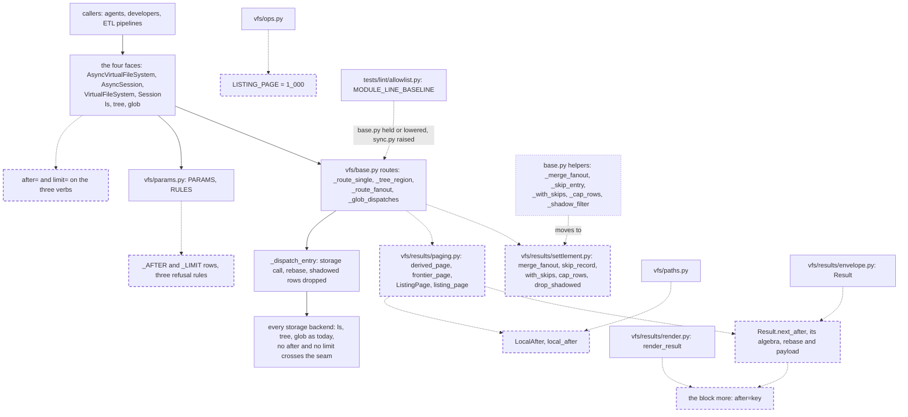

# `ls`, `tree` and `glob` take `after=` and `limit=` and return the last row's path as `Result.next_after`, paged correctly across every mount for every backend

A feature. Flags: structural (two modules are added under `src/vfs/results/`, and five pure helpers leave `src/vfs/base.py` for one of them); changes the public API (two keyword arguments on three verbs on all four faces, one declared field on `Result`, one constant in `vfs.ops`); does not change the schema format; does not need the engine legs, because no statement is added or changed and the page is cut in Python from rows every engine already returns; touches rights only as a surface a hidden name could reach, so it changes no rule and carries a leak test (criteria 26 and 27); does not touch the engine crate; not parallel-safe with any unit that edits the four faces, `src/vfs/params.py` or the held size entries of `base.py` and `sync.py`. It serves roadmap story K4, gate b ([the roadmap](../../context/standards/roadmap.md), lines 160 to 166), and carries roadmap decision D6. It is converted from [spec 176](../../context/specifications/archive/176-the-listing-cursor/spec.md), sections 1, 2.7, 3 and the statement rows of section 4, criteria 1 to 4, 9, 11, 14 and 15, tasks 1 to 4, read with [the study of that source](../2026-11-25-the-backlog-converted/studies/165-181/176-the-listing-cursor.md). It stands on the research the source names, which was not re-read, and on probes run for this conversion and reported under The problem. Dependencies. It depends on [the kernel rulings spec of 2026-11-15](../../context/specifications/active/2026-11-15-the-kernels-public-names-and-argument-families-are-ruled.md), drafted and already applied to the standards (READ, `context/standards/roadmap.md:1078`, row D6 reads Decided) with its landing notes unfilled; what is relied on is its decision 5, "A listing's resumption key is a declared field of `Result`, `next_after`, typed as a path; a key that is not a path does not ride it", and the row of its decision 12 for spec 176, "Decided: a plain path (decision 5)". It reads one drafted sibling without waiting on it: [unit 167-3](../2026-11-25-the-verb-renderer-is-bounded-never-silent-and-marks-kind-and-rank/spec.md), drafted and not built, whose Scope leaves to this unit "where that line sits beside the marker" and whose decision 7 says "the units that add `read(range=)` and the listing `after=` add theirs"; decision 17 answers both for either build order. Build order: this unit builds on landed code alone and may be built now; [unit 176-2](../2026-11-25-native-keyset-pages-in-the-database-storage-read-around-tombstones/spec.md) builds on it, and units 167-5, 171-1, 179-10, 180-1 and 180-5 name it as a dependency in [the unit map](../2026-11-25-the-backlog-converted/units.md).

## The problem

Labels: EXECUTED means a command or a scratch script ran on 2026-11-25 against the working tree at `9daedd2b` (`git rev-parse --short=8 HEAD` when the probes began); the scripts ran under `uv run python` from the session scratchpad and are not kept. READ means read at the cited `path:line` at that commit. INFERRED means reasoning from the two. HEAD moved to `4a221cc3` while this was written; EXECUTED, `git diff --stat 9daedd2b 4a221cc3 -- src tests crates` prints nothing and the two standards files are unchanged, so every claim below holds at `4a221cc3` as well.

1. No listing verb can be paged. READ, `src/vfs/base.py:930-954`: `ls(path, observations, *, columns, authority)` and `tree(path, max_depth, *, columns, authority)` take no page argument; `glob` (`base.py:1265-1279`) takes `max_count` and nothing to resume from. READ, `src/vfs/params.py:152-163`, `:243-256`: the `PARAMS` rows of the three verbs carry no `after` and no `limit`. EXECUTED, `grep -rn "next_after\|frontier_page\|local_after\|LISTING_PAGE" src tests`: the one hit is an unrelated `int` field of the index pass's private cursor (`src/vfs/storage/backends/database/indexing.py:209`).
2. A listing returns everything. EXECUTED: on an `InMemoryStorage` holding 10,000 files under `/big`, `ls("/big")`, `tree("/big")` and `glob("/big/*.txt")` each return 10,000 rows in one call, in 3, 3 and 2 statements as the system actor, 5, 5 and 4 as a named principal with a `read` grant and a warm cache, and 6, 6 and 5 as anonymous under a `list` posture. These are the counts the source recorded on 2026-10-24.
3. The standard is violated. READ, `context/standards/constitution.md:88`, Article 2 §3: "Every listing, search, or traversal op MUST accept a limit and MUST return a deterministic cap with a refine or cursor mechanism when the limit is reached." READ, `context/standards/roadmap.md:121`: "`ls`/`tree`/`glob` paging | missing (constitution Art. 2 §3 is violated)".
4. `Result` has nowhere to carry a position. READ, `src/vfs/results/envelope.py:316`, `:355-359`: the model is open (`extra="allow"`) and declares `ops`, `observations` and `errors` only. READ, `envelope.py:516-547`, `:557-586`, `:616-622`: `&`, `|`, `-`, `merge` and `_with_observations` each build a fresh `Result` from those three fields, so an undeclared extra would be dropped by all of them and rebased by none.
5. Row order differs by verb and by layout today. EXECUTED: `ls("/d")` returns its children in byte order of the name (`A.txt`, `a.txt`, `b.txt`, `sub`, `sub-x.txt`, `sub.txt`, `é.txt`); `tree("/")` and `glob("**/*.txt")` over mounts at `/`, `/m` and `/m/n` return each mount's rows in path order, one mount after another in merge order, so the whole is not in path order. READ, `src/vfs/storage/backends/database/reads.py:448`: a storage `glob` serves `sorted(observed)`.
6. Rows of the trash view answer at their stored paths. EXECUTED: after `delete("/d/sub")`, `ls("/.vfs/trash")` returns `/d/sub`, `ls("/.vfs/trash/d/sub")` returns `/d/sub/y.txt` and `/d/sub/z.txt`, and through a mount `ls("/m/.vfs/trash")` returns `/m/t`. A key for such a listing is therefore a stored path, never a path under the trash head.
7. A relative path is canonicalized, not refused. EXECUTED: `resolve_path("relative/key")` returns `/relative/key`; `resolve_path("/a\nb")` and `resolve_path(7)` return a refusal. The source's criterion 4 expects `after="relative/key"` to be `vfs.invalid`, which the path gate does not do for any path argument.
8. Rights are judged per call inside the storage. EXECUTED: anonymous `ls("/big")` under a `list` posture returns every child with `kind` and `path` only; under a `none` posture it returns no row and one fatal `vfs.unauthenticated` at `/big`. Under a partial view a named principal sees a hidden ancestor as a bare road row (`/h` with `kind` and `path`). A principal granted `read` on 20 single files of a directory lists exactly those 20 paths whether or not 100 hidden files sit beside them, and after the grants are revoked the same `ls` answers one fatal `vfs.not_found` at the directory.
9. A result can be fatal and still hold rows. EXECUTED: `glob("*", paths=("/d", "/gone", "/m"))` returns the rows of `/d` and `/m` beside one fatal `vfs.not_found` at `/gone`, with `success is False`. EXECUTED: a storage built with `glob_wall_seconds=1e-9` answers `glob` with no row and one warning of kind `vfs.budget_exhausted.truncated`.
10. Two of the files this change must edit may not grow. READ, `tests/lint/allowlist.py:26`, `:33`: `MODULE_LINE_BASELINE` holds `src/vfs/base.py` at 3,184 lines and `src/vfs/sync.py` at 1,098. EXECUTED, `wc -l`: both files hold exactly those counts. READ, `tests/lint/test_code_shape.py:222-245`: a listed module that grows fails with "move out as many as were added". READ, `tests/test_params.py:73`: the int-channel sweep pins `swept == 8`.
11. The router reads no storage trait. EXECUTED, `grep -n traits src/vfs/base.py`: no hit. READ, `src/vfs/storage/protocol.py:78-80`: `TraitKey` has seven keys and none for a listing.

Why it is wrong: an agent that lists a 10,000-child directory receives 10,000 rows it cannot refuse, the shell's and the MCP adapter's listings (units 167-5 and 171-1) have no key to page on, and the history read and the retention pass (units 180-1 and 180-5) have no page shape to follow.

## Architecture

Solid is what exists at `9daedd2b`. Dashed is what this spec adds. Dotted is what it removes from where it stands.



Terms, each used in one sense. A page is the rows one call returns when `after` or `limit` is given. The key is the path of the last row on a page; `Result.next_after` carries it, and `None` means the listing is finished. A paged call is a call given `after`, `limit` or both. A stream is one sorted source of rows inside a call: one mount's answer, or the rows of a scoped `glob`'s root probe. A stream's own key is set when that stream has more rows. The frontier is the smallest key among the streams that have more rows; no merged row may pass it. A derived page is a page the router cuts from a stream's whole unpaged listing. A mount is past when every path under it sorts at or before the key.

## Decisions

### 1. `ls`, `tree` and `glob` take keyword-only `after=` and `limit=` on all four faces, declared once in `PARAMS`

The signatures gain `after: str | None = None` and `limit: int | None = None`, in that order, directly before `columns`, on `AsyncVirtualFileSystem`, `AsyncSession`, `VirtualFileSystem` and `Session`. `PARAMS` gains two shared rows used by the three verbs: `_AFTER = ParamSpec("after", "path", doc="resume after this row's path: the previous page's next_after")` and `_LIMIT = ParamSpec("limit", "int", minimum=1, maximum=INT_CEILING, doc="most rows on one page; None lists everything after the key")`. `after=None` starts at the beginning. Each argument may be given without the other: `after` alone returns every row after the key, `limit` alone returns the first page. `limit` has no maximum below `INT_CEILING`, the ceiling every int channel shares, because a page size is the caller's choice and a lower maximum would be a designed cap. The source names `Session` in `session.py` for one face; the tree has four, and the signature drift tests hold them equal, so all four change together.

Basis: the source spec, §1.1; still true at `9daedd2b` (READ, `src/vfs/session.py:118`, `:129`, `:267`; `src/vfs/sync.py:299`, `:309`, `:456`, `:796`, `:805`, `:921`; the drift tests at `tests/test_params.py:28`, `tests/base/test_authority.py:197`, `tests/test_sync.py:232`, `:247`).

### 2. The kernel has no default page: `limit=None` lists everything, and the fronts that serve agents page at `LISTING_PAGE`

A call that names no `limit` returns every row after `after`, as every call does today. No existing caller, the conformance battery, an ETL `ls` of 10,000 rows or chained Python, can lose rows by ignoring a key it never asked for. The surfaces whose reader is an agent pass a page size themselves: the MCP tools, the shell's listing programs and the guests, each in its own unit. This reads Article 2 §3 by its body, which either option meets ("MUST accept a limit and MUST return a deterministic cap with a refine or cursor mechanism when the limit is reached"); its title, "Bounded output by default", is met at the agent-facing fronts and not at the Python surface, and that is the departure this decision names. The choice must be ruled before the surface freezes at story R5: once a beta is out, adding a default would change what an unchanged call returns, which the release rule forbids (READ, `context/standards/roadmap.md:60`), while before the freeze either option is one signature default away from the other.

Basis: provisional, no ruling on record; the options were (a) no kernel default, with the MCP tools, the shell and the guests paging at `LISTING_PAGE`, or (b) a kernel default `limit=LISTING_PAGE` on the three verbs, with `limit=None` spelled out by ETL callers; chosen because (a) is additive, leaves every existing call's rows, order and statements as they are, matches `max_count`, which defaults to `None` on `glob` and `grep` (READ, `src/vfs/params.py:253`, `:288`), and needs no change to the two refusal rules of decision 9, where a defaulted `limit` would collide with `observations` and `max_count`; against it stand the article's title and `traverse`, which has a kernel default of 128 (READ, `src/vfs/ops.py:189`).

### 3. `LISTING_PAGE: Final = 1_000` lives in `vfs/ops.py` beside `TRAVERSE_LIMIT_DEFAULT`

The constant is the one page size every front uses, so the shell, the MCP adapter and the guests cannot drift apart. It is declared here, where the listing vocabulary is added, and nothing in `src/` reads it in this change: its readers are units 167-5 and 171-1, and a ruling for option (b) of decision 2 would make it the three signatures' default. The value is the page K4's first criterion names and is large beside the median directory of 2 files and small beside the tail of thousands of children.

Basis: verified lean, the source's §1.1 as amended by the study (choice 7: the neighbour constant was renamed); precedent: `TRAVERSE_LIMIT_DEFAULT: Final = 128` at `src/vfs/ops.py:189`, a verb's row bound declared in `vfs.ops`, and roadmap story K4 criterion 1, which pages at 1,000.

### 4. The key is the plain path of a row on the page, carried on the declared field `Result.next_after: Path | None`

`Result` gains `next_after: Path | None = None`. Declared and not an extra, because the algebra and the enrichment methods rebuild a result from its declared fields (The problem, item 4). A path, because a path is gated and rebased across mounts like a row's path, is a JSON string, a shell word and a line of a transcript, and needs no server secret. The index pass's private cursor already has an `int` field of the same name (`indexing.py:209`); it is private to that module and is not changed.

Basis: ruled, 2026-11-15, recorded as decision 5 of the kernel rulings spec (`context/specifications/active/2026-11-15-the-kernels-public-names-and-argument-families-are-ruled.md:63-65`) and as row D6 of the roadmap (`context/standards/roadmap.md:1078`).

### 5. Whenever it is set, `next_after` is the path of the last row on its own page, so a key never names a row the caller was not shown

The router sets the key only from a row it is returning: a derived page's key is its last row, and a merged page's key is either its last row after the cut or the frontier, which is the last row of the stream that set it and the greatest path on the page (EXECUTED, the scratch prototype asserted `key == page[-1]` on every page of 1,000 seeded drains). A row hidden from the caller is never emitted by the storage, so its name cannot reach a key. This is K4's own wording, `next_after == rows[-1].path`. Unit 176-2 may meet a page whose last fetched row the router drops; whether the invariant then holds as written is that unit's decision.

Basis: verified lean, the source's §1.2 and §2.3 ("a key is always the path of a row on the page"), study choice 5; precedent: the archived spec `context/specifications/archive/2026-11-12-the-scan-tier-reveals-nothing-about-rows-a-caller-cannot-read.md`, whose first criterion is a leak test over two stores that differ only in what the caller cannot read, the shape criterion 26 takes.

### 6. A key never expires, grants nothing and is bound to no caller; every page passes the gate afresh

A key is a position, not a handle: the row it names may be deleted or moved between pages and the next page still starts strictly after that path. Every page is an ordinary call judged under the caller's authority of that call, so a grant revoked between pages narrows or refuses the next page, and a forged key is only a different starting position that `after=` already accepts. No expiry kind, no cipher and no stored state are added.

Basis: the source spec, §1.2 reasons 3 and 4 and §1.3 "Rights"; still true at `9daedd2b` (EXECUTED: anonymous under `none` is refused `vfs.unauthenticated` by the storage on every call; the router holds no per-caller state between calls).

### 7. `after` is resolved as every path argument is: canonicalized, and refused `vfs.invalid` only when it is no lawful path

The key passes `resolve_path` once in the router, after the verb's own path or pattern is judged and before any dispatch. A value the gate refuses (a control character, a non-string, an over-long path) answers through `_invalid_path`, kind `vfs.invalid` with `data["raw"]`, exactly as a bad `path` does. A relative value is canonicalized to the absolute path it names, as a relative `path` is. The source expected a relative key to be refused; the path gate refuses no relative path, and one argument that behaved differently from every other path argument would be a second grammar.

Basis: decided in drafting, because the source's lean contradicts the tree: `resolve_path("relative/key")` returns `/relative/key` (EXECUTED; READ, `src/vfs/paths.py:361-394`), and the params table declares a `path` kind as "gated downstream by resolve_path" (READ, `src/vfs/params.py:33`).

### 8. A key that cannot be a row of an `ls` or `tree` listing is refused `vfs.invalid` before any storage call; `glob` takes any key

The check runs in the target mount's coordinates, directly after the target resolves to its mount and before the entry gate, because it is a fact about the caller's input. The key is first read by `local_after` against the target mount's bind path (decision 20); a key outside that mount cannot be in the listing. Then, with `address = address_of(rel)` for the target's local path: for `ls` the key's parent directory must equal `address.stored`, except at the trash view's head (`address.trashed` and `address.stored == "/"`), whose rows answer at their stored paths at every depth, where any path but the root is lawful; for `tree` the key must lie strictly beneath `address.stored`, which for a stored root is any path but the root. The refusal is `self._error(ErrorKind.invalid, op=op, detail=f"{op} after is not a row of this listing", data={"raw": <the key as sent>})`, with no path locus, like the gate's other parameter refusals. `glob` is not checked: its rows are in one global path order and any path is a position in it. The check is needed now because a foreign key would otherwise return a silently empty or whole listing, and it is needed by unit 176-2, whose `ls` page compares names and would be wrong for a key from another directory.

Basis: the source spec, §1.2 (the key-in-listing table); still true at `9daedd2b` (EXECUTED: trash-view rows answer at stored paths, The problem, item 6; READ, `src/vfs/paths.py:789-823`, `address_of` is pure).

### 9. `ls` refuses `after` or `limit` beside `observations`, and `glob` refuses them beside `max_count`

`RULES["ls"]` gains `ShapeRule((("after", "limit"), ("observations",)), exactly_one=False, msg_both="ls takes after and limit with a path, not with observations")`, and `RULES["glob"]` gains `ShapeRule((("after", "limit"), ("max_count",)), exactly_one=False, msg_both="glob takes limit or max_count, not both")`. Each is `vfs.invalid` from `_gate_params` with zero storage calls. A batch `ls` lists many directories in one call; a cursor over it would need one position per directory, or one statement per directory per page, 10,000 statements a page for a 10,000-directory batch, which the per-batch rule of the reference deployment rejects. `max_count` is a prefix cut in merge order with no key, and `limit` is a page in path order with a key; two bounds on one call would leave the key's meaning open. Retiring `max_count` is not decided here.

Basis: verified lean, the source's §1.1 and §3.4, study choice 8; precedent: the mutual-exclusion rule already in `RULES["glob"]` (`src/vfs/params.py:447-453`) and the per-batch multiplier of `AGENTS.md` ("a round trip per row adds 10,000").

### 10. `glob` refuses `after` or `limit` beside `observations`

`RULES["glob"]` gains `ShapeRule((("after", "limit"), ("observations",)), exactly_one=False, msg_both="glob takes after and limit with a pattern over storage, not with observations")`. With `observations`, `glob` is a filter over rows in hand that serves them "exactly as held (columns, staleness, and input order included)" (READ, `src/vfs/base.py:1310-1312`); a page in path order would break the input-order promise, and the caller already holds the rows and can slice them. The source is silent on this pair.

Basis: decided in drafting, because the nearest rule is decision 9's for `ls`, a refusal can be lifted later without breaking a caller while a paging behaviour could not be withdrawn, and unit 181-3 proposes to take `observations=` off `glob` altogether.

### 11. A paged call returns rows in path order, the byte order of UTF-8; a call with neither argument keeps today's order and today's code path

Path order is Python's code-point order on the full path in the caller's namespace, which equals UTF-8 byte order and the binary collation every engine's `path` and `name` columns are pinned to. One order across mounts is what lets one key say where three verbs stopped. A call with neither argument builds no page request and runs every route exactly as at `9daedd2b`, so no existing result changes in rows, order, errors or statements.

Basis: the source spec, §1.3 "Order"; still true at `9daedd2b` (READ, `src/vfs/models/rows.py:191`, `:432-433`, `BytewiseString` on `path` and `name`; EXECUTED, the order probe of The problem, item 5).

### 12. A page holds at most `limit` rows, a key is set exactly when a further row existed at the call, and a result with no rows carries no key

A page may be shorter than `limit` and still carry a key, when rows of two streams at one path fuse; callers loop on the key, never on the page's length. A listing of exactly `N × limit` rows ends on its `N`th page, because the derived page looks one row past the limit before it sets a key. The key is decided by rows alone and never by errors: a call that returns no row carries no key, and a result that is fatal beside rows, a scoped `glob` with one missing root, pages on with its key and its error on every page (The problem, item 9). Under a partial view a road row is a row like any other on a derived page: it counts toward `limit` and may be the key, because the storage emitted it to this caller.

Basis: the source spec, §1.3 "Size" and "The key"; still true at `9daedd2b` (EXECUTED, the scratch prototype: no page exceeded its limit, none was empty with a key, and every drain ended).

### 13. Each page is its own call and its own read transaction, with the guarantee of POSIX `readdir` across pages

A listing across pages is not one snapshot. A row present for the whole iteration and not renamed appears exactly once; a row created, deleted or renamed during it may or may not appear; a row renamed forward past the key may appear under both paths; no row appears twice under one path. A page is the existing read statements of its verb and takes no lock, so no page waits on a writer and no writer waits on a page.

Basis: verified lean, the source's §1.3 "Rivals", study choice 15; precedent: `src/vfs/storage/backends/database/pages.py:3-7` ("each page fetched whole before the caller acts on it. Pages, never a streaming cursor") and POSIX `readdir`, which leaves an entry added or removed during iteration unspecified.

### 14. Enrichment keeps the key, set algebra and both merges clear it, and the algebra's laws are stated over rows, ops and errors

`filter`, `sort`, `top`, `kinds`, `_demoted` and `model_copy` keep `next_after`: the caller shrank or reordered a page and the listing's position is unchanged. `a | b`, `a & b`, `a - b`, `Result.merge` and `Result.merge_branches` yield `None`: two results have no one position, and the router merges pages with `frontier_page` instead. This departs from one sentence of the `Result` docstring, which calls `Result()` the identity of `|` (READ, `envelope.py:339-341`): for an operand that carries a key, `r | Result()` equals `r` in rows, ops and errors and differs in the key. The docstring is amended to say the laws hold over rows, ops and errors and that the key is not part of the algebra.

Basis: verified lean, the source's §1.4 table, study choice 4; precedent: roadmap story K4 criterion 3, "`Result | Result` clears the key; `with_mount` rebases it" (`context/standards/roadmap.md:165`).

### 15. `with_mount` rebases the key, `without_mount` strips it, and a key that overflows becomes `None` with a `vfs.unaddressable` warning of its own

The key moves across a mount boundary exactly as a row's path does, in both branches of `with_mount` (a root mount is the identity) and in `without_mount`. When `rebase_overflows(mount, key)` is true the rebased result's key is `None` and one warning is appended: kind `vfs.unaddressable`, severity warning, `source=mount`, `data={"vfs.overflow": {"next_after": <the local key>}}`, so the listing ends loudly. The source folds the key into the dropped row's own warning; a record of its own is taken because the row's warning is minted per row and need not exist, for instance after `filter` dropped the key's row. In this unit the router sets the key after the rebase, from a row that survived it, so the overflow branch is reached only by a caller that rebases a keyed result itself, and by unit 176-2.

Basis: decided in drafting, because one record per fact is the envelope's rule (`envelope.py:685-699` mints one warning per overflowing row with its own `data["vfs.overflow"]`) and the source's shared record assumes a row warning that the algebra does not guarantee.

### 16. The key crosses the wire as the string `next_after`, omitted when `None`, kept through an error rollup, and quarantined when malformed

`to_payload()` emits `"next_after": "/big/f00999.txt"` when the key is set and no such member when it is `None` under the default `exclude_none=True`. The rolled-up copy `to_payload(max_errors=...)` builds carries the key. `from_payload` restores it as a `Path`; a value the path gate refuses quarantines under the existing envelope-field rule, as a warning with every validated item salvaged and the key `None`. A peer that predates the field carries it through as an extra, because the model is open.

Basis: the source spec, §1.4 "The wire shape"; still true at `9daedd2b` (READ, `envelope.py:723-750`, `:753-794`: the payload is `model_dump_json` of the declared fields and the lenient path salvages items on an envelope-field failure; `:742-746`: the rollup builds a fresh `Result` from three fields, which is why the key is passed there by name).

### 17. The text renderer prints `more: after=<key>` as one block after the body and its note and before the errors, only when the key is set, and no budget cuts it

`render_result` builds its blocks as body, unpopulated-projection note, the line `more: after=<key>`, errors. The line is absent when `next_after` is `None`. In the failed-and-empty arrangement, which prints the errors alone, the line is printed before the errors if a key is set; the `write` arrangement is unchanged. The key is a `Path`, which holds no control character, so the line cannot be split. Beside unit 167-3: its marker is "the line directly after the kept body, before the tail" (its decision 5), so the order is body, marker, note, more-line, errors, and the more-line belongs to the tail that is never cut, because a cut that dropped it would hide that the listing continues. If `_NARROWING` exists at this build, its rows for `ls`, `tree` and `glob` become: `ls`, arguments `limit` and `after`, hint `page with limit and after`; `tree`, arguments `max_depth`, `limit` and `after`, hint `lower max_depth, or page with limit and after`; `glob`, arguments `paths`, `max_count`, `limit` and `after`, hint `scope with paths, set max_count, or page with limit and after`. If unit 167-3 is built second, it writes those rows, as its decision 7 keys the table to the arguments each verb takes at its build.

Basis: the source spec, §1.4 "The text"; still true at `9daedd2b` (READ, `src/vfs/results/render.py:59-71`: the blocks are body, note, errors); the placement beside the budget marker and the three hint rows are decided here because unit 167-3 leaves both to this unit.

### 18. Every backend is served by a page the router derives from its unpaged listing; this unit adds no storage argument and no trait

The router calls each storage exactly as today and cuts the page from the answer. `SupportsRead.ls`, `SupportsRead.tree` and `SupportsPatternSearch.glob` keep their signatures, `TraitKey` keeps its seven keys, and no storage ever receives `after` or `limit`. This departs from the source's §2.7 and task 4, which add the protocol arguments and a `listing_cursor` trait "declared by no backend yet". A trait no backend declares would put a branch in the router that only a test double can reach, the router reads no trait today (The problem, item 11), and unit 179-10 plans a `features()` declaration that may replace the mechanism. The one place a native page will later enter is `ListingPage.cut` and its call sites in the three routes; unit 176-2 adds the storage arguments and the way a backend declares them.

Basis: decided in drafting, because a branch reachable only from a test is dead code under the 100% coverage gate and speculative generality by `AGENTS.md`, "Code smells", and the source's own rule holds either way: a backend that does not serve the page itself gets "a slower kernel answer, not the cursor leaving the kernel".

### 19. One rule, `frontier_page`, merges the per-mount pages of a fan-out into one page with one key

Each stream returns its rows in path order and its own key. The frontier is the smallest key among the streams that have more rows. The merged page keeps the rows at or before the frontier, all of them when every stream is finished, in path order; if more than `limit` remain, the page is the first `limit` and the key is the last of those; otherwise the page is all of them and the key is the frontier, or `None` when every stream is finished. Nothing is lost, because a row after the page's key was not emitted and the next page starts after that key in every stream; nothing repeats, because every emitted row is at or before the key and the next page starts strictly after it. Rows of different streams at one path fuse first by the existing `Result.merge` rule. The function is generic over the row type and reads a row only through the `path_of` it is handed, so the storage can use it for statement chunks in unit 176-2.

Basis: the source spec, §3.2; still true at `9daedd2b` (READ, `envelope.py:557-586`, `Result.merge` fuses same-path rows left-wins by mask; EXECUTED, the scratch prototype drained 1,000 seeded cases of 1 to 8 streams to the oracle's rows, and three mounts of 1,500 rows at `limit=1000` in 5 pages of 4,500 distinct rows in path order).

### 20. `local_after` reads the key in each mount's coordinates, and a mount the key has passed is not dispatched

`local_after(after, mount)` returns `LocalAfter(state, key)`. `start`: `after` is `None`, is the bind path itself, or sorts before every path under the mount (`after < mount + "/"` and not under it); every row of the mount follows the key. `key`: `after` lies under the mount, and `key` is `after.without_mount(mount)`; the root mount is the identity and answers `key` for every key that is not `None`. `past`: `after` sorts after every path under the mount; the mount is exhausted. In `tree` and `glob` a `past` mount is left out before its dispatch coroutine is built, so its storage receives no call and it does not count as a branch that made progress. The function is pure and total.

Basis: the source spec, §3.1; still true at `9daedd2b` (READ, `src/vfs/paths.py:296-339`, the rebase pair it sits beside; EXECUTED, the scratch prototype checked 180,000 row-against-key comparisons, with `-`, `.` and `0` neighbours of a bind path, against a brute-force oracle, and dispatched 3, 3, 3, 3 and 2 mounts on the five pages of the three-mount drain).

### 21. A dead mount among live ones counts as a finished stream, and the listing ends with its warning

A failed branch has no rows and no key. `Result.merge_branches` demotes its fatal entry to a warning beside live branches, as today, and `frontier_page` reads its missing key as finished, so the listing does not stall on it. The page carries the demoted warning with the dead mount as `source`; that is the record that the listing is partial. The named target of a `tree` failing returns that failure alone, with no key, and a scope the caller named in a `glob` stays a loud failure beside the other scopes' rows, both as today.

Basis: verified lean, the source's §3.3 "Errors and skips", study choice 12; precedent: `Result.merge_branches` at `src/vfs/results/envelope.py:590-605`, "one dead mount among live ones is loss on record, not failure".

### 22. A listing cut by the wall-time budget pages the rows in hand and carries its `truncated` warning on every such page

A storage `glob` that reaches its wall returns what it finished and one warning of kind `vfs.budget_exhausted.truncated` (READ, `reads.py:452-454`; EXECUTED, The problem, item 9). The derived page is cut from those rows, and the warning rides the page unchanged. Every later page repeats the unpaged call and meets the same wall, so the drain ends after the rows in hand with the warning on each page: loud on every page and never a silent gap. Nothing about the wall changes. Making a page small enough to finish inside the wall is unit 176-2's work.

Basis: decided in drafting, because the wall and its record are the shared `Deadline`'s (`src/vfs/deadline.py:36`, `src/vfs/offload.py:96-98`) and a page that dropped the warning would turn a truncated listing into an apparently complete one.

### 23. A scoped `glob` asserts its roots on every page, and the roots' own rows are one more stream

The root probe of a `glob` with `paths=` runs on every paged call, whatever the key: a missing root is a loud per-root error on each page, as it is on each unpaged call. The probe's result is cut like any stream, so a root's own row is served once, on the page its path falls on. The zero-call rule of decision 20 is therefore stated for the branches, and a probe may still issue its one `stat` to a mount the key has passed.

Basis: decided in drafting, because the probe is "structurally immune to any dispatch optimization" by the router's own contract (READ, `src/vfs/base.py:2122-2128`), and skipping an assertion on later pages would make a root's absence visible on page one only.

### 24. A derived page costs one whole unpaged listing, the docstrings say so, and no caller is moved onto it by this unit

A paged call issues exactly the statements of the same unpaged call and holds that call's rows in memory; a drain of `P` pages costs `P` unpaged calls. For the median directory of 2 files that is one call. For a 10,000-child directory at 1,000 a page it is 10 calls, 30 statements as the system actor and 100,000 rows fetched, against 3 statements and 10,000 rows. For a `tree` or a `**` `glob` over a 10,000,000-file mount one page is one read of the corpus, which is what the unpaged call is today, and a full drain is 10,000 of them, about 10^11 row visits, which the per-verb-call rule of the reference deployment rejects. This unit therefore closes Article 2 §3 in contract and not in work: the three verbs accept a limit and return a cursor, and the cost of a page is bounded by unit 176-2. The `Result` docstring's paragraph on `next_after`, `glob`'s docstring and the module docstring of `paging.py` state the profile and name native keyset pages as the direction. Under decision 2 no existing call is paged, so this unit changes the cost of no call that runs today.

Basis: decided in drafting, because `AGENTS.md` ("Never design toward a hard scale cap") asks that a suboptimal profile be acknowledged in the docstring with its direction and never turned into a declared limit, and the source's §2.7 already lands the contract "green before any SQL changes".

### 25. The page arithmetic lives in `vfs/results/paging.py`, and `base.py` pays for its new lines by moving five pure helpers to `vfs/results/settlement.py`

`base.py` is held at its exact count, so it may hold only the three signatures, the gate arguments, the key's resolution and one-line hand-offs; every computation is in `src/vfs/results/paging.py`. The lines it still gains are moved out in the same landing: `_merge_fanout` (`base.py:2356-2374`, 19 lines with its blank), `_shadow_filter` (`:3014-3030`, 17), `_skip_entry` (`:3060-3075`, 16), `_with_skips` (`:3076-3083`, 8) and `_cap_rows` (`:3100-3112`, 13) become the functions `merge_fanout`, `drop_shadowed`, `skip_record`, `with_skips` and `cap_rows` of the new `src/vfs/results/settlement.py`, with the same behaviour and their docstrings. Each is a pure function of results and paths; `skip_record` takes the bind path in place of the `Binding`, and `drop_shadowed` takes the list of deeper bind paths the router reads from its table. That frees 73 lines against about 46 added (INFERRED from the Design's list). `base.py` ends at or under the entry the tree holds at the build, 3,184 at `9daedd2b`, and the entry is lowered to the exact count. Both new modules sit in `vfs.results`, a rung beneath `vfs.base`, import only `vfs.paths` and their own package, and add no entry to `LAYERS` or to the size baseline.

Basis: decided in drafting, because the size gate closes a grown module only by moving lines out or by a linked reduction (`tests/lint/test_code_shape.py:222-245`), no document carries a reduction of `base.py`, and the archived spec `context/specifications/archive/2026-11-07-the-router-keeps-routing.md` is the precedent for moving pure logic out of the router to a lower rung in the landing that needs the room.

### 26. `sync.py`'s held entry is raised by exactly the lines its six twins gain, answered by the memo that carries the module's reduction

`VirtualFileSystem` and `Session` each mirror `ls`, `tree` and `glob` parameter for parameter, so `sync.py` gains two signature lines per twin and the lines the formatter needs for the longer forwards, about 20 in all (INFERRED). The file holds forwarding twins and one loop runner, and nothing in it moves out without breaking the mirror. Its entry in `MODULE_LINE_BASELINE` is raised to the count `wc -l` prints, and the code review's ownership finding is answered "kept because" with a link to `context/research/2026-11-13-whether-the-session-twin-leaves-the-sync-facade.md`. This departs from the gate's first closing and takes its second, which the gate sanctions.

Basis: decided in drafting, because that memo states it "carries that reduction for `sync.py`" and records the precedent: the close-leaves-no-SQLite-side-files landing raised the same entry from 1,086 to 1,098 on the same answer (READ, the memo's first paragraph and its item 9, which rules out collapsing the twins).

## Intent

After this spec, a caller can list a directory of 10,000 files a page at a time on any face: `ls("/big", limit=1000)` returns 1,000 rows in path order and `next_after`, the path of the last row; passing it back as `after=` returns the next 1,000; when `next_after` comes back `None` the listing is done. `tree` and `glob` page the same way on the same key, across every mount, with no path repeated and none lost, for every storage backend, because the router cuts the page itself. The key is a plain path that never expires and grants nothing: every page is judged afresh, an anonymous caller under a `list` posture pages like anyone else and under `none` is refused at the first page, and a key never names a row the caller was not shown. The key rides `Result.next_after`, survives `filter` and `sort`, is cleared by `|`, `&` and `-`, rebases across mounts, crosses the wire as a string, and prints as `more: after=<key>` in the text. A call that names neither argument returns exactly what it returns today. A page still costs what the whole listing costs; unit 176-2 bounds that.

## Design

Each step writes its tests first and sees them fail, then the code that passes them. Steps 1 to 5 touch no route and can be built in any order after step 1; step 6 needs all of them.

**Step 1. The helpers leave the router (a move, no behaviour change).** Tests first: `tests/results/test_settlement.py` is created; the four `test_merge_fanout_*` nodes of `tests/base/test_dispatch.py:1734-1771` move there, with the row helpers they need and with `AsyncVirtualFileSystem._merge_fanout` replaced by `merge_fanout`, and one node each pins `cap_rows` (keeps the first `row_cap` rows in the order given and trims no error), `with_skips` (appends, returns the same object for no skips), `skip_record` (kind `vfs.unsupported`, severity info, `path` and `source` the bind path) and `drop_shadowed` (keeps the row at a deeper bind path, drops rows strictly beneath it, returns the same object when nothing is dropped). Then `src/vfs/results/settlement.py` (new, under 150 lines) takes the five functions of decision 25 with their docstrings, and `base.py` imports them and calls them at the same sites (`:1362`, `:1910`, `:1997`, `:2030`, `:2034-2037`, `:2857`, and the four `_skip_entry` call sites at `:1897`, `:2067`, `:2077` and `:2089`). The existing router tests keep every assertion.

**Step 2. The page arithmetic.** Tests first: `tests/results/test_paging.py` (new). Then `src/vfs/results/paging.py` (new, under 220 lines):

```python
def derived_page(
    rows: Iterable[T], after: str | None, limit: int | None, path_of: Callable[[T], str]
) -> tuple[list[T], str | None]: ...

def frontier_page(
    rows: Iterable[T], stream_keys: Iterable[str | None], limit: int | None, path_of: Callable[[T], str]
) -> tuple[list[T], str | None]: ...

class ListingPage(NamedTuple):
    after: Path | None
    limit: int | None

    def past(self, mount: Path) -> bool: ...
    def outside(self, op: str, mount: Path, rel: Path) -> bool: ...
    def cut(self, result: Result) -> Result: ...
    def settle(self, merged: Result, streams: Iterable[Result]) -> Result: ...

def listing_page(after: Path | None, limit: int | None) -> ListingPage | None: ...
```

`derived_page` keeps the rows whose path is strictly after `after`, sorts them by path, and returns them all with no key when `limit` is `None` or at most `limit` remain; otherwise it returns the first `limit` and the path of the last of those. `frontier_page` is decision 19. `listing_page` returns `None` when both arguments are `None`. `past` is `local_after(self.after, mount).state == "past"`. `outside` is decision 8's test and is false for `glob` and for a page with no `after`. `cut` returns `result.model_copy(update=...)` with the rows and key of `derived_page(result.observations, self.after, self.limit, ...)`; errors, ops and extras ride unchanged. `settle` returns `merged.model_copy(update=...)` with the rows and key of `frontier_page(merged.observations, (stream.next_after for stream in streams), self.limit, ...)`. `T` is a `TypeVar`, spelled as `vfs.deadline` spells its own, since the type-parameter syntax is above the Python floor.

**Step 3. The key in a mount's coordinates.** Tests first: a class `TestLocalAfter` in `tests/test_paths.py`. Then `src/vfs/paths.py` gains `LocalAfter(NamedTuple)` with `state: Literal["start", "key", "past"]` and `key: Path | None`, and `local_after(after: Path | None, mount: Path) -> LocalAfter` beside `rebase_overflows` (`paths.py:518`), as decision 20 states. `paths.py` holds 909 lines and stays under the 1,000-line ceiling.

**Step 4. The field.** Tests first: a class `TestListingKey` in `tests/results/test_result_laws.py` and a class `TestMoreLine` in `tests/results/test_render.py`. Then `src/vfs/results/envelope.py`: the field of decision 4; `_with_observations` and `_demoted` pass `next_after=self.next_after`; `&`, `|`, `-` and `merge` are unchanged and yield `None` by construction; `with_mount` and `without_mount` follow decision 15; the rollup copy in `to_payload` passes the key; the class docstring gains the paragraph on `next_after` (the page contract of decisions 11 to 13, the profile of decision 24) and the amended sentence of decision 14. `envelope.py` holds 914 lines and stays under the ceiling. `src/vfs/results/render.py`: the block of decision 17.

**Step 5. The arguments and the constant.** Tests first: new nodes in `tests/test_params.py` and `tests/test_ops.py`, and the count in `test_every_int_channel_enforces_the_shared_ceiling` moves from 8 to 11. Then `src/vfs/ops.py` gains `LISTING_PAGE`; `src/vfs/params.py` gains `_AFTER` and `_LIMIT`, places both before `_COLUMNS` in the rows of `ls`, `tree` and `glob`, and adds the three rules of decisions 9 and 10.

**Step 6. The routes and the faces.** Tests first: `tests/base/test_listing_pages.py` (new), and the existing drift tests go red on the first signature edited. Then:

1. `AsyncVirtualFileSystem.ls`, `.tree` and `.glob` gain the two arguments and hand them to `_gate_params`. `ls` and `tree` pass them to `_route_single`. `glob` resolves the key after its pattern expands (decision 7), builds `listing_page(...)` and passes `page=` to `_route_fanout`; its docstring gains the sentences of decision 24.
2. `_route_single` takes `after` and `limit`; after the target path resolves it resolves the key (decision 7) and builds the page; after the terminal resolves and before `_gate_entry` it refuses when `page.outside(op, terminal.binding.path, terminal.rel)` (decision 8). For `ls` it returns `page.cut(...)` of the one dispatch. For `tree` it passes `page` to `_tree_region`.
3. `_tree_region` takes `page`. Its own dispatch is cut; a descent whose bind path is `past` is left out of `descents`; every descent's answer is cut; `Result.merge_branches` runs as today and `page.settle(merged, results)` re-pages; the skip records are appended after, as today.
4. `_route_fanout` takes `page` and hands it to `_glob_dispatches`, which leaves a `past` branch out of its list. After the settled gather every answer, probe and branch, is cut; `merge_fanout` runs as today; `page.settle(merged, answers)` re-pages; `cap_rows` is then the identity, because `max_count` is refused beside a page. `grep` and `search` pass no page and are untouched.
5. With `page is None` every one of these routes runs its present statements in their present order.
6. `AsyncSession`, `VirtualFileSystem` and `Session` gain the two arguments and forward them. `tests/lint/allowlist.py` lowers the `base.py` entry to its count and raises the `sync.py` entry to its count (decisions 25 and 26).

No docstring is added to `ls` or `tree`, which have none today; their arguments are documented by the `PARAMS` rows and the contract by `Result`.

**Step 7. The gates.** `scripts/ci.sh`, then `scripts/docs.sh check`, because the `Result` and `glob` docstrings are pages of the docs site. No new glossary term is used in a docstring.

**Cost at the reference deployment.** Each line names what the change adds, the multiplier it rides on, and what bounds it.

- Statements: none is added, changed or reordered. A paged call issues the statements of the same unpaged call, which are already chunked by `membership_budget` and `arm_budget` on every engine (READ, `reads.py:159-185`, `:418`); no `IN` list and no bind count grows. Per verb call, about 150,000 a day: zero added statements on each. The arithmetic of a drain is decision 24's.
- `derived_page`: one list of references to the rows the storage already returned, and one sort. What grows is the stream's unpaged listing, `N` rows, the same rows the unpaged call holds today; the sort is `O(N)` comparisons on the path-ordered answers `DatabaseStorage` gives (READ, `reads.py:448`; EXECUTED, the order probe) and `O(N log N)` at worst. Per verb call. Nothing bounds `N` in this unit; decision 24 states the profile and unit 176-2 bounds it at `limit + 1`.
- `frontier_page`: one list of the cut streams' rows, at most `streams × limit` rows when `limit` is given, and one sort of it. Per verb call. For three mounts at `LISTING_PAGE` that is 3,000 row references.
- `local_after` and `ListingPage.outside`: string comparisons on paths of at most 1,024 bytes, one per mount beneath the target per call. Per verb call.
- Locks: none is taken. A page is a plain read; no read waits on a writer and no lock is held.
- Per file write, per index visit, per batch and per corpus: nothing is added. A batch `ls(observations=...)` cannot be paged (decision 9), so the 10,000-entry batch runs as today.

**Constitution.** The key is a path in the one namespace (Article 1.1: no hidden identifier), a field of the one result type (Article 2.1), and the mechanism Article 2.3 asks for; the algebra of Article 2.4 still combines any two results. No primitive is added: the change composes Namespace, Candidate and Mount.

## Scope

In: decisions 1 to 26. Files: `src/vfs/results/paging.py` and `src/vfs/results/settlement.py` (new); `src/vfs/base.py`, `src/vfs/session.py`, `src/vfs/sync.py`, `src/vfs/params.py`, `src/vfs/ops.py`, `src/vfs/paths.py`, `src/vfs/results/envelope.py`, `src/vfs/results/render.py`; `tests/results/test_paging.py`, `tests/results/test_settlement.py` and `tests/base/test_listing_pages.py` (new); `tests/base/test_dispatch.py`, `tests/results/test_result_laws.py`, `tests/results/test_render.py`, `tests/test_paths.py`, `tests/test_params.py`, `tests/test_ops.py`; `tests/lint/allowlist.py`.

Out, each with where it belongs.

- Native keyset pages, the storage arguments, the way a backend declares them, the two index changes, rows fetched and rows visited per page, the fill loop under a view, and K4 criterion 1's engine-leg half ("the keyset statement returns at most `limit + 1` rows per page with tombstones excluded by the predicate (rows fetched counted)", "On SQLite and on each engine leg"): [unit 176-2](../2026-11-25-native-keyset-pages-in-the-database-storage-read-around-tombstones/spec.md). This unit meets the rest of K4: criterion 1's rows and key, criteria 2, 3 and 4.
- A `tree` under `max_depth` in bounded work: [unit 176-3](../2026-11-25-a-tree-under-max-depth-pages-on-a-stored-depth-column/spec.md).
- The fronts' own paging: the shell's listing programs ([unit 167-5](../2026-11-25-a-pipeline-runs-gated-verbs-through-cli-with-the-minimal-programs/spec.md)), the MCP tools and `structuredContent` ([unit 171-1](../2026-11-25-the-wire-adapter-projects-a-result-to-mcp-blocks-within-budget/spec.md)), and the guests ([unit 172-1](../2026-11-25-the-python-guest-runs-over-wasi-python-as-the-caller/spec.md)). A front that pages every listing by default before unit 176-2 lands multiplies a large listing's cost by its page count (decision 24); that ordering is theirs to state.
- The renderer's character budget and its marker: [unit 167-3](../2026-11-25-the-verb-renderer-is-bounded-never-silent-and-marks-kind-and-rank/spec.md). Decision 17 fixes only where the more-line sits and the three hint rows.
- A key for `versions` or for the retention pass. By decision 5 of the kernel rulings spec a key that is not a path does not ride `next_after`: [unit 180-1](../2026-11-25-a-files-replaced-versions-are-listed-newest-first-in-pages-with-who-wrote-each/spec.md) and [unit 180-5](../2026-11-25-a-retention-pass-resumes-from-where-the-last-call-stopped/spec.md) name their own fields and may reuse `frontier_page`. The source's note that `sweep(limit=)` returns `next_after` is dropped.
- Retiring `glob`'s `max_count`, and taking `observations=` off `glob`: the units converted from spec 181, the second being [unit 181-3](../2026-11-25-chaining-moves-onto-the-result-and-the-query-verbs-lose-rows-in-hand/spec.md).
- A cursor on `grep`, `search` or `traverse`; a snapshot across pages; a kernel default page (decision 2, until ruled).
- Moving the session twin out of `sync.py`: the memo decision 26 links, and the spec that answers it.
- The published how-to pages under `documentation/`: none describes a listing's paging today, and the reference pages are the docstrings this change edits.

## Acceptance criteria

Counts and states, never clocks. The 10,000-row nodes are marked `slow`. `tests/base/test_listing_pages.py` is written `listing` below.

1. `Result.next_after` is a declared `Path | None`; `to_payload()` has no `next_after` member when it is `None` and a string when set; a key with a space, a quote and a non-ASCII segment survives `Result.from_payload(json.loads(json.dumps(r.to_payload())))`; a payload without the member restores `None`: `tests/results/test_result_laws.py::TestListingKey::test_the_key_round_trips_the_payload_and_is_omitted_when_none`.
2. `filter`, `sort`, `top`, `kinds` and `model_copy` keep the key, and `|`, `&`, `-`, `Result.merge` and `Result.merge_branches` yield `None`, with rows, ops and errors of `r | Result()` equal to `r`'s: `tests/results/test_result_laws.py::TestListingKey::test_enrichment_keeps_the_key_and_the_algebra_clears_it`.
3. `with_mount("/m")` turns the key `/a/b` into `/m/a/b`, `without_mount("/m")` turns it back, and a root mount leaves it: `tests/results/test_result_laws.py::TestListingKey::test_the_key_rebases_like_a_row_path`.
4. A key that overflows under `with_mount` becomes `None` and exactly one appended warning has kind `vfs.unaddressable`, `source` the mount and `data["vfs.overflow"] == {"next_after": <the local key>}`: `tests/results/test_result_laws.py::TestListingKey::test_an_overflowing_key_ends_the_listing_with_its_own_warning`.
5. `to_payload(max_errors=1)` of a keyed result with three errors still carries `next_after`, and a payload whose `next_after` holds a control character restores with the key `None`, every row kept and one warning: `tests/results/test_result_laws.py::TestListingKey::test_the_key_survives_a_rollup_and_a_malformed_key_quarantines`.
6. `to_str()` of a result with rows, a key and a warning prints the body, then exactly the line `more: after=<key>`, then the warning, as three blocks; the same result without a key prints no such line; a failed result with no rows and a key prints the line before its errors: `tests/results/test_render.py::TestMoreLine::test_the_more_line_sits_between_the_body_and_the_errors_only_when_the_key_is_set`.
7. `derived_page` over shuffled paths returns the first `limit` paths after the key in path order with the last as key, returns everything and no key when exactly `limit` remain, and returns everything after the key when `limit` is `None`: `tests/results/test_paging.py::TestDerivedPage::test_a_page_is_the_first_limit_rows_after_the_key`.
8. 1,000 seeded cases (stdlib `random`, seed fixed in the test) of 1 to 8 streams with random limits, each drained with `derived_page` and `frontier_page`, return exactly the oracle's sorted distinct paths, with every page at most `limit` rows and every key equal to the last path of its page: `tests/results/test_paging.py::TestFrontierPage::test_seeded_streams_drain_to_the_oracle`.
9. For 2,000 seeded pairs of a bind path and a key, including the neighbours `B-x`, `B.txt`, `B0` and `B` itself, `local_after` agrees with a brute-force comparison of every generated row under the mount against the key, and the root mount answers `key` for every key that is not `None`: `tests/test_paths.py::TestLocalAfter::test_every_state_agrees_with_the_brute_force_oracle`.
10. `ListingPage.outside` is false for a child key of an `ls` target, for a key beneath a `tree` target, for any non-root key at the trash view's head and for every `glob` key, and true for a sibling directory's row, the target itself, the root, and a key outside the mount: `tests/results/test_paging.py::TestListingPage::test_a_key_belongs_to_its_listing_or_it_does_not`.
11. The `after` and `limit` rows exist for `ls`, `tree` and `glob` and for no other op, and the int-channel sweep counts 11: `tests/test_params.py::test_every_int_channel_enforces_the_shared_ceiling`.
12. Every kernel verb's signature names equal its `PARAMS` row names: `tests/test_params.py::test_every_verb_signature_matches_the_table`.
13. `AsyncSession.ls`, `.tree` and `.glob` equal the kernel's signatures minus `authority`: `tests/base/test_authority.py::test_session_verbs_take_no_identity_argument`, at its `ls`, `tree` and `glob` parameters.
14. `VirtualFileSystem.ls`, `.tree` and `.glob` mirror the kernel's parameter for parameter: `tests/test_sync.py::test_every_router_coroutine_has_a_sync_twin`, at its `ls`, `tree` and `glob` parameters.
15. `Session.ls`, `.tree` and `.glob` mirror `AsyncSession`'s parameter for parameter: `tests/test_sync.py::test_every_session_coroutine_has_a_sync_twin`, at its `ls`, `tree` and `glob` parameters.
16. `LISTING_PAGE == 1_000` and is importable from `vfs.ops`: `tests/test_ops.py::test_the_listing_page_is_one_thousand`.
17. Each of these is `vfs.invalid` with zero storage calls recorded: `ls(observations=[...], limit=10)`; `glob("*", max_count=5, limit=5)`; `glob("*", observations=[...], after="/a")`; `ls("/d", limit=0)`; `ls("/d", limit=True)`; `ls("/d", after="/a\nb")`; `glob("*", after=7)`; `ls("/d", after="/e/x")`; `ls("/d", after="/d")`; `tree("/d", after="/e/x")`; `tree("/d", after="/d")`: `listing::test_each_refused_shape_reaches_no_storage`, one parameter each.
18. `glob("*", after="d/a.txt")` answers exactly as `glob("*", after="/d/a.txt")` does: `listing::test_a_relative_key_is_read_as_the_path_it_canonicalizes_to`.
19. After a directory is deleted, `ls("/.vfs/trash", limit=1)` and `tree("/.vfs/trash", limit=1)` drain to the rows of their unpaged calls, with each key a stored path outside the trash head, on the root mount and through a mount at `/m`: `listing::test_a_trash_view_listing_pages_on_its_rows_stored_paths`.
20. Over 10,000 children written in one batch, `ls("/big", limit=1000)` drained from `after=None` takes exactly 10 calls; each page holds 1,000 rows in path order; calls 1 to 9 carry `next_after == rows[-1].path` and call 10 carries `None`; the union equals the 10,000 written paths and no path repeats: `listing::test_ls_drains_ten_thousand_children_in_ten_pages`.
21. With 10,500 children of which the 500 that sort directly after child 1,000 are deleted, page two of `ls(limit=1000)` holds 1,000 rows, starts at the first live child after the key and holds no deleted path, and the drain takes 10 calls: `listing::test_a_run_of_tombstones_after_the_key_leaves_no_gap_and_no_dead_row`.
22. On one mount, `tree("/big", limit=1000)` and `glob("/big/*.txt", limit=1000)` over the same 10,000 files each drain in 10 calls to the paths of their unpaged call sorted by path: `listing::test_tree_and_glob_page_on_the_same_key`.
23. With mounts at `/`, `/m` and `/n` each holding 1,500 matching files, `glob("**/*.txt", limit=1000)` drains in exactly 5 calls to 4,500 distinct paths in one global path order, every call but the last carrying one key equal to its last row's path, and on the fifth call the storage at `/m` receives 0 calls: `listing::test_a_three_mount_glob_merges_pages_and_emits_one_key`.
24. Over the same three mounts `tree("/", limit=1000)` drains to the sorted paths of the unpaged `tree("/")`, with no path twice, one key a call, and the storage at `/m` receiving 0 calls once the key has passed it: `listing::test_a_three_mount_tree_pages_on_the_same_key`.
25. With a fourth mount whose storage raises a transport error on every call, each page of `tree("/", limit=1000)` and of `glob("**/*.txt", limit=1000)` carries that mount's failure demoted to a warning, the drain ends with `next_after is None`, and every row of the three live mounts is served: `listing::test_a_dead_mount_does_not_stall_the_listing`.
26. Two stores that differ only in files a named principal cannot name (99 hidden files beside each visible one, 100 visible in all): the principal's `ls(limit=10)` drains on each in exactly 10 calls, the pages are equal call for call in paths, key and error kinds, every key is the path of a row on its own page, and no hidden path appears in any row or key: `listing::test_a_partial_caller_pages_the_same_whatever_is_hidden`.
27. A principal whose `read` grant on the directory is revoked after page one receives on page two, with page one's key, no row, no key and the error kinds of the same unpaged call made at that moment, one fatal `vfs.not_found` at the directory: `listing::test_a_revoked_grant_refuses_the_next_page`.
28. Anonymous `ls("/big", limit=10)` under a `list` posture drains 30 files in 3 calls with rows that populate `kind` and `path` only; under a `none` posture the first call is one fatal `vfs.unauthenticated`, no row and `next_after is None`: `listing::test_an_anonymous_caller_pages_under_list_and_is_refused_under_none`.
29. During a drain, a file created at a path before the current key does not appear, one created after it does, a file present throughout appears exactly once, and a file deleted after its page was served is not served again: `listing::test_rivals_between_pages_follow_the_readdir_rule`.
30. On every paged `ls`, `tree` and `glob` across two mounts, no recorded storage call carries an `after` or a `limit` keyword: `listing::test_no_storage_receives_a_page_argument`.
31. For the system actor, a named principal with a warm cache and anonymous under `list`, the statements counted through `before_cursor_execute` for one page of each verb equal those of the same unpaged call: `listing::test_a_page_issues_the_statements_of_its_unpaged_call`.
32. A storage built with `glob_wall_seconds=1e-9` answers a paged `glob` with the one `vfs.budget_exhausted.truncated` warning and the rows of its unpaged call, and with no key when no row is in hand: `listing::test_a_truncated_listing_pages_the_rows_in_hand_and_says_so`.
33. With `/m` a mount, a scoped `glob("*", paths=("/d", "/gone", "/m"), limit=2)` carries the fatal `vfs.not_found` at `/gone` on every page of its drain, and the drained paths equal the sorted paths of its unpaged call, the root rows `/d` and `/m` among them, with none repeated: `listing::test_a_scoped_glob_asserts_its_roots_on_every_page`.
34. With neither argument, `tree("/")` over three mounts returns its rows in today's merge order, each mount's rows after the last, and `next_after is None`: `listing::test_a_call_with_neither_argument_is_unchanged`.
35. The four moved `merge_fanout` nodes pass against `vfs.results.settlement`, and `cap_rows`, `with_skips`, `skip_record` and `drop_shadowed` each hold the behaviour step 1 names: `tests/results/test_settlement.py`, its eight nodes.
36. `wc -l src/vfs/base.py` is at most the entry held before this change, each of `base.py` and `sync.py` equals its entry in `MODULE_LINE_BASELINE`, and no unlisted module exceeds 1,000 lines: `tests/lint/test_code_shape.py::test_a_listed_module_never_grows_and_an_unlisted_one_stays_under_the_ceiling`.
37. `scripts/ci.sh` exits 0 at 100% coverage and `scripts/docs.sh check` exits 0.

## Landing notes

Filled in when the pull request is opened.

## One line

`ls`, `tree` and `glob` take `after=` and `limit=` on every face and return the last row's path as `Result.next_after`, with the router cutting each page from the backend's unpaged listing and one frontier rule merging the pages of every mount, so paging is correct everywhere now and becomes cheap when the storage serves the page itself.
