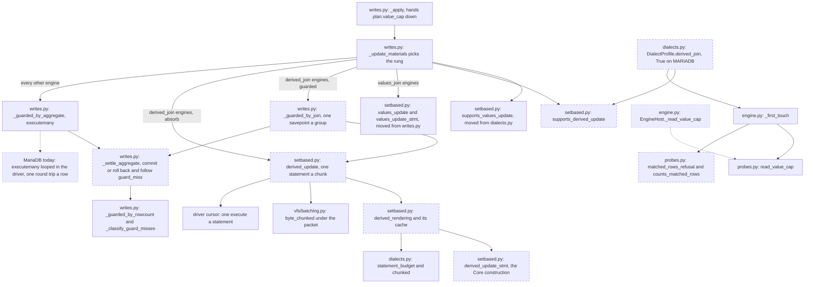

# On MariaDB a guarded overwrite batch of N rows issues ceil(N / rows_per_statement) UPDATE statements, with the same observations as today.

A fix of a cost defect. Flags: it is structural (two new modules under `src/vfs/storage/backends/database/`, and six functions move out of the three modules the size lint holds at an exact line count); it adds no public name and changes no verb, argument or error kind, and adds one refusal at first touch on one engine; it does not change the schema format; it needs the engine legs (MariaDB for the behaviour, and Postgres, SQL Server and Oracle because the update ladder is on every engine's write path); it touches no rights; it does not touch the Rust engine; it is parallel-safe with every unit that edits none of `_update_materials` in `writes.py`, `_first_touch` in `engine.py`, the field list of `DialectProfile`, the three size entries of `tests/lint/allowlist.py` this unit lowers, and the MariaDB classes of `tests/storage/test_conformance.py`. Known co-editors of `_first_touch` are [unit 157-1](../2026-11-25-first-touch-creates-the-mounts-schema-and-names-a-privilege-refusal/spec.md), [unit 157-3](../2026-11-25-a-borrowed-sql-server-factory-is-checked-and-the-facade-installs-extensions/spec.md) and [the SQL Server read spec](../../context/specifications/active/2026-11-15-on-sql-server-a-read-never-waits-on-a-write.md); whichever builds second rebases that function and the `engine.py` size entry. It serves roadmap storage story D5 at gate 0.2 ([the roadmap](../../context/standards/roadmap.md), lines 489 to 491), whose acceptance line is part of the contract: "Spec 080 slice B: `ceil(N / rows_per_statement)` statements counted; `CLIENT_FOUND_ROWS` asserted at first touch; the conformance observations byte-identical; the other engines' counts unchanged." It is converted, by amendment, from the Problem, Research questions 1 to 4 and Acceptance criteria of [spec 080](../../context/specifications/archive/080-mysql-batch-update-statements/spec.md), read with [the study of that spec](../2026-11-25-the-backlog-converted/studies/051-162/080-mysql-batch-update-statements.md) and placed by [the map of units](../2026-11-25-the-backlog-converted/units.md) as unit 080-1. It stands on the Recommendation of [the 2026-08-25 memo on batch UPDATE shapes](../../context/research/2026-08-25-mysql-family-batch-update-shapes.md) and on counts and measurements executed in drafting on 2026-11-25 against MariaDB 11.8.9, each labelled EXECUTED below. It depends on [spec 079](../../context/specifications/archive/079-guarded-update-statement-attribution/spec.md), landed 2026-07-23 and in the tree as `_update_materials`: this unit changes which statements one engine's rung runs and nothing of the attribution rule that spec pinned. It reads roadmap decision D3 (MariaDB's tier), which is a verified lean and not a ruling, for its gate only (decision 1). Two roadmap stories with no spec touch it and neither orders it: story D4, criterion 4, and story D1, criterion 1; the Design's last paragraph quotes both and says what each order of landing changes.

## The problem

Facts at commit `5b20fd4f` (`git rev-parse --short=8 HEAD`; `src/` and `tests/` are unchanged from `9daedd2b`, EXECUTED by `git diff --stat`).

1. The ladder. `_update_materials` splits a batch's material updates into guarded rows (`persistence == "update"`, in two groups, live and revive) and absorb rows, and picks a rung per group from the live dialect: the VALUES join with RETURNING where `supports_values_update` holds, else `_guarded_by_aggregate` where the dialect declares `supports_sane_multi_rowcount`, else the per-row floor, else a classified `unsupported` (READ, `src/vfs/storage/backends/database/writes.py:726-755`).
2. MariaDB takes the executemany rung. The `MARIADB` profile leaves `values_join` at its default `False` (READ, `src/vfs/storage/backends/database/dialects.py:436`, `:597-629`), and SQLAlchemy 2.0.52's `mariadb+aiomysql` dialect reports `update_returning=False`, `update_returning_multifrom=False`, `supports_sane_rowcount=True`, `supports_sane_multi_rowcount=True`, `insertmanyvalues_max_parameters=32700` and `_found_rows_client_flag()=2` (EXECUTED, a compile-only probe). So a guarded group is one `session.execute(_guarded_stmt(...), params)` with a list of parameter sets under a savepoint (READ, `writes.py:902-911`), and the absorb arm is one more executemany followed by a chunked read-back (READ, `writes.py:772-799`).
3. The driver loops. aiomysql 0.3.2 packs `executemany` into one statement only for INSERT and REPLACE; for any other statement it runs `await self.execute(query, arg)` once per parameter set (READ, the installed `aiomysql/cursors.py:286-287`). An overwrite of 3,000 existing files on the MariaDB 11.8.9 leg cost 3,000 calls of the driver cursor's `execute` whose statement opens with `UPDATE` (EXECUTED). SQLAlchemy's `before_cursor_execute` saw that same phase as one event with `executemany=True` (EXECUTED), so a count taken at that event cannot see the defect.
4. The cost at the reference deployment. A 10,000-file overwrite batch is 10,000 round trips for its update phase; at 100 batches a night that is 1,000,000 round trips, each inside one REPEATABLE READ transaction (READ, `dialects.py:605`) that holds the row locks it has taken for the rest of the loop (INFERRED from facts 2 and 3 and the reference deployment in [AGENTS.md](../../AGENTS.md)). The roadmap records the gap as "MariaDB guarded updates | per-row round trips (spec 080 researched)" (READ, `context/standards/roadmap.md:451`).
5. What moved under the source since 2026-07-23. A missed guard on MariaDB no longer re-drives row by row for blame: the profile declares `guard_miss="redrive"`, the aggregate rung raises `StaleSnapshot` after the savepoint rollback, and an exhausted redrive answers a retryable `vfs.conflict` (READ, `dialects.py:602-604`; `writes.py:908-910`; `src/vfs/storage/backends/database/backend.py:1500-1506`). Guarded rows run in two groups and every live-row arm carries a tombstone term that binds nothing (READ, `writes.py:728-731`, `:983-985`). Community MySQL is not a supported dialect and a `mysql://` URL is served on the generic floor (READ, `dialects.py:592-596`). The leg's image is `mariadb:11.8`, where the memo measured 11.4 (READ, `docker/compose.test.yml:53`).
6. The memo's shape works on 11.8 at the tree's width. The UNION ALL derived-table join, carrying the tree's tuple of 24 cells a row (id, base version, new version, path and the 20 clobber columns, READ `writes.py:115-136`, `:827`), ran 3,000 rows as 3 statements with a rowcount sum of 3,000 and every version up by one; with one row made stale a 1,362-row statement reported 1,361 and the savepoint rollback restored every row; the form without the version term reported 1,362 of 1,362 and 0 for a row whose path differed (all EXECUTED).
7. The memo's construction does not carry over. Built as the memo built it, one Core `literal()` per cell, 5,000 rows at 24 cells took 8.98 s and 8.04 s in two rounds, against 1.81 s and 3.16 s for today's executemany loop on the same loopback server; one 1,362-row statement costs about 1.0 s to build and 0.6 s to compile on the client, on the event loop (EXECUTED; clocks are measurements here and never a test). The same statement text assembled by repeating one compiled row and sent through the driver took 1.52 s and 0.58 s (EXECUTED). The memo's 3 cells a row hid this cost.
8. Three of the modules the fix would grow are held at an exact line count: `writes.py` at 1,294, `engine.py` at 1,160 and `dialects.py` at 1,170 (READ, `tests/lint/allowlist.py:30-32`; `tests/lint/test_code_shape.py:222-245`). A listed module that grows fails the lint.
9. No test records the per-row count. `tests/base/test_write_at_scale.py` counts statement families on SQLite alone, and no node under `tests/` counts driver round trips of an overwrite on MariaDB (EXECUTED, grep).

## Architecture

A rung is one way `_update_materials` runs a group of staged rows. A guarded group is the staged rows with `persistence == "update"` on one side of the tombstone, live or revive; the absorb rows are the staged rows that clobber a rival's row after arbitration. The derived-table join is MariaDB's multi-table `UPDATE vfs_entries, (SELECT ... UNION ALL SELECT ...) AS incoming SET ... WHERE ...`. A rendering is that statement compiled once for one row: the text before the row's select, the row's select, the text after it, the bind processor of each cell, the fixed binds that follow the rows, and the rows one statement may carry. The matched-row count is the statement's `rowcount` on a connection whose `CLIENT_FOUND_ROWS` flag is set. The packet is the server's `max_allowed_packet`, which first touch already reads as the host's `value_cap`.

## Decisions

### 1. The unit is built for gate 0.2, on MariaDB as a second-tier engine, and a ruling of first tier moves it to gate b without changing its design.

MariaDB is served on every verb, its leg runs the conformance contract in CI and a red leg blocks a release; what the second tier withholds is performance parity, and this unit is the first piece of that parity. The reference deployment names Postgres, SQL Server and Oracle as its engines, so the per-row cost is paid by no deployment the filter names, and the fix is not a condition of 0.1.0. Were MariaDB dropped instead, this spec would be dropped with it; nothing here is irreversible, so nothing waits.

Basis: verified lean, roadmap decision D3 ("Second tier.", `context/standards/roadmap.md:1075`), verified HOLDS-AMENDED in [the engine decisions file](../2026-11-25-the-backlog-converted/decisions/e-engines-schema-and-kernel.md); precedent: the tuned `MARIADB` profile (`dialects.py:597-629`), the MariaDB row of the CI matrix (`.github/workflows/test-dialects.yml:41-43`) and the Engines row of the reference deployment in `AGENTS.md`.

### 2. The change is specified for MariaDB alone, on the `mariadb+aiomysql` driver the `mariadb` extra installs.

The source's "MySQL family", its two conformance legs and its three drivers are stale: there is one leg (`VFS_TEST_MARIADB_URL`, with `VFS_TEST_MYSQL_URL` kept as an alias, READ `tests/conftest.py:66`), one driver in the extra (READ, `pyproject.toml:57`), and a `mysql://` URL resolves to the generic floor, which declares nothing this unit reads and so keeps the executemany rung.

Basis: decided in drafting, because `AGENTS.md` (Production posture) says MySQL community "is not a supported dialect: a `mysql://` URL is served as an unknown one", and the source spec's family framing contradicts it.

### 3. A guarded group on MariaDB runs as one derived-table join per chunk, guarded on `entry_id`, the path at snapshot, `version = base` and, outside a revive, a clear tombstone, and it writes the staged version.

The statement joins the entry table to a `UNION ALL` derived table that carries one row per staged entry: `v_id`, `v_base`, `v_ver`, `v_path` and one `v_<column>` per name of `_CLOBBER_COLUMNS`, the same tuple and the same names the VALUES arm carries. `SET` takes every clobber column and `version = incoming.v_ver`; `WHERE` is `entry_id = v_id AND path = v_path AND version = v_base` plus `tombstone_terms(entry, revive=revive)`. The join carries each row's own values and its path guard as join columns, where the row-constructor `IN` form the flag stamp uses (`src/vfs/storage/backends/database/indexing.py:906-915`) assigns one value to every matched row and would need a `CASE` over the chunk's rows in each of the 20 assigned columns; it is also the shape the memo measured against the real schema. On 11.8 the optimizer drives it from the derived table with one unique-index probe a row (decision 16).

Basis: verified lean, the study's open choice 1 (the memo's Recommendation 1); precedent: the memo's executed runs at 10,000 rows (`context/research/2026-08-25-mysql-family-batch-update-shapes.md:28-45`) and problem fact 6, EXECUTED on 11.8.9 at the tree's 24 cells a row.

### 4. The rung is selected by one profile field, `derived_join`, which `MARIADB` alone sets, and it sits after the VALUES arm and before the executemany aggregate; no code tests a dialect's name.

`DialectProfile` gains `derived_join: bool = False`: the engine accepts a `UNION ALL` derived table as the join source of a multi-table UPDATE. SQLAlchemy renders the form for any dialect that renders multi-table UPDATE and takes no position on which engines accept it, so it is a profile fact, as `values_join` is. `supports_derived_update(profile, dialect)` is the selector. Because the VALUES arm is tested first and no profile sets both fields, Postgres and SQL Server keep the VALUES join, and SQLite, Oracle and the generic floor keep the rungs they run today.

Basis: verified lean, the study's open choice 2 (amended: a profile field in place of the memo's "renders a multi-table UPDATE and lacks `update_returning_multifrom`"); precedent: `values_join` and `supports_values_update` (`dialects.py:189-194`, `:436`, `:852-861`) and `AGENTS.md`, "A `DialectProfile` field is justified only for a decision SQLAlchemy takes no position on".

### 5. The selector reads two live dialect facts beside the field: `supports_sane_rowcount` and `positional`.

The join is one `execute`, so the rowcount that proves it is the one `supports_sane_rowcount` declares; `supports_sane_multi_rowcount` describes an executemany, which this rung does not issue. `positional` is read because the statement is sent as repeated row text with a flat parameter tuple (decision 6), which a named paramstyle cannot carry. A dialect that fails either fact falls through to the rungs below, which are correct and slower. This departs from the study's amended text, which named `supports_sane_multi_rowcount`.

Basis: decided in drafting, because SQLAlchemy defines `supports_sane_rowcount` for a single UPDATE and `supports_sane_multi_rowcount` for executemany (`sqlalchemy/engine/default.py:215-216`), and both are `True` on the leg's dialect (problem fact 2), so the correction changes no engine's path.

### 6. The statement is compiled once for one row, its row select is repeated as text, each cell passes its column's own bind processor, and the chunk is sent with `exec_driver_sql`; the Core construction is used for the budget, the rendering and a parity test only.

Building the chunk through Core is slower than the loop it replaces and blocks the event loop for more than a second a chunk (problem fact 7). `bulk_insert`'s `"driver"` mode already takes this road for the same reason: the statement compiled once, Core's bind processors applied per column, the values handed to the driver (`dialects.py:892-941`, `:1130-1149`). The rendering splits the one-row statement's compiled text around the compiled text of the row's select; a split that does not find that text exactly once, or a leading bind order that is not the row's cells, raises `AssertionError` when the rendering is built, as `statement_budget` raises on drift (`dialects.py:845-846`), and never sends a statement. This departs from the memo, which built every row through Core.

Basis: decided in drafting, because the per-batch filter of `AGENTS.md` rejects a rung that costs more than the one it replaces, and problem fact 7 (EXECUTED) shows the Core construction does at the tree's row width.

### 7. A chunk is `statement_budget` over the compiled join with `row_width` the tuple's length and `row_cap` the membership budget; no constant is declared.

The per-row bind count and the fixed binds (the one `+ 1` of the absorb form) are measured off the Core construction over one and two probe rows, exactly as the VALUES arm measures them. At the leg's real budgets (parameter budget 32,700, membership budget 32,668, 24 cells) that is `(32700 - 8) // 24 = 1362` rows a statement for the guarded form and for the absorb form (EXECUTED), so a 10,000-row group is `ceil(10000 / 1362) = 8` statements. A new clobber column narrows the chunk by arithmetic and needs no edit here.

Basis: verified lean, the study's open choice 7; precedent: `_values_update` (`writes.py:828-835`) and `statement_budget` (`dialects.py:817-849`).

### 8. A chunk whose metered wire size would pass the server's packet is split by bytes, so no statement is sent that the server would answer by dropping the connection.

aiomysql inlines every value into the statement text, so the statement's size is what `max_allowed_packet` judges. At 1,362 rows the text is 641 KB before its values are inlined (EXECUTED), and with them it is bounded by the row count times the declared column widths; the default packet of 16 MiB (EXECUTED on the leg) is never reached, and a deployment that lowers the packet is still served. Each row is charged the row select's text plus, for every cell, an upper bound of its literal: twice a string's UTF-8 length plus `_LITERAL_FRAME_BYTES = 9` (the `_binary` prefix and two quotes), and `_SCALAR_LITERAL_BYTES = 32` for any other value (a quoted microsecond timestamp is 28). The page is the host's `value_cap.limit` less the statement's fixed text; with no value cap there is no split. The split is `byte_chunked` inside each row chunk, so the statement count is `ceil(N / rows_per_statement)` whenever no chunk passes the page, and one row larger than the page rides alone, as the flush law says.

Basis: decided in drafting, because `AGENTS.md` says "No statement may grow unboundedly with batch size", the profile records that an oversized statement costs the connection (`dialects.py:623-626`), and the blob insert already pages by wire bytes under the same cap (`writes.py:439-441`, `src/vfs/batching.py`).

### 9. The rendering and its rows-per-statement are cached per dialect facts, table shape, arm and budgets, in a key of strings and integers only.

Uncached, a call pays about 2.8 ms to measure the budget and 1.2 ms to render (EXECUTED), which a single-file write would pay every time. The key is the dialect's name, driver and paramstyle, the table's schema, name and column shape, the tuple's column names, `guard`, `revive`, and the two budgets; it retains no mount's metadata. A process holds three renderings per mounted schema.

Basis: decided in drafting, because the per-file-write multiplier of `AGENTS.md` (about 1,050,000 a day) makes a per-call compile a daily cost, and `_BULK_STATEMENTS` is the tree's own shape for a compiled-once statement (`dialects.py:886-889`).

### 10. A guarded group is proved by each statement's matched-row count equal to the rows it carried, under one savepoint for the group, and the first short statement stops the group.

Each staged row matches at most one entry through the unique `entry_id` index and the staging layer stages one row per `entry_id`, so a count equal to the rows sent proves every guard matched. The savepoint spans every chunk of the group, because a guarded update is not idempotent and nothing may be judged over applied state; a short statement rolls the whole group back and sends no later chunk.

Basis: the source spec, Research question 3 (answered by the memo's Q3); still true at `5b20fd4f` (problem fact 6, EXECUTED: 1,361 of 1,362 reported and every row restored by the rollback).

### 11. A short guarded chunk follows the profile's `guard_miss` mode exactly as the executemany aggregate does: on MariaDB the savepoint rolls back and `StaleSnapshot` redrives the whole method.

The source's acceptance line "exact per-row blame on conflict" does not describe MariaDB at this commit: a zero-row guard at REPEATABLE READ is ambiguous, so the profile declares `redrive`, and an exhausted redrive answers one retryable `vfs.conflict` (problem fact 5). The join and the executemany aggregate share one tail, `_settle_aggregate`, so a profile that declares `derived_join` with `reprobe` would take the per-row floor after the rollback, as the aggregate rung does on SQLite.

Basis: decided in drafting, because the tree determines it (`dialects.py:602-604`, `writes.py:908-911`, and the pin `tests/storage/test_conformance.py:536-555`), which the source's lean of a per-row re-drive for blame contradicts (the study's open choice 4, FAILS).

### 12. The absorb arm runs the same join without the version term, increments `version` SQL-side, verifies its matched count, and keeps the chunked read-back that learns versions and proves the stored path.

MariaDB has no `UPDATE ... RETURNING`, so the versions the absorb rows now hold are read back by `entry_id` in chunks of the membership budget, as today. The matched count is checked first: a statement short of its rows raises `StaleSnapshot`, which is what the VALUES arm does when its RETURNING set lacks a row (`writes.py:767-771`). No savepoint is taken, because the miss abandons the transaction.

Basis: verified lean, the study's open choice 6; precedent: the VALUES arm's unguarded form, which drops only the version term and increments SQL-side (`writes.py:864-871`), and the read-back of the executemany arm (`writes.py:785-799`).

### 13. First touch asserts the connection's `CLIENT_FOUND_ROWS` flag where the profile declares `derived_join`, by reading the driver connection and issuing no statement, and the MariaDB leg pins the same semantic by executing a matched-unchanged UPDATE.

The rung counts matched rows. SQLAlchemy sets the flag at connect; a host that overrides the client flags clears it, and then a matched row whose values do not change reports 0 (EXECUTED: 1 through SQLAlchemy's defaults, 0 with `client_flag=0`). `counts_matched_rows(driver_connection)` reads `client_flag & CLIENT_FOUND_ROWS`, the protocol's bit 2, off the driver's own connection object (EXECUTED: 2 and 0 on the two connections). The executed form of the check is not taken at first touch: the one row every mount holds is the meta row, which is the lock every rights change takes first (`src/vfs/storage/backends/database/revision.py:56-73`), so a probe UPDATE there would make the first call of a process wait behind an open rights change. A refusal is `classified(ErrorKind.unavailable, detail=MATCHED_ROWS_MISSING)`, not retryable, returned before provisioning, with the mount left not ready.

Basis: verified lean, the study's open choice 3 (amended by story D5's line "`CLIENT_FOUND_ROWS` asserted at first touch"); precedent: the value cap read at first touch (`engine.py:595-596`) and the refusal shape of `_probe_vector_function` (`engine.py:633-661`).

### 14. A driver connection that exposes no readable `client_flag` is refused at first touch in the same words.

aiomysql exposes `client_flag` as a public attribute (READ, the installed `aiomysql/connection.py`); a borrowed session factory on another MariaDB driver may not. vfs cannot verify such a connection, and the bulk-insert mode and the packet meter of this profile are already aiomysql's.

Basis: provisional, no ruling on record; the options were to refuse a connection whose flag cannot be read, to accept it unverified, or to prove it by a matched-unchanged UPDATE on a temporary table (which needs the `CREATE TEMPORARY TABLES` privilege); chosen because a refusal can be withdrawn after a release without breaking any host, while an acceptance cannot become a refusal without breaking one, and aiomysql is the one driver the `mariadb` extra installs (`pyproject.toml:57`).

### 15. Round trips are counted at the driver cursor's `execute`, never at SQLAlchemy's `before_cursor_execute`.

The event fires once for an executemany that the driver then loops (problem fact 3), so it reads 1 before this change and 8 after it for a 10,000-row batch. A helper in `tests/support/statements.py` wraps the `execute` of the cursor class the live dialect's DBAPI module names and counts calls by the statement's first word. This departs from the study's note, which proposed the event.

Basis: decided in drafting, because `AGENTS.md` (Performance tests) says a pin asserts how much work ran, and problem fact 3 (EXECUTED) shows the event does not measure the work on this driver.

### 16. The join carries no optimizer hint, and its lock footprint is pinned by a count on the leg.

On 11.8.9 the plan is the derived table read whole and `eq_ref` on `ix_vfs_entries_entry_id`, at 1,501 and at 20,101 table rows and with the join covering 91% of the table; a 3-row join held 6 record locks and a 1,362-row join held 1,521 and 2,752 at the two sizes, with 1,362 rows modified and one intention lock on the table (EXECUTED, `information_schema.INNODB_TRX`). That is the footprint of the per-row loop: the unique-index record and the clustered record of each updated row. A hint is added only if a measurement shows a plan that scans the entry table.

Basis: decided in drafting, because `AGENTS.md` costs a lock by who waits behind it and the profile's other join pins were each added on a measured misplan (`dialects.py:259-270`), which this join does not show.

### 17. This unit records the per-row baseline itself, as a node that runs the same overwrite with `derived_join` cleared and counts one driver round trip a row.

Story D4's criterion 4 asks for that number so that this landing is a visible delta, and no pin holds it (problem fact 9). The node keeps the executemany rung exercised on the real engine, which is where a `mysql://` host still runs.

Basis: decided in drafting, because the roadmap line "The MariaDB leg records the per-row `UPDATE` count of a 10k overwrite as a known number, so spec 080 landing is a visible delta" (`context/standards/roadmap.md:487`) has no test at `5b20fd4f`.

### 18. The new code lives in two new modules, `setbased.py` and `probes.py`, and `writes.py`, `dialects.py` and `engine.py` each end no longer than they began, with their size entries lowered to the new counts.

The size lint holds the three at exact counts (problem fact 8). `setbased.py` owns the two set-based material updates and their selectors: the VALUES join moves there from `writes.py` and `supports_values_update` from `dialects.py`. `probes.py` owns the facts first touch reads off a live connection: the value cap moves there from `EngineHost._read_value_cap`. Neither new module imports `writes.py` or `engine.py`, so no import cycle is made.

Basis: decided in drafting, because `tests/lint/test_code_shape.py:222-245` fails a listed module that grows and tells the change to "move out as many as were added".

### 19. The archived plan of spec 079 is not corrected; the per-engine statement shapes are stated in the docstring of `_update_materials`.

The source's last acceptance line asked for an edit to that plan. The plan is archived with its spec, and a docstring is where the ladder is described to its reader. The docstring names the four shapes in words: the VALUES join with RETURNING, the derived-table join verified by matched count, the executemany verified by aggregate count, and the per-row floor.

Basis: decided in drafting, because `AGENTS.md` says the document cites the code and never the other way round, and an archived record is read, not amended.

## Intent

After this spec, a write over existing files on a MariaDB mount sends its guarded updates and its absorbing updates as one UPDATE statement per chunk of rows instead of one driver round trip per row: a 10,000-file overwrite issues 8 UPDATE statements at the engine's real budgets where it issued 10,000. Every result, observation, version, error kind and retry behaviour is what it was; a write that loses a race still redrives and, exhausted, answers a retryable `vfs.conflict`. A MariaDB mount opened through a connection that does not count matched rows is refused at first touch with `vfs.unavailable` naming the flag. Postgres, SQL Server, Oracle, SQLite and every unknown dialect issue the statements they issued before.

## Design

Sizes. `setbased.py` is about 260 lines and `probes.py` about 70, both far under the 1,000-line ceiling. `writes.py` loses `_values_update`, `_values_update_stmt`, `_typed_cell` and `_tombstone_terms` (about 80 lines) and gains about 45; `dialects.py` loses `supports_values_update` (13 lines) and gains about 9; `engine.py` loses `_read_value_cap` (7 lines) and gains 3. The line counts are taken again at build time; the rule is decision 18's, not these estimates.

The order of work, each test before the code that passes it.

1. **The counter and the two leg pins, seen failing.** `tests/support/statements.py` gains `driver_statements(monkeypatch, storage) -> Counter[str]`, which wraps `execute` on `storage._host.engine.sync_engine.dialect.dbapi.aiomysql.Cursor` and counts calls by the upper-cased first word of the statement (decision 15). `tests/storage/test_conformance.py` gains the class `TestMariaDBGuardedUpdateRoundTrips`, marked `mariadb`, with criteria 1 and 2. Both overwrites carry new bodies, because [unit 174-1](../2026-11-25-an-identical-body-write-reports-unchanged-and-leaves-the-version-alone/spec.md) makes an identical-body write issue nothing. Criterion 1 fails at `5b20fd4f` with 10,000 where the formula says 8; that failure is the recorded baseline at full size.
2. **The move, behaviour kept.** `setbased.py` is created with `supports_values_update` (from `dialects.py`), `values_update(session, entry, columns, rows, *, parameter_budget, membership_budget, guard, revive=False) -> dict[str, int]`, `values_update_stmt(entry, columns, rows, *, guard, revive=False)`, `_typed_cell` and `tombstone_terms(entry, *, revive)` (from `writes.py`). The functions take the row tuples and the column names as arguments, so the module imports `dialects.py` and `descent.py` and not `writes.py`. `writes.py` gains `_update_rows(staged, now) -> list[tuple[object, ...]]`, the tuple-building loop that `_values_update` held (`writes.py:823-827`), and calls the moved functions with `_CLOBBER_COLUMNS`. `writes.py`, `indexing.py` and `serialized.py` import `supports_values_update` from its new home. `tests/storage/database/test_coherence.py` and `tests/storage/database/test_writes.py` change their imports and nothing else. The suite is green before step 3.
3. **The Core construction and its unit pins.** `tests/storage/database/test_setbased.py` is created with criteria 3 to 8 and 22, compile-only or over a session double. `tests/support/database_helpers.py` gains `_DriverSession`: `get_bind()` returns a MariaDB dialect, `connection()` returns a double whose `exec_driver_sql(sql, params)` records the pair and answers a rowcount from a callable that defaults to the rows the text carries, `begin_nested()` returns a savepoint double that records its commit or rollback, and `execute` answers canned rows for the read-back and the per-row floor. Then `setbased.py` gains `supports_derived_update(profile, dialect)` (`profile.derived_join and dialect.supports_sane_rowcount and dialect.positional`), `derived_update_stmt(entry, columns, rows, *, guard, revive=False) -> Update` (decision 3, one `select` of typed `literal` cells per row, `union_all` when there is more than one, as the subquery `incoming`), `DerivedRendering` (a `NamedTuple` of `head`, `row`, `tail`, `processors`, `fixed`, `rows`), `derived_rendering(dialect, entry, columns, *, parameter_budget, membership_budget, guard, revive) -> DerivedRendering` with its cache `_DERIVED_RENDERINGS` (decisions 6, 7 and 9), and `derived_update(session, entry, columns, rows, *, parameter_budget, membership_budget, packet, guard, revive=False) -> int`, which returns 0 when every statement matched and otherwise the shortfall of the first short statement, after which it sends nothing (decisions 8 and 10). `dialects.py` gains the field, one paragraph of the `DialectProfile` docstring, and `derived_join=True` on `MARIADB` with a two-line comment.
4. **The ladder.** `tests/storage/database/test_writes.py::TestGuardedAttribution` gains criteria 9 to 11 over `_DriverSession`. Then `_update_materials` takes `value_cap: ValueCap | None = None` (its one caller, `_apply`, passes `plan.value_cap`, `writes.py:426-428`), computes `supports_derived_update` once, and gains two branches. Guarded: `_guarded_by_join` opens the group's savepoint, calls `derived_update(..., guard=True, revive=revive)` and hands the shortfall to `_settle_aggregate`, the tail `_guarded_by_aggregate` now shares: commit and return nothing when the shortfall is 0; otherwise roll back, raise `StaleSnapshot` on a `redrive` profile, and run `_guarded_by_rowcount` on a `reprobe` one. Absorb: `derived_update(..., guard=False)`, `StaleSnapshot` on a shortfall, then the existing read-back, which both non-VALUES arms now reach. The docstring is rewritten per decision 19.
5. **First touch.** `tests/storage/database/test_probes.py` is created with criteria 12 and 23, and `tests/storage/database/test_engine.py` gains `TestMatchedRowsAtFirstTouch` with criteria 13 and 14; `TestValueCap` calls the moved function. Then `probes.py` gains `CLIENT_FOUND_ROWS: Final = 2`, `MATCHED_ROWS_MISSING` (the refusal's detail: the connection does not report matched rows for an UPDATE because the MySQL protocol's `CLIENT_FOUND_ROWS` flag is clear or unreadable, and the fix is to connect through `mariadb+aiomysql` with SQLAlchemy's default client flags), `counts_matched_rows(driver_connection) -> bool`, `matched_rows_refusal(session_factory) -> ResultError | None` (a session, its connection under `vfs_no_begin`, the raw connection's `driver_connection`, and the judgement) and `read_value_cap(session_factory, query, setting) -> ValueCap`. `_first_touch` calls `read_value_cap` where it called the method and, after it and before the vector probe, returns the refusal of `matched_rows_refusal` when `profile.derived_join` holds.
6. **The leg.** `tests/storage/test_conformance.py` gains `TestMariaDBMatchedRows` (criteria 15 and 16) and criterion 17's node in `TestMariaDBGuardedUpdateRoundTrips`; `tests/storage/database/test_writes.py` gains criterion 20's node. `tests/lint/allowlist.py` lowers the three entries. The four engine legs run through the `db_test` skill, then `scripts/ci.sh` and `scripts/docs.sh check` (two docstrings under `src/vfs/` change).

What grows, and what bounds it.

- **Per batch** (100 a night, 10,000 files each). A guarded group issues one SAVEPOINT, `ceil(rows / rows_per_statement)` UPDATE statements and one RELEASE: 10 statements for a 10,000-row overwrite where there were 10,002 round trips, and 800 UPDATE statements a night where there were 1,000,000. `rows_per_statement` is `statement_budget` under the live parameter budget with the membership budget as its cap (decision 7): 1,362 on MariaDB today, and never a constant. An absorb group adds its statements and `ceil(rows / membership_budget)` read-back selects, as today. A batch holds at most two guarded groups and one absorb group.
- **Per statement.** One statement's text is the fixed text (about 1.2 KB) plus 470 bytes a row before values, the row's select at 459 and its `UNION ALL` (EXECUTED); its parameter tuple holds at most `rows_per_statement * 24` cells, 32,688 today; the driver's rendered statement is at most the packet (decision 8). All three are dropped when the statement returns. The group's row tuples, one per staged row, exist today in the VALUES arm and as parameter dictionaries in the executemany arm; nothing new grows with the batch.
- **Per file write** (about 1,050,000 a day in the reference deployment; a single-file overwrite is the agent's case). One row is one chunk: SAVEPOINT, one UPDATE, RELEASE, the three round trips today's one-row executemany makes. The rendering comes from the cache; the uncached build is paid once per process and key (decision 9).
- **Per verb call, per index visit, per corpus.** Nothing is added: no read path, no index pass and no whole-table statement is touched.
- **Per lock.** No lock is added and none is held longer. The join takes the record locks the loop took, about two a row and never a scan of the table (decision 16), inside the same REPEATABLE READ transaction, which holds them to its commit as today; the update phase between the first lock and that commit falls from N round trips to `ceil(N / 1362)` statements. A plain read on InnoDB reads its snapshot and never waits on these locks. First touch's new check issues no statement and takes no lock: it checks one connection out and reads an attribute (decision 13).
- **The cache.** `_DERIVED_RENDERINGS` grows with the schemas a process mounts, three entries of about 2 KB each per schema, and never with a batch or the corpus.

Checked against [the constitution](../../context/standards/constitution.md), Article 5: the guarded arm stays revision-guarded and the absorb arm stays last-writer-wins between writers the landing admits, each declared in the docstring; Article 4: no capability a caller can discover changes. Checked against [the kernel names spec](../../context/specifications/active/2026-11-15-the-kernels-public-names-and-argument-families-are-ruled.md): this unit names no verb argument; its tests call `write` with entries and no `overwrite=`, which that spec's decision 7 removes.

Dependencies and build order. Spec 079 is landed and nothing else must land first. Story D4 has no spec; this unit relies on no line of it and satisfies its criterion 4 (quoted in decision 17) by criteria 1 and 2. If D4's own pin lands first with the per-row number, this unit's pull request changes that number to the formula of criterion 1. Story D1 has no spec; its criterion 1 puts "known caps" and, under decision D3's wording, "per-row updates documented" in the README's engine matrix. At `5b20fd4f` no page says MariaDB's updates run per row (EXECUTED, grep over `README.md`, `documentation/` and `docker/README.md`); if D1 has landed such a cell, this unit's pull request corrects it. The unit is built at gate 0.2, after the gate b units that edit the same functions, in any order with every other 0.2 unit.

## Scope

In: decisions 1 to 19. Files: `src/vfs/storage/backends/database/setbased.py` and `probes.py` (new), and `writes.py`, `dialects.py`, `engine.py`, `indexing.py` and `serialized.py` (the last two for one import each) in the same directory; `tests/storage/database/test_setbased.py` and `test_probes.py` (new), `tests/storage/database/test_writes.py`, `test_engine.py` and `test_coherence.py`, `tests/storage/test_conformance.py`, `tests/support/statements.py`, `tests/support/database_helpers.py`, `tests/lint/allowlist.py`; and `README.md` only for the cell the Design's last paragraph names, where story D1 has put one there.

Out, each with where it belongs.

- The other UPDATE statements MariaDB's driver still loops row by row: the embedding landing (`src/vfs/storage/backends/database/embed.py:344-356`, whose docstring records it as "a recorded suboptimality, never a cap"), the carried-vector landing (`indexing.py:762-768`), the parent bump of a create batch (`writes.py:1162-1186`), the edge touch (`src/vfs/storage/backends/database/edges.py:507-514`), the topology claims (`serialized.py:202-210`) and the subtree path rewrite (`src/vfs/storage/backends/database/topology.py:399-407`). None is a guarded or absorbing material update; each is counted by story D4's pins for its verb and belongs to a later unit that reuses `derived_update`.
- MariaDB's tier and the engine matrix: roadmap decision D3 and story D1.
- The 10,000-row count pins of the other verbs and the shared engine-leg fixture: story D4.
- A required-setting check for `innodb_snapshot_isolation`: the change the SQL Server read spec names for MariaDB, on its `RequiredSetting` field.
- An exclusive create, a version precondition and the `unchanged` answer on `write`: units 174-1 to 174-3 of the unit map.
- The roadmap's state row for MariaDB's guarded updates (`context/standards/roadmap.md:451`): the roadmap's own true-up.
- A wider chunk than the parameter budget allows, which aiomysql's client-side binds would permit: a later measurement, not a constant chosen here.

## Acceptance criteria

This unit changes no right, so it carries no leak test. Engine legs: criteria 1, 2, 15, 16, 17, 18 and 19 run on the MariaDB leg; criterion 20 runs on SQLite and on all four server legs.

1. On the MariaDB leg an overwrite of 10,000 existing files with new bodies succeeds and costs exactly `ceil(10000 / rendering.rows)` driver `execute` calls whose statement opens with `UPDATE`, more than one, where `rendering` is `derived_rendering` for the guarded live arm under the host's budgets: `tests/storage/test_conformance.py::TestMariaDBGuardedUpdateRoundTrips::test_a_ten_thousand_file_overwrite_costs_one_update_a_chunk` (`mariadb`, `slow`).
2. On the MariaDB leg, with `derived_join` cleared on the host's profile, an overwrite of 200 existing files costs exactly 200 such calls: `tests/storage/test_conformance.py::TestMariaDBGuardedUpdateRoundTrips::test_the_executemany_rung_costs_one_update_a_row`.
3. `supports_derived_update` is true for `MARIADB` with a MariaDB dialect, false for the same profile when the dialect's `supports_sane_rowcount` or `positional` is false, and false for every other entry of `PROFILES` and for `GENERIC`, and no profile sets both `values_join` and `derived_join`: `tests/storage/database/test_setbased.py::TestSelectors::test_only_mariadb_takes_the_derived_join`.
4. Compiled for MariaDB, `derived_update_stmt` over two rows is a multi-table `UPDATE` whose second table is a `UNION ALL` of two selects aliased `incoming`, with `incoming.v_base` and `deleted_at IS NULL` in its `WHERE` and no `RETURNING`; the revive form drops the tombstone term; the unguarded form drops `v_base` and sets `version` to `version + 1`: `tests/storage/database/test_setbased.py::TestDerivedJoin::test_the_statement_is_a_guarded_union_all_join`.
5. For 1, 2 and 3 rows and each of the three arms, the text `derived_update` sends equals the text Core compiles for `derived_update_stmt` over the same rows, and its parameters equal Core's processed parameters in order: `tests/storage/database/test_setbased.py::TestDerivedJoin::test_the_repeated_row_text_is_what_core_compiles`.
6. At a parameter budget of 32,700 and a membership budget of 32,668 the rendering carries `(32700 - 8) // width` rows for a tuple of `width` cells, and at a parameter budget of `2 * width - 1` three rows ride three statements whose rowcounts are summed: `tests/storage/database/test_setbased.py::TestDerivedJoin::test_the_chunk_is_the_statement_budget`.
7. With a packet that fits two rows by the meter, five rows that share one row chunk ride three statements, each metered at or under the page, every row sent once and in order, and with no packet they ride one: `tests/storage/database/test_setbased.py::TestDerivedJoin::test_a_chunk_over_the_packet_is_split_by_bytes`.
8. A second `derived_rendering` call with the same key calls `derived_update_stmt` zero times: `tests/storage/database/test_setbased.py::TestDerivedJoin::test_the_rendering_is_built_once_per_key`.
9. Through `_update_materials` on the `MARIADB` profile, a guarded group whose statements all match returns no error, commits its one savepoint, and issues one statement a chunk and no per-row statement: `tests/storage/database/test_writes.py::TestGuardedAttribution::test_derived_arm_proves_a_group_by_its_matched_counts`.
10. A guarded group whose second of three statements reports one row short rolls its savepoint back, raises `StaleSnapshot`, and sends no third statement: `tests/storage/database/test_writes.py::TestGuardedAttribution::test_derived_arm_short_chunk_rolls_back_and_redrives`.
11. An absorb group whose statements all match takes each staged version from the read-back; a statement one row short raises `StaleSnapshot` before any read-back; a read-back row whose path differs raises `StaleSnapshot`: `tests/storage/database/test_writes.py::TestGuardedAttribution::test_derived_arm_absorb_verifies_its_count_then_learns_versions`.
12. `counts_matched_rows` is true for a connection whose `client_flag` is 2 or has bit 2 among others, and false for a `client_flag` of 0 and for a connection with no such attribute: `tests/storage/database/test_probes.py::test_matched_rows_are_read_from_the_client_flag`.
13. On SQLite, with a profile that declares `derived_join`, first touch answers `vfs.unavailable` with `retryable` false and the detail `MATCHED_ROWS_MISSING`, the probe issues zero cursor executes, no vfs table exists afterwards, and the mount is not ready: `tests/storage/database/test_engine.py::TestMatchedRowsAtFirstTouch::test_a_connection_that_does_not_count_matched_rows_is_refused`.
14. On SQLite with its own profile, first touch calls `matched_rows_refusal` zero times: `tests/storage/database/test_engine.py::TestMatchedRowsAtFirstTouch::test_a_profile_without_the_join_is_never_probed`.
15. On the MariaDB leg an UPDATE that writes the meta row's own value back reports a rowcount of 1 through the storage's session factory and 0 through an engine built with `client_flag=0`: `tests/storage/test_conformance.py::TestMariaDBMatchedRows::test_a_matched_unchanged_update_reports_one_row`.
16. On the MariaDB leg a storage on a borrowed session factory whose connections carry `client_flag=0` is refused at first touch with `vfs.unavailable`, and its schema holds no table afterwards: `tests/storage/test_conformance.py::TestMariaDBMatchedRows::test_a_factory_without_found_rows_is_refused_at_first_touch`.
17. On the MariaDB leg, on a mount of 2,000 files, a guarded join of 100 rows run through `_update_materials` in an open transaction reports `trx_rows_modified` of 100 and `trx_rows_locked` under 300 for its connection in `information_schema.INNODB_TRX`: `tests/storage/test_conformance.py::TestMariaDBGuardedUpdateRoundTrips::test_the_join_locks_only_the_rows_it_updates`.
18. On the MariaDB leg a rival one increment ahead inside the guard's window still redrives to a success at version 3 with the victim's content, the node unedited: `tests/storage/test_conformance.py::TestMariaDBTornRowRegression::test_one_increment_rival_redrives_to_success`.
19. On the MariaDB leg every row of the storage contract and the grants contract passes with `tests/support/storage_contract.py` and `tests/support/grants_contract.py` unedited, among them `test_batch_write_observations_match_the_committed_state` and `test_namespace_create_bumps_the_parent_but_overwrite_does_not`: the conformance rows of `tests/storage/test_conformance.py::TestMariaDBConformance`.
20. An overwrite of 50 existing files issues its entry-table UPDATE as the rung its engine declares, counted at `before_cursor_execute`: one executemany event on SQLite and on Oracle, one single-statement event carrying a VALUES table on Postgres and on SQL Server, and one single-statement event carrying `UNION ALL` on MariaDB: `tests/storage/database/test_writes.py::test_an_overwrite_updates_through_the_rung_its_engine_declares` (ids `sqlite`, `postgres`, `mariadb`, `mssql`, `oracle`).
21. `writes.py`, `dialects.py` and `engine.py` each hold exactly their lowered entry, no entry rose, and the two new modules are under the ceiling: `tests/lint/test_code_shape.py::test_a_listed_module_never_grows_and_an_unlisted_one_stays_under_the_ceiling`.
22. A rendering whose one-row statement does not hold the row select's text exactly once raises `AssertionError` when it is built, and no statement is sent: `tests/storage/database/test_setbased.py::TestDerivedJoin::test_a_rendering_that_cannot_be_split_fails_loudly`.
23. `matched_rows_refusal` answers nothing for a session factory whose driver connection carries `client_flag` 2, and issues zero cursor executes: `tests/storage/database/test_probes.py::test_a_connection_that_counts_matched_rows_is_admitted`.

## Landing notes

Filled in when the pull request is opened.

## One line

On MariaDB a guarded or absorbing batch update becomes one derived-table join per budgeted chunk, proved by its matched-row count on a connection first touch has checked, so a 10,000-file overwrite sends 8 UPDATE statements where it sent 10,000 and answers exactly as before.
