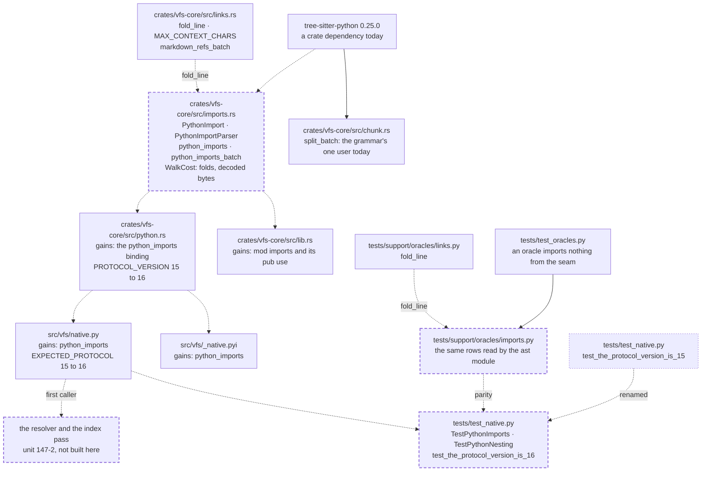

# The engine returns every Python import statement in a batch of bodies, with its module path, imported names, relative level and folded referring line, and nothing found inside strings or comments

A feature. Flags: structural (it adds one Rust module, `crates/vfs-core/src/imports.rs`, and one test-support module, `tests/support/oracles/imports.py`); touches the engine (the extension is rebuilt and the seam's protocol number moves from 15 to 16); changes no public API (`vfs.__all__` is untouched and `vfs.native` is an internal seam); changes no schema format (27 stays); needs no engine leg (it issues no SQL statement and edits no file under `src/vfs/storage/`); touches no rights; parallel-safe with every unit that neither edits `crates/vfs-core/src/python.rs`, `src/vfs/native.py`, `src/vfs/_native.pyi` or `tests/test_native.py` nor moves the protocol number. It serves roadmap story E8 at gate 0.2 ([the roadmap](../../context/standards/roadmap.md), `context/standards/roadmap.md:582-584`); the story carries no acceptance line, and its whole text is "Independent of theme 3. Render at write moves up if D21 says so.", so no roadmap decision reaches this unit. It is unit 147-1 of [the unit map](../2026-11-25-the-backlog-converted/units.md), converted by amendment from [spec 147](../../context/specifications/archive/147-import-edge-extractor/spec.md): its Scope as far as the kernel, its Slice A and its Decided semantics 4. It stands on [the study of that source against the tree](../2026-11-25-the-backlog-converted/studies/051-162/147-import-edge-extractor.md), on the memo the source was born from, [the ranking signals memo](../../context/research/2026-08-26-glean-ranking-signals-and-ranker-api.md) section 2.3, and on probes executed in drafting, each reported under The problem and the Design. It depends on one spec, landed: [spec 138, the reference-edge extractor](../../context/specifications/archive/138-reference-edge-extractor/spec.md), archived 2026-09-05, whose kernel this unit sits beside and whose `fold_line`, `MAX_CONTEXT_CHARS`, batch shape and oracle directory it reuses (READ at `crates/vfs-core/src/links.rs:28`, `:58-63`, `:71` and EXECUTED by `ls tests/support/oracles/`). It depends on nothing unbuilt. Build order: this unit first, then [unit 147-2, the imports edges in the index pass](../2026-11-25-python-imports-become-imports-edges-in-the-index-pass/spec.md), which is the kernel's first caller.

## The problem

Labels: READ means read in the file cited, at `5b20fd4f`; EXECUTED means a command ran on 2026-11-25 and the claim reports its output; INFERRED means reasoning.

The engine reads references out of Markdown and out of nothing else. READ `crates/vfs-core/src/lib.rs:16-26`: the crate's modules are `chunk`, `deadline`, `glob`, `grams`, `lexical`, `lexical_tables`, `links`, `postings`, `signals`, `vectors` and `verify`. READ `crates/vfs-core/src/links.rs:58-63` and `crates/vfs-core/src/python.rs:306-316`: the one reference kernel is `markdown_refs_batch`, bound as `markdown_refs`, and the seam serves it at `src/vfs/native.py:130-139`. EXECUTED: a search of `src/` and `crates/` for `python_imports`, `imports.rs`, `import_statement` and the quoted word `imports` prints nothing.

The Python grammar is already in the wheel and is used only to cut chunk spans. READ `crates/vfs-core/Cargo.toml:70`: `tree-sitter-python = "0.25.0"` is a crate dependency. READ `crates/vfs-core/src/chunk.rs:93`: the chunker loads it by the name `python`. Nothing walks a Python tree for its statements.

So a code tree has no extracted edge. READ `src/vfs/storage/backends/database/links.py:62-76`: the index pass extracts references only from rows whose extension is in `MARKDOWN_EXTENSIONS`. READ `src/vfs/storage/backends/database/signals.py:105`: the centrality prior reads every edge whose type is not the reserved `fs`. INFERRED: on a mount of Python source no row links a module to the modules it imports, so the prior has no signal there. READ `context/standards/roadmap.md:532`: the roadmap's state table reads "`imports` edges (147) planned".

The unit that mints those edges needs the statements first, read by a parser and not by a pattern. EXECUTED on a scratch prototype of the walk decision 11 describes, built against the versions `Cargo.lock` pins (tree-sitter 0.26.13, tree-sitter-python 0.25.0): the body `s = "import a"\n# import b\n"""\nimport c\n>>> from d import e\n"""\nimport real\n` yields one statement, `import real`, where a search for the word `import` finds five lines. The prototype is not kept; every row and count this spec takes from it is re-run by a criterion below, and its one clock reading and one memory reading are marked indicative where they appear.

The seam's protocol number is 15 on both sides and is guarded by name. READ `crates/vfs-core/src/python.rs:29`, `src/vfs/native.py:35` and `tests/test_native.py:273-278` (`test_the_protocol_version_is_15`). EXECUTED: `tests/support/oracles/` holds `links.py` and ten other oracles and no `imports.py`.

## Architecture

Solid is what exists. Dashed is what this spec adds. Dotted is what it removes. The four existing files the arrows from `imports.rs` reach (`lib.rs`, `python.rs`, `_native.pyi`, `native.py`) each gain the lines named in their box.

Terms. A *statement row* is what the kernel returns for one import statement: `(modules, names, level, context)`. A *module path* is the dotted name a statement imports or imports from, such as `a.b.c`. The *level* is the count of leading dots of a relative `from` import, and 0 for an absolute one. The *referring line* is the statement's own text folded to one line of at most 256 characters, the text the next unit stores in `edges.context`. A *clean* statement is one whose syntax subtree holds no error and no missing node. The *seam* is `src/vfs/native.py`, the one Python module that talks to the compiled extension.

## Decisions

### 1. The kernel is a new crate module, `crates/vfs-core/src/imports.rs`, and it parses with the Python grammar the wheel already links

The module holds the row type `PythonImport { modules: Vec<String>, names: Vec<String>, level: usize, context: String }`, the parser type `PythonImportParser` (one `tree_sitter::Parser` with the Python language set, built by `Default`, which panics when the grammar does not load, because a wheel whose grammar cannot load is a defective build, as `RefParser::default` treats the Markdown grammars at `crates/vfs-core/src/links.rs:46-55`), and two functions: `python_imports(parser, body)` for one body and `python_imports_batch(bodies)` for a batch. `Cargo.toml` and `Cargo.lock` are not edited: no dependency is added, so the wheel budget of `scripts/ci.sh` is not engaged. The parse is a second parse of a body the chunker also parses; decision 11 and the Design say what that costs and name the direction that removes it.

Basis: the source spec, Slice A; still true at `5b20fd4f` (`tree-sitter-python = "0.25.0"` READ at `crates/vfs-core/Cargo.toml:70`; no `imports.rs` exists, EXECUTED by listing `crates/vfs-core/src/`).

### 2. Python is the only language read, a later language is a kernel function of its own, and no registry or shared row type is declared here

A later language adds a function to the same module, named for its language as this one is, with a row shape of its own where its import forms differ. This unit declares no list of `(extension set, kernel, resolver)`, no extension set and no row type shared across languages. The list the source names selects rows by extension inside the index pass, which is the next unit's code, and a type written for languages that do not exist yet would have one member. What this unit guarantees to that list is the kernel's signature: a list of UTF-8 bodies in, an index-aligned list of row lists out.

Basis: decided in drafting, because the list of the source's Decided semantics 4 selects rows by extension where the pass does today (READ `src/vfs/storage/backends/database/links.py:72`), which the unit map gives to unit 147-2, and because AGENTS.md, "Code smells", names speculative generality as a smell.

### 3. A row is one import statement: its module paths, its imported names, its relative level and its referring line

Per body the kernel returns rows in source order, one row per statement, each `(modules, names, level, context)`. A `from` statement carries exactly one module path, the empty string when the statement names only dots (`from . import x`), then its imported names in order, and the count of its leading dots as the level. A plain `import` statement carries one module path per clause in order, no names and level 0: `import a.b as x, c.d` is one row whose paths are `a.b` and `c.d`. So the title's "its module path" is one path for every `from` statement and for a one-clause `import`, and each clause's path for a plain `import` that names several modules. The alternative weighed was one row per module path, each repeating the statement's referring line, which is nearer the markdown kernel's shape of one row per reference (READ `crates/vfs-core/src/links.rs:218`). It was not taken, for two reasons. The edge weight the next unit mints is a count of statements (the source's Decided semantics 1), and a row per statement keeps that count exact where `import a, a` would otherwise read as two. And a statement of N clauses would repeat one referring line of up to 256 characters N times, up to 128 characters of output for each byte of body, where a row per statement returns at most twice the statement's own bytes.

Basis: decided in drafting, because the count the source's Decided semantics 1 asks for is a count of statements, and because the pass holds a kernel's whole answer for a slice in memory, so of two shapes the one bounded by the statement's own bytes is taken; the shape departs from the markdown kernel's one row per reference and says so above.

### 4. A path or a name is its identifiers joined by dots, as written, and an alias is dropped

A module path and an imported name are built from the identifier nodes of the grammar's `dotted_name`, joined by `.`, never from the node's raw text: `import a . b` and a path broken by a backslash continuation both yield `a.b`. `as` clauses are read past: an alias is the importing file's local binding and says nothing about which file is imported. A wildcard import yields the one name `*`, as written. Identifiers are returned as the body spells them, with no NFKC normalisation: the engine holds no such table, Python itself would normalise `file` to `file`, and the oracle's fixtures stay on identifiers both read the same way (decision 14). EXECUTED on the prototype: `import  a\t.b   as   c` yields the path `a.b`, `from . . import q` yields level 2, and `from a import (\n    b,\n    c as d,\n)` yields the names `b` and `c`.

Basis: decided in drafting, because the engine returns text as written and the host decides what it denotes, the rule the markdown kernel states at `crates/vfs-core/src/links.rs:14-15`.

### 5. A future import is returned as a `from` import of the module `__future__`

The grammar gives `from __future__ import annotations` a node kind of its own, `future_import_statement`, beside `import_statement` and `import_from_statement` (READ in the grammar crate's `grammar.js:152-186`). The kernel returns all three kinds, and a future import as the row `(["__future__"], names, 0, context)`. The alternative was to leave it out as a compiler directive. It is kept because Python's own parser reads it as an ordinary `from` import, so the oracle and the engine agree without an exception, and because leaving a row out later is a change in the host alone while adding one later is a change to the engine and its protocol number. Whether such a row is counted among the unresolved is the next unit's decision. EXECUTED: 238 of the 3,223 import statements in this repository's own Python files are future imports.

Basis: decided in drafting, because the kernel that returns what is written leaves the choice with the host (decision 4's rule), and the option kept is the cheaper to reverse.

### 6. Every import statement at any depth is returned in source order, and text inside a string or a comment yields nothing

A statement inside a function, a class, an `if`, a `try`, a `match` arm or a `with` block is returned like one at the top of the file, and two statements on one line split by `;` are two rows. Order is the order of the statements' first bytes. An import written inside a string, a docstring, a doctest, an f-string or a comment is never returned, by construction: the tree holds no statement node inside a string or a comment node, so no filter is written. A call such as `__import__("x")` or `importlib.import_module("x")` is an expression, not an import statement, and is not returned. EXECUTED on the prototype: all of these hold on the bodies the Design lists.

Basis: the source spec, Scope ("aliased and parenthesised forms; nothing inside strings or comments"); still true at `5b20fd4f` (the three statement kinds READ in the grammar crate's `grammar.js:152-186`; the behaviour EXECUTED on the prototype against the pinned grammar).

### 7. The referring line is the statement's own text folded by `fold_line`, once per statement

`context` is the statement node's byte range, decoded and passed through `links::fold_line`: whitespace runs collapse to one space, the ends are trimmed, and the result is cut at `MAX_CONTEXT_CHARS`, 256 characters. A parenthesised statement over several lines folds to one line, `from a import ( b, c as d, )`. The text is the statement's and not the physical line's, so `if x: import a` has the referring line `import a`. A comment inside a parenthesised list and a continuation backslash stay in the folded text as written: the line is shown to a reader beside an edge, and cutting them out would take a second pass over the statement for no gain in what the edge means. The fold runs once per statement however many clauses or names the statement holds. The module imports `fold_line` from `links.rs` and declares no bound of its own, so the two kernels that feed `edges.context` cannot drift apart.

Basis: the source spec, Decided semantics 1 ("the import statement, folded to one line, ≤ 256 chars"); still true at `5b20fd4f` (`fold_line` READ at `crates/vfs-core/src/links.rs:71-95`, the bound at `:28`, and the column's width `MAX_LINK_CONTEXT_LENGTH = 256` at `src/vfs/models/links.py:45` and `src/vfs/models/rows.py:631`).

### 8. A statement the grammar could not read whole is skipped, and the clean statements of the same body are still returned

A node of one of the three kinds is returned only when `Node::has_error` is false for it, which covers an error node and a missing node anywhere beneath it. Every other statement of the body is still returned, wherever it sits, an error region included. The reason is a wrong edge: EXECUTED, the body `import a.\nimport z\n` parses to one `import_statement` whose `dotted_name` holds an identifier, an error and an identifier, and joining its identifiers would return the module `a.z`, which nobody wrote (INFERRED from the tree printed). The rule gives these answers, all EXECUTED on the prototype: `import os\nfrom a import (b, c\nimport sys\n` yields `os` alone, because the grammar's recovery takes the unclosed statement and the line after it; `import os\ndef f(:\n    pass\nimport sys\n` yields `os` and `sys`; `import os\nprint 'x'\nimport sys\n`, a Python 2 body, yields `os` and `sys`, because the grammar has a `print_statement`; and a file of prose whose line begins `import the data` yields the one row `the`. A body that is not Python therefore returns whatever clean statements the grammar finds in it, and the caller feeds the kernel Python files only. The kernel returns no flag saying a body held errors: no caller needs one today, and a row that resolves to no file mints nothing.

Basis: decided in drafting, because AGENTS.md, "Production posture", makes a 10,000-file batch a contract, so one unreadable file must cost its own rows and never the batch's, and because a row built from a broken subtree names a module the file does not import.

### 9. The kernel never raises on a body: invalid UTF-8 is decoded lossily, and a parse that returns no tree yields no rows

The input is bytes the host says are UTF-8. Where they are not, the texts returned are decoded with replacement characters and no error is raised, as the markdown kernel decodes at `crates/vfs-core/src/links.rs:211`. A parse that returns no tree yields an empty row list for that body, as `markdown_refs` does at `crates/vfs-core/src/links.rs:117-119`. An empty body and an empty batch return an empty list. No body size is refused: the kernel returns strings and no byte offset, so it has no `u32` range to guard as the chunker has. EXECUTED on the prototype: `import a\nx = '\xff\xfe'\nimport b\n` as raw bytes yields `a` and `b`.

Basis: decided in drafting, because the landed markdown kernel answers the same inputs this way and the host hands both kernels the same bodies.

### 10. The batch parses in parallel with one parser per worker, off the GIL, index-aligned with its input, under no deadline

`python_imports_batch` is `bodies.par_iter().map_init(PythonImportParser::default, ...)`, the skeleton of `markdown_refs_batch`. The binding releases the GIL around it with `py.detach`, and converts rows to tuples inside the detached block. The answer has one row list per body, in the order given. The kernel takes no budget argument: it serves the index pass, never a verb call, and the landed rule for the crate's index-pass loops is that they take no deadline.

Basis: the source spec, Slice A ("batch function on rayon"); still true at `5b20fd4f` (the skeleton READ at `crates/vfs-core/src/links.rs:58-63`, the detached binding at `crates/vfs-core/src/python.rs:306-316`, and the three parallel loops that take no deadline named out of scope by [the bounded-work spec](../../context/specifications/archive/2026-11-07-bounded-work-has-one-home.md), `:17` and `:177`).

### 11. The walk is linear in the body, and two counters make that testable

The tree is walked once with a `TreeCursor`, without recursion and without `Node::parent`. A statement's children are read in one pass of a cursor that asks each child's field name (`module_name`, `name`) and kind; no child is fetched by index, because finding child `i` scans the children before it (READ in the tree-sitter crate, `src/node.c:139-158`, and the binding's own note at `binding_rust/lib.rs:1706-1709`), which would make a statement of N names cost N squared. Only import statements are decoded: an identifier's bytes once, and the statement's bytes once for the fold. A private `walk` returns the rows with a `WalkCost { folds, decoded_bytes }`, the pair the markdown kernel counts, and the public functions drop it. `folds` counts calls of `fold_line`; `decoded_bytes` sums the lengths of the slices handed to the decoder. Since identifiers are disjoint parts of their statement, `decoded_bytes` is at most twice the bytes of the body's import statements, and so at most twice the body. EXECUTED on the prototype: a body of one statement naming 4,000 modules costs 1 fold and 12,006 decoded bytes for 8,007 bytes of body; 4,000 lines that are not imports followed by `import a` cost 1 fold and 9 decoded bytes for 90,899 bytes of body.

Basis: decided in drafting, because AGENTS.md, "Performance tests", asks that a performance pin count operations, and [the linear markdown walk](../../context/specifications/archive/2026-11-07-markdown-reference-walk-is-linear.md) set the two counters this decision reuses (READ `crates/vfs-core/src/links.rs:101-106`).

### 12. The name is `python_imports` at the binding, in the stub and at the seam

The pyo3 function is `python_imports(bodies: Vec<PyBackedBytes>) -> Vec<Vec<(Vec<String>, Vec<String>, usize, String)>>`. The stub `src/vfs/_native.pyi` declares `def python_imports(bodies: list[bytes]) -> list[list[tuple[list[str], list[str], int, str]]]: ...`. The seam `src/vfs/native.py` gains a function of the same name and signature under a banner of its own, `# Python import statements`, after the Markdown references group, with a docstring that states the row, the skip of decision 8 and the cost profile of the Design. The seam's module docstring ends "The one surface served directly here is structure-aware chunking.", which is already untrue of glob programs and Markdown references (READ `src/vfs/native.py:18-19`, `:90-139`); the sentence is corrected to name the four surfaces served directly. The crate's doc comment in `lib.rs` gains the kernel in its list.

Basis: decided in drafting, because the markdown kernel carries one name at the same three layers (READ `crates/vfs-core/src/python.rs:307`, `src/vfs/_native.pyi:18`, `src/vfs/native.py:130`), and [the ruling of 2026-11-15 on public names](../../context/specifications/active/2026-11-15-the-kernels-public-names-and-argument-families-are-ruled.md) governs the verbs and arguments of the public surface, which `vfs.native` is not part of (READ `src/vfs/__init__.py:26`: `__all__` exports nothing of it).

### 13. The protocol number moves from 15 to 16

A new binding function changes the seam's shapes, and the seam's rule is that any such change bumps the number so that a stale extension is refused at import. `PROTOCOL_VERSION` in `python.rs` and `EXPECTED_PROTOCOL` in `native.py` both become 16, and the guard test is renamed for the number it holds, as it was at 14 and at 15. If another landing reaches `dev` first and takes 16, this one takes the next integer, and the test's name and criterion 16 follow the number.

Basis: the source spec, Slice A ("protocol bump"); still true at `5b20fd4f` (15 READ at `crates/vfs-core/src/python.rs:29` and `src/vfs/native.py:35`; the rule READ at `crates/vfs-core/src/python.rs:27-28`; the guard READ at `tests/test_native.py:273-278`).

### 14. The oracle is `tests/support/oracles/imports.py`, a reading of the same rows by the standard library's `ast` module

`python_imports(content: str) -> list[ImportStatement]` parses with `ast.parse`, collects every `ast.Import` and `ast.ImportFrom` node, orders them by line and column, and returns for each an `ImportStatement(modules, names, level, context)` named tuple: `[alias.name for alias in node.names]` as the paths of an `Import`; `[node.module or ""]`, the alias names and `node.level` for an `ImportFrom`; and as context the fold of `ast.get_source_segment(content, node)`. It takes `fold_line` from `tests/support/oracles/links.py`, so the oracles share one fold as the kernels do. The oracle is silent where Python refuses the source, and it normalises identifiers where the engine does not, so the parity fixtures are valid on every interpreter of the CI matrix (3.11 to 3.14: no `type` statement, no nested f-string quotes), spell identifiers that NFKC leaves alone, and use only spaces, tabs, carriage returns and newlines as whitespace, on which the engine's fold and the oracle's agree. Outside that, the engine is the referee, and decisions 8 and 9 are pinned by engine tests of their own. The file's source must not contain the text `vfs.native` or `_native`, its docstring included, because `tests/test_oracles.py:12-18` fails any oracle that does.

Basis: the source spec, Scope ("an oracle in `tests/support/oracles/` pinning the kernel"); still true at `5b20fd4f` (the directory and `links.py` EXECUTED by `ls`; the oracle's agreement EXECUTED: an `ast` reading and the prototype return the same rows on 36 bodies and on all 261 Python files under `src/` and `tests/` outside fixtures, 3,223 statements, 0 differences).

### 15. The tests live in the crate's `imports::tests` and in `tests/test_native.py`

The grammar's behaviour, the row's fields, the skip rule and the counted cost are pinned in the crate, beside the code, as `links.rs` pins its own. The seam's types, the parity with the oracle, the protocol number and the child-process check are pinned in `tests/test_native.py`, the test file of `src/vfs/native.py`, in two classes, `TestPythonImports` and `TestPythonNesting`. No file is added under `tests/models/`: the module that would own the surface there, the resolver, is the next unit's.

Basis: decided in drafting, because [the testing standard](../../context/standards/testing.md), "Layout", gives one test file per top-level source module, and the chunk surface the seam serves directly is pinned in the same file (READ `tests/test_native.py:285-305`).

### 16. The seam function lands with no caller under `src/`, and the index pass does not change

After this unit `native.python_imports` is called by tests alone. The coverage gate holds because those tests run the function's one line. No extension set, generation string, edge type, info record or statement of the pass is touched, so `rebuild` and `refresh` do what they do today.

Basis: decided in drafting, because [the unit map](../2026-11-25-the-backlog-converted/units.md) splits the kernel from the pass so that the protocol bump and the publisher change are reviewed apart, and names unit 147-2 as the caller.

## Intent

After this spec, a host that hands the engine a list of Python file bodies gets back, for each body and in the order given, one row per import statement: the module paths it names, the names it imports from them, how many leading dots it has, and the statement folded to one line of at most 256 characters. An import written inside a string, a docstring or a comment is not in the answer, a statement the parser could not read whole is left out without costing the file its other statements, and no body, however malformed or deeply nested, raises or stops the process. Nothing a caller of vfs can observe has changed yet: every verb answers as before, and the extension speaks protocol 16. The next unit turns these rows into `imports` edges.

## Design

Bodies below are written as Python string literals without their quotes.

**Order of work.** Each test is written and seen failing before the code that passes it.

1. `tests/support/oracles/imports.py`, new, about 40 lines: decision 14.
2. `tests/test_native.py`, from 572 lines to about 700 (the 1,000-line ceiling of `tests/lint/test_code_shape.py:70` is not approached). It imports `python_imports` from `vfs.native`, the oracle as `oracle_imports` and `pathlib.Path`, at the top of the file. Seen failing: the seam has no such name. The tests:
   - `TestSeamGate::test_the_protocol_version_is_16`, the renamed guard: `_native.PROTOCOL_VERSION == EXPECTED_PROTOCOL == 16`, and `callable(_native.python_imports)` beside the assertions the node holds today.
   - `TestPythonImports::test_rows_are_typed_and_aligned_with_their_bodies`: the three-body batch of criterion 17.
   - `TestPythonImports::test_the_kernel_matches_the_oracle_on_the_shapes`, parametrised over the 31 parity bodies listed below.
   - `TestPythonImports::test_the_kernel_matches_the_oracle_on_this_repository`, marked `slow` as a corpus test: every `.py` file under the directory of `vfs.native` and under the directory of `tests/`, leaving out any path with a `fixtures` part, read as text, handed to the seam in one batch and compared file by file with the oracle; it asserts that at least 100 files were compared and at least one row was returned.
   - `TestPythonImports::test_a_broken_statement_is_skipped_and_nothing_raises`: criterion 19.
   - `TestPythonNesting::test_deep_nesting_never_aborts_the_process`, parametrised over two bodies, `blocks-2000` and `parens-5000`, each run in a child interpreter as `TestMarkdownNesting` runs its bodies (READ `tests/test_native.py:321-339`). The child builds the body itself from an expression carried in the script, `'import first\n' + ''.join(' ' * i + 'if x:\n' for i in range(2000)) + ' ' * 2000 + 'import deep\n'` and `'import first\nx = ' + '(' * 5000 + '1' + ')' * 5000 + '\nimport last\n'`, because the first body is 2,013,025 bytes and does not fit in one argument (EXECUTED: passing it as a literal fails with `OSError: [Errno 7] Argument list too long`).
3. `crates/vfs-core/src/imports.rs`, new, about 300 lines with its tests. The `tests` module is written first, the fifteen nodes of criteria 1 to 15, then the code: the module doc comment (what a row is, what is skipped, the linear walk, and the cost profile stated under Scale below, with no spec named), `PythonImport`, `PythonImportParser`, `python_imports_batch`, `python_imports`, and under an internal-helpers banner `WalkCost`, `walk`, the statement reader and the dotted-name reader. The walk visits a node, reads it when its kind is one of the three and it is clean, and need not descend into it, since the grammar nests no import statement inside another (READ `grammar.js:152-186`).
4. `crates/vfs-core/src/lib.rs`: `mod imports;`, `pub use imports::{PythonImport, PythonImportParser, python_imports, python_imports_batch};`, and the crate doc comment's list.
5. `crates/vfs-core/src/python.rs`: `use crate::imports::python_imports_batch;`, the `python_imports` function of decision 12 with a doc comment, its `add_function` line after `markdown_refs`, and `PROTOCOL_VERSION` 16.
6. `src/vfs/_native.pyi` and `src/vfs/native.py` (139 lines to about 165): decision 12, and `EXPECTED_PROTOCOL` 16.
7. `uv sync --all-extras --group dev --reinstall-package vfs-py`, since uv does not rebuild on a Rust-only edit; then `cargo test -p vfs-core`, `scripts/ci.sh`, and `scripts/docs.sh check`, which AGENTS.md requires because a docstring under `src/vfs/` changes. `vfs.native` is not in `vfs.__all__`, so the docs export needs no page for the new name (READ `scripts/docs_export.py:109-116`).

**The 31 parity bodies.** `import a\n`; `import a.b.c\n`; `import a.b as x, c.d\n`; `import a.b.c as d, e as f, g\n`; `from a.b import c, d as e\n`; `from . import x\n`; `from ..y import z\n`; `from ... import q\n`; `from . . import q\n`; `from.a import b\n`; `from .   a  import   b\n`; `from . import (a, b,)\n`; `from .a import *\n`; `from a import (\n    b,\n    c as d,\n)\n`; `from a import (  # noqa\n    b,  # why\n)\n`; `from a import b, \\\n    c\n`; `import a . b\n`; `import  a\t.b   as   c\n`; `import a; import b\n`; `if x: import a\n`; `from __future__ import annotations\n`; `from __future__ import (annotations, division)\n`; `import __future__\n`; `def f():\n    import a\n    class C:\n        from . import b\n`; `try:\n    import a\nexcept ImportError:\n    a = None\n`; `async def f():\n    async with x:\n        from . import a\n`; `s = "import a"\n# import b\n"""\nimport c\n>>> from d import e\n"""\nimport real\n`; `x = f'{1}import a'\n`; `r'''\nimport a\n'''\nb'import b'\nimport c  # import d\n`; `import a\r\nfrom b import (\r\n  c,\r\n)\r\n`; and a `from a import (...)` of 200 names `name_0` to `name_199`, whose context is cut at 256 characters. EXECUTED: the prototype and an `ast` reading agree on each of these, on the empty body, on `x = 1\n` and on three further bodies, 36 in all.

**Scale.** Costed against [the reference deployment](../../AGENTS.md#the-reference-deployment-the-scale-every-idea-is-filtered-through).

- *What this unit adds to a running deployment.* Nothing: no caller exists under `src/` (decision 16). It adds no SQL statement, no row, no column and no lock, so there is nothing for `membership_budget`, `chunked` or a statement budget to bound and no engine on which it differs. The probes that resolve a row against the tree, and their chunking under the membership budget, are unit 147-2's.
- *The multiplier the kernel rides once it is called.* The caller is the index pass, so the ceiling is per index visit, about 11,000,000 a day. At the median body of 4 KB that is at most 44 GB of text a day if every visit were a Python body read again, which it is not: the share of files that are Python is an assumption no figure exists for, and the source has the pass skip a body its stamp already covers. Per file write, 1,100,000 a day at the design ceiling, is 4.4 GB a day. Per corpus, once, on a change of extractor generation, is 10,000,000 bodies and 40 GB. Per verb call is zero: no verb calls the kernel.
- *What one call costs.* One parse and one walk per body, and the decoded bytes of decision 11. EXECUTED once on the prototype, one thread, process start included, so indicative and never a test: 5.05 MB of this repository's Python parsed and walked in 1.3 seconds, 3.8 MB a second. At that rate 44 GB is about 3.2 thread-hours a day, 4.4 GB about 19 thread-minutes, and the nightly batch's 50 files a second, 200 KB a second, about 5% of one thread. The batch runs on the engine's rayon pool, one body per worker at a time.
- *What grows in memory.* The input is whatever the caller passes; the pass today holds one slice, at most `CHUNK_SLICE_ENTRIES` entries and `CHUNK_SLICE_BYTES` of text, or one body past that budget alone (READ `src/vfs/storage/backends/database/indexing.py:128-135`). In flight, each worker holds the syntax tree of one body and drops it before its next: EXECUTED once on the prototype, a peak of 150 MiB for the 5.05 MB body, about thirty bytes for each byte of body. The chunker's parse of the same body uses the same grammar and runtime, so the kernel repeats a profile the pass already has and adds no new order of growth (INFERRED). The output is at most the statement's bytes in paths and names plus at most 256 characters of context for each statement, so at most twice the bytes of the body's import statements (decision 3); a typical file returns ten to thirty short rows (EXECUTED: 3,223 statements in 261 files, about twelve a file). The kernel caps neither rows nor names.
- *The profile the doc comment states.* A changed Python body is parsed twice, once by the chunker and once here, and a tree costs about thirty times its body while it is held. The direction that removes the second parse is one parse shared by the chunker and the extractors; it is named in the doc comment and is not built here.
- *Locks and readers.* The kernel takes no lock and touches no session, so no read waits on it. The transaction a slice of the pass holds while its bodies are parsed is the pass's, and how long that is held is unit 147-2's to cost; what this unit contributes is that the kernel's time is proportional to the slice's bytes (decision 11), which criteria 12 to 14 pin by count.
- *A forked child.* The batch runs on rayon's global pool, so it joins the hazard the crate's other parallel kernels have: a child forked after its parent ran a parallel kernel hangs in its own first one. That is recorded in [the placeholder memo](../../context/research/2026-11-12-a-forked-child-hangs-in-its-first-parallel-kernel-once-the-parent-ran-one.md) and is not changed here; the child processes of this spec's tests are started fresh, not forked.

**Constitution.** No article is engaged: no verb, result, path, kind, capability or error kind changes.

## Scope

In: decisions 1 to 16. Files: `crates/vfs-core/src/imports.rs` (new), `crates/vfs-core/src/lib.rs`, `crates/vfs-core/src/python.rs`, `src/vfs/_native.pyi`, `src/vfs/native.py`, `tests/support/oracles/imports.py` (new), `tests/test_native.py`.

Out, each with where it belongs.

- The resolver from a row to candidate paths (package roots, relative imports from the file's package, the order of candidates), `src/vfs/models/imports.py`, the `imports` edge type, the publisher generalised to an edge type, the stamp pair and the extractor generation, the info record, which extensions are fed to the kernel, whether a future import or a wildcard counts as unresolved, the list of `(extension set, kernel, resolver)`, and the corpus check of edges over this repository: [unit 147-2](../2026-11-25-python-imports-become-imports-edges-in-the-index-pass/spec.md).
- A Python corpus in the ranking harness and a re-score of the signal table with both edge types: the study names it a follow-up of unit 147-2 and no unit of the map carries it.
- Import statements of any other language: one later spec per language, each a kernel function and a resolver (decision 2).
- Symbol-level references (calls, definitions) and dynamic imports through `__import__` or `importlib`: not import statements; no spec carries them.
- Resolving a bare backticked file name by suffix, spec 138's named follow-up: no spec carries it.
- One parse shared by the chunker and the extractors: a direction the doc comment names; no spec carries it.
- A deadline on the crate's index-pass loops, and an engine pool that survives a fork: the first is out of scope of the landed bounded-work spec, the second waits on the placeholder memo linked above.
- NFKC normalisation of identifiers in the engine: not built; decision 4 says what is returned instead.
- Walking `imports` edges: `traverse` already walks every edge type that is not `fs`, and needs no change.

## Acceptance criteria

Counts and states, never clocks. Criteria 1 to 15 are `cargo test -p vfs-core` nodes in `crates/vfs-core/src/imports.rs`; criteria 16 to 22 are pytest nodes. Every expected row and count in criteria 2 to 15, 17, 19 and 21 was EXECUTED on the prototype against the pinned grammar, and the agreement of criteria 18 and 20 was EXECUTED between the prototype and an `ast` reading.

1. The Python grammar loads into a `PythonImportParser` and parses `x` to a tree. Test: `imports::tests::the_python_grammar_loads`.
2. `import a.b as x, c.d\n` yields one row with the module paths `a.b` and `c.d`, no names and level 0. Test: `imports::tests::a_plain_import_carries_one_module_path_per_clause`.
3. `from a.b import c, d as e\n`, `from . import x\n`, `from ..y import z\n` and `from .a import *\n` yield, in turn, the rows `(["a.b"], ["c", "d"], 0)`, `([""], ["x"], 1)`, `(["y"], ["z"], 2)` and `(["a"], ["*"], 1)`. Test: `imports::tests::a_from_import_carries_its_module_its_names_and_its_dot_count`.
4. `import  a\t.b   as   c\n` yields the path `a.b`, `from . . import q\n` yields level 2, and `from a import b, \\\n    c\n` and `from a import (\n    b,\n    c as d,\n)\n` each yield names free of whitespace, parentheses, backslashes and aliases (`b`, `c`). Test: `imports::tests::spacing_continuations_and_aliases_never_reach_a_path`.
5. `from __future__ import annotations\n` yields the one row `(["__future__"], ["annotations"], 0)`. Test: `imports::tests::a_future_import_is_a_from_import_of_its_module`.
6. The body `s = "import a"\n# import b\n"""\nimport c\n>>> from d import e\n"""\nx = f'{1}import f'\nimport real\n` yields exactly one row, whose one module path is `real`. Test: `imports::tests::strings_and_comments_hold_no_imports`.
7. The body `import a; import b\nif x: import c\ndef f():\n    import d\n    class C:\n        from . import e\ntry:\n    import g\nexcept ImportError:\n    g = None\n` yields six rows whose first module paths are, in order, `a`, `b`, `c`, `d`, the empty string and `g`. Test: `imports::tests::statements_at_any_depth_come_back_in_source_order`.
8. `from a import (\n    b,\n    c as d,\n)\n` has the context `from a import ( b, c as d, )`, `if x: import a\n` has the context `import a`, and a `from a import (...)` of 200 names has a context of exactly 256 characters. Test: `imports::tests::context_is_the_statement_folded_and_bounded`.
9. `import os\nfrom a import (b, c\nimport sys\n` yields one row (`os`), `import a.\nimport z\n` yields none, and `import os\ndef f(:\n    pass\nimport sys\n` yields two (`os`, `sys`). Test: `imports::tests::a_statement_with_an_error_is_skipped_and_clean_ones_are_kept`.
10. The Python 2 body `import os\nprint 'x'\nimport sys\n` yields two rows, `os` and `sys`. Test: `imports::tests::a_python_2_statement_hides_no_import`.
11. The bytes `import a\nx = '\xff\xfe'\nimport b\n`, which are not UTF-8, yield two rows, `a` and `b`, without a panic. Test: `imports::tests::invalid_utf8_never_panics`.
12. For N of 2,000 and 4,000, a body of one statement `import a,a,...` naming N modules yields one row of N module paths with `folds == 1` and `decoded_bytes <= 2 * body.len()`. Test: `imports::tests::one_statement_of_many_modules_folds_once`.
13. For N of 2,000 and 4,000, a body of N lines `import m0\n` to `import m{N-1}\n` yields N rows with `folds == N` and `decoded_bytes <= 2 * body.len()`. Test: `imports::tests::many_statements_fold_once_each`.
14. A body of 4,000 lines `x{i} = f(y, z)[0] + 1\n` followed by `import a\n` yields one row with `folds == 1` and `decoded_bytes <= 16`, twice the eight bytes of its one statement. Test: `imports::tests::only_import_statements_are_decoded`.
15. `python_imports_batch` over the three bodies `import a\n`, `x = 1\n` and `from . import b\nimport c, d\n` returns three row lists of lengths 1, 0 and 2. Test: `imports::tests::batches_align_with_their_bodies`.
16. The live extension and the seam both hold protocol 16, and the extension exposes a callable `python_imports`. Test: `tests/test_native.py::TestSeamGate::test_the_protocol_version_is_16`.
17. `python_imports([b"import a\n", b"x = 1\n", b"from . import b\nimport c, d\n"])` equals `[[(["a"], [], 0, "import a")], [], [([""], ["b"], 1, "from . import b"), (["c", "d"], [], 0, "import c, d")]]`, built of lists, tuples, strings and integers. Test: `tests/test_native.py::TestPythonImports::test_rows_are_typed_and_aligned_with_their_bodies`.
18. For each of the 31 parity bodies of the Design, the seam's rows equal the oracle's rows as tuples. Test: `tests/test_native.py::TestPythonImports::test_the_kernel_matches_the_oracle_on_the_shapes`.
19. `python_imports([b"import os\nfrom a import (b, c\nimport sys\n"])` returns `[[(["os"], [], 0, "import os")]]` and raises nothing. Test: `tests/test_native.py::TestPythonImports::test_a_broken_statement_is_skipped_and_nothing_raises`.
20. Over every `.py` file under the package directory of `vfs` and under `tests/`, outside any `fixtures` directory, the seam's rows equal the oracle's for each file, with at least 100 files compared and at least one row returned (261 files and 3,223 statements at `5b20fd4f`). Test: `tests/test_native.py::TestPythonImports::test_the_kernel_matches_the_oracle_on_this_repository`.
21. A child interpreter that builds a body of 2,000 nested `if` blocks, and one that builds a body of 5,000 nested parentheses, each calls the seam, exits with status 0 and prints the first module paths of its rows, `["first", "deep"]` and `["first", "last"]`. Test: `tests/test_native.py::TestPythonNesting::test_deep_nesting_never_aborts_the_process`.
22. With `tests/support/oracles/imports.py` in the package, no oracle's source names the seam. Test: `tests/test_oracles.py::test_oracles_import_nothing_from_the_seam`, unchanged.
23. On the finished tree, after `uv sync --all-extras --group dev --reinstall-package vfs-py`, each of `cargo test -p vfs-core`, `scripts/ci.sh` and `scripts/docs.sh check` exits 0.

## Landing notes

Filled in when the pull request is opened.

## One line

The engine gains a linear, never-raising kernel that reads every Python import statement out of a batch of bodies as one row of module paths, names, level and folded line, pinned to Python's own parser by an oracle, and the seam's protocol number moves to 16; nothing calls it until the next unit.
