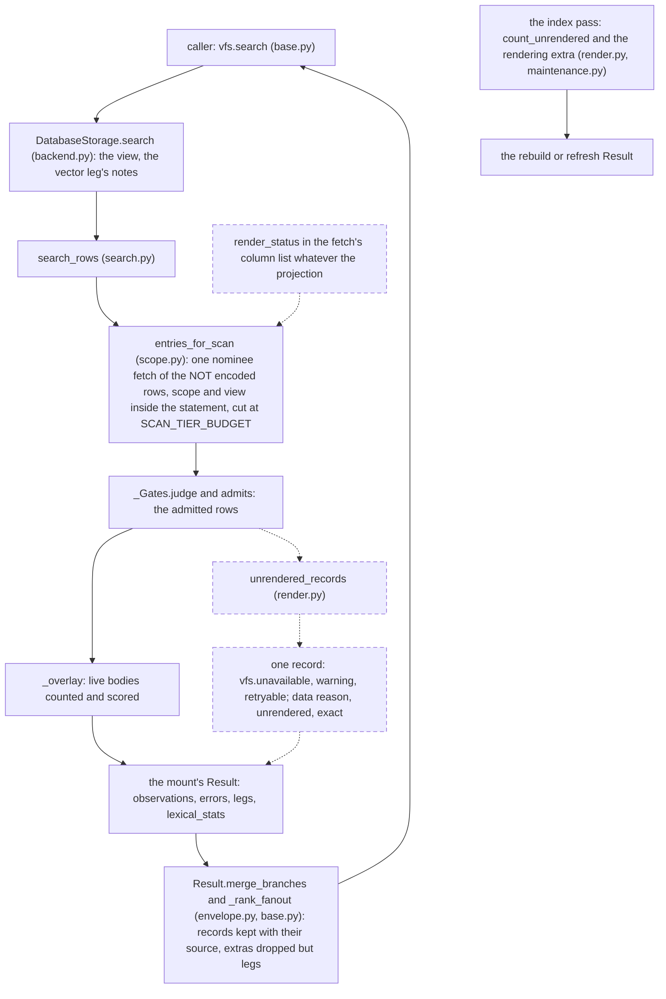

# A search over a mount holding pending or unrendered bytes entries reports their count on its result, as the index pass does

This is a feature. Flags: it changes the public API by addition only (one record on a `search` result, with three data keys); it touches rights (the count is taken under the caller's view, and criteria 11 and 12 are leak tests); it needs the engine legs (two conformance rows on every engine, and one select-list column added to an existing statement when the caller projects columns); it is not structural, changes no schema format and does not touch the Rust engine; it is parallel-safe. No roadmap story names it: the map of this conversion places it as unplaced, fitting gate `b` under domain E, whose goal ends "this domain is about defaults, truth-telling and pins" (READ [the roadmap](../../context/standards/roadmap.md), line 513), so it carries no story's acceptance line and the criteria below are its own. It is converted by amendment from [the binary bodies spec](../../context/specifications/archive/152-binary-bodies-and-text-renderings/spec.md), section 6 fourth bullet and progress note item 3, as verified against the tree by [the study of that source](../2026-11-25-the-backlog-converted/studies/051-162/152-binary-bodies-and-text-renderings.md), open choice 9. It stands on [the binary renderings memo](../../context/research/2026-10-05-binary-files-and-derived-text-renderings.md), whose open item 5 asks which states a search reports. It depends on slices A and B of the same source, which are landed: the bytes body, the `render_status` column, the render stage and its `unrendered` count are in the tree at `5b20fd4f`. It has no dependency that is not landed, so it can be built at any point in the order; [the unchanged-overwrite unit](../2026-11-25-an-unchanged-bytes-overwrite-keeps-its-rendering/spec.md) and [the render-at-write unit](../2026-11-25-a-small-binary-write-renders-its-own-bytes-before-it-returns/spec.md) only make pending rows rarer and neither is needed first. The title is the map's; decisions 2 and 3 give its two loose phrases their exact meaning: the entries counted are the pending ones, and the count is of the search's own scope as the caller may read it, never of the whole mount.

## The problem

Every fact below is at commit `5b20fd4f`.

- READ `src/vfs/storage/backends/database/writes.py:1214-1217`: a write of bytes sets `render_status` to `pending`, `encoded` to false and `indexable` to false. The entry has no content row until an index pass renders it, so the lexical leg, the vector leg and the overlay of `search` have no text for it.
- READ `src/vfs/storage/backends/database/render.py:395-400` and `src/vfs/storage/backends/database/maintenance.py:346-354`, `:476-478`, `:599-603`: the index pass counts the live bytes rows still `pending` (`count_unrendered`), reports the count as `unrendered` in its `rendering` extra, and adds a record of kind `vfs.unavailable`, severity `warning`, `retryable` true, when the count is above zero. READ `src/vfs/storage/backends/database/reads.py:885-887`: `read` of a pending binary says the same per row, with the same kind, severity and retry flag.
- READ `src/vfs/storage/backends/database/search.py:469-488`: a search's records are the backend's per-call notes, the signal notes and the truncation records, and its extras are `lexical_stats` and `legs`. EXECUTED (`grep -n "unrendered\|render_status" src/vfs/storage/backends/database/search.py`): no match. EXECUTED (scratch probe: an indexed in-memory store, two binaries written, `storage.search(query="lantern")`): the result is successful, lists only the text files and carries an empty error list. A caller cannot tell an answer over every file in scope from an answer that silently left out the binaries written since the last pass.
- EXECUTED (same probe, a spy on `search_module._overlay`): both pending binaries are among the rows the overlay admits, each with `render_status` equal to `pending`. The reason is READ: a pending bytes row is a content-kind row that is `NOT encoded`, which is the predicate of the scan tier's nominee fetch (`src/vfs/storage/backends/database/scope.py:325-329`) and of the overlay-emptiness verdict (`src/vfs/storage/backends/database/indexing.py:528`). So the search already reads every pending binary in its scope, under the caller's view, and discards what it learned.
- EXECUTED (same probe with `columns=frozenset({"path"})`): the admitted rows carry no `render_status` key. READ `scope.py:329`: the nominee fetch selects the caller's mask plus `FETCH_RIDE`, and `render_status` is in the default mask (`reads.py:99-102`) and not in the ride.
- EXECUTED (scratch probe through `AsyncVirtualFileSystem` with two mounts): a storage search result carries the extras `legs` and `lexical_stats`; the facade's result carries `legs` alone, for one answering mount and for two. READ `src/vfs/results/envelope.py:557-588`: the fan-out fold builds a new result from ops, observations and errors and keeps no extra. READ `src/vfs/base.py:3084-3098`: the ranked merge then restores `legs` only. Records survive the fold, each stamped with its mount as `source` (EXECUTED, same probe).
- READ [the memo](../../context/research/2026-10-05-binary-files-and-derived-text-renderings.md), line 103: the open item reads "Which states glean reports in its envelope, as it reports `unembedded`". EXECUTED (`grep -rn "unembedded" src/`): the word appears only in the pass (`embed.py`, `maintenance.py`, `protocol.py`); a search reports no such count. The precedent for a count is therefore the pass's, not an earlier search count.
- READ `tests/lint/test_code_shape.py:70` and `tests/lint/allowlist.py:25-34`: a module is held to 1,000 lines unless listed at its exact count. `search.py` holds 973 lines (EXECUTED, `wc -l`), `base.py` and `reads.py` are listed at their exact counts and cannot grow, and `render.py` holds 427.

## Architecture

- **Pending**: a bytes entry whose `render_status` is `pending`: written, and not yet reached by a render stage.
- **Unrendered**: the index pass's word for the count of live pending rows (`render.py:395-400`). This spec uses it for the same rows and for nothing else.
- **Admitted rows**: the scan tier's nominees that passed the call's structural gates (`search.py:429`); every one is in the search's scope and readable by the caller.
- **Floor**: a count that is known to be no greater than the true one, because the scan that produced it was cut.

## Decisions

### 1. A search says on its own result how many bytes entries it could not read because they still await a rendering

The index pass and `read` already say it; `search` is the one verb that reads text across many entries and stays silent, so an agent that searches straight after an upload gets a clean answer that omits the upload. The constitution's Article 2 fails a pattern that "forces an agent to guess, retry blindly, or parse prose to learn state" (READ [the constitution](../../context/standards/constitution.md)). The count is reported by the search itself, on the result it already returns, and never by a second call.

Basis: verified lean, the study's open choice 9 (the source's section 6 fourth bullet and its progress note item 3); precedent: the index pass's `unrendered` count carried with a retryable warning, read at `src/vfs/storage/backends/database/maintenance.py:346-354` and `:599-603` and `src/vfs/storage/backends/database/render.py:395-400`.

### 2. Only pending rows are counted; a row a renderer has settled without text is not

The count is of rows whose `render_status` is `pending`, the meaning `unrendered` already has in the pass. A row settled as `empty`, `unsupported`, `unavailable`, `encrypted`, `corrupt` or `failed` also has no text, but a retry does not change it, each such row states its own status on `ls` and `stat` and its own note on `read`, and the pass counts those states under other keys. A key for them can be added to the record later without changing the meaning of this one; a key published now cannot be withdrawn after the beta freeze (READ the roadmap, line 17, decision D2: additive names stay allowed).

Basis: provisional, no ruling on record; the options were (a) pending rows only, under `unrendered`, (b) pending rows plus the settled states that carry no text, each under the pass's own key (`empty`, `unsupported`, `failed`), (c) one merged count of every bytes row without text; chosen because (a) is the option the other two can be reached from by addition alone, and it keeps `unrendered` the one meaning the landed pass gives it.

### 3. The count is of the rows in the search's scope that the caller may read, never of the mount

The pass counts mount-wide because the system runs it. A search is a caller's verb, and a mount-wide count on its result would tell a caller how many binaries exist in subtrees it cannot read, and would move when a hidden row is written. So the count is taken over the admitted rows only: rows inside the call's `globs`, `ext` and scope channels, past its exclusions, and inside the caller's view at the verb's rung. This departs from the pass's count in its population and from the title's words "over a mount"; it follows the landed law that the scan tier's cut, record and answer count only rows the caller may read.

Basis: decided in drafting, because every verb call is judged against row-level grants (AGENTS.md, the reference deployment's Rights row) and [the scan-tier spec](../../context/specifications/archive/2026-11-12-the-scan-tier-reveals-nothing-about-rows-a-caller-cannot-read.md), decisions 1 and 5, already makes the nominee fetch exact under the view.

### 4. The count is read off the rows the overlay already admitted; no statement is added

A pending bytes row is `NOT encoded`, so the nominee fetch returns it today (the problem's fourth fact). The count is one pass in memory over the admitted rows. A separate counting statement was rejected: it would add a round trip to every search, and it would need the scope predicates and the rights clauses a second time, which is a second place for a leak. `count_unrendered` stays the pass's and is not called by a search.

Basis: decided in drafting, because a read must cost in proportion to what it returns (AGENTS.md, the per-verb-call multiplier) and the rows are already in hand at `src/vfs/storage/backends/database/search.py:429`.

### 5. `render_status` rides search's nominee fetch whatever the caller projected, and the caller's mask does not change

`search_rows` passes `fetched | {"render_status"}` to `entries_for_scan`. With the default mask the statement is byte for byte what it is today; under a narrower projection it gains one select-list column. The observations are still built from the caller's own mask (`search.py:461-468` and `:924`: `_observe` reads the projected fields only), so no row gains a populated field. `FETCH_RIDE` is not widened, so grep's statements are untouched.

Basis: decided in drafting, because the count must not depend on which columns the caller asked for, and a select-list column spends no bind parameter and no predicate.

### 6. The count rides one record per mount, not a result extra, and the facade is not changed

The pass carries its counts in a `rendering` extra. A search cannot rely on one: the fan-out fold drops every storage extra and the ranked merge restores `legs` alone, so an extra would reach a caller of `storage.search` and never a caller of `vfs.search`. A record survives the fold with its mount as `source`, and two mounts' records stay two facts because their sources differ. So each mount's search adds at most one record, a search across mounts carries one per mount that has pending rows in scope, and no sum is computed. This departs from the pass in the carrier and is named here as a departure.

Basis: decided in drafting, because the fold keeps records and drops extras (`src/vfs/results/envelope.py:557-588`, `src/vfs/base.py:3084-3098`, both confirmed by the executed probe) and one carrier that reaches every caller is less to pin than two.

### 7. The record is `vfs.unavailable` at warning severity and retryable

It is built by `classified(ErrorKind.unavailable, severity=Severity.warning, retryable=True, ...)`, with no `path`, so the renderer prints the mount as its locus. `success` is unaffected. The severity's own definition is "loss or caveat on record — rows present are trustworthy" (READ `src/vfs/results/kinds.py:109-123`), which is this case, and the same three values are what the pass and `read` use for a pending binary. The cost of warning is frequency: at the reference deployment a binary can wait up to 15 minutes for the partial pass, so a mount-wide search in working hours will usually carry the record. It is one record per mount per call, never one per row.

Basis: provisional, no ruling on record; the options were (a) `vfs.unavailable`, warning, retryable, as the pass and `read` say it, (b) the same kind at info severity, as the search's "no embedding provider" note is, (c) no record, with the count on an extra the facade would then have to carry; chosen because (a) is the nearest to what vfs already does for the same rows at three sites (`maintenance.py:346-354`, `:599-603`, `reads.py:885-887`), and a change of severity is one argument at one call site before a release.

### 8. The record's facts are three data keys; its detail names the pass to run

`data` is exactly `{"reason": "pending_rendering", "unrendered": <count>, "exact": <bool>}`. `reason` is the discriminator the search's other notes already carry (`src/vfs/storage/backends/database/backend.py:616`, `:630`, `:644`), `unrendered` is the pass's key with the pass's meaning, and `exact` is decision 9's. The detail is `"<count> binaries in scope are still pending a rendering and were not searched; run refresh"`, prefixed with `"at least "` when `exact` is false. `refresh` is named because it is the pass that reads exactly the pending rows (`render.py:176`, `maintenance.py:571`). No consumer parses the detail: the three keys carry every fact.

Basis: decided in drafting, because a record's load-bearing facts must be structured fields and never prose (`src/vfs/results/envelope.py:97-99`, the constitution's Article 2).

### 9. The count is exact only when the scan was whole; otherwise it is a floor, and a search that never ran the overlay reports nothing

`exact` is true when the nominee fetch did not overflow `SCAN_TIER_BUDGET`, the gate judgement finished, and the call's wall had not passed when the judgement returned. If any of the three fails, rows may be unread or unjudged, the count is a floor, `exact` is false and the detail says "at least". The third term is needed because a search with no pattern is judged complete whatever the clock reads (`src/vfs/offload.py:178-181`) while the nominee fetch stops between statements at the wall (`scope.py:362-364`). No record is added when the count is zero, even on a cut scan, and none when the overlay did not run (the wall had passed before it, or the store holds no row awaiting the index): the truncation records already on the result say what was cut. Under a partial view the cut counts only readable rows, so `exact: false` tells a caller nothing about rows it cannot read.

Basis: decided in drafting, because a number that is silently an undercount is the fault decision 1 removes, and the three terms are the three ways `src/vfs/storage/backends/database/search.py:408-437` can stop short.

### 10. A search of the trash view reports no count

When the call's scope addresses the trash view, the admitted rows are tombstoned ones. EXECUTED (scratch probe: a pending binary deleted, then `search(globs=("/.vfs/trash/**",))` with a spy on the overlay): the tombstoned row is admitted with `render_status` still `pending`, so without a rule it would be counted. No pass renders a tombstoned row (`render.py:179`, `:399` both require `deleted_at IS NULL`), so "run refresh" would be false and `retryable` would promise what cannot happen. The pass's `unrendered` counts live rows only, and the search's count keeps that population.

Basis: decided in drafting, because the record's retry flag must be true of every row it counts.

### 11. The record is built in `render.py`, beside the count it mirrors, and `search.py` stays under its ceiling

A new public function of the module, `unrendered_records(rows, *, exact)`, returns a list of zero or one record, and a module constant `PENDING_REASON` holds the reason word. `render.py` owns the word `unrendered` and its predicate, so the search and the pass cannot drift apart on what is counted. `search.py` grows by at most twelve lines, to at most 985 of its 1,000. `base.py` and `reads.py`, held at their exact counts, are not edited, which is why the facade's docstring is left as it is and the caller-facing text is the docs unit's.

Basis: decided in drafting, because the size baseline (`tests/lint/allowlist.py:25-34`) allows no growth in `base.py` or `reads.py`, and one module holding both the pass's count and the search's keeps the predicate `render_status == "pending"` from being spelled in a third place (AGENTS.md, Code smells, duplicated code).

## Intent

After this spec, an agent, a developer or a pipeline that searches a mount holding bytes entries written since the last index pass gets, beside the ranked rows, one warning per mount that says how many binaries inside the search's scope it could read by right but could not search because they still await a rendering, with the number as a field and a flag that says whether the number is exact or a floor. The warning is retryable, names `refresh`, and disappears once a pass has settled the rows. A caller with partial rights sees only the count of rows it may read, and nothing in its answer moves when a binary it cannot read is written. A search whose scope holds no pending binary answers exactly as it does today, with the same statements.

## Design

The order of work puts each test before the code that passes it. Each new test records the mutation it guards in its docstring, as [the testing standard](../../context/standards/testing.md) requires under "Pins land with their mutant", and the mutants below are added as rows of [the mutant ledger](../../context/standards/mutant-ledger.md) at landing.

**1. Test support.** `tests/support/partial_callers.py` gains `pending_store(readable: int, hidden: int) -> InMemoryStorage`: posture `none`, `bob` granted `read` on `/pub`, one indexed text file, then `readable` pending binaries under `/pub` and `hidden` pending binaries under `/hr`, each with distinct bytes.

**2. The helper's tests, then the helper.** `tests/storage/database/test_render.py` gains a class `TestUnrenderedRecords` with two tests (criteria 15 and 16). They fail on import. Then `src/vfs/storage/backends/database/render.py` gains, in a new banner group ("What a search says of the rows still pending") after the landing group, which ends with `count_unrendered` at line 400, and before the internal helpers at line 404:

- `PENDING_REASON: Final = "pending_rendering"`, with the module constants.
- `def unrendered_records(rows: Sequence[RowMapping], *, exact: bool) -> list[ResultError]`: counts the rows whose `render_status` equals `"pending"`, returns `[]` for zero, else one record per decisions 7 and 8. Its docstring states the three data keys and that the caller hands it only rows its caller may read.
- The import line from `vfs.results` gains `ErrorKind`, `Severity` and `classified`; `ResultError` and `RowMapping` join the `TYPE_CHECKING` block.

**3. The search's tests, then the search.** These are written and seen failing together: the class `TestUnrendered` in `tests/storage/database/test_search.py` (criteria 1 to 9 and 11), one test in `tests/storage/database/test_trash.py::TestTrashView` (criterion 10), one row in `tests/support/storage_contract.py` and one in `tests/support/grants_contract.py` (criteria 12 and 13), and one test in `tests/base/test_search_merge.py` over two real `InMemoryStorage` mounts (criterion 14). Then `src/vfs/storage/backends/database/search.py` changes in six places, four of them inside `search_rows`:

- One import: `from vfs.storage.backends.database.render import unrendered_records`.
- Before the overlay block (line 402 at `5b20fd4f`): `pending: list[ResultError] = []`.
- The nominee fetch's argument (line 418): `fetched=fetched | {"render_status"}`.
- After the admitted rows are built (line 429): when the call is not a trash-view search (`not gated.trashed`), `pending = unrendered_records(admitted, exact=completed and not nominees.overflow and not deadline.expired())`, where `completed` is the gate judgement's flag from line 426, read before `_overlay` reassigns it.
- The error list (lines 469-473): `*pending` after the truncation records.
- The module docstring's freshness paragraph and the function docstring each gain one sentence saying that pending binaries among the admitted rows are counted on one record and never scored.

**4. The gates.** `scripts/ci.sh`; `scripts/docs.sh check`, because docstrings under `src/vfs/` change; the `db_test` skill for the two conformance rows on Postgres, MariaDB, SQL Server and Oracle.

**5. The mutants.** Each is applied under the safe-restore rule and its test seen failing: the record left out of the error list (criterion 1); the nominees counted in place of the admitted rows (criterion 2); the ride left out (criterion 3); `is not None` in place of `== "pending"` (criteria 4 and 15); a `count_unrendered` call added to the search (criterion 5); `exact` fixed at true, the judgement flag dropped, the wall term dropped (criteria 6, 7 and 8); the trash guard removed (criterion 10); the helper fed the nominee rows of a whole-mount view (criteria 11 and 12).

What is added, costed against the reference deployment in AGENTS.md.

- **Statements: none.** The multiplier is per verb call, about 150,000 a day with `search` under a tenth: under 15,000 searches a day, under 2 a second at the 20-a-second peak. Each adds zero statements. EXECUTED (scratch probe, statements recorded with the planner-statistics step left out): a search over one pending binary, over 200 pending binaries, and over the same store with a dirty text file in the binary's place issues 13 statements in each world, one of them the nominee fetch.
- **Bind parameters: none.** The ride is a select-list column. The slices `membership_budget`, `arm_budget` and `chunked` cut for the nominee fetch are computed from the predicates alone (`scope.py:331-354`), so on Oracle's 1,000-element `IN` list and SQL Server's about 2,100 binds every statement keeps its present width.
- **Bytes on the wire: one column under a projection.** `render_status` is `String(16)` (`src/vfs/models/rows.py:469`). The fetch returns at most `limit + 1` rows per statement with `limit` equal to `SCAN_TIER_BUDGET`, 25,000 (`scope.py:78`, `:366`): at most 25,001 × 16 bytes, about 400 KB, and only when the caller narrowed its columns; the default mask already carries the column.
- **One loop in memory.** One comparison per admitted row, bounded by `SCAN_TIER_BUDGET`: at most 25,000 a call, on rows already held, at the site where the admitted list itself is built by a loop over the same rows. At the daytime dirty set of 1,250 to 2,500 files per 15 minutes that is about 19 to 38 million comparisons a day across all searches; at a full scan tier on every search, 375 million. Overnight the batch writes about 50 files a second, up to 45,000 between two partial passes, which is past the cut: the scan overflows, the count is a floor and `exact` is false (decision 9). No budget of the search's own is added; the declared bound is the shared `SCAN_TIER_BUDGET`.
- **One structure in memory.** A list of zero or one record per call.
- **Per file write, per index visit, per batch, per corpus: nothing.** No write path, pass or builder is touched.
- **Per lock: nothing.** The change issues no statement, so it takes no lock and waits on none; the search remains SELECTs in one read session, and a read still never waits on a writer.
- **Plans.** The nominee fetch already selects columns outside every index (`name`, `ext`, `size_bytes`, `owner_id`), so one more column cannot turn an index-only plan into a table read (INFERRED from `scope.py:329` and `rows.py:487-504`). The plan store records grep's scan-tier statements (`tests/support/plan_store.py:588-597`), which do not change.

Existing tests. EXECUTED (`grep -rlE "data=" tests | xargs grep -l "\.search("`, then each hit read): no existing test asserts the whole error list of a search over a store that holds a pending binary, so no existing assertion is expected to change (INFERRED); the gate is the check.

## Scope

In: decisions 1 to 11. Files: `src/vfs/storage/backends/database/render.py`, `src/vfs/storage/backends/database/search.py`, `tests/support/partial_callers.py`, `tests/storage/database/test_render.py`, `tests/storage/database/test_search.py`, `tests/storage/database/test_trash.py`, `tests/support/storage_contract.py`, `tests/support/grants_contract.py`, `tests/base/test_search_merge.py`, and the ledger rows in `context/standards/mutant-ledger.md`.

Out:

- A count of the bytes rows a renderer settled without text (`empty`, `unsupported`, `unavailable`, `encrypted`, `corrupt`, `failed`): not built (decision 2); an additive key for a later spec once a ruling asks for it.
- The same count on `grep`, which skips the same rows through the same scan tier: the source names the ranked verb only and no unit of [the map](../2026-11-25-the-backlog-converted/units.md) carries it; `unrendered_records` takes any admitted rows, so a later spec adds it with one call.
- A `rendering` extra on a search result, and a sum across mounts at the facade: not built (decision 6).
- Any change to `src/vfs/base.py`, to the storage protocol's signatures, to `FETCH_RIDE`, to `entries_for_scan` or to `count_unrendered`.
- The words `read` uses for a pending binary ("run rebuild", `reads.py:886`): left as landed.
- Making pending rows rarer: [the unchanged-overwrite unit](../2026-11-25-an-unchanged-bytes-overwrite-keeps-its-rendering/spec.md) and [the render-at-write unit](../2026-11-25-a-small-binary-write-renders-its-own-bytes-before-it-returns/spec.md).
- Bytes rows a renderer settled without text standing in the scan tier for good (EXECUTED, scratch probe: after `refresh`, a `corrupt` and an `unsupported` binary are still among the overlay's admitted rows): the same standing [the scan-tier spec](../../context/specifications/archive/2026-11-12-the-scan-tier-reveals-nothing-about-rows-a-caller-cannot-read.md) records in its decision 17 for bodies that are never encoded; not changed here.
- The docs site's account of the record, with the render status page and the glossary: [the documentation unit](../2026-11-25-binary-bodies-are-documented-on-the-docs-site/spec.md).
- How a bytes row prints in a rendered result: [the placeholder unit](../2026-11-25-a-bytes-row-renders-a-placeholder-and-leaves-the-payload-only-when-asked/spec.md).

## Acceptance criteria

1. A search over an indexed store with two pending binaries in scope is successful, lists the rows it listed before the binaries were written, and carries exactly one record whose kind, severity and retry flag are `vfs.unavailable`, `warning` and true and whose `data` equals `{"reason": "pending_rendering", "unrendered": 2, "exact": True}`, pinned by `tests/storage/database/test_search.py::TestUnrendered::test_pending_binaries_in_scope_add_one_record_with_their_count`.
2. With one pending binary under `/docs` and two under `/src`, a search with `globs=("docs/**",)` reports 1, a search with `globs_not=("docs/**",)` reports 2, and a search scoped to a directory holding none carries no record of that reason, pinned by `tests/storage/database/test_search.py::TestUnrendered::test_the_count_follows_the_scope_and_its_exclusions`.
3. A search with `columns=frozenset({"path"})` over two pending binaries reports 2, and no observation's populated mask holds `render_status`, pinned by `tests/storage/database/test_search.py::TestUnrendered::test_a_projected_search_counts_and_keeps_its_mask`.
4. A search over a text-only store, and a search after `refresh` has settled two binaries without text (a cut-off PDF and a type no renderer claims, each asserted to have left `pending`), each carry no record of that reason, pinned by `tests/storage/database/test_search.py::TestUnrendered::test_settled_binaries_and_text_stores_carry_no_record`.
5. The same query issues an equal number of statements, with exactly one nominee fetch, over a store holding one pending binary, over the store holding 200, and over the store holding a dirty text file with no query term in the binary's place, the planner-statistics step left out, pinned by `tests/storage/database/test_search.py::TestUnrendered::test_the_count_adds_no_statement`.
6. With `SCAN_TIER_BUDGET` patched to 2 and three pending binaries sorting first, the record's `data` holds `unrendered` 2 and `exact` false, beside the overlay-budget truncation record, pinned by `tests/storage/database/test_search.py::TestUnrendered::test_a_cut_scan_reports_a_floor`.
7. A scoped search whose gate judgement reports itself unfinished carries the record with `exact` false, pinned by `tests/storage/database/test_search.py::TestUnrendered::test_an_unfinished_gate_judgement_reports_a_floor`.
8. An unscoped search whose nominee fetch returns after the call's wall, the fake clock moved past it inside a wrapper of `entries_for_scan`, carries the record with `exact` false, pinned by `tests/storage/database/test_search.py::TestUnrendered::test_a_scan_that_ends_past_the_wall_reports_a_floor`.
9. A search whose wall has passed before the overlay, over a store with a pending binary, carries a wall record and no record of that reason, pinned by `tests/storage/database/test_search.py::TestUnrendered::test_a_search_that_skips_the_overlay_reports_no_count`.
10. After a pending binary is deleted, a search with `globs=("/.vfs/trash/**",)` carries no record of that reason, pinned by `tests/storage/database/test_trash.py::TestTrashView::test_a_trash_view_search_reports_no_pending_count`.
11. Leak test: `pending_store(2, 0)` and `pending_store(2, 5)` answer `bob`'s search with equal paths, scores, records and exports, `bob`'s record says 2 in both, and the system caller's on the second says 7, pinned by `tests/storage/database/test_search.py::TestUnrendered::test_two_stores_that_differ_only_in_hidden_pending_binaries_answer_alike`.
12. Leak test on every engine: in the grants world, after pending binaries are written under `/pub` and `/hr`, `bob`'s record counts the `/pub` ones only, and writing three more under `/hr` leaves every field of `bob`'s answer equal, pinned by the conformance row `GrantsContract::test_hidden_pending_binaries_never_reach_a_search_count`, node `tests/storage/test_conformance.py::TestSqliteConformance::test_hidden_pending_binaries_never_reach_a_search_count` and the same name under `TestMemoryConformance`, `TestPostgresConformance`, `TestMariaDBConformance`, `TestMSSQLConformance` and `TestOracleConformance`.
13. On every engine, a search after two binaries are written reports 2 with `exact` true, a search with `columns=frozenset({"path"})` reports the same, and a search after `rebuild` carries no record of that reason, pinned by the conformance row `StorageContract::test_search_counts_the_pending_binaries_in_its_scope_until_a_pass_settles_them`, node `tests/storage/test_conformance.py::TestSqliteConformance::test_search_counts_the_pending_binaries_in_its_scope_until_a_pass_settles_them` and the same name under the five other conformance classes.
14. A facade search across two mounts, one holding one pending binary and one holding two, carries two records of that reason whose `source` and `unrendered` are (`/a`, 1) and (`/b`, 2), and its extras hold `legs` alone, pinned by `tests/base/test_search_merge.py::test_each_mounts_pending_binaries_are_reported_under_its_own_source`.
15. Given one row for each of the ten render statuses and one row whose status is null, `unrendered_records` returns one record whose `unrendered` is 1, and given the same rows without the pending one it returns an empty list, pinned by `tests/storage/database/test_render.py::TestUnrenderedRecords::test_only_pending_rows_are_counted`.
16. `unrendered_records` with `exact=False` returns a record whose `data` holds `exact` false and whose kind, severity and retry flag are those of criterion 1, pinned by `tests/storage/database/test_render.py::TestUnrenderedRecords::test_a_floor_is_marked_on_the_record`.
17. `src/vfs/storage/backends/database/search.py` holds at most 1,000 lines and `src/vfs/base.py` still holds its listed 3,184, pinned by the existing `tests/lint/test_code_shape.py::test_a_listed_module_never_grows_and_an_unlisted_one_stays_under_the_ceiling`.

## Landing notes

Filled in when the pull request is opened.

## One line

A search counts, among the rows its scan tier already read and admitted, the bytes entries still pending a rendering, and says the number on one retryable warning per mount, exact or marked as a floor, without a statement more and without counting a row the caller cannot read.
