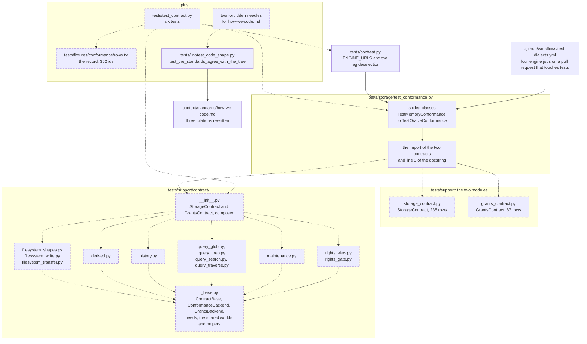

# The storage and grants contracts become one package of mixins by kernel operation, and the collected node ids before and after the split are equal line for line

A refactor of test support. Flags: it is structural in the test tree only (two modules under `tests/support/` become one package; no module of `src/vfs` moves, and the layer map and the size baseline are untouched); it does not change the public API or the schema format; it adds no statement, and its moved rows run on the four engine legs through the pull request's own workflow (decision 14); it touches rights only by moving the 87 rights rows with no assertion changed, so it adds no leak test and criterion 1 holds every existing one by its id; it does not touch the Rust engine; it is not parallel-safe with any unit that adds, renames or edits a row of the two contract modules (decision 14). It serves roadmap story K9, criterion 5, at gate b ([the roadmap](../../context/standards/roadmap.md), lines 204 to 211), which reads: "The conformance battery is reorganised by kernel operation with no test lost (count before equals count after)." It carries roadmap decision D5. Decided 2026-11-15: the verbs stay flat and the kernel groups are documentation that freezes nothing. It is converted from [spec 179](../../context/specifications/archive/179-the-storage-seam-as-the-kernel/spec.md), sections 6.1 and 6.2 (`spec.md:385-415`), and task 1 of [its task list](../../context/specifications/archive/179-the-storage-seam-as-the-kernel/tasks.md) (`tasks.md:9`), read through [the study of that source](../2026-11-25-the-backlog-converted/studies/165-181/179-the-storage-seam-as-the-kernel.md). It stands on no research memo: the source's memos argue for the test families that later units add, and the split itself rests on probes of the tree repeated under The problem. It depends on no unit of [the unit map](../2026-11-25-the-backlog-converted/units.md) and on no unbuilt roadmap story. It relies on two texts that are not specs of their own yet, and quotes them. Roadmap K9 criterion 2 names the five groups: "`OpGroup` assigns every op exactly one of `filesystem | query | history | rights | derived`". [Spec 181](../../context/specifications/archive/181-the-public-surface-regrouped-by-kernel-group/spec.md) section 2.1, the section unit [181-1](../2026-11-25-every-routed-op-sits-in-one-group-and-every-face-lists-the-verbs-in-that-order/spec.md) converts and which is not written yet, gives their members with the verbs' names of that day: `"filesystem": ("stat", "ls", "read", "write", "mkdir", "delete", "move", "copy")`, `"query": ("glob", "grep", "glean", "graph", "mkedge", "rmedge")`, `"history": ("restore", "sweep")`, `"derived": ("tree", "edit")`, and the rights group equal to the grant ops (`spec.md:109-115`, `:134`). Unit 181-1 is an ordering preference and not a dependency: this unit writes no group table, and decision 5 says what happens if 181-1 lands other members. Build order: this unit first, then the units that list it in the unit map, none written yet: [179-2](../2026-11-25-the-storage-protocols-are-regrouped-into-families-before-the-freeze/spec.md), which edits the backend protocols the package's base module names, and [179-6](../2026-11-25-a-batch-with-one-bad-row-writes-nothing-on-any-engine/spec.md) and [179-8](../2026-11-25-each-kernel-verbs-access-path-is-a-reviewed-golden-table/spec.md), which add a family file each.

## The problem

Every fact below is at commit `4a221cc3` (EXECUTED, `git rev-parse --short=8 HEAD`). The probes ran at `5b20fd4f`; `git diff --stat 5b20fd4f 4a221cc3` over `src`, `tests`, `scripts`, `.github`, `pyproject.toml` and `context/standards` prints nothing (EXECUTED). The labels: EXECUTED means a command ran for this spec, READ means the cited line was read, INFERRED means reasoning.

1. The conformance contract is two modules holding one class each. `tests/support/storage_contract.py` is 3,187 lines; its class `StorageContract` runs from line 302 to the end and defines 235 test methods, two fixtures, two class attributes and one class-scoped fixture (EXECUTED, `wc -l` and an AST walk; READ, `tests/support/storage_contract.py:302-316`, `:1405-1418`). `tests/support/grants_contract.py` is 1,485 lines; its class `GrantsContract` runs from line 157 to 1314, defines 87 test methods and no fixture, and takes `storage` from the class it is mixed with (EXECUTED; READ, `tests/support/grants_contract.py:1-3`, `:157`).
2. Six legs compose both classes and nothing else imports either. `tests/storage/test_conformance.py` imports the two contracts (READ, `:36`, `:41`) and declares `TestMemoryConformance`, `TestSqliteConformance`, `TestPostgresConformance`, `TestMariaDBConformance`, `TestMSSQLConformance` and `TestOracleConformance`, each `(StorageContract, GrantsContract)` (READ, `:62`, `:99`, `:182`, `:243`, `:253`, `:263`). A search of the repository outside `agents/` and the dated documents of `context/` finds the two module names in three other places only: line 3 of that file's docstring, three citations in `context/standards/how-we-code.md` (`:12`, `:31`, `:69`), and one document of the recorded ranking corpus under `tests/fixtures/ranking/` (EXECUTED, `grep -rn`).
3. The module collects 2,168 node ids when all six legs are selected: 352 under each leg, from 322 distinct method names (235 and 87, with no name in both classes), and 56 from the module's own classes and functions. The 352 ids after the leg's name are the same set on all six legs. A plain run selects 706 and deselects 1,462, because `tests/conftest.py` drops every engine leg whose URL variable is unset (EXECUTED, `pytest --collect-only -q -n 0` on the module with and without the four variables of `ENGINE_URLS` set to a placeholder, and a `diff` of each leg's sorted ids against the SQLite leg's; READ, `tests/conftest.py:64-98`). Collection with a placeholder URL opens no connection and exits 0, and the whole child process takes about 3.4 seconds (EXECUTED, once).
4. The banners follow the order rows were added in, not the operation a row pins. `StorageContract` has 26 banners and `GrantsContract` 10 (EXECUTED, the same walk). The banner "sweep — reclamation" (`storage_contract.py:1017`) is followed by seven sweep rows, then 23 glob rows and four rows on the stored extension of a moved or copied file (`:1086-1339`). The banner "Enumeration liveness — the /.vfs meta scope" (`:1609`) is followed by eleven rows on grep's modes (`:1648-1727`). The last row under "search — ranked search" pins `grep` after a rebuild (`:2099-2108`). "The scope channel" (`:1342`) holds five plan pins that read `glob`, `search`, `grep` and `refresh` statements (`:1420-1523`). "Bytes bodies" (`:2990`) holds eight rows over six verbs. A contributor looking for what the contract says of one verb reads the whole file.
5. The source's numbers and names are stale. It counts 2,784 lines and 220 tests, and 1,247 lines and 75 tests, and gives every row a line range of that day (READ, the source `spec.md:387-405`). Its files `query_glean.py` and `query_graph.py` name verbs that are now `search` and `traverse` (READ, `src/vfs/ops.py:53-54`), and its "reindex serving" rows drive `rebuild` and `refresh` (READ, `src/vfs/storage/protocol.py:478`). Its table has four groups; K9 criterion 2 names five.
6. Nothing of the package exists: there is no `tests/support/contract/`, no `tests/test_contract.py` and no `tests/fixtures/conformance/` (EXECUTED, `ls`).
7. What guards a row today is a property of one class body, and a split removes it. `ruff` selects the pyflakes rules (READ, `pyproject.toml:107`), and F811 reports a method name defined twice in one class; it reports nothing when two classes that a third composes define the same name, and Python then keeps one and drops the other without a word (EXECUTED, `ruff check` on two scratch files: one error for the single class, none for the pair).
8. Three facts decide how a before-and-after comparison must be made. pytest 9.0.2 collects a class's tests base class by base class in reverse order of the method resolution order, each class in definition order (READ, `.venv/lib/python3.13/site-packages/_pytest/python.py:403-447`), so the grants rows are listed before the storage rows today (EXECUTED: the first id under each leg is `test_a_group_grant_shows_its_subtree`) and any regrouping changes the order of the output. A node id names the module, the leg class and the method, never the class that defines the method (EXECUTED, the ids of fact 3). And no module registers assertion rewriting for test support, so the contract's asserts are plain today and stay plain in a package (EXECUTED, `grep -rn register_assert_rewrite tests` finds nothing).
9. Other documents hold conformance node ids by name. `context/standards/mutant-ledger.md` cites `TestMemoryConformance::test_pattern_search_serves_after_close` (`:46`) and `TestMSSQLConformance::test_the_refresh_selection_plans_seek` (`:219`) as the killers of recorded mutants (READ). A row that vanishes or is renamed in a move makes such a citation name nothing.
10. K9 criterion 5 is unmet, and three later units have no home. Units 179-6, 179-7 and 179-8 each add a test family (the mixed batch, the crash points, the access paths) that the source places as one more file beside the others (READ, the source `spec.md:402-404`; the unit map, `units.md:220-222`).

## Architecture



Terms. A row is one test method of the contract. A leg is one class of `test_conformance.py` that runs the contract on one backend. A mixin is a class that holds rows and is never collected alone; a composed contract is a class that holds nothing and lists mixins as its bases. The record is the committed list of the ids every leg collected before the split, each written as what follows the leg's name in a node id. A placeholder URL is any non-empty string set in an engine's URL variable so that collection lists the leg; nothing opens it, because nothing runs.

## Decisions

### 1. The two contract modules become one package, `tests/support/contract/`, and both old modules are deleted in the same change with no module left at the old paths.

One importer exists (fact 2), so a forwarding module would serve nobody and would keep two places a row might be added. The project is pre-release and test support ships in no wheel.

Basis: the source spec, sections 6.1 and 6.2 (`spec.md:387`, `:414`); still true at `4a221cc3` (EXECUTED: `grep -rn` finds `tests/storage/test_conformance.py` as the only importer of either module).

### 2. `StorageContract` and `GrantsContract` keep their names and their split of 235 and 87 rows, are composed in the package's `__init__.py`, and `test_conformance.py` changes one import and one docstring line.

The two imports at `test_conformance.py:36` and `:41` become `from tests.support.contract import GrantsContract, StorageContract`, and line 3 of the docstring names `tests.support.contract.StorageContract`. No leg class changes. Every node id is unchanged, because an id names the module, the leg and the method (fact 8). `__all__` of the package is the two contracts; every other name is imported from `tests.support.contract._base` by the module that uses it.

Basis: the source spec, section 6.1 (`spec.md:387`: "`test_conformance.py` changes only its import line, and every pytest node id stays the same"); still true at `4a221cc3` (EXECUTED: the collected ids carry the leg's class and never the name of `GrantsContract` or `StorageContract`).

### 3. Each mixin is one class per file, named for its file with the suffix `Rows`, on a shared `ContractBase` that holds the two fixtures, the two class attributes and the class-scoped plan fixture.

`ContractBase` lives in `_base.py` and takes, unchanged, `storage` and the autouse `_capability_gate` (`storage_contract.py:305-316`) and `plan_backend`, `engine_proven_by` and `plan_store` (`:1405-1418`). Every mixin subclasses it. A class named `...Rows` is not collected alone, because pytest collects only classes whose name begins `Test` and `pyproject.toml` sets no other pattern (READ, `pyproject.toml:148-163`). The base is needed for two reasons: rows in four files use `plan_store`, and the helper that reads `engine_proven_by` must name a type that declares it, where today it names `StorageContract` (`:281-283`). `GrantsContract` thereby gains the `storage` fixture it lacked alone; every leg composes both contracts, so no leg sees a difference.

Basis: decided in drafting, because pytest resolves a fixture and a class attribute through the leg's method resolution order, so one base serves every mixin, and `ty` checks `tests/` (READ, `pyproject.toml:141-142`) and needs the attributes declared on the type the helper takes.

### 4. The files are named for the five groups of K9 criterion 2, and a group's name here is documentation: this unit adds no table to `ops.py` and no test that ties a file to a group.

Decided 2026-11-15: the verbs stay flat, kernel groups are documentation, and a group's name is not a public name and freezes nothing. The prefixes are `filesystem_`, `query_` and `rights_`, and `history.py` and `derived.py` stand alone; the source's `fs_` becomes the group's own word so that a search for a group's name finds its files. `maintenance.py` holds what belongs to no group, because it pins no routed op: the declared traits, `close`, and the declarations of `rebuild` and `refresh`. `_base.py` and `__init__.py` hold no row. Which op sits in which group is the table unit 181-1 writes in `ops.py`; the members used here are those of the first paragraph's quotation, with `glean` read as `search` and `graph` as `traverse`.

Basis: ruled, 2026-11-15, decision 4 of [the names spec](../../context/specifications/active/2026-11-15-the-kernels-public-names-and-argument-families-are-ruled.md) (`:59-61`) and row D5 of the roadmap's section 16 (`context/standards/roadmap.md:1077`); the five names are K9 criterion 2 (`:208`).

### 5. The rows that pin `tree` or `edit` alone get a file of their own, `derived.py`, where the source left them beside `ls` and `write`.

This departs from the source's table, which was drawn when the plan had four groups and says so in its own terms ("Spec 181 adds `derived` for `tree` and `edit`", `spec.md:25`). With five groups named by the roadmap, a file per group lets one rule place every row: the file of the group and verb the row pins. Eleven rows move there (the Design's table). The choice costs nothing to reverse: a row moved between two mixins keeps its node id on every leg (fact 8), so if unit 181-1 lands other members for `derived`, the rows move in that unit's change or any later one and criterion 1 holds throughout.

Basis: decided in drafting, because K9 criterion 2 names `derived` as a fifth group (`context/standards/roadmap.md:208`) after the source's four-group table was written, and a node id does not name the defining class.

### 6. A row goes to the file of the verb it pins, a banner that states one law over several verbs moves whole, and the Design's table is the assignment.

Six banners move whole though their rows drive several verbs, because each is one law and splitting it would scatter it: the descent ladder, version stamping, committed-state observations, overlapping batch targets, occupant identity, and the restore contract with its three rows on move refusals. Six banners split by verb, as the source split the metacharacter and bytes banners: the shapes banner, the sweep banner, the scope channel, the metacharacter banner, the meta scope and the bytes banner, with one row each leaving the rebuild and search banners. The 27 rows added since the source are placed by the same rule: the scope channel's eight, the five on body measurement and one each under rebuild and search in the storage module, and ten under the grant verbs and two under ranked search in the grants module, whose banners all move whole. Nothing checks a placement mechanically; a row in the wrong file runs the same on every leg, and moving it is free.

Basis: the source spec, section 6.1 (`spec.md:389-407`, and "Version stamping stays whole", `:407`), for the rule and for every banner it names; still true at `4a221cc3` (EXECUTED: a script over both modules assigns all 322 methods by the Design's table, and the per-file counts sum to 235 and 87).

### 7. The split is a pure move: no test's name, decorators, docstring, body or comment changes, three groups of rows that sit under another verb's banner get a banner of their own, and a split banner keeps its text in each file that takes one of its rows.

The three new banners are "glob — patterns, segments, filters and exclusions" over the 23 glob rows, "grep — case, word, invert and output modes" over the eleven mode rows, and "The stored extension is re-derived at the new name" over the four extension rows. The source names the first; the other two are the same defect found at this commit (fact 4). The two comment blocks that follow a banner (`storage_contract.py:2606-2609`, `:2696-2700`) move with it as written. Within a file, rows keep the order they have today, banner by banner in the order of the Design's table. A behaviour change hidden in a move of 4,600 lines would be read by nobody, so none rides this change.

Basis: the source spec, section 6.1 (`spec.md:409`: "the split is a pure move: no assertion changes in the same commit"); still true at `4a221cc3` (READ: the three unbannered groups at `storage_contract.py:1086-1339` and `:1648-1727`).

### 8. A helper or constant used by the rows of one file moves into that file, one used by two or more files moves to `_base.py`, and every name is kept as it is, leading underscore included.

Keeping the names is what lets a row's body stay byte for byte the same (decision 7). `needs` is defined once, in `_base.py`; it is the only top-level name the two modules share (EXECUTED). Each new module follows the file order of [AGENTS.md](../../AGENTS.md), "File organization": docstring, imports, constants and types, the class, then private functions under one trailing "Internal helpers" banner. Constants stay above the class because two decorators read them when the class body runs (`SCOPE_PLANS`, `ANONYMOUS_CALLS`). The storage module's docstring becomes the package's, and the world table of the grants module's docstring becomes part of `_base.py`'s, where `_world` and `FILES` live, so that `_world`'s docstring ("the module docstring's world") stays true. One annotation changes: `_skip_a_proven_engine` takes `ContractBase`.

Basis: decided in drafting, because `AGENTS.md` puts a private type or constant beside its one user and shared plumbing in one place, and a renamed helper would change every row that calls it.

### 9. The before and after lists are compared sorted, with all six legs selected by placeholder URLs, and the mixins are listed in each contract's bases in the order of the Design's table.

The source compares the raw output of `pytest --collect-only -q`. Two facts make that comparison wrong as written. The output is in collection order, which a regrouping changes (fact 8), so equality line for line means equality of the two lists after each is sorted by code point. And a plain run lists 706 of the 2,168 ids (fact 3), so both lists are taken with every variable named in `ENGINE_URLS` set to a placeholder and with `-n 0`. Listing the bases in the table's order makes collection run the files in the reverse of it; nothing in the suite depends on collection order, since every row takes a fresh `storage` and the suite already runs under `--dist worksteal` (READ, `pyproject.toml:152`; INFERRED for the absence of an order dependence).

Basis: decided in drafting, because pytest collects in reverse order of the method resolution order (READ, `_pytest/python.py:443-447`) and `tests/conftest.py:73-98` deselects a leg whose variable is unset.

### 10. The ids collected before the split are committed as a record, `tests/fixtures/conformance/rows.txt`, and one test holds that every leg still collects each of them; rows added later need not join it.

The record is 352 lines, sorted, one per id, each written as what follows `::TestSqliteConformance::` in a node id; it is taken from the old modules before any row moves and is not edited by the split, and it sits under `tests/fixtures`, which collection does not enter (READ, `pyproject.toml:154`). The test collects the module in a child process with placeholder URLs and asserts, for every leg class, that the record is a subset of what the leg collects. It passes on the old tree and must pass unchanged on the new one: that is the proof that no row was dropped, renamed or lost a parametrized case. The other half of equality, that the move added nothing, is shown once by the sorted `diff` of decision 9 and written under Landing notes; it is not held by a test, because a new row is the ordinary work of every later unit. After the landing the record keeps one job: a recorded row is renamed or retired only in a change that edits its line, which a reviewer sees. The test's failure message names the missing id and says exactly that.

Basis: provisional, no ruling on record; the options were (a) the source's one-time comparison of two saved lists, kept only as a landing note, with no file and no test in the tree, (b) a committed record held as a subset, and (c) a committed record held by exact equality and rewritten under an environment variable, as the ranking pins are (`tests/ranking/pins.py:36-47`); chosen (b) because (a) leaves the title's claim pinned by no test, because (c) makes every later unit that adds a conformance row edit a second file that none of the drafted units knows of, and because (b) binds a later unit only when it renames or retires a recorded row and is the cheaper to reverse: removing it is one file and one test, and tightening it to (c) is one comparison and one recording.

### 11. Two structural tests take over what one class body gave for nothing: no name is defined by two classes of the package, and every file of the package holds exactly one mixin that one contract composes.

The first restores across twelve files what F811 holds inside one (fact 7): it walks `ContractBase`, every mixin and the two contracts and fails on any name without a leading double underscore that two of them define. The second fails on a file whose class no contract lists (its rows would never run), on a class not named `...Rows` or not on `ContractBase`, on a `rights_` file composed into `StorageContract` or any other into `GrantsContract`, and on a contract that defines a member of its own. Both checks are functions that return a list of faults, and a third test feeds them a planted shadow and a planted orphan, as the lint's checks are proved in `tests/lint/test_code_shape.py:492-514`. These pins guard every row, recorded or not, which is why decision 10's record need not grow.

Basis: decided in drafting, because the testing standard asks that a pin be proven by the mutation it kills ([testing.md](../../context/standards/testing.md), "Pins land with their mutant"), and the two mutations a split makes possible, a shadowed row and an orphaned file, are silent today (EXECUTED, fact 7).

### 12. The three citations in `context/standards/how-we-code.md` follow the files, the lint holds the old paths out of that page, and the recorded ranking corpus keeps its mention.

Lines 12 and 69 cite `tests/support/contract/__init__.py:1` for the contract, and line 31 cites `tests/support/contract/_base.py` at the line that defines `needs`. `test_the_standards_agree_with_the_tree` gains a `how-we-code.md` entry in its `forbidden` map with the two old paths as needles. `context/` takes no new work, and this is none: the page is a standing standard a review checks line by line, and a citation of a deleted file would make it wrong. The corpus document under `tests/fixtures/ranking/vfs_native/corpus/` is recorded input to the ranking pins and is left byte for byte.

Basis: decided in drafting, because the lint already holds a moved module's old path out of a standard the same way (READ, `tests/lint/test_code_shape.py:303-304`, the `mutant-ledger.md` entry and its comment).

### 13. The fixtures and files of the three later families are not added here.

The source's table gives `_base.py` three new fixtures (`faults`, `reopen`, `meter`) and lists `atomicity.py`, `crash.py` and `access_paths.py`, but its task 1 moves existing rows only and its task 6 adds the fixtures (`tasks.md:9`, `:20`). A fixture with no user is dead code, and each family's unit knows what its fixture must do. This unit leaves `ContractBase` with exactly the members the class has today.

Basis: the source spec, task 1 against task 6 (`tasks.md:9`, `:20`) and section 6.3 (`spec.md:417-427`); still true at `4a221cc3` (EXECUTED: `grep -rn` under `tests/` for a function named `faults`, `reopen` or `meter` finds one local helper of a lint test at `tests/lint/test_code_shape.py:499` and no fixture; `ls tests/support` shows no `faults.py`, `images.py` or `access.py`).

### 14. The unit lands alone on a quiet contract, runs `scripts/ci.sh`, and proves the engine legs through the pull request's workflow, not through a local run.

It is one pull request. Any other branch that adds or edits a row in the two old modules conflicts with it wholesale, so whichever lands second rebases: a row another unit specified in `tests/support/storage_contract.py` or `grants_contract.py` goes into the mixin of the verb it pins by decision 6, and its node id under each leg is unchanged. The saved list and the record are taken at the commit the branch is based on; a rebase onto a `dev` that changed either old module retakes both and moves the new rows. The gate is `scripts/ci.sh`, since `tests/` changes; `scripts/docs.sh check` is not run, since no page under `documentation/` and no docstring under `src/vfs/` changes. No SQL statement, schema object or storage method changes, so no local engine run is required; the Dialect tests workflow runs all four engine jobs on any pull request that touches `tests/**` (READ, `.github/workflows/test-dialects.yml:19-26`, `:110`), and those jobs are the proof of criterion 9. It may land at any time before the freeze and before or after unit 181-1.

Basis: decided in drafting, because the source asks for the engine legs before its tasks 4, 5, 8, 9, 10, 11 and 13 and not before task 1 (`spec.md:672`), `AGENTS.md` names which gate a change to `tests/` runs, and the workflow's own path filter already selects this change.

## Intent

After this spec, a contributor who wants to know what the contract says of `grep` opens `tests/support/contract/query_grep.py` and finds every row that pins it, and one who adds a row for a verb has one file to put it in. A storage author still subclasses `StorageContract` and `GrantsContract`, imported from `tests.support.contract`, and provides a `storage` fixture; nothing else about writing a leg changes. Every leg runs the same rows under the same node ids as before, so a selection by `-k`, a ledger row that names a killer and a continuous-integration log read the same. A row can no longer be lost without a test saying so: a name defined in two files, a file no contract composes, and a recorded row that stops being collected each fail by name. The three test families of the later units have a package to join. No caller of vfs sees any difference, because no file under `src/` changes.

## Design

The change adds no statement, no loop and no in-memory structure to `src/`, so it rides none of the reference deployment's multipliers: not a verb call, a file write, an index visit, a batch, the corpus or a lock. No engine sees a different statement, no lock is taken or held, and no read waits on anything; `membership_budget`, `chunked` and the statement budgets are not involved. In the test tree it adds one child process per test run, which collects 2,168 ids and holds them as six sets of about 352 strings; its size follows the number of rows in the contract, it opens no connection, and it carries a declared deadline, `COLLECT_DEADLINE_SECONDS = 120`, against a measured 3.4 seconds (fact 3), so that a hung child fails the test instead of the session. No module of `src/vfs` is touched, so the size baseline, which counts `src/vfs` only (READ, `tests/lint/test_code_shape.py:249-252`), does not move.

The work is in five steps. Line numbers are at `4a221cc3`.

**Step 1. The saved lists, taken from the old tree and kept outside the repository.** In the session scratchpad: the module's ids with all six legs selected, sorted, 2,168 lines; and for each of the 322 test methods of the two classes, the text `ast.dump` prints for the function with its decorators. The command for the first, about 4 seconds, with a 60 second timeout:

```bash
env VFS_TEST_POSTGRES_URL=collect VFS_TEST_MARIADB_URL=collect VFS_TEST_MSSQL_URL=collect VFS_TEST_ORACLE_URL=collect \
  uv run pytest --collect-only -q -n 0 -p no:cacheprovider tests/storage/test_conformance.py \
  | grep '::' | LC_ALL=C sort > "$SCRATCH/before.txt"
```

**Step 2. The record and the pins, written first.**

- `tests/fixtures/conformance/rows.txt`: the 352 lines of `before.txt` under `::TestSqliteConformance::`, each cut to what follows that prefix, sorted by code point, one trailing newline.
- `tests/test_contract.py`, a new file at the place the tree keeps the tests of a support module (`tests/test_plan_store.py`, `tests/test_shared_builds.py`). It imports the package and `tests.storage.test_conformance` as modules, never a leg class by name, since a `Test...` class imported into a test module is collected there a second time (READ, `_pytest/python.py:426-430`; the option's default is true, `_pytest/main.py:240`). Its six tests, each with the mutation it guards in its docstring:
  - `test_every_recorded_row_is_collected_on_every_leg`, marked `slow`. Runs `[sys.executable, "-m", "pytest", "--collect-only", "-q", "-n", "0", "-p", "no:cacheprovider", "tests/storage/test_conformance.py"]` from the repository root, with the parent's environment less every `PYTEST_` variable and with each variable named in `tests.conftest.ENGINE_URLS` set to a placeholder, under the deadline. Groups the ids by class. The legs are the classes of the wiring module that subclass `StorageContract`; each must appear in the output, and the record must be a subset of each leg's ids. Passes on the old tree.
  - `test_the_record_is_sorted_and_names_no_row_twice`. Passes on the old tree.
  - `test_no_contract_name_has_two_homes`. Red until step 3.
  - `test_every_contract_file_holds_one_composed_mixin`. Red until step 3.
  - `test_the_package_checks_name_a_shadow_and_an_orphan`: two toy classes defining one name give one fault that names it and both classes; a toy module whose class no contract lists gives one fault that names the module. Red until step 3, for want of the import.
  - `test_the_two_old_modules_are_gone`: neither old file exists and `importlib.util.find_spec` finds neither old module. Red until step 4.
- `tests/lint/test_code_shape.py`: the `forbidden` map of `test_the_standards_agree_with_the_tree` gains `"how-we-code.md": ("tests/support/storage_contract.py", "tests/support/grants_contract.py")` with a two-line comment that the contract is a package. Red until step 5.

No row of the mutant ledger is added: its rows mutate `src/`, and these mutations are of the test tree (INFERRED from the ledger's replay protocol, `context/standards/mutant-ledger.md:5-12`).

**Step 3. The package.** `_base.py` first, then the twelve files, then `__init__.py`. A row is cut from its old file as the lines from its first decorator to its last line and pasted under its banner; a throwaway script in the scratchpad that takes the table below as input is the way to keep 322 bodies byte for byte.

`_base.py` (about 300 lines) holds: `needs`; the two backend protocols `ConformanceBackend` (`storage_contract.py:78-87`) and `GrantsBackend` (`grants_contract.py:106-115`); `ContractBase` (decision 3); from the storage module `_rebuilder_of`, `_revision_of`, `METACHAR_DIRS`, `DECOY_DIRS`, `_mint_metachar_tree`, the eleven `SCOPE_` constants with `ScopeCase`, `_scope_world`, `_skip_a_proven_engine`, `_scoped_paths` and `_hold_prefilter_plan`; from the grants module `SYSTEM`, `ANON`, `ANN`, `BOB`, `CAROL`, `DAVE`, `FILES`, `_world`, `_paths` and `_kind`. Every other helper has one user file and moves into it: `_indexed_grep_tier` to `query_grep.py`; `_embedder_of` to `query_search.py`; `_impatient` to `history.py`; the graph and meet worlds with `_seeds`, `_nodes` and `_edges` to `query_traverse.py`; `PAIR`, `SCAN_TIER_FRESH`, `SCAN_TIER_CUT`, `PROBE`, `LADDER`, `ANONYMOUS_CALLS`, `_labels`, `_hold_posture`, `_drain_relabels`, `_ladder`, `_scores`, `_n_docs`, `_scan_tier_world`, `_scan_tier_answers` and `_rebuilder` to `rights_view.py`; `ZED`, `_deleted`, `_in_view`, `_holed_world`, `_grants_selects`, `_hole_reads`, `_granted` and `_recompiles` to `rights_gate.py` (INFERRED from a name-use walk of both modules, EXECUTED; decision 8's rule governs where the walk and the code disagree, and `ruff`'s unused-import and undefined-name rules name any miss).

The assignment. "Whole" means every row under the banner at that line; ids is the count per leg, which exceeds the rows where a row is parametrized.

| File and class | Group, verbs | Rows | Ids | What it takes |
|---|---|---|---|---|
| `filesystem_shapes.py`, `FilesystemShapeRows` | filesystem: `stat`, `ls`, `read` | 20 | 20 | from "ls / read / tree / stat shapes" (`:430`) the eight rows not named `test_tree_*`; "Per-row classification for batched reads" (`:2369`) whole, 9; from the meta scope (`:1609`) `test_default_enumeration_hides_the_meta_subtree` and `test_meta_addressing_serves_its_own_subtree`; from bytes (`:2990`) `test_listings_show_the_source_and_render_state_without_bodies` |
| `filesystem_write.py`, `FilesystemWriteRows` | filesystem: `write`, `mkdir` | 40 | 40 | "POSIX parent/site rules" (`:319`) whole, 13; "The shared descent ladder" (`:537`) whole, 3; "Version stamping and the populated mask" (`:2478`) whole, 9; "Batch observations reflect committed state" (`:2604`) whole, 6; from the metacharacter banner (`:1526`) `test_metachar_paths_write_and_read_exactly`; from bytes the first three rows (`:2993-3038`); "Storage measures the body it stores" (`:3113`) whole, 5 |
| `filesystem_transfer.py`, `FilesystemTransferRows` | filesystem: `move`, `copy`, `delete` | 48 | 48 | "move / copy subtree semantics and the move leaf table" (`:573`) whole, 17; "delete — the leaf table" (`:791`) whole, 8; "Overlapping batch targets" (`:2694`) whole, 8; "Occupant identity, delete observations, unicode round trips" (`:2809`) whole, 7; the four extension rows (`:1189-1225`) under the new banner; from the metacharacter banner the two cascade-delete rows and `test_move_of_a_bracket_directory_carries_its_whole_subtree`; from bytes `test_copy_carries_the_bytes_and_the_render_state` |
| `derived.py`, `DerivedRows` | derived: `tree`, `edit` | 11 | 11 | from the shapes banner the five rows named `test_tree_*`; "edit — sequential, atomic" (`:753`) whole, 4; from the metacharacter banner `test_tree_under_a_metachar_name_excludes_like_near_misses`; from bytes `test_edit_refuses_a_binary_and_names_write` |
| `history.py`, `HistoryRows` | history: `restore`, `sweep` | 20 | 20 | "restore — the trash contract" (`:887`) whole, 12; from "sweep — reclamation" (`:1017`) the seven rows named `test_sweep_*`; from bytes `test_delete_and_restore_keep_the_bytes` |
| `query_glob.py`, `QueryGlobRows` | query: `glob` | 28 | 29 | the 23 rows named `test_glob_*` after the sweep banner (`:1086-1339`) under the new banner; from the scope channel (`:1342`) `test_scope_channel_answers_as_composition`, `test_the_roots_alone_plan_is_index_served` and `test_the_scope_fan_plan_is_index_served`; from the metacharacter banner the two rows named `test_glob_pattern_*` |
| `query_grep.py`, `QueryGrepRows` | query: `grep` | 29 | 30 | from the meta scope `test_default_grep_hides_the_meta_subtree`; the eleven mode rows (`:1648-1727`) under the new banner; "Grep pattern-class taxonomy" (`:1730`) whole, 4; "Rebuild — the index tier actually builds and serves" (`:1788`) less `test_a_rebuilder_declares_refresh`, 9, joined by `test_a_needle_with_interior_whitespace_survives_a_rebuild` from the search banner; from the scope channel `test_scope_channel_greps_as_composition` and `test_every_callers_scan_statement_only_seeks`; from bytes `test_rebuild_renders_binaries_and_grep_hits_inside_them` |
| `query_search.py`, `QuerySearchRows` | query: `search` | 16 | 17 | "search — ranked search" (`:1937`) less the needle row, 11; "rebuild — the embed step" (`:2918`) whole, 3; from the scope channel `test_scope_channel_searches_as_composition` and `test_the_chunk_page_plan_is_the_engines_own` |
| `query_traverse.py`, `QueryTraverseRows` | query: `traverse`, `mkedge`, `rmedge` | 17 | 28 | "mkedge" (`:2111`) whole, 7; "traverse — the frontier walk and the meeting subgraph" (`:2209`) whole, 10 |
| `maintenance.py`, `MaintenanceRows` | no group: traits, `close`, `rebuild`, `refresh` | 6 | 6 | "Declared traits" (`:2959`) whole, 3; "Lifecycle" (`:2897`) whole, 1; `test_a_rebuilder_declares_refresh`; from the scope channel `test_the_refresh_selection_plans_seek` |
| `rights_view.py`, `RightsViewRows` | rights: what a caller sees | 32 | 48 | of the grants module, whole: "Reads — a hidden row is a missing row" (`:161`), 15; "The owner floor and the subject set" (`:297`), 2; "Posture — what everyone holds" (`:316`), 5; "The everyone level on the row" (`:725`), 4; "Ranked search — hidden rows never move a visible score" (`:1205`), 6 |
| `rights_gate.py`, `RightsGateRows` | rights: what a caller may change | 55 | 55 | of the grants module, whole: "The write gate" (`:372`), 20; "The trash — a deleted row is judged at its own path" (`:574`), 5; "The grant verbs" (`:815`), 16; "Groups" (`:994`), 9; "The ladder — list, add and contribute" (`:1095`), 5 |

The storage files sum to 235 rows and the two rights files to 87; the ids sum to 352 (EXECUTED, the assignment script against the collected ids of the SQLite leg). The row sizes sum to about 3,860 lines, the largest file being `rights_gate.py` at about 720 lines of rows and the smallest `maintenance.py` at about 80 (EXECUTED, the same script; a guide, since no ceiling binds a test file).

`__init__.py` carries the package docstring (the storage module's, with the usage example and the sentence on capability gating), the imports, and two classes with a docstring and no body: `StorageContract(FilesystemShapeRows, FilesystemWriteRows, FilesystemTransferRows, DerivedRows, HistoryRows, QueryGlobRows, QueryGrepRows, QuerySearchRows, QueryTraverseRows, MaintenanceRows)` and `GrantsContract(RightsViewRows, RightsGateRows)`, each keeping the one-line docstring its class has today.

**Step 4. The wiring.** `tests/storage/test_conformance.py:36` and `:41` become the one import of decision 2 and line 3 of its docstring follows. `tests/support/storage_contract.py` and `tests/support/grants_contract.py` are deleted.

**Step 5. The standard, the measurements and the gates.** `context/standards/how-we-code.md` lines 12, 31 and 69 are rewritten as decision 12 says. Then, with each result written under Landing notes as EXECUTED: the command of step 1 again, and `diff` of its output against `before.txt`, which must print nothing over 2,168 lines; the `ast.dump` of each of the 322 methods in its new file against the saved text, which must be equal for all 322; and the 352 lines of step 2 cut again from `before.txt` against `tests/fixtures/conformance/rows.txt`, which must be equal, so that the record is shown to predate the move. Then `scripts/ci.sh`. The pull request's Dialect tests workflow supplies the four engine results.

## Scope

In: decisions 1 to 14. Files added: `tests/support/contract/__init__.py`, `_base.py`, `filesystem_shapes.py`, `filesystem_write.py`, `filesystem_transfer.py`, `derived.py`, `history.py`, `query_glob.py`, `query_grep.py`, `query_search.py`, `query_traverse.py`, `maintenance.py`, `rights_view.py`, `rights_gate.py`; `tests/test_contract.py`; `tests/fixtures/conformance/rows.txt`. Files deleted: `tests/support/storage_contract.py`, `tests/support/grants_contract.py`. Files edited: `tests/storage/test_conformance.py` (one import, one docstring line), `tests/lint/test_code_shape.py` (one map entry), `context/standards/how-we-code.md` (three citations).

Out, with where each belongs:

- `OpGroup`, the table of ops by group in `ops.py`, its drift tests and the order of the verbs on every face: unit [181-1](../2026-11-25-every-routed-op-sits-in-one-group-and-every-face-lists-the-verbs-in-that-order/spec.md), K9 criterion 2. A test that ties a contract file to that table is not written by either unit (decision 4).
- The storage protocol families regrouped and renamed, which changes the bases of `ConformanceBackend` and `GrantsBackend` in `_base.py`: unit [179-2](../2026-11-25-the-storage-protocols-are-regrouped-into-families-before-the-freeze/spec.md). The source's two clarification markers, on the names of the seam's `delete` and `move` and on where counters are read, sit in sections this unit does not carry: the first is that unit's, the second unit [179-9](../2026-11-25-a-named-caller-revalidates-its-rights-in-one-statement/spec.md)'s.
- The mixed-batch family and its image helper: unit [179-6](../2026-11-25-a-batch-with-one-bad-row-writes-nothing-on-any-engine/spec.md). The crash family, `faults` and `reopen`: unit [179-7](../2026-11-25-a-crash-at-any-mutating-statement-or-seam-leaves-the-store-whole/spec.md). The access-path family and `meter`: unit [179-8](../2026-11-25-each-kernel-verbs-access-path-is-a-reviewed-golden-table/spec.md). Each adds its file to the package and its mixin to a contract's bases, and the two structural tests of decision 11 then hold it.
- The feature and trait consistency rows the source adds to `maintenance.py`: unit [179-10](../2026-11-25-a-backend-that-lacks-a-derivable-verb-is-still-served-it/spec.md).
- The removal of `run` and `SupportsRun`: unit [167-1](../2026-11-25-the-dead-run-verb-leaves-every-face/spec.md). Neither contract module names them, so the two units do not meet.
- The rename of `sweep` to `destroy` (roadmap D56) and the rename it brings to the seven `test_sweep_*` rows: the deletes spec, not yet written. That change edits those rows' lines in the record (decision 10).
- Any change to what a row asserts, any new row, and any row made parametrized or split: the unit that needs it. K9's other criteria: `run` is 167-1, the groups are 181-1, `entry_id` is unit 181-2 of the unit map, and the published list of the frozen surface is carried by no unit of the map.
- The other classes and functions of `tests/storage/test_conformance.py`, its 56 ids outside the six legs, and the per-engine regression classes: untouched.
- The recorded ranking corpus and every dated document under `context/` that names the old modules: left as written.

## Acceptance criteria

1. Each of the six leg classes of `tests/storage/test_conformance.py` collects every one of the 352 ids recorded in `tests/fixtures/conformance/rows.txt` before the split, 2,112 lookups with none missing: `tests/test_contract.py::test_every_recorded_row_is_collected_on_every_leg`.
2. The record is sorted by code point and holds no line twice: `tests/test_contract.py::test_the_record_is_sorted_and_names_no_row_twice`.
3. Zero names without a leading double underscore are defined by two classes among `ContractBase`, the mixins (twelve at this landing) and the two contracts: `tests/test_contract.py::test_no_contract_name_has_two_homes`.
4. Each module of `tests/support/contract/` whose name has no leading underscore, twelve at this landing, defines exactly one class, named with the suffix `Rows`, on `ContractBase`, and a direct base of `GrantsContract` when the module's name begins `rights_` and of `StorageContract` otherwise; the two contracts have no other base and define no member of their own: `tests/test_contract.py::test_every_contract_file_holds_one_composed_mixin`.
5. The two checks each return exactly one fault for a planted case, naming the shadowed name with both classes and the orphaned module, and none for a clean pair: `tests/test_contract.py::test_the_package_checks_name_a_shadow_and_an_orphan`.
6. Neither `tests/support/storage_contract.py` nor `tests/support/grants_contract.py` exists, and neither old module name resolves to a module: `tests/test_contract.py::test_the_two_old_modules_are_gone`.
7. `context/standards/how-we-code.md` holds zero occurrences of either old path: `tests/lint/test_code_shape.py::test_the_standards_agree_with_the_tree`.
8. On the in-memory and the SQLite-file backends, each of the 352 moved nodes passes or skips and none fails or errors: the conformance rows `tests/storage/test_conformance.py::TestMemoryConformance` and `::TestSqliteConformance`.
9. On Postgres, MariaDB, SQL Server and Oracle, each leg's 352 moved nodes pass or skip and none fails or errors, in the pull request's Dialect tests jobs: the conformance rows `tests/storage/test_conformance.py::TestPostgresConformance`, `::TestMariaDBConformance`, `::TestMSSQLConformance` and `::TestOracleConformance`.

## Landing notes

Filled in when the pull request is opened.

## One line

The two conformance modules become one package of twelve mixin files named for the kernel's five groups, with every row moved unchanged under its old node id and three tests that fail by name when a row is shadowed, orphaned or lost.
