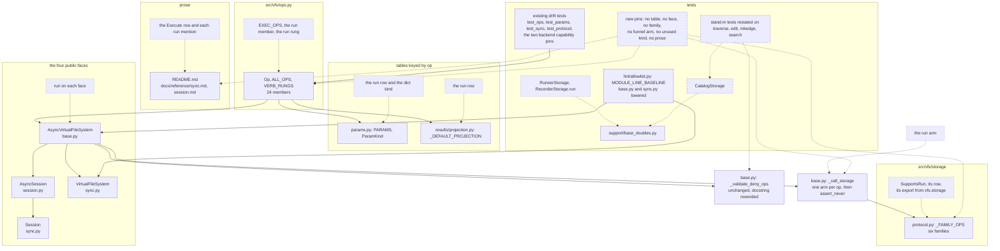

# `run` and `SupportsRun` are gone from the vocabulary, the rungs, the params table, both kernel classes, both synchronous classes, the protocol and the README, and `ALL_OPS` has 24 members

A refactor that removes dead public API. Flags: it changes the public API (four methods, one op name, one storage protocol, one vocabulary constant and one parameter kind leave, and nothing is added); it is not structural; it does not change the schema format; it needs no engine leg (decision 11); it touches rights only by deleting the removed verb's row from the rung table, and criterion 7 is the pin that the name reaches no storage; it does not touch the Rust engine; it is not parallel-safe with any unit that edits the op tables, so it lands first (decision 11). It serves roadmap story K9, criterion 1, at gate b, and it clears the vocabulary for story F1, whose dependency line reads "Nothing (K9 removes `run`; whichever lands first)", so it may land at gate a ([the roadmap](../../context/standards/roadmap.md), lines 204 to 207 and 600 to 602). K9 criterion 1, the contract this unit carries, reads: "`run` is absent from `Op`, `EXEC_OPS`, `VERB_RUNGS`, `PARAMS`, `base.py`, `session.py`, `SupportsRun`, `README.md`; `ALL_OPS` has 24 members at this landing." K9 as a story depends on K1, K4 and K6 for "the arguments the list documents", which is its criterion 4 and not this one (INFERRED from the story's own parenthesis, `roadmap.md:206`). It is converted from [spec 167](../../context/specifications/archive/167-the-shell-pipeline-core/spec.md), slice A items 1 and 2 (`spec.md:47-48`) and task 1 of [its task list](../../context/specifications/archive/167-the-shell-pipeline-core/tasks.md) (`tasks.md:7`), read through [the study of that source](../2026-11-25-the-backlog-converted/studies/165-181/167-the-shell-pipeline-core.md). It stands on no research memo: what it removes is code no storage serves, and the study's probes are repeated under The problem. It depends on no unit of [the unit map](../2026-11-25-the-backlog-converted/units.md) and on no unbuilt roadmap story. It builds on two landed specs: [the sync facade](../../context/specifications/archive/2026-11-06-the-sync-facade.md), whose decision 2 makes the twin list `ALL_OPS | MANAGEMENT_METHODS` and whose decision 9 puts `MANAGEMENT_METHODS` in `src/vfs/ops.py`, and [the two faces named](../../context/specifications/archive/2026-11-06-the-two-faces-named.md), whose decision 1 names the kernel `AsyncVirtualFileSystem` and `AsyncSession` and the synchronous face `VirtualFileSystem` and `Session`. Build order: this unit first, then the units that count 24 ops or reuse the freed name, each drafted and not built: [181-1](../2026-11-25-every-routed-op-sits-in-one-group-and-every-face-lists-the-verbs-in-that-order/spec.md), [170-1](../2026-11-25-a-callers-rung-at-many-catalogue-paths-is-one-chunked-statement-per-budget-slice/spec.md), [170-2](../2026-11-25-a-registered-host-function-is-a-file-under-the-tools-view-and-a-command-by-name/spec.md), [171-1](../2026-11-25-the-wire-adapter-projects-a-result-to-mcp-blocks-within-budget/spec.md), [167-5](../2026-11-25-a-pipeline-runs-gated-verbs-through-cli-with-the-minimal-programs/spec.md) and [179-2](../2026-11-25-the-storage-protocols-are-regrouped-into-families-before-the-freeze/spec.md).

## The problem

Every fact below is at commit `5b20fd4f` (EXECUTED, `git rev-parse --short=8 HEAD`). The labels: EXECUTED means a command ran for this spec, READ means the cited line was read, INFERRED means reasoning.

1. `run` is a routed op that no storage serves. `Op` holds `"run"`, `EXEC_OPS` is `frozenset({"run"})`, `ALL_OPS` unions it in, and `VERB_RUNGS` gives it `Needs("read")` (READ, `src/vfs/ops.py:55`, `:85`, `:103`, `:164`). `len(ALL_OPS)` is 25, and `ALL_OPS - InMemoryStorage().capabilities()` is `{"run"}`; neither `InMemoryStorage` nor `DatabaseStorage` has a `run` method (EXECUTED, a scratch probe). The verb can answer only `vfs.unsupported` on every shipped backend.
2. The dead verb is on all four public faces. `AsyncVirtualFileSystem.run` gates its parameters and routes (READ, `src/vfs/base.py:1605-1621`); `AsyncSession.run` forwards with the session's authority (READ, `src/vfs/session.py:395-398`); `VirtualFileSystem.run` and `Session.run` are the synchronous twins (READ, `src/vfs/sync.py:588-595`, `:1045-1046`). `hasattr(cls, "run")` is true for all four (EXECUTED). The source's removal list names the two kernel classes only, because it predates the synchronous face.
3. The tables keyed by op each carry a row for it: `PARAMS["run"]` with a `path` and an `arguments` parameter of kind `dict` (READ, `src/vfs/params.py:357-361`), and `_DEFAULT_PROJECTION["run"]` (READ, `src/vfs/results/projection.py:57`). `PARAMS` and `KNOWN_FUNCTIONS` have 25 keys each (EXECUTED). `run.arguments` is the only `ParamSpec` of kind `dict` among the 14 kinds of `ParamKind`, so the `dict` branch of `_check_value` exists for this row alone (EXECUTED, a count of kinds over `PARAMS`; READ, `src/vfs/params.py:32-48`, `:580-583`).
4. The dispatch funnel carries an arm for it, guarded by a protocol nothing implements: `case "run"` tests `isinstance(storage, SupportsRun)` (READ, `src/vfs/base.py:2958-2961`). `SupportsRun` is defined and mapped to `{"run"}` in `_FAMILY_OPS`, the seventh of seven rows (READ, `src/vfs/storage/protocol.py:365-375`, `:557`), imported by the router (READ, `src/vfs/base.py:98`) and exported from `vfs.storage` (READ, `src/vfs/storage/__init__.py:20`, `:41`). It is not in `vfs.__all__` (EXECUTED).
5. Prose still offers the verb. The README has an "Execute" row with `run`, says an agent may "`run` a tool", lists "run" as a protocol family and gives a catalogue that does `ls`/`read`/`run` as its example of a partial backend (READ, `README.md:73`, `:111`, `:115`), and says of `/.agents/tools/<name>/` that it is "a tool an agent can discover and run" (READ, `README.md:108`). Two reference pages of the old docs tree list `run` among the verbs (READ, `docs/reference/sync.md:53`, `docs/reference/session.md:36`). The source cites README lines 19, 61, 99 and 103; those numbers are stale. `documentation/` and `docs-app/src` do not name the verb (EXECUTED, `grep`).
6. Docstrings and comments name it: the module docstring's `EXEC_OPS` line and "``run`` waits for its own axis" (READ, `src/vfs/ops.py:11`, `:177-178`); "mutating/exec ops" in the bind docstring and the mask validator (READ, `src/vfs/base.py:434`, `:872`); the banners "public methods — execution" and "find, execution" (READ, `src/vfs/base.py:1602`, `src/vfs/session.py:264`, `src/vfs/sync.py:453`, `:918`).
7. Tests lean on `run` in two ways. Some pin the verb itself (the vocabulary, its parameter gate, its dispatch). Others use it as a stand-in: the one op the default backend does not declare, or an op a mount mask can deny (READ, the sites listed in the Design's table). After the removal the default backend declares every op, so no op is declared-but-absent on a default root, and the source's suggestion to ride "a declared-but-absent op instead, e.g. `glean`" no longer works: `search`, as `glean` is now named, is in `InMemoryStorage().capabilities()` (EXECUTED).

Why this is wrong: the roadmap counts the kernel's surface as "24 verbs (25 minus `run`)" and calls the verb "live but dead" (READ, `context/standards/roadmap.md:112`, `:129`); the constitution's Article 2 asks that a caller learn what is supported without probing, and a verb every shipped backend refuses invites the probe (READ, `context/standards/constitution.md:86`); and the units that follow count 24 ops or reuse the word for the shell's door.

## Architecture

Terms. A face is one of the four public classes a caller holds: the two kernel classes and their two synchronous twins. A stand-in test is a test whose claim is about a gate or a mask, not about `run`, and which used `run` only as a convenient op. A narrowed double is a recording storage built with `caps=` set below what its methods would derive.

## Decisions

### 1. `run` is deleted from every face outright, with no alias, no deprecation warning and no stub that answers a refusal.

After the change `fs.run(...)` on any of the four classes is Python's own `AttributeError`, as for any name the class never had. The project is pre-release, so there is no caller to migrate; no shipped storage ever served the verb, so no working call is lost; and a stub that answered `vfs.unsupported` would keep a 25th name on the surface the roadmap counts as 24. The record the source took this from was retired on 2026-10-30, so the rule is restated here with its reason and stands on the roadmap line.

Basis: the source spec, section 1 item 1 (`spec.md:47`) and its header's "`run` retired"; still true at `5b20fd4f` (EXECUTED: `ALL_OPS - InMemoryStorage().capabilities() == {"run"}` and no backend class has a `run` method; READ: roadmap K9 criterion 1, `context/standards/roadmap.md:207`).

### 2. `SupportsRun` is deleted, not renamed, and no protocol takes its place in this unit.

The class, its row in `_FAMILY_OPS` and its export from `vfs.storage` leave together. `_FAMILY_OPS` is left with six rows whose op sets are disjoint and sum to the 24 ops (EXECUTED: 4 + 2 + 1 + 10 + 1 + 6). A capability for a storage that executes something is the business of the unit that builds such a storage, which is named under Scope; keeping an empty family "for later" is speculative generality.

Basis: ruled, 2026-10-15, the source spec's decision 10, "`SupportsRun` is deleted, not renamed" (`context/specifications/archive/167-the-shell-pipeline-core/spec.md:25`).

### 3. The `EXEC_OPS` class leaves `ops.py`, and `ALL_OPS` is the union of the three classes that remain.

`ALL_OPS = MUTATING_OPS | READ_OPS | GRANT_OPS`, which is 10 + 8 + 6 = 24 members: `read`, `stat`, `ls`, `tree`, `glob`, `grep`, `search`, `traverse`, `write`, `edit`, `delete`, `restore`, `sweep`, `mkdir`, `mkedge`, `rmedge`, `move`, `copy`, `grant`, `revoke`, `grants`, `posture`, `add_member`, `remove_member`. An empty `EXEC_OPS` kept as a name would be a class with no member that two tests still had to union and compare. The only readers of `EXEC_OPS` are `ops.py` itself and `tests/test_ops.py` (EXECUTED, `grep -rn EXEC_OPS src tests`).

Basis: the source spec, section 1 item 1, "the class goes; `ALL_OPS` is the union of the three that remain" (`spec.md:47`); still true at `5b20fd4f` (EXECUTED: `EXEC_OPS == {"run"}`, and the three other classes hold 10, 8 and 6 ops).

### 4. The synchronous classes lose `run` in the same change as the kernel classes.

`VirtualFileSystem.run` and `Session.run` are deleted with `AsyncVirtualFileSystem.run` and `AsyncSession.run`. The synchronous face is defined as the twin of `ALL_OPS | MANAGEMENT_METHODS`, and its parity tests are parametrized over that set, so a twin left behind would call a kernel method that no longer exists. This is the one place the removal list grows past the source, which was written before the synchronous face existed.

Basis: decided in drafting, because the landed sync facade spec's decision 2 holds the twin list to `ALL_OPS | MANAGEMENT_METHODS` and `tests/test_sync.py::test_every_router_coroutine_has_a_sync_twin` enforces it (READ, `tests/test_sync.py:231-238`; READ, `src/vfs/ops.py:106-111`).

### 5. The `dict` parameter kind leaves `params.py` with its only user.

`"dict"` leaves the `ParamKind` literal and its branch leaves `_check_value`, so `ParamKind` has 13 members, each used by at least one row of `PARAMS`. Left in place, the branch would be code no row reaches, and the gate's 100% coverage requirement would fail on it unless a test fed the checker a hand-built `ParamSpec`, which would be a test of dead code. A later unit that needs a mapping-valued argument adds the kind back with the row that uses it.

Basis: decided in drafting, because `AGENTS.md` ("Code smells") names dead code and speculative generality, and `scripts/ci.sh` runs the tests under `--cov-fail-under=100` (READ, `scripts/ci.sh:67-68`; EXECUTED: `run.arguments` is the one `ParamSpec` of kind `dict`).

### 6. The word `run` is treated from then on as any unknown op name, and no gate is added to refuse it.

Three behaviours follow from code that already exists and none is changed. `default_projection("run")` returns `FALLBACK_PROJECTION`, as for any op name this client does not know. `_validate_deny_ops` still accepts a name outside the vocabulary as an inert mask at run time, while a typed call site that passes `{"run"}` fails `ty` because the literal is no longer an `Op` (INFERRED from the parameter's type, `Iterable[Op]`, at `src/vfs/base.py:416`). `_call_storage` reaches `assert_never` for it and raises. A refusal written specially for a retired name would be a new behaviour with no caller, and forward compatibility with unknown op names is a property both seams already declare.

Basis: decided in drafting, because the projection's fallback and the mask's openness to unknown names are stated contracts of the landed code (READ, `src/vfs/results/projection.py:80-86`; READ, `src/vfs/base.py:874-877`; READ, `src/vfs/base.py:2986-2987`), and this unit removes a verb without changing what any live call returns.

### 7. Each stand-in test keeps its claim on a live op, and a claim no op can make on a default root moves to a narrowed double.

A test whose subject was `run` itself is deleted with the verb. A stand-in test is restated on a live op of the nearest shape: `traverse` where `run` served as a single-path op the storage does not declare, `edit` or `mkedge` where it served as an op a mask denies, `search` where it served as a capability one mount adds to the union. Where the claim was "the default root does not declare this op", the root is built on a recording double with `caps=` narrowed to the read family, because after the removal the default backend declares all 24 ops. The Design's table gives every site. Each restated shape was run against the tree at `5b20fd4f` on its live op and holds (EXECUTED, a scratch probe: `traverse` on a read-family root and beneath a `{"read"}` mount answers `vfs.unsupported` with zero storage calls; a mount bound with `deny_ops={"edit"}` refuses `edit` anchored at the mount path and serves `read`).

Basis: decided in drafting, because the source's stand-in, "a declared-but-absent op instead, e.g. `glean`" (`spec.md:48`), is contradicted by the tree: the default backend declares `search` (EXECUTED), so the capability-gate claims need a double whose declared set is narrowed, and "Tests first, then code" in `AGENTS.md` asks that no claim be dropped with the op that happened to carry it.

### 8. The `RunnerStorage` test double becomes `CatalogStorage` and loses its `run` method and its `run` capability.

The double keeps its `read`, which answers one directory row at the path asked, and its default declared set becomes the read family. A double named for a method it no longer has would mislead the next reader of the gate tests. `RecorderStorage.run` and the `run` method of the protocol test's `Everything` class are deleted with it.

Basis: decided in drafting, because `AGENTS.md` ("Code smells") asks that a name say what a thing is, and the double's two remaining callers use it as a read-only catalogue (READ, `tests/base/test_gates.py:197`, `:207`; READ, `tests/support/base_doubles.py:350-376`).

### 9. The README and the two old-tree reference pages stop naming the verb and claim nothing that executes.

The exact text is in the Design. The "Execute" row leaves the README's verb table, which keeps its three other rows unchanged; the sentence about ordinary entries ends at `mkedge`; the list of protocol families is the six of `_FAMILY_OPS`; the example of a partial backend is a snapshot store that serves only the read family, which is the example the protocol module's own docstring uses; and the tools line says a tool's files are listed and read like any others. The two reference pages drop `run` from their verb lists and are otherwise untouched. The pages say what the tree does and no more: a tool that can be run comes back to the README with the unit that builds the door.

Basis: decided in drafting, because roadmap K9 criterion 1 names `README.md`, the landed spec 153 holds every README claim to the live tree (READ, `context/specifications/archive/153-docs-tell-the-truth-about-v2/spec.md:1`), and the replacement wording is taken from `_FAMILY_OPS` and the protocol docstring (READ, `src/vfs/storage/protocol.py:12`, `:551-559`).

### 10. The recorded ranking corpus, the documents under `context/` and the path-kind fixture keep their mentions.

`tests/fixtures/ranking/vfs_native/corpus/` holds old project documents as recorded input to the ranking pins; two of them name `SupportsRun` and `EXEC_OPS` (EXECUTED, `grep`). Editing a corpus file changes what the pins rank, so the corpus is left byte for byte. `context/` takes no new work. `tests/test_paths.py:961` names a file `run.py` under a tool directory, which is a path and not the verb.

Basis: decided in drafting, because the corpus is loaded whole by `tests/ranking/corpora.py` as the input of recorded rankings (READ, `tests/ranking/corpora.py:50-59`) and `AGENTS.md` closes `context/` to new work.

### 11. The unit lands alone, before every unit that counts 24 ops, and it runs no engine leg.

One pull request carries it, and it merges before unit 181-1, which reorders the same tables, so that the two never edit `ops.py`, `params.py`, `base.py` and `sync.py` at once. It counts toward gate b under K9 and may merge at gate a, since F1 does not wait on it and nothing it touches waits on F1. It runs `scripts/ci.sh` and `scripts/docs.sh check` (a docstring under `src/vfs/` changes) and no engine leg: no SQL statement, no schema object and no storage method changes, and `DatabaseStorage` never had the method (EXECUTED).

Basis: decided in drafting, because the unit map orders 167-1 before 181-1 (READ, `agents/2026-11-25-the-backlog-converted/units.md:3`), roadmap F1's dependency line leaves the order with F1 free (READ, `context/standards/roadmap.md:602`), and the `AGENTS.md` tooling rules name which gate a change to `src/` and to a docstring runs.

## Intent

After this spec, a caller who lists what vfs can do finds 24 verbs and every one of them is served by both shipped backends on a tuned dialect: `capabilities()` on a default file system equals the whole vocabulary, where before it was the vocabulary minus one. No class offers a `run` method, in the asynchronous kernel or in the synchronous face, so an agent's tool list, a notebook's tab completion and the reference pages no longer show a verb that can only answer `vfs.unsupported`. A storage author finds six protocol families and no execution family to wonder about. The README promises nothing that executes. Every other verb takes the same arguments, needs the same rung and returns the same result as before.

## Design

The change adds no statement, no loop and no in-memory structure. What it touches rides one multiplier of the reference deployment, per verb call, at about 150,000 calls a day: the parameter gate's `PARAMS[op]` lookup and the funnel's `match` over the op. Both lose one entry and neither gains work, so the cost per call is unchanged or lower by one comparison. Nothing grows with batch size or corpus size, no engine sees a different statement, no lock is taken or held, and no read waits on anything it did not wait on before. There is therefore no budget to declare: `membership_budget`, `chunked` and the statement budgets are not involved.

The work is in five steps. Line numbers are at `5b20fd4f`.

**Step 1. The pins, written first and seen red.**

- `tests/test_ops.py`: `test_expected_vocabulary` drops `"run"` from its literal set and gains `len(ALL_OPS) == 24` and `len(get_args(Op)) == 24`. New `test_run_is_in_no_table` asserts `"run"` is a key of none of `VERB_RUNGS`, `PARAMS` and `projection.KNOWN_FUNCTIONS`, that each has 24 keys, and that `vfs.ops` has no attribute `EXEC_OPS`. New `test_no_public_face_has_a_run_method`, parametrized over the four classes, asserts `not hasattr(cls, "run")`. `test_router_public_verbs_are_exactly_the_registered_ops` gains `len(verbs) == 32`. `test_no_agent_surface_op_ever_dispatches_sweep` drops its `"run"` row and gains `len(calls) == 20`. `test_all_ops_is_the_union_of_dispatch_classes`, `test_dispatch_classes_are_pairwise_disjoint` and `test_a_read_never_mints` drop `EXEC_OPS`, and the import of it goes. `test_search_and_run_have_default_projections` becomes `test_search_and_traverse_have_default_projections` and loses its two `run` lines.
- `tests/test_sync.py`: `test_the_constructors_and_the_context_managers_are_twins` asserts `len(SESSION_COROUTINES) == 25` beside the existing `len(ALL_OPS) + 1`. No other line of the file changes: its cases are parametrized over `ALL_OPS` and the shared `CALLS` table.
- `tests/test_params.py`: new `test_every_parameter_kind_has_a_user` asserts `len(get_args(ParamKind)) == 13` and that the set of kinds used across `PARAMS` equals `set(get_args(ParamKind))`. The three `run` pins go: the `dict` message at `:85`, the `run-non-dict-arguments` row of `GARBAGE` at `:161`, and `test_run_arguments_dict_passes_through` at `:207-213`.
- `tests/storage/test_protocol.py`: new `test_the_execution_family_is_gone` asserts that neither `vfs.storage.protocol` nor `vfs.storage` has an attribute `SupportsRun`, that the name is not in `vfs.storage.__all__`, and that `_FAMILY_OPS` has six rows whose op sets are pairwise disjoint with union `ALL_OPS`. `Everything.run` at `:103-104` goes.
- `tests/base/test_dispatch.py`: `test_funnel_fails_loud_on_an_unknown_op` is parametrized over `"bogus"` and `"run"`, is built on `RecorderFS`, and asserts `AssertionError` and `fs.calls == []`. `test_run_dispatches_through_the_funnel_to_the_backend` at `:1377-1381` and the `("run", ...)` row of the closed-file-system table at `:1704` go.
- `tests/storage/test_memory.py::test_capabilities_pin_the_landed_set` and `tests/storage/database/test_reads.py::TestUnlandedVerbStubs::test_the_derived_capability_set_is_whole` each keep their literal set and gain an assertion that it equals `ALL_OPS`; the comment and the class docstring that call `run` "the unlanded family" (`:20`, `:776-777`) say instead that the pinned set is the whole vocabulary.
- `tests/lint/test_code_shape.py`: new `test_the_dead_run_verb_is_named_nowhere` asserts zero occurrences of `` `run` `` in `README.md` and in each `docs/reference/*.md`, no `| Execute |` in `README.md`, and zero occurrences of `` `run` ``, `SupportsRun` and `EXEC_OPS` in every `src/vfs/**/*.py`. A doubled-backtick mention in a docstring contains the single-backtick needle, so one needle covers both.

**Step 2. The stand-in tests, restated on live ops; each passes before and after step 3.**

| Site | What it pins | After |
|---|---|---|
| `tests/base/test_authority.py:47` | the smallest well-formed call per op | the `"run"` row of `CALLS` goes; `test_the_call_table_covers_every_op` gains `len(CALLS) == 24` |
| `tests/base/test_gates.py:175-182` `test_run_on_default_root_is_unsupported` | an op the root does not declare is `vfs.unsupported` at the gate, not `vfs.not_found` | `test_an_undeclared_op_on_the_root_is_unsupported`: the root is `RecorderStorage(caps=` the read family `)`, the call is `traverse("outbound", "/nope/tool")`, and the storage records zero calls |
| `tests/base/test_gates.py:185-192` `test_run_routes_to_child_and_rebases` | a single-path op routes to the child and its path is rebased both ways | deleted: `test_capabilities_gate_allows_supported_op`, next to it, pins the same on `read` |
| `tests/base/test_gates.py:195-202` `test_capabilities_gate_blocks_unsupported_op` | a mount that does not declare the op refuses it and is never called | same name; `CatalogStorage(caps=frozenset({"read"}))`, the call is `traverse("outbound", "/nonvfs/clone-repo")` |
| `tests/base/test_mount_admin.py:62-64` | `caps` is `declared_caps - deny_ops` | `"run"` becomes `"mkedge"` in both sets |
| `tests/base/test_mount_admin.py:133` | a replayed table equals the original | `deny_ops={"edit", "rmedge"}` |
| `tests/base/test_mount_admin.py:372-386` `test_deny_run_is_noexec_for_a_tool_mount` | a denied op is refused at the mount, reads pass, and the op leaves the namespace's capabilities | `test_a_denied_op_is_refused_at_the_mount_and_leaves_the_capabilities`: root `BindableStorage(caps=` the read family `)`, child `BindableStorage(name="tools")` bound with `deny_ops={"edit"}`; `edit("/tools/x", old="a", new="b")` is `vfs.unsupported` with path `/tools`, `read` succeeds, `"edit" not in fs.capabilities()`; the section banner reads "deny_ops — the op mask" |
| `tests/base/test_mount_admin.py:391` | a mask never changes fan-out | `deny_ops={"edit"}` |
| `tests/base/test_mount_admin.py:425-439` | a bare string mask is a `TypeError` and the working mask survives | the bare strings are `"edit"`, the working mask is `{"mkedge"}`, the last line expects `("mkedge",)`, and the comment speaks of `frozenset("edit")` |
| `tests/base/test_mount_admin.py:467-477` | an inert mask is stored and bites after a refresh | `"run"` becomes `"edit"` in the mask, in the widened set and in the two assertions |
| `tests/base/test_mount_admin.py:497-500` | replacing and clearing a mask recomputes without storage I/O | the replacing mask is `{"mkedge"}` |
| `tests/base/test_mounts.py:681-685` | `capabilities()` is the union across bound entries | root `BindableStorage(caps=` the read family plus `mkdir` `)`, child declares the read family plus `search`, and the assertion is on `search` |
| `tests/base/test_mounts.py:688-693` | the capability snapshot is taken at bind | same root; the child grows `search` after the bind and `search` stays out of `capabilities()` |
| `tests/support/base_doubles.py:119-120`, `:350-376` | the doubles | `RecorderStorage.run` goes; `RunnerStorage` becomes `CatalogStorage` (decision 8), and its imports in `test_gates.py:15` and `test_mount_admin.py:17` follow |

The comment banner at `tests/base/test_gates.py:171` loses "+ run verb".

**Step 3. The removal, one edit set, because `ty` ties the `Op` literal to the funnel's arms.**

- `src/vfs/ops.py`: `"run"` leaves `Op` (`:55`); `EXEC_OPS` and its docstring go (`:85-86`); `ALL_OPS` is `MUTATING_OPS | READ_OPS | GRANT_OPS` (`:103`); the `"run"` row leaves `VERB_RUNGS` (`:164`); the module docstring loses the `EXEC_OPS` line (`:11`) and the rung docstring ends at "the developer-plane verbs sit at ``read_write``." (`:177-178`). The paragraph on `cli` (`:15-18`) is not touched.
- `src/vfs/params.py`: the `"run"` row leaves `PARAMS` (`:357-361`); `"dict"` leaves `ParamKind` (`:38`) and its branch leaves `_check_value` (`:580-583`).
- `src/vfs/results/projection.py`: the `"run"` row leaves `_DEFAULT_PROJECTION` (`:57`).
- `src/vfs/base.py`: the `SupportsRun` import (`:98`), the "public methods — execution" banner with the `run` method (`:1601-1622`) and the `case "run"` arm (`:2958-2961`) go. The bind docstring reads "*deny_ops* masks ops outside the read family out of the entry's effective capabilities" (`:434`) and the validator's first line reads "Validate a mount-policy op mask — any op outside the read family." (`:872`). The validator's code is not touched.
- `src/vfs/session.py`: `AsyncSession.run` goes (`:395-398`); the banner at `:264` reads "find"; `Any` leaves the `typing` import, since the method was its one user (EXECUTED: two occurrences in the file, the import and the method).
- `src/vfs/sync.py`: `VirtualFileSystem.run` (`:588-595`) and `Session.run` (`:1045-1046`) go; the banners at `:453` and `:918` read "find".
- `src/vfs/storage/protocol.py`: `SupportsRun` (`:364-375`) and its `_FAMILY_OPS` row (`:557`) go; `Any` leaves the `typing` import for the same reason as in `session.py` (EXECUTED).
- `src/vfs/storage/__init__.py`: the import and the `__all__` entry go (`:20`, `:41`).

**Step 4. The prose.**

- `README.md:73`: the row `| Execute | `run` | invoke a tool that lives at a path |` is deleted.
- `README.md:108`: the line reads `/.agents/tools/<name>/                   a tool's files, listed and read like any others`.
- `README.md:111`: "Chunks, edges, tools, and skills are ordinary entries: `ls` them, `grep` them, `mkedge` new links. One abstraction, one set of verbs."
- `README.md:115`: the families are "reads, pattern search, ranked search, mutation, traversal, grants", and the parenthesis reads "(a snapshot store that serves only the read family, a store without ranked search)".
- `docs/reference/sync.md:53` and `docs/reference/session.md:36`: `` `run` `` leaves each list; the item before it closes the list as the page's punctuation requires.

**Step 5. The baseline and the gates.** `tests/lint/allowlist.py` lowers `MODULE_LINE_BASELINE["src/vfs/base.py"]` and `["src/vfs/sync.py"]` to the counts `wc -l` prints after step 3. Counted from the ranges above, they are 3184 - 27 = 3157 and 1098 - 12 = 1086 (INFERRED from the line ranges; the entry is whatever the files hold at the landing, and the size test names the number if it differs). Then `scripts/ci.sh`, and `scripts/docs.sh check`.

## Scope

In: decisions 1 to 11. Files: `src/vfs/ops.py`, `src/vfs/params.py`, `src/vfs/results/projection.py`, `src/vfs/base.py`, `src/vfs/session.py`, `src/vfs/sync.py`, `src/vfs/storage/protocol.py`, `src/vfs/storage/__init__.py`, `README.md`, `docs/reference/sync.md`, `docs/reference/session.md`, `tests/test_ops.py`, `tests/test_params.py`, `tests/base/test_authority.py`, `tests/base/test_dispatch.py`, `tests/base/test_gates.py`, `tests/base/test_mount_admin.py`, `tests/base/test_mounts.py`, `tests/storage/test_protocol.py`, `tests/storage/test_memory.py`, `tests/storage/database/test_reads.py`, `tests/support/base_doubles.py`, `tests/lint/test_code_shape.py`, `tests/lint/allowlist.py`, and `tests/test_sync.py` for the one literal of criterion 5.

Out, with where each belongs:

- The op groups, the order of the verbs on each face and in each table, and the README's verb table regrouped: unit [181-1](../2026-11-25-every-routed-op-sits-in-one-group-and-every-face-lists-the-verbs-in-that-order/spec.md), K9 criterion 2. This unit deletes rows and reorders nothing.
- `cli` on the four faces, and whether `cli` is registered beside the ops: unit [167-5](../2026-11-25-a-pipeline-runs-gated-verbs-through-cli-with-the-minimal-programs/spec.md) and unit 181-1. The `cli` paragraph of the `ops.py` docstring and `test_cli_and_rm_are_not_ops` are not touched.
- The door through which a registered host function is run, and any capability a storage declares for it: unit [170-2](../2026-11-25-a-registered-host-function-is-a-file-under-the-tools-view-and-a-command-by-name/spec.md). The rung of a caller at a catalogue path: unit [170-1](../2026-11-25-a-callers-rung-at-many-catalogue-paths-is-one-chunked-statement-per-budget-slice/spec.md).
- The storage protocol families regrouped and renamed: unit [179-2](../2026-11-25-the-storage-protocols-are-regrouped-into-families-before-the-freeze/spec.md). This unit removes one family and renames none.
- The count of tools served over MCP, which the 20 agent-surface verbs feed: unit [171-1](../2026-11-25-the-wire-adapter-projects-a-result-to-mcp-blocks-within-budget/spec.md).
- The renderer gaps of story F1: units [167-2](../2026-11-25-a-bytes-row-renders-a-placeholder-and-leaves-the-payload-only-when-asked/spec.md) and [167-3](../2026-11-25-the-verb-renderer-is-bounded-never-silent-and-marks-kind-and-rank/spec.md).
- K9's other criteria: `entry_id` on rows is unit [181-2](../2026-11-25-every-row-reports-the-entrys-permanent-id-and-its-owner/spec.md); the conformance battery by kernel operation is unit [179-1](../2026-11-25-the-conformance-battery-is-split-by-kernel-operation-with-no-test-lost/spec.md); the published list of the frozen surface is K9 criterion 4, which no unit of the map carries (EXECUTED, `grep` for "frozen" and "api.md" over the unit map finds nothing).
- The rename of `sweep`: the deletes spec, not yet written. `sweep` stays one of the 24.
- A mask validator that refuses names outside the vocabulary, and a parameter kind for mapping-valued arguments: not built (decisions 6 and 5); either arrives with a unit that has a caller for it.
- The pages under `documentation/` and the docs app: they do not name the verb, and the generated API pages follow the docstrings.

## Acceptance criteria

1. `ALL_OPS` equals the 24 names of decision 3 and `get_args(Op)` has 24 members: `tests/test_ops.py::test_expected_vocabulary`.
2. `"run"` is a key of none of `VERB_RUNGS`, `PARAMS` and `projection.KNOWN_FUNCTIONS`, each has 24 keys, and `vfs.ops` has no attribute `EXEC_OPS`: `tests/test_ops.py::test_run_is_in_no_table`.
3. None of `AsyncVirtualFileSystem`, `AsyncSession`, `VirtualFileSystem` and `Session` has an attribute `run`, four cases: `tests/test_ops.py::test_no_public_face_has_a_run_method`.
4. The router has 32 public coroutines and they equal `ALL_OPS | MANAGEMENT_METHODS`: `tests/test_ops.py::test_router_public_verbs_are_exactly_the_registered_ops`.
5. `AsyncSession` has exactly 25 public coroutines, the 24 ops and `close`: `tests/test_sync.py::test_the_constructors_and_the_context_managers_are_twins`, whose count gains the literal 25 beside `len(ALL_OPS) + 1`.
6. `SupportsRun` is an attribute of neither `vfs.storage.protocol` nor `vfs.storage`, is absent from `vfs.storage.__all__`, and `_FAMILY_OPS` has six rows whose op sets are pairwise disjoint and whose union is `ALL_OPS`: `tests/storage/test_protocol.py::test_the_execution_family_is_gone`.
7. `_call_storage(binding, "run")` raises `AssertionError` and the storage records zero calls, the same as for `"bogus"`: `tests/base/test_dispatch.py::test_funnel_fails_loud_on_an_unknown_op`, two cases.
8. `ParamKind` has 13 members and each is the kind of at least one `ParamSpec` in `PARAMS`: `tests/test_params.py::test_every_parameter_kind_has_a_user`.
9. `InMemoryStorage().capabilities()` equals `ALL_OPS`: `tests/storage/test_memory.py::test_capabilities_pin_the_landed_set`.
10. `DatabaseStorage` on SQLite declares exactly `ALL_OPS`: `tests/storage/database/test_reads.py::TestUnlandedVerbStubs::test_the_derived_capability_set_is_whole`.
11. The call table has 24 rows and its keys equal `ALL_OPS`: `tests/base/test_authority.py::test_the_call_table_covers_every_op`.
12. The agent surface, `ALL_OPS - DEVELOPER_OPS`, has 20 ops and routing each of them dispatches no developer op: `tests/test_ops.py::test_no_agent_surface_op_ever_dispatches_sweep`.
13. A root whose storage declares only the read family answers `traverse` with one `vfs.unsupported` error and zero storage calls: `tests/base/test_gates.py::test_an_undeclared_op_on_the_root_is_unsupported`.
14. A mount whose storage declares only `read` answers `traverse` beneath it with `vfs.unsupported` and zero storage calls: `tests/base/test_gates.py::test_capabilities_gate_blocks_unsupported_op`.
15. A mount bound with `deny_ops={"edit"}` refuses `edit` beneath it as `vfs.unsupported` with the mount path as the error's path, serves `read`, and leaves `edit` out of `capabilities()` when no other entry declares it: `tests/base/test_mount_admin.py::test_a_denied_op_is_refused_at_the_mount_and_leaves_the_capabilities`.
16. `README.md` and every `docs/reference/*.md` hold zero occurrences of `` `run` ``, `README.md` holds no `| Execute |` row, and every `src/vfs/**/*.py` holds zero occurrences of `` `run` ``, `SupportsRun` and `EXEC_OPS`: `tests/lint/test_code_shape.py::test_the_dead_run_verb_is_named_nowhere`.
17. The size baseline holds `src/vfs/base.py` and `src/vfs/sync.py` at their line counts after the removal and reports zero faults: `tests/lint/test_code_shape.py::test_a_listed_module_never_grows_and_an_unlisted_one_stays_under_the_ceiling`.

## Landing notes

Filled in when the pull request is opened.

## One line

The verb no storage ever served, its protocol, its class and its parameter kind are deleted from all four faces, every table and the prose, leaving 24 ops that both shipped backends declare in full, with every test that leaned on the dead verb restated on a live one.
