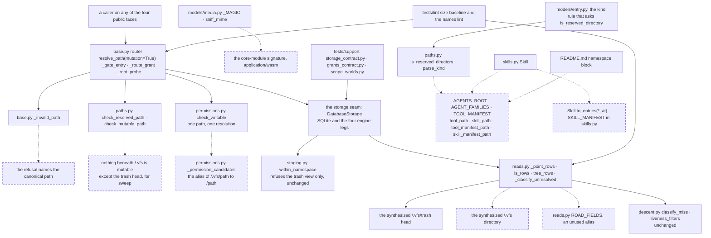

# `/.vfs` is a directory on every storage, nothing can be written beneath it, a wasm module is sniffed as `application/wasm`, and `/.agents` is gone

A feature, converted by amendment from [spec 169](../../context/specifications/archive/169-programs-the-index-and-the-vfs-views/spec.md): its section a1 without the router's heads and the index detail, the magic-table bullet of section a6, the retirement bullets of section a7, and criteria 1 (the part that needs only `trash`), 2 and 12. Flags. It changes the public API: `Skill.to_entries` takes a required `at=`, eight names leave `vfs.paths`, a write beneath `/.vfs` that succeeds today is refused, and the read verbs answer differently at `/.vfs`. It touches rights: an alias leaves the mount permission map and a synthesized directory is shown to callers, so criteria 7, 9 and 13 are leak tests. It needs the engine legs: it edits `reads.py` of the database backend and adds conformance rows. It is not structural (no module is added or removed), changes no schema format and touches no Rust. It is not parallel-safe with a unit that edits `src/vfs/base.py`, `src/vfs/storage/backends/database/reads.py`, `tests/support/storage_contract.py` or the README's namespace block. It serves roadmap story T1 at gate b ([the roadmap](../../context/standards/roadmap.md), lines 690 to 698) and carries roadmap decision D38. It stands on [the study of the source](../2026-11-25-the-backlog-converted/studies/165-181/169-programs-the-index-and-the-vfs-views.md), [the verification of D38](../2026-11-25-the-backlog-converted/decisions/d-mcp-serving-and-credentials.md), [the names ruling](../../context/specifications/active/2026-11-15-the-kernels-public-names-and-argument-families-are-ruled.md) and the probes run for this draft. It depends on no spec that is not landed. It builds on four landed specs: [the trash as a tombstone on the row](../../context/specifications/archive/162-trash-as-a-tombstone-on-the-row/spec.md), which built the synthesized trash head; [the permission ladder](../../context/specifications/archive/165-the-permission-ladder-list-and-contribute/spec.md), which built the bare row a `list` holder sees; [a read-only rule gates the verbs that reach beneath](../../context/specifications/archive/2026-11-07-a-read-only-rule-gates-the-verbs-that-reach-beneath.md), whose decision 4 this spec departs from (decision 12); and [scope crosses the seam in one shape](../../context/specifications/archive/2026-11-07-scope-crosses-the-seam-in-one-shape.md), whose stored meta scope at the storage seam this spec leaves standing (decision 11). Build order: this unit lands first of the five that spec 169 became, and [the program and skill views](../2026-11-25-the-router-serves-the-program-and-skill-views-and-resolves-a-name-by-the-index/spec.md) land on it. No choice waits on a ruling. Decisions 3 and 11 are provisional.

## The problem

Labels: READ means read in the file cited at `5b20fd4f`; EXECUTED means a command ran and the claim reports its output; INFERRED means reasoning. The probes are scratch scripts run with `uv run python` against the tree at `5b20fd4f`; `git diff --stat 9daedd2b 5b20fd4f -- src tests crates README.md` prints nothing (EXECUTED), so the two commits the probes ran between hold the same code.

**`/.vfs` exists only by accident.** EXECUTED. On a fresh root with a second storage mounted at `/data`, `stat`, `ls` and `tree` of `/.vfs` and of `/data/.vfs` each answer `vfs.not_found` at that path, while `stat /.vfs/trash` answers a directory and `ls /.vfs/trash` an empty list. A miss beneath it is named at the wrong component: `stat /.vfs/sessions` answers `vfs.not_found` at `/.vfs`. READ. The trash head is synthesized and its parent is not: a point read answers the head without a row (`src/vfs/storage/backends/database/reads.py:845`), and `ls` adds the head to the meta root's listing only when a row is stored at `/.vfs` (`reads.py:234-236`).

**Anything can be written beneath it.** EXECUTED. `write(path="/.vfs/bin/x", parents=True)` and the same under `/data/.vfs` succeed, and so do `mkdir`, `edit`, `delete`, `restore`, a `move` or `copy` in either direction and `sweep("/.vfs/bin")`. Afterwards `ls /.vfs` lists `bin` beside `trash`, and `tree /.vfs` lists the stored rows and leaves `trash` out. A file deleted beneath `/.vfs` is listed by no `ls /.vfs/trash`. READ. The path grammar refuses only `/`, `/.vfs` itself and the paths beneath the trash head, and says so: "Every other path, the meta scope included, is a lawful write target" (`src/vfs/paths.py:826-856`). The router runs that grammar twice, on the router path and on the mount-local path (`src/vfs/base.py:1767`, `:2405-2408`, `:2530`, `:2790-2796`). No code in `src/vfs` writes beneath `/.vfs` on its own (EXECUTED, a grep for writers of `METADATA_ROOT`).

**The mount permission map treats `/.vfs/<path>` as a projection of `<path>`.** READ. `_permission_candidates` resolves a path beneath `/.vfs` twice, at itself and at the same path with the `/.vfs` prefix removed (`src/vfs/permissions.py:340-353`). EXECUTED. On a mount built with `read_only(write=["/synthesis"])` a write to `/.vfs/synthesis/n.md` succeeds. On a mount built with `read_write(read=["/trash"])`, `sweep("/.vfs/trash")` is refused `vfs.read_only` with `rule_prefix` `/trash`: a rule on an ordinary directory named `trash` stops the retention pass. The module docstring of `paths.py` names a file `/.vfs/mounts/data.json` that nothing writes or serves (`paths.py:14`).

**A refusal by the grammar carries no path in router coordinates.** READ and EXECUTED. `_invalid_path` mints the error with `path=None` and the caller's text at `data["raw"]` (`base.py:3142-3150`); the same grammar refusing in a mount's coordinates sets `path` and no `raw` (`base.py:2796`).

**A wasm module is an octet stream.** EXECUTED. A bytes write whose body begins `\0asm\x01\x00\x00\x00` reads back `mime_type` `application/octet-stream`. READ. `_MAGIC` holds eight signatures and none for wasm (`src/vfs/models/media.py:81-90`).

**`/.agents` is a second reserved tree that nothing serves.** READ. `paths.py` declares `AGENTS_ROOT`, `AGENT_FAMILIES`, `TOOL_MANIFEST` and `SKILL_MANIFEST` (`:51-54`), four constructors (`:620-642`) and a rule that makes `/.agents`, its two family directories and each unit beneath them a directory whatever its name (`:686-699`). The only caller outside `paths.py` is `Skill.to_entries`, which takes no argument and always projects beneath `/.agents/skills` (`src/vfs/skills.py:31`, `:192-211`). The README shows `/.agents/tools/<name>/` beside two `/.vfs/<path>/__meta__/` lines for a projection that does not exist (`README.md:104-111`, against `paths.py:5-8`).

**Two edited modules may not grow.** READ. `tests/lint/allowlist.py:26` holds `src/vfs/base.py` at 3,184 lines and `:29` holds `reads.py` at 1,243; a module over the 1,000-line ceiling fails the lint when it grows by one line.

## Architecture

Solid is what exists and stays. Dashed is what this spec adds. Dotted is what it removes.



Terms. The **meta root** is the path `/.vfs` in a storage's own coordinates: `/.vfs` on the root binding and `/data/.vfs` for a storage mounted at `/data`. A **head** is a name directly beneath the meta root; the **trash head** is `/.vfs/trash`, the address of the trash view. A row is **synthesized** when a read verb answers it without a stored row. A **bare row** carries `path` and `kind` and nothing else, the row a holder of the `list` rung sees. The **path grammar** is the check that says whether a path may be a mutation's target, whatever the caller's rights. The **storage seam** is the set of methods a storage backend serves to the router. A **face** is one of the four public classes: `AsyncVirtualFileSystem`, `VirtualFileSystem`, `AsyncSession` and `Session`.

## Decisions

### 1. `/.vfs` is a directory that every storage answers by synthesis, in its own coordinates

`stat` of the meta root answers one bare row of kind `directory`. `ls` answers the trash head as a bare directory, beside any row stored directly beneath the meta root, in name order. `read` answers `vfs.wrong_kind`, as for any directory. This holds whether or not a row is stored at `/.vfs`. Where a row is stored there and the caller's view shows it, that row answers `stat` as itself, as today; every other caller, and every caller on a storage that stores none, is answered the synthesized row. The reason: a view tree whose root is absent until something is written into it cannot be listed, and the units that add heads need one directory to add them to. The bare row carries no `version`, as the trash head and every `list`-rung row already do; that the constitution's Article 1.3 asks for a stamp on every row is not new here and is corrected with the other frozen names by roadmap story R5's sixth criterion.

Basis: the source spec, section a1, third bullet; still true at `5b20fd4f` (EXECUTED, the probe: `stat`, `ls` and `tree` of `/.vfs` and `/data/.vfs` answer `vfs.not_found` on a fresh node).

### 2. The synthesized row is shown to every caller the trash head is shown to, and it says nothing about what is stored

The system actor and every named caller are answered the meta root, whatever they hold. An anonymous caller is judged by the posture in force at `/.vfs`, as at any path, and is refused `vfs.unauthenticated` where that posture needs a name. A row stored beneath the meta root is shown or hidden by the caller's own rights, as any row is. So a caller who holds nothing gets the same two rows, the meta root and the trash head, from a storage that holds a thousand files and from an empty one. The reason: the trash head is already answered this way, and a constant row cannot leak.

Basis: decided in drafting, because the trash head is answered to a named caller who holds no rung (`reads.py:845`; EXECUTED, a named caller under root posture `none` gets a bare `/.vfs/trash`) and a second rule for its parent would make the parent harder to see than the child.

### 3. `tree /.vfs` lists what `ls /.vfs` lists at depth one, the trash head included, and never the trash view's rows

`tree` of the meta root answers the rows stored beneath it, as today, and the trash head as one bare directory in path order. It does not descend into the trash view: a deleted row is listed at its own path, which is not beneath `/.vfs/trash`, and `tree /.vfs/trash` is the address that walks the trash. On a storage that stores nothing beneath the meta root the answer is the one row `/.vfs/trash`. This changes a landed pin, `test_the_trash_view_sits_beside_other_meta_children`, which says that `tree /.vfs` "walks the stored meta rows alone" (`tests/storage/database/test_reads.py:654-660`). The reason: a `tree` that is empty where `ls` shows a directory makes the two listing verbs disagree about what `/.vfs` holds.

Basis: provisional, no ruling on record; the options were to leave `tree /.vfs` listing stored rows alone, so that it is empty on a fresh storage, to add the trash head as one row, or to add the head and every row of the trash view; chosen because the one row is additive, costs no statement, agrees with `ls` at depth one, and is removed by deleting one line if a ruling prefers today's pin.

### 4. `/.vfs` stays out of every listing and every pattern match that does not name it

`ls /`, `tree /` and an unscoped `glob`, `grep` or `search` answer as today: none lists the meta root or the trash head. The pattern verbs match stored rows only, so no pattern returns either synthesized row, and `glob("/.vfs/trash")` stays `vfs.invalid` as today. One answer changes. A pattern verb scoped with `paths=("/.vfs",)` asserts its root with a `stat` (`base.py:2321-2343`), which now finds a directory: the `vfs.not_found` record at `/.vfs` leaves the result, and `glob` names the root itself where its pattern admits it, as it does for any directory root.

Basis: the source spec, section a1, last bullet; still true at `5b20fd4f` (READ, `descent.py:220-231`; EXECUTED, `ls /`, `tree /` and `glob("**")` list no row beneath `/.vfs` after one is stored there).

### 5. A name beneath `/.vfs` that nothing serves is absent, and there is no `/.vfs/mounts`

A read of `/.vfs/sessions`, `/.vfs/mounts` or any other name that no storage and no view serves is `vfs.not_found` at that name, not at `/.vfs`, and a write there is `vfs.invalid` by decision 6. This unit declares no table of heads: the trash head is the only one, and the table arrives with the first router-owned head. 0.1.0 serves no `/.vfs/mounts`; the mount table is read through `mounts()`, and the example `/.vfs/mounts/data.json` leaves the module docstring of `paths.py`. The reason: `mounts()` takes no authority and echoes each mount's permissions and denied verbs, so a view of it would need a per-caller filter that nothing has designed.

Basis: verified lean, roadmap decision D38, which holds as amended in [its verification](../2026-11-25-the-backlog-converted/decisions/d-mcp-serving-and-credentials.md); precedent: `context/research/studies/2026-10-15-agent-shell/07-session-state.md:67` ("The mount table is not in the namespace") and `:156`, and `mounts()` at `src/vfs/base.py:695-716`.

### 6. No mutating verb of any face writes at or beneath `/.vfs`; the trash head, for the destroying verb, is the one exception

The path grammar refuses every path strictly beneath `/.vfs`, as it already refuses `/.vfs` itself. It refuses in both coordinates the router checks, so `/.vfs/bin/x` and `/data/.vfs/bin/x` are refused alike, while a directory named `.vfs` deeper inside a storage (`/d/.vfs/x`) is an ordinary path. The refusal covers all ten verbs of `MUTATING_OPS` (`src/vfs/ops.py:64-66`): `write`, `edit`, `delete`, `restore`, `sweep`, `mkdir`, `move`, `copy`, and `mkedge` and `rmedge`, whose endpoints the `Edge` model already refuses. It covers every form: a single path, an `observations=` batch, an `entries=` batch and a batch of pairs, each refused whole before any dispatch. A `copy` or `move` whose source lies beneath `/.vfs` is refused too, because the gate judges a transfer's source by the same grammar (`base.py:2775-2778`). The exception is today's: `sweep` addressed at the trash head itself runs the retention pass. The reason: `/.vfs` is where vfs serves what it derives, and a path a caller can write is a path a view cannot own.

Basis: verified lean, the source's section a1 second bullet as amended by the study ("every path strictly beneath `/.vfs/` is refused except the trash head for the destroying verb"); precedent: the grammar already refuses every path beneath the trash head in both coordinates (`src/vfs/paths.py:854-855`, `src/vfs/base.py:2794`).

### 7. The exception follows the destroying verb's name

The verb is `sweep` in the tree, and this unit writes `sweep`. When the deletes spec renames it `destroy`, the test `head_ok=op == "sweep"` at `base.py:2794` follows the op's name in that landing; nothing here is renamed twice.

Basis: ruled, 2026-11-15, decision 3 of [the names ruling](../../context/specifications/active/2026-11-15-the-kernels-public-names-and-argument-families-are-ruled.md) and roadmap row D56.

### 8. The refusal is `vfs.invalid`, it is decided before any storage is called, and it is the same for every caller

The kind is `vfs.invalid` and not `vfs.read_only`: the refusal is a fact about the address, true on every mount and for every caller, where `read_only` names a mount rule an operator can change. The detail is the grammar's reason, "Cannot mutate beneath the reserved tree '/.vfs'"; the three existing reasons keep their words. The order is today's: in router coordinates the grammar runs when the path is resolved, before the busy guard and the mount's gates; in a mount's coordinates it runs after the capability gate and before the permission layers (`base.py:2783-2801`). Either way it runs before the storage's rights gate, so the system actor, a named caller and an anonymous caller get the same answer and no statement is issued.

Basis: decided in drafting, because roadmap story T1's second criterion names the kind ("`write`, `mkdir`, `move`, `copy` into any view path are `vfs.invalid`") and the three landed grammar refusals already answer `vfs.invalid` in this order (`paths.py:850-855`, `base.py:2796`).

### 9. Every grammar refusal names the path it refused

`_invalid_path` sets `path` to the canonical path whenever the caller's text resolves structurally, and keeps `data["raw"]`. A text that does not resolve (a null byte, an over-long segment) keeps `path=None`. This gives the new refusal one shape in both coordinates, and it also sets `path` on the three landed grammar refusals in router coordinates: `/`, `/.vfs` and a path beneath the trash head. The reason: a caller that batches forty writes needs to read which path was refused from the field every other error uses.

Basis: decided in drafting, because the same refusal already carries `path` when the grammar refuses in a mount's coordinates (`base.py:2796`) and the source asks that the refusal carry the path the caller sent.

### 10. The grant verbs stay lawful at a `/.vfs` path

`grant`, `revoke`, `grants`, `posture`, `add_member` and `remove_member` address a prefix, not a row, and are not in `MUTATING_OPS`, so the grammar is not asked about them. A posture or a grant at `/.vfs/bin` is stored in the grants table of the storage whose coordinates hold the path: the root binding's for `/.vfs/bin`, the mount's for `/data/.vfs/bin`. The units that add heads rely on this to say who may see and call what a head lists.

Basis: the source spec, section a1, the grant-verbs bullet; still true at `5b20fd4f` (READ, `src/vfs/ops.py:64-66`, `:88` and `src/vfs/base.py:1914-1934`, `:2793`; EXECUTED, `posture("/.vfs/bin", "list")` succeeds as the system actor).

### 11. The storage seam is not changed: a storage called directly still stores a row beneath `/.vfs`

The refusal of decision 6 lives in the path grammar the router runs. `DatabaseStorage` called directly keeps refusing only the trash view (`src/vfs/storage/backends/database/staging.py:238-243`), and it still stores a row at a path beneath `/.vfs` and hides it from every enumeration that does not name `/.vfs`. So "nothing can be written beneath it" is a statement about every verb of every face, which is every door a caller has; it is not a statement about the seam, which a caller never holds. The source says no stored row lives beneath `/.vfs` from this landing on. That sentence is narrowed for two reasons. The stored meta scope is a landed contract of the seam, pinned by the conformance rows `test_default_enumeration_hides_the_meta_subtree`, `test_meta_addressing_serves_its_own_subtree`, `test_default_grep_hides_the_meta_subtree` and `test_default_search_hides_the_meta_subtree` and by the scope spec's leak tests. And a later unit may want kernel rows there: the run record is specified as "rows in the root binding's storage". One consequence is accepted. The write gate's parent rule reads stored rows, so a seam write beneath a meta root that stores no row needs `parents=True`, as it does today.

Basis: provisional, no ruling on record; the options were to refuse at the router's grammar only, to refuse at the seam as well and seed the stored-meta tests by direct insert, or to refuse at the seam and remove the stored meta scope with its tests; chosen because the first is additive, is where the source put the check (`check_mutable_path`), leaves every landed pin of the seam true, and is tightened later by one branch in `within_namespace`, where the third removes code that a ruling could not bring back cheaply.

### 12. The `/.vfs/<path>` alias leaves the mount permission map

`_permission_candidates` is deleted and `check_writable` resolves the one path it is given. After decision 6 the only calls that reach the map with a path beneath `/.vfs` are `sweep` at a trash head and the five grant writes, and for both the alias answers wrongly: it lets a rule at `/trash` refuse the retention pass, and it lets a rule at `/bin` decide who may set a posture at `/.vfs/bin`. An operator who wants a rule on a `/.vfs` path declares it at that path, which the map already admits. This departs from decision 4 of [the read-only rule spec](../../context/specifications/archive/2026-11-07-a-read-only-rule-gates-the-verbs-that-reach-beneath.md), "Both permission candidates are checked, the path and its `/.vfs` alias"; its decision 8, that a sweep at the trash view keeps the point gate, stands and becomes true for a rule at `/trash` as well.

Basis: decided in drafting, because no mutating verb reaches the map beneath `/.vfs` once decision 6 holds, and the alias's two remaining effects are both wrong (EXECUTED, `sweep("/.vfs/trash")` refused `vfs.read_only` under `read_write(read=["/trash"])`).

### 13. No row is migrated

A database written before this landing may hold rows beneath `/.vfs` or `/.agents`. They are left as they are. A row beneath `/.vfs` stays readable at its literal address and can no longer be changed or deleted through a face; a developer who wants it gone calls the storage directly. A row beneath `/.agents` is an ordinary row after decision 15.

Basis: the source spec, section a1 ("There is no production data to migrate"); still true at `5b20fd4f` (READ, the project-stage section of [AGENTS.md](../../AGENTS.md): the design is unreleased and has no users to migrate).

### 14. A wasm core module is sniffed as `application/wasm`, and a component is not

`_MAGIC` gains the signature `\0asm\x01\x00\x00\x00` with the type `application/wasm`, named by a constant `WASM` beside `PDF` and `ZIP`. The signature is the four magic bytes and the four version bytes of a core module, so a component, whose header is `\0asm\x0d\x00\x01\x00`, does not match and keeps its declared type or `application/octet-stream`. Magic outranks the declared type and the extension, as for every other signature. No renderer claims the type, so the next index pass settles the row as `unsupported`, as it does an octet stream (READ, `src/vfs/rendering/registry.py:103`). A row written before this landing keeps the type it was given until it is written again.

Basis: the source spec, section a6, first bullet; still true at `5b20fd4f` (READ, `src/vfs/models/media.py:81-90`; EXECUTED, a core-module body reads back `application/octet-stream`).

### 15. `/.agents` is an ordinary name

`AGENTS_ROOT`, `AGENT_FAMILIES`, `TOOL_MANIFEST`, `tool_path`, `skill_path`, `tool_manifest_path` and `skill_manifest_path` leave `paths.py`, with the banner that introduces them and the `/.agents` arm of `is_reserved_directory`, which is then true for `/` and `/.vfs` alone. `SKILL_MANIFEST` moves to `skills.py`, its only user. After this a path beneath `/.agents` takes the ordinary rules: `/.agents` itself reads as a dotfile name, and a directory there is a directory because it was created as one. The reason: programs, tools and skills are found through the `/.vfs` views and the index a host declares, so a second reserved tree with its own kind rules has no reader.

Basis: the source spec, section a7, second and fourth bullets, and roadmap story T1's sixth criterion ("`/.agents` names are gone from `src/`"); still true at `5b20fd4f` (READ, `src/vfs/paths.py:51-54`, `:620-642`, `:686-699`; EXECUTED, a grep of `src/` finds the names in `paths.py`, `skills.py` and one docstring of `models/entry.py`).

### 16. `Skill.to_entries` takes the container as a required keyword, `at=`

The signature is `to_entries(self, *, at: str) -> list[Entry]`. `at` is the directory that holds skills; it is run through the `Path` gate, so a structurally bad container raises `ValueError`. The unit is `<at>/<name>`, written with an explicit `kind="directory"`, the manifest is `<at>/<name>/SKILL.md`, and each resource lands beneath the unit, so the Agent Skills rule that a skill's name matches its parent directory holds wherever the container is. The explicit kind is load-bearing: the unit rule of `is_reserved_directory` is gone, and a skill named `readme` or `license` would otherwise read as a file (EXECUTED, `parse_kind` of `/skills/readme` is `file`, and an `Entry` there with `kind="directory"` is accepted and stored as a directory). The argument is required because no default container exists once `/.agents` is gone: the index of skill directories is empty until a host declares one. The projection stays pure; whether the container may be written is the write's question, and a container beneath `/.vfs` is refused there by decision 6.

Basis: decided in drafting, because the source names the argument (`Skill.to_entries(at=container)`, section a7) and leaves its form open, a keyword reads at the call site, and a default would have to name a directory that nothing reserves.

### 17. The README's namespace block shows what the tree serves

The block under "Everything is a file" loses the `/.agents` line and the two `/.vfs/<path>/__meta__/` lines, which describe a stored projection that the module docstring of `paths.py` already disowns and that decision 6 now refuses. It shows the file, the `/.vfs` directory and the file's address in the trash view, and the sentence beneath it no longer names tools, skills or `run`. The Design gives the text.

Basis: decided in drafting, because the README ships in the wheel and the retirement of section a7 names its namespace block; a block that kept the `__meta__` lines would advertise writes this spec refuses.

### 18. The two size-held modules end at or below their baselines

`base.py` ends at 3,184 lines or fewer and `reads.py` at 1,243 or fewer, and each baseline entry is lowered to the count the module ends at. The synthesis of the meta root stays in `reads.py` beside the trash head's, which it shares four branches with; the room comes from deleting `ROAD_FIELDS`, an alias no module reads (`reads.py:114`), and from widening existing conditions instead of adding branches.

Basis: decided in drafting, because the size lint fails a held module that grows by one line (`tests/lint/allowlist.py:26`, `:29`) and a scratch copy with the Design's edits applied ends at 3,183 and 1,242 lines (EXECUTED).

## Intent

After this spec, an agent that runs `ls /.vfs` on any storage, fresh or full, at the root or at a mount, sees a directory holding `trash`, and `stat`, `ls` and `tree` agree about it. Nothing it does can put a file there: every mutating verb at a path beneath `/.vfs` answers `vfs.invalid` and names the path, before any storage is called and whoever is asking, and `sweep` of the trash head still runs. A developer who sets a posture at `/.vfs/bin` finds it in the grants of the storage that holds that path. A mount rule on `/trash` or `/bin` no longer reaches the same name under `/.vfs`. A `.wasm` core module written as bytes says `application/wasm`. `/.agents` means nothing special, and a developer who authors a skill says where it goes: `Skill(...).to_entries(at="/skills")`.

## Design

**Evidence for the shape.** EXECUTED. A scratch copy of `src/vfs` with the edits of steps 1 to 5 applied answered every probe as the criteria below state: the eight path verbs refused at `/.vfs/bin/x` and `/data/.vfs/bin/x` with `path` set, `sweep` of both trash heads succeeding, a named caller with no rights seeing the same two rows whether or not a row was seeded beneath `/.vfs` through the seam, and `application/wasm` on a core module. `ruff check` and `ruff format --check` were clean on the five edited files. The test suite was not run against the copy, so the list of tests to change below is from reading, not from a red run.

**Order of work.** Each step writes or changes its tests first and sees them fail, then the code that passes them.

**Step 1, the grammar.** Tests, in `tests/test_paths.py`: `TestCheckMutablePath::test_meta_scope_paths_are_mutable_but_the_trash_view_is_not` is replaced by `test_nothing_beneath_the_meta_root_is_mutable_but_the_trash_head`; `test_the_reserved_half_holds_in_any_mounts_coordinates` flips its `/.vfs/docs/x.txt` line. Code, in `src/vfs/paths.py`: `check_reserved_path` gains one branch after the trash branches, and the docstrings of `check_reserved_path`, `check_mutable_path` and `Path.is_mutable_target` say the new rule.

```python
    if path != TRASH_ROOT and _under_meta_root(path):
        return False, f"Cannot mutate beneath the reserved tree '{METADATA_ROOT}'"
```

**Step 2, the router's refusal.** Tests, in `tests/base/test_gates.py`: `test_meta_root_is_not_a_write_target_but_the_scope_is` is replaced by `test_nothing_beneath_the_meta_root_is_a_write_target`, parametrized over the eight path verbs (`move` and `copy` each as source and as destination, ten attempts) and four targets, with recording storages at the root and at `/m`; `test_a_grammar_refusal_names_the_path_it_refused` and `test_the_meta_root_refusal_is_the_same_for_every_caller` are new. In `tests/base/test_dispatch.py`, `test_write_entries_meta_root_rejected_but_meta_scope_admitted` becomes `test_write_entries_beneath_the_meta_root_are_rejected`. In `tests/base/test_write_at_scale.py`, `test_one_entry_beneath_the_meta_root_refuses_a_ten_thousand_entry_batch` is new. In `tests/base/test_grant_routing.py`, `test_a_posture_beneath_the_meta_root_lands_in_the_mount_that_holds_it` is new. Code, in `src/vfs/base.py`: `_invalid_path` passes `path=resolve_path(raw).path`. Nothing else in `base.py` changes: both runs of the grammar already call `check_reserved_path`.

**Step 3, the permission map.** Tests, in `tests/test_permissions.py`: `test_writable_hole_reaches_its_metadata_projection` and `test_explicit_metadata_rule_outranks_the_alias` are deleted; `test_the_subtree_check_covers_the_root_and_the_alias` keeps its root half as `test_the_subtree_check_covers_the_root`; `test_a_rule_on_a_path_does_not_reach_the_same_name_beneath_the_meta_root` is new. In `tests/base/test_gates.py`, `test_a_trash_view_sweep_keeps_the_point_gate` gains the rule `/trash`. Code, in `src/vfs/permissions.py`: `_permission_candidates` is deleted, `check_writable` resolves `rel` once, and `_read_rule_beneath` is called with the one path.

**Step 4, the synthesis.** Tests. Two conformance rows are new: `test_the_meta_root_is_a_directory_whether_or_not_a_row_is_stored` in `tests/support/storage_contract.py` and `test_the_meta_root_tells_a_caller_without_rights_nothing_about_what_is_stored` in `tests/support/grants_contract.py`. In `tests/storage/database/test_reads.py`, `TestNamespaceScopes::test_the_trash_view_sits_beside_other_meta_children` expects the trash head in `tree /.vfs`, and `TestNamespaceScopes::test_the_synthesized_meta_root_adds_no_statement` is new. In `tests/storage/database/test_writes.py`, `TestTrashWritability::test_nothing_is_written_into_the_trash_view` drops its last assertion, that `stat /.vfs` fails. In `tests/base/test_mounts.py`, `test_the_meta_root_lists_its_heads_at_the_root_and_at_a_mount` is new; it is the pin roadmap story T1's first criterion names, and each unit that adds a head adds its name to this one test. In `tests/base/test_glob_namespace.py`, `test_a_view_ancestor_root_reads_its_joined_text_at_every_size` expects no error where it expected `vfs.not_found` at `/.vfs`, and `test_a_wildcard_headed_pattern_hides_the_meta_root_at_every_size` seeds its row beneath `/.vfs` through the storage it built, since the router now refuses that write. `tests/support/scope_worlds.py` seeds `META_DIRECTORY` the same way, through the root mount's storage. Code, in `src/vfs/storage/backends/database/reads.py`, four places and no new statement:

- `_point_rows`: the branch that answers the trash head without a row answers any member of `_VIEW_HEADS`, which already holds both heads (`reads.py:122`).
- `ls_rows`: the meta root is never a miss; with no shown row and no place on the road it lists no stored child, and the trash head is added as today.
- `tree_rows`: the meta root is never a miss; the trash head joins the rows in path order, in the whole-view branch and the partial-view branch alike.
- `_classify_unresolved`: the live side's map of kinds holds the meta root as a directory, with and without a view, so a miss beneath it is named at its own first missing component.

`ROAD_FIELDS` is deleted. `classify_miss` and `classify_misses` in `descent.py` are not touched: the write path's parent rule keeps reading stored rows (decision 11).

**Step 5, the magic table.** Tests, in `tests/models/test_media.py`: `test_magic_decides_the_family_over_any_declaration` gains a wasm case, and `TestUnrecognised::test_a_wasm_component_is_not_a_core_module` is new. In `tests/storage/database/test_writes.py`, `TestBytesBodies::test_a_wasm_core_module_is_stored_as_application_wasm` is new. Code, in `src/vfs/models/media.py`: the constant `WASM` and one row of `_MAGIC`. The signature is 8 bytes, inside `SNIFF_LENGTH` of 16.

**Step 6, the retirement.** Tests. In `tests/test_paths.py`, `TestAgentNamespace` is deleted, `TestIsReservedDirectory` keeps `/` and `/.vfs` as `test_only_the_root_and_the_meta_root_are_reserved`, `TestParseKind::test_a_former_agents_path_takes_the_ordinary_rules` is new, and the three parametrized cases that use a `/.agents` path as an example take a neutral one. In `tests/models/test_models.py`, `test_tool_and_skill_units_are_plain_directories` and `test_with_content_rejected_on_a_unit_directory` are deleted and `test_reserved_directories_refuse_content` keeps `/.vfs`. In `tests/test_skills.py`, the three `TestToEntries` tests that call `to_entries()` pass `at="/skills"` and expect paths beneath it, and `test_a_unit_named_like_a_file_is_still_a_directory` and `test_the_container_is_required` are new. In `tests/base/test_dispatch.py`, `test_a_projected_skill_writes_beneath_its_container` is new. In `tests/lint/test_code_shape.py`, `test_src_and_the_readme_name_no_agents_namespace` is new. Code: the deletions of decision 15 in `src/vfs/paths.py`, whose module docstring is rewritten to say that `/.vfs` is a directory every storage serves, that the trash view is its one head and that no verb writes beneath it; `parse_kind` tests `is_reserved_directory` alone; `src/vfs/skills.py` declares `SKILL_MANIFEST`, drops its two imports from `vfs.paths`, and `to_entries` builds its paths from `Path(at)`; the docstring of the kind rule in `src/vfs/models/entry.py:162` drops `/.agents`. In `README.md`, lines 101 to 111 become:

```
Files and directories live in one namespace. vfs keeps one directory in it for what it serves itself:

/enterprise/auth.py                      the file
/.vfs/                                   on every storage; nothing is written beneath it
/.vfs/trash/enterprise/auth.py           the same file after a delete, until it is restored

A deleted file is still a path: read it through the trash view, and `restore` brings it back. Chunks, versions and edges belong to their file and are reached through it, never by a path of their own.
```

The three path lines stay inside the block's fence, as the block is today.

**Step 7, the gates.** `scripts/ci.sh`, then `scripts/docs.sh check` because docstrings of `vfs.Path` change, then the engine legs through the `db_test` skill.

**Cost at the reference deployment.** Each addition, the multiplier it rides on in [AGENTS.md](../../AGENTS.md), and what bounds it.

| Addition | Multiplier | Arithmetic | Bound |
|---|---|---|---|
| One prefix comparison per written path, in each of the two grammar runs | per file write, per batch | about 1,050,000 writes a day, two comparisons each; a 10,000-file batch makes 20,000 comparisons before its first statement | no statement, no allocation; the comparison is against a 5-byte constant |
| One extra structural resolution in `_invalid_path` | per refused call only | zero on a call that is admitted | one path of at most 1,024 bytes |
| The synthesized meta root in `stat` and `ls` | per verb call that names `/.vfs` | of about 150,000 calls a day, only those addressed at `/.vfs`; zero statements added to each | the point fetch stays the one chunked by `membership_budget` (`reads.py:1052`); the rows added are one or two constants |
| The trash head in `tree /.vfs` | per verb call that names `/.vfs` | the subtree statement every `tree` runs, which the miss used to skip; it returns the rows stored beneath `/.vfs` and nothing else | one statement, prefix-bounded on the path index; a dictionary of at most one head |
| One constant entry in the live map of kinds | per verb call with a miss | one dictionary entry per classification | constant |
| One 8-byte prefix comparison in `sniff_mime` | per file write with a bytes body | nine signatures where there were eight | `_MAGIC` is a constant tuple |
| The entries `to_entries` builds | per batch | two entries and one per resource, as today | the list is the skill's own; the write that follows rides the chunked builders |

Removed: one map resolution per permission layer per gated write, the alias's. No statement is added to any write. No lock is taken, nothing is written by a read, and no read waits on a writer: the synthesis is arithmetic on a fetch the verb already ran. No `IN` list, bulk insert or bulk update is added, so no chunk size is introduced. EXECUTED on SQLite as the system actor, after one warm-up call: `stat /.vfs` and `ls /.vfs` issue 2 statements each on the scratch copy, the same as the same verb at an absent path at `5b20fd4f`; `tree /.vfs` issues 3, the same as `tree /.vfs/trash`, where it issued 2 as a miss.

## Scope

In: decisions 1 to 18. Source files: `src/vfs/paths.py`, `src/vfs/base.py` (`_invalid_path` only), `src/vfs/permissions.py`, `src/vfs/storage/backends/database/reads.py`, `src/vfs/models/media.py`, `src/vfs/models/entry.py` (one docstring), `src/vfs/skills.py`, `README.md`. Test files: `tests/test_paths.py`, `tests/test_permissions.py`, `tests/test_skills.py`, `tests/base/test_gates.py`, `tests/base/test_dispatch.py`, `tests/base/test_mounts.py`, `tests/base/test_grant_routing.py`, `tests/base/test_write_at_scale.py`, `tests/base/test_glob_namespace.py`, `tests/models/test_media.py`, `tests/models/test_models.py`, `tests/storage/database/test_reads.py`, `tests/storage/database/test_writes.py`, `tests/support/storage_contract.py`, `tests/support/grants_contract.py`, `tests/support/scope_worlds.py`, `tests/lint/test_code_shape.py`, `tests/lint/allowlist.py`. Of roadmap story T1's acceptance lines this unit meets the first with `trash` as the only head ("a reserved, unserved head is `not_found` on read and `vfs.invalid` on write. At a mount, `ls /data/.vfs` lists `trash`"), the second without the index detail ("`fs.sweep("/.vfs/trash")` succeeds; `fs.posture("/.vfs/bin", "list")` writes one row in the root binding's grants table"), the D38 clause of the third and the sixth.

Out, each with where it belongs.

- The router's view table, the heads `bin` and `skills`, the index, resolution, the install rules, the detail on the refusal that names the writable program directories, and `/opt/bin`: [the program and skill views](../2026-11-25-the-router-serves-the-program-and-skill-views-and-resolves-a-name-by-the-index/spec.md), which depends on this unit and on the shell. T1's first criterion at `{bin, skills, trash}`, the rest of its second and third, and its fourth and fifth are that unit's. T1 as written depends on stories F3 and F4; this unit is the part of it that does not, which is why it lands first.
- The `run` head and its rows: [the run record](../2026-11-25-every-shell-call-leaves-a-run-record-as-rows-in-the-root-bindings-storage/spec.md). Whether its output rows are entry rows beneath `/.vfs` in the root storage is that unit's decision; decision 11 leaves the seam able to hold them.
- Refusing a write beneath `/.vfs` at the storage seam, and removing the stored meta scope (`liveness_filters(include_meta=)`, the marked admissions of the glob gates) with the tests that pin it: no unit of the map carries it; it follows a ruling on decision 11.
- Whether a stored row is an executable module, and the refusal of a text file named `x.wasm`: [the generic wasm host](../2026-11-25-a-generic-wasm-host-runs-stored-programs-with-the-callers-verbs/spec.md).
- `deny_ops` accepting a name that is no op, and masked program names: [the program and skill views](../2026-11-25-the-router-serves-the-program-and-skill-views-and-resolves-a-name-by-the-index/spec.md).
- The rename of `sweep` to `destroy`: the deletes spec, which is not written and has no roadmap story; this unit relies on decision 3 of the names ruling, "The code keeps `sweep` until ... the spec that stands on it lands".
- The removal of `run` from the README's verb table and every face: [the dead `run` verb](../2026-11-25-the-dead-run-verb-leaves-every-face/spec.md). The two units edit different lines of the README; this unit's replacement text names no `run`, so either order lands clean.
- The split of the conformance battery into mixins: [the battery split](../2026-11-25-the-conformance-battery-is-split-by-kernel-operation-with-no-test-lost/spec.md). If it lands first, this unit's two rows go into the mixins that hold the listing verbs' rows and the grants rows; the node ids under `tests/storage/test_conformance.py` are the same either way.
- The oracle that `tree` equals `ls` repeated: [the derived-verb oracles](../2026-11-25-the-derived-verbs-are-pinned-to-their-definitions-by-oracles/spec.md), which must exempt the trash head, whose `ls` answers rows at their own paths.
- The constitution's Article 1.5, which names a `/.vfs/<path>/__meta__/versions/N` address, and Article 1.3's stamp on every row: roadmap story R5's sixth criterion, which amends the articles to the frozen names.
- A reference page for the `/.vfs` tree on the docs site: roadmap story X3's pages, with the first router-owned head.

## Acceptance criteria

Counts and states, never clocks. A conformance row is named by its SQLite node and runs under the same name in `TestMemoryConformance` and the four engine classes.

1. `check_reserved_path` and `check_mutable_path` refuse `/.vfs/docs/x.txt`, `/.vfs/bin` and `/.vfs/trashy/x` with the reason "Cannot mutate beneath the reserved tree '/.vfs'", pass `/.vfs/trash` only while `head_ok` holds, keep the three landed reasons word for word, and pass `/.vfsx/a` and `/d/.vfs/x`. Test: `tests/test_paths.py::TestCheckMutablePath::test_nothing_beneath_the_meta_root_is_mutable_but_the_trash_head`.
2. Each of `write`, `edit`, `delete`, `restore`, `sweep`, `mkdir`, `move` (as source and as destination) and `copy` (as source and as destination) at `/.vfs/bin/x`, `/.vfs/sessions/x`, `/.vfs/other` and `/m/.vfs/bin/x` answers one `vfs.invalid` error whose `path` is that path, and the recording storages count zero calls. Test: `tests/base/test_gates.py::test_nothing_beneath_the_meta_root_is_a_write_target`, ten attempts by four targets, 40 cases.
3. `mkedge` and `rmedge` with an endpoint beneath `/.vfs` answer `vfs.invalid` with zero storage calls, as today. Test: `tests/base/test_dispatch.py::test_mkedge_invalid_endpoint_beats_cross_mount`, unchanged and passing.
4. `sweep("/.vfs/trash")` and `sweep("/m/.vfs/trash")` succeed under the read rules `/trash/x`, `/proj/locked` and `/trash`. Test: `tests/base/test_gates.py::test_a_trash_view_sweep_keeps_the_point_gate`, which fails at `5b20fd4f` for the rule `/trash`.
5. A `write` of 10,000 entries of which one lies beneath `/.vfs` answers one `vfs.invalid` error naming that entry's path, and the recording storage counts zero calls. Test: `tests/base/test_write_at_scale.py::test_one_entry_beneath_the_meta_root_refuses_a_ten_thousand_entry_batch`, marked `slow`.
6. A `write` at `/`, at `/.vfs` and at `/.vfs/trash/x` each answers `vfs.invalid` with `path` equal to that path and `data["raw"]` equal to the text sent, and a `write` at a path holding a null byte answers `vfs.invalid` with `path` `None` and `data["raw"]` set. Test: `tests/base/test_gates.py::test_a_grammar_refusal_names_the_path_it_refused`.
7. Leak test. On a root whose posture is `none`, a `write` at `/.vfs/q.txt` by the system actor, by a named caller who holds no rung and by an anonymous caller answers the same kind, the same `path` and the same message, with zero statements issued. Test: `tests/base/test_gates.py::test_the_meta_root_refusal_is_the_same_for_every_caller`.
8. With both storages touched once, so that each has its tables, `posture("/.vfs/bin", "list")` as the system actor leaves exactly one row with `path_prefix` `/.vfs/bin` in the root storage's `vfs_grants` and none in the storage mounted at `/data`; `posture("/data/.vfs/bin", "list")` then adds exactly one such row to the mounted storage's table and none to the root's. Test: `tests/base/test_grant_routing.py::test_a_posture_beneath_the_meta_root_lands_in_the_mount_that_holds_it`, which pins a behaviour that already holds at `5b20fd4f` (EXECUTED, counts 1 and 0, then 1 and 1) and that roadmap story T1's second criterion names.
9. Leak test. `check_writable(read_only(write=["/synthesis"]), "posture", Path("/.vfs/synthesis"))` is a `vfs.read_only` refusal by the mount default, and `check_writable(read_write(read=["/p/locked"]), "sweep", Path("/.vfs/p"), subtree=True)` is `None`. Test: `tests/test_permissions.py::test_a_rule_on_a_path_does_not_reach_the_same_name_beneath_the_meta_root`.
10. On a storage that has stored nothing, `stat /.vfs` answers one row of kind `directory` whose populated fields are `path` and `kind`, `ls /.vfs` and `tree /.vfs` each answer exactly `/.vfs/trash`, `read /.vfs` answers `vfs.wrong_kind`, and `stat /.vfs/sessions` answers `vfs.not_found` at `/.vfs/sessions`; after a file is written at `/real.txt` every one of those answers is unchanged. Conformance row: `tests/storage/test_conformance.py::TestSqliteConformance::test_the_meta_root_is_a_directory_whether_or_not_a_row_is_stored`, on SQLite and on the postgres, mariadb, mssql and oracle legs.
11. `ls /`, `tree /` and `glob("*")` on a storage name no path beneath `/.vfs`. Conformance row: `tests/storage/test_conformance.py::TestSqliteConformance::test_default_enumeration_hides_the_meta_subtree`, unchanged and passing on every leg.
12. With `/.vfs/docs/a.txt` stored through the seam, `ls /.vfs` answers `/.vfs/docs` then `/.vfs/trash`, and `tree /.vfs` answers `/.vfs/docs`, `/.vfs/docs/a.txt`, `/.vfs/trash`. Test: `tests/storage/database/test_reads.py::TestNamespaceScopes::test_the_trash_view_sits_beside_other_meta_children`.
13. Leak test. Under root posture `none`, a named caller who holds no rung gets exactly the bare rows `/.vfs` from `stat` and `/.vfs/trash` from `ls` and from `tree`, and `vfs.not_found` at `/.vfs/state` from `stat /.vfs/state`, in two worlds: one storing nothing else, one holding `/.vfs/state/s.txt` written through the seam and a deleted `/d/f.txt`; the two worlds' answers are equal field for field; and an anonymous caller gets `vfs.unauthenticated` and zero rows in both. Conformance row: `tests/storage/test_conformance.py::TestSqliteConformance::test_the_meta_root_tells_a_caller_without_rights_nothing_about_what_is_stored`, on SQLite and on the postgres, mariadb, mssql and oracle legs.
14. On a fresh root with a storage mounted at `/data`, `ls /.vfs` answers exactly `/.vfs/trash`, `ls /data/.vfs` exactly `/data/.vfs/trash`, `stat` of each meta root answers kind `directory`, and `locate("/.vfs", exists=True)` reports a directory. Test: `tests/base/test_mounts.py::test_the_meta_root_lists_its_heads_at_the_root_and_at_a_mount`.
15. With `/x/a.py` and `/x/b.py` deleted, `glob("trash/x/**", paths=("/.vfs",))` and the same call beside 201 other roots each serve the two rows with no error, and `grep` and `search` scoped to `/.vfs` alone succeed with no row and no error. Test: `tests/base/test_glob_namespace.py::test_a_view_ancestor_root_reads_its_joined_text_at_every_size`.
16. On SQLite with a statement spy, after one warm-up call, `stat /.vfs` and `ls /.vfs` on a storage storing nothing beneath `/.vfs` issue exactly as many statements as the same verb at an absent path, and `tree /.vfs` exactly as many as `tree /.vfs/trash`. Test: `tests/storage/database/test_reads.py::TestNamespaceScopes::test_the_synthesized_meta_root_adds_no_statement`.
17. `sniff_mime` of a head beginning `\0asm\x01\x00\x00\x00` is `application/wasm` under any declared type and extension, and of a head beginning `\0asm\x0d\x00\x01\x00` is the declared type, or `application/octet-stream` with none. Tests: `tests/models/test_media.py::test_magic_decides_the_family_over_any_declaration` (the wasm case) and `tests/models/test_media.py::TestUnrecognised::test_a_wasm_component_is_not_a_core_module`.
18. A core module written as `data=` reads back with `mime_type` `application/wasm` and `source` `bytes`. Test: `tests/storage/database/test_writes.py::TestBytesBodies::test_a_wasm_core_module_is_stored_as_application_wasm`.
19. No file under `src/` and no line of `README.md` holds `.agents`, `AGENTS_ROOT`, `AGENT_FAMILIES`, `TOOL_MANIFEST`, `tool_path`, `skill_path`, `tool_manifest_path` or `skill_manifest_path`, and no file under `src/` holds `/.vfs/mounts`. Test: `tests/lint/test_code_shape.py::test_src_and_the_readme_name_no_agents_namespace`.
20. `is_reserved_directory` is true for `/` and `/.vfs` and false for `/.agents`, `/.agents/skills` and `/.agents/skills/pdf`, and `parse_kind` of `/.agents` is `file` and of `/.agents/skills/pdf` is `directory`. Tests: `tests/test_paths.py::TestIsReservedDirectory::test_only_the_root_and_the_meta_root_are_reserved` and `tests/test_paths.py::TestParseKind::test_a_former_agents_path_takes_the_ordinary_rules`.
21. `Skill(name="pdf", ...).to_entries(at="/skills")` answers `/skills/pdf` as a directory, then `/skills/pdf/SKILL.md`, then each resource beneath `/skills/pdf`; a skill named `readme` projects `/skills/readme` with kind `directory`; and `to_entries()` with no `at` raises `TypeError`. Tests: `tests/test_skills.py::TestToEntries::test_unit_dir_and_manifest`, `::test_resources_emitted_under_the_skill_root`, `::test_a_unit_named_like_a_file_is_still_a_directory` and `::test_the_container_is_required`.
22. The entries of a skill named `readme` projected at `/skills`, written through the router with `parents=True`, land with `stat /skills/readme` a directory, and the same entries projected at `/.vfs/skills` are refused `vfs.invalid` with zero storage calls. Test: `tests/base/test_dispatch.py::test_a_projected_skill_writes_beneath_its_container`.
23. The size lint passes with the entries for `src/vfs/base.py` and `src/vfs/storage/backends/database/reads.py` at or below 3,184 and 1,243 and equal to the modules' line counts. Test: `tests/lint/test_code_shape.py::test_a_listed_module_never_grows_and_an_unlisted_one_stays_under_the_ceiling`.
24. `scripts/ci.sh` exits 0 with coverage at 100%, `scripts/docs.sh check` exits 0, and `TestPostgresConformance`, `TestMariaDBConformance`, `TestMSSQLConformance` and `TestOracleConformance` pass with their URLs set.

## Landing notes

Filled in when the pull request is opened.

## One line

`/.vfs` becomes a directory every storage serves and no verb can write beneath, the permission alias that mirrored it goes, a wasm core module gets its media type, and `/.agents` and its helpers leave the tree, with `Skill.to_entries` told where to put a skill.
