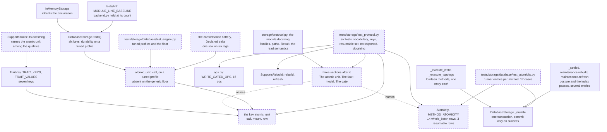

# Every backend declares its atomic unit as a trait, every mutating seam method names its model in one table, and the protocol module's docstring states the atomic unit, the fault model and the two halves of the gate once

A feature and a docs change, additive throughout. Flags: it is not structural (two source modules change, `src/vfs/storage/protocol.py` and `src/vfs/storage/backends/database/backend.py`, and no module is added under `src/`); it changes the public API by addition only (one trait key with three values in the exported `TRAIT_KEYS` and `TRAIT_VALUES`, one more entry in what `DatabaseStorage.traits()` returns, and two names in `vfs.storage.protocol`); it does not change the schema format; it needs the engine legs for one conformance row (criterion 6) and issues no new statement on any engine; it does not touch rights, and so carries no leak test: no judgement, gate or label changes; it does not touch the Rust engine; it is parallel-safe except with unit 179-4, which rewrites the same four lines of `traits()`, in either order. It serves criterion 4 of story K7, gate f, of [the roadmap](../../context/standards/roadmap.md), and it is the part of K7 that the roadmap's cut order keeps ("keep the atomic-unit pin ... and the trait", `roadmap.md:1029`). It is converted from sections 2.4, 3.1 and 3.2 and criteria 5, 7 and 8 of [spec 179](../../context/specifications/archive/179-the-storage-seam-as-the-kernel/spec.md), with the matching part of task 3 of [its task list](../../context/specifications/archive/179-the-storage-seam-as-the-kernel/tasks.md), read through [the study of that source](../2026-11-25-the-backlog-converted/studies/165-181/179-the-storage-seam-as-the-kernel.md) and placed by [the unit map](../2026-11-25-the-backlog-converted/units.md) as unit 179-3. The depth is an amend: the design stands, and the names and facts that moved since the source was written are corrected against the tree (`reindex` is `rebuild` and `refresh`, `sweep` becomes `destroy`, the membership verbs run a different runner, and five sentences of the source's docstring text describe things the tree does not have). It stands on [the OSTEP memo](../../context/research/2026-10-24-what-ostep-teaches-vfs-eight-studies-and-what-changes-in-the-kernel-plan.md), sections 2.2 and 2.9, and on a counting probe run for this spec and reported under The problem. It depends on no spec that is not landed: the trait vocabulary, the mutation runner and both index passes are in the tree at the commit named below. Build order: any time after the gate-b freeze. Six sibling units and the deletes spec each own one word or one sentence of what this unit writes, and the Design says what each one changes, whichever lands second.

## The problem

Facts are at commit `5b20fd4f`. The source's study read the tree at `0ed462f`; `git diff --stat 0ed462f HEAD -- src tests` prints one file, `tests/lint/allowlist.py` (EXECUTED), so every `src/` line the study cites holds. The probe figures marked EXECUTED come from a scratch script run through `uv run python` on an in-memory SQLite store and on a SQLite file; it counted calls and commit events and timed nothing, it is not in the repository, and criterion 4 re-measures its figures from the tree.

1. A mutation call on one mount is one transaction, committed only when the call succeeded. READ, `src/vfs/storage/backends/database/backend.py:1466-1512`: `_mutate` opens one session, runs the plan, and calls `session.commit()` only `if result.success`; a retryable outcome "discards the session and restarts the whole method from its first read". READ, `backend.py:1390-1401` and `:1455-1464`: `_execute_write` and `_execute_topology` each hand one plan to `_mutate`.
2. Fourteen methods use that runner once per call. READ, `backend.py`: `write` (`:713`), `edit` (`:744`), `mkdir` (`:905`), `mkedge` (`:951`), `rmedge` (`:980`), `add_member` (`:1072`) and `remove_member` (`:1082`) call `_execute_write`; `grant` and `revoke` call `_grant_write` (`:990`, `:1009`), which calls `_execute_write` (`:1324`); `delete` (`:764`), `restore` (`:829`) and `sweep` (`:863`) call `_execute_topology`; `move` and `copy` call `_execute_transfer` (`:913`, `:921`), which calls `_execute_topology` (`:1440`). EXECUTED: one successful call of each of the fourteen entered `_mutate` exactly once, on both stores.
3. Three methods commit in more than one transaction. READ, `backend.py:1034-1051` and `:1326-1353`: `posture` commits its posture row through `_grant_write`, then `_settled` runs the relabel "one chunk per writer transaction", and "a chunk that fails leaves its mark for the next call". READ, `src/vfs/storage/backends/database/maintenance.py:141-180`: `rebuild` and `refresh` claim the index lease in one transaction and run each phase in its own. EXECUTED: one successful call entered `_mutate` 3 times for `posture`, 7 times for `rebuild` on the SQLite file and 8 on the in-memory store (which carries an embedder), and 4 times for `refresh`.
4. One entry to `_mutate` is one commit. EXECUTED: with the planner-statistics request disabled, the engine's `commit` event fired exactly as many times as `_mutate` was entered, for all seventeen methods, and a `write` refused for one bad row entered `_mutate` once and fired no commit. With the request enabled, `write`, `edit`, `move` and `add_member` fired a second commit event: the statistics pass, which runs "after the write returns, in the host's own task" (READ, `backend.py:1474-1481`). So a count of commit events is not a count of the call's own transactions on SQLite, and a count of runner entries is.
5. Nothing a caller or a backend author can read says any of this. READ, `src/vfs/storage/protocol.py:78-91`: `TraitKey` has seven keys, `grep_tier`, `grep_staleness`, `search_signals`, `search_staleness`, `version_encoding`, `durability` and `arbitration`; none is about atomicity. READ, `backend.py:254-266`: `DatabaseStorage.traits()` declares six of them and adds `durability: "full"` on a tuned profile. EXECUTED: `grep -rn "atomic_unit\|METHOD_ATOMICITY\|Atomicity" src tests` prints nothing.
6. The seam's module docstring states neither the atomic unit nor the fault model. READ, `protocol.py:1-54`: its 53 lines cover the op families, the branded path, the `Result` channel, `TransportError`, the two read semantics and scope. Its one sentence on transactions is "Transactions are backend-internal: a backend opens and commits its own session inside these methods, and the router never sees it" (`:35-36`).
7. The classification of an engine failure is written only in the function that does it. READ, `src/vfs/storage/backends/database/engine.py:353-410`: `with_retry` restarts a retryable outcome and raises `StaleSnapshot` when the attempts run out, which `_mutate` answers as a retryable `conflict` (`backend.py:1500-1506`); `classify_failure` answers a disconnect as `backend_unavailable`, a value over the engine's single-value limit as `unsupported`, a statement defect as `internal`, and anything else as a retryable `unavailable`.
8. The gate has two halves and no text names both. READ, `src/vfs/base.py:2751-2781`: the router's `_gate_entry` judges "Capability → grammar → permission, in the pinned order", after `_gate_params` has judged the arguments (`base.py:991`). READ, `src/vfs/storage/backends/database/rights.py:1-4`: "Every verb resolves its authority here, inside its own transaction". READ, `src/vfs/storage/backends/database/authorized.py:1-15`: a mutation's "last statement before its commit" reads the caller's stamps again.
9. A batch `write` whose entries fall in two mounts is one call per mount. READ, `base.py:2525-2551`: `_route_entry_batch` gates every row, groups the rows by binding, dispatches one `write` per binding and merges the results. INFERRED: a failure in one mount's group does not undo the group another mount committed. No test pins it at this commit; unit 179-6 carries that pin.
10. Two modules this unit could touch are held at an exact line count. READ, `tests/lint/allowlist.py:26-27`: `MODULE_LINE_BASELINE` holds `src/vfs/base.py` at 3184 lines and `backend.py` at 1511, and "a module that grows fails". EXECUTED: `wc -l` prints 3184, 1511 and, for `protocol.py`, 578, which is under the ceiling of 1000 (READ, `tests/lint/test_code_shape.py:70`).
11. The record the source took the two models from is gone. Story K7 asks that "a drift test pins the table to ADR 087 pin 7" (READ, `roadmap.md:192`); decision records were retired on 2026-10-30, so the table is restated here from the code, as decision 4, and pinned to the code, as decisions 6 and 7.

Why this is wrong or missing. The promise an ETL developer relies on, that a batch of 10,000 rows lands whole or not at all, is kept by fact 1 and written nowhere. A backend author implementing the seam cannot tell which methods must be one transaction and which may commit in chunks, and a backend that cannot keep the promise has no way to say so. The OSTEP memo names these as "promises vfs keeps but has never written down" (READ, the memo, line 13) and asks that "the storage seam's docstring states the atomic unit in one sentence" and that both models are named with "which verbs use which" (lines 52-53).

## Architecture



Nothing is removed, so no node carries the retiring class.

Terms. The **seam** is the storage protocol in `storage/protocol.py`: the methods the router's one funnel calls. The **atomic unit** is the largest piece of work a backend commits whole or not at all. **Whole-batch** is the model in which one call on one mount is one transaction. **Resumable** is the model in which a call commits in bounded chunks behind a durable mark, and the next call finishes what one left. The **mutation runner** is `DatabaseStorage._mutate`, the one function through which the database backend commits. A **tuned profile** is one of the five entries of `PROFILES` (`dialects.py:669-675`: SQLite, PostgreSQL, SQL Server, MariaDB, Oracle); the **generic floor** is the profile every other dialect resolves to. A **drift test** fails when a table and the vocabulary it mirrors stop agreeing.

## Decisions

### 1. The trait vocabulary gains one key, `atomic_unit`, with the values `call`, `mount` and `row`

`call` promises that one mutation call commits whole or not at all, at any batch size. `mount` promises the same per mount inside the call, for a backend that fronts more than one store, so that a call spanning them can land in part. `row` promises only that each row commits by itself. An absent key means not declared, as for every trait (`protocol.py:75-76`), and a caller then assumes `row`, the weakest promise. The router declares no trait. No backend in the tree declares `mount` or `row`; they are in the vocabulary because a trait with one value says nothing, and a value no shipped backend declares has precedent in `durability: "relaxed"` and `grep_tier: "scan"` (`protocol.py:84`, `:89`). The key is additive, which the roadmap allows after the freeze ("An additive trait; allowed in a beta", `roadmap.md:192`).

Basis: the source spec, section 2.4; still true at 5b20fd4f (`TraitKey` read at `protocol.py:78-80` holds no atomicity key, and the grep of fact 5 finds no `atomic_unit`).

### 2. The per-method model is a table beside the trait and never a trait value

Story K7's fourth criterion reads "`traits()` declares the atomic unit (`whole_batch` / `resumable`) per verb; a drift test pins the table". A trait cannot hold that: `traits()` returns one string per key for the whole backend (`protocol.py:474`), and `TRAIT_VALUES` maps a key to one set of values (`:83-91`). So the criterion is met in two parts: `traits()` carries `atomic_unit` alone, and the per-method models are the table `METHOD_ATOMICITY` with its drift tests. This departs from the literal wording of the roadmap's acceptance line and keeps its intent; the roadmap page is not edited by this unit, and the landing notes record the reading.

Basis: verified lean, the study's open choice 4 (holds, amended); precedent: `src/vfs/storage/protocol.py:83-91` and `:474`, where a trait is one value per key per backend.

### 3. `DatabaseStorage` declares `atomic_unit: "call"` on a tuned profile and leaves the key absent on the generic floor

The runner is the same code on every dialect, so the source declared `call` for `DatabaseStorage` without a condition. The tree already has a rule for a promise about commits: "Tuned engines are the measured ones; only they may claim full durability" (`backend.py:262-265`). Whole-or-nothing rests on the engine honouring a rollback, which is proven on the five tuned engines and on no other; some stores reachable through SQLAlchemy have no transactions at all. An unknown dialect therefore declares nothing, and its caller assumes `row`. `InMemoryStorage` is a `DatabaseStorage` over SQLite (`src/vfs/storage/backends/memory.py:32`) and inherits `call`. This departs from the source's unconditional declaration.

Basis: decided in drafting, because the claim follows the rule the tree applies to `durability` at `backend.py:262-265`: a backend claims only what was measured on its engine.

### 4. `METHOD_ATOMICITY` holds seventeen rows: fourteen `whole_batch` and three `resumable`

`Atomicity` is `Literal["whole_batch", "resumable"]`, the two words of the roadmap's criterion. The table is `Final[dict[str, Atomicity]]`, keyed by method name as a plain string, because `rebuild` and `refresh` are seam methods and not members of `Op` (`src/vfs/ops.py:36-62`). The rows, each with the code that makes it true and the probe's count of runner entries for one successful call:

| Method | Model | Why, READ at 5b20fd4f | Entries, EXECUTED |
|---|---|---|---|
| `write`, `edit`, `mkdir` | `whole_batch` | `_execute_write`: one writer transaction (`backend.py:713`, `:744`, `:905`, `:1390-1401`) | 1 |
| `mkedge`, `rmedge` | `whole_batch` | `_execute_write` (`:951`, `:980`); a missing triple of `rmedge` is a warning (`edges.py:207-248`), so the call succeeds and commits | 1 |
| `delete`, `restore`, `sweep` | `whole_batch` | `_execute_topology`: one serialized transaction (`:764`, `:829`, `:863`, `:1455-1464`) | 1 |
| `move`, `copy` | `whole_batch` | `_execute_transfer`, then `_execute_topology` (`:913`, `:921`, `:1440`) | 1 |
| `grant`, `revoke` | `whole_batch` | `_grant_write`: the revision bump, the gate and the body in one transaction (`:1300-1324`) | 1 |
| `add_member`, `remove_member` | `whole_batch` | `_execute_write` directly (`:1072`, `:1082`) | 1 |
| `posture` | `resumable` | the posture row commits first; `_settled` then runs one relabel chunk per transaction behind the `vfs_relabels` mark (`:1034-1051`, `:1326-1353`) | 3 |
| `rebuild` | `resumable` | the lease, then each phase in its own transactions; the dirty flags and the epoch are the marks (`maintenance.py:141-149`) | 7 or 8 |
| `refresh` | `resumable` | the lease, then the render, chunk, delta and vector steps (`maintenance.py:152-180`) | 4 |

The source's one `reindex` row is two rows, and its claim that the membership verbs run through `_grant_write` is corrected. `posture` has one row and it is `resumable`: a call that returns success may have committed in several transactions, which is what the word tells a caller. `first_touch`, `install_extensions` and `close` are not rows: they are not methods of a seam protocol that the router calls (`backend.py:1087-1089`, "outside the routed surface").

Basis: the source spec, section 3.1; still true at 5b20fd4f (each row re-read at the lines cited, and the probe counted one runner entry for every `whole_batch` row and more than one for every `resumable` row).

### 5. The irreversible verb's row is keyed by the op's name at the landing and is `whole_batch` through 0.1.0

Decided 2026-11-15: the verb that destroys for good is named `destroy`, and the code keeps `sweep` until the deletes spec lands. So the row's key is `sweep` at `5b20fd4f` and `destroy` once that spec has landed; decision 6's drift test forces the rename in the same commit that renames the op, whichever unit lands second. The source said the row turns resumable "when spec 180's limit lands"; the roadmap places the bounded sweep at 0.2 (`roadmap.md:1044`), so through 0.1.0 the row is `whole_batch`. [The retention unit](../2026-11-25-the-trash-retention-pass-reclaims-in-short-slices-one-transaction-each/spec.md), gate 0.2, makes one arm of the verb commit in slices and owns the row's change when it lands.

Basis: verified lean, the study's open choice 16 (holds, amended) with roadmap decision D56, ruled 2026-11-15 and recorded as decision 3 of [the names ruling](../../context/specifications/active/2026-11-15-the-kernels-public-names-and-argument-families-are-ruled.md) and at `roadmap.md:1128`; precedent: `context/standards/roadmap.md:1044`, which places the bounded sweep at 0.2, and `backend.py:863`, one `_execute_topology` call.

### 6. The table's keys are pinned to the vocabulary: `WRITE_GATED_OPS` and the public coroutines of `SupportsRebuild`

A test computes both sets and asserts the table's keys equal their union: the fifteen write-gated ops (`ops.py:94`; EXECUTED, `len(WRITE_GATED_OPS)` is 15) and `rebuild` and `refresh`, read off `SupportsRebuild` the way `tests/storage/test_protocol.py:235-248` already reads them. A new mutating op, a third index pass, or the rename of decision 5 then fails the test until the table has the row. Nothing in `protocol.py` imports the op sets for this: the test owns the comparison. The source pinned the keys to `WRITE_GATED_OPS | {"reindex"}`; the literal is replaced by the protocol's own members so the pin follows the next rename without an edit.

Basis: the source spec, section 3.1's last line and criterion 7; still true at 5b20fd4f (`WRITE_GATED_OPS` read at `ops.py:94`, `SupportsRebuild` at `protocol.py:478-511`).

### 7. The table's values are pinned by a count: runner entries per successful call on the database backend

For each key, one successful call on a small world enters `DatabaseStorage._mutate` exactly once when the row says `whole_batch` and more than once when it says `resumable`. The count is of runner entries and not of the engine's `commit` event, because fact 4 shows SQLite's planner-statistics pass commits a transaction of its own after four of the methods. The test asserts `== 1` and `> 1`, never the exact figures of decision 4, which move with the embedder and the phases. A second assertion pins the resumable keys to exactly `posture`, `rebuild` and `refresh`, so that moving a method between models is an edit a reviewer sees. The source tied the values only to the crash family of unit 179-7, which drives exactly the whole-batch keys; that tie stays 179-7's, and this count is added so the table cannot land wrong before that unit exists. The same runner serves every dialect with no branch (fact 1), so the count runs on SQLite alone.

Basis: decided in drafting, because `AGENTS.md`, Performance tests, asks that a pin "asserts how much work ran (calls to a spied function ...)", and the record the roadmap's criterion pins the table to was retired, so the code's own runner is what the table is held against.

### 8. `Atomicity` and `METHOD_ATOMICITY` live in `vfs.storage.protocol` and are not added to `vfs.storage.__all__`

The trait vocabulary is exported from `vfs.storage` (`src/vfs/storage/__init__.py:29-47`), and the table could sit beside it. Story K9 freezes the public storage names at gate b, and after the freeze a name may be added and never removed or renamed (`roadmap.md:60`). The table's shape is likely to move once: the retention unit of decision 5 gives one verb two models by address, which one value per key cannot say. A name kept in its module can be exported later by one line; a name exported now could not be withdrawn. Tests and the sibling units import it from `vfs.storage.protocol`.

Basis: provisional, no ruling on record; the options were to export both names from `vfs.storage` beside `TRAIT_KEYS` and `TRAIT_VALUES`, or to keep them importable from `vfs.storage.protocol` only; chosen because an export can be added after a release and cannot be withdrawn, so the module-only form is the cheaper to reverse.

### 9. The module docstring of `protocol.py` gains three sections after its present text, and the atomic-unit sentence is written once under `src/`

The sections are "The atomic unit", "The fault model" and "The gate", in that order, each introduced by its name in bold. The text is in the Design. The sentence "One mutation call on one mount commits whole or not at all" appears there and nowhere else under `src/`, so the contract has one home and a second copy cannot drift from it. The docstring of `SupportsTraits` names the atomic unit among the qualities a backend declares. No decision record, story or spec is named in the text (`AGENTS.md`, Code comments).

Basis: the source spec, section 3.2 and criterion 8; still true at 5b20fd4f (`protocol.py:1-54` read: none of the three sections exists, and the sentence is found nowhere by the grep of fact 5's kind).

### 10. Each sentence of the three sections states what the tree does at the landing commit, and a fact a sibling unit lands is that unit's sentence

The source's text was written ahead of six things the tree does not have. Each is left out, and the unit that lands it adds or amends its own sentence, in whichever order the two land:

| The source's text | The tree at 5b20fd4f | Whose sentence |
|---|---|---|
| "the engine's own code rides `data["vfs.engine_error"]`" | `classify_failure` passes no `data` (`engine.py:384-410`) | unit 179-5 |
| "`content_hash` on the entry row is vfs's detector" | the hash is stored and no read compares it (`roadmap.md:154`) | unit 175-1 |
| "a dropped connection is `backend_unavailable`", without exception | true today; unit 177-2 gives a connection lost during `COMMIT` its own kind | unit 177-2 amends the clause |
| the router's half judges "features" | no `features()` exists | unit 179-10 |
| "in `reindex`'s own transactions" | the passes are `rebuild` and `refresh` | written here as "the index passes" |
| "a delete is a tombstone" | true today; the deletes spec redesigns where a deleted row lives | left out; the deletes spec states its own rule |

If one of those units has landed before this one, its sentence is already true of the tree and the build writes it into the section, after the sentence it extends. The three sections name no `Supports*` family, so unit 179-2's regroup changes nothing in them in either order.

Basis: decided in drafting, because a docstring is a page's content (`AGENTS.md`, Tooling) and states what the code does at its own commit; a sentence about a thing the tree lacks would be false until another unit landed.

### 11. The gate section states the wall as a rule a front keeps, since no front exists in the tree

The source wrote "On the wire and in a WebAssembly guest the gate is a wall: a token in, an `Authority` out, and no other door." No wire server and no guest is in `src/vfs` at `5b20fd4f` (EXECUTED, `ls src/vfs`). The section therefore says what is true in process, that the gate is a convention because trusted code may hold the storage object and the system authority, and states what a front that serves callers outside the process must do: turn what the caller presents into an `Authority`, enter through the router, and offer no other door. The front stories restate it on their own surfaces. This follows the memo's three tiers (lines 102-105) and rewords the two that are not built as a rule.

Basis: decided in drafting, because decision 10's rule applies: the section may bind a future front and may not describe one as existing.

### 12. A batch that spans two mounts is atomic per mount only; this unit writes that in the seam's docstring and changes no behaviour

The router dispatches each mount's rows as that mount's own call (fact 9), and each backend commits its own session. The atomic-unit section says so in one sentence. The test that lands one mount's rows and not the other's is unit 179-6's.

Basis: verified lean, the study's open choice 12 (holds); precedent: `src/vfs/storage/protocol.py:35-36` ("Transactions are backend-internal"), `src/vfs/base.py:2540-2551` (one dispatch per binding), and line 13 of the OSTEP memo ("a batch across two mounts can tear").

### 13. `base.py` is not edited: the cross-mount sentence on the public `write` travels with the test that pins it

The source added one pointer sentence to `base.py`'s module docstring and one cross-mount sentence to the public `write` docstring. `base.py` is held at exactly 3184 lines (fact 10), so every line added must be paid for by a line removed from unrelated text. The pointer sentence earns no such trade. The sentence on `write` is a claim in a published docstring about behaviour that no test pins yet; it belongs in the change that adds the two-mount test, unit 179-6, whose title carries the claim. This departs from the source's section 3.2.

Basis: decided in drafting, because `tests/lint/allowlist.py:26` holds `src/vfs/base.py` at its exact count, and a published docstring's claim lands with the test that pins it.

### 14. `backend.py` stays at its baseline: the declaration takes the lines the durability claim holds today

`backend.py` is held at 1511 lines. The two-line comment, the `if` and the one assignment at `backend.py:262-265` become a two-line comment, the same `if`, and one statement that merges both claims into the dictionary: `declared |= {"durability": "full", "atomic_unit": "call"}`. Four lines before, four after. If unit 179-4 has landed first and rewritten those lines, the `atomic_unit` entry joins whatever statement its tuned-profile branch holds, still at no added line; criterion 11 holds the count either way.

Basis: decided in drafting, because `tests/lint/allowlist.py:27` holds `backend.py` at its exact count and the baseline is lowered, never raised.

### 15. Each test sits where its behaviour lives, in the layout the tree has

The vocabulary, the table's keys, the resumable set, the export and the docstring are facts of `protocol.py`, pinned in `tests/storage/test_protocol.py` beside `test_trait_vocabulary_is_total_and_keyed` (`:348`). The runner count is a fact of the database backend, pinned in a new `tests/storage/database/test_atomicity.py`. The tuned-profile rule is pinned in `tests/storage/database/test_engine.py`, in `TestConstruction`, beside the durability test it mirrors (`:84-95`), as a test of its own so that unit 179-4 can rewrite the durability test without touching it. The declaration on every engine is one conformance row under the `Declared traits` banner, which is at `tests/support/storage_contract.py:2958-2987` at this commit; if unit 179-1 has landed, the row goes in the module of `tests/support/contract/` that holds that banner, and the node ids of criterion 6 are the same, because that unit keeps every collected node id.

Basis: decided in drafting, because `AGENTS.md` asks for a test "at the layer the behaviour lives", and each home named already holds the nearest existing test.

### 16. The engine legs run for the one conformance row, and nothing published under `documentation/` changes

The row is collected on the four server legs as well as on SQLite and the in-memory store, and it is run on each before the pull request (the db_test skill, selected by the row's name). No other test of this unit needs a server: no statement, table or dialect profile changes. `scripts/docs.sh check` is run because docstrings under `src/vfs/` change. No page under `documentation/` is edited: the reader of this unit's text is a backend author, the reference pages pull in only `DatabaseStorage` and `InMemoryStorage` (`documentation/reference/python-api/storage.md`), and the caller's statement of the all-or-nothing batch belongs with unit 179-6, whose tests prove it on every engine.

Basis: decided in drafting, because `AGENTS.md`, Tooling, names both gates by what a branch touches, and a published claim follows its proof.

## Intent

After this spec, a caller or a backend author holding a storage object reads `storage.traits()["atomic_unit"]` and learns how much of a mutation call that backend commits as one unit: `call` on SQLite, PostgreSQL, MariaDB, SQL Server and Oracle, and nothing declared on an unknown dialect, which means the weakest promise. `vfs.storage.protocol.METHOD_ATOMICITY` says, for each of the seventeen mutating seam methods, whether one call is one transaction or a run of bounded chunks that the next call finishes. The module's docstring states once what commits together, which failures the engine owns and how each classifies, and which half of the gate each side judges. No verb's behaviour, statement, argument, result field or error kind changes.

## Design

The work is five steps. In each, the tests are written first and seen failing, then the code. Every temporary mutation named below is applied to a file after it has been copied to the session scratchpad, and the file is restored from that copy, never by a git command.

**Step 1. The trait key.** Test: `tests/storage/test_protocol.py::test_the_atomic_unit_trait_has_three_values` asserts `"atomic_unit" in TRAIT_KEYS` and `TRAIT_VALUES["atomic_unit"] == frozenset({"call", "mount", "row"})`. It fails on the missing key. Code: in `protocol.py`, `TraitKey` gains `"atomic_unit"` as its last member and `TRAIT_VALUES` gains the row. `TRAIT_KEYS` follows from `get_args`. The existing `test_trait_vocabulary_is_total_and_keyed` holds the two in step.

**Step 2. The table.** Tests, in `tests/storage/test_protocol.py`: `test_method_atomicity_names_every_mutating_seam_method_and_nothing_else` (decision 6: the keys equal `WRITE_GATED_OPS` joined with the public coroutines of `SupportsRebuild`, and every value is in `get_args(Atomicity)`); `test_the_resumable_methods_are_posture_and_the_two_index_passes` (decision 7's second assertion); `test_the_atomicity_table_is_not_exported_from_the_storage_package` (decision 8: both names are attributes of `vfs.storage.protocol` and neither is in `vfs.storage.__all__`). All three fail at import. Code: `Atomicity` and `METHOD_ATOMICITY` go in `protocol.py`'s constants block, directly under `TRAIT_VALUES` (`AGENTS.md`, File organization, item 3), with the seventeen rows of decision 4 grouped as that table groups them and a one-line docstring: each mutating seam method's model, one transaction for the call or bounded chunks behind a durable mark. Mutants the tests must kill, each tried once: delete the `rmedge` row (the keys test fails); add a row `"grants"` (the keys test fails); set `posture` to `"whole_batch"` (the resumable test fails).

**Step 3. The runner count.** Tests, in a new `tests/storage/database/test_atomicity.py`, following the module layout of `AGENTS.md`: a table of seventeen scenarios keyed by method name, each a `prepare` coroutine and a `call` coroutine over a fresh `InMemoryStorage`; `test_a_method_enters_the_mutation_runner_as_its_model_says`, parametrized over `sorted(METHOD_ATOMICITY)`, runs `prepare`, replaces `DatabaseStorage._mutate` through `monkeypatch` with a wrapper that records the op and calls the original, runs `call`, asserts the result succeeded, and asserts the recorded count is `1` for a `whole_batch` key and greater than `1` for a `resumable` key; `test_every_method_of_the_table_has_a_scenario` asserts the scenario keys equal the table's keys. The scenarios are the probe's: two files written; an `edit` of one; a `mkdir`; a `move` and a `copy` into the directory; a `mkedge` and its `rmedge`; a `delete`, a `restore`, and a `sweep` of a deleted file by its path; a `grant` and its `revoke` by the system actor; `add_member` and `remove_member`; `posture` set to `read` on the directory; `rebuild`; and `refresh` after a `rebuild`. No code is written for this step: the tree already behaves as the table says (fact 2, fact 3), so the tests pass once step 2's table exists, and each is shown able to fail by a mutant: set `write` to `"resumable"` in the table and `[write]` fails; set `refresh` to `"whole_batch"` and `[refresh]` fails together with step 2's resumable test. The world of each case is at most six rows and one directory, so the file is not marked `slow`.

**Step 4. The declaration.** Tests: `tests/storage/database/test_engine.py::TestConstruction::test_the_call_is_the_atomic_unit_on_every_tuned_profile_and_undeclared_on_the_floor` patches `EngineHost.profile` over each of the five entries of `PROFILES` and then over `profile_for("duckdb")`, as the durability test beside it does (`:84-95`), and asserts `traits()["atomic_unit"] == "call"` five times and `"atomic_unit" not in traits()` once. The conformance row `test_a_mutating_backend_declares_the_call_as_its_atomic_unit`, gated by `@needs("write")`, fails when the backend is not a `SupportsTraits` and asserts `storage.traits().get("atomic_unit") == "call"`. Both fail on the missing key. Code: `DatabaseStorage.traits()` as decision 14 writes it. The existing row `test_declared_traits_stay_within_the_vocabulary` then holds the new value to the vocabulary on every leg with no edit. Mutant: move the entry out of the `if` into the unconditional dictionary, and the floor assertion fails.

**Step 5. The docstring.** Tests, in `tests/storage/test_protocol.py`: `test_the_seam_docstring_states_the_three_contracts_once` asserts that `**The atomic unit.**`, `**The fault model.**` and `**The gate.**` each occur exactly once in the module's `__doc__` and in that order; `test_the_atomic_unit_sentence_is_written_once_under_src` reads every `.py` file under `src/vfs`, joins each file's text on single spaces so that a wrapped line still matches, and asserts the sentence of decision 9 occurs once in all. Both fail on the missing text. Code: the three paragraphs below are appended to `protocol.py`'s module docstring after its last present paragraph, wrapped as the docstring is wrapped; and the second sentence of `SupportsTraits`' docstring (`protocol.py:465-467`) names "the atomic unit" after "the durability tier". The text, as it reads on the tree at `5b20fd4f` (decision 10 says which sentences a landed sibling adds):

```text
**The atomic unit.** One mutation call on one mount commits whole or
not at all, at any batch size: every row the call writes, in every
table, with the dirty flag that says the search indexes no longer
cover a row. The indexes catch up later, in the index passes' own
transactions, and the search verbs scan the dirty side meanwhile. A
whole-batch call's log and lock footprint grows with its bytes; vfs
declares no batch cap. A resumable call commits in bounded chunks
behind a durable mark, and the next call finishes what one left.
:data:`METHOD_ATOMICITY` names each method's model, and the
``atomic_unit`` trait lets a backend that cannot keep the promise say
so. A batch that spans two mounts is atomic per mount only: the
router dispatches each mount's rows as that mount's own call.

**The fault model.** The engine owns media faults and the atomic
commit; the ``durability`` trait says what a commit means on this
mount. Engines fail partly, not cleanly: a timeout, a deadlock, a lost
serialization race, a dropped connection. Each classifies and never
raises. A retryable outcome discards the session and restarts the
whole method from its first read; a restart that keeps losing is a
retryable ``conflict``; a dropped connection is ``backend_unavailable``,
retryable; a value over the engine's own single-value limit is
``unsupported``; a statement the engine rejects as malformed is
``internal`` and is never retried; any other engine failure is
``unavailable``, retryable. The tables are private to vfs: a row
changed outside these methods, by a job or a migration holding SQL
credentials, is outside the contract. Identities are never reused: an
entry id is minted once, and an index epoch a failed build left behind
is skipped.

**The gate.** The gate has two halves. The router's half judges the
arguments, the mount's declared capability, the reserved-path grammar
and the mount permission maps before it calls a method here. This
seam's half judges the caller's row-level rights inside the method's
own transaction, against the rows it reads or writes, and a mutation
proves them once more before it commits. A front that bypassed either
half would bypass the gate. In process the gate is a convention:
trusted code may hold this object and the system authority. A front
that serves callers outside the process keeps both halves in front of
them: it turns what the caller presents into an ``Authority``, enters
through the router, and offers no other door.
```

Each sentence's source in the tree: the commit rule, fact 1; the indexes catching up, `protocol.py:484-485` ("between passes `grep` and `search` serve correct results from their scan tier"); the resumable chunks, fact 3; the classification, fact 7; the entry id, `src/vfs/storage/backends/database/staging.py:390`; the skipped epoch, `src/vfs/storage/backends/database/indexing.py:371-374`; the two halves, fact 8.

**Gates.** `scripts/ci.sh`, then `scripts/docs.sh check`, then the conformance row on the four server legs. `protocol.py` grows from 578 lines to about 650, under the ceiling of 1000; `backend.py` and `base.py` do not change in length.

**What grows with input, and what bounds it.** Nothing this unit adds grows with input, and it adds no statement on any engine.

| Added | Multiplier of the reference deployment | Arithmetic | Bound |
|---|---|---|---|
| one entry in the dictionary `traits()` builds | none: no code under `src/` calls `traits()` (EXECUTED, the grep finds callers only under `tests/`); a caller that asks pays one eight-entry dictionary | 150,000 verb calls a day × 0 statements and 0 bytes | constant |
| `METHOD_ATOMICITY` | none: built once at import | seventeen entries; one more per mutating method the vocabulary gains | the size of the op vocabulary, never a batch or a corpus |
| forty lines of docstring | none | no run-time cost | the module ceiling of 1000 lines |
| statements, loops over input, locks | none added | per verb call, per file write, per index visit, per batch, per corpus and per lock: zero each | no chunk budget is needed because no statement is issued; no read waits and no lock is taken or held longer |

The test of step 3 runs seventeen small scenarios on in-memory SQLite and counts calls to one function; it reads no clock.

**Order against the siblings.** None blocks this unit and it blocks none. What each changes here when it lands second, or finds here when it lands first:

| Unit | State | What is relied on or left to it |
|---|---|---|
| [179-2](../2026-11-25-the-storage-protocols-are-regrouped-into-families-before-the-freeze/spec.md) | on the unit map, spec not yet written | nothing: the three sections name no family, and the keys test reads `SupportsRebuild`, which the study says that unit keeps ("`SupportsRebuild` (two methods)") |
| [179-4](../2026-11-25-durability-is-read-from-the-live-connection/spec.md) | on the unit map, spec not yet written | the same lines of `traits()`; decision 14 says how the two fit in either order |
| [179-5](../2026-11-25-a-failed-engine-call-carries-the-engines-own-code-as-a-field/spec.md) | on the unit map, spec not yet written | its sentence in the fault model (decision 10); relied on from its title: every classified engine failure "carries the driver's own error code in `data["vfs.engine_error"]`" |
| [179-6](../2026-11-25-a-batch-with-one-bad-row-writes-nothing-on-any-engine/spec.md) | on the unit map, spec not yet written | the proof of `call` on every engine, the two-mount test and the sentence on the public `write` (decisions 12, 13); relied on from its title: "a batch across two mounts is atomic per mount only" |
| [179-7](../2026-11-25-a-crash-at-any-mutating-statement-or-seam-leaves-the-store-whole/spec.md) | on the unit map, spec not yet written | it drives exactly the `whole_batch` keys of this table (the source's criterion 7, second half) |
| [179-10](../2026-11-25-a-backend-that-lacks-a-derivable-verb-is-still-served-it/spec.md) | on the unit map, spec not yet written | the word "features" in the gate section (decision 10) |
| [175-1](../2026-11-25-a-read-refuses-a-body-that-fails-its-recorded-hash/spec.md) and [177-2](../2026-11-25-a-commit-whose-connection-drops-answers-in-doubt/spec.md) | on the unit map, gate b, specs not yet written | one sentence each in the fault model (decision 10) |
| the deletes spec | not yet written, no roadmap story | the rename of the `sweep` row to `destroy` (decision 5), forced by the keys test |
| any unit that adds an op to `WRITE_GATED_OPS` | as each lands | one row in the table, forced by the keys test |

## Scope

In: decisions 1 to 16. Source files: `src/vfs/storage/protocol.py` (the trait key, `Atomicity`, `METHOD_ATOMICITY`, the module docstring, the docstring of `SupportsTraits`) and `src/vfs/storage/backends/database/backend.py` (`traits()`, at no added line). Tests: `tests/storage/test_protocol.py` (six tests), the new `tests/storage/database/test_atomicity.py`, `tests/storage/database/test_engine.py` (one test), and one conformance row in `tests/support/storage_contract.py` or its successor module.

Out, each with its home:

- The mixed batch of good and bad rows on every engine, the 10,000-row variant, the two-mount tear test, and the cross-mount sentence on the public `write`: [unit 179-6](../2026-11-25-a-batch-with-one-bad-row-writes-nothing-on-any-engine/spec.md).
- The crash at each mutating statement and seam, and the tie between the `whole_batch` keys and the set that family drives: [unit 179-7](../2026-11-25-a-crash-at-any-mutating-statement-or-seam-leaves-the-store-whole/spec.md).
- The engine's code as a field, and its sentence: [unit 179-5](../2026-11-25-a-failed-engine-call-carries-the-engines-own-code-as-a-field/spec.md).
- The `durability` trait read from the connection and its `none` value: [unit 179-4](../2026-11-25-durability-is-read-from-the-live-connection/spec.md).
- `features()`, the derived verbs, and the rule that a one-valued declaration is a feature: [unit 179-10](../2026-11-25-a-backend-that-lacks-a-derivable-verb-is-still-served-it/spec.md).
- The protocol regroup: [unit 179-2](../2026-11-25-the-storage-protocols-are-regrouped-into-families-before-the-freeze/spec.md).
- The rename of `sweep` to `destroy`: the deletes spec. The retention arm in slices and the row's change with it: [the retention unit](../2026-11-25-the-trash-retention-pass-reclaims-in-short-slices-one-transaction-each/spec.md), gate 0.2.
- A trait shown through `mounts()` or any router surface: no unit of the map carries it; a trait is read from the storage object, as today.
- A backend that declares `mount` or `row`: none exists; the adapter and the wire client that would are their own stories.
- Any page under `documentation/`, any edit to `src/vfs/base.py`, and any change under `crates/`.

## Acceptance criteria

1. `TRAIT_KEYS` contains `atomic_unit` and `TRAIT_VALUES["atomic_unit"]` is exactly `call`, `mount` and `row`: `tests/storage/test_protocol.py::test_the_atomic_unit_trait_has_three_values`.
2. The keys of `METHOD_ATOMICITY` equal `WRITE_GATED_OPS` joined with the public coroutines of `SupportsRebuild`, seventeen names at `5b20fd4f`, and every value is `whole_batch` or `resumable`: `tests/storage/test_protocol.py::test_method_atomicity_names_every_mutating_seam_method_and_nothing_else`.
3. The keys whose value is `resumable` are exactly `posture`, `rebuild` and `refresh`: `tests/storage/test_protocol.py::test_the_resumable_methods_are_posture_and_the_two_index_passes`.
4. For each of the seventeen keys, one successful call on an in-memory SQLite store enters `DatabaseStorage._mutate` exactly once when the key is `whole_batch` and more than once when it is `resumable`: `tests/storage/database/test_atomicity.py::test_a_method_enters_the_mutation_runner_as_its_model_says`, one node per key, `[add_member]` to `[write]`.
5. The scenario table of that file has exactly the keys of `METHOD_ATOMICITY`: `tests/storage/database/test_atomicity.py::test_every_method_of_the_table_has_a_scenario`.
6. On every leg, a backend that declares `write` declares `atomic_unit` as `call`: the conformance row `test_a_mutating_backend_declares_the_call_as_its_atomic_unit`, collected as `tests/storage/test_conformance.py::TestMemoryConformance`, `::TestSqliteConformance`, `::TestPostgresConformance`, `::TestMariaDBConformance`, `::TestMSSQLConformance` and `::TestOracleConformance`, six nodes, the four server legs run with their `VFS_TEST_<ENGINE>_URL` set.
7. `DatabaseStorage.traits()` holds `atomic_unit: "call"` under each of the five tuned profiles and holds no `atomic_unit` key under the generic floor: `tests/storage/database/test_engine.py::TestConstruction::test_the_call_is_the_atomic_unit_on_every_tuned_profile_and_undeclared_on_the_floor`.
8. `Atomicity` and `METHOD_ATOMICITY` are attributes of `vfs.storage.protocol` and neither name is in `vfs.storage.__all__`: `tests/storage/test_protocol.py::test_the_atomicity_table_is_not_exported_from_the_storage_package`.
9. The docstring of `vfs.storage.protocol` holds `**The atomic unit.**`, `**The fault model.**` and `**The gate.**`, each exactly once and in that order: `tests/storage/test_protocol.py::test_the_seam_docstring_states_the_three_contracts_once`.
10. The sentence "One mutation call on one mount commits whole or not at all" occurs exactly once in the text of the `.py` files under `src/vfs`, with each file's whitespace collapsed: `tests/storage/test_protocol.py::test_the_atomic_unit_sentence_is_written_once_under_src`.
11. `src/vfs/storage/backends/database/backend.py` and `src/vfs/base.py` each equal their entry in `MODULE_LINE_BASELINE`, no entry of that table is higher after this unit than before it, and `protocol.py` stays under 1000 lines: `tests/lint/test_code_shape.py::test_a_listed_module_never_grows_and_an_unlisted_one_stays_under_the_ceiling`.
12. Every key and value any leg's `traits()` returns is in the vocabulary, the new key included: the existing conformance row `test_declared_traits_stay_within_the_vocabulary`, unedited, on the same six leg classes as criterion 6.
13. No line under `src/` names a spec, a story or a decision record: `tests/lint/test_code_shape.py::test_src_names_no_context_document`.

## Landing notes

Filled in when the pull request is opened.

## One line

A backend says how much of a mutation call it commits as one unit, a seventeen-row table held to the op vocabulary and to the runner says which seam methods are one transaction and which finish in chunks, and the seam's docstring states the atomic unit, the fault model and the two halves of the gate once, with no change to what any verb does.
