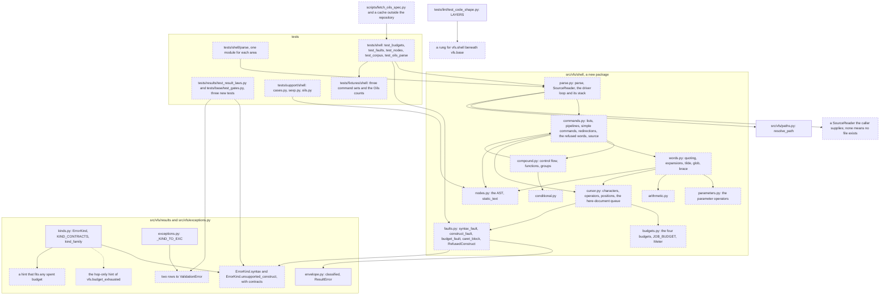

# Every bash construct parses to an AST in one pass under four counted budgets, malformed text is one `vfs.invalid.syntax` with a caret, and only the D47 and D48 words are refused as `vfs.unsupported.construct`

This is a feature. Flags: it is structural (a new package `src/vfs/shell/` and a new rung in the layer ladder); it changes the public API by two members of `ErrorKind` and by the words of one hint, and adds no name to `vfs.__all__`; it does not change the schema format, does not need the engine legs, does not touch rights and does not touch the Rust engine; it is parallel-safe with every unit drafted so far: none edits `kinds.py`, `exceptions.py` or `LAYERS`, and 167-1 adds one test to the same lint module in another place. It serves roadmap story F2, criteria 1 to 4, at gate a ([roadmap](../../context/standards/roadmap.md), lines 607 to 613). It is unit 167-4 of [the conversion map](../2026-11-25-the-backlog-converted/units.md), converted by rewrite from slice B of [the archived spec 167](../../context/specifications/archive/167-the-shell-pipeline-core/spec.md), section 2 and task 5 and 6 of its `tasks.md`, read with [the study of that source](../2026-11-25-the-backlog-converted/studies/165-181/167-the-shell-pipeline-core.md) and with [the verification of roadmap decisions D47 and D48](../2026-11-25-the-backlog-converted/decisions/f-shell-tools-guests-and-search.md). It stands on [the agent-shell memo of 2026-10-15](../../context/research/2026-10-15-the-agent-shell-prior-art-and-experiments.md), on [its grammar study](../../context/research/studies/2026-10-15-agent-shell/01-shell-grammar.md) and on the three command sets of [its parser experiment](../../context/research/studies/2026-10-15-agent-shell/experiments/s1). It depends on no spec. Roadmap decisions D47 and D48 are leans with no ruling on record; their verified texts are carried as decisions 7 to 11. Nothing waits on a ruling, and one decision, 23, is provisional. Build order: it lands at gate a, before or after the other gate-a units; [167-5](../2026-11-25-a-pipeline-runs-gated-verbs-through-cli-with-the-minimal-programs/spec.md), [167-9](../2026-11-25-the-shell-runs-control-flow-functions-arithmetic-and-arrays/spec.md) and [167-10](../2026-11-25-a-replay-corpus-measures-shell-coverage-and-a-reference-page-lists-the-surface/spec.md), none of them written yet, build on it and land after it.

## The problem

Every fact below is at commit `4a221cc3` (EXECUTED, `git rev-parse --short=8 HEAD`; the probes ran at `5b20fd4f`, and `git diff --stat 5b20fd4f HEAD -- src tests crates pyproject.toml scripts context/standards context/research` prints nothing).

1. No parser exists. EXECUTED: `ls src/vfs/shell` and `ls tests/shell` fail, `crates/vfs-core/src/` holds thirteen files and none is a shell module, and no name of `vfs` contains `shell` or is `cli`. READ: the vocabulary already describes `cli` as "a meta-verb that parses a command string into these ops" (`src/vfs/ops.py:15-17`), so the tree names a parse it cannot perform.
2. The parser's two kinds are absent. READ: `ErrorKind` has no member for a syntax fault or a refused construct (`src/vfs/results/kinds.py:64-98`), and the producer rule names only capability gates and dispatch (`kinds.py:49-50`).
3. A child kind that becomes a member loses its parent's exception class. EXECUTED (scratch probe): `exception_for_kind("vfs.invalid.syntax")` is `ValidationError` today, because an unknown child degrades to `vfs.invalid`; `exception_for_kind("vfs.invalid.unindexable_pattern")`, a member, is the base `VFSError`. READ: `kind_family` returns an exact member as itself (`kinds.py:320-323`) and the class table is keyed by that family with no walk to the parent (`src/vfs/exceptions.py:73-85`, `:97-100`). Adding the two members without two rows in that table would turn a `ValidationError` into a bare `VFSError`.
4. The one hint of `vfs.budget_exhausted` speaks of hops only. READ: "Raise the hop budget or shorten the mount chain; a retry will exhaust it again." (`kinds.py:249-254`); the kind has one producer, the router's hop budget (`src/vfs/base.py:2660-2662`), and EXECUTED: no test pins the hint's words (`grep -rn "hop budget\|shorten the mount chain" tests` matches one module docstring and one comment, and no assertion). A parser budget classified under this kind would tell an agent to shorten a mount chain.
5. The tree's gates bind a parser's shape. READ: a new package must be named on the layer ladder (`tests/lint/test_code_shape.py:43-62`), no module may exceed 1,000 lines without a baseline entry (`test_code_shape.py:70`), and coverage of `src/vfs` is held at 100% (`pyproject.toml:176`).
6. The interpreter cannot carry the depth the budget promises. EXECUTED: `sys.getrecursionlimit()` is 1,000 on the project's Python 3.13. A recursive descent spends several interpreter frames for each nested construct, so 200 levels of nesting cannot be reached by recursion (INFERRED), and a `RecursionError` would leave the parser as an unclassified raise.
7. The source admits a subset, and the later ruling admits the language. READ: slice B "admits exactly" the pipeline core and refuses the rest at parse time (source `spec.md:59`), its scope puts control flow, functions, arithmetic and `&` out (`spec.md:187`), its acceptance asks 86 of 100 (`spec.md:196`), and its never class answers `source` and `eval` as `unrecognized` (`spec.md:86`). The roadmap admits the whole language and holds the parser to 100 of 100 (`roadmap.md:51`, `:592`, `:609-613`). The decision records the source cites for its grammar were retired on 2026-10-30; what they carried is restated below as decisions.
8. The measured command set fits a static parse. EXECUTED (scratch scan of `experiments/s1/corpus.jsonl`): 100 lines, median 88 bytes, longest 336 bytes, median 11 words; one line holds `&` (id 99); no line has `jobs`, `fg`, `bg`, `disown`, `nohup`, `coproc`, `eval`, `source` or `.` as a command word; its 12 here-documents are all terminated; its one arithmetic expansion has literal operators. READ: the 14 lines the subset refused hold `for`, `while`, `if`, `case`, a function, `[[ ]]`, arithmetic, an array subscript, process substitution and `&` (`01-shell-grammar.md:157`). The coverage set of 100 lines has no refused command word either (EXECUTED, same scan), and nine of the ten malformed lines are malformed under the rules below (READ, `experiments/s1/bad.jsonl`; `01-shell-grammar.md:155`).
9. A floor for the cost of a parse in Python. EXECUTED: the standard library's `shlex.split`, a tokenizer and not a parser, takes 65 microseconds for a command of the weighted set and 0.95 seconds for a 1 MiB line of 196,608 tokens; one parsed word of one literal part, held as two slotted dataclasses and a tuple, is 223 bytes.

Why it is wrong. Nothing of the shell can be built without the tree it runs. A parser that admitted the source's subset would refuse 14 of every 100 measured lines for constructs the ruling of 2026-10-28 puts in the language. A parser that ran a line as far as its first fault would leave half of a command executed; the story asks that a refused word is refused before anything runs.

## Architecture



Terms. The line is the command text one call carries. The combined text is the line and every file it sources, each counted every time it is parsed. A fault is the one `ResultError` a parse returns in place of a tree. A token is the unit the token budget counts, defined in decision 17. A level is one open construct on the parser's stack, listed in decision 17. A command word is the first word of a simple command after its assignments, read after quote removal. A static word is a word whose text is known from the line alone: every part is a literal, a single-quoted string, or a double-quoted string of literals. A job site is one statement ended by `&`. The reader is the coroutine a caller passes so that the parser can read a sourced file. An excerpt is the piece of source text a fault shows, and the caret is the mark under the faulty character.

## Decisions

### 1. The parser is Python, in a new package `src/vfs/shell/`, on its own rung directly beneath `vfs.base`

The package holds eleven modules, each under the 1,000-line ceiling: `budgets.py`, `faults.py`, `nodes.py`, `cursor.py`, `words.py`, `parameters.py`, `arithmetic.py`, `conditional.py`, `commands.py`, `compound.py` and `parse.py`, with an `__init__.py` that re-exports `parse`, `SourceReader`, `Script` and the budget constants. The package imports `vfs.results` and `vfs.paths` and no other vfs module. `LAYERS` gains the rung `("vfs.shell",)` between the rung that ends in `vfs.chain` and `("vfs.base",)`, so that the router and the session can import the shell when `cli` lands, and the shell can never import the router. The parser is not written in the Rust crate: a line of the measured set is 88 bytes and 11 words, its parse is a fraction of a millisecond beside verb calls that last tens of milliseconds (INFERRED from problem 9; the arithmetic is under Design), and the tree it returns is walked by a Python runner. Should a measurement later say otherwise, the Python parser becomes the reference under `tests/support/oracles/` and a kernel takes its place behind the same function, as the source plans for the text programs.

Basis: the source spec, section 2 (`shell/parse.py`, `spec.md:56`) and section 4 (the Python-then-kernel path, `spec.md:81`); still true at `4a221cc3` (`ls crates/vfs-core/src` shows no shell module; the cost floor was measured by a scratch probe).

### 2. One coroutine is the whole surface: `parse(text, *, cwd="/", read=None)` returns a `Script` or one `ResultError`, and never raises for any text

`parse` takes the line as a `str`, the directory a relative `source` path is resolved against, and the reader. It returns the tree, or exactly one fault: the first in source order, whatever its kind. Inside the package a fault travels as one private exception that carries the finished `ResultError`, and `parse` is the only function that catches it; no other exception is caught, so a defect in the parser surfaces as a defect. `read=None` means that no file exists: a literal `source` then resolves as a file that is not found (decision 10). The function is a coroutine because a sourced file is read through an awaited reader and because a long parse yields to the event loop (decision 21). Nothing joins `vfs.__all__`: the package is internal until `cli` is public, and the two kinds are the only public change.

Basis: decided in drafting, because a `vfs.*` failure is a classified value and never a raise across a boundary (`src/vfs/results/envelope.py:97-105`), and roadmap F2 criterion 2 asks exactly one error per call (`roadmap.md:611`).

### 3. The parser keeps its own stack: a grammar function that can re-enter the grammar never calls another directly

Every grammar function that can open a nested construct is a generator. It yields the sub-parse it needs to one driver loop in `parse.py`, and the driver keeps the open generators in a list. The combined text is read once, left to right, and nothing is scanned a second time. The interpreter's call depth is therefore the same for a flat line and for a line nested 200 deep, the depth budget is the only bound on nesting, and no input can raise `RecursionError`. The same loop is where a parse suspends to await a sourced file (decision 9) and to yield to the event loop (decision 21). A function that cannot re-enter the grammar, such as the scan of a single-quoted string, is an ordinary function.

Basis: decided in drafting, because the interpreter's frame limit is 1,000 and the depth budget is 200 (problem 6), a declared budget and never the interpreter must be what refuses a deep line, and a `RecursionError` would be an unclassified raise that decision 2 forbids.

### 4. The grammar admitted is the whole of bash's, construct by construct, and where this table is silent the parse is the one bash 5.2 makes

Decided 2026-10-28: the shell speaks bash, the whole language, parsed statically to a tree before anything runs. The table is the contract for "every construct"; each row names the node it becomes (decision 5).

| Area | Constructs | Node |
|---|---|---|
| Lexical | blanks, `#` comments, backslash-newline, operators by longest match, reserved words recognised only unquoted and in command position | none |
| Quoting | `'…'`; `$'…'` with its C escapes decoded; `"…"`; `$"…"`; backslash | `Single`, `Double`, `Lit` |
| Parameters | `$name`, `${name}`, the positional and special parameters (`$0` to `$9`, `${10}`, `$@ $* $# $? $- $$ $!`), subscripts `${a[i]}`, `${a[@]}`, `${a[*]}` | `Param` |
| Parameter operators | default `:- - := = :? ? :+ +`; length `${#x}`; trim `# ## % %%`; replace `/ // /# /%`; slice `:o` and `:o:n`; case `^ ^^ , ,,`; transform `@Q @E @P @A @a @K @k @U @u @L`; indirection `${!x}`; name lists `${!p*}` and `${!p@}`; key lists `${!a[@]}` and `${!a[*]}` | `Param` |
| Substitution | `$( )`, backquotes, `$(( ))`, `$[ ]`, `<( )`, `>( )` | `CmdSubst`, `ArithExp`, `ProcSubst` |
| Marks left for expansion | tilde prefixes `~`, `~user`, `~+`, `~-`; glob `*`, `?`, `[…]`; extended glob `?( )`, `*( )`, `+( )`, `@( )`, `!( )`; brace `{a,b}`, `{1..9}`, `{a..e..2}` | `Tilde`, `Glob`, `ExtGlob`, `Brace` |
| Assignment | `n=v`, `n+=v`, `n[i]=v`, `n=(…)`, `n=([k]=v …)`, as a statement and as a prefix | `Assign`, `ArrayLit` |
| Simple command | words; the declaration builtins `declare`, `typeset`, `local`, `export`, `readonly` with assignment operands | `Simple`, `Decl` |
| Redirection | `<`, `>`, `>>`, `>\|`, `<>`, `<&`, `>&`, `&>`, `&>>`, `<<`, `<<-`, `<<<`; a descriptor prefix `n` or `{var}`; the close `-` and the move `m-` | `Redirect`, `HereDoc` |
| Pipeline | `\|`, `\|&`, a leading `!`, a leading `time` or `time -p` | `Pipeline`, `Stmt.negated` |
| List | `;`, newline, `&&`, `\|\|`, `&` | `AndOr`, `Stmt.background` |
| Grouping | `( list )`, `{ list; }` | `Subshell`, `Group` |
| Control flow | `if`, `elif`, `else`, `fi`; `while`; `until`; `for name in words`; `for (( ; ; ))`; `select`; `case` with `;;`, `;&` and `;;&` | `If`, `Loop`, `For`, `CFor`, `Select`, `Case` |
| Functions | `name() compound` and `function name [()] compound`, each with redirections | `FuncDef` |
| Tests | `[[ ]]` with its unary and binary operators, `=~`, `==`, `!=`, `<`, `>`, `&&`, `\|\|`, `!` and parentheses; `(( ))` | `Test`, `ArithCmd` |
| Arithmetic | literals in any base (`0x`, leading `0`, `base#n`); variables and subscripts; every operator of bash at its precedence, from `++` and `--` through `**`, the binary operators, `?:` and the assignment operators to `,` | the arithmetic nodes |
| Sourcing | `source path` and `. path` with their arguments | `Source` |

`break`, `continue`, `return`, `shift`, `let`, `wait`, `[`, `test` and every other builtin with no grammar of its own are simple commands; what they do is the runner's.

Basis: ruled, 2026-10-28, recorded in `context/standards/roadmap.md` at lines 51, 592 and 609.

### 5. The tree is frozen, slotted dataclasses; a chain is one flat node, and positions are not part of equality

`nodes.py` defines the classes named in decision 4 and listed with their fields under Design. Every node is a frozen dataclass with slots, every sequence is a tuple, and nothing in a tree is mutable. A chain of one kind is one flat node: a pipeline holds a tuple of stages, an and-or list holds its first statement and a tuple of operator and statement pairs, a run of arithmetic operators of one precedence holds its first operand and a tuple of operator and operand pairs, and an `if` holds a tuple of arms. A tree's height is therefore bounded by the depth budget and never by the length of the line, so a consumer can walk any tree `parse` returns without meeting a 50,000-deep chain. A `Stmt` and a `Word` carry the offset they began at, and a `Script` carries its text and the path it was read from; these fields are declared `compare=False`, so two trees are equal when their structure is equal. `static_text(word)` returns the text of a static word and `None` for any other; it is the one test of "literal" that the refused words, `source` and a later pre-execution summary share. This departs from the source, which draws `AndOr{op, left, right}` as a binary node and lists nodes for the subset only.

Basis: decided in drafting, because the source's node list covers the subset alone (`spec.md:58`), the ruling of 2026-10-28 admits the whole language, and a binary and-or node would make the tree's height grow with the line, which decision 3's bound exists to prevent.

### 6. Where bash settles a parse at run time, this parser settles it from the text, and each difference is recorded here

The principle (constitution, Article 3): follow Unix as completely as possible, which here means bash's grammar. The motivating constraint is the same for every row: the whole tree must exist before any verb is called, so that a refused word is refused up front and a summary of the line can be made before it runs. No row has an expiry: the static parse is the invariant the ruling of 2026-10-28 kept.

| Number | bash | Here |
|---|---|---|
| 6.1 | runs a line up to its first syntax error | a fault anywhere in the combined text refuses the whole line and nothing runs |
| 6.2 | reads `$((` as arithmetic or as a command substitution that begins with a subshell, by trial | `$((` always opens arithmetic; the other reading is written `$( (` |
| 6.3 | parses arithmetic after expansion, so an expansion may supply an operator (`$((1 $op 2))`) | arithmetic is parsed with the line; an expansion stands only where an operand may stand, and text that needs one to supply an operator is `vfs.invalid.syntax` whose `expected` is `an arithmetic operator` |
| 6.4 | takes an unterminated here-document to the end of input with a warning | it is `vfs.invalid.syntax` with `incomplete` true |
| 6.5 | parses an extended glob only after `shopt -s extglob` has run | an extended glob always parses; whether it matches is the runner's |
| 6.6 | reads a subscript as arithmetic or as a key once the array's type is known | a subscript is kept as a word, and as arithmetic too when its text is arithmetic; the runner picks by the array's type |
| 6.7 | expands aliases while reading, when they are enabled | aliases are never expanded, as in a non-interactive bash |

A carriage return is an ordinary character, as in bash; no line ending is rewritten. Decisions 7, 8, 9 and 11 record the differences that concern `&`, `source` and the refused words.

Basis: decided in drafting, because the static parse is what roadmap F2 exists to keep (`roadmap.md:590`, `:609`), Article 3 requires each deviation as a numbered decision (`context/standards/constitution.md:104`), and rows 6.2 and 6.4 are the rules the grammar study adopted from the two statically parsing shells (`01-shell-grammar.md:67`, `:234`).

### 7. `cmd &` parses as a job inside the list, numbered by its position in the parse, and `JOB_BUDGET` is a declared constant

A statement ended by `&` is a `Stmt` with `background` true and a `job` number. Job sites are numbered from 1 in the order the parser meets them across the combined text, a sourced file's sites falling where its `source` stands; the number never depends on which job finishes first. `wait`, `wait $!` and `wait %n` are simple commands. `JOB_BUDGET = 4` is declared in `budgets.py`: it is the number of jobs of one line that may run at once, further jobs waiting to start; the parser declares it and the runner enforces it. The value follows the one bounded-concurrency constant the tree has, and it is not a public name, so it may move after a measurement. At the reference deployment one line then adds at most four concurrent verb calls to a peak of about 20 a second on the shared pool, where an unbounded `for f in *; do cmd & done` would open one per match. What runs is not decided here: the implicit wait at the end of the line, the order in which job output is emitted and the status list are the run side of D47; they, and the record of the deviation from POSIX's asynchronous list, are left to 167-9.

Basis: verified lean, roadmap D47 as amended by its verification ("Jobs are numbered by their position in the parse, never by their completion order", "at most `JOB_BUDGET` jobs run at once (a declared constant; further jobs wait to start)"); precedent: the router settles every sibling before a call returns (`src/vfs/base.py:3035-3050`), the embed step bounds its concurrency by a semaphore of `EMBED_CONCURRENCY = 4` (`src/vfs/storage/backends/database/maintenance.py:762`, `embed.py:66`), and `&` is 0.2% of measured calls (`01-shell-grammar.md:42`).

### 8. Job control past the call is refused at parse time

`jobs`, `fg`, `bg`, `disown`, `nohup` and `coproc` as a command word are each one `vfs.unsupported.construct`; `coproc` is matched as the others are, so its quoted spelling is refused too. Principle: bash runs them. Deviation: the line is refused before anything runs. Constraint: one gated call returns when every job has run, so there is no terminal to bring a job to and no process that outlives the call. Expiry: none; the durable run is the background model.

Basis: verified lean, roadmap D47 as amended by its verification ("`jobs`, `fg`, `bg`, `disown`, `nohup` and `coproc` are `vfs.unsupported.construct` with the hint that the call returns when every job has run"); precedent: the two peers that accept `&` do not run it as a job, which the grammar study records as lying to the model (`01-shell-grammar.md:81`, `:83`, `:244`), and Oils replaces `&` by an explicit bounded builtin (`01-shell-grammar.md:67`).

### 9. `source` and `.` take a literal path, and the file is read through the reader and parsed in place before the line runs

When the command word is `source` or `.` and an operand follows, the first operand after an optional `--` is the path, and it must be a static word. The path is made absolute by `resolve_path` against `cwd` and passed to the reader once; the text that comes back is parsed where the statement stands, one level deeper, and becomes the `body` of a `Source` node. A sourced file's own literal `source` is resolved the same way, recursively. The combined text counts against `INPUT_BYTE_BUDGET` and `TOKEN_BUDGET`, and each sourced file is one level of `DEPTH_BUDGET`. Each distinct path is read at most once per parse: a second `source` of the same path parses the text already read, so a file that sources itself ends at the depth budget with one read. A path that is not a static word is refused, naming the expansion that computes it; a tilde counts as an expansion, because its value is the run-time `$HOME`. A relative path is refused when an earlier command of the combined text, in parse order and at any nesting, has `cd`, `pushd` or `popd` as its command word, because its address would then depend on a run-time directory; `popd` is added to the verified text because it changes the directory as `pushd` does. `source` with no operand is a simple command, and the runner answers its usage. Principle: bash resolves the path when the command is reached, searching `$PATH` and then the current directory. Deviations: the file is read before the line runs; a write to it earlier in the same line is not seen; `$PATH` is not searched; a computed path, and a relative path after a change of directory, are refused; a command word that changes the directory and is itself computed is not seen, so the file parsed is the one at `cwd`. Constraint: decision 6's. Expiry: none.

Basis: verified lean, roadmap D48 as amended by its verification ("A sourced file's own literal `source` is resolved the same way, recursively, and the combined text counts against `INPUT_BYTE_BUDGET`, `TOKEN_BUDGET` and `DEPTH_BUDGET`", "So is a relative path after a `cd` or `pushd` earlier in the same line"); precedent: Oils parses statically so that syntax errors come up front (`01-shell-grammar.md:67`), and `source` is among the builtins measured in the command corpus (`context/research/studies/2026-10-15-agent-shell/02-program-catalog.md:57`).

### 10. A sourced file that cannot be read is kept on its node, and a fault inside a sourced file refuses the line

When the reader answers with an error, or the path fails the path gate (a `vfs.invalid` carrying the gate's reason), the `Source` node carries that error as `failure` and no `body`, and the parse goes on: bash reports a missing file when the command is reached, and `[ -f lib.sh ] && source lib.sh` is the common spelling. The runner reports the failure if the statement is reached. Three families are not kept: a reader error of the family `vfs.budget_exhausted`, `vfs.timeout` or `vfs.cancelled` says that the line itself is over, and it ends the parse as the line's one fault; this is how a caller's own budget of verb calls stops a line of many `source` statements. A fault raised while parsing a sourced file's text refuses the whole line, and its `path` is the file's path, its position the position inside that file. A deferred failure discloses nothing new: it is the answer `read` gave this caller.

Basis: decided in drafting, because Article 3 keeps bash's answer where the static parse does not forbid it (a missing file is a run-time fact in bash), while decision 6.1 already settles a fault inside sourced text.

### 11. `eval` is refused in every form, and the refused set is eight constructs and no more

`eval` as a command word is one `vfs.unsupported.construct`. Principle: bash evaluates the string. Deviation: refused at parse time. Constraint: `eval` turns run-time data into commands, which no tree made before the line runs can hold. Expiry: none. The whole refused set is the enumeration `RefusedConstruct` in `faults.py`: `jobs`, `fg`, `bg`, `disown`, `nohup`, `coproc`, `eval` and `source` (the two refused forms of decision 9). A command word is matched after quote removal, so `\eval` and `"eval"` are `eval`; it is matched through the wrappers `command` and `builtin` and their `-p` and `--`, after `!` and `time`, in every stage of a pipeline and at every nesting. The check runs when the command word has been read and before the rest of the command is, so the refusal is the first fault of `eval "unclosed`. It is not matched outside command position (`echo eval`, `find . -exec`), under `command -v`, `command -V` or `type`, which name a word without running it, or when the command word is not static (`$x`), which the runner's table answers. `exec`, `trap`, `ulimit`, `umask`, `alias` and `shopt` parse as simple commands; their answers are the never table's, in 167-8.

Basis: verified lean, roadmap D48 as amended by its verification ("`eval` is `vfs.unsupported.construct` in every form"); precedent: the first grammar already refused `eval` and re-scanning (`context/research/2026-10-15-the-agent-shell-prior-art-and-experiments.md:52`, `:54`), and a static classifier of commands refuses to trust any prefix that evaluates a string (`02-program-catalog.md:89`).

### 12. `time` and `time -p` are flags on the pipeline they precede

`time` before a pipeline sets `Pipeline.timed`, and `-p` sets `Pipeline.posix_format`. It is a reserved word, never a program looked up by name and never a refused construct. The roadmap's "parses as a builtin" is read as the source's "builtin keyword".

Basis: the source spec, decision 5 and section 2 (`spec.md:24`, `:59`); still true at `4a221cc3` (the tree has no parser, and roadmap F2 criterion 4 asks the same at `roadmap.md:613`).

### 13. Malformed text is one `vfs.invalid.syntax` whose data says where, what was open, and what would be accepted

The fault's `data` carries `line` and `column` (1-based, the column in code points), `offset` (0-based code points from the start of the text the fault is in), `construct` (the token at fault or the construct left open), `expected` (what the grammar accepts there), `incomplete` (true exactly when the text ended inside an open construct or after an operator that needs an operand), and the `excerpt` and `caret` of decision 20. The position is that of the opener when a construct is left open and that of the token when a token is unexpected. The detail takes one of three forms: `` `<construct>` is not closed: expected `<expected>` ``, `` `<construct>` must be followed by <expected> ``, and `` unexpected `<construct>`: expected <expected> ``. The seven cases the roadmap names:

| Text | `construct` | `expected` | `incomplete` | Position |
|---|---|---|---|---|
| `echo "abc` | `"` | `"` | true | the opening quote |
| `cat <<EOF` and a body with no end line | `<<EOF` | `EOF` | true | the `<<` |
| `grep x f \|` | `\|` | `a command` | true | the `\|` |
| `ls && && pwd` | `&&` | `a command` | false | the second `&&` |
| `echo hi )` | `)` | `the end of the command` | false | the `)` |
| `if true; then echo` | `if` | `fi` | true | the `if` |
| `echo; done` | `done` | `a command` | false | the `done` |

Basis: the source spec, section 2, second and third bullets (`spec.md:59-60`), with the fields of the grammar study's error contract (`01-shell-grammar.md:225-229`); still true at `4a221cc3` (no producer of the kind exists; the seven cases are those of roadmap F2 criterion 2, `roadmap.md:611`).

### 14. A refused construct is one `vfs.unsupported.construct` whose reason is its detail

The fault's `data` carries `line`, `column`, `offset`, `construct` (a value of `RefusedConstruct`), `excerpt` and `caret`, and for a computed `source` path the key `expansion` naming the kind of part that computes it (`parameter expansion`, `command substitution`, `arithmetic expansion`, `process substitution`, `tilde`, `glob` or `brace expansion`). The reason is the fact's detail, so it is printed in the error line before the kind's hint: for the six job-control words, "the call returns when every job has run, so no job is left to control"; for `eval`, "the text it would run is not known before the line runs"; for a computed path, "the path is computed by a <expansion>; write a literal path"; for a relative path after a change of directory, "a relative path after cd depends on the directory at run time; write an absolute path". The roadmap's "the reason in the hint" is read as this: the contract table holds one hint for a kind, and the cause of one fact is its detail.

Basis: decided in drafting, because `KIND_CONTRACTS` carries one hint per kind and `classified` composes the message from the phrase and a path-free detail (`kinds.py:140-154`; `envelope.py:256-259`), and a load-bearing fact must be a structured field, which `construct` is (`envelope.py:97-99`).

### 15. Two kinds join the vocabulary with their contracts and their exception class, and the form kind does not

`ErrorKind.syntax = "vfs.invalid.syntax"` and `ErrorKind.unsupported_construct = "vfs.unsupported.construct"` are added. Their contracts: the phrases "Invalid syntax" and "Unsupported construct"; retry class `never` for both; the hints "Fix the command text at the reported position and send it again." and "Rewrite the command without the named construct; the message says why one call cannot run it."; and for both the `path` referent "the sourced file the fault is in; None when it is in the command line, where data carries the position". `_KIND_TO_EXC` gains a row for each, to `ValidationError`, so that the class a caller catches does not change when the kinds become members (problem 3). Neither kind joins the set that requires a detail; the parser's constructors always pass one. The producer rule in the `ErrorKind` docstring gains the sentence that the shell's parser alone emits these two kinds. `vfs.unsupported.form` is not added here: no code in this unit produces it, and it lands with its producer in 167-5, as decision 14 of [167-2](../2026-11-25-a-bytes-row-renders-a-placeholder-and-leaves-the-payload-only-when-asked/spec.md) already records. This departs from the source, whose task 5 adds all three in slice B.

Basis: decided in drafting, because a kind lands with the code that produces it, and the exception table is keyed by exact family with no walk to the parent (`exceptions.py:97-100`).

### 16. The four parser budgets keep the source's values, and an overrun is `vfs.budget_exhausted`

`INPUT_BYTE_BUDGET = 1_048_576`, `TOKEN_BUDGET = 100_000`, `DEPTH_BUDGET = 200` and `ITERATION_BUDGET = 1_000_000` are declared constants of `budgets.py`. An overrun is one `vfs.budget_exhausted` whose `data` carries `budget` (`input_bytes`, `tokens`, `depth` or `iterations`), `limit`, and the position, excerpt and caret where the overrun has one; the byte budget has none. The detail names the budget and the limit in words. The budgets bound one command line; none of them is a limit on the corpus. The values are not public names and may move after a measurement.

Basis: the source spec, section 2, fourth bullet (`spec.md:61`); still true at `4a221cc3` (roadmap F2 criterion 3 names the same four counted inputs at `roadmap.md:612`, and the peer the values come from is read at `01-shell-grammar.md:81`).

### 17. Each budget counts one named thing over the combined text

- Bytes: the UTF-8 length of the line, plus the length of each sourced text every time it is parsed. The line is measured before a character is scanned, and a sourced text before it is parsed.
- Tokens: one for each operator, each reserved word, each word part (a literal run, a quoted string, an expansion, a tilde, a glob, an extended glob or a brace run) and each operator and operand of arithmetic and of `[[ ]]`, counted wherever it stands, inside substitutions and here-document bodies as well. A part is the unit because the parser's work and the tree's size grow with parts: a word of 500,000 two-character expansions is one word and 500,000 nodes.
- Depth: one level for each open subshell, group, compound command, function body, command or process substitution, parameter-operator operand, arithmetic expansion or parenthesis, test parenthesis, right-nested arithmetic or test operator, double-quoted string, brace expansion, array literal and sourced file.
- Iterations: the number of words the brace expansions of the combined text would produce, summed over every word that holds one. A word's count is the product of its brace expansions' counts, a list's count the sum of its items', a range's count its length. The count is computed without expanding anything and stops growing one past the budget; the tree holds the brace expansion as one node whatever its count.

The 100,001st token is refused at its position, the 201st level at its opener, and the word that takes the iteration count over the budget at the word.

Basis: decided in drafting, because a budget bounds something only when the thing it counts is the thing that grows (problem 9: 223 bytes for a one-part word), and the source names the budgets without saying what each counts.

### 18. The hint of `vfs.budget_exhausted` is reworded to fit any spent budget

The contract's hint becomes "Send a smaller request, or shorten the mount chain; the same request will exhaust the budget again.", and the member's comment says a declared budget is spent, of hops or of a command's size. The alternative, a third new kind under `vfs.budget_exhausted` with a parser's hint, was weighed and not taken: the roadmap classifies each parser budget as `vfs.budget_exhausted` itself, the runner's loop and function budgets will use the same kind, a kind once shipped is never withdrawn, and a hint is code that can be corrected in every release.

Basis: decided in drafting, because the contract table is "normative and versioned with the vocabulary" and lives in code so that "a wrong word is fixable everywhere" (`kinds.py:156-157`), while a shipped kind is permanent (`kinds.py:45-47`), and no test pins the present words (problem 4).

### 19. The tree's text is never rewritten and escapes are decoded once

A node holds what bash would hold after reading: a `Single` holds its characters with `$'…'` escapes decoded, a `Lit` holds its characters with backslash escapes removed, and a here-document body holds its lines with the leading tabs of `<<-` removed and, when its delimiter was quoted, as one literal. Nothing is expanded, split or matched by the parser. Backquoted text is unescaped by POSIX's rule and then parsed as a `Script`, like `$( )`.

Basis: decided in drafting, because quote removal and escape decoding depend on the text alone, and doing them once in the parser leaves the runner no second scan of caller text, which is the rule the grammar study adopted (`01-shell-grammar.md:234`).

### 20. A fault with a position carries its own excerpt, and `caret_block` draws it as two indented lines

The `excerpt` is the line of source text that holds the fault, with each control character written as its backslash escape, cut to at most `EXCERPT_CHARACTER_BUDGET = 160` characters around the fault. `caret` is the 0-based index of the faulty character inside the excerpt. `caret_block(error)` in `faults.py` returns two lines, each indented by two spaces: the excerpt, then spaces and one `^` under the caret; it returns the empty string for an error with no excerpt. The fault carries the excerpt because a fault inside a sourced file shows text the caller did not send, and a display on the far side of a wire has no other copy. The indent is what keeps a line of caller text or file text from reading as a second error line, since every error line begins with its severity at the first column. The renderer's one-line rule for an error is untouched, and no file under `src/vfs/results/` but `kinds.py` changes: the `cli` display of 167-5 prints the block under the fault's line.

Basis: decided in drafting, because the source asks a two-line block "built from `data`" with control characters escaped (`spec.md:60`) and `_error_line` enforces one line per error so that no entry can forge a sibling (`src/vfs/results/render.py:90-120`); the excerpt's width is not a public name.

### 21. A parse yields to the event loop every 1,000 tokens

The driver awaits `asyncio.sleep(0)` each time the token count passes a multiple of `PARSE_SLICE_TOKENS = 1_000`. A line under 1,000 tokens never yields; a line at the token budget yields 100 times. Every caller on one event loop shares it, so the loop is costed as a lock: at the measured floor of about 5 microseconds a token, 100,000 tokens are at least half a second during which no other call on that loop would be served, and about 20 calls a second arrive at peak. A slice of 1,000 tokens is a few milliseconds, shorter than one verb call. A yield is also where a cancellation lands, so a long parse can be stopped.

Basis: decided in drafting, because the per-lock rule of the reference deployment costs any resource every call needs by how long it is held (`AGENTS.md`, "Per lock"), and the driver loop of decision 3 makes the yield one line.

### 22. The command sets are committed as fixtures, and expected trees are written as one-line expressions

`tests/fixtures/shell/` holds three files copied from the parser experiment: `weighted.jsonl` (100 lines), `coverage.jsonl` (100 lines) and `malformed.jsonl` (10 lines), each line an object with `id` and `cmd`. In `weighted.jsonl` 23 lines are edited: in 22 a machine-specific home directory is replaced by `/repo`, and in line 77 an account name is replaced by `owner`; no operator, quote or expansion changes, and the file holds 8,584 characters of command text (EXECUTED, scratch script). The tests read these copies and never a file under `context/`, which is due to be moved. An expected tree is written as a one-line expression by `sexp(node)` in `tests/support/shell/sexp.py`, a test-side function that is total over the node classes, walks with its own stack, and prints no position; `height(node)` beside it counts a tree's height the same way. The cases themselves live in one table, `tests/support/shell/cases.py`, from which each area's test module takes its rows.

Basis: decided in drafting, because the suite's fixtures live under `tests/fixtures/` (`pyproject.toml:154`) and test-side references live under `tests/support/`, and a dumper in `src/` would be shipped code with no caller.

### 23. The Oils spec suite is read from a cache outside the repository, and its three counts are committed

`scripts/fetch_oils_spec.py` downloads the Oils repository at one pinned commit, the commit the grammar study read (`bdc8364`, Apache-2.0), and unpacks its `spec/*.test.sh` files and its licence file into `$VFS_SHELL_CACHE`, else `~/.cache/vfs/shell`, under `oils/<commit>/`; the build re-reads the licence when it pins the full hash. `tests/support/shell/oils.py` splits each file into its cases (a case begins at a line starting `#### ` and its script ends at the first line starting `## `; INFERRED from the suite's format, and the study counted 229 files and 3,966 such cases at that commit) and skips when the cache is absent. `tests/shell/test_oils_parse.py`, marked `slow`, parses every case script and compares the per-file counts of three answers (a tree, a refused construct of decision 11, a syntax fault) with `tests/fixtures/shell/oils-parse-counts.json`, which also records the commit. No file of the suite is committed. The leg is run by hand before the pull request and its totals are written in the landing notes. Publishing them beside the run rate and naming each deliberate difference is left to 167-9, and running the fetch in CI to 167-10, where the README prints the number.

Basis: provisional, no ruling on record; the options were (a) commit the suite's files under `tests/fixtures/`, (b) read them from a cache outside the repository filled by a fetch script, with the counts committed, (c) leave the Oils parse count to the unit that first runs the suite; chosen because (a) copies a reference project's files into the tree, which the reference-repo rule forbids whatever the licence, (c) leaves the second clause of roadmap F2 criterion 1 unpinned at gate a, and (b) is the landed precedent for an outside corpus (`scripts/fetch_beir.py`; `tests/ranking/corpora.py:63-67`) and is removed by deleting one script, one module and one test.

## Intent

After this spec, a caller inside vfs hands `parse` one command line and receives either the whole line as a tree or one fact that says why there is no tree. Any bash an agent types becomes a tree: pipes, lists, redirections, here-documents, loops, conditionals, functions, arithmetic, arrays, every parameter operator and process substitution, including all 100 lines of the measured command set. A line that is malformed comes back as one `vfs.invalid.syntax` with its line, column, offset, what was open, what would be accepted, whether more text would complete it, and an excerpt with a caret. A line that uses `jobs`, `fg`, `bg`, `disown`, `nohup`, `coproc`, `eval`, or a `source` whose path cannot be known before the line runs comes back as one `vfs.unsupported.construct` that names the construct and the reason. A line too large, too deep or too wide comes back as one `vfs.budget_exhausted` naming the budget, after bounded work and never a hang. A `source` of a literal path is read once through the caller's reader and parsed in place, so the tree holds every command the line can run. Nothing runs: no verb is called by this unit, and no public method is added.

## Design

The parse surface, in `src/vfs/shell/parse.py`:

```python
SourceReader = Callable[[Path], Awaitable[str | ResultError]]

async def parse(text: str, *, cwd: str = "/", read: SourceReader | None = None) -> Script | ResultError: ...
```

The modules, with what each owns. Every one stays under 1,000 lines; `commands.py` and `words.py` are the largest and are estimated at 800 to 900 lines each.

| Module | Owns |
|---|---|
| `budgets.py` | the four budgets, `JOB_BUDGET`, `PARSE_SLICE_TOKENS`, `EXCERPT_CHARACTER_BUDGET`; `Meter`, the counters of bytes, tokens, iterations and job sites for one parse |
| `faults.py` | `RefusedConstruct`; `syntax_fault`, `construct_fault`, `budget_fault`, each building one `ResultError` through `classified`; `excerpt_of`; `caret_block`; the private `ParseStop` |
| `nodes.py` | the node classes below; `static_text` |
| `cursor.py` | the position in the text, operator recognition by longest match, comments and continuations, the queue of pending here-documents, positions as line and column; charges the meter for each token |
| `words.py` | words and their parts: quoting, `$` forms, tilde, glob, extended glob, brace detection and its count |
| `parameters.py` | `${…}` and its operators |
| `arithmetic.py` | the arithmetic grammar by precedence, chains flat |
| `conditional.py` | the `[[ ]]` grammar |
| `commands.py` | script, statements, and-or lists, pipelines, simple commands, assignments, declaration builtins, redirections, here-document bodies, the command-word check of decision 11, the `source` request of decision 9 |
| `compound.py` | `if`, loops, `for`, `select`, `case`, functions, subshells, groups, `(( ))` |
| `parse.py` | `parse`, `SourceReader`, the driver loop and its stack, the slice yield, the cache of sourced texts, the change-of-directory mark |

The node classes of `nodes.py`:

| Group | Classes and fields |
|---|---|
| Structure | `Script(stmts, text, origin)`; `Stmt(cmd, redirects, negated, background, job, offset)` |
| Commands | `Simple(assigns, words)`; `Decl(builtin, operands)`; `Pipeline(stages, stderr_seams, timed, posix_format)`; `AndOr(first, rest)`; `Subshell(body)`; `Group(body)`; `If(arms, orelse)`; `Loop(cond, body, until)`; `For(name, items, body)`; `CFor(init, cond, step, body)`; `Select(name, items, body)`; `Case(subject, arms)` with `CaseArm(patterns, body, end)`; `FuncDef(name, body)`; `Test(expr)`; `ArithCmd(expr)`; `Source(path, typed, args, body, failure)` |
| Words | `Word(parts, offset)`; `Lit(text)`; `Single(text)`; `Double(parts)`; `Param(name, subscript, op, operands)`; `CmdSubst(body)`; `ArithExp(expr)`; `ProcSubst(body, writes)`; `Tilde(user)`; `Glob(text)`; `ExtGlob(op, patterns)`; `Brace(items, range)` |
| Assignment and redirection | `Assign(name, subscript, value, append)`; `ArrayLit(items)` with `ArrayItem(key, value)`; `Subscript(word, arith)`; `Redirect(op, descriptor, variable, target)`; `HereDoc(body, strip_tabs, expands)` |
| Arithmetic | `ANum(text)`; `AVar(name, subscript)`; `AWord(word)`; `AUnary(op, operand, postfix)`; `AChain(first, rest)`; `ATernary(cond, then, orelse)`; `AAssign(op, target, value)` |
| Tests | `TWord(word)`; `TUnary(op, operand)`; `TBinary(op, left, right)`; `TNot(expr)`; `TChain(first, rest)` |

Order of work. Each step writes its tests first and sees them fail.

1. The kinds. Tests: the three tests of criteria 1 to 3. Code: the two members, their contracts, the docstring sentence and the reworded hint in `kinds.py`; the two rows in `exceptions.py`.
2. The package and its rung. The lint test fails as soon as `src/vfs/shell/__init__.py` exists without a rung; `LAYERS` gains the rung in the same step. Tests: `tests/shell/test_budgets.py` for the constants. Code: `budgets.py`.
3. The faults. Tests: `tests/shell/test_faults.py`. Code: `faults.py`.
4. The tree. Tests: `tests/shell/test_nodes.py` with `tests/support/shell/sexp.py` and the first rows of `cases.py`; the module's two tests stay red until step 8 has added the last node class. Code: `nodes.py`.
5. Words and simple commands. Tests: the quoting and expansion rows of `cases.py`, `tests/shell/parse/test_quoting.py`, `test_expansion.py`. Code: `cursor.py`, `words.py`, `parameters.py`, and the driver and the simple command of `parse.py` and `commands.py`.
6. Lists, pipelines, redirections, here-documents. Tests: `test_lists.py`, `test_pipeline.py`, `test_redirect.py`, `test_heredoc.py`. Code: the rest of `commands.py`.
7. Compound commands and functions. Tests: `test_compound.py`, `test_functions.py`. Code: `compound.py`.
8. Arithmetic, tests and arrays. Tests: `test_arithmetic.py`, `test_conditional.py`, `test_arrays.py`. Code: `arithmetic.py`, `conditional.py`.
9. The faults in place. Tests: `test_errors.py`, `test_static.py`, `test_refused.py`, `test_jobs.py`. Code: the fault sites, the command-word check and the job numbering.
10. The bounds. Tests: `test_budgets.py` under `parse/`, `test_stack.py`, `test_loop.py`, `test_total.py`. Code: the meter's refusals, the brace count, the slice yield.
11. Sourcing. Tests: `test_source.py`, with a reader made of a dictionary that counts its calls. Code: the `source` request, the cache, the change-of-directory mark.
12. The command sets. Tests: `tests/shell/test_corpus.py` over the three fixtures.
13. The Oils leg. `scripts/fetch_oils_spec.py`, `tests/support/shell/oils.py`, `tests/shell/test_oils_parse.py`, and the counts file written from one run.

What grows with input, the multiplier it rides on, and the bound.

- This unit issues no statement, opens no transaction, takes no database lock and reads no table, so no `membership_budget`, `chunked` or statement budget applies to it; per file write, per index visit, per batch and per corpus it adds nothing. The first statement a parse can cause is the read behind `source`, which is the `read` verb's own point read, made by the reader that `cli` passes under the caller's authority; roadmap F7 criterion 6 pins it there as one spied `read` (`roadmap.md:650`).
- The token loop rides per verb call. If every one of the 150,000 agent calls a day were a shell line of the measured median (88 bytes, 11 words), and a parse cost one millisecond, twenty times the tokenizer floor of problem 9 (INFERRED), the day's parsing is 150 CPU-seconds and the peak of 20 calls a second is 2% of one core. One line is bounded by `INPUT_BYTE_BUDGET` and `TOKEN_BUDGET`: at most 100,000 tokens, in 100 slices of decision 21.
- The driver's stack rides per verb call and holds at most `DEPTH_BUDGET` open constructs, a few generators each.
- The tree rides per verb call and lives for one call. Its node count is at most a small multiple of the token count; at 223 bytes for a one-part word (EXECUTED), a line at the token budget is about 25 MB of words and under 60 MB in all (INFERRED), and the median line is a few kilobytes.
- The brace count is integer arithmetic that stops one past `ITERATION_BUDGET`; no expansion is built.
- The cache of sourced texts holds each distinct file once for one parse. The reads are at most the number of distinct literal paths, itself at most `TOKEN_BUDGET // 2`, since a `source` statement costs two tokens; the caller's reader narrows this to its own budget of verb calls through decision 10. A reader returns a whole file before the byte budget can refuse it, so the size of one read is the `read` verb's own profile.
- The excerpt is at most 160 characters for each fault, and a parse returns one fault.
- Per lock: the event loop is the one shared resource a parse holds, for one slice of 1,000 tokens at a time (decision 21). A parse never waits on a writer and holds nothing across the await of a sourced read.

Gates. The branch touches `src/`, `tests/` and docstrings under `src/vfs/`, so `scripts/ci.sh` and `scripts/docs.sh check` both run before the pull request; the parser's modules are covered at 100% by the default suite, the Oils leg adding nothing to coverage.

## Scope

In: decisions 1 to 23. Files: `src/vfs/shell/__init__.py`, `budgets.py`, `faults.py`, `nodes.py`, `cursor.py`, `words.py`, `parameters.py`, `arithmetic.py`, `conditional.py`, `commands.py`, `compound.py` and `parse.py` (new); `src/vfs/results/kinds.py` and `src/vfs/exceptions.py` (edited); `tests/lint/test_code_shape.py` (one rung); `tests/results/test_result_laws.py` and `tests/base/test_gates.py` (three tests); `tests/shell/` and `tests/shell/parse/` (new); `tests/support/shell/cases.py`, `sexp.py` and `oils.py` (new); `tests/fixtures/shell/` (four files); `scripts/fetch_oils_spec.py` (new).

Out:

- Running anything: `cli`, the stage runner, the programs, `Fs`, the `cli` display that prints `caret_block`, the pre-execution summary that reads `static_text`, and the budgets of stages, arguments, verb calls and wall time. These are [167-5](../2026-11-25-a-pipeline-runs-gated-verbs-through-cli-with-the-minimal-programs/spec.md)'s, which also adds `vfs.unsupported.form` and the use of `vfs.unrecognized` for a program name.
- The never table: the answers of `exec`, `trap`, `ulimit`, `umask`, `alias`, `shopt` and the programs vfs does not run. These are [167-8](../2026-11-25-the-program-forms-set-e-and-the-never-table-answer-as-gnu-and-bash-do/spec.md)'s.
- The run side of the language: control flow, functions, arithmetic evaluation, arrays, the run of `&` and `wait` (the implicit final wait, the order of job output, the enforcement of `JOB_BUDGET`), the gated reader that `cli` passes for `source` and the report of a deferred failure, the loop and function-depth budgets, and the walk of a tree as deep as `DEPTH_BUDGET`. These are [167-9](../2026-11-25-the-shell-runs-control-flow-functions-arithmetic-and-arrays/spec.md)'s.
- The coverage harness, the published rates and the reference page: [167-10](../2026-11-25-a-replay-corpus-measures-shell-coverage-and-a-reference-page-lists-the-surface/spec.md).
- A parser kernel in the Rust crate: not planned; decision 1 names the path if a measurement asks for one.
- The renderer: no change to `src/vfs/results/render.py`, which [167-2](../2026-11-25-a-bytes-row-renders-a-placeholder-and-leaves-the-payload-only-when-asked/spec.md) and [167-3](../2026-11-25-the-verb-renderer-is-bounded-never-silent-and-marks-kind-and-rank/spec.md) edit.
- The exception class of the existing child kinds (`vfs.invalid.unindexable_pattern` raises the base class, problem 3): unchanged here.

## Acceptance criteria

Counts and states, never clocks. Paths are under `tests/`; `parse/` stands for `tests/shell/parse/`.

1. `ErrorKind.syntax` is `vfs.invalid.syntax` and `ErrorKind.unsupported_construct` is `vfs.unsupported.construct`, each has a contract of retry class `never`, and an unknown child of either degrades to it: `results/test_result_laws.py::TestKindContracts::test_the_parser_kinds_sit_under_invalid_and_unsupported`.
2. `exception_for_kind` returns `ValidationError` for both parser kinds: `base/test_gates.py::test_exception_for_kind_maps_the_parser_kinds_to_validation_error`.
3. The hint of `vfs.budget_exhausted` contains the word `request` and does not contain the word `hop`: `results/test_result_laws.py::TestKindContracts::test_the_budget_hint_names_no_single_budget`.
4. With `src/vfs/shell/` in the tree the ladder names every module and every import of the shell's modules points down it: `lint/test_code_shape.py::test_imports_point_down_the_ladder`.
5. No module of `src/vfs/shell/` exceeds 1,000 lines: `lint/test_code_shape.py::test_a_listed_module_never_grows_and_an_unlisted_one_stays_under_the_ceiling`.
6. The five declared budgets are 1,048,576 bytes, 100,000 tokens, 200 levels, 1,000,000 iterations and 4 jobs: `shell/test_budgets.py::test_the_declared_budgets`.
7. All 100 lines of `fixtures/shell/weighted.jsonl` parse to a `Script`, 100 of 100 with zero faults: `shell/test_corpus.py::test_the_weighted_set_parses_100_of_100`.
8. All 100 lines of `fixtures/shell/coverage.jsonl` parse to a `Script`: `shell/test_corpus.py::test_the_coverage_set_parses_100_of_100`.
9. Nine of the ten lines of `fixtures/shell/malformed.jsonl` are each one `vfs.invalid.syntax`, and line 9 parses: `shell/test_corpus.py::test_nine_of_the_ten_malformed_lines_are_one_syntax_fault_each`.
10. Every row of the case table parses to the expression written beside it, and the number of cases run equals the number of rows: `shell/test_nodes.py::test_every_case_parses_to_its_expression`.
11. Every node class of `vfs.shell.nodes` appears in the tree of at least one case, and `sexp` renders every node class: `shell/test_nodes.py::test_every_node_class_is_produced_by_some_case`.
12. Each quoting form (`'…'`, `$'…'` with each C escape, `"…"`, `$"…"`, backslash) parses to its parts with escapes decoded: `parse/test_quoting.py::test_each_quoting_form_parses_to_its_parts`.
13. Each parameter operator of decision 4 parses to one `Param` with its operator and operands: `parse/test_expansion.py::test_every_parameter_operator_parses_to_one_param`.
14. `$( )`, backquotes, `<( )` and `>( )` hold their bodies as a `Script`, and `$(( ))` holds arithmetic: `parse/test_expansion.py::test_substitutions_hold_their_bodies_as_trees`.
15. Each redirection operator parses with its descriptor, its variable form, its close and its move: `parse/test_redirect.py::test_every_redirection_operator_parses`.
16. Two here-documents on one line read their bodies in order, `<<-` strips leading tabs, and a quoted delimiter gives one literal body: `parse/test_heredoc.py::test_here_documents_read_their_bodies_in_order`.
17. A pipeline is one node holding its stages, its `|&` seams and its negation: `parse/test_pipeline.py::test_a_pipeline_is_one_flat_node`.
18. `time` sets `timed`, `time -p` sets `posix_format`, and neither is looked up as a program or refused: `parse/test_pipeline.py::test_time_is_a_flag_on_the_pipeline`.
19. `a && b || c ; d` is one and-or node of three statements and one statement, left to right: `parse/test_lists.py::test_an_and_or_list_is_flat_and_left_to_right`.
20. `if`, `while`, `until`, both `for` forms, `select`, `case` with its three terminators, a subshell and a group each parse to their node: `parse/test_compound.py::test_each_compound_command_parses_to_its_node`.
21. `f() { …; }` and `function f { …; }` parse to equal `FuncDef` nodes: `parse/test_functions.py::test_both_function_spellings_parse_to_one_node`.
22. Arithmetic parses by bash's precedence and associativity, in `$(( ))`, `(( ))` and `for (( ; ; ))`: `parse/test_arithmetic.py::test_arithmetic_follows_bash_precedence`.
23. `[[ ]]` parses its unary and binary operators, `=~`, parentheses and `!`: `parse/test_conditional.py::test_the_double_bracket_grammar`.
24. Array literals, keyed literals, `+=`, and subscripts kept as a word and as arithmetic all parse: `parse/test_arrays.py::test_array_literals_and_subscripts`.
25. Each row of decision 6's table answers as the table says: `parse/test_static.py::test_each_parse_time_difference_answers_as_decided`.
26. Each of the seven malformed cases of decision 13 is one `vfs.invalid.syntax` whose `line`, `column`, `offset`, `construct`, `expected` and `incomplete` equal the table's: `parse/test_errors.py::test_each_malformed_case_is_one_syntax_fault_with_its_fields`.
27. A line with two faults returns one error, the first in source order, whether that is a syntax fault or a refused construct: `parse/test_errors.py::test_two_faults_in_one_line_report_the_first_only`.
28. `caret_block` of a positioned fault is exactly two lines, each indented by two spaces, the second holding one `^` under the fault, and it is the empty string for a fault with no excerpt: `shell/test_faults.py::test_the_caret_block_is_two_indented_lines_with_the_caret_under_the_fault`.
29. An excerpt is one line of at most 160 characters with every control character escaped, for a fault at the start, the middle and the end of a 10,000-character line: `shell/test_faults.py::test_an_excerpt_is_one_bounded_line`.
30. Each of `jobs`, `fg`, `bg`, `disown`, `nohup`, `coproc` and `eval` is one `vfs.unsupported.construct` with `line`, `column`, `construct` and a reason in its message, when bare, quoted, behind `command` or `builtin`, after `!` or `time`, in a later pipeline stage, inside `$( )` and inside a function body: `parse/test_refused.py::test_each_refused_word_is_one_construct_fault_at_its_position`.
31. `echo eval`, `command -v eval`, `type jobs`, `find . -exec rm {} +`, `$x arg`, `exec 2>&1` and `trap - EXIT` each parse to a `Script`: `parse/test_refused.py::test_a_refused_word_outside_command_position_parses`.
32. `RefusedConstruct` has exactly the eight members of decision 11: `parse/test_refused.py::test_the_refused_set_is_eight_constructs`.
33. `a & b & wait` parses to three statements whose first two are jobs 1 and 2 and whose third is a simple command, and a job site inside a sourced file is numbered where its `source` stands: `parse/test_jobs.py::test_job_sites_are_numbered_in_parse_order`.
34. Each budget admits its limit and refuses one over as `vfs.budget_exhausted` naming the budget and the limit, on the inputs 1 MiB and 1 MiB plus 1 byte, 100,000 and 100,001 tokens, 200 and 201 nested subshells, and `{1..1000000}` and `{1..1000001}`: `parse/test_budgets.py::test_each_budget_admits_its_limit_and_refuses_one_over`.
35. The 201st level of each nesting form of decision 17 is refused at its opener and the 200th parses: `parse/test_budgets.py::test_the_201st_level_of_each_nesting_form_is_refused`.
36. `echo {1..1000000}` parses to a tree with the same number of nodes as `echo {1..2}`, and `{1..1001}{1..1000}` and `{1..600000} {1..400001}` are each refused: `parse/test_budgets.py::test_a_brace_expansion_is_counted_and_never_built`.
37. A line nested 200 deep, in each nesting form, parses when called with 100 interpreter frames left below the frame limit: `parse/test_stack.py::test_depth_200_parses_with_100_interpreter_frames_left`.
38. A chain of 50,000 terms has the same tree height as a chain of ten, for `&&`, `|`, `;`, arithmetic `+` and `[[ a && b ]]`: `parse/test_stack.py::test_a_long_chain_is_no_taller_than_a_short_one`.
39. A 100,000-token line lets another task on the loop run at least 100 times before `parse` returns, and a 999-token line lets it run zero times: `parse/test_loop.py::test_a_long_parse_yields_once_per_thousand_tokens`.
40. For every prefix of every line of `fixtures/shell/weighted.jsonl`, 8,584 texts in all, `parse` returns a `Script` or one fault of a parser kind and raises nothing: `parse/test_total.py::test_every_prefix_of_the_weighted_set_gets_an_answer` (marked `slow`).
41. `source lib.sh` and `. lib.sh` with `cwd="/w"` each call the reader exactly once with `/w/lib.sh` and hold the file's tree as `Source.body`: `parse/test_source.py::test_a_literal_source_is_read_once_and_parsed_in_place`.
42. A file that sources a second file that sources a third costs exactly three reader calls and nests three `Source` bodies: `parse/test_source.py::test_a_sourced_file_sources_another`.
43. A line and a sourced file whose combined bytes are one over `INPUT_BYTE_BUDGET`, and a pair whose combined tokens are one over `TOKEN_BUDGET`, are each refused as `vfs.budget_exhausted` with the sourced file as the fault's `path`: `parse/test_source.py::test_the_combined_text_counts_against_the_budgets`.
44. A file that sources itself ends as `vfs.budget_exhausted` for `depth` after exactly one reader call: `parse/test_source.py::test_a_file_that_sources_itself_ends_at_the_depth_budget`.
45. A `source` path holding a parameter expansion, a command substitution, a tilde, a glob or a brace expansion is one `vfs.unsupported.construct` whose `construct` is `source` and whose `expansion` names the part, with zero reader calls: `parse/test_source.py::test_a_computed_source_path_is_refused_naming_its_expansion`.
46. `cd /x; source lib.sh`, and the same with `pushd` and `popd`, is refused with zero reader calls, while `source lib.sh; cd /x` and `cd /x; source /abs/lib.sh` parse: `parse/test_source.py::test_a_relative_source_after_a_change_of_directory_is_refused`.
47. A reader that answers `vfs.not_found` or `vfs.permission_denied`, and `read=None`, each leave a `Source` node with that `failure`, no `body`, and the rest of the line parsed: `parse/test_source.py::test_an_unreadable_source_is_kept_on_its_node`.
48. A syntax fault and a refused word inside a sourced file each refuse the line with the file's path as the fault's `path` and the position inside the file: `parse/test_source.py::test_a_fault_inside_a_sourced_file_refuses_the_line`.
49. A reader that answers `vfs.budget_exhausted`, `vfs.timeout` or `vfs.cancelled` ends the parse with that error after exactly that one call: `parse/test_source.py::test_a_reader_that_says_the_line_is_over_ends_the_parse`.
50. With the Oils spec files at the pinned commit in the cache, each of the 3,966 case scripts of the 229 files answers a tree, a refused construct of decision 11 or a syntax fault, none raises, and the per-file counts equal `fixtures/shell/oils-parse-counts.json`: `shell/test_oils_parse.py::test_every_oils_case_gets_one_of_three_answers_and_the_counts_hold` (marked `slow`; skipped when the cache is absent).

## Landing notes

Filled in when the pull request is opened.

## One line

A new package `vfs.shell` parses any bash command line, and the literal files it sources, into one frozen tree on its own stack under four counted budgets, or returns exactly one classified fact with a caret, refusing only job control past the call, `eval`, and a `source` whose path the text does not fix.
