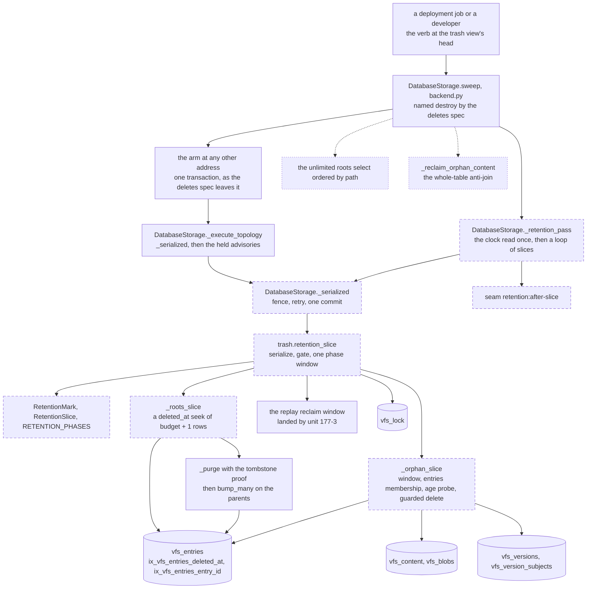

# The retention arm of the irreversible verb runs in slices of at most one membership budget, each its own transaction under the serialization point, and its orphan reclaim walks `vfs_content`, `vfs_blobs` and `vfs_versions` in `entry_id` windows instead of a whole-table anti-join

A fix to a scale profile, with one added behaviour: version rows whose file is gone join the orphan reclaim. Flags: it is not structural (two modules change, `trash.py` and `backend.py`); it does not change the public API (no argument, no field, no error kind and no op is added or renamed); it does not change the schema format; it needs the engine legs (decision 20); it touches rights only in when the gate is judged, once per slice where it was once per call, and criteria 15 and 16 are the leak and revocation pins; it does not touch the Rust engine; it is not parallel-safe with the deletes spec or with unit 177-3, which both edit the function it reshapes, so it lands after them. It serves no roadmap story by name: [the roadmap](../../context/standards/roadmap.md) places "the bounded `sweep`" at 0.2 in its table of what is deliberately not in 0.1.0 (`roadmap.md:1044`), and this unit is gate 0.2. It is converted from [spec 180](../../context/specifications/archive/180-history-pack-on-reindex-and-the-bounded-sweep/spec.md), sections 5.1 to 5.3 and 5.5, task 5 of [its task list](../../context/specifications/archive/180-history-pack-on-reindex-and-the-bounded-sweep/tasks.md) and criteria 15, 17 to 19 and 21, read through [the study of that source](../2026-11-25-the-backlog-converted/studies/165-181/180-history-pack-on-reindex-and-the-bounded-sweep.md). The depth is a rewrite: the verb's name, its callers and its arms are ruled or pending since the source was written, so the design below is stated on the retention arm alone and on what the deletes spec is relied on to leave. It stands on [the deletes memo](../../context/research/2026-11-15-deletes-tombstones-and-a-move-that-keeps-its-identity.md), on [the locality study](../../context/research/studies/2026-10-24-ostep-principles-for-vfs/04-locality-and-log-structure-ffs-lfs-ssd.md) (its principle P2, that which copy is live is answerable without a whole-table scan), on [the SQL Server membership memo](../../context/research/2026-09-04-mssql-membership-reads.md) (the 5,000-lock escalation threshold, line 197), and on a plan and statement probe run for this spec and reported under The problem. It depends on the deletes spec, which is not yet written and has no roadmap story, and for its last phase on [unit 177-3](../2026-11-25-a-keyed-call-stores-its-answer-with-its-change-and-a-resend-gets-it-back/spec.md), which [the unit map](../2026-11-25-the-backlog-converted/units.md) lists and whose spec is not yet written; the Design quotes what is relied on from each. No choice in it waits on a ruling; decision 16 is provisional.

## The problem

Facts are at commit `5b20fd4f`. The probe figures marked EXECUTED were measured at `9daedd2b`; `git diff --stat 9daedd2b 5b20fd4f -- src tests` prints nothing (EXECUTED), so they hold at the named commit. The probe ran on a file-backed SQLite through `uv run python`, counted statements and read plans, and timed nothing; it is a scratch script and is not in the repository, and criteria 1 to 9 re-measure each figure from the tree. Every plan quoted in this spec was read on a mount of 300 files, 200 of them deleted, so it shows which index a statement can use, not what a planner picks at ten million rows; criterion 19 counts the transactions on each server engine.

1. One retention pass is one transaction. READ, `src/vfs/storage/backends/database/trash.py:346-404`: `sweep_rows` takes the serialization point, runs the gate, selects the expired roots, purges them, bumps their parents and runs the orphan reclaim, and returns one `Result`. READ, `src/vfs/storage/backends/database/backend.py:844-874`, `:1455-1464` and `:1466-1512`: `DatabaseStorage.sweep` hands that function to `_execute_topology`, which runs it in one session under `_mutate` and commits once. EXECUTED: a pass over 10 expired roots and a pass over 300 each fired the engine's `begin` event once and issued 20 statements: `BEGIN` 1, `SELECT` 6, `DELETE` 9, `UPDATE` 1, and the three statements of the planner-statistics step.
2. The roots select has no limit and is read whole into memory. READ, `trash.py:389-394`: `select(...).where(entry.c.deleted_at < cutoff, tombstoned_roots(entry)).order_by(entry.c.path)`, then `.mappings().all()`. EXECUTED on SQLite: its plan is `SCAN vfs_entries USING INDEX ix_vfs_entries_path`, a walk of every entry row in path order, tombstoned or not, although `ix_vfs_entries_deleted_at` exists for this seek (READ, `src/vfs/models/rows.py:497-499`).
3. The orphan reclaim is an anti-join over two whole tables. READ, `trash.py:617-657`: for `vfs_content` and then `vfs_blobs`, one `SELECT entry_id ... WHERE NOT EXISTS (an entry with that id) AND created_at < :fence`, the result sorted in memory, then deletes by chunk. Its own docstring says the scan runs "end to end, inside the serialized transaction" and that on many millions of bodies it is "the sweep's dominant cost" (READ, `trash.py:630-637`).
4. Version rows are never reclaimed as orphans. READ, `trash.py:642`: the loop is `for body in (tables.content, tables.blobs)`. `vfs_versions` and `vfs_version_subjects` leave only with a purged entry (READ, `trash.py:606-608`).
5. The serialization point is held from the pass's first statement to its commit. READ, `trash.py:377` and `src/vfs/storage/backends/database/serialized.py:112-123`: one locking read of the mount's single lock row, "held to the end of the transaction: rival serialized verbs queue on it, and nothing else ever reads that row". The serialized verbs are delete, restore, sweep, move and copy (READ, `serialized.py:1`).
6. Statements are already chunked; the transaction is what is unbounded. READ, `trash.py:398-400` and `:551-613`: the purge runs once per `membership_budget` chunk of root ids and deletes each family once per chunk of collected rows. The flat count is pinned at 10 and at 1,000 roots under SQLite's budget (READ, `tests/storage/database/test_trash.py:1102-1120`). EXECUTED: SQLite's `membership_budget` is 32,668, so that test never crosses a chunk boundary.
7. The verb is `sweep` in the tree, a developer-plane op at rung `read_write` (READ, `src/vfs/ops.py:97`, `:165`). EXECUTED: `grep -rn '"destroy"\|def destroy' src/vfs` matches nothing.

Why this is wrong. At the reference deployment of `AGENTS.md` a mount holds 10,000,000 files, so `vfs_content` and `vfs_blobs` together hold about 10,000,000 rows. Fact 3 reads every one of them and probes `vfs_entries` for each, inside a transaction that holds the point every delete, restore, move and copy on the mount needs. Fact 2 adds a walk of the 10,000,000 entry rows and a list of every expired root in memory. `AGENTS.md` rules that a lock other callers need is never held for a batch's body or a region, and that a whole-table operation is affordable only bounded in memory and interruptible; this pass is neither. And an orphaned version row, which fact 4 leaves forever, is a body no verb can reach.

## Architecture



The node for the replay reclaim is drawn solid because another unit lands it before this build; it is not in the tree at `5b20fd4f`.

- **Retention arm.** The arm of the irreversible verb addressed at the trash view's head, `/.vfs/trash`. It destroys what has been deleted for longer than `trash_days` and reclaims rows no file owns.
- **Pass.** One call of the retention arm, from its first slice to its last.
- **Slice.** One bounded piece of a pass, in a transaction of its own that takes the serialization point as its first statement and commits before the next slice begins.
- **Budget.** `membership_budget(profile, parameter_budget)`, read from the engine host: the number of keys one `IN` list may carry on the mount's engine (READ, `src/vfs/storage/backends/database/dialects.py:760-767`). It is 1,000 on Oracle and 2,000 on SQL Server (INFERRED from `dialects.py:568`, `:639` and SQLAlchemy's parameter figure) and 32,668 on SQLite (EXECUTED).
- **Phase.** One kind of work a pass does, run as slices until it has no more: `roots`, `content`, `blobs`, `versions`, then the replay reclaim.
- **Root.** A deleted row a delete named: its `trash_root_id` is its own `entry_id` (READ, `src/vfs/storage/backends/database/descent.py:215-217`). Its set is every row sharing that `trash_root_id`.
- **Orphan.** A row of `vfs_content`, `vfs_blobs` or `vfs_versions` whose `entry_id` names no row of `vfs_entries`, live or deleted.
- **Window.** The next keys of one table after a position, in key order, at most one budget of them.
- **Fence.** The age an orphan must pass before it is reclaimed, 24 hours, so that a body an in-flight write has just stored is never taken.
- **Mark.** Where a pass stands: its phase and, in an orphan phase, the last `entry_id` a window examined. It lives in memory for the length of one call.

## Decisions

### 1. The arm this spec changes belongs to the verb that is `sweep` in the tree and `destroy` once the deletes spec lands, and this spec adds no public name.

Decided 2026-11-15: the irreversible verb is named `destroy`, and the code keeps `sweep` until the deletes spec lands, "because that spec also decides the verb's arguments, and one rename is cheaper than two". This spec is written for the retention arm under either name. Every name it adds is private and says `retention`, never `sweep` or `destroy`, so the rename and this build do not touch the same words: `retention_slice`, `RetentionMark`, `RetentionSlice`, `RETENTION_PHASES`, `_retention_pass`, and the seam `retention:after-slice`. Where the text below writes `sweep_rows` or `DatabaseStorage.sweep`, it means the function the deletes spec leaves in that place.

Basis: ruled, 2026-11-15, roadmap section 16 row D56 (`context/standards/roadmap.md:1128`) and decision 3 of the kernel rulings spec (`context/specifications/active/2026-11-15-the-kernels-public-names-and-argument-families-are-ruled.md:55-57`).

### 2. Who may call the verb is the deletes spec's to build, and this spec changes no rule of it.

Decided 2026-11-15: "destroy is only available to system when the posture is anything besides read_write, and destroy is not accessible through the cli tool". The deletes spec builds that gate. This spec takes the gate as a function it is handed, as `sweep_rows` takes `gate` today (READ, `trash.py:355`), and neither widens nor narrows it. The op stays in `DEVELOPER_OPS`, and no agent surface gains anything. No verification of rows D56 and D57 exists under the conversion's `decisions/` directory (EXECUTED, `grep -rn "D57" agents/2026-11-25-the-backlog-converted/decisions/` finds no row for it); both are marked Decided in the roadmap itself, which is the record cited.

Basis: ruled, 2026-11-15, roadmap section 16 row D57 (`context/standards/roadmap.md:1129`).

### 3. Every slice runs the verb's gate inside its own transaction, and the fence proves the caller's rights again at each commit.

The gate is called as the second statement group of each slice, after the serialization point, and each slice commits through the same fenced runner a single serialized verb uses today. A pass is many transactions, and a right can be revoked between two of them. A transaction that destroys rows must judge its caller in its own snapshot, so a revoke that commits between slices stops the pass at the next slice (decision 15). Judging once, at the first slice, would let a pass go on destroying for a caller who no longer may. The cost is the gate's statements once per slice; under the ruling of decision 2 the caller is the system actor, for whom the gate issues no statement today (EXECUTED: the six `SELECT`s of fact 1 are the lock read, the roots select, two purge collections and two anti-joins).

Basis: decided in drafting, because the fence a serialized verb commits under proves "its caller's rights still stand before it commits" for one transaction (READ, `src/vfs/storage/backends/database/authorized.py:220-239`), and a pass of many transactions keeps that rule only if each one is gated and fenced.

### 4. The retention arm always runs as slices: each slice is one transaction whose first statement takes the serialization point, and a slice works on at most one budget of units.

A unit is one root in the `roots` phase and one key examined in an orphan phase. There is no unsliced mode and no switch: a pass over three roots is one slice per phase. Between two slices the point is free, so a delete, restore, move or copy that arrived meanwhile runs before the pass goes on. The slice size is the budget and nothing else: it is the largest number of keys the slice's `IN` lists may carry on the mount's engine, so every membership predicate of a slice is one chunk, and no size is written in the code. The point is still taken first and held for the slice's body, as every serialized verb holds it; that is the tree's design for these verbs and this spec shortens the hold from a pass to a slice without changing where the lock is taken.

Basis: the source spec, section 5.1 ("A slice is at most `membership_budget` units, in its own transaction, which takes the serialization point as its first statement"); still true at `5b20fd4f` (READ, `trash.py:346-404`: the arm is one transaction; READ, `serialized.py:112-123`: the point is the first statement and is held to the commit).

### 5. A pass is a fixed sequence of phases, `roots`, `content`, `blobs`, `versions`, then each reclaim another landed spec has added to the arm, in the order those landed.

`RETENTION_PHASES` is a tuple in `trash.py`, and a pass walks it from the first name to the last. Roots come first, as today, and the orphan families follow in today's order with `versions` added after `blobs`, so the warnings of an existing pass keep their order (READ, `tests/storage/database/test_coherence.py:398-421` asserts content before blobs). A reclaim that a later spec hangs on the retention arm joins the tuple as one more name and one more slice function; decision 17 does this for the replay store.

Basis: the source spec, sections 5.2 to 5.4 (the phases `roots`, `content`, `blobs`, `versions`); still true at `5b20fd4f` (READ, `trash.py:389-403`: roots, then the orphan reclaim over content and blobs, in that order).

### 6. A roots slice seeks the oldest expired roots through the `deleted_at` index, ordered by `deleted_at` alone, and keeps no position.

The select is `WHERE deleted_at < :cutoff AND trash_root_id = entry_id ORDER BY deleted_at` with a row limit (decision 7). EXECUTED on SQLite: its plan is `SEARCH vfs_entries USING INDEX ix_vfs_entries_deleted_at (deleted_at<?)`, where today's select ordered by path is a scan (fact 2). No tie-break column is added: EXECUTED on SQLite, `ORDER BY deleted_at, entry_id` adds `USE TEMP B-TREE FOR LAST TERM OF ORDER BY`, a sort of every root sharing the oldest timestamp, and one delete batch stamps one timestamp on all of its roots (READ, `trash.py:167`, `:495`). The phase needs no position, because a purged root is gone and a root a rival revived is no longer expired: the next slice's select starts at the oldest root that remains.

Basis: the source spec, section 5.2; still true at `5b20fd4f` (EXECUTED: both plans re-read on SQLite; READ, `rows.py:497-499`: the index exists).

### 7. Every phase select asks for one row more than a slice works on, and the presence of that row is what continues the phase.

A roots select and an orphan window each carry a row limit of budget plus one. The slice works on the first budget of rows; if the extra row came back, the phase has another slice, and if not, the phase is over. A phase of N units therefore takes `max(1, ceil(N / budget))` slices, and a phase with nothing to do costs one slice of two statements. The source ends an orphan family when "a window returns fewer keys than `:slice`", which costs one more empty transaction whenever N is a multiple of the budget and cannot meet the source's own criterion 15, which counts exactly three transactions for 300 roots at a budget of 100. This decision departs from that wording and keeps the criterion.

Basis: decided in drafting, because the look-ahead row is the tree's own idiom for a bounded read that must know whether more remains (READ, `src/vfs/storage/backends/database/scope.py:365`: `.limit(limit + 1)`), and the source's criterion 15 fixes the count the source's rule cannot produce.

### 8. A root is purged with its whole set in one slice, so a slice is counted in roots and not in rows.

A slice hands its roots' ids to `_purge` as one membership chunk with the tombstone proof, exactly as today, then bumps their parents with `bump_many`. A root's set is never cut across two slices: its delete was one transaction, and if its purge were two, a `restore` between them would bring back half a tree. The honest profile follows and is written in the docstring: a slice's row count is the sum of its roots' sets, a deleted folder of any size is one unit, and `_purge` still reads the ids of that set into memory and deletes them `membership_budget` at a time inside one transaction (READ, `trash.py:590-612`). That is today's behaviour for the set and this spec does not change it; the direction, once the deletes spec has decided where a deleted row lives, is a purge of one large set leaves first behind a durable mark.

Basis: the source spec, section 5.2 ("The unit of a slice is a whole root set ... so a `restore` between slices never revives half a set"); still true at `5b20fd4f` (READ, `trash.py:551-613`: the purge and its proof; READ, `trash.py:534-548`: a restore clears a root's whole set by its id).

### 9. The retention cutoff and the orphan fence are each read from the clock once per call.

`_retention_pass` reads `datetime.now(UTC)` once and every slice derives its cutoff (`trash_days` before it) and its fence (24 hours before it) from that instant. A root deleted while the pass runs has a `deleted_at` after the cutoff and waits for the next pass. Two things follow. The set of expired roots only shrinks during a pass, so the `roots` phase ends after at most `ceil(N / budget)` slices however fast rivals delete. And a redriven slice judges age by the same instant as its first attempt.

Basis: decided in drafting, because a loop whose bound moves with the clock has no countable end, and `AGENTS.md` asks that a pin count work and never time.

### 10. The orphan reclaim walks `vfs_content`, `vfs_blobs` and `vfs_versions` by `entry_id` in windows, and no statement of it reads a whole table.

Each family is walked by its own key. A window is `SELECT entry_id FROM <family> WHERE entry_id > :after ORDER BY entry_id` with the row limit of decision 7; for `vfs_versions`, whose key is `(entry_id, version_number)`, it is `SELECT DISTINCT entry_id`. EXECUTED on SQLite, each is a covering index search: `SEARCH vfs_content USING COVERING INDEX sqlite_autoindex_vfs_content_1 (entry_id>?)`, the same on `vfs_blobs`, and `SEARCH vfs_versions USING COVERING INDEX sqlite_autoindex_vfs_versions_1 (entry_id>?)`. The anti-join is then one read inside the window: `SELECT entry_id FROM vfs_entries WHERE entry_id IN (:window)`, one membership chunk, planned as `SEARCH vfs_entries USING COVERING INDEX ix_vfs_entries_entry_id (entry_id=?)` (EXECUTED), and the difference, taken in memory over at most one budget of keys, names the candidates. A deleted entry is still an entry: the read has no liveness term, so a tombstoned file's body is never a candidate. The orphan phases run on every pass, as the reclaim does today. The honest profile is written in the docstring: a pass reads every key of the three families once, so its work is proportional to the corpus and, for `vfs_versions`, to the whole kept history, one index entry per version row; the directions are the resumption key of unit 180-5, which lets a job spread one walk over many calls, and the two the tree's docstring already names, running the reclaim rarely as its own maintenance act or reclaiming at purge time and retiring the walk (READ, `trash.py:634-637`).

Basis: the source spec, section 5.3; still true at `5b20fd4f` (EXECUTED: the four plans above; READ, `trash.py:617-657`: the anti-join this replaces; READ, `rows.py:515`, `:528`, `:545-546`: `entry_id` is the key or the key's prefix of each family).

### 11. A candidate is deleted only after an age probe and with the absence of its entry proved again inside the delete, and the count deleted is verified.

When a window has candidates, one read finds which are young: `SELECT DISTINCT entry_id FROM <family> WHERE entry_id IN (:candidates) AND created_at >= :fence`. The rest are aged, and one statement deletes them: `DELETE FROM <family> WHERE entry_id IN (:aged) AND NOT EXISTS (SELECT 1 FROM vfs_entries e WHERE e.entry_id = <family>.entry_id)`. The proof is bind-free, as `_purge`'s is, so it adds no key to the statement. The slice then checks the delete's row count where the driver reports one: equal to the number of aged keys for `vfs_content` and `vfs_blobs`, at least that number for `vfs_versions`; a shortfall raises `StaleSnapshot` and the slice redrives from a fresh window. A slice therefore issues, after the lock read, one statement when its window is empty, two when it holds no candidate, three when every candidate is young, and four when it reclaims (five for `vfs_versions`, decision 12). The source folds the age test into the delete and counts "at most three statements per family per slice"; this decision departs from it, because a delete that filters by age cannot say which keys it took, and each reclaimed key is reported (decision 13). Orphans are residue, so the common slice is the two-statement one.

Basis: decided in drafting, because a warning must name a row that was in fact reclaimed, and the tree's rule for a set-based destroy is to verify the count and redrive on a shortfall (READ, `trash.py:599-603`).

### 12. An orphaned file's version rows go together once none of them is younger than the fence, its `vfs_version_subjects` rows go in the same slice, and the answer carries one warning per file and family.

The age probe of decision 11 is by `entry_id`, so for `vfs_versions` a file with one young version row keeps all of its rows until a later pass. A version row with no `created_at`, which the mint never writes (READ, `src/vfs/storage/backends/database/versions.py:186`), counts as aged. After the version delete, one more statement deletes the subjects of the same aged keys under the same proof: `vfs_version_subjects` has no `created_at` of its own (READ, `rows.py:569-577`) and is keyed by the same `entry_id`. The warning is per `entry_id`, never per version row, so a file with ten thousand orphaned versions is one line of the answer. A subject row whose file has no version row at all is not walked: both tables lose a file's rows in the same purge chunk (READ, `trash.py:606-608`), so that residue needs a hand-written statement to exist, and a fourth walk for it is not worth a pass over the table.

Basis: decided in drafting, because the fence exists to keep an in-flight write's rows out of reach (READ, `trash.py:110-112`, `:625-628`), a file with a young row may be in flight, and the existing warning is already one per `entry_id` (READ, `trash.py:648-656`).

### 13. The 24-hour fence and the warning's kind and shape stay as they are.

`_ORPHAN_AGE_FENCE` stays `timedelta(hours=24)` and stays private to `trash.py`. Each reclaimed key is one record of kind `vfs.internal` at severity `warning`, with `data={"entry_id": ...}` and a message that names the table, built by the function that builds it today, so a version reclaim reads "... an orphaned vfs_versions row for entry ...". A pass that reclaims orphans is still a success.

Basis: the source spec, section 5.3 ("The 24-hour `_ORPHAN_AGE_FENCE` is unchanged; each reclaim is the same `internal` warning as today"); still true at `5b20fd4f` (READ, `trash.py:112`, `:648-656`; READ, `tests/storage/database/test_coherence.py:414-418`).

### 14. The answer lists the purged roots slice by slice, in path order within a slice, then the warnings in phase order, and it carries no new field.

A slice sorts its own roots by path, at most one budget of them, and the pass appends each slice's rows to the answer. Slices come oldest delete first, so across slices the order is by `deleted_at`. A pass that fits one slice returns exactly today's answer. The answer still holds one row per purged root and one warning per reclaimed key, so it grows with the garbage a pass finds, as today's does; the bound on one call's answer is the `limit=` of unit 180-5.

Basis: the source spec, section 5.2 ("Observations are each purged root, in `deleted_at` order across calls and `path` order within a slice"); still true at `5b20fd4f` (READ, `tests/support/storage_contract.py:1021-1035`: the conformance row asserts path order for a pass of one slice).

### 15. A slice that fails ends the pass, and the answer carries what the committed slices destroyed beside the failure.

A slice ends in one of three ways: it commits, the gate refuses it, or its transaction fails (a redrive exhausted, an engine error). On a refusal or a failure the pass stops, runs no further slice, and returns the rows and warnings of every committed slice together with the failing slice's errors; `success` is false. Committed slices stay committed: their rows are destroyed, and the answer is the only record of it. A caller who runs the verb again continues from what remains, because a purged root is gone and an orphan phase starts again from the first key.

Basis: decided in drafting, because the tree's one multi-transaction verb does the same, "a chunk that fails leaves its mark for the next call", and returns the failure with what it carried (READ, `backend.py:1326-1354`), and an irreversible act that hid what it had already done would leave no record.

### 16. An arm at any address other than the trash view's head, if the deletes spec keeps one, stays one transaction.

This spec slices the retention arm only. The source left open whether the arm that purges a subtree at a live path should be cut leaves first; since then the deletes memo has recommended that the irreversible act apply "only to what is already deleted", which would remove that arm. Whichever the deletes spec decides, this build does not edit that arm.

Basis: provisional, no ruling on record; the options were to leave any other arm whole-batch, as the source leaned, or to slice it leaves first by path descending so that every commit leaves a consistent tree; chosen because leaving it alone is what the tree does, changes no behaviour whether or not the arm survives the deletes spec, and a later unit can slice it without withdrawing anything this one ships.

### 17. The replay reclaim that unit 177-3 lands is the last phase of a pass, its statements unchanged, one window per slice.

Unit 177-3 is gate b and lands before any 0.2 work; its reclaim hangs on the retention arm. This build gives that reclaim a name in `RETENTION_PHASES`, after `versions`, and calls its window step once per slice, inside the slice's transaction. It edits no statement of it. The count 177-3 reports for its reclaim is summed across the pass's slices and reported under the name 177-3 gave it. If 177-3 lands the arm as whole statements, without a window, they run as one slice, also unedited.

Basis: verified lean, spec 177 section 4 as its study amends it ("The arm deletes in windows from the start ... and spec 180 adopts the arm as its `replays` phase unchanged"; `agents/2026-11-25-the-backlog-converted/studies/165-181/177-replay-the-contract-and-the-request-key.md:54`); precedent: roadmap K5 criterion 5 makes the arm's paging this unit's to finish (READ, `context/standards/roadmap.md:175`), and the 5,000-lock escalation threshold that makes an unwindowed delete a table lock on SQL Server (READ, `context/research/2026-09-04-mssql-membership-reads.md:197`).

### 18. A pass keeps its position in memory only: this spec adds no argument, no resumption key, no schema change and no error kind.

`RetentionMark` is a value `_retention_pass` holds between slices. It is not returned, not stored and not accepted from a caller. A call with no limit runs slices until every phase is done, which is the end state of today's single transaction. `limit=`, `after=`, the key's encoding and the `Result` field it rides are unit 180-5's, which serialises this mark; the kernel rulings spec has already decided that the key does not ride `next_after`.

Basis: decided in drafting, because the unit map splits the slices (this unit) from the resumable call (180-5) so that each is one pull request, and decision 5 of the kernel rulings spec leaves the key's field to the unit that adds the key (`context/specifications/active/2026-11-15-the-kernels-public-names-and-argument-families-are-ruled.md:63-65`).

### 19. Each slice commits through one shared runner, and the held advisories are taken once, on the pass's answer.

`_execute_topology` does two things today: it runs a function in a fenced, retried, serialized transaction, and it attaches the host's held advisories to the result (READ, `backend.py:1455-1464`). The first half becomes `_serialized(op, fn)`; `_execute_topology` calls it and then takes the advisories, unchanged for every other verb; `_retention_pass` calls `_serialized` once per slice and takes the advisories once at the end. A redrive after a stale snapshot then repeats one slice, never the pass.

Basis: decided in drafting, because the advisories belong to "the public verb that returns next" (READ, `backend.py:1403-1413`) and a pass is one public call, and because duplicating the fence and the execution options in a second runner is the duplicated-code smell `AGENTS.md` names.

### 20. The unit lands after the deletes spec and unit 177-3, before units 180-5 and 180-6, and it runs the four engine legs.

The deletes spec renames the verb, sets its gate and decides its arms, all in the function this unit reshapes, so it lands first. Unit 177-3 adds the replay reclaim this unit turns into a phase, so it lands first. Units 180-5 and 180-6 read this unit's mark and cutoff, so they land after. The branch touches `src/` and `tests/` and a docstring, so `scripts/ci.sh` and `scripts/docs.sh check` both run; it changes statements on the database backend, so the Postgres, MariaDB, SQL Server and Oracle legs run before the pull request.

Basis: decided in drafting, because the unit map gives this unit the deletes spec as its dependency and makes 180-5 and 180-6 depend on it (READ, `agents/2026-11-25-the-backlog-converted/units.md:233-235`), and the `AGENTS.md` tooling rules name which gate a change to `src/` and to a docstring runs.

## Intent

After this spec, a deployment job or a developer who calls the irreversible verb at the trash view gets the end state and the answer the verb gives today: every root deleted longer than `trash_days` is gone with its set, and every body with no file, older than a day, is reclaimed with a warning. What changes is what everyone else sees while it runs. A delete, a restore, a move or a copy on the same mount waits for one slice at most, where today it waits for the whole pass, including a read of every body row. A read or a plain write still never waits on the pass. No transaction of a pass grows with the garbage the mount holds: each destroys at most one budget of roots, or examines at most one budget of keys. A pass that is stopped, by a revoked right or a lost connection, has kept everything it committed, says so in its answer, and is continued by calling the verb again. And version rows whose file is gone, which nothing reclaimed before, leave with the other orphans.

## Design

**What the build stands on.** Two dependencies are not landed, so what is relied on is quoted here and a disagreement can be read off this page.

- The deletes spec, not yet written, no roadmap story. Relied on, from the kernel rulings spec decision 3: the verb "is named `destroy`; `sweep` is retired as a name when the deletes spec lands". From roadmap row D57: "destroy is only available to system when the posture is anything besides read_write, and destroy is not accessible through the cli tool". From the deletes memo, section 4: in each of the three places it weighs for a deleted row, the row stays in `vfs_entries`, and the one it recommends is "a `generation` column, 0 on a live row and the row's own number on a deleted one". This design relies on four facts of the tree that the recommended place keeps: `deleted_at` is set on a deleted row, a root is the row whose `trash_root_id` is its own `entry_id`, `ix_vfs_entries_deleted_at` serves a seek by age, and `_purge` destroys a root's set under a tombstone proof. If the deletes spec moves any of the four, decision 6's select and decision 8's purge call are re-read against it before the build; nothing else here depends on where a deleted row lives. Relied on as well: the retention arm stays addressed at the trash view's head.
- Unit 177-3, drafted in the unit map, spec not yet written. Relied on, from the study of spec 177 (its line 54): "The arm deletes in windows from the start: `SELECT request_id ... ORDER BY expires_at` with a limit of at most `membership_budget`, then the two deletes by `request_id IN (window)`, repeated until a window comes back empty."

Build order: the deletes spec, then 177-3 (gate b), then this unit, then 180-5 and 180-6.

**Files.** `src/vfs/storage/backends/database/trash.py`, `src/vfs/storage/backends/database/backend.py`, `tests/storage/database/test_trash.py`, `tests/storage/database/test_coherence.py`, `tests/storage/database/test_races.py`, `tests/storage/database/test_rights.py`. No file under `src/vfs/models/`, no `ops.py`, `params.py`, `base.py` or `storage/protocol.py`, and no page under `documentation/`: no page there describes the pass (EXECUTED, `grep -rln sweep documentation/` names only `reference/access-levels.md`, which states who may call the verb).

**Types and functions, in `trash.py`.** Under the verb's existing banner, in this order:

```python
RetentionPhase = Literal["roots", "content", "blobs", "versions"]
RETENTION_PHASES: Final[tuple[RetentionPhase, ...]] = ("roots", "content", "blobs", "versions")


class RetentionMark(NamedTuple):
    """Where a retention pass stands: its phase and, in an orphan phase, the last entry id a window examined."""

    phase: RetentionPhase
    after: str | None = None


class RetentionSlice(NamedTuple):
    """What one slice did, and the mark the pass goes on from; no mark ends the pass."""

    result: Result
    following: RetentionMark | None


async def retention_slice(
    session: AsyncSession,
    tables: VFSTables,
    profile: DialectProfile,
    membership_budget: int,
    *,
    mark: RetentionMark,
    started: datetime,
    trash_days: int,
    gate: Callable[[AsyncSession], Awaitable[list[ResultError]]] | None = None,
) -> RetentionSlice:
    """One slice of the retention arm at *mark*: the serialization point, the gate, one phase window."""
```

The literal and the tuple gain the replay phase's name from unit 177-3 (decision 17). `retention_slice` calls `serialize` first, then the gate; a refusal returns the refusal and no following mark. It then dispatches on `mark.phase` to one private helper under the trailing `# Internal helpers` banner: `_roots_slice` (decisions 6 to 8), `_orphan_slice` for the three families (decisions 10 to 12), or 177-3's window step. `_orphan_slice` takes the family's table from a private mapping of phase to table beside the tuple, so no position in a sequence stands for a table. A helper returns the slice's rows, its warnings, and whether the look-ahead row came back; `retention_slice` turns that into the following mark: the same phase with the new `after` while more remains, else the next name in `RETENTION_PHASES`, else none. `_reclaim_orphan_content` is deleted. `sweep_rows` loses its retention branch (`trash.py:388-404`) and serves only the other arm, if the deletes spec keeps one. The module docstring's paragraph on the verb and the docstrings of the changed functions are rewritten to say what a slice is, and carry the two honest profiles of decisions 8 and 10.

**Functions, in `backend.py`.** `_serialized(op, fn)` is the first half of today's `_execute_topology` (decision 19). `_retention_pass(gate)` reads the clock once, then loops: build the slice function over the current mark, run it through `_serialized`, append the outcome's errors, stop if the outcome is not a success, append its rows, take the following mark, `await seam("retention:after-slice")`. It returns one `Result` with the verb's op, the rows, the errors, the held advisories and, for the replay phase, the sum of the count each of its slices reported (decision 17). `DatabaseStorage.sweep` calls `_retention_pass` when the path is the trash view's head and is otherwise unchanged. The slice function assigns the `RetentionSlice` to a variable of the enclosing scope, as `_settled` does for a relabel step (READ, `backend.py:1341-1344`), and a redrive assigns it again.

**What each addition costs at the reference deployment.** The multiplier is per corpus: a retention pass is a whole-mount maintenance act, costed at one pass a day, and nothing here runs per verb call, per file write or per index visit. The lock is costed separately below. B is the budget.

| Addition | Grows with | Arithmetic at the reference deployment | Declared bound |
|---|---|---|---|
| Roots select, one per roots slice | nothing: a seek of B + 1 index entries | expired roots a day are not measured (the deletes memo: "The reference deployment has no row for deletes"); at the write ceiling of 1,100,000 a day as an upper bound, `ceil(1,100,000 / 1,000)` = 1,100 slices on Oracle, 550 on SQL Server, 34 at 32,668 | row limit `membership_budget + 1` |
| Purge of a slice's roots | the rows of those roots' sets | for single-file roots, one chunk: 9 deletes, 2 collections, 1 parent bump (EXECUTED, fact 1) | each `IN` list one `membership_budget` chunk through `chunked` and `membership`; the set itself is not bounded here (decision 8) |
| Orphan window, one per orphan slice | nothing: B + 1 index entries, or the version index entries of B + 1 files | about 10,000,000 body keys over `vfs_content` and `vfs_blobs`: 10,000 slices on Oracle, 5,000 on SQL Server, 307 at 32,668; `vfs_versions` has at most one key per file, 10,000,000, but one index entry per version row, which grows by up to about 1,050,000 a day with the writes | row limit `membership_budget + 1` |
| Entries membership read, one per non-empty window | nothing | at most B seeks of `ix_vfs_entries_entry_id` | one `membership_budget` chunk through `membership` |
| Age probe and guarded deletes | the candidates of one window | zero on a mount with no residue; at most B keys | one `membership_budget` chunk through `membership`; the proof adds no bind |
| A slice's keys in memory | nothing | at most B + 1 keys, B entry ids and B candidates | `membership_budget + 1` |
| The pass's answer in memory | purged roots plus reclaimed keys | one row or one warning each, as today (fact 2 holds the same roots in one list) | none in this unit; `limit=` of unit 180-5 bounds a call |
| Loop of slices | units over B | the sum of the rows above: about 21,000 short transactions for a full pass on Oracle, about 650 on Postgres | `max(1, ceil(N / membership_budget))` per phase (decisions 7 and 9) |

Total work is the same order as today's for bodies, since today's anti-join also reads every body key and probes an entry for each, plus the new walk of `vfs_versions`. What changes is that it is cut into transactions of bounded size, each interruptible between slices, with at most B + 1 keys in memory.

**The lock.** Per lock, the cost is who waits times how long. Who waits on the serialization point: the mount's other serialized verbs, delete, restore, move and copy, and nothing else, "so no write, read or rights compile waits behind a verb on any engine" (READ, `serialized.py:115-118`). At the peak of about 20 verb calls a second, about one call in four is not a read, so at most about 5 calls a second could want the point, and the share of those that are serialized verbs is not measured (the reference deployment has no row for deletes or moves). Today the hold is the pass: a hold of S seconds stalls up to 5 × S calls, and S includes a read of every body key. After this spec the hold is one slice: the lock read and at most five more statements over at most B keys for an orphan slice, or fourteen statements for a roots slice of single-file roots (INFERRED from fact 1: the 16 own statements less the two anti-joins), plus nine for each further chunk of a larger set. A read never waits on the pass, before or after. The lock is not held for the length of a commit alone, as `AGENTS.md` asks of a lock other callers need: it is taken first, as every serialized verb takes it, because the purge's correctness against a rival restore depends on it; this spec bounds the body it is held for and does not move it. On SQLite the writer transaction is the lock (READ, `serialized.py:120-121`), so there every writer waits for one slice where it waited for the pass. On SQL Server each delete statement of a slice names at most 2,000 keys, the profile's `in_list_budget`, declared to stay under the 5,000-lock escalation trigger per statement (READ, `dialects.py:319-321`); the statements are today's, and a slice holds one budget of roots' locks where the pass held all of them.

**Order of work.** Each test is written and seen failing before the code that passes it.

1. In `tests/storage/database/test_trash.py`, a helper beside `_spy` that records the engine's `begin` events and the statements into one list, so a test can split a pass into its transactions, and a fixture that narrows the budget to 100 the way `tests/storage/database/test_traverse.py:294-295` does (`replace(profile, in_list_budget=100)` behind a patched `EngineHost.profile`). Then the class `TestRetentionSlices` with the tests of criteria 1 to 6, and in `tests/storage/database/test_rights.py` the class `TestRetentionRights` with the tests of criteria 15 and 16. Criterion 15's test passes before the change, since today's gate also refuses before any row is read; it is written first as the pin the change must keep. The others fail.
2. `_serialized` in `backend.py`, with `_execute_topology` rebuilt on it; the whole suite stays green, since no behaviour moves.
3. `RetentionPhase`, `RETENTION_PHASES`, `RetentionMark`, `RetentionSlice`, `retention_slice` and `_roots_slice` in `trash.py`, with `RETENTION_PHASES` holding `roots` alone and the pass's last slice still calling `_reclaim_orphan_content` once, so the existing orphan pin stays green until step 4; `_retention_pass` and the seam in `backend.py`; the retention branch leaves `sweep_rows`. Criteria 1 to 6 and 16 pass; criteria 9, 10, 15 and 17 hold.
4. In `tests/storage/database/test_coherence.py`, the tests of criteria 7, 8 and 13, failing (criterion 13's runs on the engine legs only). Then `_orphan_slice`, the three orphan names in `RETENTION_PHASES`, and the deletion of `_reclaim_orphan_content` with the stand-in slice of step 3. They pass, and criterion 9 still holds.
5. In `tests/storage/database/test_trash.py`, the test of criterion 18, failing; then the replay phase's name and its dispatch arm. It passes, and 177-3's own reclaim test passes unedited.
6. In `tests/storage/database/test_races.py`, the tests of criteria 11, 12 and 14, and in `test_trash.py` the test of criterion 19; they run on the engine legs only.
7. Docstrings: the module's, `retention_slice`'s, the helpers'. Where roadmap story D4 has landed its 10,000-entry statement formula for this verb, the formula beside that test is rewritten to the sliced arithmetic of criterion 3.
8. `scripts/ci.sh`, `scripts/docs.sh check`, then the four engine legs.

## Scope

In: decisions 1 to 20. `src/vfs/storage/backends/database/trash.py` and `src/vfs/storage/backends/database/backend.py`; `tests/storage/database/test_trash.py`, `test_coherence.py`, `test_races.py` and `test_rights.py`.

Out:

- `limit=` and `after=` on the verb, the resumption key, its encoding and its `Result` field: [unit 180-5](../2026-11-25-a-retention-pass-resumes-from-where-the-last-call-stopped/spec.md), which serialises the `RetentionMark` of this unit.
- The gauge that counts tombstones and expired tombstones: [unit 180-6](../2026-11-25-a-gauge-reports-how-much-garbage-a-mount-holds/spec.md). It does not count orphans, which only this walk finds.
- The verb's name, who may call it, whether it has an arm at a live path, what its result says, and where a deleted row lives: the deletes spec.
- The replay store, its tables and the statements of its reclaim: [unit 177-3](../2026-11-25-a-keyed-call-stores-its-answer-with-its-change-and-a-resend-gets-it-back/spec.md). The reclaim of expired tickets, of the run ledger and of the action log, which the roadmap hangs on the same arm (rows D43 and H0's criterion 6): the stories that add them, each as one more phase under decision 5.
- Slicing the purge of one root's set, or of any arm at another address: decisions 8 and 16.
- Orphaned chunk, segment and edge rows, which the source's Scope also leaves out and this unit does not walk; and `vfs_version_subjects` rows with no version row (decision 12).
- `pack` and anything that rewrites a version row: [unit 180-3](../2026-11-25-the-full-index-pass-packs-cold-history-into-snapshots-and-verified-forward-diffs/spec.md). A retention window that deletes old versions of a live file: ruled out, the full history is kept (`context/standards/roadmap.md:1044`).
- A 10,000-entry statement pin for the verb on every engine leg: roadmap story D4.
- Running the orphan phases less often than every pass, or reclaiming at purge time and retiring the walk: the directions decision 10 names.

## Acceptance criteria

Counts and states, never clocks. "Budget 100" means the profile narrowed to `in_list_budget=100`. Unless a criterion names a caller, the caller is the system actor, whose gate issues no statement. Test names say `retention`; a test that exists today is named as the tree has it, and is read by the name the deletes spec leaves it.

1. At budget 100, a pass over 300 expired single-file roots has exactly 3 transactions that delete from `vfs_entries`, and every transaction of the pass has the `vfs_lock` read as its first statement: `tests/storage/database/test_trash.py::TestRetentionSlices::test_a_retention_pass_opens_one_transaction_per_slice`.
2. In that pass every roots select and every orphan window binds a row limit of 101, and no `IN` list of any statement holds more than 100 keys: `tests/storage/database/test_trash.py::TestRetentionSlices::test_every_retention_select_asks_for_one_budget_and_one_row`.
3. At budget 100, every transaction that deletes roots issues the same number of statements, at 300 roots and at 1,000, and a pass opens `ceil(N / 100) + T` transactions, where T is the number an empty mount's pass opens, counted in the same test: `tests/storage/database/test_trash.py::TestRetentionSlices::test_a_retention_pass_spends_the_same_statements_per_slice_at_any_garbage_size`.
4. At budget 100, one deleted directory holding 250 files is purged by exactly one transaction, in 3 deletes on `vfs_entries`, and 0 rows of its set remain: `tests/storage/database/test_trash.py::TestRetentionSlices::test_a_root_set_larger_than_the_budget_is_purged_in_one_slice`.
5. With `trash_days=0` at budget 100 and 150 expired roots, a file deleted at the first firing of the seam `retention:after-slice` is still a tombstone after the pass, and the answer holds exactly 150 rows: `tests/storage/database/test_trash.py::TestRetentionSlices::test_a_root_deleted_during_a_pass_waits_for_the_next_pass`.
6. At budget 100, with 100 roots under `/z` deleted before 100 roots under `/a`, the answer's first 100 rows are the `/z` paths in path order and its next 100 the `/a` paths in path order: `tests/storage/database/test_trash.py::TestRetentionSlices::test_a_pass_answers_slice_by_slice_and_by_path_within_a_slice`.
7. Three version rows of two entry ids that name no entry, aged 25 hours, with two subject rows, are gone after a pass, a one-hour-old orphan version row and a live file's version row remain, and the answer carries exactly 2 warnings of kind `vfs.internal`, each naming one entry id and `vfs_versions`: `tests/storage/database/test_coherence.py::TestWriteVsTopologyCoherence::test_a_retention_pass_reclaims_aged_orphan_version_rows_with_their_subjects`.
8. At budget 100, with 250 live files, three aged orphan content rows, one aged orphan blob row and two aged orphan version entries, the answer carries exactly 6 warnings in the order content, blobs, versions; the `vfs_content` phase opens `ceil(K / 100)` transactions for the K content keys the test counts; and after the lock read a transaction of an orphan phase issues exactly 2 statements when its window holds no orphan, 4 when it reclaims from `vfs_content` or `vfs_blobs`, and 5 when it reclaims from `vfs_versions`: `tests/storage/database/test_coherence.py::TestWriteVsTopologyCoherence::test_a_retention_pass_reclaims_orphans_of_three_families_in_windows`.
9. The existing orphan pin passes unedited: `tests/storage/database/test_coherence.py::TestWriteVsTopologyCoherence::test_sweep_reclaims_only_aged_orphan_bodies`.
10. The retention rows of the conformance battery pass unedited on the memory, SQLite, Postgres, MariaDB, SQL Server and Oracle legs: `tests/support/storage_contract.py::StorageContract::test_sweep_drops_expired_roots_with_their_sets`, `::test_sweep_retains_young_roots` and `::test_sweep_of_a_never_used_trash_is_an_idempotent_no_op`, through the six conformance classes of `tests/storage/test_conformance.py`.
11. On each server engine at budget 100, a deleted directory restored at the first firing of `retention:after-slice`, before the slice that would purge it, is live with all 3 of its files after the pass, and the answer holds exactly the 100 rows of the first slice: `tests/storage/database/test_races.py::TestPurgeWindows::test_a_restore_between_retention_slices_survives_whole`, parametrized over `ENGINE_LEGS`.
12. On each server engine at budget 100, a `write` to an expired root's path at the first firing of `retention:after-slice`, before the slice that would purge it, leaves that file live with the new body, and the answer holds exactly the 100 rows of the first slice: `tests/storage/database/test_races.py::TestPurgeWindows::test_a_revive_between_retention_slices_survives`, parametrized over `ENGINE_LEGS`.
13. On each server engine, one aged orphan row in each of `vfs_content`, `vfs_blobs` and `vfs_versions` is reclaimed by a pass with exactly 3 warnings, and a young one in each remains: `tests/storage/database/test_coherence.py::test_aged_orphans_of_three_families_are_reclaimed_on_every_server_engine`, parametrized over `ENGINE_LEGS`.
14. On each server engine at budget 100 with 150 expired roots, a rival `delete` of a live file, driven at the first firing of `retention:after-slice` and awaited there under the test's own deadline, returns success while the pass has 50 roots still to purge: `tests/storage/database/test_races.py::TestPurgeWindows::test_a_rival_delete_lands_between_two_retention_slices`, parametrized over `ENGINE_LEGS`.
15. A caller the gate refuses, on a mount holding expired roots that caller cannot see and one aged orphan, gets an answer with 0 rows and 0 warnings whose errors equal, in kind and message, the errors the same caller gets on a mount with an empty trash, and no `DELETE` is issued: `tests/storage/database/test_rights.py::TestRetentionRights::test_a_refused_retention_pass_names_no_row_and_reclaims_nothing`.
16. At budget 100 with 300 expired roots, a rights change committed at the first firing of `retention:after-slice` that makes the gate refuse the caller ends the pass: the answer is not a success, holds exactly 100 rows and the gate's refusal, 200 expired roots remain, and no `DELETE` is issued after the refusal: `tests/storage/database/test_rights.py::TestRetentionRights::test_a_rights_change_between_slices_ends_the_pass_with_what_committed`.
17. The existing flat-count pin and the two op-class pins pass unedited: `tests/storage/database/test_trash.py::TestScale::test_a_retention_sweep_issues_a_flat_number_of_statements_in_roots`, `tests/test_ops.py::test_sweep_and_mount_policy_are_developer_plane_ops` and `tests/test_ops.py::test_no_agent_surface_op_ever_dispatches_sweep`.
18. At budget 100 with 250 expired replay heads, the replay deletes fall in exactly 3 transactions, each after the last transaction that reads `vfs_versions`, and the count the answer reports for the replay reclaim is 250: `tests/storage/database/test_trash.py::TestRetentionSlices::test_the_replay_reclaim_is_the_last_phase_one_window_per_slice`.
19. On each server engine at its own budget, a pass over 2,500 expired single-file roots has exactly `ceil(2500 / membership_budget)` transactions that delete from `vfs_entries`, the budget read from the engine host: `tests/storage/database/test_trash.py::TestRetentionSlices::test_the_roots_phase_takes_one_transaction_per_native_budget`, parametrized over `ENGINE_LEGS` and marked `slow`.

## Landing notes

Filled in when the pull request is opened.

## One line

A retention pass becomes a loop of short serialized transactions, one budget of roots or of keys each, so that no delete, restore, move or copy waits for more than a slice, no statement reads a whole table, and orphaned version rows are reclaimed with the bodies.
