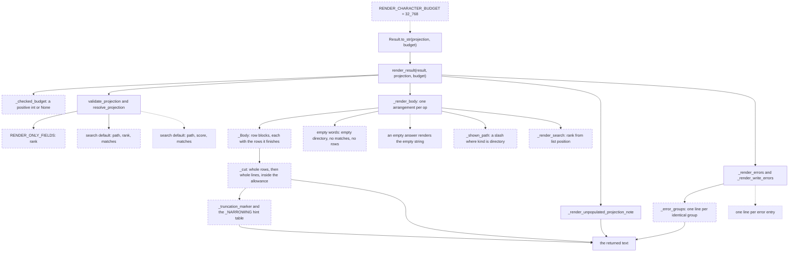

# A rendered result stops at a declared character budget with one marker, says when it is empty, marks directories with a slash, prints identical fan-out errors once, and ranks search hits by position

This is a feature in `src/vfs/results/render.py`, `src/vfs/results/projection.py` and `Result.to_str`. Flags: it changes the public API (`budget=` on `Result.to_str`, the default `search` projection, the projection name `rank`); it is not structural; it does not change the schema format; it needs no engine legs, because it adds and changes no statement; it touches neither rights nor the engine; it is not parallel-safe with units 167-1 and 167-2, which edit the same files. It serves roadmap story F1, criterion 3, at gate a (READ, `context/standards/roadmap.md:600-605`). It is converted from [spec 167](../../context/specifications/archive/167-the-shell-pipeline-core/spec.md) (slice A items 4 and 5 at `:51-52`, acceptance criterion 3 at `:195`, task 3 at `tasks.md:9`) and from all of [spec 155](../../context/specifications/archive/155-the-text-renderer-for-agents/spec.md), which folded itself into that slice; the studies are [the 167 study](../2026-11-25-the-backlog-converted/studies/165-181/167-the-shell-pipeline-core.md) and [the 155 study](../2026-11-25-the-backlog-converted/studies/051-162/155-the-text-renderer-for-agents.md), and the unit is key 167-3 of [the unit map](../2026-11-25-the-backlog-converted/units.md). It stands on [the 2026-10-08 integration memo](../../context/research/2026-10-08-smartowl-workspace-integration-issues.md), items 9 to 13. It depends on nothing that is not landed: the one-line error format and its contract hints are landed by [archived spec 154](../../context/specifications/archive/154-errors-are-facts/spec.md), and the rank-ordered `search` arrangement by [archived spec 133](../../context/specifications/archive/133-glean-previews-and-renderer/spec.md). Build order: no predecessor. Two sibling units, both drafted and not built and neither needed first, edit the same files: [167-1](../2026-11-25-the-dead-run-verb-leaves-every-face/spec.md) removes the `run` row of `_DEFAULT_PROJECTION` (its Design, `projection.py:57`) and rewrites assertions in `tests/test_ops.py`, and [167-2](../2026-11-25-a-bytes-row-renders-a-placeholder-and-leaves-the-payload-only-when-asked/spec.md) changes `_render_read`, `_render_block` and the cells of `_render_rows` (its decisions 5 and 6, through two helpers, `_read_body` and `_row_field`). Nothing here relies on a decision of either: the three land in any order and the later ones rebase, each keeping the other's change to a shared function. No ruling is awaited: the one product choice no record settles, the marker's paging hint, is decision 7, provisional and reversible.

## The problem

The tree was read at commit `5b20fd4f` (EXECUTED, `git rev-parse --short=8 HEAD`); `src/` and `tests/` are unchanged since `9daedd2b`, where the reading began (EXECUTED, `git diff --stat 9daedd2b HEAD -- src tests` prints nothing). `Result.to_str()` is the only text a caller reads, and five things about it are wrong today.

1. Nothing bounds it. `render_result(result, *, projection=None)` and `Result.to_str(*, projection=None)` take no budget (READ, `src/vfs/results/render.py:42`, `src/vfs/results/envelope.py:799-805`; EXECUTED, `inspect.signature` on both). No `RENDER_CHARACTER_BUDGET` exists (EXECUTED, `hasattr(vfs.results.render, "RENDER_CHARACTER_BUDGET")` is `False`). A 5,000-line file read through the synchronous face renders 48,889 characters, whole (EXECUTED, scratch probe). The memo measured 83,890 characters from one `read` and 172,782 from one unscoped `grep` (READ, `context/research/2026-10-08-smartowl-workspace-integration-issues.md:90`). One call can fill a caller's context window, and every host has to build its own cap.
2. An empty answer is the empty string. `ls` and `tree` of an empty directory, a `glob` with no match and a `grep` with no match each render `''` with `success` true (EXECUTED, scratch probe). Of the 25 ops, nine render an empty successful result as `''`: `glob`, `grep`, `ls`, `read`, `run`, `search`, `stat`, `traverse`, `tree`; a cross-op merge does too (EXECUTED, a loop over `ALL_OPS`). The code paths are `_render_rows` (READ, `render.py:234-237`), `_render_read` (`:312-313`), `_render_tree` (`:480-498`) and `_render_traverse` (`:515-516`); two tests pin the empty string (READ, `tests/results/test_render.py:374-375`, `:484-485`). A caller cannot tell "nothing there" from "the tool said nothing".
3. A directory and a file look the same. `ls /mine` prints `/mine/empty` for a row whose `kind` is `directory` and `/mine/notes.md` for a file (EXECUTED, scratch probe). `_render_rows` prints `o.path` bare (READ, `render.py:235`) and `_render_tree` prints path segments without reading `kind` (`:478-498`). Every row carries its kind: the database backend always fetches it (READ, `src/vfs/storage/backends/database/reads.py:109`) and the in-memory backend stamps it (READ, `src/vfs/models/entry.py:292`; EXECUTED, the probe's rows).
4. One failure prints once per mount. Three errors equal in kind, severity and message, from the mounts `/`, `/course` and `/mine`, render three lines that differ only in `mount <source>` (EXECUTED, scratch probe). `_render_errors` prints one line per entry (READ, `render.py:82-87`). The only grouping in the tree is the wire rollup `_rolled_errors`, applied by `to_payload(max_errors=...)` and never by the text (READ, `envelope.py:741-747`, `:815-839`).
5. The lowest search hit reads as irrelevant. Scores are min-max scaled before they reach the row, so the lowest hit of a set that is not flat is exactly 0 (READ, `src/vfs/storage/ranking.py:71-79`, `src/vfs/rerank.py:340-342`, `src/vfs/storage/backends/database/search.py:885`). The default `search` projection is `("path", "score", "matches")` (READ, `src/vfs/results/projection.py:52`) and the header prints `score=` with four decimals (READ, `render.py:457-460`), so two hits scored 1.0 and 0.0 render `/z.md  score=1.0000` and `/a.md  score=0.0000` (EXECUTED, scratch probe). `rank` is not a projection name: `validate_projection(("path", "rank"))` raises `ValueError: unknown field 'rank'` (EXECUTED).

No surface passes a budget today, because none exists: `src/vfs/shell` and `src/vfs/mcp` are absent and no method is named `cli` (EXECUTED, `ls`, `grep -rn "def cli"`). The projection is a render-side argument only: `resolve_projection` is called from `render.py` and nowhere else, and a verb's `columns=` reaches the backends through `effective_columns`, which keeps only entry fields (READ, `reads.py:130-144`; EXECUTED, `grep -rn resolve_projection src`).

## Architecture

- The body is the text an arrangement draws for the rows of a result. The tail is what follows it today: the unpopulated-projection note and the errors section, each after one blank line.
- A row is one observation. For the grant verbs, whose answer is a table of `grants=` or `members=` entries, a row is one entry.
- A row block is a run of whole lines of the body that finishes some number of rows; the body is an ordered list of row blocks and one separator.
- The marker is the one line the renderer adds when it cuts a body. The allowance is the number of body characters that still fit once the marker and the tail are counted.
- A render-only name is a projection name that selects a column the renderer synthesizes; it is not a field of `Observation` and no backend fetches it.

## Decisions

### 1. `render_result` and `Result.to_str` take `budget=`, a count of characters, and `None`, the default, renders everything

The signatures are `render_result(result, *, projection=None, budget=None)` and `Result.to_str(self, *, projection=None, budget=None)`. `Result.__str__` keeps calling `to_str()` with no budget. A caller that does not ask gets today's text, so no existing caller changes. The budget counts characters, as `len` of the returned `str` does, because that is what a context window and a wire cap are measured against at the renderer; bytes are a transport's concern.

Basis: the source spec, 167 slice A item 4 (`:51`); still true at `5b20fd4f` (EXECUTED, both signatures printed with no `budget`).

### 2. The declared budget is `RENDER_CHARACTER_BUDGET = 32_768` in `vfs.results.render`, and nothing in `src/` passes it in this change

Decided 2026-10-15: the render cap is 32,768 characters, and it is opt-in. The constant is a module constant of `render.py`, typed `Final[int]`, and is not re-exported from `vfs.results`: the surfaces that will pass it import it from the module that owns the cut. No surface exists at `5b20fd4f` to pass it, so this change declares the constant and pins it against the roadmap's figure in one test.

Basis: ruled, 2026-10-15, recorded in the archived spec 155 at `context/specifications/archive/155-the-text-renderer-for-agents/spec.md:5` and carried by roadmap story F1 criterion 3 (`context/standards/roadmap.md:605`).

### 3. A budget bounds the whole returned text whenever the parts that are never cut fit inside it

When the unbudgeted text is at most `budget` characters, it is returned unchanged, character for character. Otherwise the body is cut so that the kept body, the marker and the tail together are at most `budget` characters. When the marker and the tail alone are longer than the budget, the body is cut to nothing and the marker and the tail are returned whole; the text is then longer than the budget by exactly their excess. The reason: a surface with a hard cap needs the sum bounded. A budget that bounded the body alone would leave every surface to subtract the marker, the note and the errors itself. This departs from spec 155's first criterion and spec 171's criterion 4, which both say "at most N characters plus" the marker line; both remain true, as weaker upper bounds.

Basis: decided in drafting, because the title's promise is about the text a caller receives, and the 155 and 171 wordings are satisfied by the stricter bound.

### 4. The cut keeps whole rows in render order, then whole lines of the first row that does not fit, and never ends inside a line

The renderer keeps row blocks from the top while they fit the allowance. From the first block that does not fit it keeps the longest prefix of whole lines that still fits, which may be no line. A line that is by itself longer than the remaining allowance is removed whole, so a one-line body larger than the budget renders as the marker alone. Cutting inside a line would hand the caller half a path, half a table row or half a statement that reads as complete.

Basis: the source spec, 167 slice A item 4 (`:51`) and 155 rule 1 (`:20`), "cut at a line boundary"; still true at `5b20fd4f` (roadmap F1 criterion 3 repeats it; READ, `roadmap.md:605`).

### 5. A cut body ends with exactly one marker, `[output truncated: N characters removed, R rows remaining]`, on its own line

Decided 2026-10-15: one canonical marker that names the characters removed and the rows remaining, in place of spec 155's six per-verb notes. The marker is the line directly after the kept body, before the tail; when no body line is kept it is the first line. N is the length of the unbudgeted body minus the length of the kept body, so separators between removed blocks count and the marker itself does not. R is the number of rows whose text the cut removed in whole or in part; a row that draws no line in the unbudgeted body is not counted. Both are plain decimal integers with no separator, and the nouns agree in number through the module's `_pluralize` (`1 character`, `1 row`). A hint may follow R inside the brackets, after `; `, as decision 7 says. A body that is not cut carries no marker. File content is printed verbatim, so the marker is recognized by its position, the last line of the body, and not by its text alone.

Basis: ruled, 2026-10-15, recorded at `context/specifications/archive/155-the-text-renderer-for-agents/spec.md:5` and carried by roadmap story F1 criterion 3 (`context/standards/roadmap.md:605`), which fixes the two counts; their arithmetic is fixed here.

### 6. The errors section and the unpopulated-projection note are never cut, whatever the budget

Every error line of the unbudgeted text is in the budgeted text, whole and in the same order, and so is the note. A cut that dropped an error would turn a partial failure into an apparent success in the one text the caller reads. The profile is stated plainly in the docstring: the errors section grows with the number of distinct failures, so a 10,000-row batch whose every row fails at its own path renders 10,000 error lines under any budget. The collapse of decision 15 shortens it only where failures are identical. A surface that must bound the error lines too does so itself, as the wire already does with `to_payload(max_errors=...)`.

Basis: the source spec, 167 slice A item 4 (`:51`), "The errors section is never cut"; still true at `5b20fd4f` (roadmap F1 criterion 3 repeats it; READ, `roadmap.md:605`).

### 7. The marker's paging hint is chosen by the verb, from one table of the arguments that verb takes today, and a verb with no narrowing argument gets no hint

The source disagrees with itself: spec 167 slice A writes one shell hint for every surface (`page with head, tail or sed -n`, `:51`), and spec 171 section 2.4 makes the hint follow the op (`context/specifications/archive/171-the-mcp-adapter-and-the-cli-tool/spec.md:148`). This spec takes the second shape. The table `_NARROWING` in `render.py` maps an op to the arguments it names and the phrase printed after `; `:

| Op | Arguments named | Hint |
|---|---|---|
| `ls` | none | `list a subdirectory` |
| `tree` | `max_depth` | `lower max_depth` |
| `glob` | `paths`, `max_count` | `scope with paths or set max_count` |
| `grep` | `paths`, `ext`, `globs`, `max_count` | `scope with paths, add ext or globs, or set max_count` |
| `search` | `paths`, `ext`, `globs`, `limit` | `scope with paths, add ext or globs, or lower limit` |
| `traverse` | `depth` | `lower depth` |

Every other op, `read` and `stat` among them, closes the marker after the two counts. Every argument in the table is a parameter of its verb at `5b20fd4f` (READ, `src/vfs/params.py:158-163`, `:243-292`, `:293-330`), and a drift test holds the table to `PARAMS`. A shell hint at gate a would name three programs that no caller can run, since no shell exists until gate b. The fixed part of the marker, which is all that F1 pins, is the same under either shape, so a ruling for one shell hint replaces this table with one constant and changes no other line. The unit that adds the `cli` arrangement adds its own row; the units that add `read(range=)` and the listing `after=` add theirs.

Basis: provisional, no ruling on record; the options were one shell-shaped hint on every surface, or a hint chosen by the surface; chosen because a hint keyed by the verb names only arguments that exist at this commit, matches how the error lines already hint in vfs's own verbs, and reverses to the other option by collapsing one table to one constant.

### 8. A budget that is not a positive integer raises, on every arrangement

`budget` is `None` or an `int` of at least 1. A `bool`, a `float` or a `str` raises `TypeError`; an integer below 1 raises `ValueError`. The check runs before any arrangement is chosen, so it raises on a `write` result and on a failed result too, where the budget would otherwise be ignored. This is the rule the projection already follows: a bad argument fails the same way whatever result it lands on (READ, `render.py:54-56`).

Basis: decided in drafting, because `validate_projection` already raises `TypeError` and `ValueError` for a bad render argument on every path (READ, `projection.py:102-121`), and a silently ignored bound is the failure this spec removes.

### 9. The cut changes text only: the envelope keeps every row and every error, and no fact is minted

`to_str(budget=...)` reads the result and returns a string. It adds no entry to `errors`, changes no row, and leaves `to_payload()` equal before and after. In particular it does not add a `vfs.budget_exhausted.truncated` entry: that kind records a cut of the result itself by a runtime budget (READ, `src/vfs/results/kinds.py:88`), and here the result is whole. A surface that also cuts its structured payload says so in that payload.

Basis: decided in drafting, because rendering is declared pure (READ, `render.py:9-10`) and spec 155 keeps the envelope, the wire format and the storage untouched (`:8`).

### 10. Every arrangement returns its body as row blocks, so the cut counts rows without parsing text and never builds the full body when it cuts

Each `_render_*` arrangement returns a `_Body`: a list of `_Block(text, rows)` and the separator between blocks. `render_result` joins them when no cut is needed and hands them to `_cut` when one is. This departs from spec 155's sketch, a `_truncate(text, budget, note)` over a fully joined body: a joined string cannot say how many rows it lost, and joining a 10,000-row body to discard nine tenths of it copies what is thrown away. The profile that remains is stated in the `render_result` docstring: every row is still drawn into its block before the cut, so a budgeted render costs in proportion to the rows of the result, not to the budget. A renderer that stops drawing once the allowance is spent is the future direction; it is not a declared limit.

Basis: decided in drafting, because F1 pins a count of rows remaining and AGENTS.md's production posture asks that a profile that is not optimal at scale be stated and its direction named, never turned into a limit (the 155 study's choice 7 verifies the same reading).

### 11. A listing with no rows renders `(empty directory)` and a match set with no rows renders `(no matches)`

A successful `ls` or `tree` with no observations renders `(empty directory)`. A successful `glob`, `grep` or `search` with no observations renders `(no matches)`. The word is the body, so warnings and info records still follow it after a blank line. A failed result with no observations renders its errors alone, as today, and no word. The test is the absence of observations, not an empty drawing: a `grep` whose rows exist but whose projected columns are unpopulated keeps today's note and gains no word.

Basis: the source spec, 155 rule 2 (`:27`); still true at `5b20fd4f` (EXECUTED, the five verbs render `''` when empty).

### 12. Every other read arrangement with no rows renders `(no rows)`, so no successful result renders the empty string

A successful `read`, `stat` or `traverse` with no observations, an op this client does not know, and a cross-op merge render `(no rows)`. The words the other arrangements already print stay as they are: `No changes` for a mutation, `No grants` and `No members` for the grant tables, `write: nothing to do` for a write (READ, `render.py:581-582`, `:607-608`, `:633-634`). This goes one word beyond the source, which names two words for five verbs and leaves four arrangements silent; neither of its words fits a walk or a read.

Basis: decided in drafting, because the rule the source states is that the text is never silent, and four of the nine silent ops fall outside its two words (EXECUTED, the loop over `ALL_OPS`).

### 13. In the text of `ls`, `glob` and `tree`, a row whose own `kind` is `directory` prints its path with a trailing `/`

The slash is added to the rendered path only: the one-path-per-line list, the `path` cell of a table, and the node name in a tree. The row's `path` field is unchanged. It is read from the row's own `kind` and never inferred: a row whose `kind` is not populated prints bare, and a tree segment that no row stands for, an ancestor drawn only because a descendant was returned, prints bare. The root `/` never becomes `//`. Other verbs print paths as they do today: `stat` already prints `kind` on its own line, and `grep` and `search` rows are files.

Basis: the source spec, 155 rule 3 (`:28`); still true at `5b20fd4f` (EXECUTED, a directory row prints bare; READ, `reads.py:109`, every row carries `kind`).

### 14. The empty words, the slash, the collapse and the rank column belong to the verb arrangements; a `cli` result will print what bash prints and takes only the budget

Decided 2026-10-15: the `cli` surface prints exactly what bash prints, nothing for an empty `ls` and no trailing slash without `-F`, and the markers of spec 155 stay on the verb tools. Nothing in this change draws a `cli` result, because the op does not exist yet. What this change guarantees is the seam: each decoration is chosen by the op inside `_render_body`, so an op with its own arrangement receives none of them unless that arrangement asks.

Basis: verified lean, the 155 study's choice 6 (holds); precedent: `context/specifications/archive/167-the-shell-pipeline-core/spec.md:21`, the decision of 2026-10-15, and for the verb side the memo's items 10 and 11 (`context/research/2026-10-08-smartowl-workspace-integration-issues.md:96-106`).

### 15. Errors equal in `(kind, severity, retryable, path, message)` print as one line that names every mount, and an entry carrying `data` is never merged

The grouping is in the text only; `Result.errors` keeps every entry, and value identity and the wire are unchanged. A group takes the place of its first member in today's order: fatal first, then warnings, then info, each tier in arrival order. Its line is the member's line with one change to the locus: when the group has a path, the path, as today; otherwise ` mount <source>` for one distinct source and ` mounts <a>, <b>, <c>` for several, each distinct source once, in arrival order; no locus when no member has a source. An entry whose `data` is not empty is printed alone, so a `vfs.target` second entry and a `vfs.rollup` count are never merged away, and a rollup line keeps its `[+N more rolled up]` suffix. The same grouping serves the `write errors:` block. Exact duplicates, equal in source too, print once.

Basis: verified lean, the 155 study's choice 5 (holds); precedent: the wire rollup already groups on `(kind, severity, retryable)` and keeps every fact on the envelope (`src/vfs/results/envelope.py:815-839`), and `_error_line` draws its target and rollup suffix from `data` (`src/vfs/results/render.py:111-121`).

### 16. `rank` is a render-only projection name, declared in `RENDER_ONLY_FIELDS`, and is not a field of `Observation`

`validate_projection` admits a name in `OBSERVATION_FIELDS`, in `RENDER_ONLY_FIELDS` or among the two sentinels. `OBSERVATION_FIELDS` keeps equal to the model's fields, which two storage tests rely on (READ, `tests/storage/database/test_reads.py:283`, `tests/support/storage_contract.py:2522`). The `all` sentinel never expands to `rank`, because `all` means every field populated on a row and `rank` is on no row. A verb's `columns=` is untouched: a name outside the entry fields fetches nothing there today, `rank` included (EXECUTED, `ls("/", columns=frozenset({"rank"}))` succeeds with no error).

Basis: verified lean, the 155 study's choice 1 (holds-amended); precedent: `context/specifications/archive/133-glean-previews-and-renderer/spec.md:21`, which fixes rank order as the arrangement of a ranked result and keeps display options in the render layer.

### 17. The default `search` projection is `("path", "rank", "matches")`; the rank prints as `#1`, `#2` from list position, and the scaled score prints only when `score` is projected

In the line arrangement the header is the path, then two spaces and `#N` when `rank` is projected, then two spaces and `score=0.8731` when `score` is projected and populated: `/z.md  #1`, and under `("default", "score")`, `/z.md  #1  score=0.9000`. The path stays first so every line of a hit still begins with its path or with `>`. In the table arrangement `rank` is a right-aligned column whose cell is `#N`. N is the row's one-based position in `result.observations`, which is rank order for a `search` result. The score printed under an explicit `score` projection is the min-max-scaled score, exactly as today. A raw score before scaling is not printed: no such value reaches the row, and adding one would add a field to `Observation`.

Basis: verified lean, the 155 study's choice 1 (holds-amended); precedent: `tests/results/test_render.py:340-342`, the landed pin that an explicit `("path", "score")` projection prints the scaled score, and `src/vfs/storage/ranking.py:71-79`, which makes the lowest scaled score 0 by construction.

### 18. On any op but `search`, a projected `rank` draws an empty column and the unpopulated note names it

`rank` is a valid projection name on every result, because a projection's validity never depends on the result it lands on (READ, `render.py:54-56`). Only a `search` result is ranked, so on any other op the column is empty and the existing note reads `NOTE: rank not populated for any observations.`, as it does for any projected field no row carries. The arrangements that ignore the projection (`tree`, `traverse`, the action and grant verbs) stay silent about it, as they are about every column.

Basis: decided in drafting, because the note is how the renderer already reports a named column with nothing to show (READ, `render.py:130-158`), and raising by op would break the rule cited.

### 19. The two published pages that show a listing with directories are amended in the same change

`documentation/tutorials/control-who-can-access-files.md:129-132` and `:140-142` show `/finance` and `/handbook`, and `documentation/how-to/load-a-folder-of-files.md:148-168` shows ten directories of a loaded repository, all bare. After this change the product prints each with a slash, so the blocks are edited to match. These are `text` blocks beside a call, and no test executes them: the documentation gate runs `python` fences in `README.md` and under `docs/` (READ, `conftest.py:1-12`). The edit is therefore checked by the review reading the diff, and it brings `scripts/docs.sh check` into the gate for this change.

Basis: decided in drafting, because `documentation/` is published and a page that shows output the product no longer prints is a defect of the change that moved the output.

## Intent

After this spec, a caller that passes `budget=` to `Result.to_str` receives at most that many characters whenever the errors fit, cut at the end of a line, with one line that says how many characters and rows were left out and, where the verb has one, which argument narrows the call; every error is still there. A caller that passes no budget receives everything, as before. An empty directory reads `(empty directory)`, a search or a pattern that found nothing reads `(no matches)`, and no successful result reads as the empty string. In `ls`, `glob` and `tree` a directory ends in `/`. A failure that three mounts report identically is one line naming the three mounts. Search hits read `#1`, `#2` in order, and the scaled score appears only when asked for by name. Nothing about the rows, the errors or the wire payload changes.

## Design

### Cost at the reference deployment

Everything here rides one multiplier: per verb call, about 150,000 a day and about 20 a second at peak, one render per call at most, at the boundary that shows text. Nothing rides per file write, per index visit, per batch, per corpus or per lock: the renderer is pure, issues no statement, holds no connection and takes no lock, so a read still never waits on a writer and no engine budget (`membership_budget`, `chunked`, `statement_budget`) is involved. The bound this change declares is `RENDER_CHARACTER_BUDGET`. What it adds in memory, per call, freed at return:

| Structure | Grows with | Size at a 10,000-row result | Bound |
|---|---|---|---|
| the `_Block` list of a body | rows drawn | 10,000 two-field tuples beside the 10,000 strings the renderer builds today (`render.py:235`) | the rows of the result already in memory |
| the length sum and the prefix walk in `_cut` | blocks | 10,000 additions; the walk stops once the allowance is spent, about 1,700 paths of 18 characters at 32,768 | one pass over the blocks |
| the kept text | the budget | at most 32,768 characters plus the uncut tail | `budget` |
| the group map in `_error_groups` | distinct errors | at most one key per error entry, 10,000 if every row of a batch fails differently | the errors of the result already in memory |
| the directory set in `_render_tree` | directory rows | at most one entry per row | the rows of the result |
| the sources of one collapsed line | mounts that failed identically | one source per mount, each replacing a whole line printed today | the router's mount count |

At the peak rate, 20 renders a second of a typical result of tens of rows is a few hundred small tuples a second. A render never costs in proportion to the corpus: it reads only what the call returned.

### `src/vfs/results/projection.py`

- `RENDER_ONLY_FIELDS: frozenset[str] = frozenset({"rank"})`, declared under `OBSERVATION_FIELDS`.
- `validate_projection` admits `OBSERVATION_FIELDS | RENDER_ONLY_FIELDS | PROJECTION_SENTINELS`.
- `_DEFAULT_PROJECTION["search"]` becomes `("path", "rank", "matches")`.
- The comment at `:45-48` loses its mention of `--output` on a CLI, which does not exist, and gains one sentence on `rank`.
- `resolve_projection` is unchanged: `all` walks `Observation.model_fields`, which holds no `rank`.

### `src/vfs/results/render.py`

Module constants and shared types, in a new section under the imports as AGENTS.md's file order asks:

- `RENDER_CHARACTER_BUDGET: Final[int] = 32_768`.
- `_Block(NamedTuple)`: `text: str` (whole lines, no trailing newline) and `rows: int` (the rows this block finishes).
- `_Body(NamedTuple)`: `blocks: list[_Block]` and `separator: str`.
- `_Cut(NamedTuple)`: `text: str`, `characters_removed: int`, `rows_remaining: int`.
- `_Narrowing(NamedTuple)`: `arguments: tuple[str, ...]` and `hint: str`; `_NARROWING: dict[str, _Narrowing]` holds the six rows of decision 7.
- `_EMPTY_WORDS: dict[str, str]` maps `ls` and `tree` to `(empty directory)` and `glob`, `grep` and `search` to `(no matches)`; `_NO_ROWS = "(no rows)"`.
- `_SLASH_FUNCTIONS: frozenset[str] = frozenset({"ls", "glob", "tree"})`.
- `"rank"` joins `_SEARCH_LINE_LEVEL_FIELDS` and `_RIGHT_ALIGN_FIELDS`.

The entry point:

- `render_result(result, *, projection=None, budget=None)` validates the projection, then the budget through `_checked_budget`, then proceeds as today. A `write` result and a failed result with no observations are returned whole: the first has a body of at most three lines whatever the batch size (READ, `render.py:648-675`), the second is the errors section alone. For every other result it takes the `_Body` from `_render_body`, the note and the errors section. With no budget, or when the full length (the sum of block lengths and separators, plus the tail) is within the budget, it joins the blocks with the separator and appends the tail exactly as today. Otherwise it computes the allowance as `budget` minus the length of the marker drawn at its widest counts (N as the full body length, R as the total rows), minus one for the newline before the marker, minus the tail's length with its blank lines, and calls `_cut`; an allowance below zero is treated as zero, which is the case decision 3 names where the marker and the tail are returned alone.
- The docstring states decisions 3 to 6, the profile of decision 10 and its future direction. It names no spec.

Internal helpers:

- `_checked_budget(budget) -> int | None` raises as decision 8 says.
- `_cut(body, allowance) -> _Cut` keeps blocks while the running length fits, then the longest whole-line prefix of the next block, found with one `str.rfind` for a newline at or before the remaining allowance; it sums `rows` of the blocks it did not keep whole.
- `_truncation_marker(op, characters, rows) -> str` draws the line of decision 5 and appends `; <hint>` when `_NARROWING` has the op.
- `_render_body(result, projection) -> _Body` returns the empty word of decisions 11 and 12 as a one-block body when `result.observations` is empty and the op is not an action or grant verb; otherwise it dispatches as today.
- The arrangements return `_Body` in place of `str`:

| Arrangement | Blocks | Rows a block finishes | Separator |
|---|---|---|---|
| path list (`_render_rows`, path only) | one line per row | 1 | newline |
| table (`_render_rows`, `_markdown_table`) | header and divider, then one line per row | 0, then 1 | newline |
| `stat` and projected `read` (`_render_block`) | one block per row | 1 | blank line |
| `read`, one row | the content | 1 | newline |
| `read`, several rows | `==> path <==` and the content | 1 | blank line |
| `grep` lines | all the lines of one row; a row that draws no line has no block | 1 | newline |
| `search` lines | the header, locators and previews of one hit | 1 | newline |
| `tree` | one line per node | 1 when a row has that path, 0 for an ancestor no row stands for | newline |
| `traverse` | one line each | 1 for a root, 2 for a child (the node and the edge that reached it), 1 for a further edge, 0 for the closing count | newline |
| action one-liner, grant table | one line; header and divider then one line per entry | 0; 0 then 1 | newline |

- `_shown_path(observation) -> str` returns the path with `/` appended when `kind == "directory"` and the path is not `/`. `_render_rows` gains `mark_directories: bool` and `ranked: bool`, both keyword-only and false by default; `_render_path_list` passes `mark_directories=result.op in _SLASH_FUNCTIONS`; `_render_search` passes `ranked=True` for its table. `_render_tree` collects the paths of its directory rows in a set and appends `/` to a node whose full path is in it.
- `_render_search` draws the header of decision 17 from the row's position.
- `_field_unpopulated` treats `rank` as populated only when the op is `search`, and `_render_unpopulated_projection_note` considers names in `OBSERVATION_FIELDS | RENDER_ONLY_FIELDS`.
- `_error_groups(errors) -> list[tuple[ResultError, list[Path]]]` orders by the severity tiers as today, then groups by the key of decision 15, leaving every entry with non-empty `data` alone. `_error_line(error, sources=())` draws the locus of decision 15. `_render_errors` and `_render_write_errors` both draw from `_error_groups`, so the two blocks cannot drift.

### `src/vfs/results/envelope.py`

- `to_str(self, *, projection=None, budget=None)` passes both through. Its docstring says in two sentences what a budget does and that the errors are never cut; it is a page's content, so `scripts/docs.sh check` is part of this change's gate.

### `documentation/`

- The three listing blocks of decision 19.

### Order of work

Each step writes its tests first and sees them fail, then the code. Every node id is under `tests/results/test_render.py` unless another file is named.

1. The projection name. Tests: `tests/results/test_projection.py::TestValidateProjection::test_rank_is_admitted_as_a_render_only_name`, `::TestVocabulary::test_rank_is_not_an_observation_field`, `::TestResolveProjection::test_all_never_expands_to_rank`, `::TestDefaultProjection::test_search_defaults_to_rank`. Amended: `tests/results/test_projection.py::TestVocabulary::test_every_default_projection_uses_real_fields` accepts a render-only name, and `tests/test_ops.py::test_search_and_run_have_default_projections` expects the new default. Then `projection.py`.
2. The rank column. Tests in `TestSearchRendering`; the pin at `:331-334` is amended to `"/z.md  #1\n/z.md:10-30\n> **needle** here\n> more\n/a.md  #2"`. Then `_render_search`, `_render_rows(ranked=)`, the note.
3. The error collapse. Tests in `TestErrorRendering`. Then `_error_groups`, `_error_line`, both error blocks.
4. The slash. Tests in a new `TestDirectorySlash`. Then `_shown_path`, `_render_rows(mark_directories=)`, `_render_tree`.
5. The empty words. Tests in a new `TestEmptyMarkers`; `TestSearchRendering::test_an_empty_result_renders_nothing` becomes `::test_an_empty_result_says_no_matches` and `TestTraverseRendering::test_an_empty_graph_renders_nothing` becomes `::test_an_empty_graph_says_no_rows`. Then `_EMPTY_WORDS` and `_render_body`.
6. The row blocks, with no change of behaviour: every arrangement returns a `_Body` and `render_result` joins it. The whole of `tests/results/test_render.py` as it stands after step 5 is the pin.
7. The budget. Tests in a new `TestRenderBudget`. Then `RENDER_CHARACTER_BUDGET`, `_NARROWING`, `_checked_budget`, `_cut`, `_truncation_marker`, `budget=` on `render_result` and on `Result.to_str`.
8. The documentation blocks and the docstrings. Then the two gates, `scripts/ci.sh` (lint, format, types and the suite at 100% coverage, so every branch added above is reached by a test named here) and `scripts/docs.sh check`.

No test asserts on time. No test is marked `slow`: the largest input is 10,000 hand-built rows in memory.

## Scope

In: decisions 1 to 19. Files: `src/vfs/results/render.py`, `src/vfs/results/projection.py`, `src/vfs/results/envelope.py` (the `to_str` signature and docstring only), `tests/results/test_render.py`, `tests/results/test_projection.py`, `tests/test_ops.py` (one assertion), `documentation/tutorials/control-who-can-access-files.md` and `documentation/how-to/load-a-folder-of-files.md` (three text blocks).

Out, and where each belongs:

- The `cli` arrangement, its display that passes `RENDER_CHARACTER_BUDGET`, its shell hint row and its rule for stderr: [unit 167-5](../2026-11-25-a-pipeline-runs-gated-verbs-through-cli-with-the-minimal-programs/spec.md).
- The MCP adapter that passes the budget, a public value carrying the text with the number of rows it showed, the errors section leading a failed result, the truncation warning on the structured payload and `max_errors` at the wire: [unit 171-1](../2026-11-25-the-wire-adapter-projects-a-result-to-mcp-blocks-within-budget/spec.md). `_Cut` here is private; that unit decides what it publishes.
- The placeholder for a bytes row and `to_payload(include_bytes=)`: [unit 167-2](../2026-11-25-a-bytes-row-renders-a-placeholder-and-leaves-the-payload-only-when-asked/spec.md).
- The removal of `run`, including its row in `_DEFAULT_PROJECTION`: [unit 167-1](../2026-11-25-the-dead-run-verb-leaves-every-face/spec.md).
- The listing key `next_after`, the `more: after=` line the renderer prints for it, and where that line sits beside the marker: [unit 176-1](../2026-11-25-ls-tree-and-glob-page-on-a-path-key-served-by-a-derived-page-in-the-router/spec.md). A render cut and a resumption key are different things: the first hides text of rows the call returned, the second names rows the call did not return.
- `read(range=)` and a hint row for `read`: [unit 178-2](../2026-11-25-read-takes-a-byte-range-and-the-row-says-which-slice-it-carries/spec.md).
- A plan rendered under `to_str(budget=)`: roadmap story H2, criterion 6 (`context/standards/roadmap.md:305`), which has no spec and consumes decision 1.
- A raw score before scaling: no unit carries it; it needs a new `Observation` field.
- A bound on the number of error lines in text, a storage-side limit on rows, any change to the envelope or the wire format, and a renderer that stops drawing at the allowance.

## Acceptance criteria

Every node id is in `tests/results/test_render.py` unless another file is named. Counts and states only.

1. `to_str(budget=32_768)` on a 10,000-row `ls` result carrying three distinct warnings returns at most 32,768 characters, ends its body at a line boundary, holds exactly one line beginning `[output truncated: `, and holds all three warning lines whole: `TestRenderBudget::test_the_declared_budget_cuts_a_ten_thousand_row_listing_and_keeps_its_errors`.
2. `RENDER_CHARACTER_BUDGET` equals 32,768 and `to_str()` with no budget on the same 10,000-row result returns every row and no marker: `TestRenderBudget::test_the_declared_constant_and_the_unbounded_default`.
3. `to_str(budget=2000)` on a one-row read of 5,000 lines returns at most 2,000 characters, every line before the marker is a line of the content in order, N equals the content's length minus the kept length, and R is 1: `TestRenderBudget::test_a_read_is_cut_at_a_line_boundary_and_counts_what_it_removed`.
4. For each arrangement (path list, table, `stat` blocks, multi-row `read`, `grep` lines, `search` lines, `tree`, `traverse`, a grant table) under a budget that cuts it, the rows kept whole plus R equals the rows drawn unbudgeted, and N plus the kept body's length equals the unbudgeted body's length: `TestRenderBudget::test_rows_remaining_and_characters_removed_reconcile_in_every_arrangement`.
5. For each arrangement and a `write` result, `to_str(budget=len(to_str()))` equals `to_str()` and holds no marker: `TestRenderBudget::test_a_budget_the_text_fits_changes_nothing`.
6. A one-line body of 5,000 characters under `budget=200` renders the marker alone, with N 5,000 and R 1: `TestRenderBudget::test_a_line_longer_than_the_allowance_is_removed_whole`.
7. A result with 500 rows, twenty distinct errors and one unpopulated projected field under `budget=50` renders no body line, one marker, the note and all twenty error lines, and its length equals the marker plus the tail: `TestRenderBudget::test_errors_and_note_larger_than_the_budget_print_whole`.
8. A `write` result of 10,000 file rows and a failed result with no rows render the same text under `budget=64` as under no budget: `TestRenderBudget::test_a_write_and_a_failed_result_are_returned_whole`.
9. `budget=0` and `budget=-1` raise `ValueError`, and `budget=True`, `budget=1.5` and `budget="10"` raise `TypeError`, on an `ls` result, a `write` result and a failed result: `TestRenderBudget::test_a_bad_budget_raises_on_every_arrangement`.
10. After `to_str(budget=64)` on a 500-row result, `to_payload()` equals its value before the call, `len(result.errors)` is unchanged and no error kind is `vfs.budget_exhausted.truncated`: `TestRenderBudget::test_the_cut_leaves_the_envelope_unchanged`.
11. A cut `ls`, `tree`, `glob`, `grep`, `search` and `traverse` result each end their marker with `; ` and the hint of decision 7, and a cut `read` and `stat` result end theirs with `rows remaining]` or `row remaining]`: `TestRenderBudget::test_the_marker_hint_follows_the_verb`.
12. Every argument named in `_NARROWING` is a `ParamSpec` name of that op in `vfs.params.PARAMS` and appears in its hint: `TestRenderBudget::test_every_hint_argument_is_a_parameter_of_its_verb`.
13. A successful `ls` and `tree` result with no rows render `(empty directory)`, and a successful `glob`, `grep` and `search` result with no rows render `(no matches)`: `TestEmptyMarkers::test_the_five_listing_and_matching_verbs_name_their_emptiness`.
14. For every op in `ALL_OPS`, an unknown op and a two-op merge, a successful result with no rows renders a string of at least one character: `TestEmptyMarkers::test_no_successful_result_renders_the_empty_string`.
15. An empty `grep` result with one warning renders `(no matches)`, a blank line and the warning line; a failed empty result renders its error line and no word; a `grep` whose rows exist with unpopulated columns renders the note and no word: `TestEmptyMarkers::test_the_word_follows_the_rows_and_not_the_drawing`.
16. Through `AsyncVirtualFileSystem` over `InMemoryStorage`, `ls` of a directory holding an empty directory and a file renders `/mine/empty/` and `/mine/notes.md`, and the two rows' `path` fields are `/mine/empty` and `/mine/notes.md`: `TestDirectorySlash::test_ls_through_the_kernel_marks_the_directory_and_not_the_file`.
17. A `glob` path list, an `ls` table and a `tree` drawing each print the slash on a row of kind `directory`; a tree ancestor no row stands for, a row with `kind` unpopulated and the root `/` print without one: `TestDirectorySlash::test_the_slash_is_read_from_the_rows_own_kind`.
18. A `stat` block, a `grep` table, a `search` result and an unknown op print a directory row's path bare: `TestDirectorySlash::test_other_verbs_print_paths_bare`.
19. Three errors equal in kind, severity, retryability and message from the sources `/`, `/course` and `/mine` render one line beginning `ERROR mounts /, /course, /mine: `, and `len(result.errors)` is 3: `TestErrorRendering::test_identical_fan_out_errors_print_once_naming_every_mount`.
20. Two errors that differ in exactly one of kind, severity, retryability, path or message render two lines, for each of the five: `TestErrorRendering::test_errors_differing_in_one_key_field_stay_apart`.
21. Two otherwise identical errors that each carry `data` render two lines, and a rollup entry keeps its `[+N more rolled up]` suffix beside a collapsed group: `TestErrorRendering::test_an_entry_carrying_data_is_never_merged`.
22. A group renders at the position of its first member within its severity tier, and the `write errors:` block collapses the same three errors to one indented line: `TestErrorRendering::test_a_group_keeps_its_first_members_place_in_both_error_blocks`.
23. `validate_projection(("path", "rank"))` returns the tuple, `"rank"` is in neither `OBSERVATION_FIELDS` nor `Observation.model_fields`, and `resolve_projection(("all",), "search", rows)` holds no `rank`: `tests/results/test_projection.py::TestValidateProjection::test_rank_is_admitted_as_a_render_only_name`.
24. `default_projection("search")` is `("path", "rank", "matches")`: `tests/results/test_projection.py::TestDefaultProjection::test_search_defaults_to_rank`.
25. Two search hits scored 1.0 and 0.0 render headers ending `#1` and `#2` by default, and the text holds no `0.0000`: `TestSearchRendering::test_default_hits_read_as_ranks_and_never_as_a_zero_score`.
26. `projection=("path", "score")` on a search hit still renders `/z.md  score=0.9000`, and `("default", "score")` renders `/z.md  #1  score=0.9000`: `TestSearchRendering::test_the_scaled_score_prints_only_when_projected`.
27. A search table under `("path", "rank", "size_bytes")` holds the cells `#1` and `#2` in row order, and `projection=("path", "rank")` on an `ls` result renders an empty `rank` column and the line `NOTE: rank not populated for any observations.`: `TestSearchRendering::test_rank_in_a_table_and_on_an_unranked_verb`.

## Landing notes

Filled in when the pull request is opened.

## One line

The text of a result is bounded when a caller asks, never silent, and never misleading about kind or rank, and the rows, the errors and the wire are exactly what they were.
