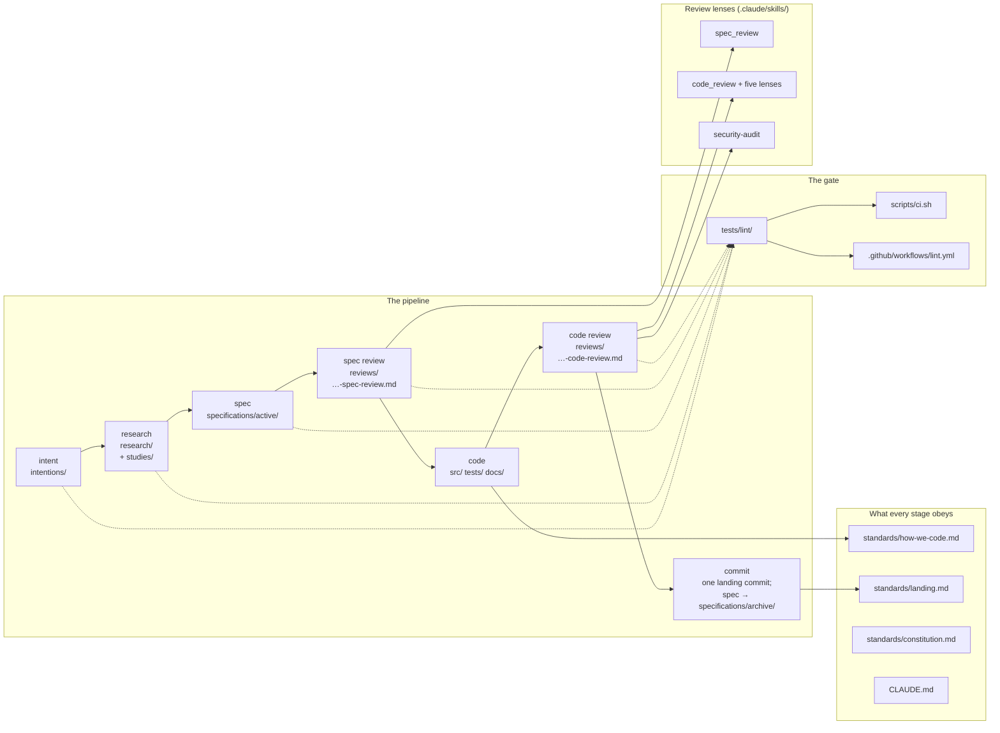

# /context

The durable memory of this project: what we are building, why, and how we build it, kept apart from the code. Code is a build artifact of this context. When the two disagree, fix the code, unless the context is demonstrably wrong, in which case fix the context first. The constitution, the mission and the standards under [standards/](standards/README.md) govern every document here.

## The pipeline

Work moves through seven stages: intent → research → spec → review → code → review → commit. Each stage writes one document to one folder, and a worker entering at any stage knows where to read and where to write. Not every change needs an intention or research. Every change needs a spec.



The folders, in pipeline order:

```
context/
  README.md        # this page
  intentions/      # INTENT — one page per piece of work: the experience it enables
  research/        # RESEARCH — dated memos, each standing on a studies/ folder of the same name
  specifications/active/    # SPEC — one file per change, not yet landed
  specifications/archive/   # the landed specs, moved here by the landing commit
  reviews/         # REVIEW, twice — the spec review before the build, the code review before the landing
  standards/       # what every stage obeys: the constitution, the mission, how we code, how a change lands
  architecture/    # the map of the system, drawn from the specs and the code
```

## The seven stages

**Intent** writes [intentions/](intentions/README.md). An intention is a page about the experience a piece of work enables: a user story, the problem today as measured facts, the outcomes, at most one paragraph of means, what it is not, done-when checks a person can verify, and the questions the research must answer. It is written when research will be commissioned, when more than one spec will carry the work, or when an audience gains or loses an experience. Otherwise the work starts at the spec.

**Research** writes [research/](research/README.md). A research memo is a labelled, boxed, append-only answer to one question, standing on a studies folder of the same name under `research/studies/`. Every claim is EXECUTED (a command ran here), READ (read in a cited file or page) or INFERRED (reasoning). A memo commits us to nothing. A placeholder memo holds a question, what is known, and the experiment that answers it, and is completed in place when the research is done; it is where an undecided choice waits. Research is skipped when there is nothing a study would change.

**Spec** writes [specifications/active/](specifications/README.md). A spec is one file with nine sections in a fixed order: the problem, an architecture diagram of the components it touches, numbered decisions each with its reason, the intent, the design, the scope, acceptance criteria that each name the test that will pin them, landing notes, and one line. A spec decides every choice it needs; it holds no open question. There are no separate decision records: a decision lives in the spec that carries it.

**Review of the spec** writes [reviews/](reviews/README.md). A fresh reviewer, an agent or a person who did not write the spec, reads it with the intention, the research and the standards, never the author's summary, and writes `YYYY-MM-DD-<spec-slug>-spec-review.md`: decisions checked one by one, criteria checked as countable, the diagram, the scale posture, the constitution, a premortem, findings ranked High, Medium and Low, and a verdict that begins "Fit to build" or "Not yet". The author answers in the file's Disposition; the reviewer signs again.

**Code** follows [how we code](standards/how-we-code.md). Tests first, then code: the test is written and seen failing before the code that passes it, at the layer the behaviour lives. The tests land in the same commit as the code they pin.

**Review of the code** writes `YYYY-MM-DD-<spec-slug>-code-review.md` under reviews/. A fresh reviewer reads the spec and the diff of the local unpushed commits, runs `scripts/ci.sh` and the engine legs when storage changed, checks each criterion against evidence, runs the five lenses (contract, scale, tests, ownership, adversarial) and the security lens in guidance mode, and writes a verdict that begins "Lands" or "Does not land yet".

**Commit** follows [landing](standards/landing.md). One landing commit carries the code, the tests, the docs, the review file, the landing notes, the move of the spec to `specifications/archive/` and the architecture page; its trailers link the spec and both reviews. The owner says when to commit and when to push.

## The rules every document keeps

- **Dated, descriptive names.** Every intention, memo, spec and review is `YYYY-MM-DD-descriptive-slug.md`. Nothing is numbered. A study file inside a studies folder keeps a two-digit reading-order prefix, which is order, not identity.
- **No header lines.** The title is line one and prose follows. The date is in the name; the state of a spec is its folder. Cross-references are Markdown links with relative paths, placed where they make the most sense.
- **One line per paragraph.** A paragraph is one line of any length; `scripts/unwrap_context.py --fix` joins wrapped prose and leaves code, tables, quotes and hard breaks alone.
- **Labels on claims.** EXECUTED, READ or INFERRED, in memos, studies, the problem section of a spec, and reviews.
- **No open questions.** No clarification marker, no to-be-decided note, no to-do note. An undecided choice becomes a placeholder memo and the spec waits. An intention's last section lists what the research must answer; that is the one place a question stands.
- **Links point backward.** A later document cites an earlier one; an earlier one is never edited to point forward. A document links the path that is true when it is written; the move from `specifications/active/` to `specifications/archive/` is the one sanctioned rename, and the lint treats such a link as resolved.
- **Nothing lands unreviewed.** Two reviews, both files, both by someone who did not write the change.
- **Prior art is studied, never copied.** Reference checkouts are read, cited and described; every line here is ours.

The lint package `tests/lint/` holds every one of these shapes and runs in `scripts/ci.sh` and in the `lint.yml` workflow. A document that drifts fails the gate, and the failure names the file and the missing part.

## Lifecycle of a spec

Born in `specifications/active/` from an intention, a memo, or directly from a defect or a reviewer's finding. Drafted whole, with its diagram and every decision made. Reviewed; "Fit to build" is the signature on that draft. Built, tests first, in the working tree. Reviewed again on the local commits; "Lands" is the signature on that tip. Landed: the landing notes are filled, they link both reviews, and the file moves to `specifications/archive/` under the same name. A spec under `active/` is not landed; one under `archive/` is. A parked spec stays in `active/` and its first paragraph begins "Parked:"; a withdrawn one moves to `archive/` and its first paragraph begins "Withdrawn:".

What flows backward from a landing: a decision taken during the build is appended to the spec's own Decisions section; a measurement goes to `research/` as a dated memo; the architecture page the spec named is updated and the glossary gains its terms.

## Before 2026-10-29

The numbered folders under `specifications/` are the shape the project used before this process. They keep their names and are not scanned by the shape lint. A numbered spec picked up to build is converted in place: its markers become decisions or a placeholder memo, it gains an architecture section, and its reviews name it by title. `specifications/STATUS.md` froze with a note saying where its content now lives.
