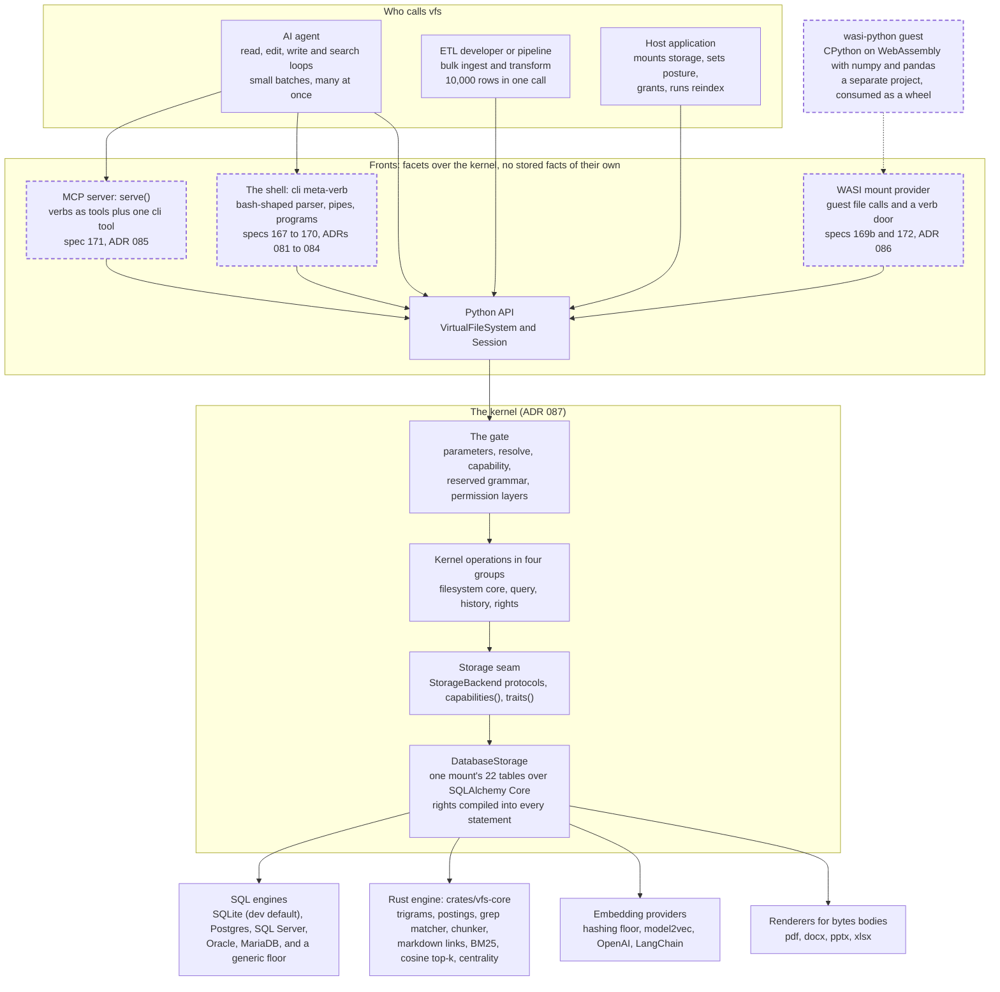

# 01. vfs at a glance

- **Status:** living diagram, drawn 2026-10-24 against `ba77449`. Revised in place; the date above moves when it is.
- **Shows:** who calls vfs, the fronts they call through, the kernel every call passes, and the engines and libraries beneath it. One picture of the whole system, built and planned on one page.
- **Legend:** a solid box is built and on `main`. A dashed box is planned, and names the spec or ADR that decides it. A box with a dotted border is built but slated to change.
- **Sources:** `src/vfs/base.py`, `src/vfs/storage/`, `crates/vfs-core/src/lib.rs`; ADR 057 (one engine), ADR 058 and 075 (positioning), ADR 087 (the kernel); specs 167, 169, 171, 172.

## The picture

## Reading the picture

vfs is a filesystem whose files live in a SQL database. Two audiences share it. Agents make many small calls and care about latency. ETL pipelines make few large calls and care about batch size. Both reach the same kernel.

Every front is a thin adapter. The Python API is the one front that is built today. The MCP server, the shell and the WASI mount are planned; each will call the same router methods the Python API exposes, so every call passes the same gate. A front adds only its own machinery, such as a flag grammar, a wire format, or a handle table. It never stores a fact.

The kernel is the gate and everything under it. The gate is the one funnel in the router. Under it sit the kernel operations, the storage seam, and the one storage implementation, `DatabaseStorage`. The database holds every fact: rows, bodies, versions, edges, indexes, grants.

Three things sit beside the database. The Rust engine does the compute-heavy work (index building, matching, scoring, chunking) and holds no policy. Embedding providers fill vectors during `reindex`. Renderers turn binary bodies into searchable text during `reindex`.

## Terms this diagram introduces

| Term | Meaning |
|---|---|
| **Front** | A way into vfs built on top of the kernel: the Python API, the MCP server, the shell, a mount for a guest. A front adds its own machinery and stores no fact. ADR 087 calls fronts and derived verbs together *facets*. |
| **Kernel** | The gate and everything under it: the router's funnel, the kernel operations, the storage seam, and storage itself. Defined in ADR 087. |
| **Gate** | The one funnel every call passes. It has two halves: the router's (parameters, routing, capability, grammar, structural permission maps) and storage's (the caller's grants, judged inside each SQL statement). See diagram 04. |
| **Storage seam** | The protocol in `storage/protocol.py` that the router calls. A backend declares what it serves through `capabilities()`. |
| **Mount** | One storage backend bound at one path in the namespace. See diagram 05. |
| **Rust engine** | The compiled crate `vfs-core`, built into the wheel as `vfs._native`. Required: there is no pure-Python fallback (ADR 057). |
| **Generic floor** | The conservative dialect profile an unknown SQL engine resolves to. It serves the core verbs and withholds `glean` and `graph` (ADR 059). |

## What is planned, and where it is decided

- **The MCP server** (`vfs.mcp`, spec 171): every kernel verb as a tool, plus one `cli` tool; rows projected to MCP's five content blocks (ADR 085); a token in and an `Authority` out (spec 149).
- **The shell** (`src/vfs/shell/`, spec 167): a static bash-shaped parser (ADR 081), a program table (ADR 082), a pipe of rows or bytes (ADR 083), the gate order as the execution policy (ADR 084).
- **The WASI mount** (specs 169b, 172): the guest's whole filesystem is a vfs `Session`; wasi-python 0.1.0 already ships the mount and tool protocols the seam needs (memo 2026-10-23).

## Open

- Which front comes first after WASI: FUSE or NFS (kernel memo 2026-10-23, Q5).
