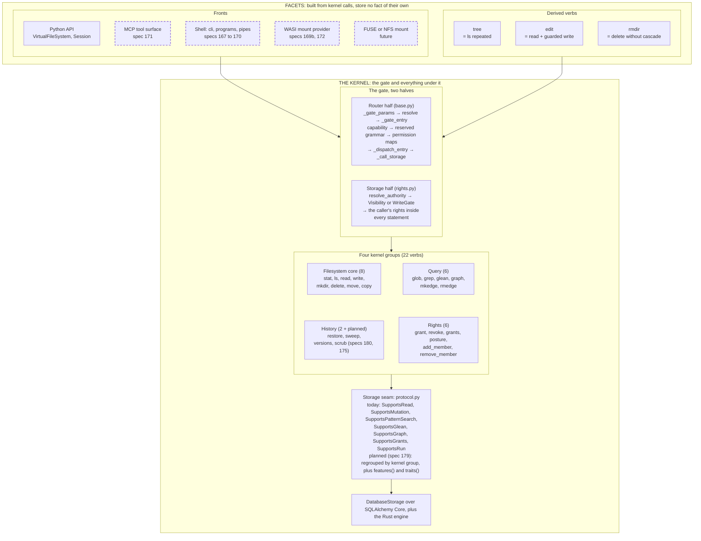

# 02. The kernel and the facets

- **Status:** living diagram, drawn 2026-10-24 against `ba77449`. Draws ADR 087 (proposed 2026-10-24) as the target shape and marks what the code already is.
- **Shows:** the one layering rule vfs now follows. The kernel is the gate and everything under it. Everything else is a facet: a front or a derived verb. The four groups of kernel operations and the verbs in each.
- **Legend:** solid is built. Dashed is planned, with the spec named. Verbs in *italics* inside a group are planned additions.
- **Sources:** ADR 087 pins 1, 2, 4, 5; spec 179 (the seam regrouped), spec 181 (the public surface regrouped); `src/vfs/ops.py`, `src/vfs/base.py`, `src/vfs/storage/protocol.py`.

## The picture

## Reading the picture

Start at the bottom. The database holds every fact. Storage reads and writes it through one protocol, the storage seam. The router calls the seam through one funnel, the gate. The kernel is that whole stack: the gate and everything under it.

The kernel has four groups of operations. The filesystem core is the part every file protocol has. The query group is the part no file protocol has: search over an index, with the caller's rights compiled into the search statement. The history group reads and writes version and tombstone facts. The rights group reads and writes grant facts. All four pass the same gate. That is why they are kernel operations and not a layer above.

Everything above the gate is a facet. A front is a way in. A derived verb is a convenience built from kernel calls. Neither stores a fact. `tree` is `ls` repeated. `edit` is `read` followed by a guarded `write`. A facet may add its own machinery: a parser, a handle table, a wire format, a line window. It may not add a stored fact or a new permission check.

The gate has two halves, and a front that skipped either would skip the gate. The router's half judges what the router knows: the parameter table, the mount table, the capability set, the reserved grammar, the structural permission maps. Storage's half judges what only the rows know: the caller's grants, compiled into the statement.

## Today versus the target

| Piece | Today (`ba77449`) | Target (ADR 087 and its specs) |
|---|---|---|
| Verb set | 25 routed verbs in `ALL_OPS`, including `run` | 24: `run` retires (ADR 082 pin 12, spec 167 slice A). 22 sit in the four kernel groups; `tree` and `edit` are the derived verbs. ADR 087 pin 1 writes the rights group's last member as `members`; the code has `add_member` and `remove_member`, and spec 181 keeps the two |
| Dispatch classes | `MUTATING_OPS`, `TWO_PATH_OPS`, `READ_OPS`, `EXEC_OPS`, `GRANT_OPS` (and `DEVELOPER_OPS`, a plane marker: never on an agent-facing surface) | The same classes stay as the routing axis; kernel groups are a second axis, `OpGroup` in `ops.py` (spec 181) |
| Seam families | Grouped by history: `SupportsRead` (the minimum: read, stat, ls, tree), `SupportsMutation`, `SupportsPatternSearch`, `SupportsGlean`, `SupportsGraph`, `SupportsRun`, `SupportsGrants`, plus `SupportsTraits`, `SupportsReindex`, `SupportsClose` | Grouped by kernel group: `SupportsFileRead`, `SupportsFileWrite`, `SupportsCopy`, `SupportsTree`, `SupportsEdit`, `SupportsPatternSearch`, `SupportsGlean`, `SupportsGraph`, `SupportsEdges`, `SupportsTrash`, `SupportsRights`; a backend lacking a derivable piece is served by the kernel, slower (spec 179) |
| Per-call arguments | Whole bodies, whole listings, no preconditions | `ls(after=, limit=)`, `read(range=)`, `write(if_version=, if_absent=, append=)`, `move(replace=)` (specs 174, 176, 178, 167) |
| Public names | Flat: `vfs.read`, `vfs.grep` | Flat, by lean (pin 16); groups are documentation and test organisation, not namespaces |

## Terms this diagram introduces

| Term | Meaning |
|---|---|
| **Facet** | Anything built on top of kernel calls that stores no fact of its own. Two kinds: fronts and derived verbs. |
| **Derived verb** | A verb built from kernel calls: `tree`, `edit`, `rmdir`. A backend may answer one natively; otherwise the kernel derives it. |
| **Kernel group** | One of four kinds of kernel operation: filesystem core, query, history, rights. Spec 181's `OpGroup` adds a fifth value, `derived`, so `tree` and `edit` have a home in the one list. |
| **Dispatch class** | How a verb is routed and gated: mutating, two-path, read, exec, grant. A different axis from the group. `mkedge` is in the query group and is a mutation. |
| **Capability** | An operation a backend declares in `capabilities()`. "Which verbs." |
| **Trait** | A quality of how a backend serves, from `traits()`: today the grep tier, the glean staleness, the arbitration mode; a durability tier is planned (spec 179). "How." |
| **Feature** | Planned (spec 179). An argument family or index a backend serves itself, from `features()`. "Which arguments." |
| **Derive** | Planned (spec 179). The kernel serves something the backend lacks from simpler calls the backend has. Correct, slower. |

## Not in the kernel, by evidence (ADR 087 pin 4)

No handles or file descriptors (a front owns its own handle table). No inode-keyed addressing (`entry_id` becomes a read-only column on `stat`, never an address). No hard or symbolic links. No mode bits or `chmod`. No access time. No `fsync` verb. No seek (a byte range per call instead).

## Open

- Pin 3: keep `delete` and `move` as names, or rename to `remove` and `rename`.
- Pin 16: flat names, or groups as namespaces.
- Pin 17: on `move(replace=True)`, which row's identity survives.
