# 03. The source tree as layers

- **Status:** living diagram, drawn 2026-10-24 against `ba77449`.
- **Shows:** every module under `src/vfs/` and the Rust crate, placed in the layer it serves, with one line on what each owns. This is the map from the design words to the files.
- **Legend:** boxes are modules or packages. Arrows point from a module to what it imports, at the layer level only. Planned packages are dashed.
- **Sources:** the module docstrings under `src/vfs/`; `crates/vfs-core/src/lib.rs`; spec 167 (`shell/`), spec 171 (`mcp/`), spec 181 (`derived.py`, `chain.py`).

## The picture

```mermaid
flowchart TB
  subgraph surface["Public surface and fronts"]
    direction LR
    init["__init__.py<br/>the exported names"]
    session["session.py<br/>Session: one authority, one filesystem"]
    shell["shell/ (planned, spec 167)<br/>parse, programs, run, cli"]
    mcp["mcp/ (planned, spec 171)<br/>serve, adapter, schemas"]
    skills["skills.py<br/>Agent Skills as entries under /.agents"]
  end

  subgraph router["The router and its vocabulary"]
    direction LR
    base["base.py<br/>VirtualFileSystem: mount table, the gate,<br/>the funnel, fan-out, cross-mount routing"]
    ops["ops.py<br/>Op names, dispatch classes, the ladder, VERB_RUNGS"]
    params["params.py<br/>the per-op parameter table"]
    paths["paths.py<br/>Path: canonical paths, the reserved scope"]
    authority["authority.py<br/>Principal, Authority, the four doors"]
    permissions["permissions.py<br/>PermissionMap: structural read-only layers"]
    rerank["rerank.py<br/>cross-mount merge of glean answers"]
    exceptions["exceptions.py<br/>the opt-in raise at the boundary"]
  end

  subgraph models["Domain models and results"]
    direction LR
    entry["models/entry.py<br/>Entry, Observation, Match"]
    scoped["models/chunk.py, version.py, edge.py<br/>entry-scoped metadata"]
    rows["models/rows.py<br/>the 22 tables, hand-written"]
    media["models/media.py<br/>text or bytes, render status, mime"]
    support["models/chunking.py, code_grams.py, lexical.py, postings.py,<br/>links.py, signals.py, versioning.py,<br/>vector.py, vector_codec.py, vector_native.py"]
    results["results/<br/>envelope.py Result, kinds.py ErrorKind,<br/>render.py, projection.py, preview.py"]
    pm["pattern_matching/<br/>glob.py the pattern language,<br/>grep.py the match authority"]
  end

  subgraph storage["Storage: the seam and the one backend"]
    direction LR
    protocol["storage/protocol.py<br/>the Supports* families, StorageBackend"]
    shared["storage/grants.py rights algebra,<br/>ranking.py fusion, replace.py and editing.py the edit engine"]
    backend["storage/backends/database/<br/>backend.py DatabaseStorage and 31 modules<br/>(see the table below)"]
    memory["storage/backends/memory.py<br/>InMemoryStorage = DatabaseStorage on SQLite :memory:"]
  end

  subgraph seams["Seams to the outside"]
    direction LR
    native["native.py<br/>the Rust engine, protocol-gated"]
    embedding["embedding/<br/>provider seam; hashing, model2vec, openai, langchain"]
    rendering["rendering/<br/>seam, registry, the markdown builder;<br/>pdf, docx, pptx, xlsx"]
  end

  rust["crates/vfs-core (Rust)<br/>grams, postings, verify, chunk, links,<br/>lexical and its generated tables, vectors, signals;<br/>python.rs binding"]

  surface --> router --> models
  router --> storage
  storage --> models
  storage --> seams
  models --> native
  native --> rust

  classDef planned stroke-dasharray: 6 4,stroke-width:2px;
  class shell,mcp planned
```

## The database backend, module by module

`storage/backends/database/` is the largest package. Each module owns one concern.

| Module | Owns |
|---|---|
| `backend.py` | `DatabaseStorage`: the protocol methods, one transaction per verb, the permission view (`_viewed`), `reindex`'s phase order |
| `engine.py` | `EngineHost`: built or borrowed connectivity, first touch, retry, close, sqlite-vec loading |
| `dialects.py` | `DialectProfile` per engine and the generic floor; the membership budget; `chunked()`; bulk insert modes |
| `membership.py` | Every chunked `IN (...)`, in the dialect's form |
| `descent.py` | Miss classification (`not_found` versus `wrong_kind`), bounded path fetches, subtree scoping |
| `reads.py` | `stat`, `ls`, `tree`, `read`, `glob` statement builders; `Observation` reconstruction with the populated mask |
| `writes.py`, `staging.py` | `write`, `edit`, `mkdir`: plan then execute; `WritePlan` and `StagedEntry` |
| `versions.py` | The version mint: an overwrite keeps the replaced body as a version row |
| `serialized.py` | The kit shared by the serialized verbs: the per-mount lock row, guarded claims, redrive |
| `topology.py` | `move`, `copy` |
| `trash.py` | `delete`, `restore`, `sweep` over the tombstone columns |
| `edges.py` | The `fs` mirror edge per entry; edge drift repair |
| `segments.py`, `pathterms.py` | Path-segment postings for glob pushdown; the glob-to-terms compiler |
| `grep.py`, `scope.py` | Grep over the gram index plus the dirty overlay; the structural scope both grep and glean share |
| `indexing.py`, `lexical.py` | `reindex`'s gram epochs: assess, chunk, build, publish, reclaim; the lexical index build |
| `links.py` | Markdown references minted as `links` edges inside the chunk pass |
| `render.py` | The render stage of `reindex`: bytes bodies to text renderings |
| `embed.py` | The embed step of `reindex`: streaming, resumable, no transaction held |
| `glean.py`, `distance.py` | Ranked search: the BM25 leg, the vector leg, fusion; the cosine spelling per dialect |
| `signals.py` | Stored ranking priors computed during `reindex` |
| `graph.py` | The frontier walk over `vfs_edges`, judged every hop |
| `rights.py`, `ranges.py`, `labels.py`, `revision.py` | The enforcement spine: resolve and cache rights, the three-seek predicate, the everyone level on the row, the grant revision lock |
| `offload.py` | CPU work leaves the event loop |
| `seams.py` | Named points where tests stage rival writers |

## Reading the picture

The layers import downward, with two exceptions worth knowing. The router imports the models and the storage seam, and also two concrete pieces of the database backend: `InMemoryStorage` as the default root and one trash constant from `descent.py`. And `base.py` imports `Session` at runtime so `vfs.session()` can build one, while `session.py` imports the router only for typing; the runtime arrow between those two points from the router to the surface. Storage imports the models and the outside seams. The one leaf that everything may import is `native.py`, which imports nothing else from vfs.

Two modules define vocabulary that every layer shares and neither layer may redefine. `ops.py` is the verb vocabulary: the names, the dispatch classes, the ladder, and the rung each verb needs. `params.py` is the parameter vocabulary: one row per public parameter, read by the router's gate, the signature drift test, and the planned wire schemas.

`pattern_matching/` is pure. Paths and text go in; decisions come out. It knows nothing about rows, sessions or the router. Storage prefilters and router dispatch both defer to it.

## Terms this diagram introduces

| Term | Meaning |
|---|---|
| **Router** | `VirtualFileSystem` in `base.py`. It owns the mount table and the gate, and calls storage through one funnel. One router is one namespace and one policy layer. |
| **Domain model** | A pydantic value never bound to a database session: `Entry`, `Observation`, `Chunk`, `Version`, `Edge`. |
| **Persistence model** | The hand-written tables in `rows.py`. Held in step with the domain models by a drift test, never derived from them. |
| **Seam** | A declared boundary with a protocol on one side and replaceable implementations on the other: the storage seam, the embedding seam, the renderer seam, the native seam. |
| **Offload** | Running CPU-bound work on a worker thread so the event loop keeps serving other callers. |

## What is planned, and where

- `shell/` (spec 167): `parse.py`, `programs/`, `run.py`, `status.py`.
- `mcp/` (spec 171): `serve.py`, `adapter.py`, `schemas.py`, behind the `vfs-py[mcp]` extra.
- `derived.py` and `chain.py` (specs 179, 181): the derived verbs and the rows-in-hand filters that leave `glob` and `grep`.
- `src2/` and `tests2/` are archived pre-refactor code, not part of this map.
