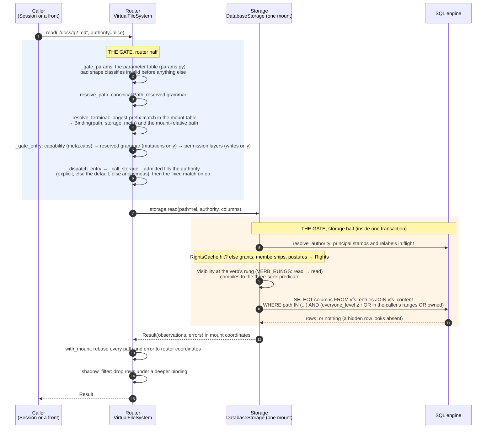
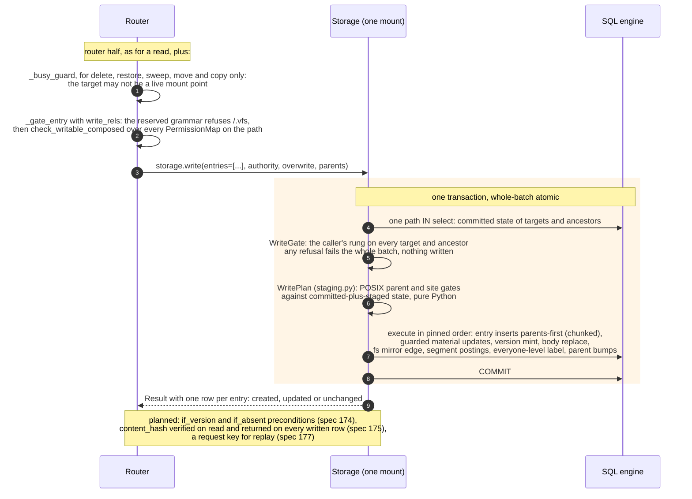

# 04. One call, end to end

- **Status:** living diagram, drawn 2026-10-24 against `ba77449`.
- **Shows:** what happens between a caller typing `read` and the
  `Result` coming back. Every step is a named function in the code.
  The same path serves every verb; a mutation adds the steps in the
  second picture.
- **Legend:** the gate's two halves are labelled. Steps marked
  *planned* do not exist yet and name their spec.
- **Sources:** `src/vfs/base.py` (`_route_single`, `_gate_params`,
  `_admitted`, `_resolve_terminal`, `_gate_entry`, `_dispatch_entry`,
  `_call_storage`), `src/vfs/storage/backends/database/rights.py`
  (`resolve_authority`, `Visibility`, `WriteGate`), ADR 087 pin 5
  (the two halves), ADR 067 and 072 (rights in the statement).

## The picture: a read

## The picture: a write adds these steps

## Reading the picture

Every verb walks the same road. First the router checks what it can
know without touching storage: the parameters, the path, which mount
owns it, whether that mount declares the verb, whether a mutation's
path is reserved, and whether a structural read-only map forbids a
write. These are the router's half of the gate. An incapable mount
reads as `unsupported`, never as a permission denial; the order is a
contract. At the funnel the router fills in the authority the call
runs as: the explicit one, else the filesystem's default, else
anonymous.

Then the router calls storage through one funnel. `_call_storage` is a
fixed `match` on the op name ending in `assert_never`, so a new verb
fails type checking until it is routed. Storage opens one transaction.
Inside it, storage resolves the caller's rights and compiles them into
the statement. A row the caller may not see is not fetched; it looks
exactly like a row that does not exist. This is storage's half of the
gate, and nothing above storage could do it, because only the rows
know who may see them.

The result comes back in mount coordinates. The router rebases every
path to the namespace and drops rows that a deeper mount shadows. The
caller sees one tree.

A mutation adds a write gate inside storage and a plan-then-execute
discipline: fetch committed state once, adjudicate the whole batch in
memory, and execute only an error-free plan. A batch of 10,000 rows
with one bad row writes nothing.

## The three trust tiers (ADR 087 pin 5)

| Tier | Where | What the gate is |
|---|---|---|
| In process | Python API, `Session` | A convention: any caller could construct `Authority.system()` or reach the storage object. Open by default (ADR 068). |
| On the wire | `serve()` (planned, spec 171) | A wall: a token in and an `Authority` out (ADR 062, spec 149); the system actor is refused for every served call. |
| In the guest | WASI mount (planned, specs 169b, 172) | A wall: the guest's only exits are the file calls and the host door, both over one `Session`. |

## Terms this diagram introduces

| Term | Meaning |
|---|---|
| **Funnel** | `_dispatch_entry` and `_call_storage`: the one seam from op to storage and one seam back. Every routed dispatch (single, grouped, paired, fan-out, tree) passes through it. |
| **Admitted authority** | The authority a call runs as after `_admitted`: the explicit one, else the filesystem's default, else anonymous. Storage always receives one. |
| **Binding** | One mount-table row: `(path, storage, meta)`. The root's own storage is the identity binding at `/`. |
| **Permission layer** | A structural `PermissionMap` on a binding: a default of `read` or `read_write` plus prefix overrides. Layers compose downward and only tighten. Distinct from grants, which are per caller. |
| **Visibility** | Storage's compile of one read call's rights at the verb's rung: which rows the caller may name, which it may read whole. |
| **WriteGate** | Storage's check that a mutation passes before its first write statement: the caller's rung on every target and ancestor, decided once per batch. |
| **Three-seek predicate** | The visibility clause: the everyone level on the row, the caller's grant ranges joined to the path index, and the rows the caller owns. Three index seeks merged by `UNION ALL`. See diagram 09. |
| **Rebase** | Translating paths between mount coordinates and router coordinates: `with_mount` and `without_mount` on `Result`. |
| **Shadow filter** | Dropping rows that a deeper binding owns, so a listing of `/` never shows the root storage's stale row under a mount point. |

## Open

- Specs 174 to 178 add preconditions, integrity, a cursor, replay and
  ranges to this path. Each is a draft cut from ADR 087 on 2026-10-24.
