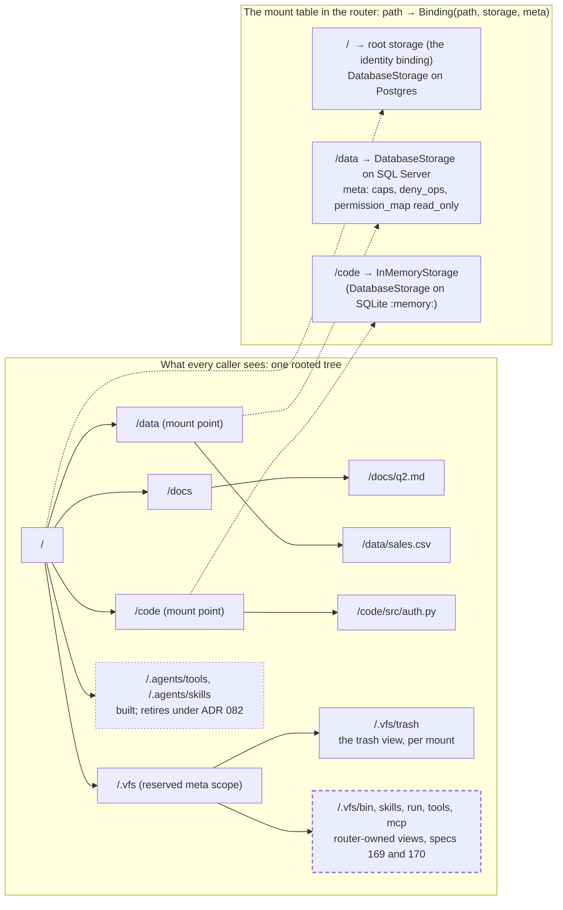
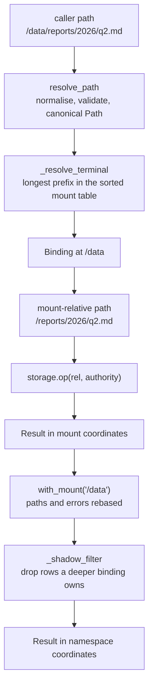
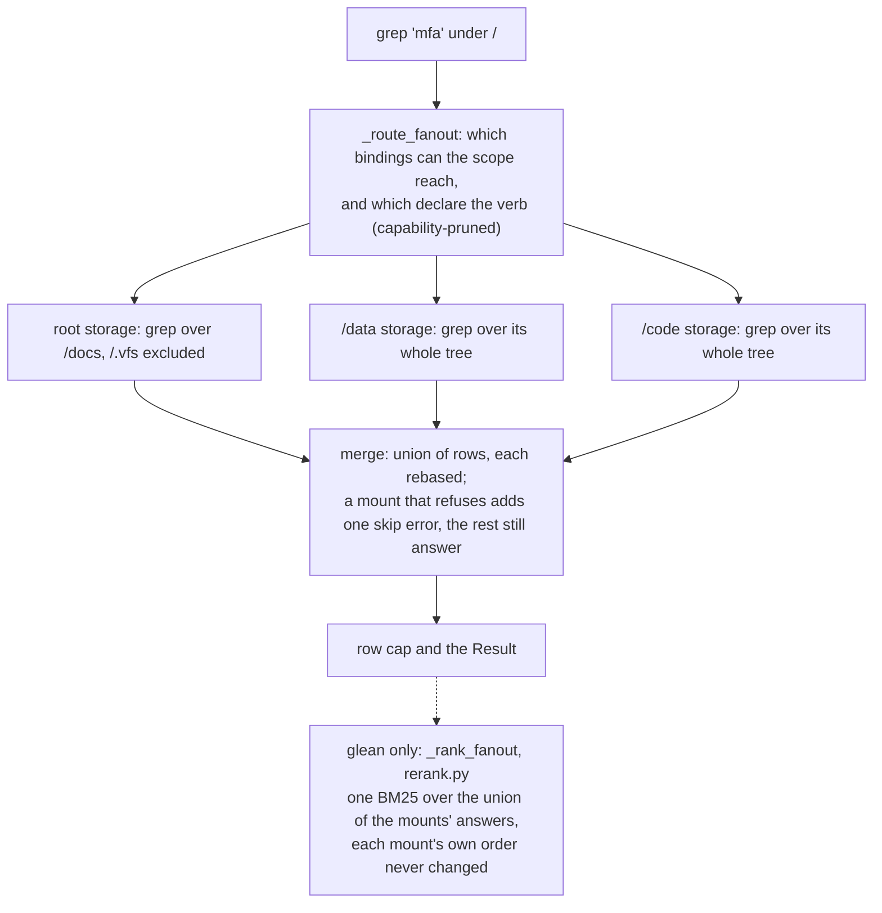

# 05. The namespace and mounts

- **Status:** living diagram, drawn 2026-10-24 against `ba77449`.
- **Shows:** the one rooted tree every caller sees, how a mount binds a storage backend into it, how a path resolves to exactly one backend, the reserved `/.vfs` scope, and how a search spanning several mounts is answered.
- **Legend:** solid is built. Dashed is planned, with the spec named. Dotted is built but retiring.
- **Sources:** `src/vfs/base.py` (the module docstring, `bind`, `add_mount`, `_resolve_terminal`, `_route_fanout`, `_rank_fanout`), `src/vfs/paths.py`, `src/vfs/rerank.py`; constitution Article 1; ADR 001 (composition), 009 (stored mount points), 011 (no union routing), 016 (metadata off the namespace), 030 (residual routing), 082 pins 6 to 8 (the `/.vfs` views) and 9 (the program index); spec 169a.

## The picture: one tree, three storages

## The picture: how a path finds its backend

## The picture: a search that spans mounts

## Reading the picture

There is one tree. Every first-class thing has an absolute path in it. There are no parallel naming systems, no backend URLs in paths, and no hidden ids a caller must learn (constitution Article 1).

A mount binds a storage backend at one path. The binding lives in the router's mount table, which maps a path to `Binding(path, storage, meta)`. The root binding is the node's own storage. The mount-point directory itself is an ordinary stored row in whichever storage owns the parent path. The shape of the namespace is stored, never synthesised. A mount binds a storage instance, never another router: one router is one namespace and one policy layer, the Linux shape.

Resolution is longest prefix. A path matches the deepest binding whose path prefixes it, and the root binding is the fallback. Every path resolves to exactly one backend. There is no union routing: a path never falls through from one backend to another (ADR 011).

`bind` is the primitive: it attaches a storage onto an existing empty directory. `add_mount` fuses a mkdir-if-absent in front of it. `remove_mount` unbinds and then removes the empty mount-point directory. A delete, restore, sweep, move or copy may not target a live mount point: that is the busy guard, `EBUSY` in Unix terms.

`/.vfs` is the reserved meta scope. Today it holds the trash view, which each backend serves at `<mount>/.vfs/trash`: a deleted row stays at its path with a tombstone, and the view shows the tombstoned rows at their own paths. Nothing may be written beneath `/.vfs`. The planned catalogue views (`bin`, `skills`, `run`, `tools`, `mcp`) are served by a router-owned view table checked before the mount table (ADR 082 pin 7, spec 169a). `/.agents` holds the skill and tool entries today and retires when those views land.

The verbs that take a scope rather than one path (`glob`, `grep`, `glean`) fan out to every binding the scope reaches and that declares the verb. Each mount answers in its own coordinates; the router rebases and unions the answers. For `glean`, two mounts' scores are not comparable, so the router re-scores the union with one BM25 built from the statistics each mount exports, under one law: a mount's own order is never changed.

## Terms this diagram introduces

| Term | Meaning |
|---|---|
| **Namespace** | The one rooted tree. Everything first-class is addressable in it by an absolute, canonical path. |
| **Path** | The `Path` type in `paths.py`: normalised, validated, at most 1,024 bytes, segments at most 255 bytes, no `..` after resolution. |
| **Mount point** | A directory row stored in the parent's storage, at which a binding attaches another storage. |
| **Mount table** | The router's sorted map from path to `Binding`. Longest prefix wins. |
| **Identity binding** | The root binding at `/`: the node's own storage, and the fallback for every path no deeper binding claims. |
| **Longest-prefix resolution** | Finding the deepest binding whose path prefixes the caller's path. |
| **Mount coordinates** | Paths as a storage sees them, relative to its binding. Router coordinates are paths as the caller sees them. |
| **Reserved scope** | `/.vfs`: the system's own tree, served as views, never written by a caller. `check_reserved_path` refuses mutations there. |
| **Trash view** | `/.vfs/trash/<path>`: the tombstoned row at `<path>`, per mount (ADR 074). |
| **View** | Planned. A `/.vfs` head the router serves from a table of its own, checked before the mount table: `bin`, `skills`, `run`, `tools`, `mcp`. |
| **Fan-out** | Dispatching one scoped verb to every binding its scope reaches, in parallel, and merging the answers. |
| **Capability-pruned** | A fan-out skips a binding that does not declare the verb, and says so with a skip error instead of failing the call. |
| **Rerank** | The cross-mount merge of `glean` answers: one BM25 over the union, each mount contributing a prefix of its own list. |
| **Busy guard** | The refusal of a delete, restore, sweep, move or copy that targets a live mount point or a region holding one. Unmount first. |

## Open

- Nested mounts are built: a deeper binding is an ordinary row in the same table (roadmap item 016 is stale on this). Bind aliases and union mounts are roadmap items (`standards/roadmap.md`, Wave 2).
- Cross-mount `copy` as read plus write is spec 160 (draft).
- Spec 176 adds a cursor to `ls`, `tree` and `glob` with one merge rule for every fan-out.
