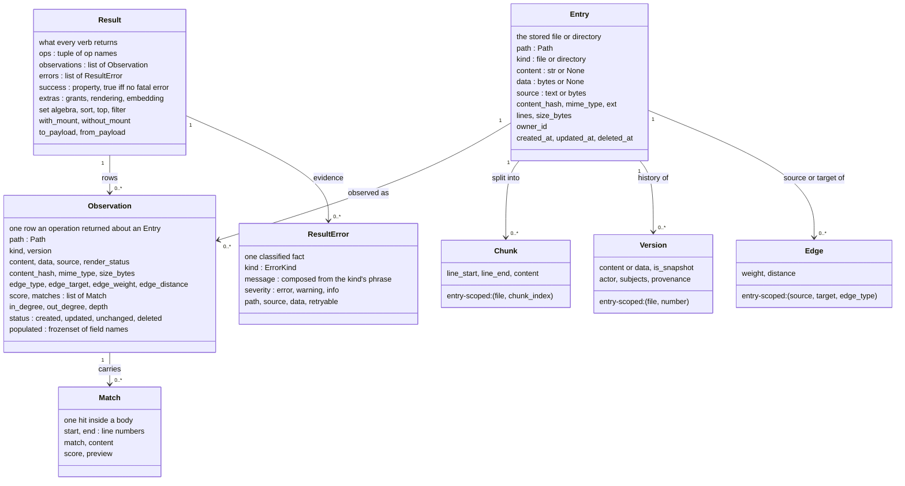
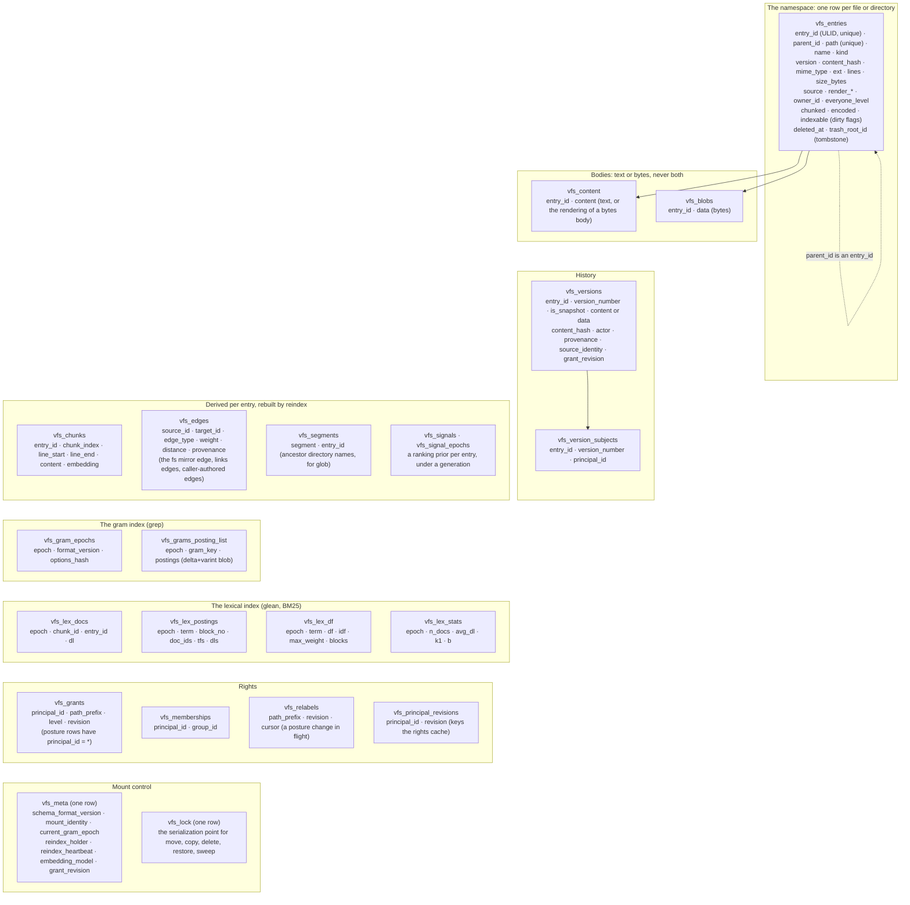

# 06. The data model: domain models and the schema

- **Status:** living diagram, drawn 2026-10-24 against `ba77449` (schema format 23).
- **Shows:** the three result-side values every caller touches (`Entry`, `Observation`, `Result`), the three entry-scoped models (`Chunk`, `Version`, `Edge`), and the 22 tables one mount stores, grouped by what they hold. `entry_id` is the spine that ties them.
- **Legend:** solid is built. Columns listed are the ones that carry the design; the full column lists are in `models/rows.py`.
- **Sources:** `src/vfs/models/entry.py`, `rows.py`, `chunk.py`, `version.py`, `edge.py`, `media.py`; `src/vfs/results/envelope.py`; ADR 004 (stable identity), 010 (the envelope), 013 and 017 (versions), 015 (the entry, chunk, version, edge split), 018 and 019 (edges, ULIDs), 020 (schema format), 021 and 073 (grants on the row), 074 (the tombstone).

## The picture: the values a caller sees

## The picture: the 22 tables of one mount

Every table in the derived, index and rights groups keys on `entry_id` or on an epoch; the arrows are left out so the groups read as rows.

## Reading the picture

Start with the three values a caller sees. An `Entry` is the stored file or directory: the durable shape. An `Observation` is one row an operation returned about an entry at the moment it returned. It carries a `populated` mask: a null field means "not fetched by this call", never "absent on the entry". A `Result` is what every verb returns: rows plus classified errors, and `success` is derived from the errors, never stored. These three are the whole public data shape. Chunks, versions and edges are entry-scoped: they belong to a file and are addressed by the file plus a discriminator, never by a path of their own.

Now the tables. Every table keys on `entry_id`, a ULID minted once at create and never reused. `parent_id` is the one structural pointer and is also an `entry_id`. The `path` column is stored and unique, so a lookup is one statement at any depth; a directory move rewrites the paths beneath it. For agents, who look up far more than they rename, this is the right trade.

A body is text or bytes, never both. `source` on the entry row says which table holds it. A bytes body becomes searchable only through a rendering, text derived by a per-format renderer and written to the content row under the same `entry_id`.

A delete is a tombstone on the row (`deleted_at`, `trash_root_id`), not a move. An overwrite keeps the replaced body as a version row with the attribution of who replaced it.

Three dirty flags on the entry row say what the indexes do not yet cover: `chunked`, `encoded`, `indexable`. A write stamps the row dirty; `reindex` catches up in its own transactions. `grep` stays correct by scanning the dirty rows and consulting the index only for encoded ones.

The gram index and the lexical index are built under an epoch. Rows of a new epoch are invisible until one pointer flip in `vfs_meta` publishes them. Rights are rows too: a grant says a principal holds a rung at and below a prefix; a posture is a grant row for everyone, `*`.

## Terms this diagram introduces

| Term | Meaning |
|---|---|
| **Entry** | The stored record of one file or directory. A pure pydantic value, never bound to a session. |
| **Observation** | One row an operation returned about an entry, with a `populated` mask saying which fields this call fetched. |
| **Populated mask** | The set of field names a call fetched. A null outside the mask means "not fetched"; inside it means "fetched and null". |
| **Result** | The envelope every verb returns: `ops`, `observations`, `errors`, and extras. `success` is a property derived from the errors. |
| **ResultError** | One classified error fact: a kind from the closed vocabulary, a composed message, a severity, a path. No producer writes prose (ADR 076). |
| **Entry-scoped metadata** | Chunks, versions, edges: rows that belong to a file and are addressed by file plus discriminator, never by a path. |
| **entry_id** | The 26-character ULID on every entry row: the permanent logical identity and the referential key every dependent table uses. Survives a move. Spec 181 exposes it read-only on `stat`. |
| **parent_id** | The one structural pointer: the parent's `entry_id`. Authoritative for the hierarchy; the `fs` mirror edge follows it. |
| **Body** | An entry's content: text in `vfs_content` or bytes in `vfs_blobs`, chosen by `source`. |
| **Rendering** | The text derived from a bytes body by a renderer, stored in the content row and stamped on the entry (`render_source_hash`, `render_generation`, `render_status`). |
| **Dirty flag** | `chunked`, `encoded`, `indexable` on the entry row: whether the chunks, the gram and lexical postings, and gram eligibility reflect the current body. |
| **Epoch** | One built generation of the gram and lexical indexes. Invisible until published by the `current_gram_epoch` pointer flip. |
| **Tombstone** | `deleted_at` and `trash_root_id` set on a row in place. The row keeps its path. |
| **Version row** | The replaced body of an overwrite, with its number, hash, and the authority that replaced it. |
| **Posture row** | A grant row whose principal is `*`: the level everyone holds at and below a prefix. |
| **Everyone level** | `everyone_level` on the entry row: the deepest covering posture's rank, stamped at mint and rewritten when a posture changes. Derived, never authoritative. |
| **Schema format** | The integer in `vfs_meta.schema_format_version`, bumped on every schema change; a mount at an old format is refused at first touch, never migrated silently (ADR 020). Today 23. |
| **Serialization point** | The one-row `vfs_lock` table that the serialized verbs lock first, so they never interleave. |

## A note on names

The constitution (`standards/constitution.md`, Article 1) still names these values `VFSEntry`, `Candidate` and `VFSResult`, and gives the kind enum as `file | directory | chunk | version | edge | tool | api`. The code and the ADRs since 015 and 034 use `Entry`, `Observation` and `Result`, and `ObjectKind` is `file | directory`. The constitution is due a wording pass; this diagram follows the code.

## Open

- Specs 176, 177 and 180 each bump the schema format from 23; the first to land takes 24.
- Spec 180 fills `version_diff` with forward deltas for cold versions (`pack`); today every version row is a snapshot.
