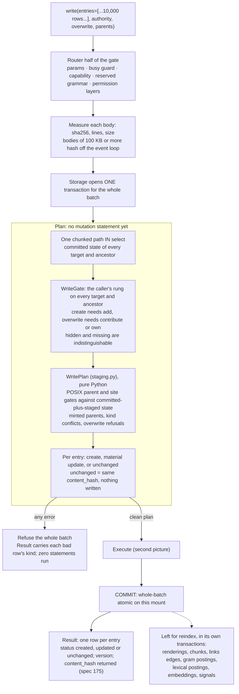
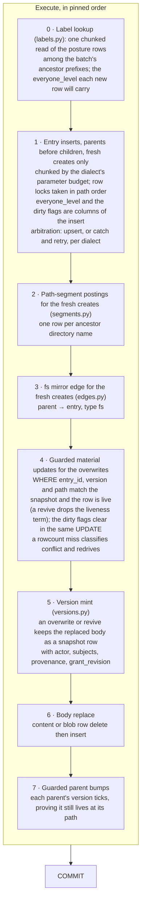

# 07. The write path: one transaction per mount

- **Status:** living diagram, drawn 2026-10-24 against `ba77449`.
- **Shows:** what one `write` call does inside storage, in order: the
  snapshot, the gate, the plan, the pinned statement order, the commit,
  and what is deliberately left for `reindex`. The same discipline
  serves `edit` and `mkdir`.
- **Legend:** solid is built. Dashed is planned, with the spec named.
- **Sources:** `src/vfs/storage/backends/database/writes.py`,
  `staging.py`, `versions.py`, `edges.py`, `segments.py`, `labels.py`,
  `rights.py` (`WriteGate`), `dialects.py` (arbitration, budgets);
  ADR 025 (conflict redrive), 033 §6 (the index catches up later),
  056 (bulk inserts), 087 pins 7 and 13; the OSTEP memo §2.2.

## The picture

## The picture: the execution order

## Reading the picture

A write is not "insert a row". It is plan, then execute. First storage
reads the committed state of every path the batch touches in one
chunked statement. Then it decides the whole batch in memory: who may
write where, which parents exist, which names collide, which bodies are
unchanged. Only a plan with no error executes. A batch of 10,000 good
rows and one bad row writes nothing, and the result names the bad row.

Execution is a handful of bulk statements in a pinned order. The
posture rows are read once so every new row carries its everyone
level. Inserts go parents before children, with the label and the
dirty flags as columns of the insert. The segment postings and the
`fs` mirror edge follow for the fresh creates. Updates are guarded on
the entry id, version and path the plan read, so a rival who wrote in
between makes the guard miss; the miss classifies `conflict` and the
verb redrives from a fresh snapshot (ADR 025). Then the version mint,
the body replace, and the parent bumps. Row locks are taken in path
order, so two batches that overlap cannot deadlock.

What commits with the body: the entry row, the body row, the version
row holding the replaced body, the `fs` mirror edge, the path
segments, the everyone-level label, the dirty flags, and the parent
bumps. One call on one mount commits whole or not at all, at any batch
size. A batch that spans two mounts is per-mount atomic only.

What does not commit with the body: the search indexes. A write stamps
the row dirty. `reindex` builds chunks, postings, embeddings and
signals later, each in its own transaction. `grep` stays correct in
between by scanning dirty rows (diagram 08).

An unchanged body costs nothing: same hash, no version row, no body
write, no dirty flag, no `updated_at` churn. Re-running an ingestion
over identical content writes nothing, which makes `updated_at` a
trustworthy change signal.

## Statement counts (system actor, `ba77449`)

Counts are the measure, never clocks (CLAUDE.md, *Performance tests*).

| Verb | Statements |
|---|---|
| `write`, create at depth 1 | 6 |
| `write`, overwrite | 8 |
| `edit` | 7 |
| `mkdir` | 5 |

A named principal with a warm rights cache adds two statements to each.
The whole-body rewrite is the next cost to cut (ADR 087 pin 14).

## Terms this diagram introduces

| Term | Meaning |
|---|---|
| **Plan then execute** | Fetch committed state once, adjudicate the whole batch in memory, execute only an error-free plan. |
| **WritePlan, StagedEntry** | The in-memory plan and one path's planned final state, carrying the persistence bookkeeping an `Entry` never holds: the minted `entry_id`, the `base_version` guard. |
| **Guarded update** | An `UPDATE` whose `WHERE` proves the row still has the entry id, version and path the plan read, and is live. A rowcount miss means a rival moved first. |
| **Conflict redrive** | On a guard miss the verb classifies `conflict` and runs again from a fresh snapshot, within a retry budget (ADR 025). |
| **Arbitration** | How two creates of the same path are settled: an upsert where the dialect has one, else catch the unique violation and retry. A `DialectProfile` field. |
| **Version mint** | Writing the replaced body as a version row, with the replacing authority's attribution. Creates mint nothing; identical bodies mint nothing. |
| **fs mirror edge** | One reserved-type `fs` edge row per non-root entry, parent to child, maintained in the same transaction. `parent_id` is authoritative; the mirror serves the graph verb. |
| **Path segments** | One posting row per ancestor directory name of an entry, mirroring the `path` column at every commit, so glob can push literal directory components into SQL. |
| **Parent bump** | Ticking each touched parent's version, with a guard proving the parent still lives at its path. |
| **Whole-batch atomic** | The atomicity model of the write family: the whole call on one mount is one transaction (ADR 087 pin 7). |
| **Parameter budget** | `dialect.insertmanyvalues_max_parameters`: the bind-parameter cap SQLAlchemy models; inserts chunk to it. |
| **Membership budget** | The tighter of the parameter budget and the dialect's `IN`-list cap (Oracle: 1,000); every `IN (...)` chunks to it. |

## What is planned, and where

- `write(if_version=, if_absent=, append=)` and an `unchanged` status
  with no version bump: spec 174. These close the lost-update append
  the OSTEP probe found.
- `content_hash` returned on every written row and verified on every
  read: spec 175 (the column is already stamped on every write).
- A request key answered from the stored first result: spec 177.
- `overwrite=` may leave `write`, since `if_absent=True` is today's
  `overwrite=False` (pending Clay).
