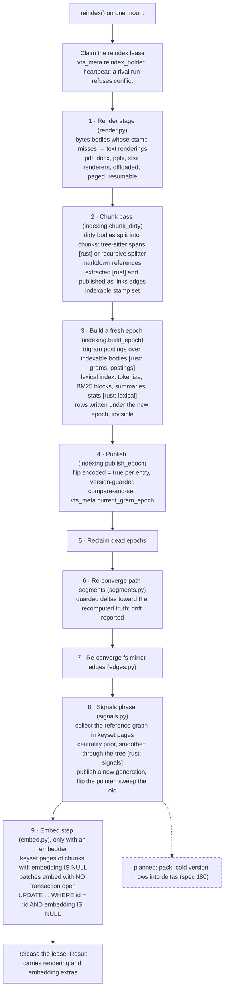
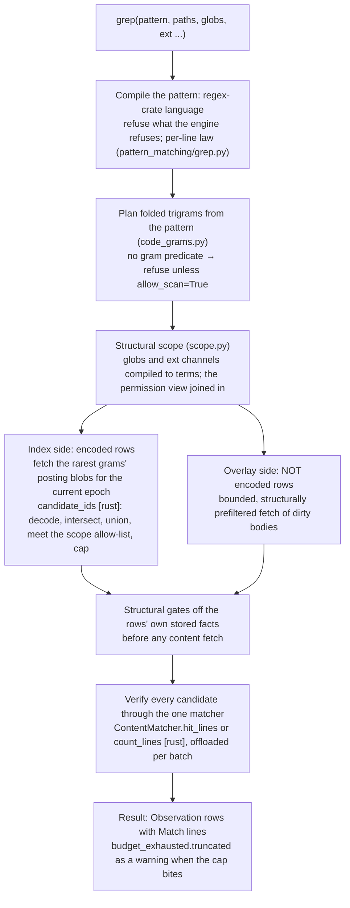
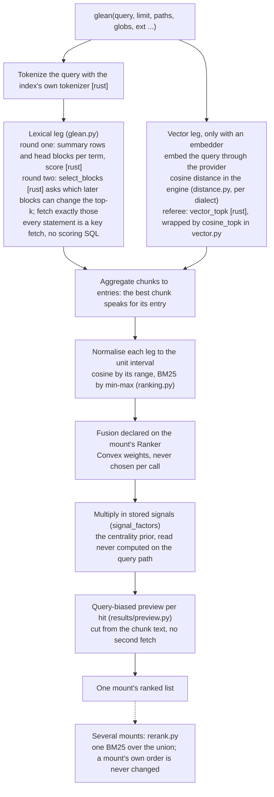
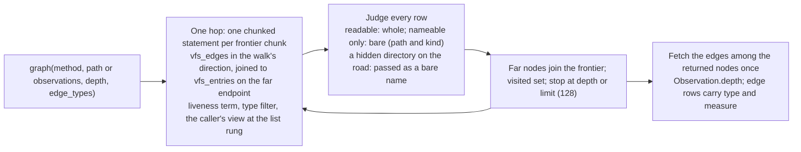

# 08. Indexes and search: reindex, grep, glean, graph

- **Status:** living diagram, drawn 2026-10-24 against `ba77449`.
- **Shows:** the one maintenance verb, `reindex`, and the phases it runs; then the read side, how `grep`, `glean` and `graph` answer over the indexes plus the dirty overlay, with the Rust engine's kernels named where they run.
- **Legend:** solid is built. Dashed is planned, with the spec named. Rust kernels are marked `[rust]`.
- **Sources:** `storage/backends/database/backend.py` (`reindex`, `_reindex_phases`), `indexing.py`, `lexical.py`, `render.py`, `links.py`, `embed.py`, `signals.py`, `segments.py`, `edges.py`, `grep.py`, `scope.py`, `glean.py`, `distance.py`, `graph.py`; `storage/ranking.py`, `rerank.py`, `results/preview.py`; `crates/vfs-core`; ADRs 033, 036, 038 to 046, 048, 049, 051 to 055, 059, 060, 077, 079.

## The picture: reindex

Each numbered phase runs in its own writer transaction. The render and embed loops are resumable: they commit in bounded pages behind a durable mark, so a second run finishes what the first left.

## The picture: grep

## The picture: glean

## The picture: graph

## Reading the picture

vfs keeps four indexes and one derived table, and `reindex` is the one verb that builds them: the gram index for `grep`, the lexical index for `glean`'s BM25 leg, the vector column for `glean`'s cosine leg, the stored signals for `glean`'s prior, and the `links` edges that feed `graph`. The write path does not build any of them. It stamps the row dirty and moves on, because an ETL batch of 10,000 files must not wait for tokenising, embedding or tree-sitter.

The gram and lexical indexes are built whole under a fresh epoch and published by one pointer flip. Between the write and the publish, the row's `encoded` flag is false, and `grep` scans it. That is why `grep` has two sides: the index side over encoded rows and the overlay side over dirty rows. Both pass the same structural gates and the same matcher. The matcher is the one authority on what "matches" means, and it lives in the Rust engine.

`glean` is grep's shape with a scorer where grep has a matcher. Its lexical leg never runs scoring SQL: every statement is a key fetch, and the engine scores. Its vector leg runs cosine inside the SQL engine, because every supported dialect has a distance function (ADR 059); the Rust kernel is the referee the dialects are pinned against. The two legs are normalised and fused under a law declared once on the mount.

`graph` is a frontier walk the application holds. Each hop is one chunked statement, and every row is judged against the caller's view before it joins the frontier. A node the caller may read comes back whole; one it may only name comes back bare.

The permission view is a filter inside every one of these statements, never a pass over the rows afterwards. That is the fact that makes the query verbs kernel operations (ADR 087 pin 2).

## Terms this diagram introduces

| Term | Meaning |
|---|---|
| **reindex** | The one maintenance verb: renderings, chunks, links, gram and lexical epochs, segments, edges, signals, embeddings. Runs under a lease. |
| **Lease** | `vfs_meta.reindex_holder` plus a heartbeat. One `reindex` per mount at a time; a rival refuses `conflict`. |
| **Gram, trigram** | Three consecutive bytes of a folded body, packed into 24 bits. The key of the gram index. |
| **Posting list** | One gram's sorted list of entry ids, stored as a varint count plus LEB128 deltas. Decoded only in the engine. |
| **Epoch** | One built generation of the gram and lexical indexes. Built invisible, published by a pointer flip, reclaimed when dead. |
| **encoded** | The entry flag meaning "this row's postings are in the current epoch". False means grep scans it. |
| **Overlay, scan side** | The dirty rows `grep` reads directly because the index does not cover them. Always correct, slower. |
| **Candidate** | An entry the gram index nominates for a pattern. May be a false positive; the matcher decides. Never a false negative. |
| **Matcher** | `ContentMatcher`, the Rust `verify` kernel's class: the one definition of a grep match for every surface, with `count_lines` and `hit_lines` per batch. |
| **Chunk** | One indexed unit of a body, split by tree-sitter spans for code and markup or by the recursive splitter. The unit the lexical index and the embedding describe. |
| **Lexical index, BM25** | The ranked text index: per-term blocks of postings with term frequencies and lengths, plus summary rows that bound every block. |
| **Block, summary** | The lexical index stores up to `BLOCK_SIZE` postings per `(term, block)` row and one summary row per term, so round two can skip blocks that cannot change the top-k. |
| **Leg** | One ranked source inside `glean`: the lexical leg or the vector leg, each aggregated to entries and normalised. |
| **Fusion, Ranker** | How a mount combines its legs: a `Convex` weighting declared on the `Ranker` at construction. |
| **Signal, prior** | A query-independent importance score per entry in `[0, 1]`, computed during `reindex` from the reference graph and the tree, read on the query path. |
| **Preview** | The query-biased excerpt cut from a hit's chunk text; bounded by construction. |
| **Embedding provider** | The seam `reindex` fills `chunks.embedding` through: `model_id`, `dimension`, request caps, embed one batch. Storage owns budgets and the loop. |
| **Frontier walk** | `graph`'s algorithm: the application holds the frontier and the visited set; each hop is one chunked statement; every row is judged. |
| **links edge** | An edge minted from a markdown reference in a body, resolved against the live tree during the chunk pass. |
| **Rust kernel** | A compute routine `crates/vfs-core` exports through `vfs._native`: `distinct_gram_count`, `PostingsBuilder`, `candidate_ids`, `ContentMatcher` (`count_lines`, `hit_lines`), `chunk_spans`, `markdown_refs`, `tokenize`, `LexicalBuilder`, `lexical_score`, `decode_summary`, `select_blocks`, `vector_topk`, `centrality_prior`. The Python wrappers `cosine_topk` and `Chunk.split_batch` sit over `vector_topk` and `chunk_spans`. |

## Open

- `glean` fetches 1,000 candidate entries and builds a preview unconditionally; both are recorded for a spec of their own (memo 2026-10-10).
- Stored signals may count hidden in-links; grep's candidate budget counts hidden candidates (`open-questions.md`).
- `pack` as a `reindex` phase: spec 180.
