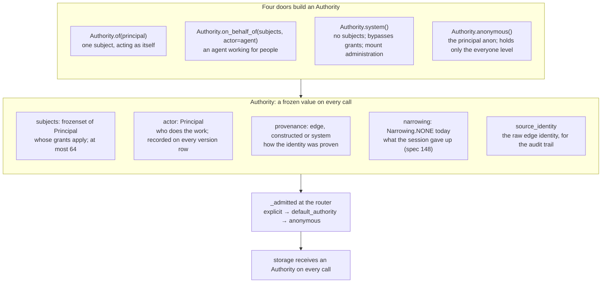
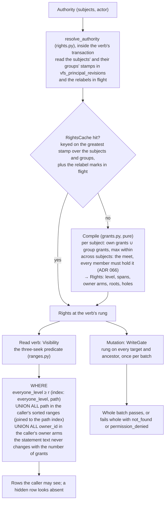
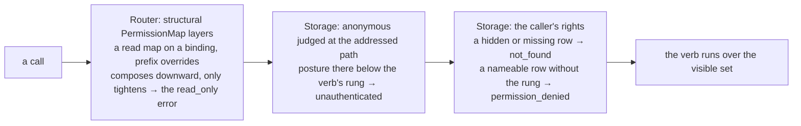

# 09. Identity and rights: who a call is for, and what it may see

- **Status:** living diagram, drawn 2026-10-24 against `ba77449`.
- **Shows:** the one identity value every call carries, the permission
  ladder, the rows that grant rights, how storage compiles a caller's
  rights into every statement, and the three places a refusal can come
  from. Everything here is built unless marked.
- **Legend:** solid is built. Dashed is planned, with the spec named.
- **Sources:** `src/vfs/authority.py`, `ops.py` (the ladder,
  `VERB_RUNGS`), `permissions.py`, `storage/grants.py`,
  `storage/backends/database/rights.py`, `ranges.py`, `labels.py`,
  `revision.py`; `docs/reference/glossary.md`; ADRs 062 to 073, 080;
  spec 165 (landed 2026-10-14).

## The picture: the identity value

## The picture: the ladder, the rows, the row

```mermaid
flowchart TB
  subgraph ladder["The ladder, lowest rung first"]
    direction LR
    l0["none"] --> l1["list<br/>name a row:<br/>path and kind"] --> l2["read<br/>see it whole"] --> l3["add<br/>create beneath,<br/>alter only your own"] --> l4["contribute<br/>edit anyone's,<br/>trash only your own"] --> l5["read_write<br/>everything,<br/>grants included"]
  end
  subgraph verbs["Every verb names its rung: VERB_RUNGS in ops.py"]
    v["stat, ls, tree, glob → list · read, grep, glean, graph, grants → read<br/>write, mkdir, edit, mkedge, rmedge → contribute; write and mkdir mint a fresh name at add<br/>delete, move, copy, restore, grant, revoke, posture, sweep, add_member, remove_member → read_write;<br/>move and copy mint at add · a walk and an edge's far end pass at list; a copy's source at read"]
  end
  subgraph rows["Rows that give rights (vfs_grants, vfs_memberships)"]
    direction TB
    g["grant row: principal_id · path_prefix · level<br/>additive: holds the level at and below the prefix; no deny rows"]
    po["posture row: principal_id = *<br/>the level everyone holds; deepest prefix wins; default read_write"]
    m["membership: principal_id ∈ group_id<br/>a member holds its groups' grants, nested up to 8 deep"]
  end
  subgraph row["Facts on the entry row"]
    direction TB
    e["everyone_level: the deepest covering posture's rank<br/>stamped at mint, rewritten by a relabel when a posture changes"]
    o["owner_id: set once at creation from the authority<br/>the owner floor: an owner can always read and write its row"]
  end
  l5 ~~~ v
  v ~~~ g
  g ~~~ po
  po ~~~ m
  m ~~~ e
  e ~~~ o
```

## The picture: from an Authority to a statement

## The picture: three places a refusal comes from

## Reading the picture

Every call carries one value that says who it is for and who is doing
the work. That value is an `Authority`. It is frozen and hashable, and
it caches no decision. Rights are re-derived on every call, so a grant
revoked at noon takes effect on the next call. The cost is paid by a
cache keyed on a revision stamp, not by remembering a verdict.

Rights come from rows. A grant row says a principal holds a rung at
and below a prefix. Rows only widen; there is no deny row. A posture is
a grant row for everyone, and it is the one thing that can narrow,
because the deepest posture wins. A group is a principal whose
membership rows say who belongs; a member holds its groups' grants.

A set of subjects holds a right only when every member holds it. That
is the intersection law. An agent working for Alice and Bob sees what
both may see.

Storage compiles the caller's rights into every statement. The
everyone level is stamped on each row, so the common case is one index
seek. The caller's own grants travel as sorted path ranges joined to
the path index. The rows the caller owns are a third branch. The three
branches are disjoint and merge with `UNION ALL`, so no engine plans a
deduplication and the statement text never changes with the number of
grants. A row the caller may not see is not fetched. It looks exactly
like a row that does not exist, and it never counts in search
statistics (ADR 065).

A mutation passes a write gate first: one batched fetch of the targets
and their ancestors, judged in application code against the verb's
rungs. Any refusal fails the batch whole.

The router has its own, older layer: a structural `PermissionMap` per
binding whose values are `read` and `read_write` (built by the
`read_only()` and `read_write()` factories) that can make a mount or a
prefix read-only for everyone. It composes downward and only tightens.
It is not about who the caller is.

## Terms this diagram introduces

| Term | Meaning |
|---|---|
| **Principal** | One verified identity: `sub` (the token's subject claim), a kind (`user`, `service`, `system`, `anonymous`), scopes. |
| **Authority** | The frozen value on every call: subjects, actor, provenance, narrowing, source identity. Built only through the four doors. |
| **Subjects, actor** | Whose grants apply, and who does the work. Kept apart so neither the agent nor the people are hidden in the record. |
| **System actor** | `Authority.system()`: no subjects, bypasses grants, stamps whatever owner a payload declares. Mount administration runs as it. Refused on the wire. |
| **Anonymous principal** | `anon`: what a call runs as when nothing names an authority and the filesystem has no default. Holds only the everyone level; owns nothing. |
| **Ladder, rung** | The total order `none < list < read < add < contribute < read_write`. Each rung includes the ones below. Every verb's rung is one row in `VERB_RUNGS`. |
| **Needs** | A verb's rungs: on its target (`primary`), on a fresh name it mints (`create`), on a row it only passes or reads (`traverse`). |
| **Grant** | A row: a principal holds a rung at and below a prefix. Additive. |
| **Posture** | The everyone level at and below a prefix, stored as a grant row for `*`. The deepest covering posture wins. Default `read_write`. |
| **Group** | A principal id starting with `group:`. Membership rows nest up to eight levels. |
| **Intersection law** | A subject set holds a right only when every member does; the set's coverage is the meet of the members' coverage (ADR 066). |
| **Owner floor** | A principal named in `owner_id` can always read and write that row. |
| **Everyone level** | `everyone_level` on the entry row: the deepest covering posture's rank, derived, rewritten by a relabel. |
| **Relabel** | The resumable pass that rewrites `everyone_level` under a prefix after a posture change, in bounded chunks behind a cursor in `vfs_relabels`. Readers compile the span in flight as a cover or a hole. |
| **Rights** | The compiled result for one caller at one rung: level, spans, owner arms, roots, holes. Pure, in `storage/grants.py`. |
| **RightsCache** | The per-mount cache of compiles, keyed on the greatest `principal_revisions` stamp over the caller's subjects and groups plus the relabel marks in flight. A grant write retires its grantee's compile. |
| **Grant revision** | `vfs_meta.grant_revision`: advanced as the first statement of every grants write, so rival admin writes serialise; stamps version rows and grant rows. |
| **Visibility** | Storage's compile of what one read call may see at the verb's rung. |
| **WriteGate** | Storage's point check before a mutation's first write statement. |
| **Three-seek predicate** | The visibility clause: everyone level, grant ranges, owner arms, merged by `UNION ALL`. |
| **Road directory** | A hidden directory with a visible row beneath it. Listed as a bare name; refuses every write beneath it. |
| **Hidden row** | A row the caller holds no rung on. Answers `not_found` like a missing path; never counted in statistics. |
| **PermissionMap** | The router's structural layer: a default of `read` or `read_write` per binding with prefix overrides (the `read_only()` and `read_write()` factories build one). Composes downward, only tightens. Not per caller. |
| **Unauthenticated** | The mount-side refusal of an anonymous call at a path whose posture is below the verb's rung. The hint names the fix. |

## What is planned, and where

- `Narrowing` beyond `NONE`, sub-sessions, the subject set's lifecycle:
  spec 148 (seed).
- A token in and an `Authority` out at `serve()`: spec 149 (seed).
- Three enforcement gaps noticed in the 2026-10-07 teaching session,
  a `manage` rung, and group ownership: `open-questions.md`.
