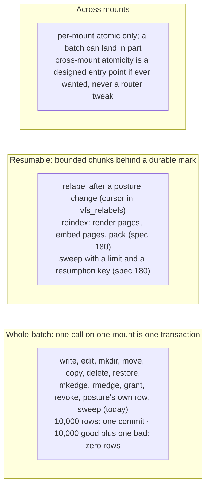
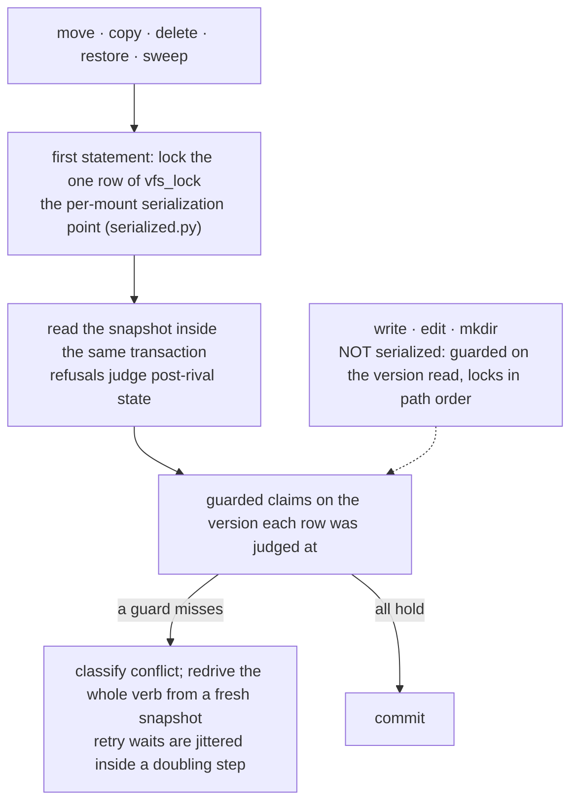
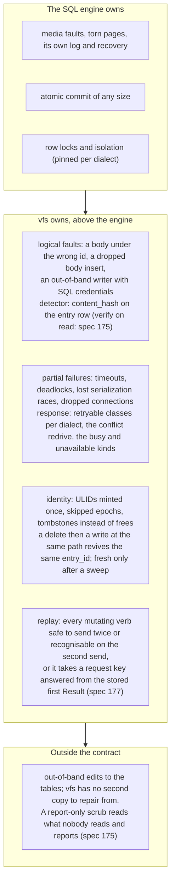

# 10. History, trash, the atomic unit and the fault model

- **Status:** living diagram, drawn 2026-10-24 against `ba77449`. Draws ADR 087's promises (pins 7 to 11, 13) beside what the code does today.
- **Shows:** what happens to a body when it is replaced, to a row when it is deleted, and to the store when something fails. The two atomicity models every verb belongs to. The fault model: which layer catches which fault.
- **Legend:** solid is built. Dashed is planned, with the spec named.
- **Sources:** `storage/backends/database/versions.py`, `trash.py`, `serialized.py`, `topology.py`, `engine.py`, `dialects.py`; `models/versioning.py`; ADRs 013, 017, 025, 027, 064, 074, 078, 087; specs 174, 175, 177, 180; the OSTEP memo §2.

## The picture: the life of a row

```mermaid
stateDiagram-v2
  [*] --> Live : write (create)<br/>entry_id minted, version 1, no version row
  Live --> Live : write of an identical body<br/>nothing written, status unchanged
  Live --> Live : overwrite or edit<br/>version +1; the replaced body becomes a version row<br/>with actor, subjects, provenance
  Live --> Live : move<br/>path rewritten, entry_id kept, edges follow
  Live --> Tombstoned : delete<br/>deleted_at and trash_root_id set in place<br/>path kept; edges hide with the row
  Tombstoned --> Live : restore<br/>the root's set is cleared
  Tombstoned --> Live : write at the path, a revive<br/>same entry_id, the old body kept as a version
  Tombstoned --> [*] : sweep<br/>the row, its bodies, versions, chunks, edges destroyed<br/>the entry_id is never reused
```

## The picture: the two atomicity models

## The picture: the serialized verbs and the rivals

## The picture: the fault model

## Reading the picture

A file's history is kept, not reconstructed. When a body is replaced, the body it replaced is written to a version row in the same transaction, whole, with who replaced it. A create mints nothing. An identical body mints nothing, because nothing was lost. Today every version row is a snapshot; `pack` (spec 180) will later rewrite cold ranges into a snapshot plus forward deltas, and no version row is ever deleted by default.

A delete is a tombstone. The row stays at its path with `deleted_at` and `trash_root_id` set. Nothing moves: no path rewrite, no posting move, no edge cascade. The trash view at `/.vfs/trash` shows the tombstoned rows at their own paths. `restore` clears the set. A write at a tombstoned path revives the row with the same `entry_id`. Only `sweep` destroys, and it is a developer-plane verb that agents never see.

vfs has two atomicity models and names them. Whole-batch verbs commit the whole call on one mount in one transaction. Resumable verbs commit in bounded chunks behind a durable mark, so a second run finishes what the first left. Every verb is one or the other.

The serialized verbs rewrite or hide parts of the tree that other rows depend on, so they take the per-mount lock row first and never interleave. Writes are deliberately not serialized with them; every claim a write makes is guarded on the version it read, and a miss redrives.

The fault model is written once. The engine owns the media and the atomic commit. vfs owns the logical faults above it, and the detector is the hash it already stores. Engines fail partially, not fail-stop, so the response is a classified retry, never a crash. Identities are never reused.

## Terms this diagram introduces

| Term | Meaning |
|---|---|
| **Version** | A file's per-entry revision counter, bumped on every material change. Also the number on a version row. |
| **Version row** | The replaced body kept whole, with actor, subjects, provenance, source identity and grant revision. |
| **Snapshot, delta** | A version row holding the whole body, or (planned, spec 180) a forward diff from the previous one. |
| **Pack** | Planned (spec 180). A `reindex` phase that rewrites cold version ranges into a snapshot plus deltas. ADR 017's name. |
| **Tombstone** | `deleted_at` and `trash_root_id` on a row in place. A delete sets it; a restore clears it. |
| **Trash root** | The row a delete named; every row in its subtree carries its id, so `restore` clears a root's set in one statement. |
| **Revive** | A write at a tombstoned path: the same `entry_id` comes back live and the old body is kept as a version. |
| **Sweep** | The one destroying verb: tombstoned rows, their bodies, versions, chunks and edges. Developer plane. Planned: a limit and a resumption key (spec 180). |
| **Atomic unit** | The largest piece of work that commits whole or not at all. One call on one mount. |
| **Whole-batch** | The atomicity model where the whole call is one transaction. |
| **Resumable** | The atomicity model where the call commits in bounded chunks behind a durable mark. |
| **Serialized verb** | `move`, `copy`, `delete`, `restore`, `sweep`: a verb that takes the serialization point first. |
| **Serialization point** | The one row of `vfs_lock`, locked by a serialized verb's first statement. Nothing else reads it, so it never holds up a write or a read. |
| **Guarded claim** | A mutation that proves the row still has the version it was judged at. |
| **Redrive** | Running a verb again from a fresh snapshot after a guard miss, classified `conflict`, within a retry budget with jittered waits. |
| **Fault model** | Which layer catches which fault: the engine owns media and commit; vfs owns logical faults and partial failures. |
| **Fail-partial** | How engines fail in practice: timeouts, deadlocks, lost races, dropped connections, not a clean stop. |
| **Replay, request key** | Planned (spec 177). Every mutating verb is safe to send twice or recognisable on the second send; the ones that cannot be take a key answered from the stored first result. |
| **Scrub** | Planned (spec 175). A paced, report-only read of everything, version rows included, comparing bodies to their hashes. |
| **Garbage, gauge** | Planned (spec 180). Tombstoned rows, version rows and bytes per mount; a cheap read a deployment job consults before it cleans. |

## What the probes found (2026-10-24), and the spec that closes each

| Probe | Finding today | Closed by |
|---|---|---|
| Twenty concurrent read-then-write appends | one line survived, all reported success | `write(if_version=)` and the guarded append, spec 174 |
| A body changed under vfs with direct SQL | `read` served it as success | verify on read, spec 175 |
| A replayed `move` | a bare `not_found`; "already moved" and "never existed" look alike | the replay table and the request key, spec 177 |

Six contract-free fixes landed the same day (`25f6da4` to `ba77449`): row locks in path order, jittered retry waits, three hidden statements removed, the write-path hash offloaded above 100 KB.

## Open

- Pin 17: on `move(replace=True)`, the destination's identity survives (spec 167's lean) or the source's (POSIX's).
- The replay row's time to live (spec 177 leans 24 hours).
- Whether an integrity failure is a kind of its own or rides `unavailable`.
