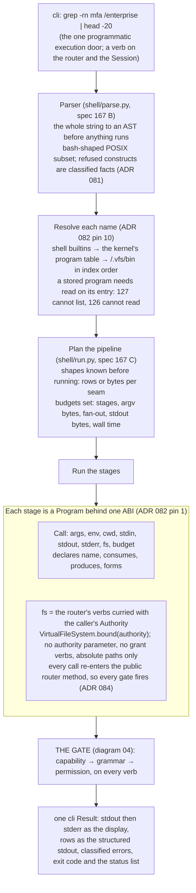
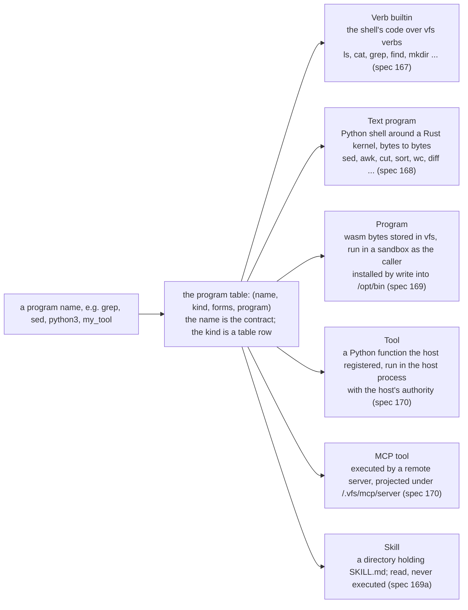
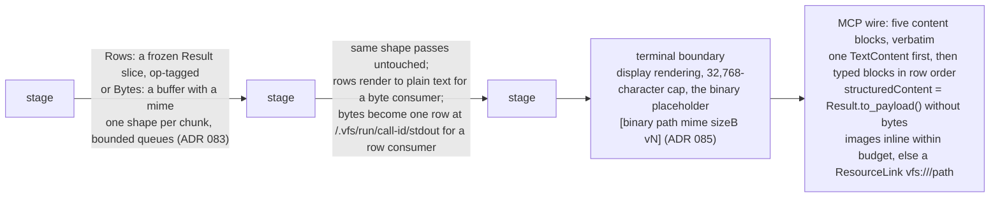
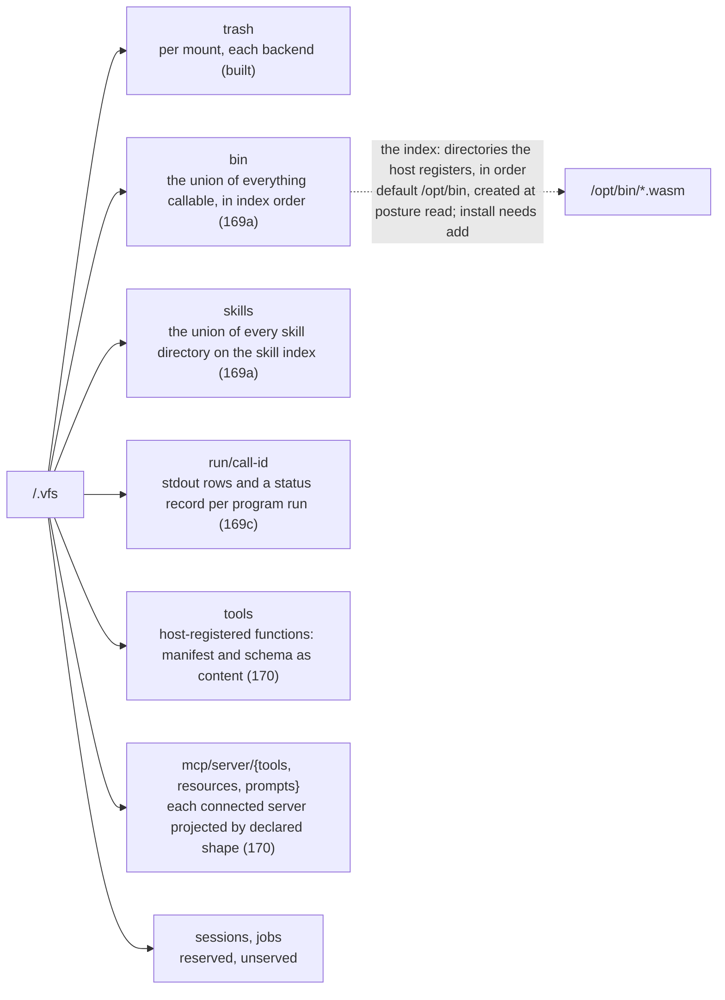
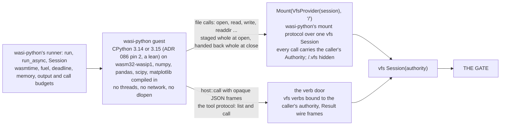

# 11. The agent shell, programs and the fronts (planned)

- **Status:** living diagram, drawn 2026-10-24. **Nothing on this page
  is built.** It draws the decided target: ADRs 081 to 086 (proposed
  2026-10-15 and 2026-10-16) and specs 167 to 172; specs 167, 171 and
  172 carry rebase notes of 2026-10-24 for ADR 087.
- **Shows:** how an agent's command line becomes gated kernel calls;
  the six kinds of program behind one ABI; the pipe; the `/.vfs`
  views; the MCP adapter; the WASI mount for a Python guest.
- **Legend:** every box here is planned. The spec that lands each is
  named on it.
- **Sources:** ADR 081 (the grammar), 082 (programs and views), 083
  (the pipe), 084 (the execution policy), 085 (the content channel),
  086 (Python in vfs); specs 167, 168, 169, 170, 171, 172; the memos
  of 2026-10-15 (the agent shell) and 2026-10-23 (wasi-python over
  vfs).

## The picture: a command line becomes kernel calls

## The picture: six kinds behind one name

## The picture: the pipe and the terminal

## The picture: the views and the index

## The picture: the Python guest over vfs

## Reading the picture

The shell is a front. It owns a parser, a program table, a pipeline
runner and a terminal rendering. It owns no stored fact and no
permission check. Every verb a command resolves to re-enters the
public router method, so the gate fires exactly as it would for a
Python caller. That is the execution policy: the gate order is the
policy, and executing a stored program is `read` on its entry
(ADR 084).

One name can be served by several kinds over time. `grep` is a verb
builtin today; `sed` is a Rust text kernel; a wasm program is bytes
installed under `/opt/bin`; `python3` is the wasi-python wheel's own
runner behind a thin `python` kind; a host's function is a tool; a
remote server's tool is an MCP tool. The kind is invisible on the pipe. A
program cannot hold more than its caller: its filesystem capability is
the verb set closed over the caller's `Authority`, and there is no
parameter through which to widen it.

The pipe carries rows or bytes, one shape per chunk, and converts only
at a seam. `ls | grep auth` filters rendered lines exactly as bash
does. A single binary read crosses a pipe raw, like Unix, and prints a
placeholder at the terminal, never base64. On the MCP wire the result
is MCP's five content blocks and nothing else.

`/.vfs` grows from one view (the trash) to a catalogue: everything
callable under `bin`, the host's tools, connected MCP servers, skills,
and the records of program runs. The catalogue views are router-owned
and read-only. Installing a program is a `write` into an indexed
directory under the ladder.

The Python runtime is a separate project, `wasi_python`, consumed as a
wheel. Its 0.1.0 release already ships the two seams vfs needs: a
mount protocol that makes a `Session` the guest's whole filesystem, and
a tool protocol through which guest code calls vfs verbs. Both carry
the caller's `Authority`. vfs's remaining work is bookkeeping: an errno
table, `move`'s replace rule, and the `python` program kind.

## Terms this diagram introduces

| Term | Meaning |
|---|---|
| **cli** | The meta-verb that takes a command string or argv and runs it through the shell. The one programmatic execution door. Refuses the system actor. |
| **Program** | Anything callable by name from the shell: one ABI, six kinds. |
| **ABI** | The one shape every program implements: `args`, `env`, `cwd`, `stdin`, `stdout`, `stderr`, `fs`, `budget` in; `stdout`, `stderr`, an exit code out. |
| **Filesystem capability (`fs`)** | The vfs verb set curried with the caller's `Authority`. No authority parameter, no grant verbs, absolute paths only. |
| **Verb builtin** | A program written as shell code over vfs verbs. |
| **Text kernel** | A program whose core is bytes-to-bytes Rust in `vfs-core`, with a thin Python layer for operands. |
| **Forms** | A program's declared option grammar and the subset this kind implements; an unimplemented form refuses `unsupported.form`. |
| **Pipe, chunk** | One ordered stream per seam; each chunk is `Rows` or `Bytes`, never both. |
| **Placeholder** | The one-line stand-in a binary row prints at a text boundary: `[binary <path> <mime> <size>B v<version>]`. |
| **Render cap** | 32,768 characters at the `cli` display and the MCP adapter; a pipe is never capped. |
| **View** | A `/.vfs` head the router serves from its own table: `bin`, `skills`, `run`, `tools`, `mcp`. |
| **Index** | The ordered list of directories whose entries feed `/.vfs/bin`. Default `/opt/bin`. |
| **Execution policy** | The gate order, fired on every verb a command resolves to. Executing a program is `read` on its entry. No `ask` inside vfs. |
| **Budget** | A declared constant with a classified outcome: stages, argv bytes, fan-out, stdout bytes, wall time, fuel, verb calls, memory, staging bytes. |
| **Five blocks** | MCP's content block types, the only wire: text, image, audio, resource link, embedded resource. |
| **Mount protocol, tool protocol** | wasi-python's two embedder seams: serve the guest's filesystem; let guest code call host functions. |
| **Verb door** | The host function behind `host::call` that carries vfs verb calls as `Result` wire frames. |

## Landing order (as the specs stand on 2026-10-24)

1. Spec 167 slices A to E: the renderer gaps, the parser, the pipe and
   `cli`, the program forms, the harness. `run` and `SupportsRun`
   retire in slice A.
2. Spec 168: the text kernels in Rust.
3. Spec 169a: the views and the index; 169b: generic wasm programs
   (narrowed by the 2026-10-23 memo); 169c: `/.vfs/run`.
4. Spec 171: the MCP adapter and `serve()`.
5. Spec 170: tools and MCP servers as views (one small study still
   owed).
6. Spec 172: the `python` kind over wasi-python; QuickJS for
   JavaScript.

## Open

- Spec 170 needs one small study before it is shaped.
- ADR 086 pins 2, 5 and 8 are leans pending Clay.
- `serve()`'s refusal to start on an open mount is not yet built
  (`docs/explanation/open-in-process-loud-at-the-edge.md`).
