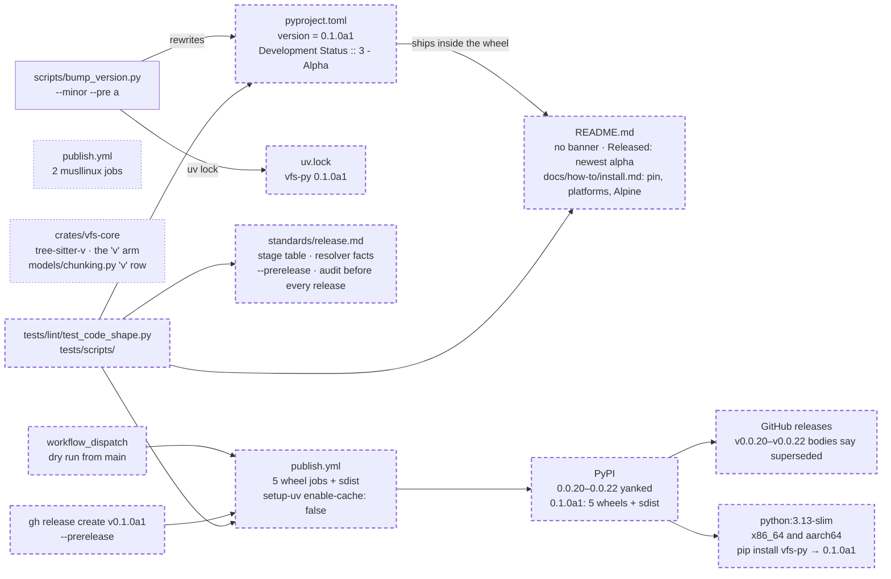

# The release lane to 0.1.0: yank the dead numbers, tell the truth in the README and the standard, drop the musl wheels, and cut the first alpha

Release engineering, not structural. No verb changes meaning, no schema format moves, no storage code changes, so the engine legs are not needed; the `src/` facts it touches are the README that ships inside the wheel and one grammar leaving the chunker's language table so the Windows wheel builds. It is the landing of the numbered spec 166, cut 2026-10-15 from Clay's decision the same day ("yank the old code, it didn't work anyway, and then start alpha then beta releases for 0.1.0"), converted in place to the nine-section shape on 2026-11-06 after [the release plumbing](../../archive/2026-11-06-the-release-plumbing.md) built the tooling the lane needs and left the rest here. It is parallel-safe with every active kernel spec: none of them edits the README's install section, the release standard or the publish workflow. Spec 167, active and unbuilt, also edits `README.md` for the shell; this spec removes the banner and edits the *Status* list, so the edits do not collide and whichever lands second rebases onto the other. It carries the roadmap's stories R2 and R3 and its decisions D1 and D30 ([roadmap](../../../standards/roadmap.md) §13, §16), each a lean the roadmap recorded on 2026-10-28 and this spec takes as its own decision with the reason beside it.

## The problem

Measured on `main` at `4ec3611`, 2026-11-06, unless labelled otherwise.

- **PyPI serves a dead API and nothing is yanked.** EXECUTED, the PyPI JSON API on 2026-11-06: `vfs-py` has exactly three releases, `0.0.20`, `0.0.21` and `0.0.22`, each a `py3-none-any` wheel and an sdist, none yanked. READ: `src/vfs/__init__.py` exports none of the names those releases shipped (`VirtualFileSystem` is the only name in common and it is a different class). `pip install vfs-py` today installs an API that no longer exists anywhere but on the index.
- **The README says so in two places, and will be wrong the day of the yank.** READ: line 19 ("the current PyPI release (`vfs-py 0.0.22`) still ships the previous-generation API") and line 150 ("`vfs-py 0.0.22` on PyPI ships the previous-generation API"). The README ships in the wheel, so the alpha that replaces 0.0.22 must carry a README that does not say 0.0.22 is current.
- **After the yank, a bare `pip install vfs-py` fails under pip.** EXECUTED on 2026-11-06 by the code review and re-run by the author: against a local PEP 503 index holding a final marked `data-yanked` beside two alphas, pip 25.3 and pip 26.3 answer `pip install <pkg>` and `pip install "<pkg><0.2"` with "Ignored the following yanked versions" and then "No matching distribution", because pip counts the yanked final when deciding whether pre-releases are allowed and drops it afterwards; `pip install "<pkg>>=0.1.0a1,<0.2"` installs the newest alpha; uv 0.13.6 resolves all three lines to the alpha. An earlier model of these facts with `packaging` alone (2026-10-15) said the bare line falls back to the alphas; `packaging` does not see yanks. A README that shows the bare line promises an install that fails for pip users for the whole alpha stage.
- **The release standard describes a world with no pre-releases.** READ, `context/standards/release.md`: *When to release* has three rungs and no stage table; step 7's `gh release create` has no `--prerelease`; the resolver facts live only in a spec; the section *Before the first v2 release* is a fact list that says "No release is planned yet". Step 3 asks for a full security audit on every release, written when the only release in view was a final.
- **The publish matrix builds two wheels nobody can install.** READ, `.github/workflows/publish.yml`: seven wheel rows, two of them `musllinux_1_2`. EXECUTED, the PyPI JSON API on 2026-11-06: `sqlite-vec 0.1.9`, a core dependency, ships five wheels (manylinux x86_64 and aarch64, macOS x86_64 and arm64, Windows x64) and no musl wheel and no sdist, so `pip install vfs-py` on Alpine fails resolution whatever vfs publishes. The two jobs cost two runners per release and advertise a platform that does not work.
- **The publish matrix has run once, by dispatch, and failed.** EXECUTED: before 2026-11-06 every run of `publish.yml` was the old two-job workflow, the last on 2026-04-23 for `v0.0.22`; the seven-platform matrix written on 2026-08-16 had never built. EXECUTED: run `42326517501`, a `workflow_dispatch` on `main` at 2026-11-07T01:54Z: `sdist`, `linux-x86_64` and `musllinux-x86_64` green; `windows-x64` fails in `maturin-action` because `tree-sitter-v 0.0.4`'s build script compiles `parser.c` by hand with `-o` and then calls `ar`, and under MSVC `cl` writes no `parser.o` and there is no `ar` ("ar failed"; it is the only crate that failed, and crates.io has no newer version); the other four wheel jobs upload their wheel and then fail in `setup-uv`'s post step, which finds no cache because no `uv` command runs on a dispatch (the tag check is gated on a release). The six wheels that were built are 8.2 to 8.7 MB each; the sdist is 0.5 MB.
- **The classifier is right for an alpha and nothing moves it.** READ, `pyproject.toml` line 24: `Development Status :: 3 - Alpha`. The lane needs it to become `4 - Beta` at `0.1.0b1`; no rule says so.
- **The full-audit rule has never been exercised.** READ, [the development process](../../archive/2026-10-29-the-development-process.md) decision 14, `release.md` lines 3 and 46 to 48 and `landing.md` line 94: a release runs the security-audit skill in full. EXECUTED: `ls context/reviews/ | grep -c security-audit` is 0; no full audit has ever been written for this tree.
- **The old spec held one undecided choice.** READ, the previous text of this file: a clarification marker on the bar for `0.1.0` final. The roadmap's section 2 names the `f` gate as the feature half of that bar and its D2 is a lean needed before `b1`; decision 5 below takes the rule.

## Architecture

The release lane end to end. Solid is what exists after the release plumbing; dashed is what this spec adds or changes; dotted is what it retires.

Page this changes: none; the architecture folder was retired on 2026-10-31.

## Decisions

Decisions 1 to 7 are the lane itself, taken by Clay on 2026-10-15 and kept as written; 5 closes the one choice the old text left open. Decisions 8 onward are this landing's.

### 1. 0.0.20, 0.0.21 and 0.0.22 are yanked on PyPI, not deleted

Yanking keeps the files and stops default resolution from choosing them; only an exact `==0.0.22` pin still gets one, with a warning. The yank reason is the same sentence on all three: *Previous-generation API, superseded by the 0.1.0 rebuild; nothing from 0.0.x carries over.* Reason: yanking is reversible and deletion is not, and an old project's exact pin must keep resolving.

### 2. The next version is `0.1.0a1`, a PEP 440 alpha of `0.1.0`

Not `0.0.23` (the number says "another patch of the old thing"), not `0.1.0` final (a stability claim the surface cannot yet back), not CalVer (the standard adheres to SemVer, and a `2026.x` number can never sort below itself again). Reason: pip and uv hide pre-releases from anyone who has not asked for them, so an alpha cannot surprise a host that pinned a final; and the step from the last beta to `0.1.0` is a suffix, not a build. The cost, measured on 2026-11-06: under pip a bare `pip install vfs-py` fails for the whole alpha stage once the finals are yanked, so the install line during the stage carries the specifier (decision 10).

### 3. The lane has three stages, named by the suffix, and no `rc` stage is planned

| Stage | Numbers | What may change between releases | Who it is for |
|---|---|---|---|
| alpha | `0.1.0a1`, `a2`, … | anything: verbs, models, result shapes, the schema | the repo's own hosts and anyone who asked for `--pre` |
| beta | `0.1.0b1`, `b2`, … | bugs only; names may be added and are listed under *Added*; no rename, removal or change of meaning | hosts preparing to depend on 0.1.0 |
| final | `0.1.0` | nothing; the next change is `0.1.1` or `0.2.0` | everyone |

Reason: three stages are what PEP 440 and the installers already understand, and the beta rule as the roadmap's D2 refined it (additive names allowed, listed) is what lets a beta keep taking small work without breaking a host that started on `b1`. A beta that holds becomes the final; `rc` is a letter the bump script accepts and the lane does not use.

### 4. Beta begins when the public surface is frozen, and Clay calls the freeze

The public surface is the set of verbs and their signatures, the `Result` shapes they return, the storage protocols a backend implements, the row schema (`SCHEMA_FORMAT_VERSION`), the two faces and the session, and the MCP surface if it exists by then. "Frozen" means no active spec would rename, remove or change the meaning of a public name, and any spec that would is tagged `0.2.0`. The call is a dated line in `release.md` and in the `v0.1.0b1` release notes, and the classifier becomes `4 - Beta` in the same bump. Reason: a freeze by criteria rather than by date is the only kind a single developer can keep, and writing the call down is what makes it checkable by the beta-entry story (roadmap R5).

### 5. Final `0.1.0` ships when a beta has held and the roadmap's `f` gate has landed

The bar: the current beta has been the current release for at least fourteen days; no breaking fix was needed in that time; the four real-engine legs (Postgres, MariaDB, SQL Server, Oracle) pass from the published wheel, not a checkout; and every story the roadmap tags `f` has landed. The roadmap's section 2 names the `f` gate as the feature half of the bar; its D2, the choice between a plain `f` gate and the structural cut, is a lean until Clay decides it before `b1`, and that choice changes which stories carry `f`, not this rule. This spec owns the held-beta bar. Reason: the old text asked whether `0.1.0` also waits for a feature; a rule that reads the gate tags off one page is checkable at any moment and is better than two documents that each hold half the bar. The `0.x` minors exist so features keep arriving after `0.1.0`.

### 6. Cadence: an alpha per landed batch, cut by hand, no automation that publishes from `main`

When one or more specs land that change the public surface or fix something a host hit, the next alpha ships. A nightly `0.1.0.devN` lane is out of scope. Reason: the lane is for hosts who can read a release note, not for a tracker of the tip; a second workflow and a dev-number scheme are work that no host has asked for.

### 7. The classifier follows the version by threshold, not by letter

Below `0.1.0b1` the classifier is `Development Status :: 3 - Alpha`; from `0.1.0b1` and below `1.0.0` it is `4 - Beta`; from `1.0.0` it is `5 - Production/Stable`. The comparison is `packaging`'s, so `rc`, `.devN` and the alphas of a later minor sort where PEP 440 puts them (`0.2.0a1` is Beta, because Beta stays through the whole `0.x` lane; `1.0.0a1` is still Beta, because a pre-release of `1.0.0` sorts below it and the threshold is reached by `1.0.0` itself), and `0.0.22`, which predates the lane, reads Alpha, so the test that pins this is green before and after the bump. The classifier line is a hand edit in the release commit that crosses a threshold; the test is what forces it. Reason: the classifier is the one line on the PyPI page a reader sees before the README, and a rule by threshold is the only one that assigns every PEP 440 version exactly one answer.

### 8. This landing carries the old spec's items 5 to 10 and the roadmap's D30, and the first alpha is cut from the tree as it stands

In: the README's banner out and its *Released* bullet, the install guide with the pin guidance and the Alpine note; the release standard's stage table, resolver facts, `--prerelease` step and audit rule; the two musllinux jobs out of the matrix; the matrix dry run; the yank and the three GitHub release bodies; the bump, the release and the install proof. Out, and landed already: the version source, the bump script, the dispatch, the tag check, the runner and the maturin floor (the release plumbing). Also out: any change to what a verb does; the shell (spec 167), which the roadmap's D1 decoupled from `0.1.0a1` on 2026-10-28. Reason: the old spec's criterion 6 (a `[0.1.0a1]` changelog section) was overtaken on 2026-11-04 when `1a9a768` deleted `CHANGELOG.md` in favour of GitHub release notes, so item 5 becomes the release notes of decision 13; the rest is exactly what stands between a green tree and a number a host can install.

### 9. The two musllinux jobs leave the publish matrix, the README and the standard say Alpine is not served, and the dry run's two failures are repaired so five wheels build

The matrix keeps five wheels (manylinux 2_28 on x86_64 and aarch64, macOS arm64 and x86_64, Windows x64) and the sdist. The install guide of decision 10 gains one sentence: Alpine and other musl images cannot resolve `sqlite-vec`, which ships no musl wheel; use a glibc image such as `python:3.13-slim`. The standard records the same fact under its permanent rules, with the condition for bringing the jobs back: `sqlite-vec` publishes a musl wheel. Reason: a wheel that publishes but cannot install is a platform claim vfs cannot keep, the two jobs are two runners per release, and the roadmap's D30 leaned this way on 2026-10-28 ("Drop; note it"); this spec takes it. Two repairs from run `42326517501`. First, the `tree-sitter-v` grammar leaves the chunker's language table: the crate leaves `crates/vfs-core/Cargo.toml` and `Cargo.lock`, the `"v"` name leaves `GRAMMAR_NAMES` and the `"v"` arm leaves the grammar match in `crates/vfs-core/src/chunk.rs`, and the `"v": "v"` row leaves the extension map in `src/vfs/models/chunking.py`, so a `.v` file chunks by the plain splitter like any language without a grammar; the release notes' *Known limits* say so. Reason: its build script is the only one of the fifty-seven that shells out to `ar`, no newer version exists, a platform-conditional dependency would make the grammar list differ by platform where the coverage contract pins one list, and V files are rare in the corpora vfs serves; the grammar returns when a version of the crate builds under MSVC. Second, every `setup-uv` step in `publish.yml` sets `enable-cache: false`. Reason: the workflow never syncs a project, so on a dispatch nothing is cached and the action's default post step fails a job that built and uploaded its wheel. The workflow test that pins the matrix gains the row count, the absence of `musllinux`, and `enable-cache: false` on every `setup-uv` step.

### 10. The README loses its banner, its install line is the pinned one, and the platform notes live in a how-to page, `docs/how-to/install.md`

The warning blockquote under the install line goes, and nothing replaces it (Clay, 2026-11-06: no banner, and no pin line under the install block either). The install block itself is `pip install "vfs-py>=0.1.0a1,<0.2"` for the whole alpha stage (Clay, 2026-11-06, after the code review showed the bare line fails under pip): one line that installs and pins under pip and uv alike. The *Released* bullet under *Status* says the newest alpha of the rebuild is on PyPI as `vfs-py`, names no version so no later alpha has to edit it, points at the GitHub releases as the changelog, and says the `0.0.x` releases are yanked; no sentence anywhere in the README says PyPI ships the previous-generation API or names `0.0.22`. A new how-to page, "How to install and pin vfs", in the docs nav and the how-to index, carries the same line and the reasons: the finals are yanked, so only alphas are on the index; an alpha may change anything; the `a1` is what lets pip see an alpha, and pip still counts a yanked final when deciding whether pre-releases are allowed, so the bare line and `vfs-py<0.2` fail under pip and resolve under uv; the exact-pin escape hatch; the five wheel platforms; the Alpine note of decision 9; the sdist's need for a C compiler; and the one-line check `python -c "import vfs, vfs.native; print(vfs.__version__)"`. When `0.1.0` final ships, the bare line works under both installers and the marker leaves the README. Reason: the README is the front page and ships in the wheel, and Clay wants it to read as the product, not as a notice board; the one line it must carry is the one that works, and the explanation is a task a host reads once, which is what a how-to page is for.

### 11. The release standard gains the lane and loses the fact list

*When to release* opens with decision 3's stage table and the entry rules of decisions 4 and 5, then the `0.x` rules as they are (a breaking change bumps the minor, a fix the patch). A new section *What a bare install gives* carries the resolver facts as executed against a local PEP 503 index with pip 25.3, pip 26.3 and uv 0.13.6 (a pip column and a uv column), as the permanent record of what each install line does during the alpha stage and after the final. Step 7 says `--prerelease` is mandatory for any suffixed version and shows it. The section *Before the first v2 release* is deleted; its facts are either done (the first matrix dry run, recorded in this spec's landing notes), restated as permanent rules (the musl note, the tag check, the sdist needing a C compiler, no `CHANGELOG.md`, and the dispatch rule: no release after a change to `publish.yml` without a `workflow_dispatch` run of it from `main` first, because the dispatch builds every wheel and the sdist and uploads nothing, so the matrix is proven before a tag exists) or gone (PyPI state). Reason: a standard describes the tree and the lane as they are; a section titled "before the first release" is wrong the day after it, and the dispatch rule is the one fact in it that outlives the first release.

### 12. The full security audit runs before every release, alphas included

The rule of [the development process](../../archive/2026-10-29-the-development-process.md) decision 14 ("a release runs it in full"), at `release.md` lines 3 and 46 to 48 and `landing.md` line 94, stands unchanged for the whole lane: every alpha, beta and final gets the full audit before its release commit. The draft of this spec proposed narrowing it to stage entry; Clay kept the rule on 2026-11-06 ("every release, alphas included"), and that word closes it. The first alpha's audit is a step of this landing's procedure (decision 14), run before the release commit, and writes `context/reviews/2026-MM-DD-0-1-0a1-security-audit.md` with its run folder beside it as `landing.md` describes; a High it finds is fixed before the release commit, and anything lower is a line in the release notes' *Known limits* and a spec of its own. Step 3 of the standard gains one sentence saying the rule holds for pre-releases. Reason: no full audit has ever read this tree, the headline is "governed", and an alpha reaches the same index a final does; the cost is a day per release, and the lane's cadence (one alpha per landed batch, by hand) is set so that cost is paid when a batch is worth publishing.

### 13. The release notes are the changelog, and the first alpha's notes list the surface that exists

The `v0.1.0a1` body opens with one *Rebuild* paragraph: ground-up; nothing from 0.0.x carries over; 0.0.20 to 0.0.22 yanked and why. Then the Keep-a-Changelog groups: *Added* lists the two faces and the session, the twenty-five verbs by name, the two storages, the five dialects and the generic floor, the four embedding providers, the permission ladder and the row-level grants, the graph walk, trash as a tombstone with `restore` and `sweep`, binary bodies with text renderings; *Breaking* says nothing from 0.0.x carries over and that, until `0.1.0b1`, an alpha may change the row schema, in which case a mount made by an earlier alpha is re-provisioned (the schema line the roadmap's D2 asks every alpha to carry); *Known limits* repeats the README's list and the Alpine note. Later alphas list what their batch landed, from the `Changelog:` line of each spec's landing notes, as step 5 of the standard already says. Reason: the tree holds no changelog by the decision of 2026-11-04, and a reader of the first alpha has no earlier release to diff against, so the first notes must name the whole surface once.

### 14. The cut is the standard's steps in order, by hand, with Clay's hands on PyPI and the push

The order. The landing commit (the README, the standard, the workflow, the grammar's removal and the tests) lands first and Clay pushes it; the dry run of criterion 7 is a `workflow_dispatch` of `publish.yml` from that `main`, and a red job is a fix landed first; the full audit of decision 12 runs and its file lands; `uv run python scripts/bump_version.py --minor --pre a` moves `0.0.22` to `0.1.0a1` and locks; one commit `build: release 0.1.0a1` carries `pyproject.toml` and `uv.lock` and nothing else; Clay pushes; the Tests, Lint and Dialect workflows go green on that push; Clay yanks the three releases on pypi.org with decision 1's sentence (there is no `uv` or `twine` command for it) and adds the same sentence as the first line of the three GitHub release bodies; `gh release create v0.1.0a1 --prerelease --title "v0.1.0a1"` with decision 13's body; the publish run is watched to the end. The yank precedes the release so that the moment `0.1.0a1` appears, the pinned install line and a bare uv install resolve to it and nothing resolves to the dead API. Reason: every step is one the standard already names or this spec adds to it; the landing commit goes first because the dry run must prove the matrix this spec leaves, not the one it found; and the order leaves no window in which an install still gets 0.0.22 after the alpha exists.

### 15. The install is proved on the slim image from the index, and the proof is recorded, not automated

After the publish run, on `python:3.13-slim` for x86_64 and for aarch64 with no compiler and no Rust: `pip install "vfs-py>=0.1.0a1,<0.2"` installs `0.1.0a1` and `python -c "import vfs, vfs.native; print(vfs.__version__)"` prints `0.1.0a1`; `pip install vfs-py` and `pip install "vfs-py<0.2"` fail with the yanked-versions line and no matching distribution; `pip install vfs-py==0.0.22` installs with pip's yank warning; `uv pip install vfs-py` into a fresh venv installs `0.1.0a1`. Each proof runs as `docker run --rm --platform linux/amd64 python:3.13-slim sh -c '...'` and again with `--platform linux/arm64`, so the x86_64 leg runs under emulation on this arm64 machine; the digest recorded is each image's `RepoDigests` entry. The three commands and their last lines go in the landing notes with the image digests. Reason: the resolver table was executed against a local index that imitates PyPI, and the real index can differ from it in one way, a missed yank, so the first alpha checks the index itself; a workflow that installs from PyPI on every push would test the index, not the tree, and is not this spec's to add.

### 16. The tests pin the words, the matrix and the classifier

The standards test in `tests/lint/test_code_shape.py` gains rows: `release.md` must name `--prerelease`, `0.1.0a1`, `0.1.0b1` and `musl`, and must not say "Before the first v2 release" or "No release is planned"; a new README check in the same module requires `vfs-py>=0.1.0a1,<0.2` and `python:3.13-slim` and forbids "previous-generation API". The publish-workflow test asserts five wheel rows, that no row names `musllinux`, that `manylinux: "2_28"` is on both Linux rows, and that every `setup-uv` step sets `enable-cache: false`. A new test in `tests/scripts/test_bump_version.py` pins decision 7's threshold rule against the repository's `pyproject.toml`: it parses the version with `packaging`, maps it to the one classifier the thresholds give, and asserts that classifier is the `Development Status` line, so the classifier cannot lag the version. The chunking coverage test in `tests/models/test_chunking.py` holds as it is: the grammar list and the extension map lose `v` together. Reason: every sentence this spec adds to a page is a sentence a later edit can delete, and the lint is where the tree keeps the standards honest.

## Intent

A host copies the README's one install line and gets the rebuild, not a dead API, on Linux, macOS and Windows without a compiler, under pip or uv. The README reads as the product, and the install guide tells them why the line carries a specifier and where vfs will not install. The release standard tells the next person who cuts a release what the stages mean, what a bare install gives in each, and what the audit rule is. The publish matrix has run once with nothing at stake, and advertises only platforms that work.

## Design

**The README and the install guide.** Line 19's banner is deleted per decision 10; the install block becomes `pip install "vfs-py>=0.1.0a1,<0.2"` with nothing under it. Line 150's *Released* bullet becomes: "the newest alpha of this rebuild is on PyPI as `vfs-py`; the [releases](https://github.com/ClayGendron/vfs/releases) are the changelog. The `0.0.x` releases are yanked." The *Implemented* bullet's test count is refreshed from `scripts/ci.sh`'s output in the same edit. `docs/how-to/install.md` is written with the sections *Why the specifier*, *Platforms* and *Check what you have*, in the how-to shape the folder's header comment prescribes; `mkdocs.yml`'s nav and `docs/how-to/index.md` gain its line.

**The standard.** `context/standards/release.md`: *When to release* becomes the stage table, the two entry rules, and the `0.x` rules; a section *What a bare install gives* holds the executed resolver table with its six rows, a pip column and a uv column, and the sentence that names the alpha-stage install line; step 3 becomes decision 12's rule; step 4's examples stay; step 7 adds `--prerelease` and says it is mandatory for a suffixed version; *Before the first v2 release* goes; the *Don'ts* gain "No alpha or beta without `--prerelease`" and "No musl wheel while `sqlite-vec` ships none".

**The workflow.** `publish.yml` loses the two `musllinux_1_2` rows, its header comment counts five wheels, and each of its three `setup-uv` steps gains `with: enable-cache: false` under its `python-version`. Nothing else moves.

**The grammar.** `tree-sitter-v = "0.0.4"` leaves `crates/vfs-core/Cargo.toml`; `cargo update -p tree-sitter-v` is not needed because removing the dependency and running any cargo command prunes `Cargo.lock`; `"v"` leaves `GRAMMAR_NAMES` and the `"v" => tree_sitter_v::LANGUAGE.into()` arm leaves the match in `crates/vfs-core/src/chunk.rs`; `"v": "v"` leaves the extension map in `src/vfs/models/chunking.py`. After the edit, `cargo test -p vfs-core` and `uv sync --all-extras --group dev --reinstall-package vfs-py` rebuild the engine.

**The audit.** The security-audit skill in full-audit mode, as `release.md` step 3 and `landing.md` describe, before the release commit; its file and folder land as a commit of their own.

**The release body.** Written once, in the shape of decision 13, as the `--notes` of the release command; the scratch draft is prepared in the session scratchpad and the final text is pasted into the landing notes.

**The tests.** As decision 16 says: rows in the standards test's tables, one README test beside it, the cache-flag assertion in the publish-workflow test and a second test for the matrix rows, one classifier test with a parametrized companion that places ten versions by the threshold rule.

**The procedure.** Decision 14's steps, in that order. The dry run's five wheel sizes are read by `gh run download <run id> --pattern 'dist-*'` and `wc -c` over the downloaded wheels, since the size gate runs only in the publish job, which a dispatch skips. Each step's run id goes in the landing notes.

Nothing here grows with input: no statement, loop or structure scales with a batch.

## Scope

In: decisions 1 to 16. Files: `README.md`, `docs/how-to/install.md` (new), `docs/how-to/index.md`, `mkdocs.yml`, `context/standards/release.md`, `.github/workflows/publish.yml`, `crates/vfs-core/Cargo.toml`, `Cargo.lock`, `crates/vfs-core/src/chunk.rs`, `src/vfs/models/chunking.py`, `pyproject.toml` and `uv.lock` (the bump, in the release commit), `tests/lint/test_code_shape.py`, `tests/scripts/test_check_release_tag.py`, `tests/scripts/test_bump_version.py`, and the audit file and folder under `context/reviews/`. Actions outside the tree: the dry run, the yank, the three release bodies, the release, the publish run, the slim-image install.

Out: a nightly `devN` lane; trusted-publisher setup (confirmed at the first publish; the standard gains one line saying the publisher is configured, and a second saying what was fixed if it was not); fixing the musl install; the V grammar's return, which waits on a crate that builds under MSVC; any change to what a verb does; the shell; the beta freeze itself (roadmap R5) and the final (R4).

## Acceptance criteria

Counts and states, never clocks. 1 to 6 are pinned by tests on the tree; 7 to 12 are evidence recorded in the landing notes.

1. `README.md` does not contain "previous-generation API" or `0.0.22`, contains the line `pip install "vfs-py>=0.1.0a1,<0.2"` and does not contain the bare line `pip install vfs-py` followed by a newline; `docs/how-to/install.md` contains `vfs-py>=0.1.0a1,<0.2` and `python:3.13-slim`; `mkdocs.yml` names `how-to/install.md`. Test: `tests/lint/test_code_shape.py::test_the_readme_tells_the_truth_after_the_yank`.
2. `context/standards/release.md` names `--prerelease`, `0.1.0a1`, `0.1.0b1` and `musl`, keeps `--pre`, `--final`, `--set` and `workflow_dispatch`, and does not say "Before the first v2 release", "No release is planned", `src/vfs/__init__.py` or `macos-13`. Test: `tests/lint/test_code_shape.py::test_the_standards_agree_with_the_tree`, its `release.md` rows extended.
3. `publish.yml`'s `wheels` job has exactly five matrix rows, none naming `musllinux`, both Linux rows say `manylinux: "2_28"`, and every step whose `uses` names `setup-uv` has `enable-cache: false`; every other assertion of the existing test holds. Tests: `tests/scripts/test_check_release_tag.py::test_the_publish_workflow_runs_the_check_first_in_every_job` (the cache flag, beside the tag check) and `tests/scripts/test_check_release_tag.py::test_the_publish_matrix_builds_the_five_wheels_a_host_can_install` (the matrix rows).
4. `pyproject.toml`'s `Development Status` classifier is the one decision 7's thresholds give for its version: `3 - Alpha` below `0.1.0b1`, `4 - Beta` from `0.1.0b1` and below `1.0.0`, `5 - Production/Stable` from `1.0.0`, compared with `packaging`; green at `0.0.22` and at `0.1.0a1`. Test: `tests/scripts/test_bump_version.py::test_the_classifier_follows_the_version`.
5. The repository's `uv.lock` records the version `pyproject.toml` states, after the bump. Test: the existing `tests/scripts/test_bump_version.py::test_the_lock_carries_the_project_version`.
6. `scripts/ci.sh` is green at 100% coverage on the tree as committed; `ruff check`, `ruff format --check` and `ty check` at zero over `src/` and `tests/`; `cargo test -p vfs-core` green; `vfs.native.structure_grammars()` does not contain `"v"` and the chunking coverage test `tests/models/test_chunking.py::TestGrammarResolution::test_native_registry_covers_the_map_minus_declared_fallbacks` holds.
7. A `workflow_dispatch` run of `publish.yml` from `main` after the landing commit is green on all six build jobs before the release exists; its run id and the size of each of the five wheels against the 50 MB budget, read from the downloaded artifacts, are in the landing notes. Run `42326517501`, the dispatch before this landing, is recorded there as the run that found the two repairs.
8. pypi.org shows `0.0.20`, `0.0.21` and `0.0.22` yanked with decision 1's sentence, and the three GitHub release bodies open with the same sentence.
9. The `v0.1.0a1` GitHub release is marked pre-release and its body has the shape of decision 13.
10. The publish run for `v0.1.0a1` is green on all seven jobs and pypi.org lists five wheels and one sdist for `0.1.0a1`; the file page shows provenance, or the landing notes say what `uv publish` lacked and the standard gains the flag.
11. On `python:3.13-slim` x86_64 and aarch64: `pip install "vfs-py>=0.1.0a1,<0.2"` installs `0.1.0a1` and `import vfs, vfs.native` works and `vfs.__version__` prints `0.1.0a1`; `pip install vfs-py` and `pip install "vfs-py<0.2"` each fail with "Ignored the following yanked versions" and "No matching distribution"; `pip install vfs-py==0.0.22` installs with a yank warning; and `uv pip install vfs-py` into a fresh venv on the same image installs `0.1.0a1`. The transcripts and the image digests are in the landing notes.
12. Trusted publishing is confirmed configured on the PyPI project (the publish step succeeded with `--trusted-publishing always`), and the standard says so in one line.

## Landing notes

Filled in at the landing: the dry-run id and the wheel sizes, the date of the yank, the release and publish run ids, the three install transcripts, and the `Changelog:` line.

## One line

Yank the three dead numbers, tell the truth in the README and the standard, drop the two wheels nobody can install, run the matrix once with nothing at stake, and cut `0.1.0a1` so that the README's one install line installs the rebuild.
