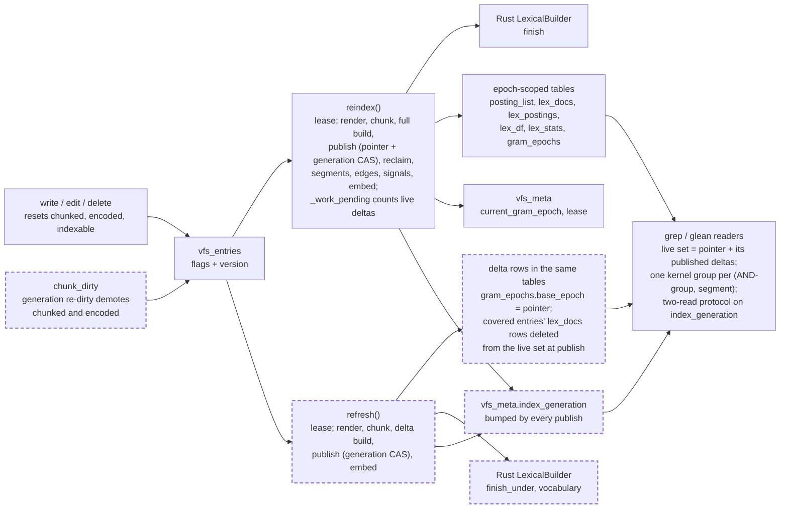

# Refresh, the incremental index verb: delta segments on the epoch tables, published by a generation counter, folded by the full rebuild

A feature, structural (a new protocol method and admin verb, `refresh()`, beside `reindex()`), that changes the schema format (three columns on `vfs_gram_epochs`, one on `vfs_meta`; the schema format constant bumps), needs the engine legs (every change is under `storage/backends/database/`) and touches the engine (one new method on the Rust lexical builder). It changes the storage protocol (`SupportsReindex`), not the user-facing `VirtualFileSystem` surface, and no docs reference exists to regenerate, so the public-API flag does not apply. It comes from no intention: Clay's request of 2026-10-31 for incremental indexing in a 1,000,000-file store with 1–5% daily edits and three full rebuilds a day is the stated intent, recorded in the opening of [the research memo](../../research/2026-10-31-incremental-index-refresh-measured-and-the-delta-segment-recommendation.md) this spec stands on, together with its four studies. It depends on no active spec. Its spec review is [the review of 2026-10-31](../../reviews/2026-10-31-refresh-the-incremental-index-verb-spec-review.md), whose standing verdict is "Fit to build". It touches the same files as the history pack spec, [180](../active/180-history-pack-on-reindex-and-the-bounded-sweep/spec.md), which adds a phase to `reindex()`; whichever lands second rebases onto the other's `backend.py`. The CLI subcommand for the new verb belongs to [the MCP adapter and CLI spec, 171](../active/171-the-mcp-adapter-and-the-cli-tool/spec.md) and is out of scope here. The compaction of many deltas into one and the running of a refresh during a full rebuild are follow-on specs named under Scope.

## The problem

Measured on `main` at `3667fec`, 2026-10-31 (details and tables in the memo and its studies).

READ: `reindex()` rebuilds the whole gram index and the whole lexical index whenever any live entry is dirty. `build_epoch` in `storage/backends/database/indexing.py` scans every `chunked ∧ indexable ∧ live` entry with no `encoded` term; `_work_pending` is true when one entry awaits encoding. Chunking (`chunk_dirty`) and embedding (`_embed_step` in `backend.py`) are already dirty-bounded; the two inverted indexes are not.

EXECUTED (SQLite, M1 Pro, synthetic prose): a cold rebuild of 50,000 files took 136 s and 2.8 GB of peak RSS; a rebuild with 1% of files rewritten took 1.24x the cold build; with 5% rewritten 0.94x. The builder-only cost of the work the dirty set needs was under 3 s of CPU for 6,000 files.

EXECUTED: readers pay for every dirty body on every call. Ten grep patterns took 1.03 s on a clean 10k store and 4.00 s with 5% of files dirty; 13.4 s clean and 24–27 s from 1% dirty on at 50k. No match was lost.

EXECUTED: glean's lexical overlay scores at most `OVERLAY_BUDGET = 500` unindexed entries per call in path order. From 501 dirty entries on, a freshly written file whose path sorts last is absent from the ranking and only a warning record says so. At 10,000–50,000 edits over an eight-hour day a 1,000,000-file store crosses 500 dirty entries within 5–25 minutes of each full rebuild.

EXECUTED: `write()` of 500 entries issues 13 statements whether the store is clean or 5% dirty. The write path never touches the index; the constraint that a refresh must not slow writes is already met and must stay met.

READ: `glean.py` `_entries_for_chunks` keeps a ranked chunk whenever its entry is `encoded`, and `_observe` indexes `sources.chunks[chunk_id]` with no miss path. A lexical posting that names a chunk row `chunk_dirty` has deleted raises `KeyError`, uncaught by `_execute`. Today this is reachable only after a chunk-generation bump re-dirties `chunked` without demoting `encoded` (indexing.py, the `stale` update in `chunk_dirty`) and before the next publish. A delta that re-posts a re-split entry while an older segment still names its old chunk ids makes this a steady-state path unless the publish removes those rows.

READ: `crates/vfs-core/src/lexical.rs` `LexicalAccumulator::finish` computes N, avg_dl, each term's idf and every block's maximum weight from the documents it was fed. A delta of 5,000 chunks would fix statistics from 5,000 documents, so its block bounds would be wrong for the scorer's block selection under the base epoch's statistics.

READ: `crates/vfs-core/src/postings.rs` `candidate_ids(groups, allow, cap)` ORs its groups and ANDs the blobs within a group. EXECUTED on the prototype: one group per (AND-group, segment) is a union across segments that admits no cross-version phantom, because an entry's postings for one version live whole in one segment; no new gram kernel is needed.

## Architecture

No architecture page exists yet under `context/`; when the storage page is written it carries this diagram. Solid is what exists; dashed is what this spec adds. Nothing is removed.

Terms. A *segment* is one epoch number's rows in the epoch-scoped tables. The *base* is the epoch the pointer names. A *delta* is a segment whose `gram_epochs.base_epoch` equals the base and that holds postings for only the entries it covered. The *live set* is the base plus its published, unretired deltas. The *generation* is the integer `vfs_meta.index_generation`, which every publish increments; readers compare it where they compared the pointer. A *ghost* is a posting that names an entry whose body has changed since the posting was built; grep rejects it at verification.

## Decisions

### 1. A new verb `refresh()`, not a mode of `reindex()`.

`reindex()` is O(corpus) and holds the lease for the better part of an hour at 1,000,000 files; `refresh()` is O(dirty). The constitution makes cost part of the contract and asks for declared capabilities, so a caller must be able to tell the two apart without running either. `SupportsReindex` in `storage/protocol.py` gains `refresh`; a backend that exposes `reindex` exposes `refresh`.

### 2. A delta is an epoch number in the existing epoch-scoped tables, marked by `gram_epochs.base_epoch`.

`epoch_scoped()`, `bulk_insert`, the primary-key collision that arbitrates rival builds and the range-delete reclaim all keep working unchanged. `vfs_gram_epochs` gains `base_epoch` (nullable integer; null for a full epoch), `published_at` and `retired_at` (nullable timestamps). No second table family.

### 3. The readers' coherence token is `vfs_meta.index_generation`, bumped by every publish.

The two-read protocol in `grep.py` and `glean.py` compares one integer for equality. The pointer alone cannot see a delta publish, which changes what the live index is without moving the pointer. `pointer_with_overlay` in `reads.py` returns the generation beside the pointer and the overlay verdict in the same statement; movement of the generation raises `StaleSnapshot` exactly as pointer movement does today.

### 4. The live set is read from `vfs_gram_epochs` by one statement per call.

`SELECT epoch FROM vfs_gram_epochs WHERE epoch = :pointer OR (base_epoch = :pointer AND published_at IS NOT NULL AND retired_at IS NULL)` runs after the first generation read. The generation compare closes the window in which the set changes under the reader. A denormalised live-set column on the meta row is the fallback if this statement ever shows in a measurement; the normalised set is the honest shape of the data.

### 5. The delta build posts only `NOT encoded ∧ chunked ∧ indexable ∧ live` entries, ordered by surrogate id.

This is the same predicate `_pending_probe` uses and the same order `build_epoch` feeds. Doc ids stay the entry surrogate `entry.id`, which is stable across content writes. Old postings of a re-posted entry remain in older segments as ghosts.

### 6. Ghosts stay until the full rebuild; grep tolerates them, glean must not see them.

grep verifies every candidate against its live body (`_entries_for_docs`, `content_for_entries`, the matcher), so a ghost costs one candidate fetch and nothing else; the prototype measured ghosts at 1.2–5.8% of candidates at 3–12% churn. The lexical leg resolves chunk ids through `lex_docs` and then indexes chunk rows by id, so a ghost chunk id is the `KeyError` named under The problem. The delta publish therefore deletes the covered entries' `lex_docs` rows across the live set, chunked by `membership_budget` and served by `ix_vfs_lex_docs_entry`. With no `lex_docs` row the ghost block's chunk id resolves to no entry and is dropped by the join, as the existing code already does for an unresolved id. The delete runs over the live set as it stands before the `published_at` stamp, so the delta's own `lex_docs` rows are not in it.

### 7. Readers pass one kernel group per (AND-group, segment); no gram kernel changes.

`candidate_ids` ORs groups and ANDs within a group. A document's postings for one version live whole in one segment, so this is union across segments and intersection within, and it admits no candidate whose grams come from two different versions of one body. The prototype measured the alternative, a per-gram union before the kernel, at 20–100 ms per query in Python and up to 108 phantom candidates per query. A gram absent from a segment contributes no group for that segment.

### 8. Posting meta is summed across the live set; the ladder prices the sum.

`_posting_meta` fetches `doc_count` and `byte_size` per (epoch, gram) across the live set in one statement per membership chunk, `epoch IN (S)` carried in every arm, and sums per gram before `_choose_grams` and `_ladder_defers` price the plan.

### 9. The live set is itself chunked by the membership budget, and every statement that carries `epoch IN (S)` runs once per chunk of `S` with its key list sized to what remains.

The existing filter bind reserve of 32 is not sized for 49 segments, which is a four-hour gap at five-minute cadence, and nothing in this spec bounds how many deltas a store without a full rebuild accumulates. So `S` is chunked too: a statement carries at most `membership_budget - <other binds> - 1` epochs per chunk, so at least one key always fits, and the key list takes what remains of the budget, and the results merge: posting meta sums per gram, blobs and summaries are keyed by `(epoch, key)` and concatenate, `lex_docs` resolutions and deletes union. The kernel still receives one group per (AND-group, segment). No statement grows with the number of live deltas or with the dirty set, and a test with a tightened budget holds both a live set of 49 and a live set larger than the budget.

### 10. Deltas score under the base's `avg_dl`, and under the base's idf where the term exists in the base, else `idf(delta_df, base_n + delta_n)`, the base's `n_docs` plus the delta's own document count.

This is the law `glean._overlay_blocks` already applies to unindexed bodies, so the index side, the deltas and the overlay share one scale. The prototype measured the drift at 5% churn as median 0%, p90 3.2%, p99 8.3% in idf when delta df is ignored, and showed that a term absent from the base takes the maximum idf (+307%) unless its own df under the summed N is used. The full rebuild resets every statistic.

### 11. The Rust lexical builder gains `finish_under(n_docs, avg_dl, idfs)` and a vocabulary accessor.

`LexicalAccumulator::finish` computes statistics from its own documents; a delta needs the base's. The refresh asks the builder for its vocabulary, fetches the base's `lex_df` rows for those terms in membership chunks, computes each term's idf by decision 10, and hands them in. Block maximum weights are then computed under the statistics the scorer will use, so `select_blocks` bounds stay sound. Oracle parity in `tests/support/oracles/` pins the new method, per the Rust-engine rule.

### 12. The lexical leg reads summaries and blocks per (term, segment) and concatenates blocks.

`lexical_score` sums per chunk id over every block whose term index names an idf; chunk ids are never reused, and decision 6 removes every stale `lex_docs` row, so a chunk id appears in one segment of the live set. `select_blocks` treats each (term, segment) summary as a term and takes the summed maxima of the others as lift, which loosens the bound and never tightens it.

### 13. The delta publish flips `encoded` on the covered (entry, version) pairs, stamps `published_at`, and compare-and-sets the generation, in one transaction.

The flip is the existing version-guarded set-based `_flip_flags`; a write between build and publish bumps the version, the flip misses, and the row stays scan-side, which is the guard a refresh racing a write needs. The CAS is `UPDATE vfs_meta SET index_generation = index_generation + 1 WHERE id = 1 AND index_generation = :seen AND current_gram_epoch = :base`; `:seen` and `:base` are read in one statement from the meta row before the delta build begins, so a publish of any kind between that read and the CAS fails the CAS. A miss classifies `conflict`, and the built delta is reclaimed by `reclaim_built_epoch`. Two deltas on one base publishing without this CAS would double-post an entry's chunks into two segments.

### 14. The full publish compare-and-sets the pointer and the generation together.

The statement is `UPDATE vfs_meta SET current_gram_epoch = :epoch, index_generation = index_generation + 1 WHERE id = 1 AND current_gram_epoch = :previous AND index_generation = :seen`, where `:seen` is read in the same statement as the pointer at the start of `build_epoch`; a miss classifies `conflict` and the built epoch is reclaimed, exactly as a lost pointer race is today. A full epoch covers every entry that was dirty when its scan ran, but not an entry a delta covered after that scan: such a delta can publish during a full only when the lease has lapsed, and `claim_reindex_lease` takes a lease whose heartbeat is five minutes stale while `_gram_phases` checks the lease only between phases. Without the generation predicate, that delta's covered entries would stay `encoded` with their only postings in a segment outside the new live set, a silent lost match until the next full rebuild. The predicate never fires in the normal flow; it is the guard the lease, an arbiter, is not. The bump also makes readers that cached a live set redrive.

### 15. The existing reclaim rule sweeps deltas: every epoch-scoped row with `epoch < current` is deleted after a full publish.

A delta is minted past every built epoch, so its number is above its base and below the next full epoch. `reclaim_epochs` already deletes below the pointer in its own transaction after re-reading the pointer. `retired_at` is stamped on the swept `gram_epochs` rows before they are deleted only in the compaction spec; here the rows go with the sweep.

### 16. `_work_pending` is true when live deltas exist.

A scheduled full rebuild must fold the deltas back into one epoch even when no entry is dirty, or the deltas persist until the next dirty write and the live set grows without bound.

### 17. A refresh with no published base refuses with a classified `unavailable` record naming `reindex`.

The first index of a corpus is the corpus; a refresh that silently became an O(corpus) build would break decision 1. The record is not retryable and its detail says to run `reindex`. This departs from the design study's lean to run the full build in that case.

### 18. A refresh refuses on fingerprint drift and names `reindex`.

A delta built under different options against an old base mixes formats. `build_epoch` already treats format or options drift as a drop-and-rebuild; the refresh checks the same fingerprint and refuses with the same `unavailable` record.

### 19. The refresh runs render, chunk and embed; it does not run the segment, edge, signal or history-pack phases.

The first three are dirty-bounded and reuse `_render_step`, `chunk_dirty` and `_embed_step` unchanged. The other phases are whole-corpus by nature: the baseline measured the segment and edge re-convergence at 24 s on a 50k store with nothing dirty, and a five-minute cadence would pay it every run. They stay in `reindex()`.

### 20. The refresh shares `reindex()`'s lease.

One arbiter, one lifecycle. A refresh that finds the lease held refuses loudly with the existing retryable `conflict` record. While a full rebuild runs, no refresh runs; the follow-on spec that splits the lease removes that blackout.

### 21. The chunk-generation re-dirty demotes `encoded` beside `chunked`.

The `stale` update in `chunk_dirty` sets `chunked = False` and leaves `encoded = True`, which is the only path to the `KeyError` today. Demoting both makes the invariant "encoded implies in the live index" hold through a generation bump as well.

### 22. The schema format constant bumps; the index format constant does not.

Three columns on `vfs_gram_epochs` and one on `vfs_meta` are a schema change, so `SCHEMA_FORMAT_VERSION` in `models/rows.py` goes from 23 to 24. The posting and lexical row formats are unchanged, so `INDEX_FORMAT_VERSION` stays at 4.

### 23. The `glean_staleness` and `grep_staleness` traits are unchanged by this spec.

The readers still serve the `NOT encoded` rows from the scan tier and the overlay. What changes is how many rows are there between full rebuilds, which is a deployment's cadence, not a backend trait.

### 24. A refresh that finds nothing dirty mints no epoch and bumps no generation.

A scheduled refresh runs whether or not anything changed. When the scan after the chunk pass returns no `NOT encoded ∧ chunked ∧ indexable ∧ live` entry, the verb writes no row, bumps nothing and returns `Result(ops=("refresh",))` with the render, chunk and embed extras of the phases it ran; a refresh never creates an empty segment. Otherwise every quiet night would add one segment per scheduled run to the live set and every reader would carry that growth.

## Intent

After this spec, a deployment that runs `reindex()` three times a day can run `refresh()` every thirty or sixty minutes in between, and every file written since the last run is in the index within one refresh interval: grep finds it without reading its body in the scan tier, glean ranks it beside the rest with the same statistics, the next full rebuild folds every delta back into one epoch, and `write()` issues exactly the statements it issues today.

## Design

Tests first, at the layer the behaviour lives; each test is seen failing before the code that passes it.

The schema (`models/rows.py`): `vfs_gram_epochs` gains `base_epoch`, `published_at`, `retired_at`; `vfs_meta` gains `index_generation` (integer, not null, default 0); `SCHEMA_FORMAT_VERSION` goes to 24. Tests: `tests/models/test_models.py` pins the columns and the constant.

The protocol (`storage/protocol.py`): `SupportsReindex` gains `async def refresh(self) -> Result`; the docstring states the cost contract of each. Tests: the existing protocol drift test gains the method.

The engine (`crates/vfs-core/src/lexical.rs`, `python.rs`, `models/lexical.py`): `LexicalAccumulator::finish_under(n_docs, avg_dl, idfs)` and `vocabulary()`; the Python `LexicalBuilder` protocol gains both; the oracle in `tests/support/oracles/` mirrors them. Tests: parity between the engine and the oracle on a fixed corpus under given statistics; `cargo test -p vfs-core` for the Rust side.

The build (`storage/backends/database/indexing.py`): `build_delta(session, tables, state, executor)` scans `~encoded ∧ chunked ∧ indexable ∧ live` by surrogate id, feeds the postings builder in byte-bounded batches, drains into `posting_list` under the new epoch, then calls `lexical.build_lexical_delta(session, tables, epoch, entry_ids, base_stats, executor)`, which fetches the base's `lex_df` rows for the builder's vocabulary in membership chunks, computes idfs by decision 10, and finishes under them. `gram_epochs` gets the row with `base_epoch` set and `published_at` null. `publish_delta` runs `_flip_flags`, the `lex_docs` delete across the live set, the `published_at` stamp and the generation CAS. `publish_epoch` adds the generation increment to its pointer CAS. `_work_pending` gains the live-delta clause. `chunk_dirty`'s `stale` update demotes `encoded`. Tests: `tests/storage/database/test_refresh.py` for the delta build, publish, CAS, reclaim and refusals; `test_indexing.py` for the changed full publish and `_work_pending`.

The verb (`storage/backends/database/backend.py`): `refresh()` claims the lease, runs `_render_step`, `chunk_dirty`, the fingerprint check, `build_delta`, `publish_delta`, `reclaim_built_epoch` on a lost CAS, then `_embed_step`, and releases; when `build_delta` finds nothing dirty it skips the build and the publish (decision 24). Its Result carries `ops=("refresh",)` and the same extras `reindex()` carries for the phases it ran.

The readers (`reads.py`, `grep.py`, `glean.py`, `lexical.py`): `pointer_with_overlay` returns `(pointer, generation, overlay_empty)`; a new `live_set(session, tables, pointer)` returns the sorted epochs; `_posting_meta` and `_posting_blobs` take the set and carry `epoch IN (S)` with the bind reserve of decision 9; `_index_doc_ids` builds one group per (AND-group, segment); `lexical_stats` reads the base's statistics and each delta's `lex_df` rows for the query terms; `_chunk_ranking` fetches summaries and head blocks per (term, segment) and concatenates; the generation replaces the pointer in both two-read rechecks. Every statement that is pinned to one epoch today takes the live set: in `glean.py` the nine statements in `_chunk_ids_for`, `_chunk_ranking` (two), `_entries_for_chunks`, `_visible_corpus` (three), `_all_blocks` and `_visible_chunks`; in `grep.py` the two in `_posting_meta` and `_posting_blobs`; in `lexical.py` the two in `lexical_stats`. The rights-scoped (`view`) and scope-narrowed (`allow`) paths of glean are among them and have their own criterion. Tests: `test_grep.py`, `test_glean.py`, `test_lexical.py`, `test_races.py` gain the delta cases named under Acceptance criteria.

Sizes that matter: `build_delta` holds the dirty set's postings in the Rust accumulator, which allocates a fixed 64 MB slot table per builder plus the postings themselves (about 3 bytes per (gram, document) pair measured); nothing else in the refresh is proportional to the corpus.

Order of work: schema and generation token with readers comparing the generation and no behaviour change; the gram delta build and publish with grep reading the live set; the lexical delta with the engine method and glean reading the live set; the verb, the refusals and the full rebuild's fold; the engine legs through the `db_test` cycle.

## Scope

In: decisions 1 to 24. Files: `src/vfs/models/rows.py`, `src/vfs/models/lexical.py`, `src/vfs/storage/protocol.py`, `src/vfs/storage/backends/database/indexing.py`, `lexical.py`, `backend.py`, `reads.py`, `grep.py`, `glean.py`, `crates/vfs-core/src/lexical.rs`, `crates/vfs-core/src/python.rs`, `tests/support/oracles/`, `tests/storage/database/test_refresh.py` (new), `test_indexing.py`, `test_grep.py`, `test_glean.py`, `test_lexical.py`, `test_races.py`, `tests/models/test_models.py`, the protocol drift test.

Out: the fold compaction that merges several deltas into one segment by re-indexing their covered entries from bodies, with `MERGE_FAN_IN` as a merge trigger and `retired_at` as the retirement stamp; it enables 5- and 15-minute cadence and is its own spec, written after this one lands and the live-set row counts are measured on a real corpus. Out: a refresh during a full rebuild (an early epoch reservation row and a split lease); its own spec. Out: paging glean's overlay to the wall budget instead of the silent 500 cap; a small fix spec of its own, independent of this work. Out: the `refresh` CLI subcommand and MCP exposure; [spec 171](../active/171-the-mcp-adapter-and-the-cli-tool/spec.md). Out: the full rebuild's whole-corpus residency and the gram-range-partitioned build; the direction the `build_epoch` docstring names. Out: moving the blob column after the meta columns in `posting_list`; a schema hygiene change for a later format bump.

## Acceptance criteria

1. `refresh()` on a store with a published base and D dirty entries inserts posting rows only under one new epoch whose `base_epoch` is the pointer, and the base epoch's posting row count and lexical row counts are unchanged before and after. Test: `tests/storage/database/test_refresh.py::TestDeltaBuild::test_a_delta_posts_only_the_dirty_under_its_base`.
2. The write path issues the same statement count for a 500-entry `write()` with zero and with three live deltas. Test: `test_refresh.py::TestWritePath::test_write_statements_do_not_change_with_live_deltas`.
3. After `refresh()`, every covered entry is `encoded`, and a grep for a word unique to a refreshed body finds it with zero scan-tier content reads and one group per (AND-group, segment) handed to the kernel. Test: `tests/storage/database/test_grep.py::TestLiveSet::test_a_refreshed_body_is_found_from_the_index_tier`.
4. A refreshed entry whose body was re-split into different chunk ids is ranked by glean from its new chunks, no `lex_docs` row of the live set names its old chunk ids, and no `KeyError` is raised. Test: `tests/storage/database/test_glean.py::TestLiveSet::test_a_re_split_entry_ranks_from_its_new_chunks`.
5. A delta publish that lands between a reader's first and second generation reads raises `StaleSnapshot` and the call redrives once, on SQLite and each engine leg. Test: `tests/storage/database/test_races.py::TestGenerationConsistency::test_a_delta_publish_mid_call_redrives_grep_and_glean`.
6. Two refreshes racing on one base: exactly one publishes, the other classifies `conflict`, and the loser's epoch has zero rows in every epoch-scoped table afterwards. Test: `test_refresh.py::TestRivals::test_the_loser_of_the_generation_cas_reclaims_its_delta`.
7. A `reindex()` after N published deltas with no dirty entries still builds (`_work_pending` is true), and afterwards every epoch-scoped row has `epoch == current` and `index_generation` has increased by one. Test: `test_refresh.py::TestFold::test_the_full_rebuild_folds_every_delta`.
8. With a bind budget tightened to the minimum, a live set of 49 segments and then a live set larger than the tightened budget, no statement issued by grep, glean or refresh over a 10,000-entry dirty set exceeds the budget. Test: `test_refresh.py::TestBounds::test_no_statement_grows_with_the_dirty_set_or_the_live_set`.
9. `refresh()` on a store with no published base writes no rows and returns one `unavailable` record whose detail names `reindex`; the same on fingerprint drift. Test: `test_refresh.py::TestRefusals::test_no_base_and_drift_refuse_naming_reindex`.
10. A delta's `lex_df` row for a term present in the base carries the base's idf, and for a term absent from the base carries `idf(delta_df, base_n + delta_n)`; the engine's `finish_under` and the oracle agree byte for byte on a fixed corpus. Tests: `tests/storage/database/test_lexical.py::TestDeltaStatistics::test_delta_idfs_follow_the_overlay_law`; `tests/models/test_lexical.py::test_finish_under_matches_the_oracle`.
11. A chunk-generation bump demotes `encoded` on every re-dirtied entry. Test: `tests/storage/database/test_indexing.py::TestGenerationLaw::test_the_re_dirty_demotes_encoded`.
12. `SCHEMA_FORMAT_VERSION` is 24, `INDEX_FORMAT_VERSION` is 4, and `SupportsReindex` declares `refresh`. Tests: `tests/models/test_rows.py::test_schema_format_version_is_24`; `tests/support/storage_contract.py::TestReindex::test_a_reindexer_declares_refresh`, new in the conformance suite that already resolves `SupportsReindex`.
13. The four engine legs pass with the suite's refresh tests selected. Evidence: the `db_test` cycle's output in the landing notes.
14. A delta published at the `reindex:before-publish` seam makes the full publish classify `conflict`, reclaims the full's epoch, and leaves no `encoded` entry whose postings are outside the live set. Test: `tests/storage/database/test_races.py::TestGenerationConsistency::test_a_delta_published_mid_full_build_fails_the_full_publish`.
15. `refresh()` on a store with a published base and zero dirty entries leaves every table's row count and `index_generation` unchanged. Test: `test_refresh.py::TestDeltaBuild::test_a_quiet_refresh_mints_nothing`.
16. A rights-scoped glean (`view` set) and a scope-narrowed glean (`allow` within `SCOPE_ID_BUDGET`) each rank a refreshed entry from its delta chunks. Test: `tests/storage/database/test_glean.py::TestLiveSet::test_the_view_and_scope_paths_read_the_live_set`.
17. On a fixed corpus split as base plus two deltas sharing a term absent from the base, glean's ranking equals the oracle's BM25 over the same blocks under the base's `avg_dl` and the stored per-slot idfs, and the block set `select_blocks` fetches is a superset of the set it fetches for the same blocks laid flat. Test: `tests/storage/database/test_lexical.py::TestDeltaStatistics::test_concatenated_segments_rank_as_the_oracle_does`.
18. `refresh()` issues no statement against `vfs_segments` or the edge tables and runs no history-pack phase. Test: `test_refresh.py::TestPhases::test_refresh_runs_only_the_dirty_bounded_phases`.
19. A `refresh()` while the lease is held classifies the retryable `conflict` and writes no row. Test: `test_refresh.py::TestRefusals::test_a_held_lease_refuses_with_conflict`.

## Landing notes

Filled in on landing.

## One line

A `refresh()` verb indexes only the entries written since the last run into a delta segment that readers union with the base and the three-times-daily full rebuild folds away, so a store can be fresh to the hour while `write()` stays exactly as it is.
